## Raytheom Aircraft Company


## Beechcraft

## Super King B200 &amp; B2OOC Aire

(Serials BB-734, BB-793, BB-829, BB-854 thru BB-870, BB-874 thru BB-891, BB-894, BB-896 thru BB-911, BB-913 thru BB-1438, BB-1440 thru BB-1443; and BL-37 thru BL-138)

## Pilot's Operating Handbook and FAA Approved Airplane Flight Manual

FAA Approved in the Normal Category based on 14 CFR Part 23. This document must be carried in the airplane at all times, and be kept within reach of the pilot during all flight operations. This handbook includes the material required to be furnished to the pilot by 14 CFR Part 23.

Airplane Serial Number:

Airplane Registration Number:

John Tigue Raytheon Aircraft Company DOA-230339-CE

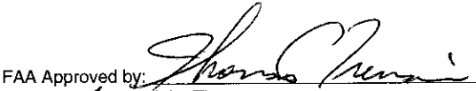

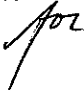

## Published By RAYTHEON AIRCRAFT COMPANY

## P.O. Box 85 Wichita; Kansas 67201 USA

NOTE

Where Beech Aircraft Corporation is reterred to in this publication, it will be taken to read Raytheon Aircraft Company-

The export of these commodities, technology or software are subject to the US Export Administration Regulations. Diversion contrary to U.S. law is prohibited For   guidance on export control requirements, contact the Commerce Department' s Bureau of Export Administration at 202-482-4811 or at wwwbxa doc gov:

Raytheon Raytheon Aircraft Company


## Raytheon Aircraft Company

## LIST OF EFFECTIVE PAGES

This listing contains all current pages with effective revision number or date: It should be used after posting changes to ensure the manual is complete and up-to-date. Always destroy superseded pages when you insert revised pages:

## SUPER KING AlRe B2OO &amp; BZOOC

BB-896 thru BB-911, BB-913 thru 88-1438, BB-1440 thru BB-1443; and BL-37 thru BL-138)

## Pilot's Operating Handbook and FAA Approved Airplane Flight Manual

## PIN 101-590010-147 Revision C9 August; 2004

|    |    |    |    |
|----|----|----|----|
|    |    |    |    |
|    |    |    |    |
|    |    |    |    |
|    |    |    |    |
|    |    |    |    |
|    |    |    |    |
|    |    |    |    |
|    |    |    |    |
|    |    |    |    |
|    |    |    |    |
|    |    |    |    |
|    |    |    |    |
|    |    |    |    |
|    |    |    |    |
|    |    |    |    |
|    |    |    |    |
|    |    |    |    |
|    |    |    |    |
|    |    |    |    |
|    |    |    |    |
|    |    |    |    |
|    |    |    |    |
|    |    |    |    |
|    |    |    |    |
|    |    |    |    |
|    |    |    |    |
|    |    |    |    |
|    |    |    |    |
|    |    |    |    |
|    |    |    |    |
|    |    |    |    |
|    |    |    |    |
|    |    |    |    |
|    |    |    |    |
|    |    |    |    |
|    |    |    |    |
|    |    |    |    |
|    |    |    |    |
|    |    |    |    |
|    |    |    |    |
|    |    |    |    |

## List Of Effective Pages (Cont'd) PIN 101-590010-147 Revision C9 August 2004

7-48 thru 7-50 December; 1994 9-1 and 9-2 December; 1994 7-51 April, 1996 Supplements \_ See of Supplements 7-52 thru 7-58 December; 1994 10-1 thru 10-20 1994 8-1 thru 8-16 2000 Log May, May,

## Hawker Beechcraft Corporation

## LOG OF TEMPORARY CHANGES

Beech Super King B2OO &amp; B2OOC Aire

Pilot's Operating Handbook and FAA Approved Airplane Flight Manual

PIN 101-590010-147C

May, 2011

Temporary Changes to this manual must be in the airplane for all flight operations

| PART NUMBER                                              | SUBJECT                                                                                                                              | DATE                    |
|----------------------------------------------------------|--------------------------------------------------------------------------------------------------------------------------------------|-------------------------|
| 101-590010-147CTC1 101-590010-147CTC2 101-590010-147CTC3 | Provides Emergency Procedures for Windshield Electrical Fault April 8, 1997 In-Flight Selection of Beta Range Structural Limitations | July 21, 1997 May, 2011 |

NOTE: This page should be filed in the front of the manual immediately in front of the Log Of Revisions page(s): This page replaces any Log Of Temporary Changes page dated prior to the date of this Log:

## Raytheom Aircraft Company

## LOG OF REVISIONS

Super B200 &amp; BzOOC (Serials BB-734, BB-793, BB-829, BB-854 thru BB-870, BB-874 thru BB-891, BB-894, BB-896 thru BB-911, BB-913 thru BB-1438, BB-1440 thru BB-1443; &amp;nd BL-37 thru BL-138) King Aire

## Pilot's Operating Handbook and FAA Approved Airplane Flight Manual

PIN 101-590010-147 Revision C9 August, 2004

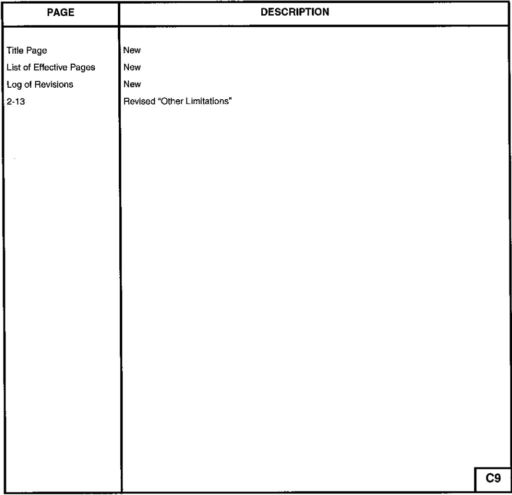

## Raytheon Aircraft Company

## LOG OF REVISIONS

Super B200 &amp; B2OOC King Aire

BB-896 thru BB-911, BB-913 thru BB-1438, BB-1440 thru BB-1443; and BL-37 thru BL-138)

## Pilot's Operating Handbook and FAA Approved Airplane Flight Manual

PIN 101-590010-147 Revision C8 April, 2004

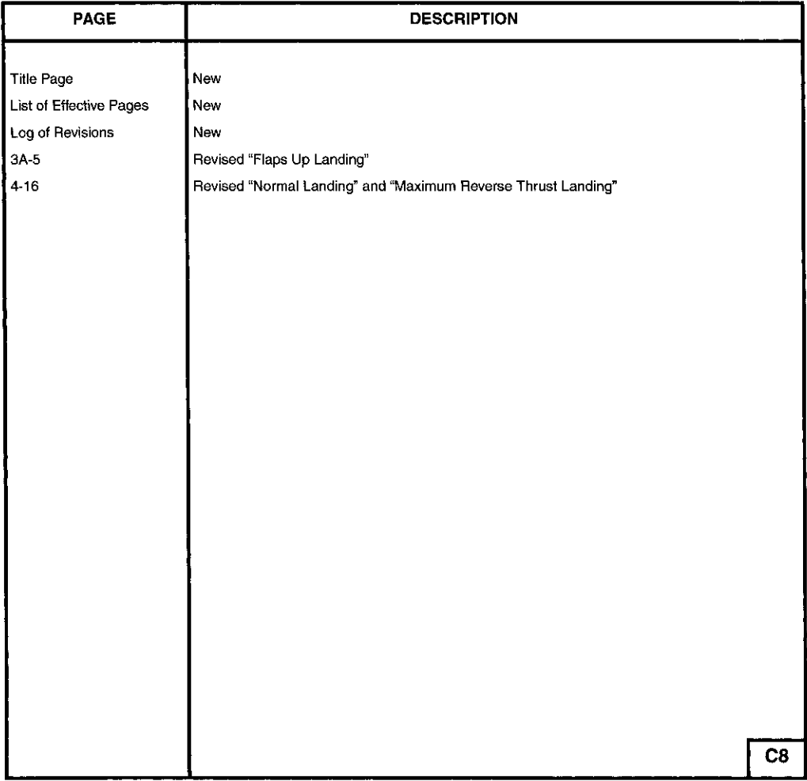

## Raytheom Aircraft Company

## Super King Aire

(Serials BB-734, BB-793, BB-829, BB-854 thru BB-870, BB-874 thru BB-891, BB-894, BB-896 thru BB-911, BB-913 thru BB-1438, BB-1440 thru BB-1443; and BL-37 thru BL-138)

Pilot's Operating Handbook and FAA Approved Airplane Flight Manual

PIN 101-590010-147 Revision C7 February, 2004

| PAGE                                                                    | DESCRIPTION                                                                                                                                                                                                      |
|-------------------------------------------------------------------------|------------------------------------------------------------------------------------------------------------------------------------------------------------------------------------------------------------------|
| Title Page List of Effective Pages Log of Revisions 2-1 and 2-2 2-6 2-7 | DESCRIPTION New New New Revised Table of Contents Deleted "Minimum Temperature Limits" and Shifted Data Revised "Anti-Icing Additive" and "Fuel Biocide Additive" Revised "Blending Anti-Icing Additive To Fuel" |


## LOG OF REVISIONS

## Beech Super King Aire B200 &amp; B2OOC

(Serials BB-734, BB-793, BB-829, BB-854 thru BB-870, BB-874 thru BB-891, BB-894, BB-896 thru BB-911, BB-913 thru BB-1438, BB-1440 thru BB-1443; and BL-37 thru BL-138)

Pilot's Operating Handbook and FAA Approved Airplane Flight Manual

PIN 101-590010-147 Revision C6 January, 2002

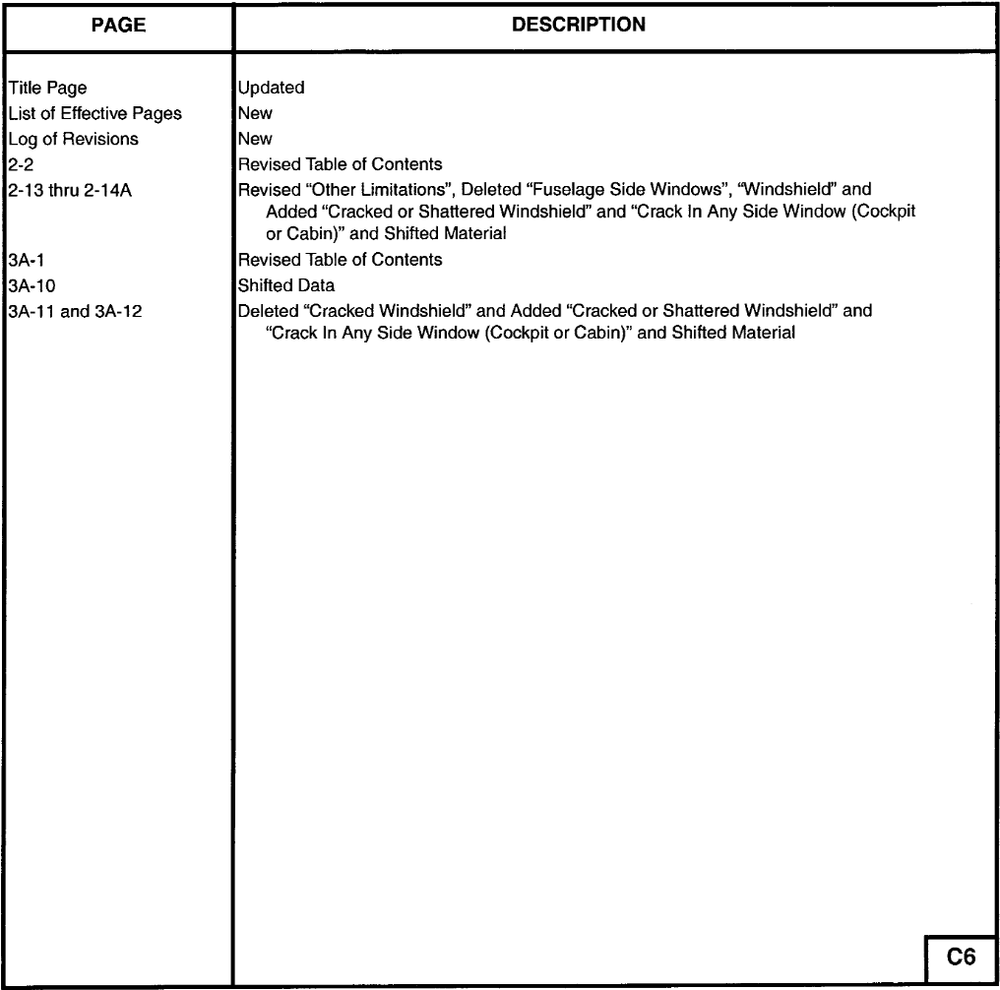

|    |    |
|----|----|
|    |    |

## Raytheon Aircraft

## Beech Super King Aire

(Serials BB-734, BB-793, BB-829, BB-854 thru BB-870, BB-874 thru BB-891, BB-894, BB-896 thru BB-911, BB-913 thru BB-1438, BB-1440 thru BB-1443; BL-37 thru BL-138)

## Pilot's Operating Handbook and FAA Approved Airplane Flight Manual

PIN 101-590010-147C

## LOG OF REVISIONS

"C5" Revision

2000 May;

|    |    |
|----|----|
|    |    |
|    |    |

"C4" Revision April, 1997

|    |    |
|----|----|
|    |    |

## Raytheon Aircraft

## Beech Super King Air \_

(Serials BB-734, BB-793, BB-829, BB-854 thru BB-870, BB-874 thru BB-891, BB-894, BB-896 thru BB-911, BB-913 thru BB-1438, BB-1440 thru BB-1443; and BL-37 thru BL-138)

## Pilot's Operating Handbook and FAA Approved Airplane Flight Manual

PIN: 101-590010-147C

## of Revisions Log

(SERIALS BB-734, BB-793, BB-829, BB-854 THRU BB-870 , BB-874 THRU BB-891 , AND BL-37 THRU BL-138)

## PILOT'S OPERATING HANDBOOK AND FAA APPROVED AIRPLANE FLIGHT MANUAL

## PIN 101-590010-147C

## LoG OF REVISIONS

"C3" Revision JJuly, 1996

|    |    |
|----|----|
|    |    |

'C2' Revision

April, 1996

|    |    |    |
|----|----|----|
|    |    |    |
|    |    |    |

AND BL-37 ThRU BL-138)

## PILOT'S OPERATING HANDBOOK AND FAA APPROVED AIRPLANE FLIGHT MANUAL

## P/n 101-590010-147C

## LoG OF REVISIONS

"C2' Revision

|    |    |
|----|----|
|    |    |

## LOG OF REVISIONS (CONTINUED)

37 Thru BL-138)

## PILOT'S OPERATING HANDBOOK AND FAA APPROVED AIRPLANE FLIGHT MANUAL

PIn 101-590010-147C

## LoG OF REVISIONS

Septamber, 1995

|    |    |
|----|----|
|    |    |

## SERIALS BB-734, BB-793, BB-829, BB-854 THRU BB-870, BB-874 THRU BB-891, BB-894, BB-896 THRU BB-911, BB-913 AND AFTER, BL-37 AND AFTER

## PILOT'S OPERATING HANDBOOK AND FAA APPROVED AIRPLANE FLIGHT MANUAL

PIn 101-590010-147C

## LOG OF REVISIONS

Original Issue

'C'

Reissue January, 1981

December; 1994

|    |    |    |
|----|----|----|
|    |    |    |

## INTRODUCTION

The format and contents of this Pilot's Operating Handbook and FAA Approved Airplane Flight Manual conform t0 GAMA (General Aviation Manutacturers Association) Handbook Specification Number as revised: September 1\_ 1984. Use of this specification by all manufacturers will provide the pilot with the same type of data in the same place in all handbooks;

Attention is called to Section X (SAFETY INFORMATION). BEECHCRAFT feels that it is highly important to have Satety Information in condensed form in the hands of the pilots The Safety Information should be read and studied. Periodic review will serve as a reminder of good piloting techniques:


Use only genuine BEECHCRAFT or BEECHCRAFT approved parts obtained from BEECH: CRAFT approved sources, in connection with the maintenance and repair of Beech airplanes.

Genuine BEECHCRAFT parts are produced and inspected under rigorous procedures to ensure airworthiness and suitability for use in Beech airplane applications. Parts purchased from sources other than BEECHCRAFT , even though outwardly identical in appearance, may not have had the required tests and inspections performed, may be different in fabrication

Salvaged airplane parts, reworked parts obtained trom non-BEECHCRAFT approved sources, Or parts, components, or structural assemblies, the service history of which is unknown or cannot be authenticated, have been subjected to unacceptable stresses or temperatures or have other hidden damage, not discernible through routine visual or usual nondestructive testing techniques. This may render the part, component;, or structural assembly, even though originally manufactured by BEECHCRAFT, unsuitable and unsate tor airplane use. may

BEECHCRAFT expressly disclaims any responsibility for malfunctions, failures, damage or injury caused by use of non-BEECHCRAFT approved parts:

## PILOT'S OPERATING HANDBOOK AND FAA APPROVED AIRPLANE FLIGHT MANUAL

## TABLE OF DIVISIONS

|    |
|----|
|    |
|    |
|    |
|    |
|    |
|    |
|    |
|    |
|    |
|    |


## SECTION GENERAL TABLE OF CONTENTS

| SUBJECT                                                                                                                          | PAGE   |
|----------------------------------------------------------------------------------------------------------------------------------|--------|
| Important Notice                                                                                                                 | 1-3    |
|                                                                                                                                  |        |
| Warnings, Cautions, And Notes                                                                                                    | 1-3    |
|                                                                                                                                  |        |
|                                                                                                                                  |        |
| Airplane Flight Manual Supplements Revision Record . . . . . . . . . . . . . . . . . . . . . . . . . . . . . . . . . . . . . 1-4 |        |
| Supplier-Issued STC Supplements                                                                                                  | 1-4A   |
|                                                                                                                                  |        |
|                                                                                                                                  |        |
| Ground Turning Clearance                                                                                                         | 1-7    |
|                                                                                                                                  |        |
|                                                                                                                                  |        |
|                                                                                                                                  |        |
|                                                                                                                                  |        |
|                                                                                                                                  |        |
| Engine Type                                                                                                                      | • 1-8  |
| Number of Drive Shafts                                                                                                           | 1-8    |
| Compressor Stages and Types                                                                                                      | 1-8    |
|                                                                                                                                  |        |
| Turbine Stages and Types                                                                                                         |        |
| Compressor (Gas Generator) Turbine                                                                                               | 1-8    |
|                                                                                                                                  |        |
|                                                                                                                                  |        |
| Compressor (Gas Generator) Shaft Rotational Speed (N1) Limits                                                                    | 1-8    |
|                                                                                                                                  |        |
|                                                                                                                                  |        |
|                                                                                                                                  |        |
|                                                                                                                                  |        |
|                                                                                                                                  |        |
| Propeller Type                                                                                                                   | 1-9    |
| Pitch Range (30-inch Station)                                                                                                    | 1-9    |
| Fuel                                                                                                                             | 1-9    |
|                                                                                                                                  |        |
|                                                                                                                                  |        |
| Military Grades                                                                                                                  | 1-9    |
|                                                                                                                                  |        |
| Commercial Aviation Gasoline Grades                                                                                              | 1-9    |
| Military Aviation Gasoline Grades                                                                                                | 1-9    |
| . Usable Fuel                                                                                                                    |        |
| . Usable Fuel                                                                                                                    |        |
| Engine Oil                                                                                                                       | 1-10   |
|                                                                                                                                  |        |
| Oil Capacity (Each Engine)                                                                                                       | 1-10   |
|                                                                                                                                  |        |
|                                                                                                                                  |        |
|                                                                                                                                  |        |

## SUBJECT


## SECTION GENERAL

## TABLE OF CONTENTS (CONT'D)

| SUBJECT                                 | PAGE   |
|-----------------------------------------|--------|
| Symbols, Abbreviations, and Terminology | 1-11   |
| General Airspeed Terminology            | 1-11   |
| Meteorological Terminology              | 1-12   |
| Power Terminology                       | 1-12   |
| Control and Instrument Terminology      | 1-13   |
| Graph and Tabular Terminology           | 1-13   |
| Weight and Balance Terminology          | 1-14   |


## IMPORTANT NOTICE

This handbook should be read carefully by the owner and the operator in order to become familiar with the operation of the airplane. Suggestions and recommendations have been made within it to aid in obtaining maximum performance without sacrificing economy- Be familiar with, and operate the airplane in accordance with, the Pilots Operating Handbook and FAA Approved Airplane Flight Manual andlor placards which are located in the airplane.

As a further reminder, the owner and the operator should also be familiar with the Federal Aviation Regulations applicable to the operation and maintenance of the airplane, and FAR Part 91, General Operating and Flight Rules. Further; the airplane must be operated and maintained in accordance with FAA Airworthiness Directivves which may be issued against it:

The Federal Aviation Regulations place the responsibility for the maintenance of this airplane on the owner and the operator; who should ensure that all maintenance is done by qualified mechanics in conformity with all airworthiness requirements established for this airplane.

AIl limits, procedures, safety practices, time limits, servicing, and maintenance requirements contained in this handbook are considered mandatory for continued airworthiness and to maintain the airplane in a condition equal to that of its original manufacture.

Raytheon Aircraft Authorized Outlets can provide recommended modification, service, and operating procedures issued by both the FAA and Raytheon Aircraft Company, which are designed to get maximum utility and safety from the airplane.

## USE OF THE HANDBOOK

## WARNINGS, CAUTIONS, AND NOTES

The following definitions apply to (WARNINGS), (CAUTIONS) , and (NOTES) found throughout the handbook:


Operating procedures, techniques, etc-, which could result in personal injury or loss of life if not carefully followed.


Operating procedures, techniques, etc-, which could result in damage to equipment if not carefully followed:

## NOTE

An operating procedure, technique, etc-, which is considered essential to emphasize.

## REVISING THE HANDBOOK

The Pilots Operating Handbookis designed to facilitate maintaining the documents necessary for the safe and efficient operation of the airplane. The handbook has been prepared in loose leaf form for ease in maintenance. It incorporates quick-reference tabs imprinted with the title of each section.

## NOTE

In an effort to provide as complete coverage as possible, applicable to any configuration of the airplane, some optional equipment has been included in the scope of the handbook However, due to the variety of airplane appointments and arrangements available, optional equipment described or depicted herein may not be designated as such in every case\_


Immediately following the Title Page is a List Of Effective Pages. A complete listing of all pages is presented right corner of the blocked portion is &amp; box containing a capital letter which denotes reissue of the manual\_ It will be advanced one letter, alphabetically, per reissue. A reissue of the manual or the revision of any portion tive Page(s) enables the user to determine the current issue, revision, or reissue in effect for each page in the handbook, (except for the Supplements Section):

When the handbook is originally issued, and each time it is revised or reissued, a new Log Of Revisions page is provided, immediately following the List Of Effective Pages Log Of Revisions pages must be retained until the handbook is reissued A capital letter in the lower right corner of the Log Of Revisions page designates the Original Issue ("A") or reissue ("B" "C" etc ) covered by the Log page. If a number follows the letter, it designates the sequential revision (1st, Znd, 3rd, etc-,) to the Original Issue or reissue covered by the Log Of Revisions page- Reference to the Of Revisions page(s) enables the user to determine the current issue, revision, or reissue in effect for each page in the handbook (except for the Supplements Section), and provides record of changes made since the Original Issue or the latest reissue\_ Log

That portion of the text or an illustration which has been revised by the addition of, or a change in, information is denoted by a solid revision bar located adjacent to the area of change and placed along the outside margin of a page.

## REVISION SERVICE

The following publications will be provided, at no charge; to the registered ownerloperator of this airplane:

1. Reissues and revisions of Pilots Operating Manual and FAA Approved Airplane Flight Manual.
2. Original issues and revisions of FAA Approved Airplane Flight Manual Supplements.
3. Original issues and revisions of Raytheon Aircraft Service Bulletins:

The above publications will be provided to the registered ownerloperator at the address listed on the FAA Airthe ownerloperator will receive only those publications pertaining to the registered airplane serial number: For detailed information on how to obtain Revision Service" applicable to this manual or other Raytheon Aircraft Service Publications, consult any Raytheon Aircraft authorized outlet; or refer to the latest revision of Raytheon Aircraft Service Bulletin No. 2001.

Raytheon Aircraft Corporation expressly reserves the right to supersede, cancel, andlor declare obsolete , without prior notice, any part; part number; kit; or publication referenced in this manual.

The ownerloperator should always refer to all supplements, whether STC Supplements or Raytheon Aircraft Supplements, for possible placards, limitations, emergency, abnormal, normal, and other operational procedures for proper operation of the airplane with optional equipment installed


It shall be the responsibility of the ownerloperator to ensure that the latest revisions of publications referenced in this manual are utilized during operation, servicing, and maintenance of the airplane.

## AIRPLANE FLIGHT MANUAL SUPPLEMENTS REVISION RECORD

Section IX contains the FAA Approved Airplane Flight Manual Supplements headed by a of Supplements page: On the page is a listing of the FAA Approved Supplemental Equipment available for installation on the airplane. When new supplements are received or existing supplements are revised, a new Log page will replace the previous one, since it contains a listing of all previous approvals, plus the new approval. The supplemental material will be added to the Section in accordance with the sequence specified on the page: Log Log Log NOTE


Upon receipt of a new or revised supplement; compare the existing of Supplements in the handbook with the corresponding applicable Log page accompanying the new or revised supplement: It may occur that the than the page accompanying the new or revised supplement. In any case, retain the Log page having the later date in the folio at the bottom-left corner of the page, and discard the older Log page. Log Log

## SUPPLIER-ISSUED STC SUPPLEMENTS

When a new airplane is delivered the factory, the handbook delivered with it contains either an STC (Supplemental Type Certificate) Supplement or a Raytheon Aircraft Flight Manual Supplement for every installed item requiring a supplement: If a new handbook for operation of the airplane is obtained at a later date, it is the responsibility of the ownerloperator to ensure that all required STC Supplements (as well as weight and bal: ance and other pertinent data) are transferred into the new handbook from THIS PAGE INTENTIONALLY LEFT BLANK


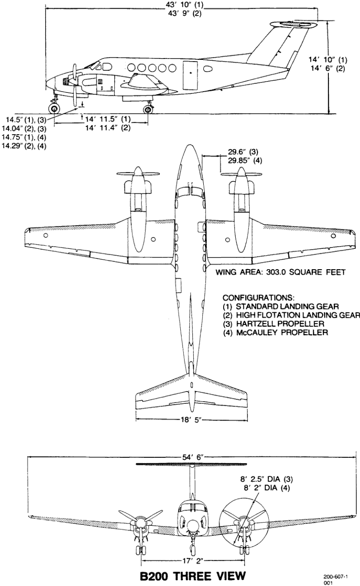

Super King Air BZOO/B200C

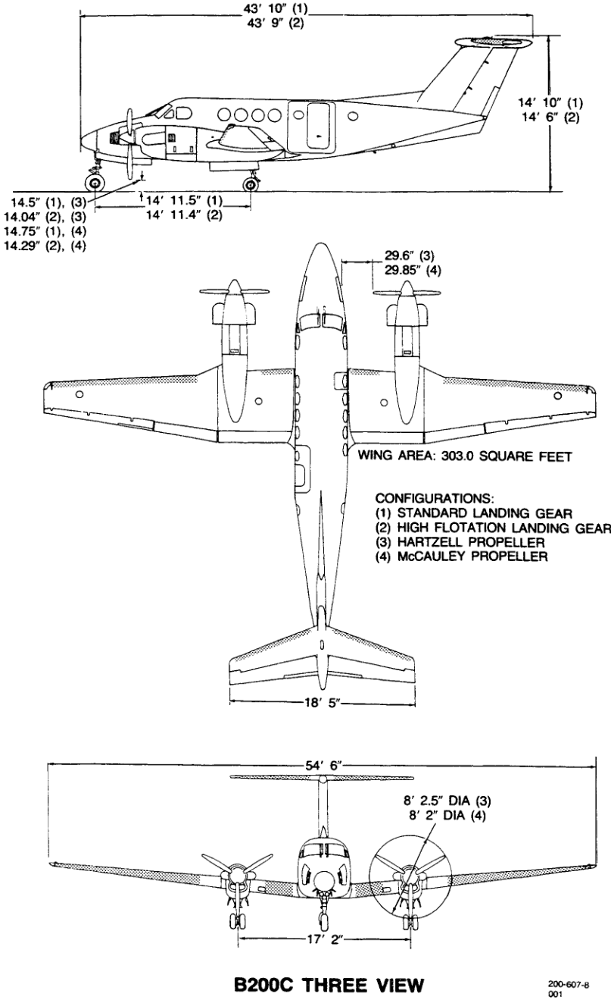

## GROUND TURNING CLEARANCE

| Radius for Inside Gear .   | · 4 feet   | o inches   |
|----------------------------|------------|------------|
| Radius for Nose Wheel .    | · 19 feet  | 6 inches   |
| Radius for Outside Gear .  | · 21 feet  | 1 inch     |
| Radius for Wing Tip. . .   | · 39 feet  | 10 inches  |

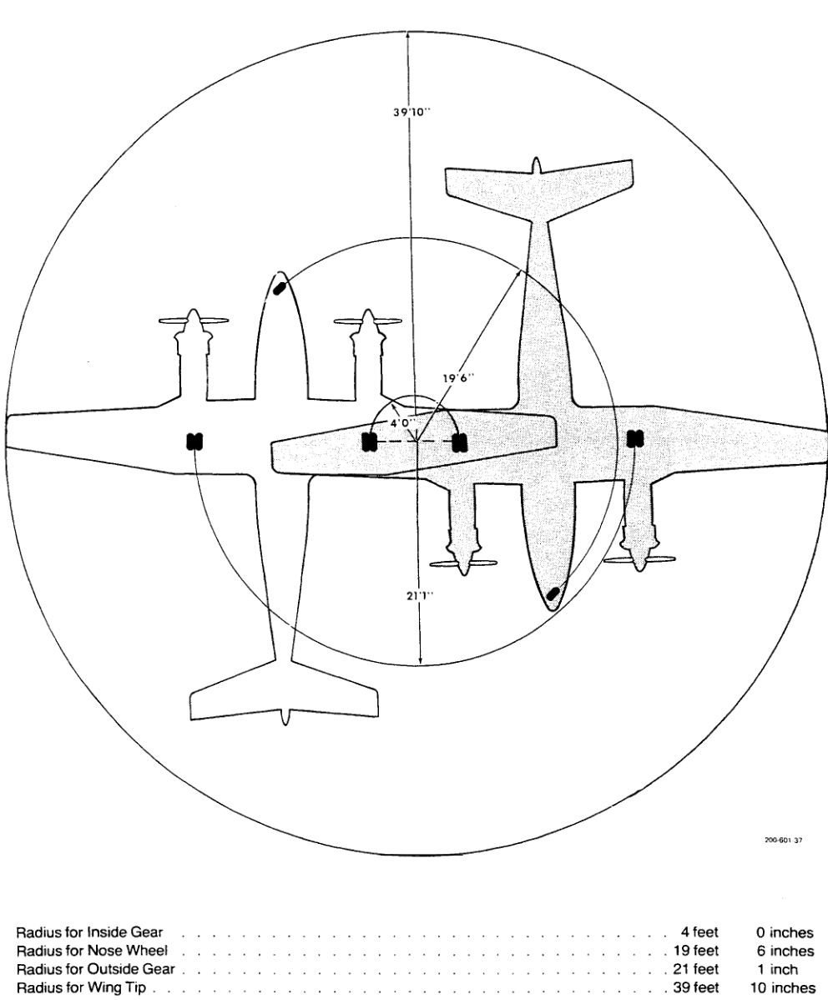

TURNING RADII ARE PREDICATED ON THE USE OF PARTIAL BRAKING ACTION AND DIFFERENTIAL POWER

## DESCRIPTIVE DATA

## ENGINES

NUMBER OF ENGINES

Two

ENGINE MANUFACTURER

Pratt &amp; Whitney Canada (Longueuil, Quebec, Canada)

ENGINE MODEL NUMBER

PT6A-42

ENGINE TYPE

Turbo-propeller Engine

NUMBER OF DRIVE SHAFTS

## Two

- 1 Compressor (Gas Generator) Shaft
- Power Turbine Shaft

COMPRESSOR STAGES AND TYPES

- 3 Axial-flow Stages
- Centrifugal-flow Stage

COMBUSTION CHAMBER TYPE

Annular

TURBINE STAGES AND TYPES

COMPRESSOR (GAS GENERATOR) TURBINE

Single-stage Axial-flow Reaction Turbine

## POWER TURBINE

Two-Stage Axial-flow Reaction Turbine

ENGINE SHAFT-HORSEPOWER RATING

850 SHP

COMPRESSOR (GAS GENERATOR) SHAFT ROTATIONAL SPEED (N1) LIMITS

Take-off;, Maximum Continuous, Cruise Climb, Maximum Cruise, Normal Cruise Power: 101.5% N1 (38,100

PROPELLER ROTATIONAL SPEED (Nz) LIMITS

Take-off; Maximum Continuous, Cruise Climb, Maximum Cruise, Normal Cruise Power: 2000 rpm

## PROPELLERS

NUMBER OF PROPELLERS

Two


## PROPELLER MANUFACTURER

Hartzell Propeller, Inc. (Piqua, Ohio) McCauley Propeller (Vandalia, Ohio)

NUMBER OF BLADES

Three

PROPELLER DIAMETER

Hartzell Propeller 98.5 inches

McCauley Propeller 98.0 inches

PROPELLER TYPE

Constant-speed, Full-teathering, Reversing; Counter-weighted, Hydraulically Actuated

PITCH RANGE (30-INCH STATION)

McCauley Propeller: Feathered+ 86.89 , Reverse -10?

## FUEL

APPROVED ENGINE FUELS

COMMERCIAL GRADES

Jet A, Jet A-1, Jet B

MILITARY GRADES

JP-4, JP-5, JP-8

EMERGENCY ENGINE FUELS (SEE LIMITATIONS SECTION FOR LIMITATIONS)

## COMMERCIAL AVIATION GASOLINE GRADES

80 Red (Forerly 80/87) 91/98 1OOLL Blue" 100 Green (Formerly 100/130) 115/145 Purple

"In some countries, this fuel is colored Green and designated

## MILIARY AVIATION GASOLINE GRADES

80/87 Red

100/130 Green

115/145 Purple

## USABLE FUEL

Main Fuel System\_

386 gallons

Auxiliary Fuel System\_

158 gallons

Maximum Usable Fuel Quantity \_

544 gallons

## APPROVED FUEL ADDITIVES

Anti-ice additive conforming to Specification MIL-I-27686 or equivalent, is permissible. Use not less than 20 fl Oz of additive per 260


Maintenance Manual and Pratt &amp; Whitney Service Bulletin No.  1244 for concentrations to use and for pro cedures tor adding BIOBOR JF to the airplane tuel.

## ENGINE OIL

## SPECIFICATION

oil specified by brand name in the latest revision of Pratt &amp; Whitney Service Bulletin Number 3001. Refer Any

## OIL CAPACITY (EACH ENGINE)

| Total 14.2 U.S. quarts Undrainable •...........•............•....................................................................................................•.1.5 U.S. quarts Refill Capacity...•.......................................•.................................•.......•.................................... 12.7 U.S. quarts Operating Range Full to 4.0 U.S. Quarts low                             |
|-----------------------------------------------------------------------------------------------------------------------------------------------------------------------------------------------------------------------------------------------------------------------------------------------------------------------------------------------------------------------------------------------------------------------|
| MAXIMUM CERTIFICATED WEIGHTS                                                                                                                                                                                                                                                                                                                                                                                          |
| Maximum Ramp Weight.............................................................•................•...............................12,590 pounds Maximum Take-off Weight 12,500 pounds Maximum L.anding Weight 12,500 pounds Maximum Zero Fuel Weight.•.........................................•............................................................11,000 pounds Maximum Weight in Baggage Compartment:       |
| Maximum Take-off Weight 12,500 pounds Maximum L.anding Weight 12,500 pounds Maximum Zero Fuel Weight.•.........................................•............................................................11,000 pounds Maximum Weight in Baggage Compartment: B8-1052, BB·1091 and after, BL·58 and after, and prior airplanes with Beech Kit #101-5068-1 installed: When Equipped with FOld-up Seats ~ 510 pounds |
| B8-1052, BB·1091 and after, BL·58 and after, and prior airplanes with Beech Kit #101-5068-1 installed: When Equipped with FOld-up Seats ~ 510 pounds                                                                                                                                                                                                                                                                  |
| B8-1052, BB·1091 and after, BL·58 and after, and prior airplanes with Beech Kit #101-5068-1 installed: When Equipped with FOld-up Seats ~ 510 pounds                                                                                                                                                                                                                                                                  |
| B8-1052, BB·1091 and after, BL·58 and after, and prior airplanes with Beech Kit #101-5068-1 installed: When Equipped with FOld-up Seats ~ 510 pounds                                                                                                                                                                                                                                                                  |
| When Not Equipped with Fold-up Seats 550 pounds or; Prior to BB-1091, except BB-1052, and prior to BL-58 without                                                                                                                                                                                                                                                                                                      |
| or; Prior to BB-1091, except BB-1052, and prior to BL-58 without                                                                                                                                                                                                                                                                                                                                                      |
| When Equipped with FOld-up Seats 370 pounds When Not Equipped with Fold-up Seats ..•........................................................................410 pounds                                                                                                                                                                                                                                                |
| CABIN AND ENTRY DIMENSIONS                                                                                                                                                                                                                                                                                                                                                                                            |
| CABIN AND ENTRY DIMENSIONS Cabin Wic:ttl1 (Maximum) .......................................•........................•........................•............................54 inches Cabin Length (Maximum between pressure bulkheads) ........•................................................................22 feet                                                                                                |
| Cabin Length (Maximum between pressure bulkheads) ........•................................................................22 feet Cabin Height (Maximum) 57 inches Airstair Entrance Door Width (Minimum) (B200) .......•............................•.................•....................26.75 inches                                                                                                             |
| Cabin Height (Maximum) 57 inches Airstair Entrance Door Width (Minimum) (B200) .......•............................•.................•....................26.75 inches Airstair Entrance Door Height (Minimum) (8200) 51.5 inches                                                                                                                                                                                     |
| Cabin Height (Maximum) Airstair Entrance Door Width (Minimum) (B200) .......•............................•.................•....................26.75 inches Airstair Entrance Door Height (Minimum) (8200) 51.5 inches                                                                                                                                                                                               |
| Airstair Entrance Door Width (Minimum) (B200) .......•............................•.................•....................26.75 inches Airstair Entrance Door Height (Minimum) (8200) 51.5 inches Airstair Entrance Door Width (Minimum) (B200C) .....................•............................................•........20.2 inches                                                                                |
| Airstair Entrance Door Height (Minimum) (8200) 51.5 inches Airstair Entrance Door Width (Minimum) (B200C) .....................•............................................•........20.2 inches                                                                                                                                                                                                                      |
| Airstair Entrance Door Height (Minimum) (8200) Airstair Entrance Door Width (Minimum) (B200C) .....................•............................................•........20.2 inches Airstair Entrance Door Height (Minimum) (B200C) •....................•.•.........•...........................................46 inches                                                                                           |
| Airstair Entrance Door Height (Minimum) (B200C) •....................•.•.........•...........................................46 inches Cargo Door Width (Minimum) (B200C) 49 inches                                                                                                                                                                                                                                   |
| Airstair Entrance Door Height (Minimum) (B200C) •....................•.•.........•...........................................46 inches Cargo Door Width (Minimum) (B200C) 49 inches                                                                                                                                                                                                                                   |
| Cargo Door Width (Minimum) (B200C) 49 inches Cargo Door Height (Minimum) (B200C) 52 inches                                                                                                                                                                                                                                                                                                                            |
| Cargo Door Height (Minimum) (B200C) 52 inches Pressure Vessel Volume...................................................................................................•..........393 cubic feet                                                                                                                                                                                                                      |
| Pressure Vessel Volume...................................................................................................•..........393 cubic feet Potential Cargo-area Volume                                                                                                                                                                                                                                        |
| Potential Cargo-area Volume 253 cubic feet                                                                                                                                                                                                                                                                                                                                                                            |
| Potential Cargo-area Volume 253 cubic feet                                                                                                                                                                                                                                                                                                                                                                            |
| Potential Cargo-area Volume 253 cubic feet                                                                                                                                                                                                                                                                                                                                                                            |
| Potential Cargo-area Volume 253 cubic feet                                                                                                                                                                                                                                                                                                                                                                            |

Potential Cargo-area Volume.

## SPECIFIC LOADINGS

WING LOADING: 41.3 pounds per square foot

POWER LOADING: 7.4 pounds per shaft horsepower

## SYMBOLS, ABBREVIATIONS, AND TERMINOLOGY

The following glossary is applicable within this handbook

## GENERAL AIRSPEED TERMINOLOGY

CAS

GS

IAS

KCAS

KIAS

Calibrated Airspeed is the indicated airspeed of an airplane corrected for position and instrument error. Calibrated airspeed is equal to true airspeed in standard atmosphere at sea level.

Ground Speed is the speed of an airplane relative to the ground.

Indicated Airspeed is the speed of an airplane as shown on the airspeed indicator when corrected for instrument error: IAS values published in this handbook assume zero instrument error\_

Calibrated Airspeed expressed in knots:

Indicated Airspeed expressed in knots:

M

TAS

V1

Va

VLe

VLo

VMCA

VmcG

VR

Mach Number is the ratio of true airspeed to the speed of sound.

True Airspeed is the airspeed of an airplane relative to undisturbed air, which is the CAS corrected for altitude, temperature, and compressibility:

Take-off Decision Speed

Take-off Safety Speed

Maneuvering Speedis the maximum speed at which application oi full available aerodynamic control will not overstress the airplane.

Design Flap Speed is the highest speed permissible at which wing flaps may be actuated.

Maximum Flap Extended Speed is the highest speed permissible with flaps in a prescribed extended position. wing

Maximum Landing Gear Extended Speed is the maximum speed at which an airplane can be safely flown with the landing gear extended:

Maximum Landing Gear Operating Speed is the maximum speed at which the landing gear can be safely extended or retracted

Air Minimum Control Speed is the minimum flight speed at which the airplane is directionally controllable as determined in accordance with Federal Aviation Regulations. The airplane certification conditions include one engine becoming inoperative and windmilling, a 5-degree bank towards the operative engine, take-off power on operative engine, landing gear up, flaps in the take-off position, and most rearward C.G: For some conditions of weight and altitude, stall can be encountered at speeds above as established by the certification procedure described above, in which event stall speed must be regarded as the limit of effective directional control. VMCA

Ground Minimum Control Speed

Maximum Operating Limit Speed is the speed limit that may not be deliberately exceeded in normal flight operations: V is expressed in knots and M in Mach Number.

Rotation Speed

Vs

Vso

VSSE

Stalling Speed or the minimum steady flight speed at which the airplane is controllable

Stalling Speed or the minimum steady flight speed at which the airplane is

Intentional One-Engine-Inoperative Speed is a speed above both VMCA and stall speed, selected to provide a margin of lateral and directional control when one engine is suddenly rendered inoperative. Intentional of one engine below this speed is not recommended failing


Vx

Vxse

Vy

Vyse Best Angle-of-Climb Speed is the airspeed which delivers the greatest gain of altitude in the shortest possible horizontal distance with gear and flaps up\_

One-Engine-Inoperative Best Angle-of-Climb Speed is the airspeed which delivers the greatest in altitude in the shortest possible horizontal distance with one engine inoperative: gain

Best Rate-of-Climb Speed is the airspeed which delivers the greatest gain in altitude in the shortest possible time with gear and flaps up.

One-Engine-Inoperative Best Rate-of-Climb Speed is the airspeed which delivers the greatest gain in altitude in the shortest possible time with one engine inoperative.

## METEOROLOGICAL TERMINOLOGY

Altimeter Setting Barometric Pressure corrected to sea level:

Indicated Pressure Altitude

IOAT

ISA

The number actually read from an altimeter when the barometric subscale has been set to 29.92 inches of mercury (1013.2 millibars)

Indicated Outside Air Temperature is the temperature value read from an indicator.

International Standard Atmosphere in which:

OAT

Pressure Altitude

Station Pressure

- The air is a dry perfect gas;

The pressure at sea level is 29.92 inches of mercury (1013.2 millibars);

- The temperature at sea level is 159 Celsius (599 Fahrenheit);
- The temperature gradient from sea level to the altitude at which the grade (0.0035669 Fahrenheit) per foot and zero above that altitude:

Outside Air Temperature is the free air static temperature obtained either from the temperature indicator (IOAT) adjusted for compressibility effects, or from ground meteorological sources:

Altitude measured from  standard sea-level pressure (29.92 in Hg) by a pressure (barometric) altimeter: It is the indicated pressure altitude COrrected for position and instrument error. In this handbook, altimeter instrument errors are assumed to be zero. Position errors may be obtained from the Altimeter Correction graphs

Actual atmospheric pressure at field elevation

Temperature Compressibility Effects An error in the indication of temperature caused by airflow over the temperature probe. The error varies, depending on altitude and airspeed:

Wind

## POWER TERMINOLOGY

Beta Range

Cruise Climb

High Idle

Low Idle

Maximum Continuous Power The region of the Power Lever control which is aft of the Idle Stop and forward of reversing range where blade pitch angle can be changed without a change of gas generator rpm.

Is the maximum power approved for normal climb. These powers are torque or temperature (ITT) limited.

Obtained by placing the Condition Lever in the High Idle Position: This limits the power operation to a minimum of 70% of Nq rpm\_

Obtained by placing the Condition Lever in the Low Idle position. This limits the power operation to a minimum of 56% of Nq rpm:

Is the highest power rating not limited by time. Use of this rating is intended for emergency situations at the discretion of the pilot

The wind velocities recorded as variables on the charts of this handbook are to as the headwind or tailwind components of the


Maximum Cruise Power

Reverse

SHP

Is the highest power rating for cruise and is not time limited

Reverse thrust is obtained by lifting the Power Levers and moving them aft of the Beta range.

Shaft Horsepower

Take-off Power Is the maximum power rating and is limited to a maximum of 5 minutes operation. use of this rating should be limited to normal take-off operations and emergency situations:

## CONTROL AND INSTRUMENT TERMINOLOGY

Condition Lever (Fuel Shut-off Lever)

ITT (Interstage Turbine Temperature)

The fuel shut-off lever actuates &amp; valve in the fuel control unit which controls the flow of fuel at the fuel control outlet and regulates the idle range from Low to High Idle.

Eight probes wired in parallel indicate the temperature between the compressor and power turbines:

N, Tachometer (Gas Generator RPM)

The tachometer registers the rpm of the gas generator with 100% representing a gas generator speed of 37,500 rpm:

Power Lever (Gas Generator N1 RPM)

Propeller Control Lever (Nz RPM)

Propeller Governor

Torquemeter This lever serves to modulate engine power from full reverse thrust to takeoff. The position for idle represents the lowest recommended level of power for flight operation:

This lever is used to control the rpm setting of the propeller governor: Movement of the lever results in an increase or decrease in propeller rpm. Propeller feathering is the result of lever movement beyond the detents at the low rpm (high pitch) end of the lever travel.

The propeller governor senses changes in rpm and hydraulically changes propeller blade angle to compensate for the changes in rpm. Constant propeller rpm is thereby maintained at the selected rpm setting:

The torquemeter system indicates the shaft output torque. Differential pressure from a mechanism within the reduction gear case causes a bellows and servo system to indicate torque on a meter. Instrument readout is in foot-pounds:

## GRAPH AND TABULAR TERMINOLOGY

| Accelerate-Go       | The distance to accelerate to Take-off Decision Speed (V1), experience an engine failure, continue accelerating to lift-off, then climb and accelerate in order to achieve Take-off Safety Speed (V2) at 35 feet above the runway.                                                                                                                                                                                                                                                                                                                                   |
|---------------------|----------------------------------------------------------------------------------------------------------------------------------------------------------------------------------------------------------------------------------------------------------------------------------------------------------------------------------------------------------------------------------------------------------------------------------------------------------------------------------------------------------------------------------------------------------------------|
| Accelerate-Stop     | The distance to accelerate to Take-off Decision Speed (V1) and bring the airplane to a stop.                                                                                                                                                                                                                                                                                                                                                                                                                                                                         |
| AGL                 | Above Ground Level                                                                                                                                                                                                                                                                                                                                                                                                                                                                                                                                                   |
| Best Angle of Climb | The best angle-at-climb speed is the airspeed which delivers the greatest gain of altitude in the shortest possible horizontal distance with gear and flaps up.                                                                                                                                                                                                                                                                                                                                                                                                      |
| Best Rate of Climb  | The best rate-ot-climb speed is the airspeed which delivers the greatest gain of altitude in the shortest possible time with gear and flaps up.                                                                                                                                                                                                                                                                                                                                                                                                                      |
| Clearway            | A clearway is an area beyond the airport runway not less than 500 feet wide, centrally located about the extended centerline of the runway, and under the control of the airport authorities. The clearway is expessed in terms of a clear plane, extending from the end of the runway with an upward slope not exceeding 1.25 percent, above which no object nor any terrain protrudes. However, threshold lights may protrude above the plane if their height above the end of the runway is 26 inches or less and if they are located to each side of the runway. |

Climb Gradient

Demonstrated Crosswind

MEA

The ratio of the change in height during a portion of a climb, to the horizontal distance traversed in the same time interval.

The maximum 90-degree crosswind component for which adequate control of the airplane during takeoff and landing was actually demonstrated during certification. The value shown is not limiting:

Minimum Enroute Altitude

Net Gradient of Climb

Route Segment The gradient of climb with the flaps in the take-off position, and the landing retracted  "Net" indicates that the actual gradients Of climb have been ent of Climb graphs are constructed so that the value(s) obtained using the airport pressure altitude and outside air temperature will be the average gear A part of a route. Each end of that part is identified by:

Take-off Flight Path

(1) a geographic location; Or

(2) point at which a definite radio fix can be established

The minimum gradient of climb required to clear obstacles in excess of 35 feet;, measured horizontally from reference zero and vertically at the altitude above the runway. Reference zero is the point where the airplane has reached 35 feet above the runway as determined the Accelerate-Go graphs from

## WEIGHT AND BALANCE TERMINOLOGY

| Approved Loading Envelope   | Those combinations of airplane weight and center of gravity which define the limits beyond which, loading is not approved.                                                                                                                                                                                       |
|-----------------------------|------------------------------------------------------------------------------------------------------------------------------------------------------------------------------------------------------------------------------------------------------------------------------------------------------------------|
| Arm                         | The distance from the center of gravity of an object to a line about which moments are to be computed.                                                                                                                                                                                                           |
| Basic Empty Weight          | The weight of an empty airplane including full engine oil and unusable fuel. This equals empty weight plus the weight of unusable fuel, and the weight of all the engine oil required to fill the lines and tanks. Basic empty weight is the basic configuration from which loading data is determined.          |
| Center of Gravity           | A point at which the weight of an object may be considered concentrated for weight and balance purposes.                                                                                                                                                                                                         |
| CG Limits                   | The extreme center of gravity locations within which the airplane must be operated at a given weight.                                                                                                                                                                                                            |
| Datum                       | A vertical plane perpendicular to the airplane longitudinal axis from which fore and aft (usually aft) measurements are made for weight and balance purposes.                                                                                                                                                    |
| Empty Weight                | The weight of an empty airplane before any oil or fuel has been added. This includes all permanently installed equipment, fixed ballast, full hydraulic fluid, full chemical toilet fluid, and all other operating fluids full, except that the engines, tanks, and lines do not contain any engine oil or fuel. |
| Engine Oil                  | That portion of the engine oil which can be drained from the engine.                                                                                                                                                                                                                                             |
| Jack Point                  | Points on the airplane identified by the manufacturer as suitable for support­ ing the airplane for weighing or other purposes.                                                                                                                                                                                  |
| Landing Weight              | The weight of the airplane at landing touchdown.                                                                                                                                                                                                                                                                 |
| Leveling Points             | Those points which are used during the weighing process to level the air­ plane.                                                                                                                                                                                                                                 |
| Maximum Weight              | The largest weight allowed by design, structural, performance or other limi­ tations.                                                                                                                                                                                                                            |
| Moment                      | A measure of the rotational tendency of a weight, about a specified line, mathematically equal to the product of the weight and the arm.                                                                                                                                                                         |

| Payload          | Weight of occupants, cargo and baggage.                                                                                               |
|------------------|---------------------------------------------------------------------------------------------------------------------------------------|
| Ramp Weight      | The airplane weight at engine start assuming all loading is completed.                                                                |
| Stat ion         | The longitudinal distance from some 'point to the zero datum or zero fuse­ lage station.                                              |
| Take-off Weight  | The weight of the airplane at lift-off from the runway.                                                                               |
| Tare             | The weight which may be indicated by a set of scales before any load is applied.                                                      |
| Unusable Fuel    | The fuel remaining after consumption of usable fuel.                                                                                  |
| Usable Fuel      | That portion of the total fuel which is available for consumption as deter­ mined in accordance with applicable regulatory standards. |
| Useful Load      | The difference between the airplane ramp weight and the basic empty weight.                                                           |
| Zero Fuel Weight | The airplane ramp weight minus the weight of usable fuel on board.                                                                    |

THIS PAGE INTENTIONALLY LEFT BLANK

## Raytheon Aircraft Company

## Section 2

## Limitations TABLE OF CONTENTS

| SUBJECT | PAGE |
|---|---|
| **Airspeed Limitations** | 2-3 |
| **Airspeed Indicator Markings** | 2-4 |
| **Power Plant Limitations** | 2-4 |
| Number of Engines | 2-4 |
| Engine Manufacturer | 2-4 |
| Engine Model Number | 2-4 |
| Power Levers | 2-4 |
| Engine Operating Limits | 2-4 |
| External Power Limits | 2-5 |
| Generator Limits | 2-5 |
| Starter Limits | 2-6 |
| Fuel Limits | 2-6 |
| Approved Engine Fuels | 2-6 |
| Commercial Grades | 2-6 |
| Military Grades | 2-6 |
| Emergency Engine Fuels | 2-6 |
| Commercial Aviation Gasoline Grades | 2-6 |
| Military Aviation Gasoline Grades | 2-6 |
| Limitations on the Use of Aviation Gasoline | 2-6 |
| Approved Fuel Additives | 2-7 |
| Anti-icing Additive | 2-7 |
| Fuel Biocide Additive | 2-7 |
| Fuel Management | 2-7 |
| Usable Fuel | 2-7 |
| Fuel Imbalance | 2-7 |
| Fuel Crossfeed | 2-8 |
| Fuel Gages In the Yellow Arc | 2-8 |
| Auxiliary Fuel | 2-8 |
| Operating with Low Fuel Pressure | 2-8 |
| Oil Specification | 2-8 |
| Number of Propellers | 2-8 |
| Propeller Manufacturer | 2-8 |
| Propeller Hub and Blade Model Numbers | 2-9 |
| Propeller Diameter | 2-9 |
| Propeller Blade Angles at 30-inch Station | 2-9 |
| Propeller Rotational Speed Limits | 2-9 |
| Propeller Rotational Overspeed Limits | 2-9 |
| **Power Plant Instrument Markings** | 2-10 |
| **Miscellaneous Instrument Markings** | 2-10 |
| Fuel Quantity Indicators | 2-10 |
| Cabin Differential Pressure Gage | 2-10 |
| Pneumatic Gage | 2-10 |
| Gyro Suction Gage | 2-10 |
| Propeller Deice Ammeter | 2-11 |
| **Weight Limits** | 2-11 |
| **Center of Gravity Limits** | 2-11 |
| Aft Limit | 2-11 |
| Forward Limits | 2-11 |
| Datum | 2-11 |
| Mean Aerodynamic Chord (MAC) | 2-11 |
| **Maneuver Limits** | 2-11 |
| **Flight Load Factor Limits** | 2-11 |

## Raytheon Aircraft Company

## Section 2 Limitations TABLE OF CONTENTS (CONT'D)

| SUBJECT | PAGE |
|---|---|
| **Minimum Flight Crew** | 2-11 |
| **Maximum Operating Pressure-altitude Limits** | 2-12 |
| **Maximum Outside Air Temperature Limits** | 2-12 |
| **Cabin Pressurization Limit** | 2-12 |
| **Maximum Occupancy Limits** | 2-12 |
| **Systems and Equipment Limits** | 2-12 |
| Landing Gear Cycle Limits | 2-12 |
| Aft-Facing Seats | 2-12 |
| **Icing Limitations** | 2-12 |
| Approved Airplane Deicing/Anti-icing Fluids | 2-12 |
| **Other Limitations** | 2-13 |
| Structural Limitations (Prior to S/N BB-1193 and BL-73, Except BB-1158 and BB-1167) | 2-13 |
| Structural Limitations (BB-1158, BB-1167, BB-1193 and After, BL-73 and After) | 2-13 |
| Cracked or Shattered Windshield | 2-13 |
| Crack In Any Side Window (Cockpit or Cabin) | 2-14 |
| Cargo Limitations (All Serials) | 2-14 |
| Limitations When Encountering Severe Icing Conditions (Required By FAA AD 96-09-13) | 2-14 |
| **Placards** | 2-14B |
| **Kinds of Operation Limits** | 2-22 |
| **Kinds of Operations Equipment List** | 2-22 |

## AIRSPEED LIMITATIONS

The limitations included in this section have been approved by the Federal Aviation Administration, and they must be observed in the operation of the BEECHCRAFT Super King Air B200/B200C.

| AIRSPEED LIMITATIONS — SPEED | KCAS | KIAS | REMARKS |
|---|---|---|---|
| Maneuvering Speed VA (12,500 pounds) | 182 | 181 | Do not make full or abrupt control movements above this speed. |
| Maximum Flap Extension Extended Speed VFE — Approach Position - 40% | 200 | 200 | Do not extend flaps or operate with flaps in prescribed position above these speeds. |
| Maximum Flap Extension Extended Speed VFE — Full Down Position - 100% | 155 | 157 | Do not extend flaps or operate with flaps in prescribed position above these speeds. |
| Maximum Landing Gear Operating Speed VLO — Extension | 182 | 181 | Do not extend or retract landing gear above the speeds given. |
| Maximum Landing Gear Operating Speed VLO — Retraction | 164 | 163 | Do not extend or retract landing gear above the speeds given. |
| Maximum Landing Gear Extended Speed VLE | 182 | 181 | Do not exceed this speed with landing gear extended. |
| Air Minimum Control Speed VMCA | 91 | 86 | This is the lowest airspeed at which the airplane is directionally controllable when one engine suddenly becomes inoperative and the other engine is at take-off power. (See definition in Section I.) |
| Maximum Operating Speed VMO | 260 | 259 | Do not exceed this airspeed or Mach Number in any operation. |
| Maximum Operating Speed MMO | .52 Mach | .52 Mach | Do not exceed this airspeed or Mach Number in any operation. |

## AIRSPEED INDICATOR MARKINGS

| MARKING* | KCAS VALUE OR RANGE | KIAS VALUE OR RANGE | SIGNIFICANCE |
|---|---|---|---|
| Red Line | 91 | 86 | Air Minimum Control Speed (VMCA) |
| White Arc | 80 to 155 | 75 to 157 | Full-flap Operating Range |
| Wide White Arc | 80 to 102 | 75 to 99 | Lower Limit is the Stalling Speed (VSO) at maximum weight with Full Flaps (100%) and idle power. |
| Narrow White Arc | 102 to 155 | 99 to 157 | Lower Limit is the Stalling Speed (VS) at maximum weight with Flaps Up (0%) and idle power. Upper limit is the maximum speed permissible with flaps extended beyond Approach (more than 40%). |
| White Triangle | 200 | 200 | Maximum Speed with Approach (40%) Flaps. |
| Blue Line | 122 | 121 | One-Engine-Inoperative Best Rate-of-Climb speed |
| Red & White Hash-Marked Pointer | 260 KCAS (259 KIAS) or value equal to .52 Mach, whichever is lower. | (same cell) | Maximum Speed for any operation. |

\* The airspeed indicator is marked in IAS values.

## POWER PLANT LIMITATIONS

## NUMBER OF ENGINES

Two

## ENGINE MANUFACTURER

Pratt & Whitney Canada (Longueuil, Quebec, Canada)

## ENGINE MODEL NUMBER

PT6A-42

## POWER LEVERS

Do not lift power levers in flight.

## ENGINE OPERATING LIMITS

The following limitations shall be observed. Each column presents limitations. The limits presented do not necessarily occur simultaneously. Refer to the Pratt & Whitney Engine Maintenance Manual for specific actions required if limits are exceeded.

## SUPER KING AIR B200/B200C

## TEMPORARY CHANGE TO THE PILOT'S OPERATING HANDBOOK AND FAA APPROVED AIRPLANE FLIGHT MANUAL

## P/N 101-590010-147CTC2

| | |
|---|---|
| PUBLICATION AFFECTED: | Super King Air B200/B200C Pilot's Operating Handbook and FAA Approved Airplane Flight Manual P/N 101-590010-147C, Reissued December, 1994 or Subsequent |
| AIRPLANE SERIAL NUMBERS AFFECTED: | BB-734, BB-793, BB-829, BB-854 thru BB-870, BB-874 thru BB-891, BB-894, BB-896 thru BB-911, BB-913 thru BB-1438, BB-1440 thru BB-1443; and BL-37 thru BL-138 |
| DESCRIPTION OF CHANGE: | Provides a Limitation prohibiting the selection of Beta Range in flight. |
| FILING INSTRUCTIONS: | Insert this Temporary Change in the B200/B200C Pilot's Operating Handbook and FAA Approved Airplane Flight Manual following page 2-4 (LIMITATIONS Section), and retain until rescinded or replaced. |

## LIMITATIONS

## POWER PLANT LIMITATIONS

## POWER LEVERS

Do not lift the power levers in flight. Lifting the power levers in flight, or moving the power levers in flight below the flight idle position, could result in a nose-down pitch and a descent rate leading to aircraft damage and injury to personnel.

APPROVED BY: A. C. Jackson, Raytheon Aircraft Company, DOA CE-2 — July 21, 1997

*(This Page Intentionally Blank — 2 of 2)*

## ENGINE OPERATING LIMITS (continued)

| OPERATING CONDITION | SHP | TORQUE FT-LBS (1) | MAXIMUM OBSERVED ITT °C | GAS GENERATOR RPM N1 — RPM | GAS GENERATOR RPM N1 — % | PROP RPM N2 | OIL PRESS PSI (2) | OIL TEMP °C (3) (4) |
|---|---|---|---|---|---|---|---|---|
| STARTING | --- | --- | 1000 (5) | --- | --- | --- | --- | -40 (min) |
| LOW IDLE | --- | --- | 750 (6) | 21,000 | 56 (min) | --- | 60 (min) | -40 to 99 |
| HIGH IDLE | --- | --- | --- | --- | (7) | --- | --- | -40 to 99 |
| TAKEOFF AND MAX CONT | 850 | 2230 | 800 | 38,100 | 101.5 | 2000 | 100 to 135 | 0 to 99 |
| MAX CRUISE | 850 | 2230 (8) | 800 | 38,100 | 101.5 | 2000 | 100 to 135 | 0 to 99 |
| CRUISE CLIMB AND REC (NORMAL) CRUISE | 850 | 2230 (8) | 770 | 38,100 | 101.5 | 2000 | 100 to 135 | 0 to 99 |
| MAX REVERSE (9) | 800 | --- | 750 | --- | 88 | 1900 | 100 TO 135 | 0 to 99 |
| TRANSIENT | --- | 2750 (5) | 850 | 38,500 (10) | 102.6 (10) | 2200 (5) | --- | 0 TO 104 (11) |

**FOOTNOTES:**

(1) Torque limit applies within range of 1600 - 2000 propeller rpm (N2). Below 1600 propeller rpm, torque is limited to 1100 ft-lbs.

(2) When gas generator speeds are above 27,000 rpm (72% N1) and oil temperatures are between 60°C and 71°C, normal oil pressures are: 100 to 135 psi below 21,000 feet; 85 to 135 psi at 21,000 feet and above.

During extremely cold starts, oil pressure may reach 200 psi. Oil pressure between 60 and 85 psi is undesirable; it should be tolerated only for the completion of the flight, and then only at a reduced power setting not exceeding 1100 ft-lbs torque. Oil pressure below 60 psi is unsafe; it requires that either the engine be shut down, or that a landing be made at the nearest suitable airport, using the minimum power required to sustain flight. Fluctuations of plus or minus 10 psi are acceptable.

(3) A minimum oil temperature of 55°C is recommended for fuel heater operation at take-off power.

(4) Oil temperature limits are -40°C and 99°C. However, temperatures of up to 104°C are permitted for a maximum time of 10 minutes.

(5) These values are time limited to 5 seconds.

(6) High ITT at ground idle may be corrected by reducing accessory load and/or increasing N1 rpm.

(7) At approximately 70% N1.

(8) Cruise torque values vary with altitude and temperature.

(9) This operation is time limited to 1 minute.

(10) These values are time limited to 10 seconds.

(11) Values above 99°C are time limited to 10 minutes.

## EXTERNAL POWER LIMITS

External power carts will be set to 28.0 - 28.4 volts and be capable of generating a minimum of 1000 amps momentarily and 300 amps continuously.

## GENERATOR LIMITS

Maximum sustained generator load is limited as follows:

In Flight:

- Sea Level to 31,000 feet altitude ................ 100%
- Above 31,000 feet altitude ................ 88%
- Ground Operation ................ 85%

During ground operation, also observe the following limitations:

| GENERATOR LOAD | MINIMUM GAS GENERATOR RPM - N1: WITHOUT AIR CONDITIONING | MINIMUM GAS GENERATOR RPM - N1: * WITH AIR CONDITIONING |
|---|---|---|
| 0 - 75% | 56% | 62% |
| 75% - 80% | 60% | 62% |
| 80% - 85% | 65% | 65% |

\* Right engine only.

## STARTER LIMITS

Use of the starter is limited to 40 seconds ON, 60 seconds OFF, 40 seconds ON, 60 seconds OFF, 40 seconds ON, then 30 minutes OFF.

## FUEL LIMITS

*APPROVED ENGINE FUELS*

***COMMERCIAL GRADES***

Jet A, Jet A-1, Jet B

***MILITARY GRADES***

JP-4, JP-5, JP-8

*EMERGENCY ENGINE FUELS*

***COMMERCIAL AVIATION GASOLINE GRADES***

80 Red (Formerly 80/87)
91/98
100LL Blue**
100 Green (Formerly 100/130)
115/145 Purple

\*\*In some countries, this fuel is colored Green and designated "100L".

***MILITARY AVIATION GASOLINE GRADES***

80/87 Red
100/130 Green
115/145 Purple

***LIMITATIONS ON THE USE OF AVIATION GASOLINE***

1. Operation is limited to 150 hours between engine overhauls.
2. Operation is limited to 20,000 feet pressure altitude (FL 200) or below if either standby pump is inoperative.
3. Crossfeed capability is required for climbs above 20,000 feet pressure altitude (FL 200).
4. Operation above 31,000 feet (FL 310) is prohibited.

*APPROVED FUEL ADDITIVES*

***ANTI-ICING ADDITIVE***

Engine oil is used to heat the fuel on entering the fuel control. Since no temperature measurement is available for the fuel at this point, it must be assumed to be the same as the OAT. The graph below is used to determine the minimum oil temperature required to maintain the fuel temperature above the freezing point of water, and thus prevent ice accumulations in the fuel control unit. Enter the graph at the known or forecast OAT and determine the minimum oil temperature required for each phase of flight. If the anticipated actual oil temperature is not equal to, or above this minimum temperature, anti-icing additive conforming to MIL-I-27686 or MIL-I-85470 must be added to the fuel. Refer to Section IV, NORMAL PROCEDURES, for blending procedures.

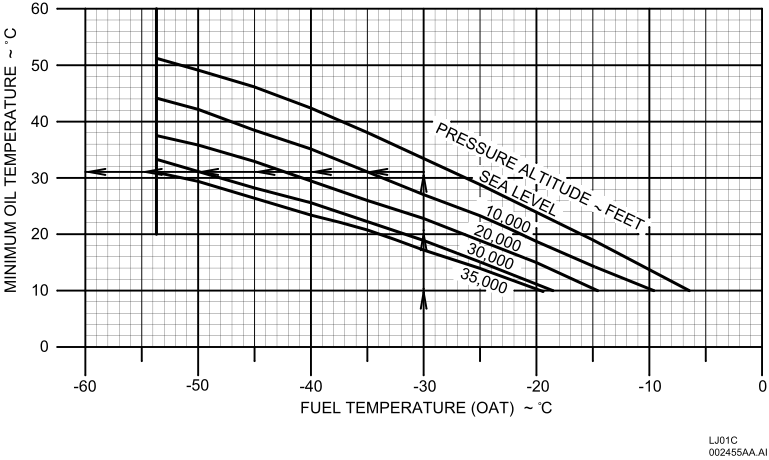

**CAUTION**

Prior to refueling, check with the fuel supplier to determine whether or not anti-icing additive has already been added to the fuel. If anti-icing additive is required, it must be properly blended with the fuel to avoid deterioration of the fuel cell sealant. The additive concentration shall be a minimum of 0.10% and a maximum of 0.15% by volume. To assure proper concentration by volume of fuel on board, blend only enough additive for the unblended fuel.

***FUEL BIOCIDE ADDITIVE***

Fuel biocide-fungicide BIOBOR JF in concentrations of 135 ppm or 270 ppm may be used in the fuel. BIOBOR JF may be used as the only fuel additive, or it may be used with the anti-icing additive conforming to MIL-I-27686 or MIL-I-85470 specification. Used together, the additives have no detrimental effect on the fuel system components.

Refer to the Super King Air 200 Series Maintenance Manual and to the latest revision of Pratt and Whitney Canada Engine Service Bulletin No. 3044 for concentrations to use and for procedures, recommendations and limitations pertaining to the use of biocidal/fungicidal additives in turbine fuels.

## FUEL MANAGEMENT

*USABLE FUEL (GALLONS X 6.7 = POUNDS)*

- Total Usable Fuel Quantity ................ 544 gallons (3645 pounds)
  - Each Main Fuel Tank System ................ 193 gallons (1293 pounds)
  - Each Auxiliary Fuel Tank ................ 79 gallons (529 pounds)

*FUEL IMBALANCE*

Maximum allowable fuel imbalance between wing fuel systems is 1000 pounds.

*FUEL CROSSFEED*

Crossfeeding of fuel is permitted only when one engine is inoperative.

**WARNING**

The airplane is approved for takeoff with one standby boost pump inoperative, but in such a case, crossfeed of fuel will not be available from the side of the inoperative standby boost pump.

*FUEL GAGES IN THE YELLOW ARC*

Do not take off if fuel quantity gages indicate in yellow arc or indicate less than 265 pounds of fuel in each main tank system.

*AUXILIARY FUEL*

Do not put any fuel into the auxiliary tanks unless the main tanks are full.

*OPERATING WITH LOW FUEL PRESSURE*

Operation of either engine with its corresponding fuel pressure annunciator (L FUEL PRESS or R FUEL PRESS) illuminated is limited to 10 hours before overhaul or replacement of the engine-driven fuel pump. Windmilling time need not be charged against this time limit.

## OIL SPECIFICATION

Any oil specified by brand name in the latest revision of *Pratt & Whitney Service Bulletin Number 3001* is approved for use in the PT6A-42 engine.

## NUMBER OF PROPELLERS

2

## PROPELLER MANUFACTURER

Hartzell Propeller, Inc. (Piqua, Ohio)

McCauley Propeller (Vandalia, Ohio)

## PROPELLER HUB AND BLADE MODEL NUMBERS

| | HUBS | BLADES |
|---|---|---|
| Hartzell Propeller — Prior to BB-829, BL-37 | HC-B3TN-3G or HC-B3TN-3N | T10178B-3R |
| Hartzell Propeller — BB-829 and After, BL-37 and After | HC-B3TN-3G or HC-B3TN-3N | T10178K-3R |
| McCauley Propeller (or) — BB-1193 and After, BL-124 and After | 3GFR34C702-☒ | ☒-100LA |

**NOTE**

The letter appearing in the place of the ☒ represents minor variations in the propeller hub or blades. They do not affect eligibility or interchangeability.

Hartzell and McCauley propellers may be interchanged (in matched pairs only) on airplane serials BB-1193 and after, and BL-124 and after.

## PROPELLER DIAMETER

Hartzell Propeller: 98.5 inches only

McCauley Propeller: 98.0 inches

## PROPELLER BLADE ANGLES AT 30-INCH STATION

Hartzell Propeller: Feathered + 90°; Reverse - 9°

McCauley Propeller: Feathered + 86.8°; Reverse - 10°

## PROPELLER ROTATIONAL SPEED LIMITS

- Transients not exceeding 5 seconds ................ 2200 rpm
- Reverse ................ 1900 rpm
- All other conditions ................ 2000 rpm

## PROPELLER ROTATIONAL OVERSPEED LIMITS

The maximum propeller overspeed limit is 2200 rpm and is time-limited to five seconds. Sustained propeller overspeeds faster than 2000 rpm indicate failure of the primary governor. Flight may be continued at propeller overspeeds up to 2080 rpm, provided torque is limited to 1800 foot-pounds. Sustained propeller overspeeds faster than 2080 rpm indicate failure of both the primary governor and the secondary governor, and such overspeeds are unapproved.

## POWERPLANT INSTRUMENT MARKINGS

| INSTRUMENT | RED LINE MINIMUM LIMIT | GREEN ARC NORMAL OPERATING | RED LINE MAXIMUM LIMIT |
|---|---|---|---|
| INTERSTAGE TURBINE TEMPERATURE* | --- | 400°C to 800°C | 800°C |
| TORQUE METER | --- | 400 ft-lbs to 2230 ft-lbs | 2230 ft-lbs |
| PROPELLER TACHOMETER (N2) | --- | 1600 rpm to 2000 rpm | 2000 rpm |
| GAS GENERATOR TACHOMETER (N1) | --- | --- | 101.5% |
| OIL TEMPERATURE | --- | 10°C to 99°C | 99°C |
| OIL PRESSURE** | 60 psi | 100 psi to 135 psi | 200 psi |

\* Starting Limit (Dashed Red Line): 1000°C.

\*\* A dual-band yellow/green arc extends from 85 to 100 psi, indicating the extended range of normal oil pressures for operation at, or above, 21,000 feet.

## MISCELLANEOUS INSTRUMENT MARKINGS

## FUEL QUANTITY INDICATORS

Yellow Arc (No-Takeoff Range) ................ 0 to 265 pounds

## CABIN DIFFERENTIAL PRESSURE GAGE

- Green Arc (Approved Operating Range) ................ 0 to 6.6 psi
- Red Arc (Unapproved Operating Range) ................ 6.6 psi to end of scale

## PNEUMATIC GAGE

- Green Arc (Normal Operating Range) ................ 12 to 20 psi
- Red Line (Maximum Operating Limit) ................ 20 psi

## GYRO SUCTION GAGE

- Narrow Green Arc (Normal from 35,000 to 15,000 feet) ................ 2.8 to 4.3 in. Hg
- Wide Green Arc (Normal from 15,000 feet to Sea Level) ................ 4.3 to 5.9 in. Hg
- 35K marked on face of gage at ................ 3.0 in. Hg
- 15K marked on face of gage at ................ 4.3 in. Hg

## PROPELLER DEICE AMMETER

Green Arc (Normal Operating Range) ................ 14 to 18 amperes

## WEIGHT LIMITS

- Maximum Ramp Weight ................ 12,590 pounds
- Maximum Take-off Weight:
  - All Except FAR Part 135 Operations ................ 12,500 pounds
  - FAR Part 135 Operations ................ As Limited by MAXIMUM ENROUTE WEIGHT Graph in Section V, PERFORMANCE
- Maximum Landing Weight ................ 12,500 pounds
- Maximum Zero Fuel Weight ................ 11,000 pounds
- Maximum Weight in Baggage Compartment:
  - **BB-1052, BB-1091 and after, BL-58 and after, and prior airplanes with Beech Kit #101-5068-1 installed:**
    - When Equipped with Fold-up Seats ................ 510 pounds
    - When Not Equipped with Fold-up Seats ................ 550 pounds
  - or;
  - **Prior to BB-1091, except BB-1052, and prior to BL-58 without Beech Kit #101-5068-1 installed:**
    - When Equipped With Fold-up Seats ................ 370 pounds
    - When Not Equipped with Fold-up Seats ................ 410 pounds

## CENTER OF GRAVITY LIMITS

## AFT LIMIT

196.4 inches aft of datum at all weights

## FORWARD LIMITS

185.0 inches aft of datum at 12,500 pounds, with straight line variation to 181.0 inches aft of datum at 11,279 pounds. 181.0 inches aft of datum at 11,279 pounds or less.

## DATUM

The reference datum is located 83.5 inches forward of the center of the front jack point.

## MEAN AERODYNAMIC CHORD (MAC)

The leading edge of the MAC is 171.23 inches aft of the datum.

The MAC length is 70.41 inches.

## MANEUVER LIMITS

The BEECHCRAFT Super King Air B200 and B200C are Normal Category Airplanes. Acrobatic maneuvers, including spins, are prohibited.

## FLIGHT LOAD FACTOR LIMITS

| FLAPS UP | FLAPS DOWN |
|---|---|
| 3.17 positive g's | 2.00 positive g's |
| 1.27 negative g's | 0.00 g |

## MINIMUM FLIGHT CREW

One pilot

## MAXIMUM OPERATING PRESSURE-ALTITUDE LIMITS

- Normal Operation ................ 35,000 feet
- Operation with Yaw Damp System Inoperative ................ 17,000 feet

## MAXIMUM OUTSIDE AIR TEMPERATURE LIMITS

- Sea Level to 25,000 feet pressure altitude ................ ISA+37°C
- Above 25,000 feet pressure altitude ................ ISA+31°C

## CABIN PRESSURIZATION LIMIT

Maximum Cabin Pressure Differential ................ 6.6 psi

## MAXIMUM OCCUPANCY LIMIT

Including Crew ................ Fifteen (15)

## SYSTEMS AND EQUIPMENT LIMITS

## LANDING GEAR CYCLE LIMITS

Landing gear cycles (1 up - 1 down) are limited to one every 5 minutes for a total of 6 cycles followed by a 15 minute cool-down period.

## AFT-FACING SEATS

Only aft-facing seats (placarded as such on the leg crossmember) are authorized in the aft-facing position. The seatback of each occupied aft-facing seat must be in the fully raised position for takeoff and landing. The headrest should be positioned properly for the occupant.

## ICING LIMITATIONS

- Minimum Ambient Temperature for Operation of Deicing Boots ................ -40°C
- Minimum Airspeed for Sustained Icing Flight ................ 140 Knots

Sustained flight in icing conditions with flaps extended is prohibited except for approach and landings.

ICE VANES, LEFT and RIGHT, shall be extended for operations in ambient temperatures of +5°C or below when flight free of visible moisture cannot be assured.

ICE VANES, LEFT and RIGHT, shall be retracted for all takeoff and flight operations in ambient temperatures of above +15°C.

Once the manual override system is activated (i.e., anytime the ICE VANE EMERGENCY MANUAL EXTENSION handle has been pulled out), do not attempt to operate the ice vanes electrically until the override assembly inside the engine cowling has been properly reset on the ground. Even after the manual extension handle has been pushed back in, the manual override system is still engaged.

## APPROVED AIRPLANE DEICING/ANTI-ICING FLUIDS

- SAE AMS 1424 Type I
- ISO 11075 Type I
- SAE AMS 1428 Type II
- ISO 11078 Type II
- SAE AMS 1428 Type IV. Only the following Type IV Fluids are approved:
  - Clariant Safewing MP IV 1957
  - Clariant Safewing MP IV 2001
  - UCAR ULTRA+ (Approved for use down to -15°C)
  - Octagon Max Flight Type IV

*(Page: THIS PAGE INTENTIONALLY LEFT BLANK — Hawker Beechcraft, Section II Limitations, May 2011, 1 of 2)*

## Temporary Change to the Pilot's Operating Handbook and FAA Approved Airplane Flight Manual

## P/N 101-590010-147CTC3

| | |
|---|---|
| PUBLICATION AFFECTED: | Super King Air B200/B200C Pilot's Operating Handbook and FAA Approved Airplane Flight Manual P/N 101-590010-147C, Reissued December, 1994 or Subsequent |
| AIRPLANE SERIAL NUMBERS AFFECTED: | BB-734, BB-793, BB-829, BB-854 thru BB-870, BB-874 thru BB-891, BB-894, BB-896 thru BB-911, BB-913 thru BB-1438, BB-1440 thru BB-1443; and BL-37 thru BL-138 |
| DESCRIPTION OF CHANGE: | Replace Structural Limitations with reference to the *Super King Air 200 Series Airworthiness Limitations Manual*. |
| FILING INSTRUCTIONS: | Insert this Temporary Change into the B200/B200C Pilot's Operating Handbook and FAA Approved Airplane Flight Manual following page 2-12 (LIMITATIONS Section), and retain until rescinded or replaced. |

## LIMITATIONS

## STRUCTURAL LIMITATIONS

Refer to the *Super King Air 200 Series Airworthiness Limitations Manual* for structural limitations.

FAA Approved by: Randolph Shields, ODA Lead administrator, Hawker Beechcraft Corporation, ODA-230339-CE (2 of 2, May, 2011)

## OTHER LIMITATIONS

## STRUCTURAL LIMITATIONS (PRIOR TO S/N BB-1193 AND BL-73, EXCEPT BB-1158, BB-1167)

- Cabin Door Forward and Aft Side Latches (or bayonets) (4) Safelife (B200 only) ................ 5,000 cycles
- Cabin Door Upper Latch Hooks (2) and Attaching Hardware (B200 only) ................ 10,000 cycles
- Cargo Door Cam-lock Actuator Cable Safelife (B200C only) ................ 8,000 cycles
- Wing and Associated Structure Fatigue Safelife ................ 30,000 hours
- Horizontal and Vertical Stabilizer ................ 45,000 hours
- Windshield Frame Screws ................ 10,000 cycles
- All Wing Attach Bolts, Nuts and Barrel Nut Assemblies:
  - Inconel Components ................ Replace every 15 calendar years of installed bolt and nut time

Refer to the Raytheon Aircraft Company Structural Inspection and Repair Manual and the Super King Air 200 Series Maintenance Manual for inspection and replacement procedures.

The above lives are based on airplane utilization, operation, and maintenance in the category of service for which the airplane was originally designed; specifically 95% or more time is accumulated from pressurized executive or corporate transportation wherein the majority of cruise is above 10,000 ft altitude (AGL) and flight duration is more than one hour. Should the airplane be used for missions other than that intended by design, notify the Customer Support Department of Raytheon Aircraft Company for a more appropriate life.

## STRUCTURAL LIMITATIONS (S/N BB-1158, BB-1167, BB-1193 AND AFTER, BL-73 AND AFTER)

Refer to Chapter Four of the Super King Air 200 Series Maintenance Manual for structural limitations.

## CRACKED OR SHATTERED WINDSHIELD

The following limitations apply when continued flight is required with a cracked outer or inner ply of the windshield.

1. Continued flight with a cracked windshield is limited to 25 flight hours.
2. Windshields which have a shattered inner ply will have numerous cracks which will obstruct forward vision and produce small particles or flakes of glass that can break free of the windshield and interfere with the crew's vision. These windshields must be replaced prior to the next flight unless a special flight permit is obtained from the local FAA Flight Standards District Office.
3. Crack(s) must not impair visibility.
4. Crack(s) must not interfere with the use of windshield wipers for flights requiring the use of the wipers.
5. Windshield anti-ice must be operational for flights in icing conditions.
6. The following placard must be installed in clear view of the pilot:

   > MAXIMUM AIRPLANE ALTITUDE IS LIMITED TO 25,000 FEET. CABIN ΔP MUST BE MAINTAINED BETWEEN 2.0 AND 4.6 PSI DURING FLIGHT.

Windshields that have cracks in both the inner and outer plies must be replaced prior to the next flight unless a special flight permit is obtained from the local FAA Flight Standards District Office.

## CRACK IN ANY SIDE WINDOW (COCKPIT OR CABIN)

The following limitations apply when continued flight is required with a cracked outer or inner ply in any side window. These limitations do not apply to minor compression-type chips (Clamshell) which may occur on the milled edge of cockpit side windows. Refer to the *Beech Super King Air 200 Series Maintenance Manual* for the disposition of such chips.

1. Continued flight is limited to 25 flight hours.
2. Flights must be conducted with the cabin depressurized. The following placard must be installed in clear view of the pilot:

   > PRESSURIZED FLIGHT IS PROHIBITED DUE TO A CRACKED SIDE WINDOW. CONDUCT FLIGHT WITH THE CABIN PRESSURE SWITCH IN THE DUMP POSITION.

## CARGO LIMITATIONS (ALL SERIALS)

1. All cargo shall be properly secured by an FAA-approved cargo restraint system.
2. Cargo must be arranged to permit free access to all exits and emergency exits.

## LIMITATIONS WHEN ENCOUNTERING SEVERE ICING CONDITIONS (Required By FAA AD 96-09-13)

**WARNING**

Severe icing may result from environmental conditions outside of those for which the airplane is certificated. Flight in freezing rain, freezing drizzle, or mixed icing conditions (supercooled liquid water and ice crystals) may result in ice build-up on protected surfaces exceeding the capability of the ice protection system, or may result in ice forming aft of the protected surfaces. This ice may not be shed using the ice protection systems, and may seriously degrade the performance and controllability of the airplane.

1. During flight, severe icing conditions that exceed those for which the airplane is certificated shall be determined by the following visual cues. If one or more of these visual cues exists, immediately request priority handling from Air Traffic Control to facilitate a route or an altitude change to exit the icing conditions.
   a. Unusually extensive ice accreted on the airframe in areas not normally observed to collect ice.
   b. Accumulation of ice on the upper surface of the wing aft of the protected area.
   c. Accumulation of ice on the propeller spinner farther aft than normally observed.
2. Since the autopilot may mask tactile cues that indicate adverse changes in handling characteristics, use of the autopilot is prohibited when any of the visual cues specified above exist, or when unusual lateral trim requirements or autopilot trim warnings are encountered while the airplane is in icing conditions.
3. All icing detection lights must be operative prior to flight into icing conditions at night. [NOTE: This supersedes any relief provided by the Master Minimum Equipment List (MMEL).]

*(THIS PAGE INTENTIONALLY LEFT BLANK — 2-14A)*

## PLACARDS

*On Overhead Panels in Pilot's Compartment:*

> **OPERATION LIMITATIONS**
> THIS AIRPLANE MUST BE OPERATED AS A NORMAL CATEGORY AIRPLANE IN COMPLIANCE WITH THE OPERATING LIMITATIONS STATED IN THE FORM OF PLACARDS MARKINGS AND MANUALS. NO ACROBATIC MANEUVERS INCLUDING SPINS ARE APPROVED. THIS AIRPLANE APPROVED FOR VFR, IFR, & DAY & NIGHT OPERATION & IN ICING CONDITIONS.
> CAUTION
> STALL WARNING IS INOPERATIVE WHEN MASTER SWITCH IS OFF. STANDBY COMPASS IS ERRATIC WHEN WINDSHIELD ANTI-ICE AND/OR AIR-CONDITIONING IS ON.

*Aft of Overhead Light Control Panel:*

> **AIRSPEEDS (IAS)**
> MAX GEAR EXTENSION — 181 KNOTS
> MAX GEAR RETRACT — 163 KNOTS
> MAX GEAR EXTENDED — 181 KNOTS
> MAX APPROACH FLAP — 200 KNOTS
> MAX FULL DOWN FLAP — 157 KNOTS
> MAX MANEUVERING — 181 KNOTS

*Aft of Overhead Light Control Panel:*

> **OXYGEN** — PASSENGER MANUAL O'RIDE / PULL ON SYS READY

*On Pilot's Window Sill:*

> TURN OFF STROBE LIGHTS WHEN TAXIING IN VICINITY OF OTHER AIRCRAFT OR DURING FLIGHT THROUGH FOG OR CLOUDS. STD POSITION LIGHTS TO BE TURNED ON FOR ALL NIGHT OPERATIONS.

*On Pilot's & Copilot's Window Sills:*

> **WARNING** DO NOT SMOKE WHILE OXYGEN IS IN USE. WITH DILUTER-DEMAND CREW MASK FLOW STOPS WHEN BREATHING STOPS.

*On Curved Pedestal Adjacent to Power Levers:*

> **CAUTION** REVERSE ONLY WITH ENGINES RUNNING

*On Pedestal Near Cabin Pressurization Controller:*

> **WARNING** DE-PRESSURIZE CABIN BEFORE LANDING

*Below Latch on Forward Side of Forward and Aft Partitions (B200):*
*Below Latch on Forward Side of Forward Partition and on Aft Side of Aft Partition (B200C):*

> KICK HERE FOR EMERGENCY EVACUATION

*On Floor Aft of Pedestal (On airplanes prior to BL-73 and BB-1193 (except BB-1158 and BB-1167) not incorporating Beech Kit P/N 101-8018-1):*

> **LANDING GEAR ALTERNATE EXTENSION**
> 1. LIFT AND TURN HANDLE TO ENGAGE
> 2. PUMP HANDLE UP AND DOWN UNTIL THREE GREEN GEAR LIGHTS ILLUM.

*On Floor Aft of Pedestal (On airplanes BB-1158, BB-1167, BB-1193 and after, BL-73 and after, and those prior airplanes incorporating Beech Kit P/N 101-8018-1):*

> **LANDING GEAR ALTERNATE EXTENSION**
> 1. REMOVE HANDLE FROM SECURING CLIP AND PUMP
> 2. AFTER ALL THREE GREEN INDICATOR LIGHTS ARE ILLUMINATED AND FURTHER RESISTANCE IS FELT, SECURE HANDLE IN STOWED POSITION.

*Below Right Circuit Breaker Panel:*

> PILOT'S STATIC AIR SOURCE — NORMAL / ALTERNATE — SEE FLIGHT MANUAL PERFORMANCE SECTION FOR INSTR CAL ERROR

*Center of Cabin on Passenger Servicing Unit (B200C):*

> NO SMOKING / FASTEN SEAT BELT

*On Cabin Side of Forward and Aft Partitions (B200):* (no-smoking and seat-belt symbols)

*On Inside Surface of Each Oxygen Access Door:*

> **WARNING - DO NOT SMOKE WHILE OXYGEN IS IN USE**
> TO USE — PULL LANYARD PIN — DON MASK

*Below Emergency Exit Handle on Exit Lock Lever (Visible only when Lever is in Locked Position) (B200):*

> MUST BE UNLOCKED BEFORE TAKEOFF — LOCKED — EXIT LOCK

*On Emergency Exit Handle:*

> EXIT-PULL

*On Window Frame Escutcheon Adjacent to Front Seats (airplanes equipped with a chaise lounge):*

> COUCH — NOT TO BE OCCUPIED AS CHAISE LOUNGE DURING TAKE-OFF AND LANDING.

*Stitched to the Aft End of the Couch Cushion (airplanes equipped with a chaise lounge):*

> NOT TO BE OCCUPIED AS CHAISE LOUNGE DURING TAKE-OFF AND LANDING

*On Inside Bottom of Couch Drawer (airplanes equipped with a two-placed couch):*

> **COUCH LIMITATIONS** TOTAL WEIGHT OF OCCUPANTS NOT TO EXCEED 340 LBS. MAX WT OF DRAWER CONTENTS 30 LBS PER DRAWER

Or:

> **COUCH LIMITATIONS** MAX WT OF DRAWER CONTENTS 30 LBS PER DRAWER

*On Shoulder Harness Assembly For All Chairs:*

> SHOULDER HARNESS MUST BE WORN DURING TAKE-OFF AND LANDING WITH SEAT IN OUTBD POSITION, SEAT BACK UPRIGHT AND HEADREST FULLY EXTENDED

*On Cupholders and Tables When Installed:*

> STOW BEFORE TAKE-OFF AND LANDING

*On Trim Above Side Facing Seat (Forward of Baggage Area):*

> FASTEN SEAT BELT DURING TAKEOFF AND LANDING

*On Window Frame Adjacent to Lateral-Tracking Seats When Installed:*

> SEAT MUST BE LOCATED IN OUTBOARD POSITION FOR TAKEOFF AND LANDING

*On Outside Surface of First Aid Oxygen Access Door:*

> FIRST AID OXYGEN ———— PULL

*On Inside Surface of First Aid Oxygen Access Door:*

> **WARNING - DO NOT SMOKE WHILE OXYGEN IS IN USE**
> TO USE — TURN VALVE ON — DON MASK
> NOTE: CREW SYS MUST BE ON

*On Aft Compartment Sidewall Adjacent to Fold-Up Seats:*

> FASTEN SHOULDER HARNESS AND SEAT BELT DURING TAKE OFF AND LANDING

*On Center of Aft Bulkhead (When Not Equipped with Fold-up Seats) — BB-1052, BB-1091 and after, BL-58 and after, and prior airplanes with Beech Kit No. 101-5068-1 or -5 installed:*

> COMPARTMENT CAPACITY 550 LBS. THIS INCLUDES BAGGAGE AND/OR EQUIPMENT AND/OR OPTIONAL FURNISHINGS. SEE WEIGHT AND BALANCE SECTION OF FLIGHT MANUAL FOR LOADING INSTRUCTIONS

*Prior to BB-1052, BB-1091 and BL-58:*

> COMPARTMENT CAPACITY 410 LBS. THIS INCLUDES BAGGAGE AND/OR EQUIPMENT AND/OR OPTIONAL FURNISHINGS. SEE WEIGHT AND BALANCE SECTION OF FLIGHT MANUAL FOR LOADING INSTRUCTIONS

*On Center of Aft Bulkhead (When Equipped with Fold-up Seats) — BB-1052, BB-1091 and after, BL-58 and after, and prior airplanes with Beech Kit No. 101-5068-3 installed:*

> COMPARTMENT CAPACITY. TOTAL COMPARTMENT CAPACITY (INCLUDING BAGGAGE AND/OR PASSENGER) NOT TO EXCEED 510 POUNDS. SEE WEIGHT AND BALANCE SECTION OF FLIGHT MANUAL FOR LOADING INSTRUCTIONS

*Prior to BB-1052, BB-1091 and BL-58:*

> COMPARTMENT CAPACITY. TOTAL COMPARTMENT CAPACITY (INCLUDING BAGGAGE AND/OR PASSENGER) NOT TO EXCEED 370 POUNDS. SEE WEIGHT AND BALANCE SECTION OF FLIGHT MANUAL FOR LOADING INSTRUCTIONS

*Above Coat Rod (Aft Compartment):*

> CLOTHING ONLY

*Inside Airstair Door Behind Handle (B200):*

> CAUTION — DO NOT OPEN DOOR WHEN CABIN IS PRESSURIZED. CAUTION — DO NOT ATTEMPT TO CHECK SECURITY OF CABIN DOOR BY MOVING DOOR HANDLE UNLESS CABIN IS DEPRESSURIZED AND AIRCRAFT IS ON THE GROUND. PUSH BUTTON & TURN HANDLE TO OPEN DOOR. (Handle positions marked: OPEN, LATCH, LOCK)

*Inside Airstair Door Behind Handle (B200C):*

> CAUTION — DO NOT OPEN OR CHECK SECURITY BY MOVING DOOR HANDLE WHILE AIRCRAFT IS PRESSURIZED AND/OR IN FLIGHT. PUSH BUTTON & TURN HANDLE TO OPEN DOOR. (Handle positions marked: OPEN, LOCK)

*Inside Airstair Door On Folding Step (B200 and B200C):*

> LIFT STEP TO INSPECT DOOR LOCK

*Inside Airstair Door Between Folding Steps (B200 and B200C):*

> WHEN HANDLE IS IN LOCKED POSITION-ARM SHOULD BE AROUND PLUNGER AS SHOWN

*On Escutcheon Near Upper Access Cover of Cargo Door (B200C):*

> LOAD CARGO PER PILOT'S OPERATING HANDBOOK

*On Upper Access Cover of Cargo Door (B200C):*

> CAUTION — DO NOT OPEN OR CHECK SECURITY BY MOVING DOOR HANDLE WHILE AIRCRAFT IS PRESSURIZED AND/OR IN FLIGHT

*On Upper Access Cover of Cargo Door: (B200C)*

> CARGO DOOR LATCH HANDLE ACCESS

*On Cargo Door Upper Latch Handle (B200C):*

> PUSH TO RELEASE

*On Lower Access Cover of Cargo Door: (B200C)*

> CARGO DOOR LOWER LATCH HANDLE ACCESS

*Inside Lower Access Cover of Cargo Door: (B200C)*

> CAUTION — DO NOT OPEN OR CHECK SECURITY BY MOVING DOOR HANDLE WHILE AIRCRAFT IS PRESSURIZED AND/OR IN FLIGHT. OPEN ◄► CLOSED. LIFT HOOK TO RELEASE HANDLE

## KINDS OF OPERATIONS

The BEECHCRAFT Super King Air B200 and B200C are approved for the following types of operations when the required equipment is installed and operational as defined within the KINDS OF OPERATIONS EQUIPMENT LIST.

1. VFR Day
2. VFR Night
3. IFR Day
4. IFR Night
5. Know Icing Conditions

## KINDS OF OPERATIONS EQUIPMENT LIST

This airplane may be operated in day or night VFR, IFR, or icing conditions when the appropriate equipment is installed and operable.

The following equipment list identifies the systems and equipment upon which type certification for each kind of operation was predicated. The systems and items of equipment listed must be installed and operable unless:

1. The airplane is operated in accordance with a current Minimum Equipment List (MEL) issued by the FAA.

   or;

2. An alternate procedure is provided in the Pilot's Operating Handbook and FAA Approved Airplane Flight Manual for the inoperative state of the listed equipment.

Numbers on the Kinds of Operations Equipment List refer to quantities required to be operative for a specified condition.

## NOTE

The following systems and equipment list does not include all equipment required by the FAR Parts 91 and 135 Operating Requirements. It also does not include components obviously required for the airplane to be airworthy, such as wings, empenage, engine, etc.

Columns of the table below, in order: VFR DAY | VFR NIGHT | IFR DAY | IFR NIGHT | ICING CONDITIONS.

| SYSTEM and/or COMPONENT | VFR DAY | VFR NIGHT | IFR DAY | IFR NIGHT | ICING CONDITIONS |
|---|---|---|---|---|---|
| **ELECTRICAL POWER** | | | | | |
| 1. AC Volts/Frequency Meter | 1 | 1 | 1 | 1 | 1 |
| 2. Battery | 1 | 1 | 1 | 1 | 1 |
| 3. Battery Charge Monitor System and Annunciator | 1 | 1 | 1 | 1 | 1 |
| 4. DC Generator | 2 | 2 | 2 | 2 | 2 |
| 5. DC GEN Annunciator | 2 | 2 | 2 | 2 | 2 |
| 6. DC Load Meter | 2 | 2 | 2 | 2 | 2 |
| 7. Inverter | 2 | 2 | 2 | 2 | 2 |
| 8. INVERTER Annunciator | 1 | 1 | 1 | 1 | 1 |
| **ENGINE INDICATIONS** | | | | | |
| 1. ITT Indicator | 2 | 2 | 2 | 2 | 2 |
| 2. Tachometer (Gas Generator) | 2 | 2 | 2 | 2 | 2 |
| 3. Tachometer (Propeller) | 2 | 2 | 2 | 2 | 2 |
| 4. Torque Indicator | 2 | 2 | 2 | 2 | 2 |
| **ENGINE OIL** | | | | | |
| 1. Chip Detector System Including Annunciators | 2 | 2 | 2 | 2 | 2 |
| 2. Oil Pressure Indicator | 2 | 2 | 2 | 2 | 2 |
| 3. Oil Temperature Indicator | 2 | 2 | 2 | 2 | 2 |
| 4. OIL PRESS Annunciator | 2 | 2 | 2 | 2 | 2 |
| **ENVIRONMENTAL** | | | | | |
| 1. BL AIR FAIL Annunciators | 2 | 2 | 2 | 2 | 2 |
| 2. ALT WARN Annunciator (Cabin) | 1 | 1 | 1 | 1 | 1 |
| 3. Cabin Rate of Climb Indicator | 1 | 1 | 1 | 1 | 1 |
| 4. Differential Pressure/Cabin Altitude Indicator | 1 | 1 | 1 | 1 | 1 |
| 5. DUCT OVERTEMP Annunciator | 1 | 1 | 1 | 1 | 1 |
| 6. Outflow Valve | 1 | 1 | 1 | 1 | 1 |
| 7. Pressurization Controller | 1 | 1 | 1 | 1 | 1 |
| 8. Safety Valve | 1 | 1 | 1 | 1 | 1 |
| 9. Bleed Air Shutoff Valve | 2 | 2 | 2 | 2 | 2 |
| **FIRE PROTECTION** | | | | | |
| 1. Engine Fire Detector System And Annunciators | 2 | 2 | 2 | 2 | 2 |
| **FLIGHT CONTROLS** | | | | | |
| 1. Flap Position Indicator | 1 | 1 | 1 | 1 | 1 |
| 2. Flap System | 1 | 1 | 1 | 1 | 1 |
| 3. Stall Warning Horn | 1 | 1 | 1 | 1 | 1 |
| 4. Trim Tab Position Indicator (Rudder, Aileron, Elevator) | 3 | 3 | 3 | 3 | 3 |
| 5. Yaw Damp System | 1 | 1 | 1 | 1 | 1 |
| **FUEL** | | | | | |
| 1. Engine Driven Boost Pump | 2 | 2 | 2 | 2 | 2 |
| 2. Fuel Crossfeed System Including Annunciator | 1 | 1 | 1 | 1 | 1 |
| 3. Standby Fuel Boost Pump | 2 | 2 | 2 | 2 | 2 |
| 4. FUEL PRESS Annunciator | 2 | 2 | 2 | 2 | 2 |
| 5. Fuel Quantity Indicating System Including Annunciators | 2 | 2 | 2 | 2 | 2 |
| 6. Firewall Fuel Shutoff System Including Annunciators | 2 | 2 | 2 | 2 | 2 |
| 7. Jet Transfer Pump | 2 | 2 | 2 | 2 | 2 |
| 8. Motive Flow Valve | 2 | 2 | 2 | 2 | 2 |
| 9. Fuel Flow Indicator | 2 | 2 | 2 | 2 | 2 |
| **ICE AND RAIN PROTECTION** | | | | | |
| 1. Alternate Static Air Source | 0 | 0 | 1 | 1 | 1 |
| 2. Engine Auto Ignition and Annunciators | 2 | 2 | 2 | 2 | 2 |
| 3. Engine Anti-Ice System and Annunciators | 2 | 2 | 2 | 2 | 2 |
| 4. Heated Fuel Vent | 0 | 0 | 2 | 2 | 2 |
| 5. Heated Windshield (Left) | 0 | 0 | 0 | 0 | 1 |
| 6. Pitot Heat | 0 | 0 | 2 | 2 | 2 |
| 7. Pneumatic Pressure Indicator | 0 | 0 | 1 | 1 | 1 |
| 8. Propeller Deicer System | 0 | 0 | 0 | 0 | 1 |
| 9. Stall Warning Heat (Lift Transducer and Mounting Plate) | 0 | 0 | 0 | 0 | 1 |
| 10. Surface Deicer System | 0 | 0 | 0 | 0 | 1 |
| 11. Wing Ice Light (Left) | 0 | 0 | 0 | 0 | 1 |
| **LANDING GEAR** | | | | | |
| 1. Landing Gear Position Indicator Lights | 3 | 3 | 3 | 3 | 3 |
| 2. Landing Gear Handle Light | 1 | 1 | 1 | 1 | 1 |
| 3. Landing Gear Aural Warning | 1 | 1 | 1 | 1 | 1 |
| 4. \* Landing Gear Motor and Gearbox | 1 | 1 | 1 | 1 | 1 |
| 5. Alternate Landing Gear Extension System | 1 | 1 | 1 | 1 | 1 |
| 6. \*\* Hydraulic Fluid Low Annunciator | 1 | 1 | 1 | 1 | 1 |
| 7. \*\* Landing Gear Hydraulic Power Pack | 1 | 1 | 1 | 1 | 1 |
| **LIGHTS** | | | | | |
| 1. Cockpit and Instrument Lighting System | 0 | 1 | 0 | 1 | 0 |
| 2. CABIN DOOR Annunciator | 1 | 1 | 1 | 1 | 1 |
| 3. Landing Lights | 0 | 1 | 0 | 1 | 0 |
| 4. Position Lights | 0 | 3 | 0 | 3 | 0 |
| 5. Anticollision Lights System | 0 | 1 | 0 | 1 | 0 |
| **NAVIGATION INSTRUMENTS** | | | | | |
| 1. Airspeed Indicator (Left) | 1 | 1 | 1 | 1 | 1 |
| 2. Altimeter (Left) | 1 | 1 | 1 | 1 | 1 |
| 3. Magnetic Compass | 1 | 1 | 1 | 1 | 1 |
| 4. Outside Air Temperature | 1 | 1 | 1 | 1 | 1 |
| **OXYGEN** | | | | | |
| 1. Oxygen System | 1 | 1 | 1 | 1 | 1 |
| **PROPELLER** | | | | | |
| 1. Prop Reversing System Including Annunciators | 2 | 2 | 2 | 2 | 2 |
| 2. Prop Governor Test Switch | 1 | 1 | 1 | 1 | 1 |
| 3. Prop Overspeed Governor | 2 | 2 | 2 | 2 | 2 |
| 4. Propeller Primary Low-Pitch Stop | 2 | 2 | 2 | 2 | 2 |
| **VACUUM SYSTEM** | | | | | |
| 1. Instrument Air System | 0 | 1 | 1 | 1 | 1 |
| 2. Gyro Suction Indicator | 1 | 1 | 1 | 1 | 1 |

\* On airplanes prior to BL-73 and BB-1193 (except BB-1158 and BB-1167) not incorporating Beech Kit P/N 101-8018-1

\*\* On airplanes BB-1158, BB-1167, BB-1193 and after, BL-73 and after, and those prior airplanes incorporating Beech Kit P/N 101-8018-1

## NOTE

The above Kinds of Operations Equipment List does not include all specific flight instrument and communications/navigation equipment required by FAR Parts 91 and 135 Operating Requirements.

*(Pages 2-26 / blank page — THIS PAGE INTENTIONALLY LEFT BLANK)*

## SECTION III — EMERGENCY PROCEDURES TABLE OF CONTENTS

| SUBJECT | PAGE |
|---|---|
| **Emergency Airspeeds (12,500 lbs)** | 3-3 |
| **Engine Failure** | 3-3 |
| Emergency Engine Shutdown | 3-3 |
| Engine Fire On Ground | 3-3 |
| Engine Failure During Ground Roll | 3-3 |
| Engine Failure After Lift-Off (If Conditions Preclude an Immediate Landing) | 3-4 |
| Engine Failure In Flight Below Air Minimum Control Speed (VMCA) | 3-4 |
| Engine Flameout (2nd Engine) | 3-4 |
| Fuel System | 3-5 |
| Fuel Pressure Low (*L or R FUEL PRESS Annunciator*) | 3-5 |
| **Smoke And Fume Elimination** | 3-5 |
| Electrical Smoke Or Fire | 3-5 |
| Environmental System Smoke Or Fumes | 3-5 |
| **Cabin or Cargo Unlocked (CABIN DOOR Annunciator)** | 3-6 |
| **Emergency Descent** | 3-6 |
| **Glide** | 3-7 |
| **Electrical** | 3-7 |
| Inverter Inoperative (INVERTER Annunciator) | 3-7 |
| **Flight Controls** | 3-7 |
| Unscheduled Electric Elevator Trim | 3-7 |
| Unscheduled Rudder Boost Activation | 3-7 |
| **Environmental Systems** | 3-8 |
| Use of Oxygen | 3-8 |
| Pressurization Loss (ALT WARN Annunciator) | 3-8 |
| Auto-Deployment Oxygen System Failure (ALT WARN Annunciator Illuminated, PASS OXY ON Annunciator Not Illuminated) | 3-9 |
| High Differential Pressure (Cabin Differential Pressure Exceeds 6.6 PSI) | 3-9 |
| Bleed Air Line Failure (L or R BL AIR FAIL Annunciator) | 3-9 |
| **Emergency Exit** | 3-9 |
| **Spins** | 3-9 |

*(Next page: THIS PAGE INTENTIONALLY LEFT BLANK)*

*All airspeeds quoted in this section are indicated airspeeds (IAS) and assume zero instrument error.*

## NOTE

Immediate action procedures are delineated by bold type with the remaining procedures following.

## EMERGENCY AIRSPEEDS (12,500 LBS)

- One-Engine-Inoperative Best Angle-of-Climb (VXSE) ................ 115 kts
- One-Engine-Inoperative Best Rate-of-Climb (VYSE) ................ 121 kts
- Air Minimum Control Speed (VMCA) ................ 86 kts
- One-Engine-Inoperative Enroute Climb ................ 121 kts
- Emergency Descent ................ 181 kts
- Maximum Range Glide ................ 135 kts

## ENGINE FAILURE

## NOTE

To obtain best performance with one engine inoperative, the airplane must be banked 3° to 5° into the operating engine while maintaining a constant heading.

## EMERGENCY ENGINE SHUTDOWN

- *ENGINE TORQUE INCREASE - UNSCHEDULED (Ground or Flight) (Not Responsive to Power Lever Movement)*
- *ENGINE FIRE IN FLIGHT*
- *ENGINE FAILURE IN FLIGHT*

*Affected Engine:*

1. **Condition Lever - FUEL CUT OFF**
2. **Propeller Lever - FEATHER**
3. **Firewall Shutoff Valve - CLOSED**
4. **Fire Extinguisher (if installed) - ACTUATE (if required)**
5. Auto Ignition - OFF
6. Generator - OFF
7. Prop Sync - OFF
8. Electrical Load - MONITOR

## ENGINE FIRE ON GROUND

*Affected Engine:*

1. **Condition Lever - FUEL CUT OFF**
2. **Firewall Shutoff Valve - CLOSED**
3. Ignition and Engine Start - STARTER ONLY
4. Fire Extinguisher (if installed) - ACTUATE (if required)

## ENGINE FAILURE DURING GROUND ROLL

1. **Power Levers - IDLE**
2. **Brakes - AS REQUIRED**
3. **Operative Engine - MAXIMUM REVERSE**

**WARNING**

Extreme care must be exercised when using single-engine reversing on surfaces with reduced traction.

*If Insufficient Runway Remains for Stopping:*

4. **Condition Levers - FUEL CUT OFF**
5. **Firewall Shutoff Valves - CLOSED**
6. **Master Switch - OFF (Gang bar down)**

## ENGINE FAILURE AFTER LIFT-OFF (If Conditions Preclude an Immediate Landing)

1. **Power - MAXIMUM ALLOWABLE**
2. **Airspeed - MAINTAIN (take-off speed or above)**
3. **Landing Gear - UP**

## NOTE

If the autofeather system (if installed) is being used, do not retard the failed engine power lever until the autofeather system has completely stopped propeller rotation. To do so will deactivate the autofeather circuit and prevent automatic feathering.

4. **Propeller Lever (inoperative engine) - FEATHER (or verify FEATHER if autofeather is installed)**
5. **Airspeed - VYSE (after obstacle clearance altitude is reached)**
6. Flaps - UP
7. Clean-up (inoperative engine):
   a. Condition Lever - FUEL CUT OFF
   b. Propeller Lever - FEATHER
   c. Firewall Shutoff Valve - CLOSED
   d. Auto Ignition - OFF
   e. Autofeather (if installed) - OFF
   f. Generator - OFF
8. Electrical Load - MONITOR

## ENGINE FAILURE IN FLIGHT BELOW AIR MINIMUM CONTROL SPEED (VMCA)

1. **Power - Reduce as required to maintain directional control.**
2. **Nose - Lower to accelerate above VMCA.**
3. Power (operative engine) - AS REQUIRED
4. Failed Engine - SECURE (See EMERGENCY ENGINE SHUTDOWN)

## ENGINE FLAMEOUT (2nd Engine)

1. **Power Lever - IDLE**
2. **Propeller Lever - DO NOT FEATHER**
3. **Condition Lever - FUEL CUT OFF**
4. **Conduct Air Start Procedures.**

## NOTE

The propeller will not unfeather without engine operating.

## SUPER KING AIR B200/B200C — TEMPORARY PILOT'S OPERATING HANDBOOK AND FAA APPROVED AIRPLANE FLIGHT MANUAL CHANGE

## P/N 101-590010-147CTC1

| | |
|---|---|
| PUBLICATION AFFECTED: | Super King Air B200/B200C Pilot's Operating Handbook and FAA Approved Airplane Flight Manual P/N 101-590010-147C, Reissued December, 1994 or Subsequent |
| AIRPLANE SERIAL NUMBERS AFFECTED: | BB-734, BB-793, BB-829, BB-854 thru BB-870, BB-874 thru BB-891, BB-894, BB-896 thru BB-911, BB-913 thru BB-1438, BB-1440 thru BB-1443; and BL-37 thru BL-138 |
| DESCRIPTION OF CHANGE: | Provides an Emergency Procedure for Windshield Electrical Fault |
| FILING INSTRUCTIONS: | Insert this Temporary Change in the B200/B200C Pilot's Operating Handbook and FAA Approved Airplane Flight Manual following page 3-4 (EMERGENCY PROCEDURES Section), and retain until rescinded or replaced. |

## TEMPORARY EMERGENCY PROCEDURES

## SMOKE AND FUME ELIMINATION

## WINDSHIELD ELECTRICAL FAULT

The smell of an electrical overheat, or observing smoke and/or fire at the lower inboard corner of either windshield, adjacent to the center post, may indicate an overheat condition in the electrical power terminal for the normal heat mode of the pilot's or copilot's windshield heat.

1. WSHLD ANTI-ICE Switches - OFF

*If Smoke and/or Fire Does Not Cease:*

2. Conduct ELECTRICAL SMOKE OR FIRE procedure.

*If Smoke and/or Fire Ceases:*

3. Continue flight with Windshield Anti-ice OFF if possible.

*If Windshield Anti-ice is Required:*

4. If the source of the smell, smoke, or fire can be isolated to the pilot's or copilot's windshield, the opposite windshield (without the overheat condition) may be operated in the NORMAL or HI windshield heat mode.

APPROVED BY: A. C. Jackson, Raytheon Aircraft Company, DOA CE-2 — April 8, 1997 (1 of 2)

*(2 of 2 — This Page Intentionally Blank)*

## FUEL SYSTEM

*FUEL PRESSURE LOW (L or R FUEL PRESS Annunciator)*

1. **Standby Pump (failed side) - ON**
2. FUEL PRESS Annunciator - EXTINGUISHED

## SMOKE AND FUME ELIMINATION

Attempt to identify the source of smoke or fumes. Smoke associated with electrical failures is usually gray or tan in color, and irritating to the nose and eyes. Smoke produced by environmental system failures is generally white in color, and much less irritating to the nose and eyes. If smoke is prevalent in the cabin, cabin oxygen masks should not be intentionally deployed. If masks are automatically deployed due to an increase in cabin altitude, passengers should be instructed not to use them unless the cabin altitude exceeds 15,000 feet.

## ELECTRICAL SMOKE OR FIRE

1. **Oxygen**
   a. **Oxygen System Ready - PULL ON (Verify)**
   b. **Crew (Diluter Demand Masks) - DON MASKS (100% position)**
   c. **Mic Selector - OXYGEN MASK**
   d. **Audio Speaker - ON**
2. Cabin Temp Mode - OFF
3. Vent Blower - AUTO
4. Aft Blower (if installed) - OFF
5. Avionics Master - OFF
6. Nonessential Electrical Equipment - OFF

*If Fire or Smoke Ceases:*

7. Individually restore avionics and equipment previously turned off.
8. Isolate defective equipment.

**WARNING**

Dissipation of smoke is not sufficient evidence that a fire has been extinguished. If it cannot be visually confirmed that no fire exists, land at the nearest suitable airport.

*If Smoke Persists or if Extinguishing of Fire is Not Confirmed:*

9. Cabin Pressure - DUMP
10. Land at the nearest suitable airport.

## NOTE

Opening a storm window (after depressurizing) will facilitate smoke and fume removal.

## ENVIRONMENTAL SYSTEM SMOKE OR FUMES

1. **Oxygen**
   a. **Oxygen System Ready - PULL ON (Verify)**
   b. **Crew (Diluter Demand Masks) - DON MASKS (100% position)**
   c. **Mic Selector - OXYGEN MASK**
   d. **Audio Speaker - ON**
2. Cabin Temp Mode - OFF
3. Vent Blower - HI
4. Left Bleed Air Valve - ENVIR OFF

*If Smoke Decreases:*

5. Continue operation with left bleed air off.

*If Smoke Does Not Decrease:*

6. Left Bleed Air Valve - OPEN
7. Right Bleed Air Valve - ENVIR OFF
8. If smoke decreases, continue operation with right bleed air off.

## NOTE

Each bleed air valve must remain closed long enough to allow time for smoke purging to positively identify the smoke source.

## CABIN OR CARGO UNLOCKED (CABIN DOOR Annunciator)

**WARNING**

Do not attempt to check the security of the airstair or cargo door in flight. Remain as far from the door as possible with seatbelts securely fastened.

***If the CABIN DOOR Annunciator Illuminates, or If an Unlatched Airstair/Cargo Door is Suspected:***

1. **All Occupants - SEATED WITH SEAT BELTS SECURELY FASTENED**
2. Cabin Sign - NO SMOKE & FSB
3. Cabin Differential Pressure - REDUCE TO LOWEST VALUE PRACTICAL (zero preferred) by descending and/or selecting higher cabin altitude setting.
4. Oxygen - AS REQUIRED
5. Land at nearest suitable airport.

## EMERGENCY DESCENT

1. **Oxygen - CREW REQUIRED (passengers as required)**
   a. **Oxygen System Ready - PULL ON (verify)**
   b. **Crew (Diluter Demand Masks) - DON MASKS**
   c. **Mic Selector - OXYGEN MASK**
   d. **Audio Speaker - ON**
   e. **Passenger Manual Drop Out - PULL ON**
   f. Passengers - PULL LANYARD PIN, DON MASK
2. **Power Levers - IDLE**
3. **Propeller Levers - FULL FORWARD**
4. **Flaps - APPROACH**
5. **Landing Gear - DN**
6. **Airspeed - 181 KNOTS MAXIMUM**

## GLIDE

1. **Landing Gear - UP**
2. **Flaps - UP**

**WARNING**

Determine that procedures for re-starting first and second failed engines are ineffective before feathering second engine propeller.

3. **Propellers - FEATHERED**
4. **Airspeed - 135 KNOTS**
5. Glide Ratio - 2.0 nm for each 1000 feet of altitude. Decrease by 0.2 nm for each 10 knots of headwind.

## ELECTRICAL

## INVERTER INOPERATIVE (INVERTER Annunciator)

- **Select the other inverter.**

## FLIGHT CONTROLS

## UNSCHEDULED ELECTRIC ELEVATOR TRIM

1. **Airplane Attitude - MAINTAIN (using elevator control)**
2. **Control Wheel Disconnect Switch - DEPRESS FULLY (2nd level, ELEC TRIM OFF annunciator - ILLUMINATED)**

## NOTE

Autopilot will disengage when the disconnect switch is depressed.

3. Manually retrim airplane.
4. Elevator Trim - OFF

**CAUTION**

DO NOT reactivate electric trim system until cause of malfunction has been determined.

## UNSCHEDULED RUDDER BOOST ACTIVATION

Rudder boost operation without a large variation of power between the engines indicates a failure of the system.

1. **Directional Control - MAINTAIN USING RUDDER PEDALS**
2. **Rudder Boost - OFF**

*If Condition Persists:*

3. Rudder Boost Circuit Breaker - PULL
4. Either Bleed Air Valve - INSTR & ENVIR OFF
5. Rudder Trim - AS REQUIRED
6. Perform normal landing.

## ENVIRONMENTAL SYSTEMS

## USE OF OXYGEN

**WARNING**

The following table sets forth the average time of useful consciousness (TUC) (time from onset of hypoxia until loss of effective performance) at various altitudes.

| Cabin Pressure Altitude | TUC |
|---|---|
| 35,000 feet | 1/2 - 1 minute |
| 30,000 feet | 1 - 2 minutes |
| 25,000 feet | 3 to 5 minutes |
| 22,000 feet | 5 to 10 minutes |
| 12 - 18,000 feet | 30 minutes or more |

1. **Oxygen System Ready - PULL ON (verify)**
2. **Crew (Diluter Demand Masks) - DON MASKS**
3. **Mic Selector - OXYGEN MASK**
4. **Audio Speaker - ON**
5. **Passenger Manual Drop Out - PULL ON**
6. Passengers - PULL LANYARD PIN, DON MASK
7. Oxygen Duration - CONFIRM (See OXYGEN SYSTEM in Section IV, NORMAL PROCEDURES for duration tables)
8. First Aid Oxygen - AS REQUIRED
   a. Oxygen Compartment - PULL OPEN
   b. ON/OFF Valve - ON
   c. Mask - DON

## PRESSURIZATION LOSS (ALT WARN Annunciator)

1. **Oxygen**
   a. **Oxygen System Ready - PULL ON (verify)**
   b. **Crew - DON MASK**
   c. **Mic Selector - OXYGEN MASK**
   d. **Audio Speaker - ON**
   e. **Passenger Manual Drop Out - PULL ON**
   f. Passengers - PULL LANYARD PIN, DON MASK
2. **Descend as required.**

**WARNING**

Adequate oxygen pressure is not provided to the passengers for sustained flight at cabin altitudes above 34,000 feet. The highest recommended cabin altitude for sustained flight is 25,000 feet.

3. Range - DETERMINE FOR FINAL CRUISE ALTITUDE
4. Oxygen Duration - CONFIRM (See OXYGEN SYSTEM in Section IV, NORMAL PROCEDURES for duration tables)

## AUTO-DEPLOYMENT OXYGEN SYSTEM FAILURE (ALT WARN Annunciator Illuminated, PASS OXY ON Annunciator Not Illuminated)

1. **Passenger Manual Drop Out - PULL ON**
2. First Aid Mask (if required) - DEPLOY MANUALLY

*To Isolate Oxygen Supply to the Crew and First Aid Mask:*

3. Oxygen Control Circuit Breaker - PULL
4. Passenger Manual Drop Out - PUSH OFF

## HIGH DIFFERENTIAL PRESSURE (Cabin Differential Pressure Exceeds 6.6 PSI)

1. **Bleed Air Valves - ENVIR OFF**
2. **Oxygen (Crew and Passengers) - AS REQUIRED**
3. **Descend - AS REQUIRED**

## BLEED AIR LINE FAILURE (L or R BL AIR FAIL Annunciator)

Warning annunciators should be monitored during engine start procedure. Either engine will extinguish both annunciators upon starting.

Illumination of a warning annunciator in flight indicates a possible rupture of a bleed air line aft of the engine firewall.

1. **Bleed Air Valve (affected engine) - INSTR & ENVIR OFF position**
2. Engine Instruments - MONITOR

## NOTE

The bleed air warning annunciator will not extinguish after closing the Bleed Air Valve.

## EMERGENCY EXIT

- Emergency Exit Handle - PULL (This is a plug-type door and opens into the cabin)

**CAUTION**

**B200:** The outside handle may be locked from the inside with the EXIT LOCK lever. The inside EXIT-PULL handle will unlatch the door regardless of the position of the EXIT LOCK lever. Before flight, make certain the lock lever is in the unlocked position.

**B200C:** The outside handle may be locked from the inside with a key. The inside handle will unlatch the door, regardless of the position of the key lock, by overriding the locking mechanism. Before flight, make certain the door is unlocked.

## SPINS

***If a Spin is Entered Inadvertently:***

1. **Control Column - FULL FORWARD**
2. **Full Rudder - OPPOSITE DIRECTION OF SPIN**
3. **Power Levers - IDLE**
4. **Controls - NEUTRALIZE WHEN ROTATION STOPS**
5. **Execute a smooth pull out.**

## NOTE

Federal Aviation Administration Regulations do not require spin demonstration of airplanes of this weight; therefore no spin tests have been conducted. The recovery technique is based on the best available information.

## SECTION IIIA — ABNORMAL PROCEDURES TABLE OF CONTENTS

| SUBJECT | PAGE |
|---|---|
| **Air Start** | 3A-3 |
| Starter Assist | 3A-3 |
| No Starter Assist (Windmilling Engine and Propeller) | 3A-4 |
| **Landing** | 3A-4 |
| Flaps Up Landing | 3A-4 |
| One-Engine-Inoperative Approach and Landing | 3A-5 |
| One-Engine-Inoperative Go-around | 3A-5 |
| **Systems** | 3A-5 |
| Engine Oil System | 3A-5 |
| Low Oil Pressure Indication | 3A-5 |
| Chip Detect (L or R CHIP DETECT Annunciator) | 3A-6 |
| Fuel System | 3A-6 |
| Crossfeed (One-Engine-Inoperative Operation) | 3A-6 |
| To Discontinue Crossfeed | 3A-6 |
| Auxiliary Fuel Transfer Failure (NO TRANSFER Light) | 3A-6 |
| Electrical System | 3A-6 |
| Generator Inoperative (L or R DC GEN Annunciator) | 3A-6 |
| Battery Charge Rate (BATTERY CHARGE Annunciator) | 3A-6 |
| Excessive Loadmeter Indication (Over 100%) | 3A-7 |
| Circuit Breaker Tripped | 3A-7 |
| Bus Feeder Circuit Breaker Tripped | 3A-7 |
| Avionics Master Power Switch Failure | 3A-7 |
| Landing Gear System | 3A-7 |
| Hydraulic Fluid Low (HYD FLUID LOW Annunciator) | 3A-7 |
| Landing Gear Manual Extension (Hydraulic System) | 3A-7 |
| Landing Gear Manual Extension (Mechanical System) | 3A-8 |
| Environmental Systems | 3A-9 |
| Duct Overtemperature (DUCT OVERTEMP Annunciator) | 3A-9 |
| Ice Protection Systems | 3A-9 |
| Electrothermal Propeller Deice (Auto System) | 3A-9 |
| Electrothermal Propeller Deice (Manual System) | 3A-9 |
| Engine Ice Vane Failure (L or R ICE VANE Annunciator) | 3A-10 |
| Static Air System | 3A-10 |
| Pilot's Alternate Static Air Source | 3A-10 |
| **Cracked or Shattered Windshield** | 3A-11 |
| **Crack In Any Side Window (Cockpit or Cabin)** | 3A-11 |
| **Severe Icing Conditions (Required By FAA AD 96-09-13)** | 3A-12 |

*(3A-2: THIS PAGE INTENTIONALLY LEFT BLANK)*

*All airspeeds quoted in this section are indicated airspeeds (IAS) and assume zero instrument error.*

## AIR START

**WARNING**

Airstart using the STARTER ASSIST procedures may momentarily cause the loss of attitude display on Electronic Flight Instrument System (EFIS) equipped airplanes, and lead to premature system failures. IF FLIGHT CONDITIONS DO NOT PERMIT THE TEMPORARY LOSS OF ATTITUDE REFERENCE, CONDUCT AIRSTART USING THE NO STARTER ASSIST PROCEDURES.

**CAUTION**

The pilot should determine the reason for engine failure before attempting an air start. Do not attempt an air start if N1 indicates zero.

Above 20,000 feet, starts tend to be hotter. During engine acceleration to idle speed, it may become necessary to move the condition lever periodically into CUT-OFF in order to avoid an overtemperature condition.

## STARTER ASSIST

1. Cabin Temp Mode - OFF
2. Vent Blower - AUTO
3. Aft Blower (if installed) - OFF
4. Radar - STANDBY or OFF
5. Windshield Heat - OFF
6. Power Lever - IDLE
7. Propeller Lever (inoperative engine) - LOW RPM
8. Condition Lever - FUEL CUT OFF
9. Firewall Shutoff Valve - OPEN
10. Generator (inoperative engine) - OFF

## NOTE

If conditions permit, retard operative engine ITT to 700°C or less to reduce the possibility of exceeding ITT limit. Reduce electrical load to minimum consistent with flight conditions.

11. Ignition and Engine Start - ON, IGNITION ON annunciator - ILLUMINATED)
12. Condition Lever - LOW IDLE
13. ITT and N1 - MONITOR (1000°C MAXIMUM)
14. Ignition and Engine Start - OFF (N1 above 50%)
15. Propeller Lever - AS REQUIRED
16. Power Lever - AS REQUIRED
17. Generator - ON
18. Auto Ignition - ARM
19. Prop Sync - ON
20. Cabin Temp Mode - AUTO
21. Aft Blower (if installed) - AS REQUIRED
22. Radar - AS REQUIRED
23. Windshield Heat - AS REQUIRED

## NO STARTER ASSIST (Windmilling Engine and Propeller)

1. Power Lever - IDLE
2. Propeller Lever - FULL FORWARD
3. Condition Lever - FUEL CUT OFF
4. Engine Ice Vane (inoperative engine) - RETRACTED
5. Firewall Shutoff Valve - OPEN
6. Generator (inoperative engine) - OFF
7. Airspeed - 140 KNOTS MINIMUM
8. Altitude - BELOW 20,000 FEET
9. Auto Ignition - ARM (IGNITION ON annunciator - ILLUMINATED)
10. Condition Lever - LOW IDLE
11. ITT and N1 - MONITOR (1000°C MAXIMUM)
12. Power - AS REQUIRED (after ITT has peaked)
13. Generator - ON
14. Prop Sync - ON

## LANDING

## FLAPS UP LANDING

Refer to Section V, PERFORMANCE, for Flaps Up Landing Distance and Approach Speed.

1. Approach Speed - CONFIRM
2. Autofeather (if installed) - ARM
3. Pressurization - CHECK
4. Cabin Sign - NO SMOKE & FSB
5. Flaps - UP

**CAUTION**

Do not silence the landing gear warning horn, since the flap actuated portion of the landing gear warning system will not be actuated during a flaps up landing.

6. Landing Gear - DN
7. Lights - AS REQUIRED

## NOTE

Under low visibility conditions, landing and taxi lights should be left off due to light reflections.

8. Radar - AS REQUIRED
9. Surface Deice - CYCLE (as required)

## NOTE

If crosswind landing is anticipated, determine Crosswind Component from Section V, PERFORMANCE. Immediately prior to touchdown, lower upwind wing and align the fuselage with the runway. During rollout, hold aileron control into the wind and maintain directional control with rudder and brakes. Use propeller reverse as desired.

10. Approach Speed - ESTABLISHED
11. Yaw Damp - OFF
12. Propeller Levers - FULL FORWARD
13. Power Levers - IDLE

*After Touchdown:*

14. Power Levers - LIFT AND SELECT REVERSE
15. Brakes - AS REQUIRED

## ONE-ENGINE-INOPERATIVE APPROACH AND LANDING

1. Approach Speed - CONFIRM
2. Fuel Balance - CHECK
3. Pressurization - CHECK
4. Cabin Sign - NO SMOKE & FSB

*When It is Certain that the Field Can Be Reached:*

5. Flaps - APPROACH
6. Landing Gear - DN
7. Propeller Lever - FULL FORWARD
8. Airspeed - 10 KNOTS ABOVE NORMAL LANDING APPROACH SPEED
9. Interior and Exterior Lights - AS REQUIRED
10. Radar - AS REQUIRED
11. Surface Deice - CYCLE (as required)

*When It is Certain There is No Possibility of a Go-Around:*

12. Flaps - DN
13. Airspeed - NORMAL LANDING APPROACH SPEED
14. Perform normal landing.

## NOTE

Single-engine reverse thrust may be used with caution after touchdown on smooth, dry, paved surfaces.

## ONE-ENGINE-INOPERATIVE GO-AROUND

1. Power - MAXIMUM ALLOWABLE
2. Landing Gear - UP
3. Flaps - UP
4. Airspeed - INCREASE TO BLUE LINE, 121 KNOTS

## SYSTEMS

## ENGINE OIL SYSTEM

*LOW OIL PRESSURE INDICATION*

Oil pressure values between 60 and 85 psi are undesirable; they should be tolerated only for the completion of the flight, and then only at a reduced power setting not exceeding 1100 foot-pounds torque. Oil pressure values below 60 psi are unsafe; they require that either the engine be shut down or that a landing be made at the nearest suitable airport, using the minimum power required to sustain flight.

*CHIP DETECT (L or R CHIP DETECT Annunciator)*

Illumination of a CHIP DETECT annunciator indicates possible metal contamination in the engine oil supply. Illumination of a CHIP DETECT annunciator is not in itself cause for an engine to be shut down. Engine parameters should be monitored for abnormal indications. If parameters are abnormal, a precautionary shut-down may be made at the pilot's discretion. After illumination of a CHIP DETECT annunciator, cause of the malfunction should be determined and corrected prior to the next flight.

## FUEL SYSTEM

*CROSSFEED (One-Engine-Inoperative Operation)*

1. Crossfeed - LEFT OR RIGHT, AS REQUIRED (FUEL CROSSFEED annunciator - ILLUMINATED)
2. Standby Pumps - OFF
3. Auxiliary Tank Transfer - AUTO
4. Fuel Balance - MONITOR

*If Fuel is Required from the Inoperative Engine's Auxiliary Fuel Tank and the Reason for Shutdown was Not an Engine Fire or Fuel Leak:*

5. Firewall Shutoff Valve (inoperative engine) - OPEN (FUEL PRESS annunciator - EXTINGUISHED)
6. No Transfer Light (inoperative engine) - EXTINGUISHED IN 30 TO 50 SECONDS.

*TO DISCONTINUE CROSSFEED*

- Crossfeed Flow Switch - OFF (centered)

*AUXILIARY FUEL TRANSFER FAILURE (NO TRANSFER Light)*

1. Auxiliary Tank Transfer - OVERRIDE
2. No Transfer Light - EXTINGUISHED (If light does not extinguish, auxiliary fuel may not be available)
3. Auxiliary Fuel Quantity - MONITOR
4. Auxiliary Tank Transfer - AUTO (when auxiliary fuel tank is empty)

## ELECTRICAL SYSTEM

*GENERATOR INOPERATIVE (L or R DC GEN Annunciator)*

1. Loadmeter - VERIFY GENERATOR IS OFF (0% LOAD)
2. Generator - RESET, THEN ON

*If generator will not reset:*

3. Generator - OFF
4. Loadmeter - DO NOT EXCEED 100% (88% Above 31,000 feet)

*BATTERY CHARGE RATE (BATTERY CHARGE Annunciator)*

*Ground Operations:*

The BATTERY CHARGE annunciator will illuminate after an engine start. Do not take off with the annunciator illuminated unless a decreasing battery charge current is confirmed. See Nickel-Cadmium Battery Check in Section IV, NORMAL PROCEDURES.

*In Flight:*

In-flight illumination of the BATTERY CHARGE annunciator indicates a possible battery malfunction.

1. Battery Switch - OFF
2. BATTERY CHARGE Annunciator Extinguished - CONTINUE TO DESTINATION
3. BATTERY CHARGE Annunciator Still Illuminated - LAND AT NEAREST SUITABLE AIRPORT

*EXCESSIVE LOADMETER INDICATION (over 100%)*

1. Battery - OFF (monitor loadmeter)

*If Loadmeter Still Indicates Above 100%:*

2. Nonessential Electrical Equipment - OFF

*If Loadmeter Indicates 100% or Below:*

3. Battery - ON

*CIRCUIT BREAKER TRIPPED*

1. Nonessential Circuit - DO NOT RESET IN FLIGHT
2. Essential Circuit:
   a. Circuit Breaker - PUSH TO RESET
   b. If Circuit Breaker Trips Again - DO NOT RESET

*BUS FEEDER CIRCUIT BREAKER TRIPPED (Fuel Panel Bus Feeders and Right Circuit Breaker Panel Bus Feeders)*

- A short is indicated, do not reset in flight.

## NOTE

The items that may be inoperative can be determined from the electrical system schematic in Section VII, SYSTEMS DESCRIPTION.

## AVIONICS MASTER POWER SWITCH FAILURE

*If the Avionics Master Pwr Switch Fails to Operate in the ON Position:*

- Avionics Master Circuit Breaker - PULL

## NOTE

Turning on the Avionics Master Pwr switch removes power that holds the avionics relay open. If the switch fails to the OFF position, pulling the Avionics Master circuit breaker will remove power to the relay and should restore power to the avionics buses.

## LANDING GEAR SYSTEM

*HYDRAULIC FLUID LOW (HYD FLUID LOW Annunciator)*

If HYD FLUID LOW annunciator illuminates during flight, attempt to extend the landing gear normally upon reaching destination. If the landing gear fails to extend, follow LANDING GEAR MANUAL EXTENSION procedures.

*LANDING GEAR MANUAL EXTENSION (HYDRAULIC SYSTEM)*

On airplanes BB-1158, BB-1167, BB-1193 and after, BL-73 and after, and those airplanes incorporating Beech Kit P/N 101-8018-1

*If the landing gear fails to extend after placing the Landing Gear Control down, perform the following:*

1. Landing Gear Relay Circuit Breaker (pilot's subpanel) - PULL
2. Landing Gear Control - DN
3. Alternate Extension Handle - PUMP UP AND DOWN UNTIL THE THREE GREEN GEAR-DOWN ANNUNCIATORS ARE ILLUMINATED. WHILE PUMPING, DO NOT LOWER HANDLE TO THE LEVEL OF THE SECURING CLIP DURING THE DOWN STROKE AS THIS WILL RESULT IN THE LOSS OF PRESSURE.

*If all three green gear-down annunciators are illuminated:*

4. Alternate Extension Handle - STOW
5. Landing Gear Controls - DO NOT ACTIVATE (The Landing Gear Control and the Landing Gear Relay Circuit Breaker must not be activated. The landing gear should be considered UNSAFE until the system is cycled and checked with the airplane on jacks.)

*If one or more green gear-down annunciators do not illuminate for any reason and a decision is made to land in this condition:*

6. Alternate Extension Handle - CONTINUE PUMPING UNTIL MAXIMUM RESISTANCE IS FELT.
7. Alternate Extension Handle - DO NOT LOWER. LEAVE AT THE TOP OF THE UP STROKE.

   *Prior to Landing:*

8. Alternate Extension Handle - PUMP UNTIL MAXIMUM RESISTANCE IS FELT. DO NOT STOW.

   *After Landing:*

9. Alternate Extension Handle - CONTINUE PUMPING, WHEN CONDITIONS PERMIT, TO MAINTAIN HYDRAULIC PRESSURE UNTIL THE GEAR CAN BE MECHANICALLY SECURED. DO NOT STOW HANDLE. DO NOT ACTIVATE THE LANDING GEAR CONTROL OR THE LANDING GEAR RELAY CIRCUIT BREAKER. THE LANDING GEAR SHOULD BE CONSIDERED UNLOCKED UNTIL THE SYSTEM IS CYCLED AND CHECKED WITH THE AIRPLANE ON JACKS.

*LANDING GEAR MANUAL EXTENSION (MECHANICAL SYSTEM)*

On airplanes prior to BL-73 and BB-1193 (except BB-1158 and BB-1167) not incorporating Beech Kit P/N 101-8018-1

*If the landing gear fails to extend after placing the Landing Gear Control down, perform the following:*

1. Airspeed - ESTABLISH 130 KNOTS
2. Landing Gear Relay Circuit Breaker (pilot's subpanel) - PULL
3. Landing Gear Control - DN
4. Alternate Engage Handle - LIFT AND TURN CLOCKWISE TO THE STOP TO ENGAGE.
5. Alternate Extension Handle - PUMP UP AND DOWN UNTIL THE THREE GREEN GEAR-DOWN ANNUNCIATORS ARE ILLUMINATED. ADDITIONAL PUMPING WHEN ALL THREE ANNUNCIATORS ARE ILLUMINATED COULD DAMAGE THE DRIVE MECHANISM AND PREVENT SUBSEQUENT ELECTRICAL GEAR RETRACTION.

*If all three green gear-down annunciators are illuminated:*

6. Alternate Extension Handle - DO NOT STOW (Proceed to step 8.)

*If one or more green gear-down annunciators do not illuminate for any reason and a decision is made to land in this condition:*

7. Alternate Extension Handle - CONTINUE PUMPING UNTIL MAXIMUM RESISTANCE IS FELT, EVEN THOUGH THIS MAY DAMAGE THE DRIVE MECHANISM.
8. Landing Gear Controls - DO NOT ACTIVATE (The Landing Gear Control and the Landing Gear Relay Circuit Breaker must not be activated. The landing gear should be considered UNSAFE until the system is cycled and checked with the airplane on jacks.)

## ENVIRONMENTAL SYSTEMS

*DUCT OVERTEMPERATURE (DUCT OVERTEMP ANNUNCIATOR)*

1. Vent Blower - HIGH
2. Cabin and Cockpit Air - PUSH IN (to increase airflow to cabin)

*If Condition Persists:*

3. Cabin Temp Mode - MAN HEAT
4. Manual Temp - DECR (for 60 seconds)

*If Condition Persists, the Right Bypass Valve May Be Inoperative, Preventing Both Valves from Moving to the Colder Position:*

5. Left Bleed Air Valve - ENVIR OFF

*If the DUCT OVERTEMP Annunciator Does Not Extinguish After 2 Minutes:*

6. Oxygen - AS REQUIRED
7. Right Bleed Air Valve - ENVIR OFF
8. Descend as required.

## ICE PROTECTION SYSTEMS

*ELECTROTHERMAL PROPELLER DEICE (AUTO SYSTEM)*

*Abnormal Readings on Deice Ammeter: (Normal Operation: 14 to 18 amps)*

1. Zero Amps:
   a. Prop Deice - CHECK AUTO
   b. If OFF, reposition to AUTO after 30 seconds.
   c. If in AUTO position with zero amps reading, system is inoperative: position the switch to OFF.
   d. Use manual backup system. (No deice ammeter indication - monitor loadmeter)
2. Below 14 amps:
   a. Continue operation.
   b. If propeller imbalance occurs, increase rpm briefly to aid in ice removal.
3. Over 18 amps:
   a. If the Auto Prop Deice circuit breaker switch does not trip, continue operation.
   b. If propeller imbalance occurs, increase rpm briefly to aid in ice removal.
   c. If the Auto Prop Deice circuit breaker switch trips, use the manual system. Monitor loadmeter for excessive current drain.
   d. If the Prop Deice Control circuit breaker or the Left or Right Prop Deice circuit breaker trips, avoid icing conditions.

*ELECTROTHERMAL PROPELLER DEICE (MANUAL SYSTEM)*

*On Airplanes Prior to BB-829:*

1. To use manual system, hold switch in OUTER position for approximately 30 seconds, then in INNER position for approximately 30 seconds.
2. Monitor manual system current requirement using the airplane's loadmeters when the switch is in OUTER or INNER. A small needle deflection (approximately 5%) indicating the system is functioning.

*Airplanes BB-829 and After, BL-37 and After:*

3. To use manual system, hold manual propeller deice switch in MANUAL position for approximately 90 seconds, or until ice is dislodged from blades.
4. Monitor manual system current requirement with the airplane's loadmeters when the manual deice switch is in the MANUAL position. A small needle deflection (approximately 5%) indicates the system is functioning.

*ENGINE ICE VANE FAILURE (L or R ICE VANE Annunciator)*

1. Ice Vane Control Circuit Breaker - PULL
2. Airspeed - 140 - 160 KIAS
3. Manual Extension Handle - PULL OUT (ICE VANE EXT Annunciator Illuminated)
4. Airspeed - RESUME

*If ICE VANE EXT Annunciator Does Not Illuminate:*

5. Exit icing conditions.
6. Manual Extension Handle - PUSH IN (to retract vanes when required)

**CAUTION**

Do not activate ice vanes electrically once the manual system has been used until the override linkage has been reset after landing.

## NOTE

The ICE VANE fail annunciator will be illuminated any time the position of the ice vane does not match the corresponding switch position. The switch may be repositioned to match the vane position without damaging the linkage as long as the Ice Vane Control circuit breaker is out.

## STATIC AIR SYSTEM

*PILOT'S ALTERNATE STATIC AIR SOURCE*

THE PILOT'S ALTERNATE STATIC AIR SOURCE SHOULD BE USED FOR CONDITIONS WHERE THE NORMAL STATIC SOURCE HAS BEEN OBSTRUCTED. When the airplane has been exposed to moisture and/or icing conditions (especially on the ground), the possibility of obstructed static ports should be considered. Partial obstructions will result in the rate of climb indication being sluggish during a climb or descent. Verification of suspected obstruction is possible by switching to the alternate system and noting a sudden sustained change in rate of climb. This may be accompanied by abnormal indicated airspeed and altitude changes beyond normal calibrated differences.

*Whenever any obstruction exists in the Normal Static Air System, or when the Alternate Static Air System is desired for use:*

1. Pilot's Static Air Source (right side panel) - ALTERNATE
2. For Airspeed Calibration and Altimeter Correction, refer to Section V, PERFORMANCE.

## NOTE

Be certain the static air valve is in the NORMAL position when the alternate system is not needed.

## CRACKED OR SHATTERED WINDSHIELD

The following procedure should be used when one or more cracks occur in the inner or outer ply of the windshield. The procedure is also applicable if the windshield shatters. This usually occurs in the inner ply and is characterized by a multitude of cracks which will likely obstruct the crew members vision and may produce small particles or flakes of glass that can break free of the windshield.

1. Altitude - MAINTAIN 25,000 FT OR LESS, IF POSSIBLE
2. Pressurization Controller - RESET
   a. Cruise and Descent - MAINTAIN A CABIN DIFFERENTIAL PRESSURE OF 2.0 TO 4.6 PSI (A cabin differential pressure of 4.6 psi will produce approximately a 10,500-foot cabin altitude at an airplane altitude of 25,000 feet)
   b. Before Landing - DEPRESSURIZE CABIN PRIOR TO TOUCHDOWN
3. Other In-flight Considerations
   a. Visibility through a shattered windshield may be sufficiently reduced to dictate flying the airplane from the opposite side of the cockpit.
   b. Precautions should be taken to prevent particles or flakes of glass from a shattered inner ply of the windshield from interfering with the crew's vision.
   c. A cracked outer windshield ply may damage operating windshield wipers.
   d. Windshield heat may be inoperative in the area of the crack(s).
   e. The structural integrity of the windshield will be maintained.
4. Postflight Considerations - SEE SECTION II, LIMITATIONS

## CRACK IN ANY SIDE WINDOW (COCKPIT OR CABIN)

1. Altitude - DESCEND IF REQUIRED
   a. Descend to an altitude not requiring oxygen, if possible, or
   b. Descend to at least 25,000 feet if passengers are on board.
2. Crew and Passengers - DON OXYGEN MASKS, IF REQUIRED
3. Pressurization Controller - RESET AS REQUIRED TO DEPRESSURIZE CABIN
4. Cabin Pressure Switch - DUMP
5. Postflight Considerations - SEE SECTION II, LIMITATIONS

## SEVERE ICING CONDITIONS (Required By FAA AD 96-09-13)

THE FOLLOWING WEATHER CONDITIONS MAY BE CONDUCIVE TO SEVERE IN-FLIGHT ICING:

- Visible rain at temperatures below 0°C ambient air temperature.
- Droplets that splash or splatter on impact at temperatures below 0°C ambient air temperature.

PROCEDURES FOR EXITING THE SEVERE ICING ENVIRONMENT:

These procedures are applicable to all flight phases from takeoff to landing. Monitor the ambient air temperature. While severe icing may form at temperatures as cold as -18°C, increased vigilance is warranted at temperatures around freezing with visible moisture present. If the visual cues specified in Section II, LIMITATIONS for identifying severe icing conditions are observed, accomplish the following:

1. Immediately request priority handling from Air Traffic Control to facilitate a route or an altitude change to exit the severe icing conditions in order to avoid extended exposure to flight conditions more severe than those for which the airplane has been certificated.
2. Avoid abrupt and excessive maneuvering that may exacerbate control difficulties.
3. Do not engage the autopilot.
4. If the autopilot is engaged, hold the control wheel firmly and disengage the autopilot.
5. If an unusual roll response or uncommanded roll control movement is observed, reduce the angle-of-attack.
6. Do not extend flaps during extended operation in icing conditions. Operation with flaps extended can result in a reduced wing angle-of-attack with the possibility of ice forming on the upper surface further aft on the wing than normal, possibly aft of the protected area.
7. If the flaps are extended, do not retract them until the airframe is clear of ice.
8. Report these weather conditions to Air Traffic Control.

## SECTION IV — NORMAL PROCEDURES TABLE OF CONTENTS

| SUBJECT | PAGE |
|---|---|
| **Airspeeds For Safe Operation (12,500 lbs)** | 4-3 |
| **Procedures By Flight Phase** | 4-3 |
| Preflight Inspection | 4-3 |
| Cabin/Cockpit | 4-3 |
| Left Wing and Nacelle | 4-4 |
| Nose Section | 4-5 |
| Right Wing and Nacelle | 4-5 |
| Right Aft Fuselage | 4-6 |
| Tail Section | 4-6 |
| Left Aft Fuselage | 4-7 |
| Before Engine Starting | 4-7 |
| Engine Starting (Battery) | 4-9 |
| Engine Starting (External Power) | 4-10 |
| Engine Clearing | 4-11 |
| Before Taxi | 4-11 |
| Before Takeoff (Runup) | 4-12 |
| Before Takeoff (Final Items) | 4-14 |
| Takeoff | 4-14 |
| Climb | 4-15 |
| Cruise | 4-15 |
| Descent | 4-15 |
| Before Landing | 4-15 |
| Normal Landing | 4-16 |
| Maximum Reverse Thrust Landing | 4-16 |
| Balked Landing | 4-17 |
| After Landing | 4-17 |
| Shutdown and Securing | 4-17 |
| **Other Normal Procedures** | 4-18 |
| Oxygen System | 4-18 |
| Preflight Inspection | 4-18 |
| Heating/Cooling System | 4-20 |
| Radiant Heat (if installed) | 4-20 |
| Defroster Air | 4-20 |
| Blending Anti-icing Additive to Fuel | 4-21 |
| Adding Biocide to Fuel | 4-21 |
| Use of Jet B, JP-4, and Aviation Gasoline | 4-21 |
| Nickel-Cadmium Battery Check (Ground Operation Only) | 4-21 |
| Cold Weather Procedures (Snow, Slush, and Ice) | 4-22 |
| Preflight Inspection | 4-22 |
| Taxiing | 4-22 |
| Before Takeoff | 4-22 |
| Takeoff | 4-22A |
| Landing | 4-22A |
| Shutdown and Securing | 4-22A |
| Icing Flight | 4-23 |
| Before Takeoff (Runup) | 4-23 |
| In Flight | 4-24 |
| Before Landing | 4-26 |
| Practice Demonstration of VMCA | 4-26 |
| Practice Landing Gear Manual Extension (Mechanical System) | 4-27 |

## SECTION IV — NORMAL PROCEDURES TABLE OF CONTENTS (CONT'D)

| SUBJECT | PAGE |
|---|---|
| Landing Gear Retraction After Practice Manual Extension (Mechanical System) | 4-27 |
| Practice Landing Gear Manual Extension (Hydraulic System) | 4-27 |
| Landing Gear Retraction After Practice Manual Extension (Hydraulic System) | 4-27 |
| Simulating One-Engine-Inoperative (Zero Thrust) | 4-28 |
| Noise Characteristics | 4-28 |
| Cabin Door Annunciator Circuitry Check (B200) | 4-28 |
| Cabin/Cargo Door Annunciator Circuitry Check (B200C) | 4-28 |

*All airspeeds quoted in this section are indicated airspeeds (IAS) and assume zero instrument error.*

## AIRSPEEDS FOR SAFE OPERATION (12,500 LBS)

- Maximum Demonstrated Crosswind Component ................ 25 Knots
- Takeoff (Flaps Up)
  - Rotation ................ 95 Knots
  - 50-ft Speed ................ 121 Knots
- Takeoff (Flaps Approach)
  - Rotation ................ 94 Knots
  - 50-ft Speed ................ 106 Knots
- Two-Engine Best Angle-of-Climb (VX) ................ 100 Knots
- Two-Engine Best Rate-of-Climb (VY) ................ 125 Knots
- Cruise Climb:
  - Sea Level to 10,000 feet ................ 160 Knots
  - 10,000 to 20,000 feet ................ 140 Knots
  - 20,000 to 25,000 feet ................ 130 Knots
  - 25,000 to 35,000 feet ................ 120 Knots
- Maximum Airspeed for Effective Windshield Anti-icing ................ 226 Knots
- Maneuvering Speed (VA) ................ 181 Knots
- Turbulent Air Penetration ................ 170 Knots

**CAUTION**

For turbulent air penetration, use an airspeed of 170 knots. Avoid over-action on power levers. Turn off autopilot altitude hold. Keep wings level, maintain attitude and avoid use of trim. Do not chase airspeed and altitude. Penetration should be at an altitude which provides adequate maneuvering margins when severe turbulence is encountered.

- Landing Approach:
  - Flaps Down ................ 103 Knots
- Balked Landing Climb ................ 100 Knots
- Intentional One-Engine-Inoperative Speed (VSSE) ................ 104 Knots
- Air Minimum Control Speed (VMCA) ................ 86 Knots

## PROCEDURES BY FLIGHT PHASE

## NOTE

Refer to all applicable Beech Supplements and STC Supplements for flight phase procedures for optional equipment installed in the airplane.

## PREFLIGHT INSPECTION

After the first flight of each day, the Preflight Inspection may be omitted except for items marked with a "+". Fuel tank caps and engine oil quantity and filler cap need not be checked unless system(s) were serviced. External inspections with flaps down may be conducted at intervals deemed appropriate by the pilot.

*CABIN/COCKPIT*

1. Monogram Electric Toilet (if installed) - KNIFE VALVE OPEN
2. + Baggage - SECURE
3. Emergency Exit - SECURE AND UNLOCKED
4. Trim Tabs - SET TO "0" UNITS

**CAUTION**

The elevator trim system must not be forced past the limits which are indicated on the elevator trim indicator scale, either manually, electrically, or by action of the autopilot.

5. Condition Levers - FUEL CUT OFF
6. Landing Gear Control - DN
7. Control Locks - REMOVE
8. Parking Brake - SET
9. Ignition and Engine Start - ENSURE OFF
10. Battery - ON, CHECK 23 VOLT MINIMUM
11. Fuel Quantity - CHECK
12. Flap Control (if desired) - APPROACH, THEN DOWN (check indicator)
13. Battery - OFF
14. Oxygen System Preflight Inspection - COMPLETE (See OTHER NORMAL PROCEDURES.)

*LEFT WING AND NACELLE*

1. Door Seal - CHECK
2. Flaps - CHECK
3. Oil Breather Vent - CLEAR
4. + Brake Lines, Brake Wear, Brake Deice Lines (if installed) - CHECK
5. Fire Extinguisher (if installed) - CHECK PRESSURE
6. Inverter Cooling Louver - CLEAR
7. Aileron and Tab - CHECK
8. Flush Outboard Wing Fuel Tank Sump - DRAIN
9. Static Wicks (4) - CHECK
10. Navigation, Recognition, & Strobe Lights - CHECK
11. + Main Fuel Tank Cap - SECURE
12. Stall Warning Vane - CHECK
13. + Tiedown - REMOVED
14. Outboard Deice Boot and Stall Strip - CHECK
15. Ice Light - CHECK
16. Heated Fuel Vent - CLEAR
17. Ram Scoop Fuel Vent - CLEAR
18. Gravity Line Drain - DRAIN
19. Inverter Cooling Louvers - CLEAR
20. Wing Leading Edge Tank Sump - DRAIN
21. + Landing Gear (Doors, Wheel Well, Strut, Tires, Brakes) - CHECK
22. + Chock - REMOVE
23. Standby Pump Drain - DRAIN
24. Fuel Filter Strainer Sump - DRAIN
25. + Engine Oil - CHECK QUANTITY, CAP SECURE
26. Engine Compartment Door (Outbd) - SECURE, BLEED VALVE EXHAUST CLEAR
27. Exhaust Stack (Outbd) - CHECK FOR CRACKS
28. Top Cowling Locks (Outbd) - SECURE
29. Nacelle Cooling Ram Air Inlets - CLEAR
30. + Propeller - CHECK FOR NICKS, DEICE BOOT SECURE
31. Engine Intake - CLEAR
32. Top Cowling Locks (Inbd) - SECURE
33. Exhaust Stack (Inbd) - CHECK FOR CRACKS
34. Generator Cooling Inlet - CLEAR
35. Engine Compartment Door (Inbd) - SECURE, BLEED VALVE EXHAUST CLEAR
36. Heat Exchanger Inlet - CLEAR
37. + Auxiliary Fuel Tank Cap - SECURE
38. Hydraulic Landing Gear Service Door (if installed) - SECURE
39. Inboard Deice Boot - CHECK
40. Heat Exchanger Outlet - CLEAR
41. Hydraulic Landing Gear Vent Lines (if installed) - CLEAR
42. Auxiliary Fuel Tank Sump - DRAIN
43. Lower Antennas and Beacon - CHECK

*NOSE SECTION*

1. OAT Probe (Lower Fuselage) - CHECK
2. Avionics Panel - SECURE
3. Condenser Blower Outlet - CLEAR
4. + Nose Gear (Doors, Strut, Nose Gear Steering Stop Block, Tire, Wheel Well) - CHECK
5. + Chock - REMOVE
6. Landing and Taxi Lights - CHECK
7. Pitot Masts - COVERS REMOVED, CLEAR
8. Radome - CHECK
9. Windshield Wipers - CHECK
10. Ram Air Inlet - CLEAR
11. Avionics Panel - SECURE

*RIGHT WING AND NACELLE*

1. Auxiliary Fuel Tank Sump - DRAIN
2. Battery Drain - CLEAR
3. Battery Air Inlet - CLEAR, VALVE FREE
4. Heat Exchanger Outlet - CLEAR
5. Inboard Deice Boot - CHECK
6. Battery Exhaust - CLEAR
7. + Auxiliary Fuel Tank Cap - SECURE
8. Heat Exchanger Inlet - CLEAR
9. + Engine Oil - CHECK QUANTITY, CAP SECURE
10. Engine Compartment Door (Inbd) - SECURE, BLEED VALVE EXHAUST CLEAR
11. Exhaust Stack (Inbd) - CHECK FOR CRACKS
12. Top Cowling Locks (Inbd) - SECURE
13. Nacelle Cooling Ram Air Inlets - CLEAR
14. + Propeller - CHECK FOR NICKS, DEICE BOOT SECURE
15. Engine Intake - CLEAR
16. Top Cowling Locks (Outbd) - SECURE
17. Exhaust Stack (Outbd) - CHECK FOR CRACKS
18. Generator Cooling Inlet - CLEAR
19. Engine Compartment Door (Outbd) - SECURE, BLEED VALVE EXHAUST CLEAR
20. Fuel Filter Strainer Sump - DRAIN
21. Standby Pump Drain - DRAIN
22. + Landing Gear (Doors, Wheel Well, Strut, Tires, Brakes) - CHECK
23. Fire Extinguisher (if installed) - CHECK PRESSURE
24. + Chock - REMOVE
25. Heated Fuel Vent - CLEAR
26. Ram Scoop Fuel Vent - CLEAR
27. Gravity Line Drain - DRAIN
28. Inverter Cooling Louvers - CLEAR
29. Wing Leading Edge Tank Sump - DRAIN
30. + External Power Door - CLOSED
31. Ice Light - CHECK
32. Outboard Deice Boot and Stall Strip - CHECK
33. + Tiedown - REMOVE
34. Flush Outboard Wing Fuel Tank Sump - DRAIN
35. + Main Fuel Tank Cap - SECURE
36. Navigation, Recognition, and Strobe Lights - CHECK
37. Static Wicks (4) - CHECK
38. Aileron and Bendable Tab - CHECK
39. Flaps - CHECK
40. Inverter Cooling Louver - CLEAR
41. + Brake Lines, Brake Wear, Brake Deice Lines (if installed) - CHECK
42. Oil Breather Vent - CLEAR

*RIGHT AFT FUSELAGE*

1. Lower Antennas - CHECK
2. Ventral Fin Drain Holes - CLEAR
3. Lower Aft Cabin Access Door - SECURE
4. + Tiedown - REMOVED
5. Oxygen Service Access Door - SECURE
6. Static Ports - CLEAR
7. ELT - ARMED
8. Cabin Air Exhaust - CLEAR
9. Access Panel - SECURE

*TAIL SECTION*

1. Ventral Fin and Static Wick (1) - CHECK
2. VOR antennas (Right and Left) - CHECK
3. Rudder, Rudder Tab, Stinger and Static Wicks (4) - CHECK
4. Horizontal Stabilizer, Boots and Static Wick (Right and Left) - CHECK
5. Elevator, Tab, and Static Wicks (3 Each Side) - CHECK. Verify Tabs are in "0" (Neutral) Position.

## NOTE

The elevator trim tab "0" (neutral) position is determined by observing that the trailing edge of the elevator trim tab aligns with the trailing edge of the elevator when the elevator is resting against the down stops.

6. Position Light, Tail Floodlights (Left and Right If installed) - CHECK

*LEFT AFT FUSELAGE*

1. Access Panel - SECURE
2. Static Ports - CLEAR
3. Drains (Aft Compartment, Oxygen Discharge, Relief Tube) - CLEAR

## BEFORE ENGINE STARTING

## NOTE

Items marked with an "\*" may be omitted at pilot's discretion after the first flight of each day.

1. \* Cabin Door (B200) or Cabin Door/Cargo Door (B200C) Circuitry Check - COMPLETE (See OTHER NORMAL PROCEDURES.)
2. Cabin Door (B200) or Cabin Door/Cargo Door (B200C) - LOCKED (See OTHER NORMAL PROCEDURES.)

**WARNING**

A crew member must close and lock the door.

3. \* Monogram Electric Toilet (if installed) - CONFIRM KNIFE VALVE OPEN
4. Load and Baggage - CONFIRM SECURE
5. Weight and C.G. - CHECKED
6. Seats - POSITIONED (SEATBACKS UPRIGHT, LATERAL-TRACKING SEATS - OUTBOARD POSITION)
7. Emergency Exit - CONFIRM SECURE AND UNLOCKED
8. Passenger Briefing - COMPLETE
9. Control Locks - CONFIRM REMOVED
10. Seats and Rudder Pedals - ADJUSTED
11. Seatbelts and Shoulder Harnesses - FASTENED
12. Oxygen System Ready - PULL ON
13. \* Oxygen System Preflight Inspection - CONFIRM COMPLETE (See OTHER NORMAL PROCEDURES.)
14. Fuel Panel Circuit Breakers - IN
15. Pilot's Instrument Panel - CHECK
    a. Compass Control - SLAVED
    b. Prop Sync Switch (if installed) TYPE I - OFF; TYPE II - ON
16. \* Pilot's Clock (Control Wheel) - CHECK AND SET
17. Pilot's Subpanel - CHECK
    a. Mic Selector Switch - NORMAL
    b. Parking Brake - CONFIRM SET
    c. Engine Ice Vane Switches - EXTEND

## NOTE

The engine ice vanes should be extended for all ground operations to minimize ingestion of ground debris. Turn engine anti-ice off, when required, to maintain oil temperature within limits.

- d. Pilot Air Control - AS REQUIRED
    e. Defrost Air Control - AS REQUIRED
    f. Landing Gear Control - DN
    g. Landing Gear Relay Circuit Breaker - IN
    h. All Other Switches - OFF
18. Avionics Panel Switches - AS REQUIRED
    - Radar - OFF OR STANDBY
19. Power Console - CHECK
    a. Power Levers - IDLE, FRICTION SET
    b. Propeller Levers - FULL FORWARD, FRICTION SET
    c. Condition Levers - FUEL CUT OFF, FRICTION SET
    d. Elevator, Aileron, and Rudder Trim Controls - SET
    e. Landing Gear Alternate Extension Handle - STOWED
20. Pedestal - CHECK
    a. EFIS Power Switches (if installed) - OFF
    b. EFIS Reversionary Switches (if installed) - NORMAL
    c. Cabin Pressure Switch - PRESS
    d. Rudder Boost Switch - ON
    e. Elevator Trim Switch - ON
    f. Pressurization Controller - SET
21. Copilot's Instrument Panel - CHECK
    - Compass Control - SLAVED
22. \* Copilot's Clock (Control Wheel) - CHECK AND SET
23. Copilot's Subpanel - CHECK
    a. Cabin Sign - NO SMOKE & FSB
    b. Vent Blower Switch - AUTO
    c. Bleed Air Valve Switches - OPEN OR ENVIR OFF
    d. Cabin Temp Mode Control - OFF
    e. Cabin/Cockpit Air Control - AS REQUIRED
    f. Copilot Air Control - AS REQUIRED
    g. Mic Selector Switch - NORMAL
    h. Oxygen Pressure - CONFIRM
    i. All Other Switches - OFF
24. Copilot's Circuit Breaker Panel - CHECK
25. \* Pilot's Static Air Source - NORMAL
26. \* Fire Extinguisher (Under Copilot's Chair) - CHECK
27. Fuel Panel - CHECK
    a. Battery - ON (L & R FUEL PRESS, L & R ICE VANE EXT annunciators - ILLUMINATED)
    b. \* Firewall Shutoff Valves - CLOSE
    c. \* Standby Pumps - ON (Listen For Operation, L & R FUEL PRESS annunciators - ILLUMINATED)
    d. \* Firewall Shutoff Valves - OPEN (L & R FUEL PRESS annunciators - EXTINGUISHED)
    e. \* Standby Pumps - OFF (L & R FUEL PRESS annunciators - ILLUMINATED)
    f. \* Crossfeed - ALTERNATELY LEFT AND RIGHT (FUEL CROSSFEED annunciator - ILLUMINATED, L & R FUEL PRESS annunciators - EXTINGUISHED)
    g. \* Crossfeed - OFF
    h. \* Auxiliary Tank Transfer - AUTO
    i. \* No Transfer Lights - PRESS TO TEST (if extinguished)
    j. Fuel Quantity (Main and Auxiliary) - CHECK
28. \* Landing Gear Handle Lights - PRESS TO TEST
29. \* Hydraulic Fluid Sensor (if installed) - TEST (HYD FLUID LOW annunciator ILLUMINATED)
30. Beacon - ON
31. DC Volt/Loadmeters - PRESS TO CHECK VOLTAGE (23 volt minimum)
32. \* Annunciators - TEST
33. \* Stall Warning - TEST
34. \* Fire Detectors and Fire Extinguishers (if installed) - TEST

## ENGINE STARTING (BATTERY)

1. Right Ignition and Engine Start - ON (R FUEL PRESS annunciator - EXTINGUISHED)
2. Right Condition Lever - LOW IDLE (at 12% N1 or above)
3. ITT and N1 - MONITOR (1000°C maximum)

**CAUTION**

If no ITT rise is observed within 10 seconds after moving the Condition Lever to LOW IDLE, move the Condition Lever to CUT OFF. Allow 60 seconds for fuel to drain and starter to cool, then follow ENGINE CLEARING procedures.

4. Right Oil Pressure - CHECK
5. Right Condition Lever - HIGH IDLE
6. Right Ignition and Engine Start - OFF (at 50% N1 or above)
7. Right Generator - RESET, (HOLD for 1 sec) then ON (charge battery until loadmeter reads approximately 50% or less)

## NOTE

In order to turn the generator ON, the generator control switch must be held in the spring-loaded RESET position for a minimum of one second, then released to ON.

## NOTE

The BATTERY CHARGE annunciator will illuminate approximately 6 seconds after the generator is on the line. If the annunciator does not extinguish within 5 minutes, refer to NICKEL-CADMIUM BATTERY CHECK procedure (see OTHER NORMAL PROCEDURES).

8. Right Generator - OFF
9. Left Ignition and Engine Start - ON (L FUEL PRESS annunciator - EXTINGUISHED)
10. As Left N1 rpm accelerates thru 12%:
    a. Left Condition Lever - LOW IDLE
    b. Right Generator - ON
11. ITT and N1 - MONITOR (1000°C maximum)
12. Left Oil Pressure - CHECK
13. Left Ignition and Engine Start - OFF (at 50% N1 or above)
14. D.C. Volt/Loadmeters - PRESS TO CHECK VOLTAGE (27.5-29.0 volts)
15. Left Generator - RESET, (HOLD for 1 sec) THEN ON
16. Right Condition Lever - REDUCE TO LOW IDLE or as required for air conditioner.

## ENGINE STARTING (EXTERNAL POWER)

**CAUTION**

NEVER CONNECT AN EXTERNAL POWER SOURCE TO THE AIRPLANE UNLESS A BATTERY INDICATING A CHARGE OF AT LEAST 20 VOLTS IS IN THE AIRPLANE. If the battery voltage is less than 20 volts, the battery must be recharged, or replaced with a battery indicating at least 20 volts, before connecting external power. Only use an external power source fitted with an AN-type plug.

## NOTE

When an external power source is used, it must be set to 28.0 to 28.4 volts and be capable of producing 1000 amperes momentarily and 300 amps continuously. The battery should be On to absorb transients present in some auxiliary power units. An EXT PWR annunciator is provided to alert the crew when an external DC power plug is connected to the airplane.

1. Avionics Master Switch - CONFIRM OFF
2. Left and Right Generator Switches - CONFIRM OFF
3. Battery - ON
4. External Power Source - TURN OFF, then CONNECT TO AIRPLANE
5. External Power Source - TURN ON
6. Voltmeter - 28.0 TO 28.4 VOLTS

## NOTE

If the battery is partially discharged, the BATTERY CHARGE annunciator will illuminate approximately 6 seconds after the external power is on the line. If the annunciator does not extinguish within 5 minutes, refer to the NICKEL-CADMIUM BATTERY CHECK procedure (see OTHER NORMAL PROCEDURES).

7. Propeller Levers - FEATHER
8. Right Ignition and Engine Start - ON (R FUEL PRESS Annunciator - EXTINGUISHED)
9. Right Condition Lever - LOW IDLE (at 12% N1 or above)
10. ITT and N1 - MONITOR (1000°C maximum)

**CAUTION**

If no ITT rise is observed within 10 seconds after moving the Condition Lever to LOW IDLE, move the Condition Lever to FUEL CUT OFF. Allow 60 seconds for fuel to drain and starter to cool, then follow ENGINE CLEARING procedures.

11. Right Oil Pressure - CHECK
12. Right Ignition and Engine Start - OFF (at 50% N1 or above)
13. Left Ignition and Engine Start - ON (L FUEL PRESS Annunciator - EXTINGUISHED)
14. Left Condition Lever - LOW IDLE (at 12% N1 or above)

15. ITT and N1 - MONITOR (1000°C maximum)
16. Left Oil Pressure - CHECK
17. Left Ignition and Engine Start - OFF (at 50% N1 or above)
18. External Power Source - TURN OFF, DISCONNECT, SECURE DOOR
19. Left and Right Generators - RESET, (HOLD for 1 sec) THEN ON
20. Propeller Levers - FULL FORWARD

## ENGINE CLEARING

The following procedure is used to clear an engine at any time it is deemed necessary to remove internally trapped fuel and vapor, or if there is evidence of a fire within the engine. Air passing through the engine serves to purge fuel, vapor, or fire from the combustion section, gas generator turbine, power turbines and exhaust system.

1. Condition Lever - FUEL CUT OFF
2. Ignition and Engine Start - STARTER ONLY (for a maximum of 40 seconds)

**CAUTION**

Do not exceed the starter time limits; see Section II, LIMITATIONS.

3. Ignition and Engine Start - OFF

## BEFORE TAXI

## NOTE

Items marked with an "\*" may be omitted at pilot's discretion after the first flight of the day.

## NOTE

If excessive ITT's occur during any one of the following conditions, adjust the condition levers to a higher N1 speed.

- When high generator loads are required.
- During operations at high ambient air temperatures.
- During operations at high field elevations.

If excessive ITT's are encountered, particularly if accompanied by a decreasing N1, the associated generator should be turned off prior to attempting to accelerate the engine. If the right ITT is high, also turn off the air conditioner by selecting the CABIN TEMP MODE switch to OFF.

1. Inverters - CHECK (Volts/Freq = 105-120 V/380-420Hz)
   a. Either Inverter - SELECT (Check Volts, Freq, INVERTER annunciator - EXTINGUISHED)
   b. Other Inverter - SELECT (Check Volts, Freq, INVERTER annunciator - EXTINGUISHED)
2. Inverter - SELECT NO. 1 OR NO. 2
3. Loadmeters - PARALLEL WITHIN 10%
4. Avionics Master - ON
5. EFIS Power (if installed) - ON
6. External Lights - AS REQUIRED
7. Cabin Lights - AS REQUIRED
8. Bleed Air Valves - OPEN OR ENVIR OFF - AS REQUIRED
9. Cabin Temp Mode - AUTO
10. Cabin Temperature - AS REQUIRED
11. Instruments - CHECK (EFIS brightness at minimum required, if installed)
12. \* Brake Deice (if installed) - CHECK
    a. Bleed Air Valves - OPEN
    b. Brake Deice - ON (BRAKE DEICE ON annunciator - ILLUMINATED)
    c. Condition Levers - HIGH IDLE (if Brake Deice is required)
    d. Brake Deice - OFF (BRAKE DEICE ON annunciator - EXTINGUISHED)
    e. Condition Levers - LOW IDLE

**CAUTION**

Do not leave brake deice on longer than required to check function of annunciators at ambient temperatures above 15°C.

## NOTE

Brake deice control valves may become inoperative if valves are not cycled periodically. One cycle of the valves is required daily regardless of the weather conditions.

13. Flight Controls - CHECK PROPER DIRECTION AND FREEDOM OF MOVEMENT
14. Flaps - CHECK AND SET
15. Brakes - RELEASED AND CHECKED

**CAUTION**

Never taxi with a flat tire or flat shock strut. During taxi operations, particular attention should be given to propeller tip clearance. Extreme caution is required when operating on unimproved or irregular surfaces or when high winds exist. If operations produce a propeller rpm over 1600, retard propeller levers to the detent to limit rpm to 1600 to help reduce the possibility of ingestion of ground debris.

## BEFORE TAKEOFF (Runup)

## NOTE

Items marked with an "\*" may be omitted at pilot's discretion after the first flight of the day.

1. Avionics and Radar - CHECK
2. EFIS (if installed) - TEST
3. Pressurization - CHECK AND SET
   a. \* Cabin Altitude Selector Knob - ADJUST SO THAT "CABIN ALT" DIAL INDICATES AN ALTITUDE 1000 FEET BELOW FIELD PRESSURE ALTITUDE
   b. \* Rate Control Selector Knob - SET INDEX AT 12-O'CLOCK POSITION
   c. \* Cabin Pressurization Switch - HOLD IN TEST
   d. \* Cabin Climb Indicator - CHECK FOR RATE OF DESCENT INDICATION
   e. \* Cabin Pressurization Switch - RELEASE TO PRESS WHEN PRESSURIZING IS CONFIRMED
   f. Cabin Altitude Selector Knob - ADJUST SO THAT INNER SCALE (ACFT ALT) INDICATES PLANNED CRUISE ALTITUDE PLUS 1000 FEET (If this setting does not result in an outer scale (CABIN ALT) indication of at least 500 feet above take-off field pressure altitude, adjust as required.)
4. \* Autopilot - CHECK
5. \* Elevator Trim - CHECK
   a. Elevator Trim - ON
   b. Pilot's and Copilot's Switches - CHECK OPERATION
   c. Trim Quick Disconnect - CHECK (ELEC TRIM OFF annunciator - ILLUMINATED)
   d. Elevator Trim - OFF, THEN ON (ELEC TRIM OFF annunciator - EXTINGUISHED)

**WARNING**

Operation of the electric trim system should occur only by movements of pairs of switches. Any movement of the elevator trim wheel while depressing only one switch denotes a system malfunction. The elevator trim control switch must then be turned OFF and flight conducted only by manual operation of the trim wheel.

6. Trim Tabs - CONFIRM SET
7. \* Primary Governors, Overspeed Governors and Rudder Boost - TEST
   a. Rudder Boost - ON
   b. Prop Governor Test Switch - HOLD TO PROP GOV TEST
   c. Power Levers (Individually) - INCREASE UNTIL PROP IS STABILIZED AT 1830 TO 1910 RPM.
   d. Propeller Lever - RETARD TO DETENT, THEN FULL FORWARD (to check primary governor)
   e. Power Lever - CONTINUE TO INCREASE UNTIL RUDDER MOVEMENT IS NOTED. (Observe ITT and Torque Limits)
   f. Power Lever - IDLE
   g. Repeat Steps c - f
   h. Prop Governor Test - RELEASE
8. \* Autofeather (if installed) - CHECK
   a. Power Levers - APPROXIMATELY 500 FT-LBS TORQUE
   b. Autofeather Switch - HOLD TO TEST (L & R AUTOFEATHER annunciators - ILLUMINATED)
   c. Power Levers - RETARD INDIVIDUALLY:
      1) At Approximately 410 ft-lbs - OPPOSITE ANNUNCIATOR EXTINGUISHED
      2) At Approximately 260 ft-lbs - BOTH ANNUNCIATORS EXTINGUISHED (Propeller Starts to Feather)

## NOTE

Autofeather annunciator will cycle on and off with each fluctuation of torque as the propeller feathers.

- d. Power Levers - BOTH RETARDED (L & R AUTOFEATHER annunciators - EXTINGUISHED, neither propeller feathers)
9. Autofeather (if installed) - ARM
10. Propeller Feathering (Manual) - CHECK
11. \* Vacuum and Pneumatic Pressure - CHECK
    a. Left Bleed Air Valve - INSTR & ENVIR OFF
       1) L BL AIR OFF annunciator - ILLUMINATED
       2) Gyro Suction Gage and Pneumatic Pressure Gage in Green Arc
    b. Right Bleed Air Valve - INSTR & ENVIR OFF
       1) R BL AIR OFF, L & R BLEED FAIL annunciators - ILLUMINATED
       2) Gyro Suction Gage and Pneumatic Pressure Gage - Zero
    c. Left Bleed Air Valve - OPEN
       1) L BL AIR OFF, L & R BLEED FAIL annunciators - EXTINGUISHED
       2) Gyro Suction Gage and Pneumatic Pressure Gage - IN GREEN ARC
    d. Right Bleed Air Valve - OPEN (R BL AIR OFF annunciator - EXTINGUISHED)
12. Engine Ice Vanes - CHECK (see OTHER NORMAL PROCEDURES)
13. Systems For Icing Flight - CHECK, IF REQUIRED (see OTHER NORMAL PROCEDURES)
14. Fuel Quantity, Flight and Engine Instruments - CHECK

## BEFORE TAKEOFF (Final Items)

1. Propeller Levers - CONFIRM FULL FORWARD
2. Flaps - CONFIRM SET
3. Trim - CONFIRM SET
4. Brake Deice (if installed) - OFF
5. Left and Right Bleed Air - OPEN
6. Aft Blower (if installed) - AS REQUIRED
7. Annunciators - EXTINGUISHED OR CONSIDERED
8. Ice Protection - ON, IF REQUIRED
   a. Auto Ignition - ON (L and R IGNITION ON annunciators - ILLUMINATED)
   b. Engine Ice Vanes - CONFIRM EXTENDED (L & R ENG ANTI-ICE annunciators - ILLUMINATED)
   c. Windshield Anti-ice - NORMAL/HI
   d. Prop Heat - AUTO
   e. Left and Right Fuel Vent Heat - ON
   f. Stall Warning Heat - ON
   g. Left and Right Pitot Heat - ON

**CAUTION**

Prolonged use of stall warning and pitot heat on the ground will damage the heating elements.

9. Generator Load - CHECK
10. Engine Ice Vanes (if not required) - CONFIRM RETRACTED
11. External Lights - AS REQUIRED
12. Transponder - ON
13. V1, VR, V2, and Minimum Takeoff Power - CONFIRM

## TAKEOFF

1. Brakes - HOLD
2. Power - SET (ensure minimum takeoff power is available)
3. Autofeather Annunciators (if installed) - ILLUMINATED
4. Brakes - RELEASED

## NOTE

Increasing airspeed will cause torque and ITT to increase.

5. Landing Gear - UP (when positive climb established)

6. Flaps - UP (at blue line, 121 knots minimum)

## CLIMB

1. Yaw Damp - ON
2. Climb Power - SET
3. Propellers - 1900 RPM
4. Prop Sync (if installed) - ON
5. Autofeather (if installed) - OFF
6. Engine Instruments - MONITOR
7. Cabin Sign - AS REQUIRED
8. Pressurization - CHECK
9. Aft Blower (if installed) - AS REQUIRED
10. Lights - AS REQUIRED

## CRUISE

**WARNING**

Do not lift power levers in flight.

1. Cruise Power - SET PER CRUISE POWER TABLES OR GRAPHS
2. Engine Instruments - MONITOR
3. Auxiliary Fuel Gages - MONITOR (Ensure fuel is being transferred from the auxiliary tanks.)
4. Pressurization - MONITOR (Reset if cruise altitude changes by 1000 feet or more)

## DESCENT

1. Pressurization - SET
   a. Cabin Altitude Selector Knob - SET PER PRESSURIZATION CONTROLLER SETTING FOR LANDING GRAPH, OR SO THAT "CABIN ALT" DIAL INDICATES LANDING FIELD PRESSURE ALTITUDE PLUS 500 FEET.
   b. Rate Control Selector Knob - AS DESIRED
2. Altimeter - SET
3. Cabin Sign - AS REQUIRED
4. Windshield Anti-ice - AS REQUIRED (NORMAL or HI well before descent into warm, moist air, to aid in defogging.)
5. Autofeather (if installed) - ARM
6. Fuel Balance - CHECK
7. Power - AS REQUIRED

## NOTE

Approximately 75% N1 is required to maintain the pressurization schedule during descent.

## BEFORE LANDING

**CAUTION**

Propeller operation in the range of 1750-1850 rpm should be avoided as it may cause ILS interference.

1. Approach Speed - CONFIRM
2. Pressurization - CHECK
3. Cabin Sign - NO SMOKE & FSB
4. Flaps - APPROACH
5. Landing Gear - DN
6. Lights - AS REQUIRED

## NOTE

Under low visibility conditions, landing and taxi lights should be left off due to light reflections.

7. Prop Sync (TYPE I) - OFF
8. Radar - AS REQUIRED
9. Surface Deice - CYCLE (as required)

## NOTE

If crosswind landing is anticipated, determine crosswind component from Section V, PERFORMANCE. Immediately prior to touchdown, lower upwind wing and align the fuselage with the runway by use of rudder. During rollout, hold aileron control into the wind and maintain directional control with rudder and brakes. Use propeller reverse as desired.

## NORMAL LANDING

1. Flaps - DOWN
2. Airspeed - NORMAL LANDING APPROACH SPEED
3. Yaw Damp - OFF
4. Power Levers - IDLE
5. Propeller Levers - FULL FORWARD

**CAUTION**

To ensure constant reversing characteristics, the propeller levers must be in the high rpm position.

*After Touchdown:*

6. Power Levers - BETA RANGE OR REVERSE (AS REQUIRED)
7. Brakes - AS REQUIRED

## MAXIMUM REVERSE THRUST LANDING

1. Flaps - DOWN
2. Airspeed - NORMAL LANDING APPROACH SPEED
3. Yaw Damp - OFF
4. Condition Levers - HIGH IDLE
5. Propeller Levers - HIGH RPM

*After Touchdown:*

6. Power Levers - LIFT AND REVERSE
7. Brakes - AS REQUIRED
8. Condition Levers - LOW IDLE

**CAUTION**

If possible, propellers should be moved out of reverse at approximately 40 knots to minimize blade erosion. Care must be exercised when reversing on runways with loose sand, dust, or snow on the surface. Flying gravel will damage propeller blades, and dust or snow may impair the pilot's visibility.

## BALKED LANDING

1. Power - MAXIMUM ALLOWABLE
2. Airspeed - 100 KNOTS (when clear of obstacles, establish normal climb)
3. Flaps - UP
4. Landing Gear - UP

## AFTER LANDING

1. Auto Ignition - OFF
2. Engine Ice Vanes - EXTEND

**CAUTION**

The engine ice vanes should be extended for all ground operations to minimize ingestion of ground debris. Turn engine anti-ice off, when required, to maintain oil temperature within limits.

3. Lights - AS REQUIRED
4. Ice Protection - OFF
5. Transponder - STANDBY
6. Radar - STANDBY or OFF
7. Trim Tabs - SET
8. Flaps - UP

## SHUTDOWN AND SECURING

1. Parking Brake - SET
2. Standby Boost Pumps and Crossfeed - OFF
3. EFIS Power (if installed) - OFF
4. Avionics Master - OFF
5. Inverter - OFF
6. Autofeather (if installed) - OFF
7. Lights - OFF
8. Vent Blower - AUTO
9. Cabin Temp Mode - OFF
10. Aft Blower (if installed) - OFF
11. Radiant Heat (if installed) - OFF
12. Battery - CHARGED
13. ITT - STABILIZED AT MINIMUM TEMPERATURE FOR ONE MINUTE
14. Condition Levers - FUEL CUT OFF

**CAUTION**

Monitor ITT during shutdown. If sustained combustion is observed, proceed immediately to the engine clearing procedure. During shutdown, ensure that the compressors decelerate freely. Do not close the firewall fuel valves for normal engine shutdown.

15. Propeller Levers - FEATHER
16. DC Volt/Loadmeters - CHECK VOLTAGE (No voltage indicates current limiter is out)
17. Overhead Panel Switches - OFF
18. Oxygen System Ready - PUSH OFF
19. Battery and Generator Switches - OFF (below 15% N1)

## NOTE

N1 decreasing below 15% indicates the starter relay is not engaged.

20. Control Locks - INSTALL
21. Emergency Exit - LOCKED
22. Electric Toilet (if installed) - SERVICE AS REQUIRED
23. Tiedowns and Chocks - AS REQUIRED
24. External Covers - AS REQUIRED
25. Propeller Locks - AS REQUIRED
26. Oil Quantity Check - AS REQUIRED

## OTHER NORMAL PROCEDURES

## OXYGEN SYSTEM

*PREFLIGHT INSPECTION*

1. Passenger Manual Drop Out - PUSH OFF
2. Oxygen System Ready - PULL ON
3. Crew Diluter Demand Masks - DON MASK, CHECK FIT AND OPERATION, AND STOW

**WARNING**

Beard and mustaches should be carefully trimmed so that they will not interfere with the proper sealing of an oxygen mask. The fit of the oxygen mask around the beard or mustache should be checked on the ground for proper sealing. Studies conducted by the military and the FAA conclude that oxygen masks do not seal over beards and mustaches. Hats and "earmuff" type headsets must be removed prior to donning crew oxygen masks. Headsets and eyeglasses worn by crew members may interfere with quick-donning capabilities.

4. Oxygen Duration - DETERMINE

## NOTE

A bottle of 1850 psi at 15°C is fully charged (100% capacity). Read duration directly from the table.

- a. Read the oxygen pressure from the gage.
   b. Read the IOAT.
   c. Determine the percent of usable capacity from the following graph (eg., 1100 psi at 0°C = 57%).

*OXYGEN AVAILABLE WITH PARTIALLY FULL BOTTLE — graph: gage pressure (psig, 0–2500) versus percent of usable capacity (0–100), with curves for bottle temperature 60°C (140°F), 0°C (32°F) and -60°C (-76°F).*

- d. Compute the oxygen duration in minutes from the table by multiplying the full bottle duration by the percent of usable capacity. eg.,
      1) Pilot and copilot with masks set at 100% plus 6 passengers = 10 people using oxygen.

## NOTE

Pilot and copilot are each counted as 2 people with diluter demand masks set at the 100% or NORMAL mode.

- 2) Cylinder volume = 115 cubic feet.
      3) Duration with full bottle = 73 minutes
      4) Duration with 57% capacity = .57 x 73 = 41 minutes.

## OXYGEN DURATION WITH FULL BOTTLE (100% CAPACITY)

†NUMBER OF PEOPLE USING — DURATION IN MINUTES

| Stated Cylinder Size (Cu Ft) | 1 | 2 | 3 | 4 | 5 | 6 | 7 | 8 | 9 | 10 | 11 | 12 | 13 | 14 | 15 | †16 | †17 |
|---|---|---|---|---|---|---|---|---|---|---|---|---|---|---|---|---|---|
| 22 | 144 | 72 | 48 | 36 | 28 | 24 | 20 | 18 | 16 | 14 | 13 | 12 | 11 | 10 | * | * | * |
| 49 or 50 | 317 | 158 | 105 | 79 | 63 | 52 | 45 | 39 | 35 | 31 | 28 | 26 | 24 | 22 | 21 | 19 | 18 |
| 66 | 422 | 211 | 140 | 105 | 84 | 70 | 60 | 52 | 47 | 42 | 38 | 35 | 32 | 30 | 28 | 26 | 24 |
| 76 or 77 | 488 | 244 | 162 | 122 | 97 | 81 | 69 | 61 | 54 | 48 | 44 | 40 | 37 | 34 | 32 | 30 | 28 |
| 115 | 732 | 366 | 244 | 183 | 146 | 122 | 104 | 91 | 81 | 73 | 66 | 61 | 56 | 52 | 48 | 45 | 43 |

\*Will not meet oxygen requirements

† For oxygen duration computations, count each diluter-demand crew mask in use as 2 (e.g., with 4 passengers and a crew of 2, enter the table at 8 people using).

## HEATING/COOLING SYSTEM

1. Bleed Air Valves - OPEN (ENVIR OFF for more efficient cooling on the ground.)
2. Cabin Temperature Mode - AUTO
3. Vent Blower - AUTO
4. Radiant Heat or Aft Blower (if installed) - AS REQUIRED (The radiant heat system should be used in conjunction with manual temp control mode only.)
5. Temperature Control - AS REQUIRED
6. Cabin Air Control - AS REQUIRED (to divert cabin air flow to the cockpit)

## NOTE

With the Cabin Temp Mode switch in AUTO, MAN HEAT or MAN COOL, the ventilation blower operates in the low position. For increased air circulation, turn the Vent Blower Switch to HIGH. For maximum cooling, the ventilation blower should be in the HIGH mode and the aft blower (if installed) should be selected ON. With air conditioner on, maintain at least 60% N1 speed on the right engine. If below N1 minimum speed, the AIR COND N1 LOW annunciator will illuminate, and the air conditioner clutch will disengage. For maximum heating, the ventilation blowers should be selected to HIGH and the aft blower should be selected OFF.

*RADIANT HEAT (IF INSTALLED)*

Overhead radiant heat, operated by a switch in the environmental group, can be used in conjunction with an auxiliary power unit to warm the cabin prior to engine starting, and may be used for supplemental heat in flight, if required.

*DEFROSTER AIR*

1. Windshield Defroster Air Control (right side of pilot's control column) - ON (pull)
2. Pilot, Copilot, and Cabin Air Controls - OFF (if increased defroster air flow is required)

## BLENDING ANTI-ICING ADDITIVE TO FUEL

The following procedure must be observed when blending anti-icing additive with fuel.

1. The additive must conform to specification MIL-I-27686 or MIL-I-85470.
2. The concentration of the additive must be a minimum of 0.10% and a maximum of 0.15% by volume. Thus, a 20 oz. can of additive is sufficient for 105 to 155 gallons of fuel.
3. When blending the additive as the airplane is being refueled, use the following precautions:
   a. Refuel at a rate of 30 to 45 gallons per minute. A rate of less than 30 GPM may be used when topping off the tanks.
   b. Start additive after fuel flow starts, and stop before fuel flow stops.
   c. Ensure additive is directed into the flowing fuel stream.
   d. Do not allow concentrated additive to contact coated interior of fuel cells or airplane surfaces.

## ADDING BIOCIDE TO FUEL

Refer to the Super King Air 200 Series Maintenance Manual and to the latest revision of Pratt & Whitney Canada Engine Service Bulletin No. 3044 for concentrations to use, and for procedures, recommendations, and limitations pertaining to the use of biocidal/fungicidal additives in turbine fuels.

## USE OF JET B, JP-4, AND AVIATION GASOLINE

Fuel quantity indicators will not indicate correctly when using Jet B, JP-4, or aviation gasoline due to the differences in their density and dielectric constants. The indicated fuel quantity should be corrected using the factors show below. These factors have been generalized in some cases for simplicity, thus results should be considered as approximations.

When using Jet B or JP-4 multiply the indicated fuel quantity by .96 to obtain the corrected fuel quantity.

When using aviation gasoline, multiply the indicated fuel quantity by .94 to obtain the corrected fuel quantity.

## NICKEL-CADMIUM BATTERY CHECK (GROUND OPERATION ONLY)

Illumination of the BATTERY CHARGE annunciators indicates an above-normal charge current. Following an engine start, the battery recharge current is very high and causes the illumination of the BATTERY CHARGE annunciator. It should normally extinguish within five minutes. If it does not, or if it should reappear, the battery charge current should be monitored using the procedure shown below until it decreases to a level to extinguish the BATTERY CHARGE annunciator. Check the battery charge current every 90 seconds until the charge current decreases sufficiently to extinguish the annunciator. No decrease in charging current between checks indicates an unsatisfactory condition and the battery should be removed and checked by a qualified nickel-cadmium battery shop. Do not take off with annunciator illuminated unless a decreasing battery charge current is confirmed.

1. Either Generator - OFF
2. Voltmeter - ENSURE INDICATION OF 28 VOLTS
3. Battery Switch - OFF MOMENTARILY, NOTING DECREASE IN LOADMETER.

If Decrease in Loadmeter Exceeds 2.5%:

4. Battery - CONTINUE TO CHARGE, REPEATING STEP 3 EVERY 90 SECONDS.
5. Battery Charge Annunciator - EXTINGUISHED WHEN DECREASE IN LOADMETER IS LESS THAN 2.5%.

## COLD WEATHER PROCEDURES (SNOW, SLUSH, AND ICE)

*PREFLIGHT INSPECTION*

Verify that the tires are not frozen to the ramp, and that the brakes are free of ice contamination. Deicing or anti-icing solutions may be used on the tires and brakes if they are frozen. Solutions which contain a lubricant, such as oil, must not be used as they will decrease the effectiveness of the brakes.

In addition to the normal exterior preflight inspection, special attention should be given all vents, openings, static ports, control surfaces, hinge points, and the wing, tail, and fuselage surfaces for accumulations of ice or snow. Removal of these accumulations is necessary prior to takeoff. Airfoil contours may be altered by the ice and snow to the extent that their lift qualities will be seriously impaired. Ice and snow on the fuselage can increase drag and weight. Frost that may form on the wing fuel tank bottom skins need not be removed prior to flight. Frost that may accumulate on other portions of the wing, the tail surfaces, or on any control surface, must be removed prior to flight.

Inspect the propeller blades and hubs for ice and snow. Unless engine inlet covers have been installed during snow or icing conditions, the propellers should be turned by hand in the direction of normal rotation to make sure they are free to rotate prior to starting engines.

The removal of frozen deposits by chipping or scraping is not recommended. A soft brush, squeegee, or mop may be used to clear snow that is not adhering to the surfaces. If use of deicing/anti-icing fluids are required to produce a clean airplane, special attention must be given to ensure that the pitot masts, static ports, fuel vents, cockpit windows and the area forward of the cockpit windows are free of the deicing/anti-icing solution. Both wings and both stabilizers must receive the same complete treatment. The type and concentration of deicing/anti-icing solution being applied and the rate of precipitation will affect the length of time the treatment will be effective. Refer to Chapter 12 of the *Beech Super King Air 200 Series Maintenance Manual* and Section VIII of this manual for additional information on deicing and anti-icing of airplanes on the ground. See Section II, Limitations, for a list of approved fluids.

Complete the normal preflight procedures, including a check of the flight controls for complete freedom of movement.

After engine start, exercise the propellers through low- and high-pitch and into reverse range to flush any congealed oil through the system.

If the optional brake deicing system is installed, turn it on prior to taxi if brakes require deicing.

*TAXIING*

Taxiing through deep snow or slush should be avoided when possible. Snow and slush can be forced into brake assemblies which may cause the brakes to freeze during a prolonged hold on the ground or during the subsequent flight. Keep flaps retracted during taxiing to avoid throwing snow or slush into flap mechanisms and to minimize damage to flap surfaces.

Glaze ice can be difficult to see. Therefore, taxi slowly and allow more clearance from objects when maneuvering the airplane.

*BEFORE TAKEOFF*

After completion of the normal Before Takeoff checklist, verify that the airplane is still free of frozen contaminants.

Ensure the runway is free from hazards such as snow drifts, glazed ice, and ruts.

**WARNING**

Ice, frost, or snow on top of deicing/anti-icing solutions must be considered as adhering to the airplane. Takeoff should not be attempted.

If visible moisture will be encountered during the takeoff, engine ice vanes must be extended to reduce the possibility of ice being ingested into the engine air inlet.

*TAKEOFF*

Allow additional take-off distance when snow or slush is on the runway. Extra cycling of the landing gear when above 500 feet AGL may help clear any contamination from the gear system.

When using FAA Approved SAE Type II or Type IV deicing/anti-icing fluids in the concentrated form, the control column force required to rotate for takeoff may temporarily increase approximately 20 pounds. The cruise, descent, approach and landing phases of flight are not affected by the use of these fluids.

*LANDING*

If it is possible that the brakes may be restricted by ice accumulations from previous ground or in-flight icing conditions, turn the brake deicing system (if installed) on during the descent.

Braking and steering are less effective on slick runways. Also, hydroplaning may occur under wet runway conditions at higher speeds. Use the rudder to maintain directional control until the tires make solid contact with the runway surface.

Selecting reverse thrust can effectively reduce stopping distances on slick runways; however, reverse thrust may cause snow or moisture to be thrown forward, temporarily reducing visibility.

*SHUTDOWN AND SECURING*

Avoid setting the parking brake, if possible. This will help reduce the possibility of freezing the brakes. Proper chocking can be used to prevent the airplane from rolling.

*(4-22B: THIS PAGE INTENTIONALLY LEFT BLANK)*

## ICING FLIGHT

This airplane is approved for flight in icing conditions as defined in FAR 25, Appendix C. These conditions do not include, nor were tests conducted in, all conditions that may be encountered (e.g., freezing rain, freezing drizzle, mixed conditions, or conditions defined as severe). Some icing conditions not defined in FAR 25 have the potential of producing hazardous ice accumulations, which: 1) exceed the capabilities of the airplane's ice protection equipment; and/or 2) create unacceptable airplane performance. Flight into icing conditions which lie outside the FAR-defined conditions is not prohibited; however, pilots must be prepared to divert the flight promptly if hazardous ice accumulations occur.

Refer to Section II for limitations relating to icing flight, and Section IIIA for abnormal procedures associated with icing equipment malfunctions and procedures required by FAA AD 96-09-13.

**WARNING**

Due to distortion of the wing airfoil, ice accumulations on the leading edges can cause a significant loss in rate of climb and in speed performance, as well as increases in stall speed. Even after cycling deicing boots, the ice accumulation remaining on the boots and unprotected areas of the airplane can cause large performance losses. For the same reason, the aural stall warning system may not be accurate and should not be relied upon. Maintain a comfortable margin of airspeed above the normal stall speed. In order to minimize ice accumulation on unprotected surfaces of the wing, maintain a minimum of 140 knots during operations in sustained icing conditions. In the event of windshield icing, reduce airspeed to 226 knots or below. Prior to a landing approach, cycle the deicing boots to shed any accumulated ice.

*BEFORE TAKEOFF (RUNUP)*

1. Auto Ignition - CHECK
   a. Power Levers - IDLE
   b. Auto Ignition - ARM (L & R IGNITION ON annunciators - ILLUMINATED)
   c. Power Levers - ADVANCE ABOVE 360-460 FT-LBS TORQUE (L & R IGNITION ON annunciators - EXTINGUISHED)
   d. Power Levers - IDLE (L & R IGNITION ON annunciators - ILLUMINATED)
   e. Auto Ignition - OFF (L & R IGNITION ON annunciators - EXTINGUISHED)
2. Engine Ice Vanes - CHECK (system initially on)
   a. Engine Ice Vanes - RETRACT (L & R ICE VANE EXT annunciators - EXTINGUISHED)
   b. Engine Ice Vanes (if required for takeoff) - EXTEND (L & R ICE VANE EXT annunciators - ILLUMINATED)
3. Windshield Anti-ice - CHECK
   a. Windshield Anti-ice - HI (Observe increase on left and right loadmeters.)
   b. Windshield Anti-ice - OFF, THEN NORMAL (Observe increase on left and right loadmeters.)
   c. Windshield Anti-ice - OFF
4. Electrothermal Propeller Deice - CHECK

**CAUTION**

Do not operate propeller deice when the propellers are static.

- a. Automatic Prop Deice - AUTO
   b. Deice Ammeter - 14 to 18 amps
      - Monitor for 90 seconds to ensure automatic timer operation.

*On Airplanes Prior to BB-829:*

- 2) Manual Propeller Deice Switch - MOMENTARILY HOLD IN "INNER" POSITION, THEN "OUTER" (Small loadmeter deflection on both meters in each position indicates the manual system is operating).

*On Airplanes BB-829 and After, BL-37 and After:*

- c. Manual Propeller Deice Switch - MOMENTARILY HOLD IN "MANUAL" POSITION (Small loadmeter deflection on both meters indicates manual system is operating).

## NOTE

Use of current for the manual (backup) system is not registered on the propeller deice ammeter; however, it will be indicated as part of the airplane's load on the loadmeters (small needle deflection) when the system is switched on.

- d. Automatic Propeller Deice Switch - OFF
5. Surface Deice System - CHECK
   a. Condition Levers - HIGH IDLE
   b. Pneumatic Pressure - CHECK
   c. Surface Deice Switch - SINGLE AND RELEASE
      1) Pneumatic Pressure - Will Decrease Momentarily
      2) Check boots visually, where possible, for inflation and hold down.
      3) Inflation time is 6 seconds for wings, followed by 4 seconds for horizontal stabilizer.
   d. Surface Deice Switch - MANUAL AND HOLD
      1) Pneumatic Pressure - Will Decrease Momentarily
      2) Check boots visually, where possible, for inflation.
   e. Surface Deice Switch - RELEASE
      - Check boots visually, where possible for hold down.
   f. Condition Levers - LOW IDLE

**WARNING**

Do not cycle boots during takeoff.

6. Stall Warning and Pitot Heat - CHECK

**CAUTION**

Prolonged use of stall warning and pitot heat on the ground will damage the heating elements.

*IN FLIGHT*

1. Engine Ice Protection

*Before visible moisture is encountered at +5°C and below, or;*

*At night when freedom from visible moisture is not assured at +5°C and below (Operation of strobe lights will sometimes show ice crystals not normally visible).*

- a. Engine Ice Vanes - EXTEND (L & R ICE VANE EXT annunciators - ILLUMINATED)
   b. Check proper operation by noting torque drop.

**WARNING**

If in doubt, extend the vanes. Engine icing can occur even though no surface icing is present. If freedom from visible moisture can not be assured, engine ice protection should be activated. Visible moisture is moisture of any form; clouds, ice crystals, snow, rain, sleet, hail or any combination of these. Operation of strobe lights will sometimes show ice crystals not normally visible.

## NOTE

If either engine's ice vane does not attain the selected position within 15 seconds, the appropriate L or R ICE VANE annunciator will illuminate. See ENGINE ICE VANE FAILURE in Section IIIA, ABNORMAL PROCEDURES.

2. Auto Ignition
   - Auto Ignition - ARM

## NOTE

Auto Ignition must be ARMED for icing flight, precipitation, and operation during turbulence. To prevent prolonged operation of the ignitors with the system ARMED, do not reduce power levers below 500 ft-lbs torque.

3. Electrothermal Propeller Deice
   a. Automatic Prop Deice - AUTO (The system may be operated continuously in flight, and will function automatically until the switch is turned off.)
   b. Relieve propeller imbalance due to ice by increasing rpm briefly and returning to the desired setting. Repeat as necessary.

**CAUTION**

If the deice ammeter does not indicate 14 to 18 amperes, or the automatic timer fails to switch, refer to Section IIIA, ABNORMAL PROCEDURES.

4. Surface Deice

**WARNING**

All components of the surface deice system must be monitored during icing flight to ensure the system is functioning normally. These components include:

Pneumatic Pressure Gage. The gage should indicate 12.0 - 20.0 psi before boots are activated. The pressure will momentarily decrease when the boots are activated.

Gyro Suction Gage. The gage should indicate in the area of the green arc corresponding to the airplane altitude. The vacuum will momentarily decrease when the boots are activated.

Pneumatic Boots. Visually monitor the boots, where possible, to ensure ice is being removed.

**CAUTION**

Operation of the surface deice system in ambient temperatures below -40°C can cause permanent damage to the deice boots.

## NOTE

Either engine will supply sufficient pneumatic pressure for deice operation.

*When Ice Accumulates 1/2 to 1 inch:*

- a. Surface Deice Switch - SINGLE AND RELEASE
   b. Repeat as required.

*If Single Position of the Surface Deice Switch Fails:*

- c. Surface Deice Switch - MANUAL AND HOLD FOR A MINIMUM OF 6 SECONDS, THEN RELEASE.
   d. Repeat as required.
5. Windshield Anti-ice - NORMAL/HI

## NOTE

Maximum airspeed for effective windshield anti-icing is 226 Knots.

6. Left and Right Fuel Vent Heat - ON
7. Left and Right Pitot Heat - ON
8. Stall Warning Heat - ON
9. Ice Lights - AS REQUIRED
10. Alternate Static Air Source - Refer to Section IIIA, ABNORMAL PROCEDURES.

*BEFORE LANDING*

1. Surface Deice Switch - SINGLE AND RELEASE
2. Approach Speeds (Flaps Up or Flaps Down) - INCREASE IF RESIDUAL ICE REMAINS
3. Landing Distances - WILL INCREASE IF APPROACH SPEED IS INCREASED

## NOTE

Prior to the landing approach, cycle the wing deice boots to shed as much residual ice as possible, regardless of the amount of ice remaining on the boots. Stall speeds can be expected to increase if ice is not shed from the deice boots.

## PRACTICE DEMONSTRATION OF VMCA

VMCA demonstration may be required for multi-engine pilot certification. The following procedure shall be used at a safe altitude of at least 5000 feet above the ground in clear air only.

**WARNING**

IN-FLIGHT ENGINE CUTS BELOW VSSE SPEED OF 104 KNOTS ARE PROHIBITED.

1. Landing Gear - UP
2. Flaps - UP
3. Airspeed - ABOVE 104 KNOTS (VSSE)
4. Propeller Levers - HIGH RPM
5. Power Lever (simulated inoperative engine) - IDLE
6. Power Lever (other engine) - MAXIMUM ALLOWABLE
7. Airspeed - Reduce approximately 1 knot per second until either VMCA or stall warning is obtained.

**CAUTION**

Use rudder to maintain directional control (heading) and aileron to maintain 5° bank towards the operative engine (lateral attitude). At the first sign of either VMCA or stall warning (which may be evidenced by: inability to maintain heading or lateral attitude, aerodynamic stall buffet, or stall warning horn sound) immediately initiate recovery: reduce power to idle on the operative engine and immediately lower the nose to regain VSSE.

## PRACTICE LANDING GEAR MANUAL EXTENSION (MECHANICAL SYSTEM)

On airplanes prior to BL-73 and BB-1193 (except BB-1158 and BB-1167) not incorporating Beech Kit P/N 101-8018-1

1. Airspeed - ESTABLISH 130 KNOTS
2. Landing Gear Relay Circuit Breaker (pilot's subpanel) - PULL
3. Landing Gear Control - DN
4. Alternate Engage Handle - LIFT AND TURN CLOCKWISE TO THE STOP TO ENGAGE
5. Alternate Extension Handle - PUMP UP AND DOWN UNTIL THE THREE GREEN GEAR-DOWN ANNUNCIATORS ARE ILLUMINATED. ADDITIONAL PUMPING WHEN ALL THREE ANNUNCIATORS ARE ILLUMINATED COULD DAMAGE THE DRIVE MECHANISM AND PREVENT SUBSEQUENT ELECTRICAL GEAR RETRACTION.

## LANDING GEAR RETRACTION AFTER PRACTICE MANUAL EXTENSION (MECHANICAL SYSTEM)

On airplanes prior to BL-73 and BB-1193 (except BB-1158 and BB-1167) not incorporating Beech Kit P/N 101-8018-1

*After a practice manual extension of the landing gear, the gear may be retracted electrically as follows:*

1. Alternate Engage Handle - ROTATE COUNTERCLOCKWISE AND PUSH DOWN
2. Alternate Extension Handle - STOW
3. Landing Gear Control Circuit Breaker (pilot's subpanel) - PUSH IN
4. Landing Gear - UP

## PRACTICE LANDING GEAR MANUAL EXTENSION (HYDRAULIC SYSTEM)

On airplanes BB-1158, BB-1167, BB-1193 and after, BL-73 and after, and those prior airplanes incorporating Beech Kit P/N 101-8018-1

1. Airspeed - BELOW 181 KNOTS
2. Landing Gear Relay Circuit Breaker (pilot's subpanel) - PULL
3. Landing Gear Control - DN
4. Alternate Extension Handle - PUMP UP AND DOWN UNTIL THE THREE GREEN GEAR-DOWN ANNUNCIATORS ARE ILLUMINATED.
5. Alternate Extension Handle - STOW

## LANDING GEAR RETRACTION AFTER PRACTICE MANUAL EXTENSION (HYDRAULIC SYSTEM)

On airplanes BB-1158, BB-1167, BB-1193 and after, BL-73 and after, and those prior airplanes incorporating Beech Kit P/N 101-8018-1

*After a practice manual extension, the gear may be hydraulically retracted as follows:*

1. Alternate Extension Handle - CONFIRM STOWED
2. Landing Gear Relay Control Circuit Breaker (pilot's subpanel) - PUSH IN
3. Landing Gear - UP

## SIMULATING ONE-ENGINE-INOPERATIVE (ZERO THRUST)

When establishing zero thrust operation, use the power setting listed below. By using this power setting to establish zero thrust, one avoids the inherent delays of restarting a shut-down engine and preserves almost instant power to counter any attendant hazard.

1. Propeller - 1600 RPM
2. Power Lever - SET 120 ft-lbs torque

## NOTE

This setting will approximate Zero Thrust at low altitudes using recommended One-Engine-Inoperative Climb speeds.

## NOISE CHARACTERISTICS

Approach to and departure from an airport should be made so as to avoid prolonged flight at low altitude near noise-sensitive areas. Avoidance of noise-sensitive areas, if practical, is preferable to overflight at relatively low altitudes.

For VFR operations over outdoor assemblies of persons, recreational and park areas, and other noise-sensitive areas, pilot's should make every effort to fly not less than 2000 feet above the surface, weather permitting, even though flight at lower level may be consistent with the provisions of government regulations.

## NOTE

The preceding recommended procedures do not apply where they would conflict with Air Traffic Control clearances or instructions, or where, in the pilot's judgement, an altitude less than 2000 feet is necessary to adequately exercise his duty to see and avoid other airplanes.

The flyover noise level established in compliance with FAR 36 is:

- 79.2 dB(A) for Hartzell 3-blade propellers.
- 75.4 dB(A) for McCauley 3-blade propellers.

No determination has been made by the Federal Aviation Administration that the noise level of this airplane is or should be acceptable or unacceptable for operation at, into, or out of any airport.

## CABIN DOOR ANNUNCIATOR CIRCUITRY CHECK (B200)

The following test shall be performed prior to the first flight of the day.

1. Perform the following annunciator circuitry check:
   a. Battery - ON
   b. With door open and mechanism in locked position, ensure CABIN DOOR annunciator is ILLUMINATED.
   c. With door closed and latched, but not locked, ensure the CABIN DOOR annunciator remains ILLUMINATED.
   d. With the door closed and locked, ensure that the CABIN DOOR annunciator is EXTINGUISHED.
   e. Battery - OFF
2. Ensure that the door is closed and locked using the following procedure:
   a. Ensure that the door handle will not move out of the locked position without depressing the release button.
   b. Lift the top door step and ensure that the red safety arm is around the plunger.
   c. Ensure that the green index mark on each of the 4 locking bolts aligns with the black pointer in the observation port.

## CABIN/CARGO DOOR ANNUNCIATOR CIRCUITRY CHECK (B200C)

The following test checks both the cargo door and cabin door annunciator circuitry and shall be performed prior to the first flight of the day.

1. Perform the following annunciator circuitry check:
   a. Battery - OFF
   b. Cargo Door - CLOSED AND LOCKED
   c. With the cabin door closed, but not locked, ensure that the CABIN DOOR annunciator is ILLUMINATED.
   d. With the cabin door open, ensure that the CABIN DOOR annunciator is EXTINGUISHED.
   e. Battery - ON
   f. With the cabin door open, ensure that the CABIN DOOR annunciator is ILLUMINATED.
   g. With the cabin door closed and locked, ensure that the CABIN DOOR annunciator is EXTINGUISHED.
   h. Battery - OFF
2. Ensure the cargo door is closed and locked using the following procedure:
   a. Check upper handle position - CLOSED AND LOCKED (Open access panel on upper left side of door and attempt to open cargo door latches without releasing safety lock.)
   b. Ensure that the orange index mark on each of the four rotary cam locks aligns with the notch in the plate on the door frame.
   c. Check lower pin lock handle position - CLOSED AND LOCKED (Open access panel on lower forward area of door and attempt to rotate the handle without lifting the orange lock hook.)
   d. Ensure that the orange stripe on the latch pin linkage is aligned with the orange pointer. (Observe through window at lower aft corner.)
3. Ensure the cabin door is closed and locked using the following procedure:
   a. Ensure that the door handle will not move out of the locked position without depressing the release button.
   b. Lift the door step and ensure that the red safety arm is around the plunger.
   c. Ensure that the orange index mark on each of the six rotary cam locks aligns with the notch in the plate on the door frame.

*(4-30: THIS PAGE INTENTIONALLY LEFT BLANK)*

## SECTION V — PERFORMANCE TABLE OF CONTENTS

| SUBJECT | PAGE |
|---|---|
| **Introduction To Performance and Flight Planning** | 5-5 |
| **Comments Pertinent To The Use Of Performance Graphs** | 5-12 |
| **GRAPHS:** | |
| Airspeed Calibration - Normal System - Take-off Ground Roll | 5-13 |
| Airspeed Calibration - Normal System | 5-14 |
| Altimeter Correction - Normal System | 5-15 |
| Airspeed Calibration - Alternate System | 5-16 |
| Altimeter Correction - Alternate System | 5-17 |
| Indicated Outside Air Temperature Correction - ISA | 5-18 |
| ISA Conversion | 5-19 |
| Fahrenheit to Celsius Temperature Conversion | 5-20 |
| Stall Speeds - Power Idle | 5-21 |
| Cabin Altitude For Various Airplane Altitudes | 5-22 |
| Maximum Take-off Weight Permitted by Enroute Climb Requirement | 5-23 |
| Take-off Weight to Achieve Positive One-Engine-Inoperative Climb at Lift-off - Flaps UP | 5-24 |
| Take-off Weight to Achieve Positive One-Engine-Inoperative Climb at Lift-off - Flaps APPROACH | 5-25 |
| Maximum Enroute Weight (FAR Part 135 Operations) | 5-26 |
| Weight - Flaps UP - To Meet FAR 25 Take-off Climb Requirement | 5-27 |
| Weight - Flaps APPROACH - To Meet FAR 25 Take-off Climb Requirement | 5-28 |
| Minimum Take-off Power at 2000 RPM With Ice Vanes Retracted (65 Knots) | 5-29 |
| Minimum Take-off Power With Ice Vanes Extended (65 Knots) | 5-30 |
| Flight Path | 5-31 |
| Wind Components | 5-32 |
| Take-off Distance - Flaps UP | 5-33 |
| Accelerate-Stop - Flaps UP | 5-34 |
| Accelerate-Go - Flaps UP | 5-35 |
| Net Gradient of Climb - Flaps UP | 5-36 |
| Take-off Distance - Flaps APPROACH | 5-37 |
| Accelerate-Stop - Flaps APPROACH | 5-38 |
| Accelerate-Go - Flaps APPROACH | 5-39 |
| Net Gradient of Climb - Flaps APPROACH | 5-40 |
| Climb - Two Engines - Flaps UP | 5-41 |
| Climb - Two Engines - Flaps APPROACH | 5-42 |
| Climb - One Engine Inoperative | 5-43 |
| Service Ceiling - One Engine Inoperative | 5-44 |
| Time, Fuel, and Distance to Climb | 5-45 |
| **TABLES:** | |
| Normal Cruise Power at 1700 RPM - ISA -30°C | 5-46 |
| Normal Cruise Power at 1700 RPM - ISA -20°C | 5-47 |
| Normal Cruise Power at 1700 RPM - ISA -10°C | 5-48 |
| Normal Cruise Power at 1700 RPM - ISA | 5-49 |
| Normal Cruise Power at 1700 RPM - ISA +10°C | 5-50 |
| Normal Cruise Power at 1700 RPM - ISA +20°C | 5-51 |
| Normal Cruise Power at 1700 RPM - ISA +30°C | 5-52 |
| Normal Cruise Power at 1700 RPM - ISA +37°C | 5-53 |
| **GRAPHS:** | |
| Normal Cruise Speeds at 1700 RPM | 5-54 |
| Normal Cruise Power at 1700 RPM | 5-55 |
| Fuel Flow at Normal Cruise Power at 1700 RPM | 5-56 |
| Range Profile - Normal Cruise Power at 1700 RPM | 5-57 |
| **TABLES:** | |
| Maximum Cruise Power at 1700 RPM - ISA -30°C | 5-58 |
| Maximum Cruise Power at 1700 RPM - ISA -20°C | 5-59 |
| Maximum Cruise Power at 1700 RPM - ISA -10°C | 5-60 |
| Maximum Cruise Power at 1700 RPM - ISA | 5-61 |
| Maximum Cruise Power at 1700 RPM - ISA +10°C | 5-62 |
| Maximum Cruise Power at 1700 RPM - ISA +20°C | 5-63 |

## SECTION V — PERFORMANCE TABLE OF CONTENTS (Continued)

| SUBJECT | PAGE |
|---|---|
| Maximum Cruise Power at 1700 RPM - ISA +30°C | 5-64 |
| Maximum Cruise Power at 1700 RPM - ISA +37°C | 5-65 |
| **GRAPHS:** | |
| Maximum Cruise Speeds at 1700 RPM | 5-66 |
| Maximum Cruise Power at 1700 RPM | 5-67 |
| Fuel Flow at Maximum Cruise Power at 1700 RPM | 5-68 |
| Range Profile - Maximum Cruise Power at 1700 RPM | 5-69 |
| **TABLES:** | |
| Normal Cruise Power at 1800 RPM - ISA -30°C | 5-70 |
| Normal Cruise Power at 1800 RPM - ISA -20°C | 5-71 |
| Normal Cruise Power at 1800 RPM - ISA -10°C | 5-60 *(as printed)* |
| Normal Cruise Power at 1800 RPM - ISA | 5-73 |
| Normal Cruise Power at 1800 RPM - ISA +10°C | 5-74 |
| Normal Cruise Power at 1800 RPM - ISA +20°C | 5-75 |
| Normal Cruise Power at 1800 RPM - ISA +30°C | 5-76 |
| Normal Cruise Power at 1800 RPM - ISA +37°C | 5-77 |
| **GRAPHS:** | |
| Normal Cruise Speeds at 1800 RPM | 5-78 |
| Normal Cruise Power at 1800 RPM | 5-79 |
| Fuel Flow at Normal Cruise Power at 1800 RPM | 5-80 |
| Range Profile - Normal Cruise Power at 1800 RPM | 5-81 |
| **TABLES:** | |
| Maximum Cruise Power at 1800 RPM - ISA -30°C | 5-82 |
| Maximum Cruise Power at 1800 RPM - ISA -20°C | 5-83 |
| Maximum Cruise Power at 1800 RPM - ISA -10°C | 5-84 |
| Maximum Cruise Power at 1800 RPM - ISA | 5-85 |
| Maximum Cruise Power at 1800 RPM - ISA +10°C | 5-86 |
| Maximum Cruise Power at 1800 RPM - ISA +20°C | 5-87 |
| Maximum Cruise Power at 1800 RPM - ISA +30°C | 5-88 |
| Maximum Cruise Power at 1800 RPM - ISA +37°C | 5-89 |
| **GRAPHS:** | |
| Maximum Cruise Speeds at 1800 RPM | 5-90 |
| Maximum Cruise Power at 1800 RPM | 5-91 |
| Fuel Flow at Maximum Cruise Power at 1800 RPM | 5-92 |
| Range Profile - Maximum Cruise Power at 1800 RPM | 5-93 |
| **TABLES:** | |
| Maximum Range Power at 1700 RPM - ISA -30°C | 5-94 |
| Maximum Range Power at 1700 RPM - ISA -20°C | 5-95 |
| Maximum Range Power at 1700 RPM - ISA -10°C | 5-96 |
| Maximum Range Power at 1700 RPM - ISA | 5-97 |
| Maximum Range Power at 1700 RPM - ISA +10°C | 5-98 |
| Maximum Range Power at 1700 RPM - ISA +20°C | 5-99 |
| Maximum Range Power at 1700 RPM - ISA +30°C | 5-100 |
| Maximum Range Power at 1700 RPM - ISA +37°C | 5-101 |
| **GRAPHS:** | |
| Range Profile - Maximum Range Power at 1700 RPM | 5-102 |
| Range Profile - Full Main and Full Aux Tanks | 5-103 |
| Endurance Profile - Full Main and Full Aux Tanks | 5-104 |
| Range Profile - Full Main Tanks | 5-105 |
| Endurance Profile - Full Main Tanks | 5-106 |
| **TABLES:** | |
| One-Engine-Inoperative Maximum Cruise Power at 1900 RPM - ISA -30°C | 5-108 |
| One-Engine-Inoperative Maximum Cruise Power at 1900 RPM - ISA -20°C | 5-109 |
| One-Engine-Inoperative Maximum Cruise Power at 1900 RPM - ISA -10°C | 5-110 |
| One-Engine-Inoperative Maximum Cruise Power at 1900 RPM - ISA | 5-111 |
| One-Engine-Inoperative Maximum Cruise Power at 1900 RPM - ISA +10°C | 5-112 |

## SECTION V — PERFORMANCE TABLE OF CONTENTS (Continued)

| SUBJECT | PAGE |
|---|---|
| One-Engine-Inoperative Maximum Cruise Power at 1900 RPM - ISA +20°C | 5-113 |
| One-Engine-Inoperative Maximum Range Power at 1900 RPM - ISA +30°C | 5-114 |
| One-Engine-Inoperative Maximum Cruise Power at 1900 RPM - ISA +37°C | 5-115 |
| **GRAPHS:** | |
| Pressurization Controller Setting for Landing | 5-116 |
| Holding Time | 5-117 |
| Time, Fuel, and Distance to Descend | 5-118 |
| Climb - Balked Landing | 5-105 *(as printed)* |
| Normal Landing Distance Without Propeller Reversing - Flaps DOWN | 5-120 |
| Normal Landing Distance Without Propeller Reversing - Flaps DOWN | 5-120 *(as printed; second entry as in the original)* |
| Landing Distance Without Propeller Reversing - Flaps UP | 5-121 |
| Landing Distance With Propeller Reversing - Flaps DOWN | 5-122 |
| Landing Distance With Propeller Reversing - Flaps UP | 5-123 |

*(5-4: THIS PAGE INTENTIONALLY LEFT BLANK)*

## INTRODUCTION TO PERFORMANCE AND FLIGHT PLANNING

The graphs and tables in this Section present performance information for takeoff, climb, landing, and flight planning at various parameters of weight, power, altitude, and temperature. All FAA-approved performance information is included within this Section. Examples have been presented on all performance graphs.

The following example presents calculations for flight time, block speed, and fuel required for a proposed flight from Denver to Reno using the conditions listed below:

## CONDITIONS

At Stapleton International (DEN):

- Outside Air Temperature ................ 28°C (82°F)
- Field Elevation ................ 5333 feet¹
- Altimeter Setting ................ 29.82 in. Hg
- Wind ................ 330° at 10 knots
- Runway 35L Length ................ 11,500 feet¹

¹ Source: Jeppesen Approach Chart, July 11-80

Route of Trip²:

DEN - J116 - EKR - J173 - SLC - J154 - BAM - J32 - RNO

Route Segment Data:²

| ROUTE SEGMENT | MAGNETIC COURSE | MAGNETIC VARIATION | DISTANCE NM | WIND AT FL 260 DIR/KNOTS | OAT AT FL 260 °C | OAT AT 18,000 FT³ °C | ALTIMETER SETTING IN. HG |
|---|---|---|---|---|---|---|---|
| DEN - EKR | 265° | 13°E | 143⁴ | 350°/40 | -10 | -6 | 29.82 |
| EKR - SLC | 270° | 15°E | 192 | 350°/40 | -10 | -7 | 29.82 |
| SLC - BVL | 249° | 16°E | 81 | 340°/35 | -20 | 0 | 29.75 |
| BVL - BAM | 250° | 16°E | 145 | 340°/35 | -20 | 0 | 29.75 |
| BAM - RNO | 227° | 17°E | 146⁴ | 290°/45 | -20 | -4 | 29.60 |

²Source: Jeppesen High Altitude Enroute Chart US (HI) 2, Oct 24-80.

³To illustrate the MEA requirement, the floor of the Jet Airways (18,000 ft MSL) was used in this example.

⁴Includes distance between airport and VORTAC, per Jeppesen Airport Directory, 1978.

At Cannon International (RNO):

- Outside Air Temperature ................ 32°C (90°F)
- Field Elevation ................ 4412 feet⁵
- Altimeter Setting ................ 29.60 in. Hg
- Wind ................ 270° at 5 knots
- Runway 25 Length ................ 6101 feet⁵

⁵ Jeppesen Approach Chart, May 30-80.

To determine the pressure altitude at origin and destination airports, add 1000 feet to field elevation for each 1.00 in. Hg that the reported altimeter setting value is below 29.92 in. Hg, and subtract 1000 feet for each 1.00 in. Hg above 29.92 in. Hg. First, find the difference between 29.92 in. Hg and the reported altimeter setting. Then multiply the answer by 1000 to find the difference in feet between field elevation and pressure altitude.

Pressure Altitude at DEN:

- 29.92 in. Hg - 29.82 in. Hg = 0.10
- 0.10 X 1000 feet = 100 feet
- The pressure altitude at DEN is 100 feet above field elevation.
- Pressure Altitude at DEN = 5333 + 100 = 5433 feet.

Pressure Altitude at RNO:

- 29.92 in. Hg - 29.60 in. Hg = 0.32
- 0.32 X 1000 feet = 320 feet
- The pressure altitude at RNO is 320 feet above field elevation.
- Pressure Altitude at RNO = 4412 + 320 = 4732 feet.

## PERFORMANCE EXAMPLE

## TAKE-OFF WEIGHT

Maximum take-off weight limit (from LIMITATIONS Section) = 12,500 pounds.

A summary of graphs provided in this handbook to restrict take-off weight is presented below:

1. MAXIMUM TAKE-OFF WEIGHT PERMITTED BY ENROUTE CLIMB REQUIREMENT (No Restriction)
2. TAKE-OFF WEIGHT TO ACHIEVE POSITIVE ONE-ENGINE-INOPERATIVE CLIMB AT LIFT-OFF (separate graphs for Flaps UP and Flaps APPROACH) (Optional)
3. MAXIMUM ENROUTE WEIGHT (FAR 135 OPERATIONS) (Required for FAR Part 135 Operations)
4. TAKE-OFF WEIGHT TO MEET FAR 25 TAKE-OFF CLIMB REQUIREMENTS (separate graphs for Flaps UP and Flaps APPROACH) (Optional)

*MAXIMUM TAKE-OFF WEIGHT PERMITTED BY ENROUTE CLIMB REQUIREMENT*

There is no weight restriction to meet Enroute Climb Requirements.

Maximum allowable take-off weight = 12,500 pounds.

*TAKE-OFF WEIGHT TO ACHIEVE POSITIVE ONE-ENGINE-INOPERATIVE CLIMB AT LIFT-OFF*

Enter the graphs at 5433 feet and 28°C to determine the maximum weight at which the accelerate-go procedures should be attempted.

- Maximum Accelerate-Go Weight (Flaps UP) ................ 12,500 pounds
- Maximum Accelerate-Go Weight (Flaps APPROACH) ................ 12,450 pounds

*MAXIMUM ENROUTE WEIGHT (FAR 135 OPERATIONS)*

To determine the maximum take-off weight, the weight of the fuel used to reach the MEA is added to the maximum enroute weight.

From the TIME, FUEL, AND DISTANCE TO CLIMB Graph, the time, fuel, and distance required to climb from 5433 feet (28°C) to 18,000 feet (-6°C) are:

- Time ................ 7 minutes
- Fuel ................ 103 pounds
- Distance ................ 22 nautical miles

Enter the MAXIMUM ENROUTE WEIGHT (FAR 135 OPERATIONS) graph at the conditions for the worst route segment of the trip, i.e., 0°C, 18,000 feet, and 29.75 in. Hg:

- Maximum Enroute Weight to Meet FAR 135 Requirements ................ 12,550 pounds

Since this weight is greater than the Maximum Take-off Weight Limitation of 12,500 pounds, there is no limitation to meet FAR 135 Enroute Weight Requirements. Take-off Weight must not exceed 12,500 pounds.

*TAKE-OFF WEIGHT TO MEET FAR 25 TAKE-OFF AND CLIMB CRITERIA*

The following information has been presented to provide the option of limiting weight to obtain the performance specifications of FAR 25 during the critical take-off and initial climb flight segments. Their use is not mandatory and full compliance with other regulations applicable to FAR 25 is not implied.

The criteria for limiting weight involves the selection from the Take-off Weight graphs of the most adverse conditions of:

1. One-engine-inoperative climb
2. Field length to accelerate-stop
3. Field length to accelerate-go
4. The take-off flight path required to clear known obstacles beyond the runway

The performance graphs associated with the above conditions are:

- TAKE-OFF WEIGHT - TO MEET FAR 25 TAKE-OFF CLIMB REQUIREMENTS Graphs
- ACCELERATE-STOP Graphs
- ACCELERATE-GO Graphs
- NET GRADIENT OF CLIMB Graphs
- TAKE-OFF FLIGHT PATH Graph

(Reference FAR 25.109, 25.111, 25.115, and 25.121)

The performance presented using this criteria is predicated on the autofeather system being armed and operable. The Ground Minimum Control Speed (VMCG) has been determined to be 84 knots. At this speed, control within 25 feet of the runway center line is possible.

The following example illustrates the procedures required to obtain a take-off weight value using the CONDITIONS specified below, and illustrated by the TAKE-OFF FLIGHT PATH DIAGRAM.

CONDITIONS (These conditions do not pertain to any particular airport location):

- Outside Air Temperature ................ 28°C
- Field Elevation ................ 5330 feet
- Altimeter Setting ................ 29.82 in. Hg
- Surface Wind ................ 140° at 11 knots
- Runway 17 Length ................ 6486 feet
- Pressure Altitude (29.92 - 29.82 = 0.10 in. Hg) 5330 + 100 ................ 5430 feet
- Headwind Component (From WIND COMPONENTS Graph) ................ 9.5 knots
- Obstacles (Height above runway):
  - 20-foot-high wires 300 feet beyond end of runway
  - 175-foot-high ridge 3000 feet beyond end of runway

*TAKE-OFF FLIGHT PATH DIAGRAM (figure): Accelerate-Go Distance Available — 6786 feet; Accelerate-Stop Distance Available — 6486 feet; 300 feet clearway*; 20 feet obstacle; 175 feet obstacle at 3000 feet; runway 6486 feet.*

\* The maximum allowable clearway for this runway is 1621 feet. (25% of 6486 feet)

## TAKE-OFF FLIGHT PATH

1. From the TAKE-OFF WEIGHT - TO MEET FAR 25 TAKE-OFF CLIMB REQUIREMENTS Graphs, determine that the maximum take-off weights to meet FAR 25 climb requirements are 12,500 pounds with flaps at UP, and 12,300 pounds with flaps at APPROACH.
2. From the ACCELERATE-STOP Graphs, using 12,500 pounds with flaps at UP, and 12,300 pounds with flaps at APPROACH, determine that the resulting distances are less than the runway length. Therefore, accelerate-stop is not a limiting factor.
3. From the ACCELERATE-GO Graphs, using 12,500 pounds with flaps at UP, and 12,300 pounds with flaps at APPROACH, determine that the resulting distances are greater than the available accelerate-go distance of 6786 feet. (Refer to the TAKE-OFF FLIGHT PATH Diagram.)
4. Using the ACCELERATE-GO Graphs, enter in reverse using the 6786 feet value and determine the weight for which this accelerate-go distance is possible.
   a. Take-off weight of 10,650 pounds with flaps at UP
   b. Take-off weight of 11,700 pounds with flaps at APPROACH
5. Enter the TAKE-OFF FLIGHT PATH Graph to determine the minimum gradient of climb which will result in a flight path clear of the 175-foot-high ridge 3000 feet beyond the end of the runway. (Refer to the TAKE-OFF FLIGHT PATH Diagram above.)
   a. Ridge = 175 feet AGL
   b. From Reference Zero (9486 - 6786) = 2700 feet
   c. Minimum Gradient of Climb = 5.2%
6. Enter the NET GRADIENT OF CLIMB - FLAPS UP Graph at 10,650 pounds, and the NET GRADIENT OF CLIMB - FLAPS APPROACH Graph at 11,700 pounds.
   - Both resulting gradients are less than 5.2%.
7. Enter in reverse the NET GRADIENT OF CLIMB Graphs using the 5.2% net gradient of climb value to determine the weights for which a climb at this value is possible.
   a. Flaps UP = 9900 pounds
   b. Flaps APPROACH = 9250 pounds
8. Using the weight of 9900 pounds with the flaps at UP, and 9250 pounds with the flaps at APPROACH, the accelerate-go distance will be shortened. This in turn will decrease the minimum gradient of climb value required to clear the ridge. The allowable take-off weights to meet these requirements are between 10,650 pounds and 9900 pounds with the flaps at UP, or between 11,700 pounds and 9250 pounds with the flaps at APPROACH. Exact weight can be determined by an iterative process of assuming new weight halfway between these weights and using the procedures outlined in Steps 3, 5, 6, 7, and 8. Determine new weights for first iteration as follows:
   a. Flaps UP: 10,650 - 9900 = 750 ÷ 2 = 375 + 9900 = 10,275 pounds
   b. Flaps APPROACH: 11,700 - 9250 = 2450 ÷ 2 = 1225 + 9250 = 10,475 pounds
9. (Step 3 procedures): From the ACCELERATE-GO Graphs, using 10,275 pounds for flaps at UP, and 10,475 pounds for flaps at APPROACH, the resulting distances are within the available accelerate-go distance of 6786 feet.
   a. 6100 feet with flaps at UP
   b. 5050 feet with flaps at APPROACH
10. (Step 5 procedure): Enter the TAKE-OFF FLIGHT PATH Graph and adjust the horizontal distance from Reference Zero and determine minimum gradient of climb.
    a. Flaps UP - From Reference Zero (9486 - 6100) = 3386 feet. Minimum Gradient of Climb = 4.1%
    b. Flaps APPROACH - From Reference Zero (9486 - 5050) = 4436 feet. Minimum Gradient of Climb = 3.2%
11. (Step 6 procedures): Enter the NET GRADIENT OF CLIMB - FLAPS UP Graph at 10,275 pounds for a 4.7% net gradient of climb. Enter the NET GRADIENT OF CLIMB - FLAPS APPROACH Graph at 10,475 pounds for a 3.5% net gradient of climb.
    a. Since these results are greater than the minimum value, the take-off weights of 10,275 pounds with flaps at UP or 10,475 pounds with flaps at APPROACH may be used.
    b. If an exact value is required, complete the next step and repeat Steps 3, 5, 6, 7, and 8.
12. (Step 7 procedures): Enter in reverse the NET GRADIENT OF CLIMB - FLAPS UP Graph using minimum gradient of climb of 4.1% for a take-off weight of 10,825 pounds, and the NET GRADIENT OF CLIMB - FLAPS APPROACH Graph using minimum gradient of climb of 3.2% for a take-off weight of 10,550 pounds.
13. (Step 8 procedures): Use the weights of Step 8 and Step 12 to obtain a new assumed weight.
    a. Flaps UP: 10,825 - 10,275 = 550 ÷ 2 = 275 + 10,275 = 10,550 pounds
    b. Flaps APPROACH: 10,725 - 10,475 = 250 ÷ 2 = 125 + 10,475 = 10,600 pounds

Use these assumed weights for second iteration.

14. After several additional iterations, the exact weights which will satisfy all the given conditions are:
    a. Flaps UP = 10,470 pounds with a 4.5% Net Gradient of Climb.
    b. Flaps APPROACH = 10,625 pounds with a 3.3% Net Gradient of Climb.

The fuel quantity required for start and taxi can be added to these weights.

## TAKE-OFF DISTANCE

Enter the TAKE-OFF DISTANCE Graphs at 28°C, 5433 feet pressure altitude, 12,500 pounds, and 9.5 knots headwind component and obtain the following results:

| | FLAPS 0% | FLAPS 40% |
|---|---|---|
| Ground Roll | 2870 feet | 2700 feet |
| Total Distance Over 50-foot Obstacle | 4900 feet | 3750 feet |
| Take-off Speed: At Rotation | 95 knots | 94 knots |
| Take-off Speed: At 50 Feet | 121 knots | 106 knots |

## FLIGHT PLANNING

The following calculations provide information for flight planning at various parameters of weight, power, altitude, and temperature. Graphs and tables are included for: TIME, FUEL, AND DISTANCE TO CLIMB; TIME, FUEL, AND DISTANCE TO DESCEND; NORMAL CRUISE POWER AT 1700 RPM; MAXIMUM CRUISE POWER AT 1700 RPM; NORMAL CRUISE POWER AT 1800 RPM; MAXIMUM CRUISE POWER AT 1800 RPM; MAXIMUM RANGE POWER AT 1700 RPM; and HOLDING TIME.

Calculations for flight time, block speed, and fuel requirements for a proposed flight are detailed below.

Enter the ISA CONVERSION Graph at the conditions indicated:

DEN

- Pressure Altitude ................ 5433 feet
- OAT ................ 28°C
- ISA Condition ................ ISA +23°C

DEN - SLC

- Pressure Altitude ................ 26,000 feet
- OAT ................ -10°C
- ISA Condition ................ ISA +27°C

SLC - RNO

- Pressure Altitude ................ 26,000 feet
- OAT ................ -20°C
- ISA Condition ................ ISA +17°C

RNO

- Pressure Altitude ................ 4732 feet
- OAT ................ 32°C
- ISA Condition ................ ISA +27°C

Enter the TIME, FUEL, AND DISTANCE TO CLIMB graph at 28°C, to 5433 feet, and to 12,500 pounds and enter at -10°C, to 26,000 feet and to 12,500 pounds and read:

- Time to Climb ................ 21 - 3 = 18 min
- Fuel Used to Climb ................ 250 - 47 = 203 pounds
- Distance Traveled ................ 62 - 8 = 54 nautical miles

Enter the TIME, FUEL, AND DISTANCE TO DESCEND graph at 26,000 feet, and enter again at 4732 feet, and read:

- Time to Descend ................ 17 - 3 = 14 min
- Fuel Used to Descend ................ 164 - 36 = 128 pounds
- Descent Distance ................ 82 - 13 = 69 nautical miles

The estimated average cruise weight is approximately 11,600 pounds.

Enter the tables for NORMAL CRUISE POWER at 1800 RPM for ISA +10°C, ISA +20°C, and for ISA +30°C, and read the cruise speeds for 26,000 feet at 12,000 pounds and 11,000 pounds.

**CRUISE TRUE AIRSPEEDS AT FL 260**

| | ISA + 10°C | ISA + 20°C | ISA + 30°C |
|---|---|---|---|
| 12,000 POUNDS | 277 | 275 | 272 |
| 11,000 POUNDS | 281 | 279 | 277 |

Interpolate between these speeds for ISA + 27°C and ISA + 17°C at 11,600 pounds.

- Cruise True Airspeed (ISA + 27°C) ................ 275 knots
- Cruise True Airspeed (ISA + 17°C) ................ 278 knots

Enter the NORMAL CRUISE POWER at 1800 RPM graph at 26,000 feet and read the recommended torque settings for ISA +27°C (-3°C IOAT) and ISA + 17°C (-13°C IOAT):

- ISA + 27°C (-3°C IOAT) ................ 1450 ft-lbs torque per engine
- ISA + 17°C (-13°C IOAT) ................ 1515 ft-lbs torque per engine

Enter the \*FUEL FLOW AT NORMAL CRUISE POWER at 1800 RPM Graph at 26,000 feet and read the fuel flow for ISA +27°C (-3°C IOAT) and ISA +17°C (-13°C IOAT):

| | Fuel Flow Per Engine | Total Fuel Flow |
|---|---|---|
| ISA + 27°C (-3°C IOAT) | 265 lbs/hr | 530 lbs/hr |
| ISA + 17°C (-13°C IOAT) | 276 lbs/hr | 552 lbs/hr |

\*NOTE: For flight planning, enter these graphs at the forecasted ISA condition; for enroute power settings and fuel flow, enter the graphs at the actual IOAT.

Time and Fuel used were calculated at Normal Cruise Power at 1800 RPM as follows:

Time = Distance ÷ Ground Speed

Fuel Used = (Time) (Total Fuel Flow)

Results are as follows:

| ROUTE | DISTANCE NM | ESTIMATED GROUND SPEED KNOTS | TIME AT CRUISE ALTITUDE HRS : MIN | FUEL USED FOR CRUISE LBS |
|---|---|---|---|---|
| DEN - EKR | 89* | 260 | :21 | 181 |
| EKR - SLC | 192 | 256 | :45 | 398 |
| SLC - BVL | 81 | 267 | :18 | 167 |
| BVL - BAM | 145 | 266 | :33 | 301 |
| BAM - RNO | 77* | 245 | :19 | 173 |

\*Distance required to climb or descend has been subtracted from segment distance.

## TIME - FUEL - DISTANCE

| ITEM | TIME HRS : MINS | FUEL POUNDS | DISTANCE NM |
|---|---|---|---|
| Start, Runup, Taxi, and Take-Off acceleration | 00 : 00 | 90 | 0 |
| Climb | 00 : 18 | 203 | 54 |
| Cruise | 2 : 16 | 1220 | 584 |
| Descent | 00 : 14 | 128 | 69 |
| Total | 2 : 48 | 1641 | 707 |

Block Speed: 707 NM ÷ 2 hours, 48 minutes = 253 knots

*RESERVE FUEL*

Reserve Fuel (45 minute at Maximum Range Power): Assume weight at end of cruise to be 11,000 pounds. Enter the tables for MAXIMUM RANGE POWER at 1700 RPM for ISA +10°C and ISA +20°C, and read the fuel flow for 26,000 feet at 11,000 pounds:

- ISA +10°C ................ 380 lbs/hr Total Fuel Flow
- ISA +20°C ................ 390 lbs/hr Total Fuel Flow

Interpolate to find fuel flow at ISA +17°C:

- Total fuel flow for reserve = 380 + 7 = 387 lbs/hr
- Reserve Fuel = 45 minutes X 387 lbs/hr = 291 lbs

*TOTAL FUEL REQUIREMENT*

1641 lbs + 291 lbs = 1932 lbs

*ZERO FUEL WEIGHT LIMITATION*

For this example, the following conditions were assumed:

- Ramp Weight ................ 12,590 pounds
- Weight of Usable Fuel Onboard ................ 1932 pounds

Zero Fuel Weight = Ramp Weight - Weight of Usable Fuel Onboard

Zero Fuel Weight = 12,590 - 1932 = 10,658 pounds

Maximum Zero Fuel Weight (from LIMITATIONS Section) ................ = 11,000 pounds

Maximum Zero Fuel Weight Limitation has not been exceeded.

Anytime the Zero Fuel Weight exceeds the Maximum Zero Fuel Weight Limit by X amount, at least X pounds of payload must be off-loaded. If desired, additional fuel may then be added until the maximum ramp weight limitation of 12,590 pounds is again reached.

## LANDING INFORMATION

The estimated Landing Weight is determined by subtracting the fuel required for the trip from the Ramp Weight:

- Ramp Weight ................ 12,590 pounds
- Fuel Required for Total Trip ................ -1641 lbs
- Landing Weight (12,590 - 1641) ................ 10,949 pounds

NOTE: For the remainder of this example, a landing weight of 10,937 pounds has been assumed.

Enter the NORMAL LANDING DISTANCE WITHOUT PROPELLER REVERSING - FLAPS DOWN Graph at 32°C, 4732 feet, 10,937 pounds, and 4.7 knots headwind component:

- Ground Roll ................ 1850 feet
- Total Over 50-foot Obstacle ................ 3000 feet
- Approach Speed ................ 99 knots

Enter the CLIMB - BALKED LANDING Graph at 32°C, 4732 feet, and 10,937 pounds

- Rate of Climb ................ 1450 feet per minute
- Climb Gradient ................ 12.8%

## COMMENTS PERTINENT TO THE USE OF PERFORMANCE GRAPHS

1. In addition to presenting the answer for a particular set of conditions, the example on the graph also presents the order in which the various scales on the graph should be used. For instance, if the first item in the example is OAT, then enter the graph at the known OAT.
2. The reference lines indicate where to begin following the guidelines. Always project to the reference line first, then follow the guidelines to the next known item by maintaining the same PROPORTIONAL DISTANCE between the guideline above and guideline below the projected line. For instance, if the projected line intersects the reference line in the ratio of 3UP down/ 7UP up between the guidelines, then maintain this same 3UP/7UP relationship between the guidelines all the way to the next known item or answer.
3. The associated conditions define the specific conditions from which performance parameters have been determined. They are not intended to be used as instructions; however, performance values determined from charts can only be achieved if the specific conditions exist.
4. Indicated airspeeds (IAS) were obained using the Airspeed Calibration - Normal System graph.
5. The full amount of usable fuel is available for all approved flight conditions.
6. Notes have been provided on various graphs and tables to approximate performance with ice vanes extended. The effect will vary, depending upon airspeed, temperature, altitude, and ambient conditions. At lower altitudes, where operation on the torque limit is possible, the effect of ice vane extension will be less, depending upon how much power can be recovered after the ice vanes have been extended.

## AIRSPEED CALIBRATION - NORMAL SYSTEM

TAKE-OFF GROUND ROLL — CAS - Calibrated Airspeed (knots) versus IAS - Indicated Airspeed (knots), "FLAPS UP OR APPROACH - GEAR DOWN". *(5-13)*


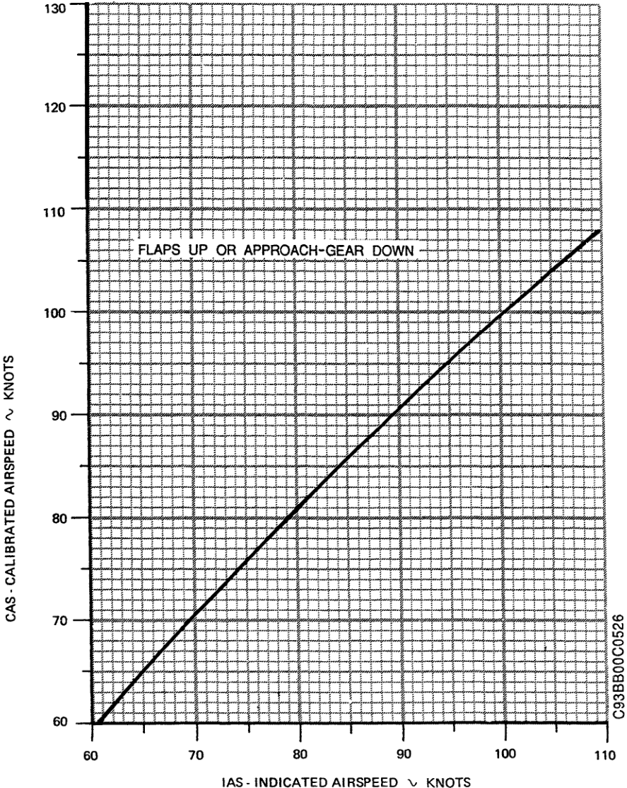

## AIRSPEED CALIBRATION - NORMAL SYSTEM

CAS - Calibrated Airspeed versus IAS - Indicated Airspeed (knots): curve FLAPS UP, and curves FLAPS APPROACH and FLAPS DOWN. *(5-14)*

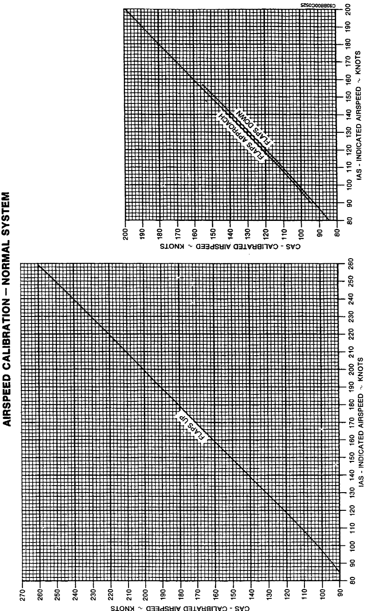

## ALTIMETER CORRECTION - NORMAL SYSTEM

Altimeter correction (feet, add to indicated altitude) versus IAS (knots) for FLAPS UP, FLAPS APPROACH and FLAPS DOWN, at pressure altitudes SL, 10,000 and 35,000 feet. *(5-15)*

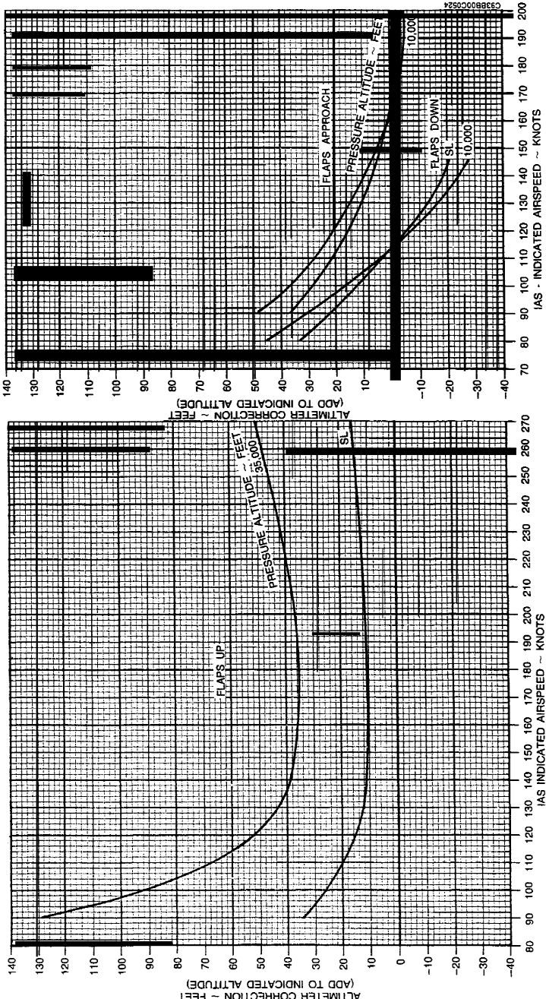

## AIRSPEED CALIBRATION - ALTERNATE SYSTEM

APPLICABLE FOR ALL FLAP POSITIONS — CAS - Calibrated Airspeed versus IAS - Indicated Airspeed (knots). *(5-16)*

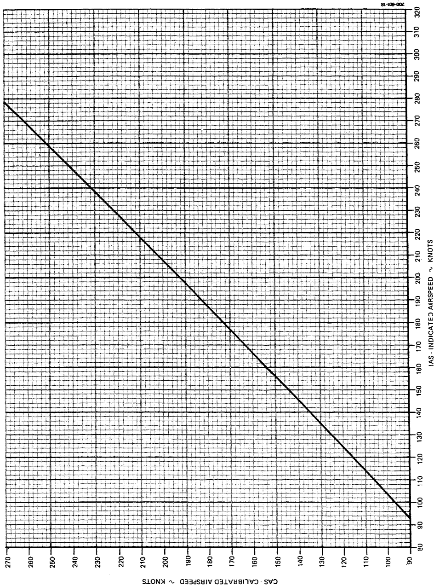

## ALTIMETER CORRECTION - ALTERNATE SYSTEM

APPLICABLE FOR ALL FLAP POSITIONS — Altimeter correction (feet, add to indicated altitude) versus IAS (knots) at pressure altitudes SL, 10,000, 20,000, 30,000 and 35,000 feet. *(5-17)*

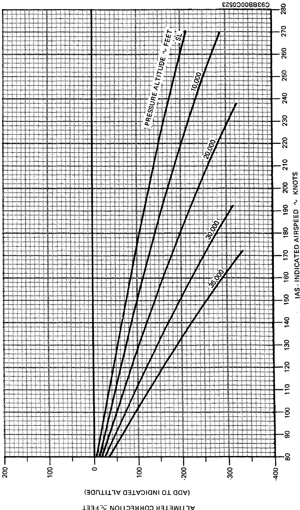

## INDICATED OUTSIDE AIR TEMPERATURE CORRECTION - STANDARD DAY (ISA)

NOTE: SUBTRACT ΔT FROM INDICATED (GAGE) OAT TO OBTAIN TRUE OAT. (ΔT ASSUMES A RECOVERY FACTOR OF 0.7)

Calibrated Airspeed (knots, 80-280) versus ΔT Temperature Correction (°C, 0-18), at pressure altitudes SL, 5000, 10,000, 15,000, 20,000, 25,000, 30,000 and 35,000 feet. *(5-18)*


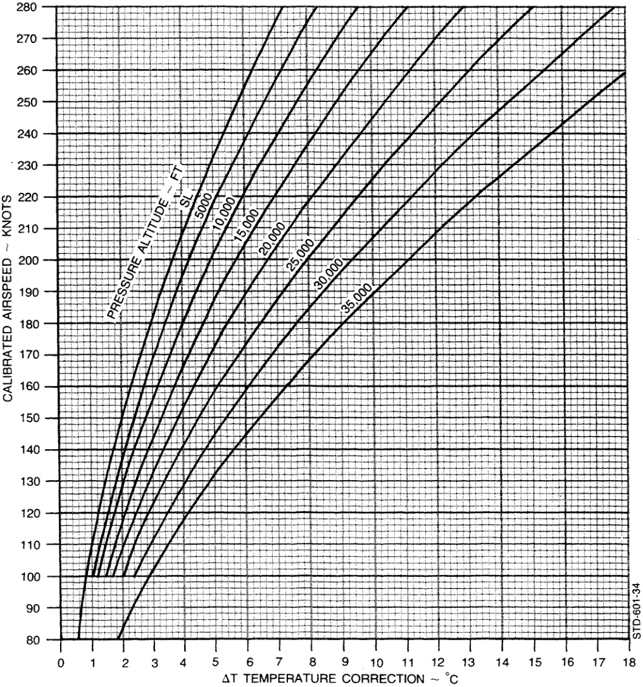

## ISA CONVERSION

PRESSURE ALTITUDE vs OUTSIDE AIR TEMPERATURE — lines ISA -30°C, ISA -20°C, ISA -10°C, ISA, ISA +10°C, ISA +20°C, ISA +30°C, ISA +40°C; temperature -100 to +60°C; pressure altitude 0 to 35,000 feet. *(5-19)*

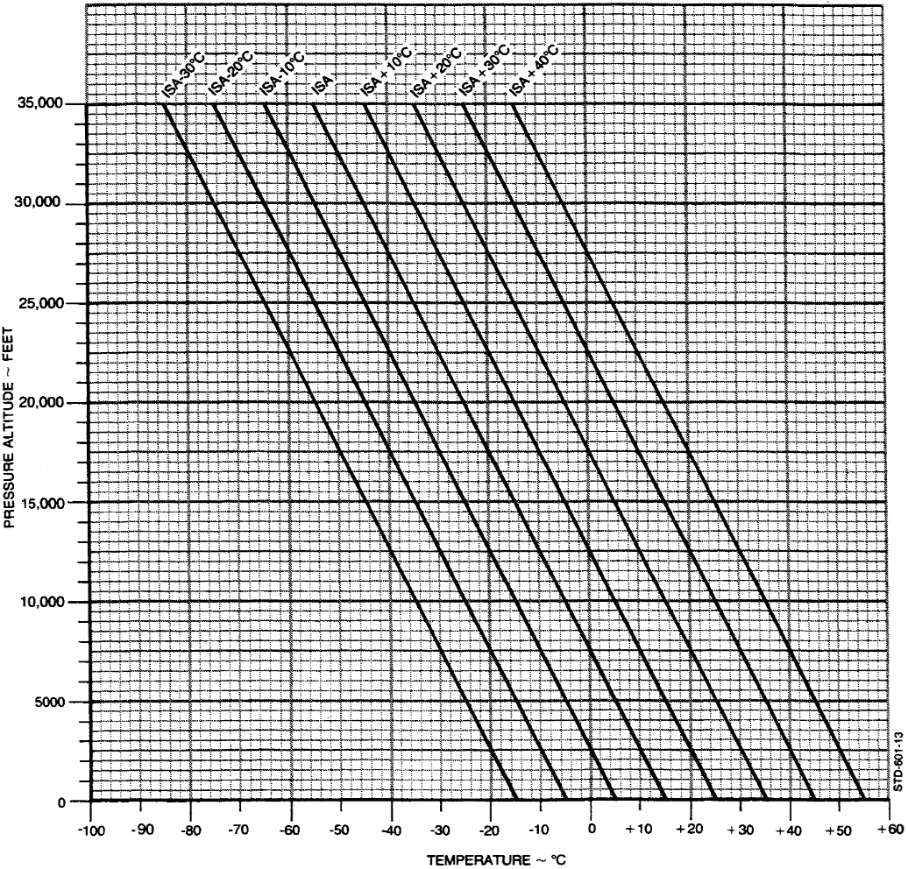

## FAHRENHEIT TO CELSIUS TEMPERATURE CONVERSION

Degrees °C (-60 to 60) versus degrees °F (-60 to 120). *(5-20)*


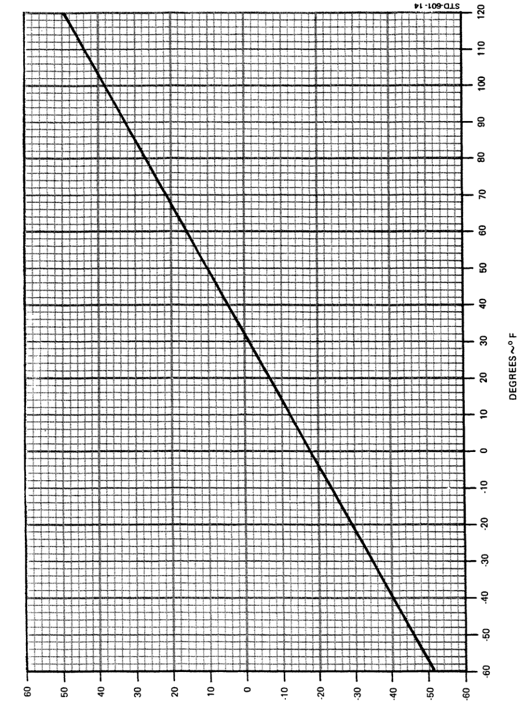

## STALL SPEEDS - POWER IDLE

NOTES:

1. ALTITUDE LOSS EXPERIENCED WHILE CONDUCTING STALLS IN ACCORDANCE WITH FAR 23.201 WAS 600 FEET.
2. MAXIMUM NOSE DOWN PITCH ATTITUDE AND ALTITUDE LOSS DURING RECOVERY FROM ONE-ENGINE-INOPERATIVE STALLS PER FAR 23.205 ARE APPROXIMATELY 8° AND 300 FEET RESPECTIVELY.
3. A NORMAL STALL RECOVERY TECHNIQUE MAY BE USED. THE BEST PROCEDURE IS A BRISK FORWARD WHEEL MOVEMENT TO A NOSE DOWN ATTITUDE, LEVEL THE AIRPLANE AFTER AIRSPEED HAS INCREASED APPROXIMATELY 25 KNOTS ABOVE STALL SPEED.
4. LANDING GEAR POSITION HAS NO EFFECT ON STALL SPEED.

EXAMPLE: WEIGHT 11,700 LBS; FLAPS APPROACH; ANGLE OF BANK 30 DEG.; STALL SPEED 96 KTS CAS / 90 KTS IAS.

Stall speed (knots, 60-130) versus angle of bank (0-60°) and weight (9000-12,000 lb), for FLAPS UP, FLAPS APPROACH and FLAPS DOWN; solid lines CAS - calibrated airspeed, dashed lines IAS - indicated airspeed. *(5-21)*

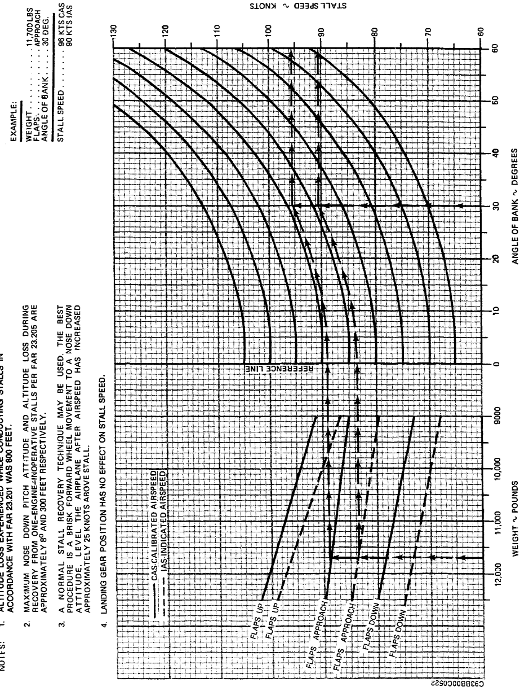

## CABIN ALTITUDE FOR VARIOUS AIRPLANE ALTITUDES

EXAMPLE:

- AIRPLANE ALTITUDE ................ 25,000 FT
- CABIN DIFFERENTIAL PRESSURE ................ 4.0 PSI
- CABIN ALTITUDE ................ 11,800 FT

Cabin differential pressure lines 0 to 7 PSI; ALTITUDE WARNING marked. *(5-22)*


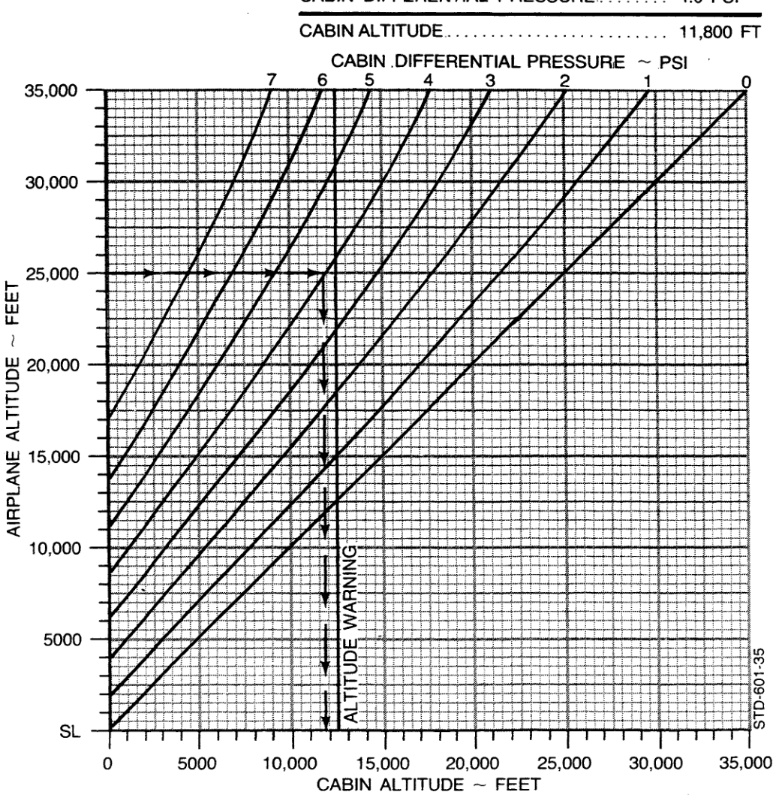

## MAXIMUM TAKE-OFF WEIGHT PERMITTED BY ENROUTE CLIMB REQUIREMENT

NOTE: FOR OPERATION WITH ICE VANES EXTENDED, NO OFF LOADING IS REQUIRED.

STRUCTURAL LIMIT 12,500 pounds. NO OFF LOADING IS REQUIRED TO MEET ENROUTE CLIMB REQUIREMENT. Maximum take-off weight (9000-12,500 lb) versus outside air temperature (-20 to 80°C). *(5-23)*

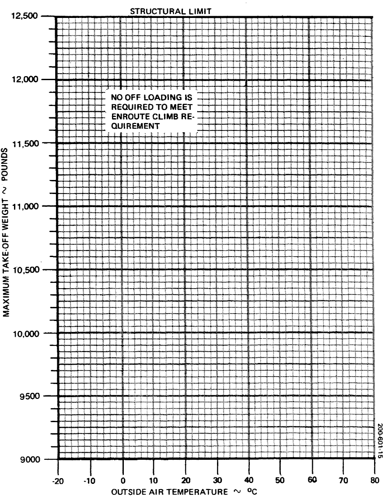

## TAKE-OFF WEIGHT - FLAPS UP

TO ACHIEVE POSITIVE ONE-ENGINE-INOPERATIVE RATE-OF-CLIMB AT LIFT-OFF

ASSOCIATED CONDITIONS: POWER ................ TAKE-OFF; FLAPS ................ UP; LANDING GEAR ................ DOWN; INOPERATIVE PROPELLER ................ FEATHERED

EXAMPLE: PRESSURE ALTITUDE ................ 5433 FT; OAT ................ 28°C; TAKE-OFF WEIGHT ................ 12,500 LBS

NOTE: FOR OPERATION WITH ICE VANES EXTENDED, NO OFF-LOADING IS REQUIRED. *(5-24)*


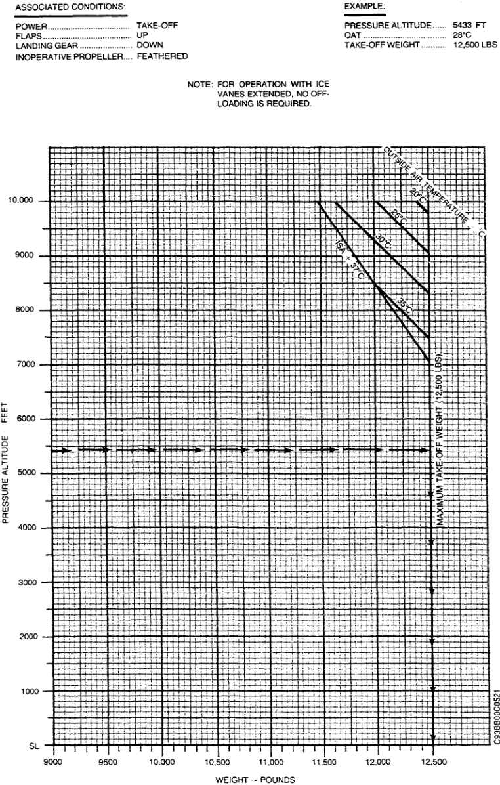

## TAKE-OFF WEIGHT - FLAPS APPROACH

TO ACHIEVE POSITIVE ONE-ENGINE INOPERATIVE RATE OF CLIMB AT LIFT-OFF

ASSOCIATED CONDITIONS: POWER ................ TAKE-OFF; FLAPS ................ APPROACH; LANDING GEAR ................ DOWN; INOPERATIVE PROPELLER ................ FEATHERED

EXAMPLE: PRESSURE ALTITUDE ................ 5433 FT; OAT ................ 28°C; TAKE-OFF WEIGHT ................ 12,450 LBS

NOTE: FOR OPERATION WITH ICE VANES EXTENDED, ADD 10°C TO THE ACTUAL OAT BEFORE ENTERING THE GRAPH. *(5-25)*

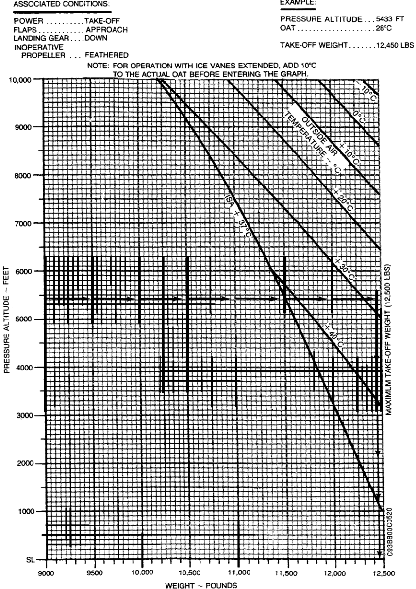

## MAXIMUM ENROUTE WEIGHT [FAR PART 135 - OPERATIONS]

ASSOCIATED CONDITIONS: POWER ................ MAX CONTINUOUS; FLAPS ................ UP; LANDING GEAR ................ UP; INOPERATIVE PROPELLER ................ FEATHERED

EXAMPLE: OAT AT MEA ................ 0°C; MINIMUM ENROUTE ALTITUDE ................ 18,000 FT; ALTIMETER SETTING ................ 29.75 IN. HG; MAXIMUM ALLOWABLE WEIGHT ................ 12,500 LBS

NOTE: PER FAR 135, OPERATIONS OVER THE TOP OR IN IFR CONDITIONS REQUIRE THAT THE AIRPLANE BE CAPABLE OF CLIMBING 50 FT/MIN AT THE MEA'S OF THE PROPOSED ROUTE OR 5000 FT MSL, WHICHEVER IS HIGHER. *(5-26)*

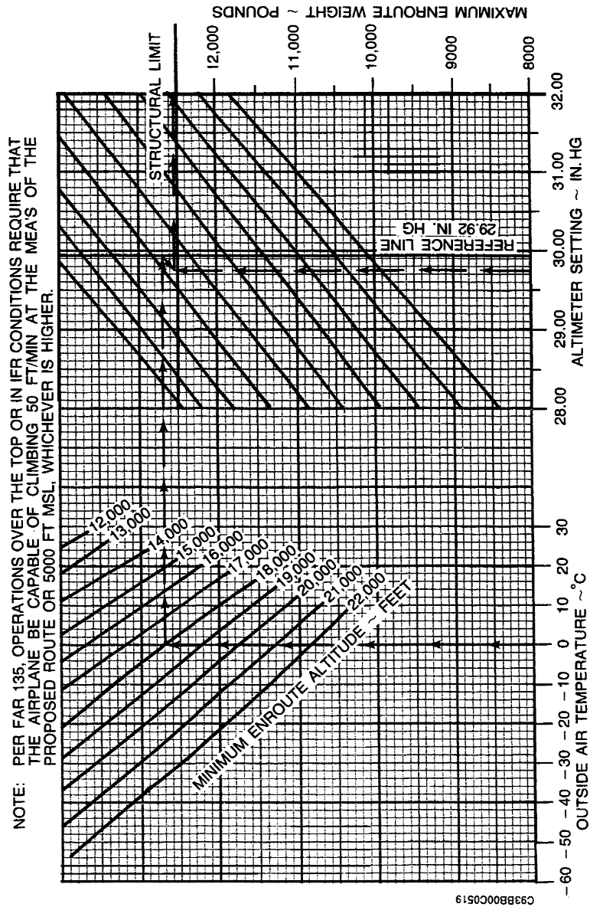

## TAKE-OFF WEIGHT - FLAPS UP

TO MEET FAR 25 TAKE-OFF CLIMB REQUIREMENTS

ASSOCIATED CONDITIONS: AIRPLANE ................ AIRBORNE; POWER ................ TAKE-OFF; FLAPS ................ UP; INOPERATIVE PROPELLER ................ FEATHERED

EXAMPLE: PRESSURE ALTITUDE ................ 5430 FT; OAT ................ 28°C; TAKE-OFF WEIGHT ................ 12,500 LBS

NOTE: FOR OPERATION WITH ICE VANES EXTENDED, NO OFF LOADING IS REQUIRED. *(5-27)*

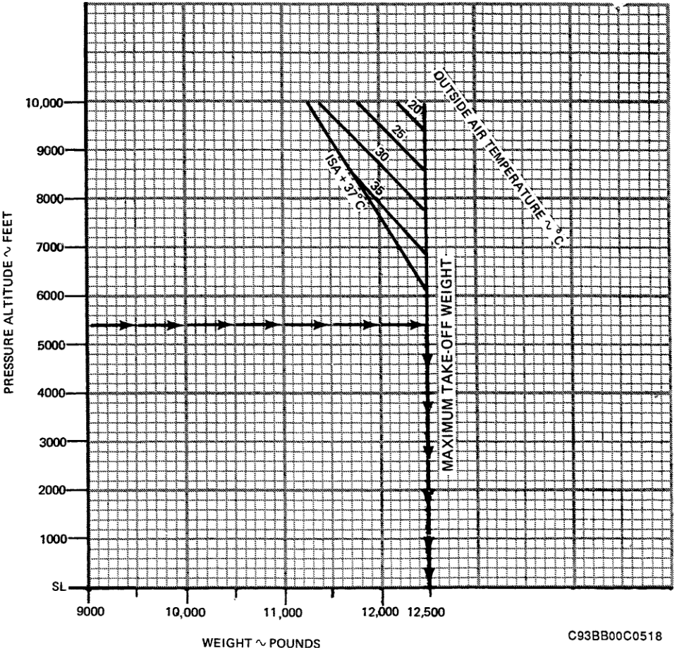

## TAKE-OFF WEIGHT - FLAPS APPROACH

TO MEET FAR 25 TAKE-OFF CLIMB REQUIREMENTS

ASSOCIATED CONDITIONS: AIRPLANE ................ AIRBORNE; POWER ................ TAKE-OFF; FLAPS ................ APPROACH; INOPERATIVE PROPELLER ................ FEATHERED

EXAMPLE: PRESSURE ALTITUDE ................ 5430 FT; OAT ................ 28°C; TAKE-OFF WEIGHT ................ 12,300 LBS

NOTE: FOR OPERATION WITH ICE VANES EXTENDED, ADD 10°C TO ACTUAL OAT BEFORE ENTERING ON GRAPH. *(5-28)*


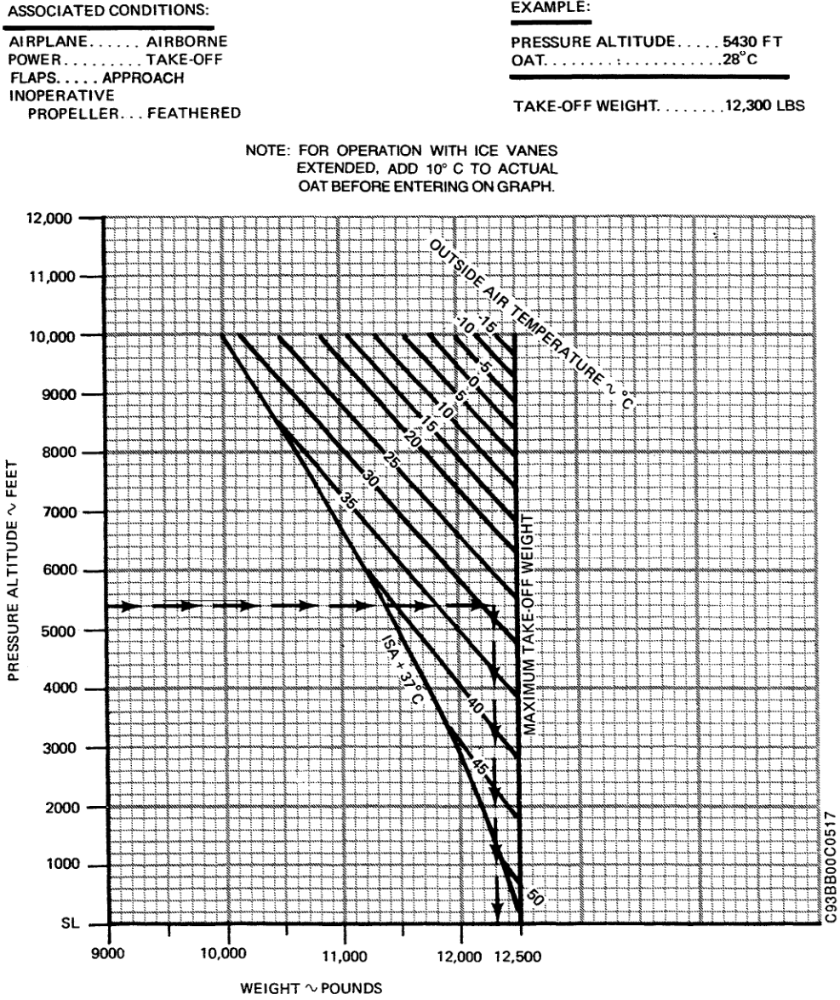

## MINIMUM TAKE-OFF POWER AT 2000 RPM WITH ICE VANES RETRACTED (65 KNOTS)

NOTES:

1. TORQUE INCREASES APPROXIMATELY 20 FT-LBS FROM ZERO TO 65 KNOTS.
2. THE POWER (TORQUE) INDICATED IS THE MINIMUM VALUE FOR WHICH TAKE-OFF PERFORMANCE IN THIS SECTION CAN BE OBTAINED. EXCESS POWER WHICH CAN BE DEVELOPED WITHOUT EXCEEDING ENGINE LIMITATIONS MAY BE UTILIZED.

Engine torque at 2000 RPM (ft-lbs, 1000-2400) versus outside air temperature (-50 to 70°C), by pressure altitude SL to 10,000 feet and ISA +37°C. *(5-29)*


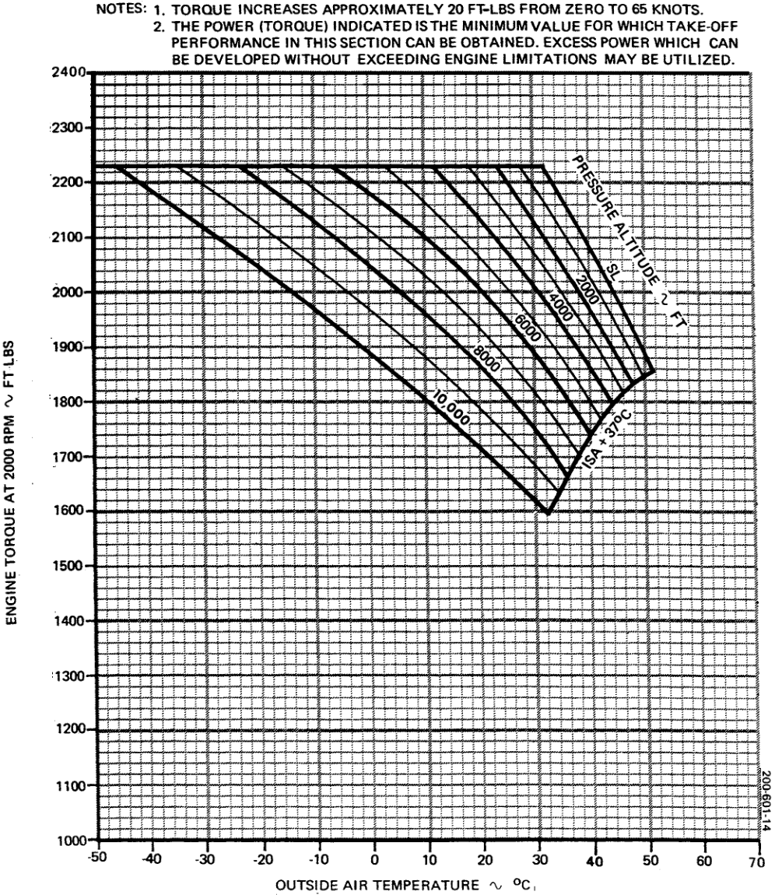

## MINIMUM TAKE-OFF POWER WITH ICE VANES EXTENDED (65 KNOTS)

NOTES:

1. TORQUE INCREASES APPROXIMATELY 20 FT-LBS FROM ZERO TO 65 KNOTS.
2. THE POWER (TORQUE) INDICATED IS THE MINIMUM VALUE FOR WHICH TAKE-OFF PERFORMANCE WITH EXTENDED ICE VANES CAN BE OBTAINED. EXCESS POWER WHICH CAN BE DEVELOPED WITHOUT EXCEEDING ENGINE LIMITATIONS MAY BE UTILIZED.
3. TAKE-OFF WITH VANES EXTENDED IS PROHIBITED IN SHADED AREA.

TORQUE LIMIT - 2230 FT-LBS. Engine torque at 2000 RPM (ft-lbs, 1000-2300) versus outside air temperature (-50 to 70°C), by pressure altitude SL to 10,000 feet and ISA +37°C. *(5-30)*

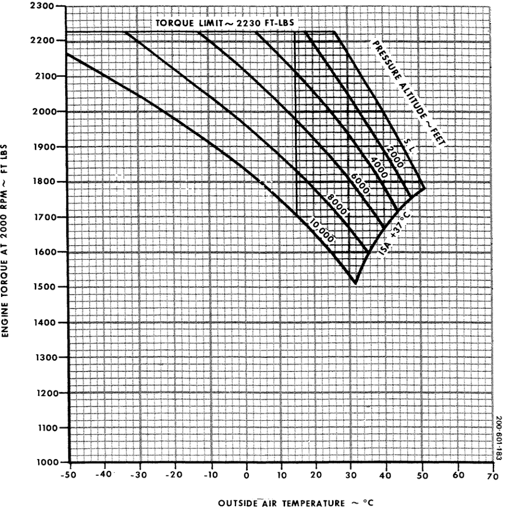


## TAKE-OFF FLIGHT PATH

REFERENCE ZERO: THE POINT AT THE END OF THE TAKE-OFF RUN AT WHICH THE AIRPLANE IS 35 FEET ABOVE THE RUNWAY SURFACE.

EXAMPLE: OBSTACLE HEIGHT ................ 175 FEET

| HORIZONTAL DISTANCE FROM REFERENCE ZERO (FEET) | MINIMUM GRADIENT OF CLIMB (%) |
|---|---|
| 2700 | 5.2 |
| 3386 | 4.1 |
| 4436 | 3.2 |
| 3116 | 4.5 |
| 4336 | 3.3 |

Obstacle height above runway surface (feet) versus horizontal distance from reference zero (feet), lines of minimum gradient of climb (%), with an expanded scale. *(5-31)*

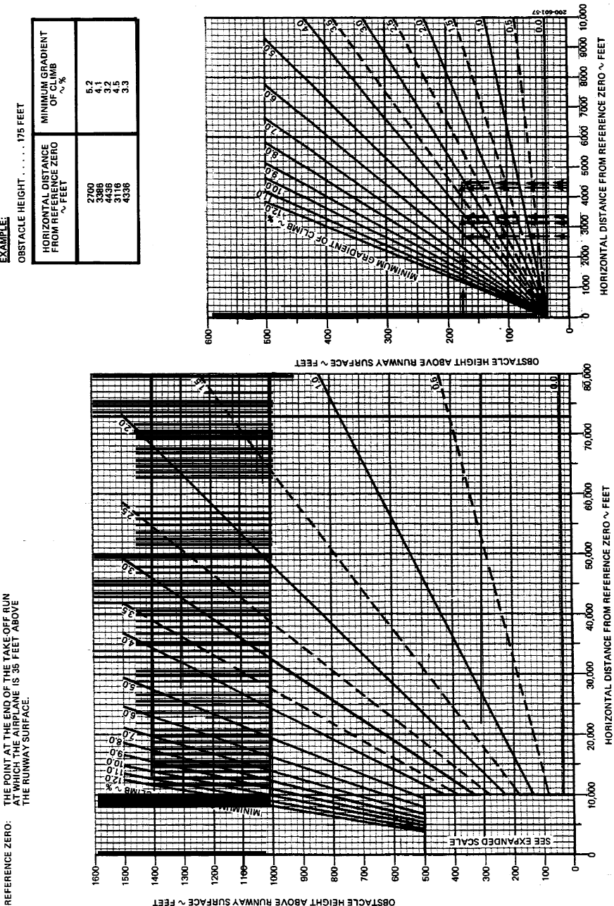

## WIND COMPONENTS

EXAMPLE: WIND SPEED ................ 10 KNOTS; ANGLE BETWEEN WIND DIRECTION AND FLIGHT PATH ................ 20°

- HEADWIND COMPONENT ................ 9.5 KNOTS
- CROSSWIND COMPONENT ................ 3.5 KNOTS

Headwind component (knots, -20 to 60) versus crosswind component (knots, 0 to 60). *(5-32)*

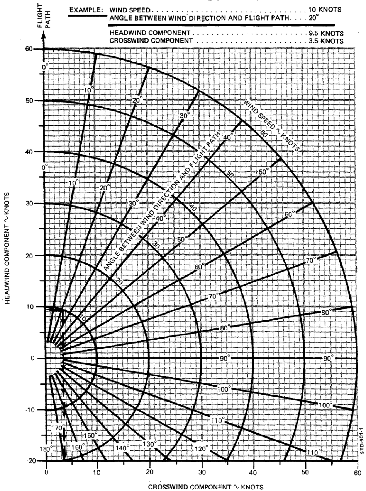

## TAKE-OFF DISTANCE - FLAPS UP

ASSOCIATED CONDITIONS: POWER ................ TAKE-OFF POWER SET BEFORE BRAKE RELEASE; FLAPS ................ UP; LANDING GEAR ................ RETRACT AFTER LIFT-OFF; RUNWAY ................ PAVED, LEVEL, DRY SURFACE

| WEIGHT (POUNDS) | TAKE-OFF SPEED (KNOTS) ROTATION | TAKE-OFF SPEED (KNOTS) 50 FT |
|---|---|---|
| 12,500 | 95 | 121 |
| 12,000 | 95 | 119 |
| 11,000 | 95 | 115 |
| 10,000 | 95 | 111 |
| 9000 | 95 | 108 |

EXAMPLE: OAT ................ 28°C; PRESSURE ALTITUDE ................ 5433 FT; TAKE-OFF WEIGHT ................ 12,500 LBS; HEADWIND COMPONENT ................ 9.5 KTS

- GROUND ROLL ................ 2870 FT
- TOTAL DISTANCE OVER 50 FT OBSTACLE ................ 4900 FT
- TAKE-OFF SPEED AT ROTATION ................ 95 KTS
- AT 50 FT ................ 121 KTS

NOTE: FOR OPERATION WITH ICE VANES EXTENDED, ADD 10°C TO THE ACTUAL OAT BEFORE ENTERING GRAPH. *(5-33)*

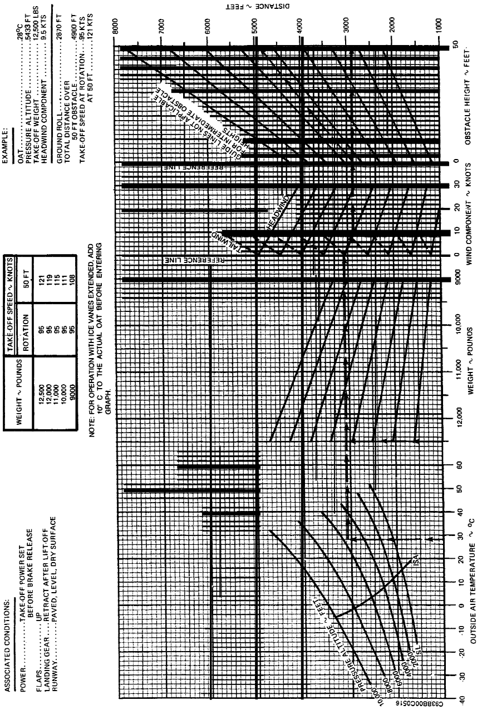

## ACCELERATE - STOP - FLAPS UP

ASSOCIATED CONDITIONS:

- POWER: 1. TAKE-OFF POWER SET BEFORE BRAKE RELEASE; 2. BOTH ENGINES IDLE AT V1 SPEED AND REVERSE OPERATING ENGINE
- FLAPS ................ UP
- AUTOFEATHER ................ ARMED
- BRAKING ................ MAXIMUM
- RUNWAY ................ PAVED, LEVEL, DRY SURFACE

| WEIGHT (POUNDS) | V1 (KNOTS) |
|---|---|
| 12,500 | 95 |
| 12,000 | 95 |
| 11,000 | 95 |
| 10,000 | 95 |
| 9000 | 95 |

NOTE: FOR OPERATION WITH ICE VANES EXTENDED, PERFORMANCE IS NOT AFFECTED.

EXAMPLE: OAT ................ 28°C; PRESSURE ALTITUDE ................ 5430 FT; WEIGHT ................ 12,500 LBS; HEADWIND COMPONENT ................ 9.5 KTS

- FIELD LENGTH ................ 4375 FT
- V1 ................ 95 KTS *(5-34)*

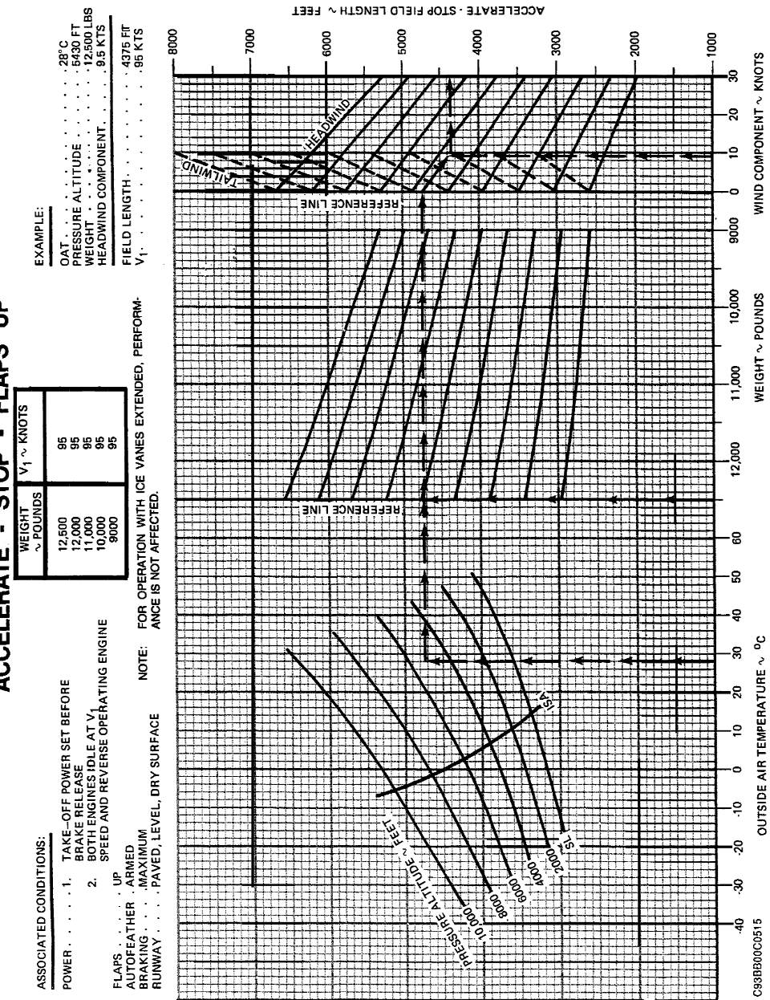

## ACCELERATE - GO - FLAPS UP

ASSOCIATED CONDITION: POWER ................ TAKE-OFF POWER SET BEFORE BRAKE RELEASE; FLAPS ................ UP; AUTOFEATHER ................ ARMED; LANDING GEAR ................ RETRACT AFTER LIFT-OFF; RUNWAY ................ PAVED, LEVEL, DRY SURFACE; OBSTACLE HEIGHT ................ 35 FEET

| WEIGHT (POUNDS) | SPEED (KNOTS) VR | SPEED (KNOTS) V2 |
|---|---|---|
| 12,500 | 95 | 121 |
| 12,000 | 95 | 119 |
| 11,000 | 95 | 115 |
| 10,000 | 95 | 111 |
| 9000 | 95 | 108 |

NOTE:

1. AIR DISTANCE IS 50% OF TAKE-OFF FIELD LENGTH
2. V1 (ENGINE FAILURE SPEED) EQUALS VR (ROTATION SPEED).
3. USABLE CLEAR WAY CANNOT EXCEED 25% OF THE RUNWAY LENGTH.
4. FOR OPERATION WITH ICE VANES EXTENDED, ADD 6°C TO THE ACTUAL OAT BEFORE ENTERING THE GRAPH.

EXAMPLE: OAT ................ 28°C; PRESSURE ALTITUDE ................ 5430 FT; HEADWIND COMPONENT ................ 9.5 KTS

| TAKE-OFF WEIGHT (POUNDS) | TAKE-OFF FIELD LENGTH (FEET) |
|---|---|
| 12,500 | 10,950 |
| 10,650 | 6786 |
| 10,470 | 6370 |

SPEEDS (10,470 POUNDS): VR ................ 95 KTS; V2 ................ 113 KTS *(5-35)*

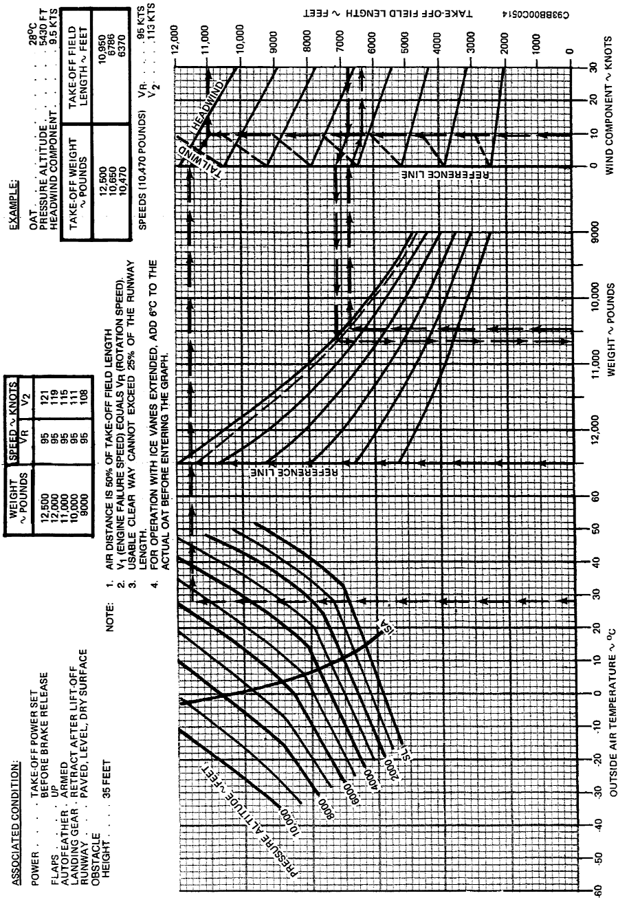

## NET GRADIENT OF CLIMB - FLAPS UP

ASSOCIATED CONDITIONS: POWER ................ TAKE-OFF; FLAPS ................ UP; LANDING GEAR ................ UP; INOPERATIVE PROPELLER ................ FEATHERED

| WEIGHT (POUNDS) | CLIMB SPEED (KNOTS) |
|---|---|
| 12,500 | 121 |
| 12,000 | 119 |
| 11,000 | 115 |
| 10,000 | 111 |
| 9000 | 108 |

NOTE: FOR OPERATION WITH ICE VANES EXTENDED, ADD 10°C TO THE ACTUAL OAT BEFORE ENTERING GRAPH.

EXAMPLE: OAT ................ 28°C; PRESSURE ALTITUDE ................ 5430 FT

| WEIGHT (POUNDS) | NET GRADIENT OF CLIMB (%) |
|---|---|
| 10,650 | 4.3 |
| 9900 | 5.2 |
| 10,470 | 4.5 |

CLIMB SPEED @ 10,470 LBS ................ 113 KTS *(5-36)*

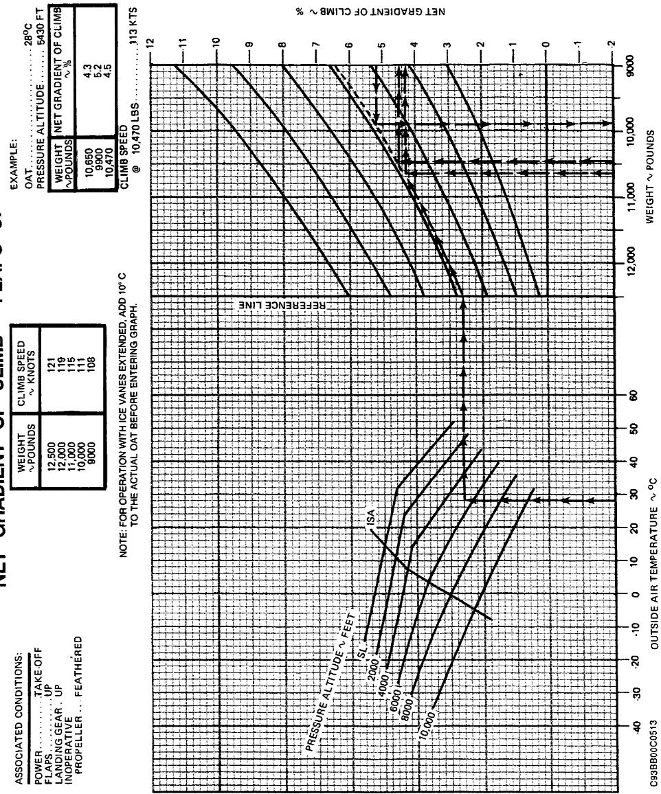

## TAKE-OFF DISTANCE - FLAPS APPROACH

ASSOCIATED CONDITIONS: POWER ................ TAKE-OFF POWER SET BEFORE BRAKE RELEASE; FLAPS ................ APPROACH; LANDING GEAR ................ RETRACT AFTER LIFT-OFF; RUNWAY ................ PAVED, LEVEL, DRY SURFACE

| WEIGHT (POUNDS) | TAKE-OFF SPEED (KNOTS) ROTATION | TAKE-OFF SPEED (KNOTS) 50 FT |
|---|---|---|
| 12,500 | 94 | 106 |
| 12,000 | 94 | 105 |
| 11,000 | 94 | 103 |
| 10,000 | 94 | 101 |
| 9000 | 94 | 99 |

NOTE: FOR OPERATION WITH ICE VANES EXTENDED, ADD 10°C TO THE ACTUAL OAT BEFORE ENTERING GRAPH.

EXAMPLE: OAT ................ 28°C; PRESSURE ALTITUDE ................ 5433 FT; TAKE-OFF WEIGHT ................ 12,500 LBS; HEADWIND COMPONENT ................ 9.5 KTS

- GROUND ROLL ................ 2700 FT
- TOTAL DISTANCE OVER 50 FT OBSTACLE ................ 3750 FT
- TAKE-OFF SPEED AT ROTATION ................ 94 KTS
- AT 50 FT ................ 106 KTS *(5-37)*

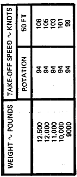
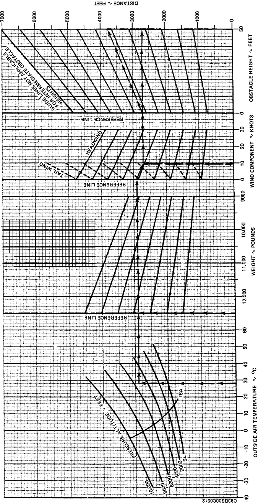

## ACCELERATE - STOP - FLAPS APPROACH

ASSOCIATED CONDITIONS:

- POWER: 1. TAKE-OFF POWER SET BEFORE BRAKE RELEASE; 2. BOTH ENGINES IDLE AT V1 SPEED AND REVERSE OPERATING ENGINE
- FLAPS ................ APPROACH
- AUTOFEATHER ................ ARMED
- BRAKING ................ MAXIMUM
- RUNWAY ................ PAVED, LEVEL, DRY SURFACE

| WEIGHT (POUNDS) | V1 (KNOTS) |
|---|---|
| 12,500 | 94 |
| 12,000 | 94 |
| 11,000 | 94 |
| 10,000 | 94 |
| 9000 | 94 |

NOTE: FOR OPERATION WITH ICE VANES EXTENDED, PERFORMANCE IS NOT AFFECTED.

EXAMPLE: OAT ................ 28°C; PRESSURE ALTITUDE ................ 5430 FT; WEIGHT ................ 12,300 LBS; HEADWIND COMPONENT ................ 9.5 KTS

- FIELD LENGTH ................ 4370 FT
- V1 ................ 94 KTS *(5-38)*

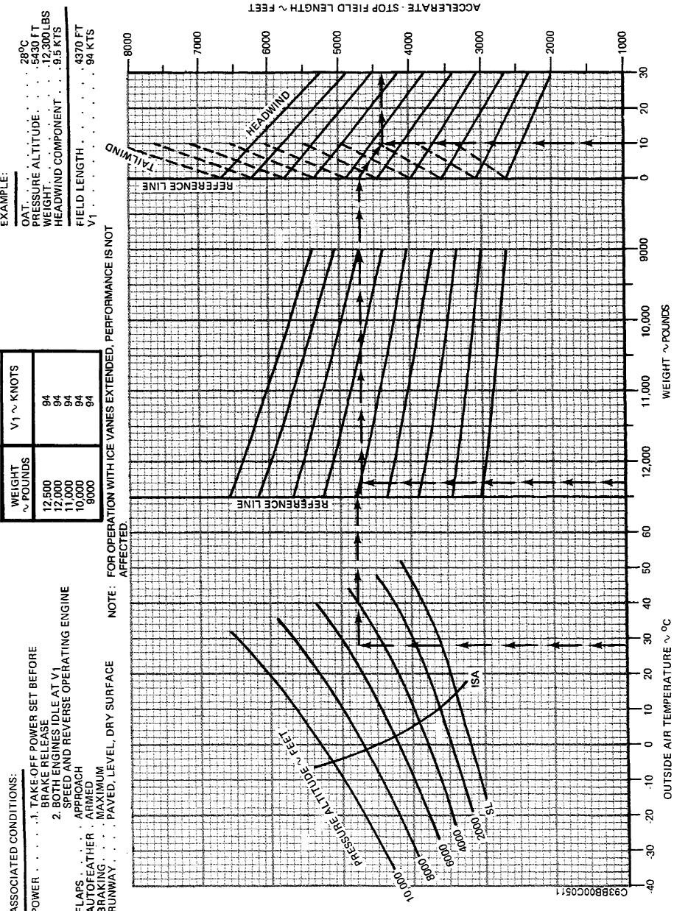

## ACCELERATE - GO - FLAPS APPROACH

ASSOCIATED CONDITIONS: POWER ................ TAKE-OFF POWER SET BEFORE BRAKE RELEASE; FLAPS ................ APPROACH; AUTOFEATHER ................ ARMED; LANDING GEAR ................ RETRACT AFTER LIFT-OFF; RUNWAY ................ PAVED, LEVEL, DRY SURFACE; OBSTACLE HEIGHT ................ 35 FEET

| WEIGHT (POUNDS) | SPEED (KNOTS) VR | SPEED (KNOTS) V2 |
|---|---|---|
| 12,500 | 94 | 106 |
| 12,000 | 94 | 105 |
| 11,000 | 94 | 103 |
| 10,000 | 94 | 101 |
| 9000 | 94 | 99 |

NOTE:

1. AIR DISTANCE IS 50% OF TAKE-OFF FIELD LENGTH.
2. V1 (ENGINE FAILURE SPEED) EQUALS VR (ROTATION SPEED).
3. USABLE CLEARWAY CANNOT EXCEED 25% OF THE RUNWAY LENGTH.
4. FOR OPERATION WITH ICE VANES EXTENDED, ADD 6°C TO THE ACTUAL OAT BEFORE ENTERING GRAPH.

EXAMPLE: OAT ................ 28°C; PRESSURE ALTITUDE ................ 5430 FT; HEADWIND COMPONENT ................ 9.5 KTS

| TAKE-OFF WEIGHT (POUNDS) | TAKE-OFF FIELD LENGTH (FEET) |
|---|---|
| 12,300 | 8080 |
| 11,700 | 6786 |
| 10,625 | 5150 |

SPEEDS (10,625 POUNDS): VR ................ 94 KTS; V2 ................ 102 KTS *(5-39)*

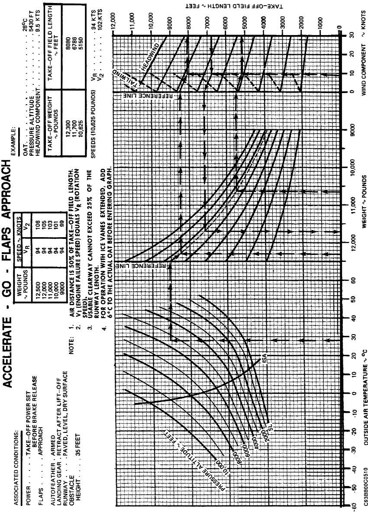

## NET GRADIENT OF CLIMB - FLAPS APPROACH

ASSOCIATED CONDITIONS: POWER ................ TAKE-OFF; FLAPS ................ APPROACH; LANDING GEAR ................ UP; INOPERATIVE PROPELLER ................ FEATHERED

| WEIGHT (POUNDS) | CLIMB SPEED (KNOTS) |
|---|---|
| 12,500 | 106 |
| 12,000 | 105 |
| 11,000 | 103 |
| 10,000 | 101 |
| 9000 | 99 |

NOTE: FOR OPERATION WITH ICE VANES EXTENDED, ADD 10°C TO THE ACTUAL OAT BEFORE ENTERING GRAPH.

EXAMPLE: OAT ................ 28°C; PRESSURE ALTITUDE ................ 5430 FT

| WEIGHT (POUNDS) | NET GRADIENT OF CLIMB (%) |
|---|---|
| 11,700 | 2.1 |
| 9250 | 5.2 |
| 10,625 | 3.3 |

CLIMB SPEED @ 10,625 LBS ................ 102 KTS *(5-40)*

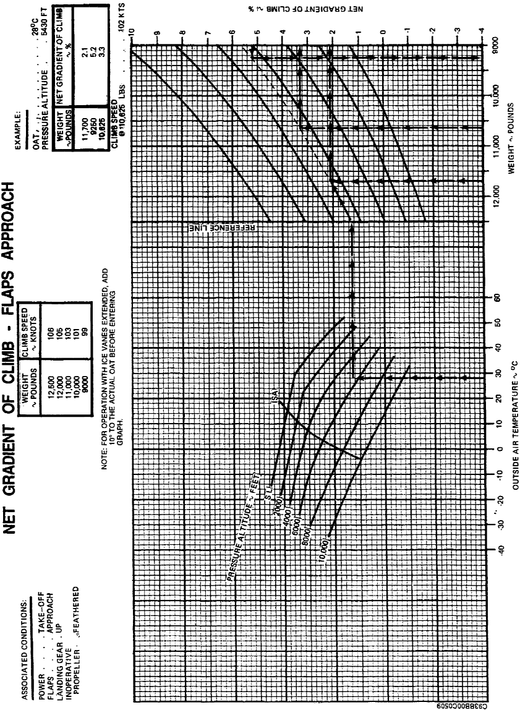

## CLIMB - TWO ENGINES - FLAPS UP

ASSOCIATED CONDITIONS: POWER ................ MAX CONTINUOUS; FLAPS ................ UP; LANDING GEAR ................ UP

| WEIGHT (POUNDS) | CLIMB SPEED (KNOTS) |
|---|---|
| 12,500 | 125 |
| 12,000 | 124 |
| 11,000 | 121 |
| 10,000 | 118 |
| 9000 | 115 |

EXAMPLE: OAT ................ -6°C; PRESSURE ALTITUDE ................ 18,000 FT; WEIGHT ................ 12,405 LBS

- RATE OF CLIMB ................ 1400 FT/MIN
- CLIMB GRADIENT ................ 8%
- CLIMB SPEED ................ 125 KTS

NOTE: DURING OPERATION WITH ICE VANES EXTENDED, RATE OF CLIMB WILL BE REDUCED APPROXIMATELY 250 FEET PER MINUTE. *(5-41)*

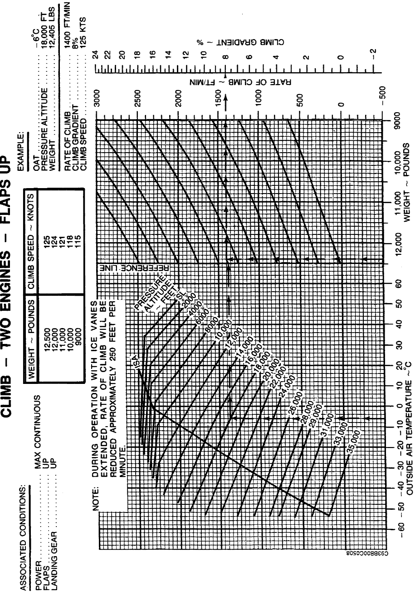

## CLIMB - TWO ENGINES - FLAPS APPROACH

ASSOCIATED CONDITIONS: POWER ................ MAX CONTINUOUS; FLAPS ................ APPROACH; LANDING GEAR ................ UP

| WEIGHT (POUNDS) | CLIMB SPEED (KNOTS) |
|---|---|
| 12,500 | 125 |
| 12,000 | 124 |
| 11,000 | 121 |
| 10,000 | 118 |
| 9000 | 115 |

EXAMPLE: OAT ................ -6°C; PRESSURE ALTITUDE ................ 18,000 FT; WEIGHT ................ 12,405 LBS

- RATE OF CLIMB ................ 1190 FT/MIN
- CLIMB GRADIENT ................ 6.9%
- CLIMB SPEED ................ 125 KTS

NOTE: DURING OPERATION WITH ICE VANES EXTENDED, RATE OF CLIMB WILL BE REDUCED APPROXIMATELY 250 FEET PER MINUTE. *(5-42)*

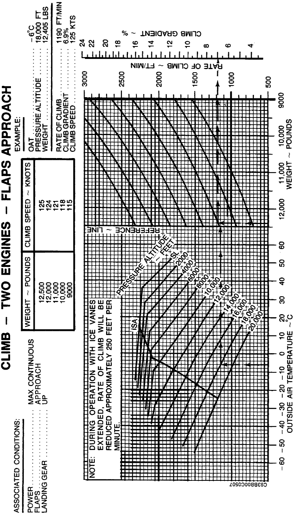

## CLIMB - ONE ENGINE INOPERATIVE

ASSOCIATED CONDITIONS: POWER ................ MAX CONTINUOUS; FLAPS ................ UP; LANDING GEAR ................ UP; INOPERATIVE PROPELLER ................ FEATHERED

| WEIGHT (POUNDS) | CLIMB SPEED (KNOTS) |
|---|---|
| 12,500 | 121 |
| 12,000 | 119 |
| 11,000 | 117 |
| 10,000 | 114 |
| 9000 | 111 |

EXAMPLE: OAT ................ -6°C; PRESSURE ALTITUDE ................ 18,000 FT; WEIGHT ................ 12,405 LBS

- RATE OF CLIMB ................ 120 FT/MIN
- CLIMB GRADIENT ................ 0.8%
- CLIMB SPEED ................ 121 KTS

NOTE: DURING OPERATION WITH ICE VANE EXTENDED, RATE OF CLIMB WILL BE REDUCED APPROXIMATELY 100 FEET PER MINUTE. *(5-43)*

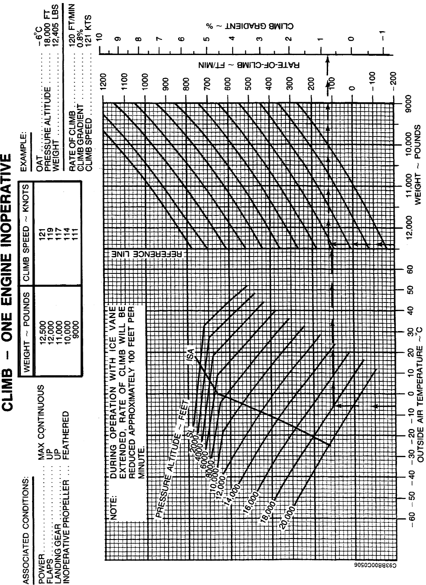

## SERVICE CEILING - ONE ENGINE INOPERATIVE

ASSOCIATED CONDITIONS: POWER ................ MAXIMUM CONTINUOUS; LANDING GEAR ................ UP; INOPERATIVE PROPELLER ................ FEATHERED; FLAPS ................ UP

NOTE: SERVICE CEILING IS THE MAXIMUM PRESSURE ALTITUDE AT WHICH THE AIRPLANE IS CAPABLE OF CLIMBING 50 FT/MINUTE WITH ONE PROPELLER FEATHERED.

EXAMPLE: OAT AT MEA ................ 0°C; WEIGHT ................ 12,393 LBS; ROUTE SEGMENT MEA ................ 18,000 FT

- SERVICE CEILING ................ 18,730 FT

NOTE: SERVICE CEILING IS ABOVE ENROUTE MEA.

NOTE: DURING OPERATION WITH ICE VANE EXTENDED, SERVICE CEILING WILL BE LOWERED APPROXIMATELY 1500 FEET. *(5-44)*


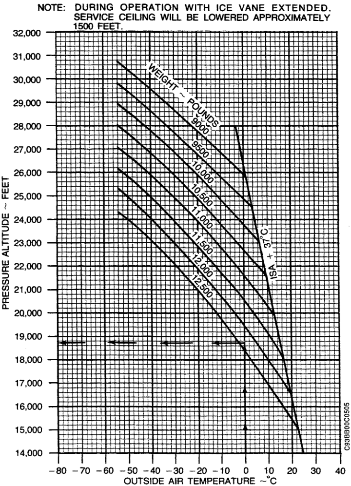

## TIME, FUEL, AND DISTANCE TO CLIMB

ASSOCIATED CONDITIONS: PROPELLER SPEED ................ 1900 RPM; ITT ................ 770°C; OR TORQUE ................ 2230 FT-LBS

| ALTITUDE (FEET) | CLIMB SPEED (KTS) |
|---|---|
| SL TO 10,000 | 160 |
| 10,000 TO 20,000 | 140 |
| 20,000 TO 25,000 | 130 |
| 25,000 TO 35,000 | 120 |

EXAMPLE: OAT AT TAKEOFF ................ 28°C; OAT AT CRUISE ................ -10°C; AIRPORT PRESSURE ALTITUDE ................ 5433 FT; CRUISE ALTITUDE ................ 26,000 FT; INITIAL CLIMB WEIGHT ................ 12,500 LBS

- TIME TO CLIMB (21-3) ................ 18 MIN
- FUEL TO CLIMB (250-47) ................ 203 LBS
- DISTANCE TO CLIMB (62-8) ................ 54 NM

NOTE:

1. ADD 90 LBS FUEL FOR START, TAXI, AND TAKEOFF.
2. FOR OPERATION WITH ICE VANES EXTENDED, ADD 20°C TO THE ACTUAL OAT BEFORE ENTERING THE GRAPH. *(5-45)*

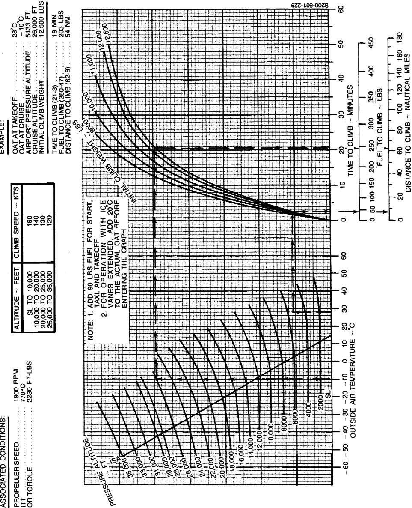

## NORMAL CRUISE POWER — 1700 RPM

**ISA -30°C**

NOTE: IOAT, TORQUE, AND FUEL FLOW BASED ON 11,000 POUNDS.

| PRESSURE ALTITUDE (FEET) | IOAT °C | OAT °C | TORQUE PER ENGINE (FT-LBS) | FUEL FLOW PER ENGINE (LBS/HR) | TOTAL FUEL FLOW (LBS/HR) | @12,000 LBS IAS | @12,000 LBS TAS | @11,000 LBS IAS | @11,000 LBS TAS | @10,000 LBS IAS | @10,000 LBS TAS |
|---|---|---|---|---|---|---|---|---|---|---|---|
| SL | -10 | -15 | 2230 | 463 | 926 | 243 | 231 | 244 | 232 | 245 | 233 |
| 2000 | -14 | -19 | 2230 | 452 | 904 | 241 | 235 | 242 | 236 | 243 | 237 |
| 4000 | -18 | -23 | 2230 | 439 | 878 | 239 | 240 | 240 | 241 | 240 | 242 |
| 6000 | -21 | -27 | 2230 | 428 | 856 | 237 | 244 | 237 | 245 | 238 | 246 |
| 8000 | -25 | -31 | 2230 | 417 | 834 | 234 | 249 | 235 | 250 | 236 | 251 |
| 10,000 | -29 | -35 | 2230 | 406 | 812 | 232 | 254 | 233 | 255 | 234 | 256 |
| 12,000 | -33 | -39 | 2230 | 396 | 792 | 230 | 259 | 231 | 260 | 231 | 261 |
| 14,000 | -36 | -43 | 2230 | 389 | 778 | 227 | 264 | 228 | 265 | 229 | 266 |
| 16,000 | -40 | -47 | 2230 | 384 | 768 | 225 | 269 | 226 | 270 | 227 | 271 |
| 18,000 | -44 | -51 | 2230 | 379 | 758 | 223 | 274 | 224 | 276 | 225 | 277 |

Células "---" no original (altitudes sem dados) foram omitidas das linhas acima.

*(5-46)*


## NORMAL CRUISE POWER — 1700 RPM

**ISA -20°C**

NOTE: IOAT, TORQUE, AND FUEL FLOW BASED ON 11,000 POUNDS.

| PRESSURE ALTITUDE (FEET) | IOAT °C | OAT °C | TORQUE PER ENGINE (FT-LBS) | FUEL FLOW PER ENGINE (LBS/HR) | TOTAL FUEL FLOW (LBS/HR) | @12,000 LBS IAS | @12,000 LBS TAS | @11,000 LBS IAS | @11,000 LBS TAS | @10,000 LBS IAS | @10,000 LBS TAS |
|---|---|---|---|---|---|---|---|---|---|---|---|
| SL | 0 | -5 | 2230 | 466 | 932 | 242 | 234 | 242 | 235 | 243 | 236 |
| 2000 | -4 | -9 | 2230 | 453 | 906 | 239 | 238 | 240 | 239 | 241 | 240 |
| 4000 | -7 | -13 | 2230 | 440 | 880 | 237 | 243 | 238 | 244 | 239 | 245 |
| 6000 | -11 | -17 | 2230 | 428 | 856 | 235 | 248 | 236 | 248 | 237 | 249 |
| 8000 | -15 | -21 | 2230 | 418 | 836 | 232 | 252 | 233 | 253 | 234 | 254 |
| 10,000 | -19 | -25 | 2230 | 408 | 816 | 231 | 257 | 231 | 258 | 232 | 259 |
| 12,000 | -22 | -29 | 2230 | 398 | 796 | 228 | 262 | 229 | 263 | 230 | 264 |
| 14,000 | -26 | -33 | 2230 | 391 | 782 | 225 | 267 | 226 | 269 | 227 | 270 |
| 16,000 | -30 | -37 | 2230 | 385 | 770 | 223 | 273 | 224 | 274 | 225 | 275 |
| 18,000 | -33 | -41 | 2230 | 381 | 762 | 220 | 278 | 221 | 279 | 223 | 280 |
| 20,000 | -37 | -45 | 2230 | 378 | 756 | 218 | 283 | 219 | 284 | 220 | 286 |
| 22,000 | -41 | -49 | 2155 | 364 | 728 | 212 | 284 | 213 | 287 | 215 | 288 |
| 24,000 | -44 | -53 | 2029 | 341 | 682 | 204 | 283 | 206 | 286 | 208 | 288 |

Células "---" no original (altitudes sem dados) foram omitidas das linhas acima.

*(5-47)*


## NORMAL CRUISE POWER — 1700 RPM

**ISA -10°C**

NOTE: IOAT, TORQUE, AND FUEL FLOW BASED ON 11,000 POUNDS.

| PRESSURE ALTITUDE (FEET) | IOAT °C | OAT °C | TORQUE PER ENGINE (FT-LBS) | FUEL FLOW PER ENGINE (LBS/HR) | TOTAL FUEL FLOW (LBS/HR) | @12,000 LBS IAS | @12,000 LBS TAS | @11,000 LBS IAS | @11,000 LBS TAS | @10,000 LBS IAS | @10,000 LBS TAS |
|---|---|---|---|---|---|---|---|---|---|---|---|
| SL | 10 | 5 | 2230 | 469 | 938 | 240 | 237 | 241 | 238 | 241 | 238 |
| 2000 | 6 | 1 | 2230 | 456 | 912 | 238 | 241 | 239 | 242 | 239 | 243 |
| 4000 | 3 | -3 | 2230 | 443 | 886 | 235 | 246 | 236 | 247 | 237 | 248 |
| 6000 | -1 | -7 | 2230 | 431 | 862 | 233 | 250 | 234 | 251 | 235 | 252 |
| 8000 | -5 | -11 | 2230 | 419 | 838 | 231 | 255 | 232 | 256 | 232 | 257 |
| 10,000 | -9 | -15 | 2230 | 408 | 816 | 228 | 260 | 229 | 261 | 230 | 262 |
| 12,000 | -12 | -19 | 2230 | 399 | 798 | 226 | 265 | 227 | 266 | 228 | 268 |
| 14,000 | -16 | -23 | 2230 | 392 | 784 | 224 | 271 | 225 | 272 | 226 | 273 |
| 16,000 | -20 | -27 | 2230 | 387 | 774 | 221 | 276 | 222 | 277 | 223 | 278 |
| 18,000 | -23 | -31 | 2230 | 383 | 766 | 218 | 281 | 219 | 282 | 221 | 284 |
| 20,000 | -27 | -35 | 2155 | 368 | 736 | 212 | 282 | 214 | 284 | 215 | 286 |
| 22,000 | -31 | -39 | 2055 | 350 | 700 | 206 | 283 | 208 | 285 | 209 | 287 |
| 24,000 | -35 | -43 | 1933 | 328 | 656 | 198 | 282 | 200 | 284 | 202 | 287 |
| 26,000 | -39 | -47 | 1800 | 305 | 610 | 190 | 279 | 192 | 282 | 195 | 285 |
| 28,000 | -43 | -51 | 1662 | 281 | 562 | 181 | 275 | 184 | 279 | 186 | 283 |
| 29,000 | -45 | -52 | 1595 | 270 | 540 | 176 | 273 | 179 | 277 | 182 | 281 |

Células "---" no original (altitudes sem dados) foram omitidas das linhas acima.

*(5-48)*


## NORMAL CRUISE POWER — 1700 RPM

**ISA**

NOTE: IOAT, TORQUE, AND FUEL FLOW BASED ON 11,000 POUNDS.

| PRESSURE ALTITUDE (FEET) | IOAT °C | OAT °C | TORQUE PER ENGINE (FT-LBS) | FUEL FLOW PER ENGINE (LBS/HR) | TOTAL FUEL FLOW (LBS/HR) | @12,000 LBS IAS | @12,000 LBS TAS | @11,000 LBS IAS | @11,000 LBS TAS | @10,000 LBS IAS | @10,000 LBS TAS |
|---|---|---|---|---|---|---|---|---|---|---|---|
| SL | 20 | 15 | 2230 | 473 | 946 | 238 | 239 | 239 | 240 | 240 | 241 |
| 2000 | 17 | 11 | 2230 | 459 | 918 | 236 | 244 | 237 | 245 | 238 | 246 |
| 4000 | 13 | 7 | 2230 | 446 | 892 | 234 | 249 | 235 | 250 | 236 | 250 |
| 6000 | 9 | 3 | 2230 | 433 | 866 | 231 | 253 | 232 | 254 | 233 | 255 |
| 8000 | 5 | -1 | 2230 | 421 | 842 | 229 | 258 | 230 | 259 | 231 | 260 |
| 10,000 | 2 | -5 | 2230 | 410 | 820 | 227 | 263 | 228 | 264 | 229 | 265 |
| 12,000 | -2 | -9 | 2230 | 400 | 800 | 224 | 268 | 225 | 270 | 226 | 271 |
| 14,000 | -6 | -13 | 2230 | 393 | 786 | 222 | 274 | 223 | 275 | 224 | 276 |
| 16,000 | -9 | -17 | 2230 | 388 | 776 | 219 | 279 | 220 | 280 | 221 | 282 |
| 18,000 | -13 | -21 | 2152 | 373 | 746 | 213 | 280 | 215 | 282 | 216 | 284 |
| 20,000 | -17 | -25 | 2057 | 355 | 710 | 207 | 281 | 208 | 283 | 210 | 285 |
| 22,000 | -21 | -29 | 1963 | 337 | 674 | 200 | 281 | 202 | 284 | 204 | 286 |
| 24,000 | -25 | -33 | 1842 | 316 | 632 | 192 | 280 | 195 | 283 | 197 | 285 |
| 26,000 | -29 | -37 | 1712 | 293 | 586 | 184 | 277 | 186 | 280 | 189 | 283 |
| 28,000 | -33 | -41 | 1579 | 270 | 540 | 175 | 272 | 178 | 277 | 180 | 281 |
| 29,000 | -36 | -42 | 1514 | 259 | 518 | 170 | 269 | 173 | 274 | 176 | 279 |
| 31,000 | -40 | -46 | 1391 | 239 | 478 | 160 | 263 | 164 | 270 | 167 | 275 |
| 33,000 | -44 | -50 | 1274 | 220 | 440 | 149 | 254 | 154 | 263 | 158 | 270 |
| 35,000 | -49 | -54 | 1153 | 201 | 402 | 133 | 237 | 143 | 254 | 150 | 263 |

Células "---" no original (altitudes sem dados) foram omitidas das linhas acima.

*(5-49)*


## NORMAL CRUISE POWER — 1700 RPM

**ISA +10°C**

NOTE: IOAT, TORQUE, AND FUEL FLOW BASED ON 11,000 POUNDS.

| PRESSURE ALTITUDE (FEET) | IOAT °C | OAT °C | TORQUE PER ENGINE (FT-LBS) | FUEL FLOW PER ENGINE (LBS/HR) | TOTAL FUEL FLOW (LBS/HR) | @12,000 LBS IAS | @12,000 LBS TAS | @11,000 LBS IAS | @11,000 LBS TAS | @10,000 LBS IAS | @10,000 LBS TAS |
|---|---|---|---|---|---|---|---|---|---|---|---|
| SL | 30 | 25 | 2230 | 475 | 950 | 237 | 242 | 238 | 243 | 239 | 244 |
| 2000 | 27 | 21 | 2230 | 462 | 924 | 235 | 247 | 236 | 248 | 236 | 248 |
| 4000 | 23 | 17 | 2230 | 449 | 898 | 232 | 251 | 233 | 252 | 234 | 253 |
| 6000 | 19 | 13 | 2230 | 436 | 872 | 230 | 256 | 231 | 257 | 232 | 258 |
| 8000 | 15 | 9 | 2230 | 424 | 848 | 227 | 261 | 228 | 262 | 229 | 263 |
| 10,000 | 12 | 5 | 2230 | 412 | 824 | 225 | 266 | 226 | 267 | 227 | 269 |
| 12,000 | 8 | 1 | 2230 | 402 | 804 | 223 | 271 | 224 | 273 | 225 | 274 |
| 14,000 | 4 | -3 | 2230 | 394 | 788 | 220 | 277 | 221 | 278 | 222 | 279 |
| 16,000 | 1 | -7 | 2172 | 379 | 758 | 215 | 279 | 216 | 281 | 217 | 282 |
| 18,000 | -3 | -11 | 2064 | 358 | 716 | 208 | 279 | 210 | 281 | 211 | 283 |
| 20,000 | -7 | -15 | 1975 | 341 | 682 | 202 | 280 | 204 | 282 | 205 | 284 |
| 22,000 | -11 | -19 | 1873 | 325 | 650 | 195 | 279 | 197 | 282 | 199 | 284 |
| 24,000 | -15 | -23 | 1756 | 304 | 608 | 187 | 277 | 189 | 281 | 191 | 284 |
| 26,000 | -19 | -27 | 1630 | 281 | 562 | 178 | 274 | 181 | 278 | 183 | 281 |
| 28,000 | -24 | -31 | 1500 | 259 | 518 | 169 | 269 | 172 | 274 | 175 | 278 |
| 29,000 | -26 | -32 | 1438 | 248 | 496 | 164 | 264 | 167 | 271 | 270 | 276 |
| 31,000 | -30 | -36 | 1319 | 229 | 458 | 153 | 258 | 158 | 266 | 262 | 272 |
| 33,000 | -34 | -40 | 1205 | 210 | 420 | 141 | 247 | 148 | 258 | 253 | 267 |
| 35,000 | -39 | -44 | 1087 | 192 | 384 | --- | --- | 135 | 246 | 242 | 259 |

Células "---" no original (altitudes sem dados) foram omitidas das linhas acima.

Nota do transcritor: no original, as quatro últimas linhas da coluna "@ 10,000 LBS IAS" (270, 262, 253, 242) estão assim impressas, fora da tendência das demais colunas; os valores foram confirmados pelo usuário e mantidos como impressos.

*(5-50)*


## NORMAL CRUISE POWER — 1700 RPM

**ISA +20°C**

NOTE: IOAT, TORQUE, AND FUEL FLOW BASED ON 11,000 POUNDS.

| PRESSURE ALTITUDE (FEET) | IOAT °C | OAT °C | TORQUE PER ENGINE (FT-LBS) | FUEL FLOW PER ENGINE (LBS/HR) | TOTAL FUEL FLOW (LBS/HR) | @12,000 LBS IAS | @12,000 LBS TAS | @11,000 LBS IAS | @11,000 LBS TAS | @10,000 LBS IAS | @10,000 LBS TAS |
|---|---|---|---|---|---|---|---|---|---|---|---|
| SL | 41 | 35 | 2230 | 478 | 956 | 235 | 244 | 236 | 245 | 237 | 246 |
| 2000 | 37 | 31 | 2230 | 465 | 930 | 233 | 249 | 234 | 250 | 235 | 251 |
| 4000 | 33 | 27 | 2230 | 451 | 902 | 231 | 254 | 232 | 255 | 232 | 256 |
| 6000 | 29 | 23 | 2230 | 439 | 878 | 228 | 259 | 229 | 260 | 230 | 261 |
| 8000 | 26 | 19 | 2230 | 427 | 854 | 226 | 264 | 227 | 265 | 228 | 266 |
| 10,000 | 22 | 15 | 2230 | 415 | 830 | 223 | 269 | 224 | 270 | 226 | 272 |
| 12,000 | 18 | 11 | 2229 | 404 | 808 | 221 | 274 | 222 | 276 | 223 | 277 |
| 14,000 | 14 | 7 | 2135 | 382 | 764 | 214 | 275 | 216 | 277 | 217 | 278 |
| 16,000 | 10 | 3 | 2041 | 362 | 724 | 208 | 276 | 210 | 278 | 212 | 279 |
| 18,000 | 7 | -1 | 1947 | 342 | 682 | 202 | 276 | 203 | 278 | 205 | 280 |
| 20,000 | 3 | -5 | 1882 | 328 | 656 | 196 | 277 | 198 | 280 | 200 | 282 |
| 22,000 | -1 | -9 | 1802 | 313 | 616 | 190 | 278 | 192 | 281 | 194 | 284 |
| 24,000 | -5 | -13 | 1690 | 293 | 586 | 182 | 276 | 185 | 279 | 187 | 283 |
| 26,000 | -9 | -17 | 1560 | 271 | 542 | 173 | 271 | 176 | 276 | 178 | 280 |
| 28,000 | -14 | -21 | 1425 | 249 | 498 | 163 | 265 | 166 | 271 | 170 | 276 |
| 29,000 | -16 | -22 | 1364 | 238 | 476 | 157 | 261 | 162 | 268 | 165 | 273 |
| 31,000 | -20 | -26 | 1249 | 219 | 438 | 146 | 252 | 152 | 261 | 156 | 268 |
| 33,000 | -25 | -30 | 1139 | 202 | 404 | 131 | 234 | 141 | 253 | 147 | 262 |

Células "---" no original (altitudes sem dados) foram omitidas das linhas acima.

Nota do transcritor: na linha de 22,000 ft o Total Fuel Flow está impresso como 616 (o dobro de 313 seria 626); mantido como impresso.

*(5-51)*


## NORMAL CRUISE POWER — 1700 RPM

**ISA +30°C**

NOTE: IOAT, TORQUE, AND FUEL FLOW BASED ON 11,000 POUNDS.

| PRESSURE ALTITUDE (FEET) | IOAT °C | OAT °C | TORQUE PER ENGINE (FT-LBS) | FUEL FLOW PER ENGINE (LBS/HR) | TOTAL FUEL FLOW (LBS/HR) | @12,000 LBS IAS | @12,000 LBS TAS | @11,000 LBS IAS | @11,000 LBS TAS | @10,000 LBS IAS | @10,000 LBS TAS |
|---|---|---|---|---|---|---|---|---|---|---|---|
| SL | 51 | 45 | 2230 | 481 | 962 | 234 | 247 | 235 | 248 | 236 | 249 |
| 2000 | 47 | 41 | 2230 | 468 | 936 | 232 | 252 | 233 | 253 | 233 | 254 |
| 4000 | 43 | 37 | 2230 | 454 | 908 | 229 | 256 | 230 | 257 | 231 | 258 |
| 6000 | 39 | 33 | 2230 | 441 | 882 | 227 | 261 | 228 | 263 | 229 | 264 |
| 8000 | 36 | 29 | 2230 | 428 | 856 | 224 | 267 | 225 | 268 | 226 | 269 |
| 10,000 | 32 | 25 | 2187 | 410 | 820 | 220 | 270 | 221 | 271 | 222 | 273 |
| 12,000 | 28 | 21 | 2076 | 384 | 768 | 213 | 270 | 215 | 272 | 216 | 273 |
| 14,000 | 24 | 17 | 1989 | 363 | 726 | 207 | 271 | 209 | 273 | 210 | 274 |
| 16,000 | 20 | 13 | 1906 | 344 | 688 | 201 | 271 | 203 | 274 | 204 | 276 |
| 18,000 | 16 | 9 | 1828 | 326 | 652 | 195 | 272 | 197 | 275 | 199 | 277 |
| 20,000 | 12 | 5 | 1777 | 314 | 628 | 190 | 274 | 192 | 277 | 194 | 279 |
| 22,000 | 9 | 1 | 1719 | 302 | 604 | 185 | 275 | 187 | 279 | 189 | 282 |
| 24,000 | 5 | -3 | 1608 | 281 | 562 | 176 | 273 | 179 | 277 | 182 | 280 |
| 26,000 | 0 | -7 | 1489 | 260 | 520 | 167 | 268 | 171 | 273 | 174 | 278 |
| 28,000 | -4 | -11 | 1369 | 239 | 478 | 157 | 262 | 162 | 268 | 165 | 274 |
| 29,000 | -6 | -12 | 1310 | 229 | 458 | 152 | 257 | 157 | 265 | 161 | 271 |
| 31,000 | -10 | -16 | 1195 | 211 | 422 | 139 | 245 | 147 | 258 | 151 | 266 |
| 33,000 | -15 | -20 | 1078 | 193 | 286 | --- | --- | 134 | 245 | 141 | 258 |

Células "---" no original (altitudes sem dados) foram omitidas das linhas acima.

Nota do transcritor: na linha de 33,000 ft o Total Fuel Flow está impresso como 286 (o dobro de 193 seria 386); mantido como impresso.

*(5-52)*


## NORMAL CRUISE POWER — 1700 RPM

**ISA +37°C**

NOTE: IOAT, TORQUE, AND FUEL FLOW BASED ON 11,000 POUNDS.

| PRESSURE ALTITUDE (FEET) | IOAT °C | OAT °C | TORQUE PER ENGINE (FT-LBS) | FUEL FLOW PER ENGINE (LBS/HR) | TOTAL FUEL FLOW (LBS/HR) | @12,000 LBS IAS | @12,000 LBS TAS | @11,000 LBS IAS | @11,000 LBS TAS | @10,000 LBS IAS | @10,000 LBS TAS |
|---|---|---|---|---|---|---|---|---|---|---|---|
| SL | 58 | 52 | 2230 | 483 | 966 | 233 | 249 | 234 | 250 | 235 | 251 |
| 2000 | 54 | 48 | 2230 | 470 | 940 | 231 | 253 | 232 | 254 | 232 | 255 |
| 4000 | 50 | 44 | 2230 | 456 | 912 | 228 | 258 | 229 | 259 | 230 | 260 |
| 6000 | 47 | 40 | 2230 | 442 | 884 | 226 | 263 | 227 | 264 | 228 | 265 |
| 8000 | 43 | 36 | 2160 | 420 | 840 | 220 | 265 | 222 | 267 | 223 | 268 |
| 10,000 | 39 | 32 | 2080 | 397 | 794 | 215 | 267 | 216 | 268 | 218 | 270 |
| 12,000 | 35 | 28 | 1975 | 370 | 740 | 208 | 267 | 210 | 268 | 211 | 270 |
| 14,000 | 31 | 24 | 1893 | 351 | 702 | 202 | 267 | 204 | 270 | 206 | 272 |
| 16,000 | 27 | 20 | 1815 | 333 | 666 | 197 | 268 | 198 | 271 | 200 | 273 |
| 18,000 | 23 | 16 | 1740 | 315 | 630 | 191 | 269 | 192 | 272 | 194 | 274 |
| 20,000 | 19 | 12 | 1696 | 304 | 608 | 185 | 271 | 188 | 274 | 190 | 277 |
| 22,000 | 15 | 8 | 1645 | 292 | 584 | 180 | 272 | 183 | 276 | 185 | 279 |
| 24,000 | 11 | 4 | 1546 | 273 | 546 | 172 | 270 | 175 | 274 | 178 | 278 |
| 26,000 | 7 | 0 | 1435 | 252 | 504 | 163 | 265 | 167 | 271 | 170 | 276 |
| 28,000 | 3 | -4 | 1319 | 232 | 464 | 153 | 258 | 158 | 266 | 161 | 272 |
| 29,000 | 1 | -5 | 1261 | 223 | 446 | 147 | 253 | 153 | 262 | 157 | 269 |
| 31,000 | -4 | -9 | 1151 | 205 | 410 | 133 | 238 | 142 | 254 | 148 | 263 |
| 33,000 | -9 | -13 | 1039 | 187 | 374 | --- | --- | 128 | 238 | 138 | 255 |

Células "---" no original (altitudes sem dados) foram omitidas das linhas acima.

*(5-53)*


## NORMAL CRUISE SPEEDS — 1700 RPM

**WEIGHT 11,000 LBS**

NOTE: DURING OPERATION WITH ICE VANES EXTENDED, TRUE AIRSPEED WILL BE REDUCED APPROXIMATELY 30 KNOTS.

Pressure altitude (SL to 35,000 ft) versus true airspeed (230 to 290 knots), curves ISA -30°C, ISA and ISA +37°C. *(5-54)*

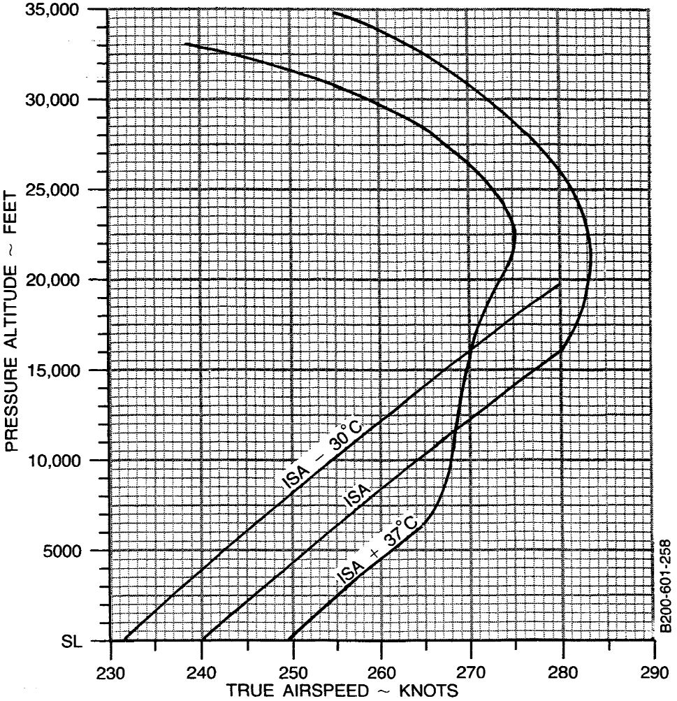

## NORMAL CRUISE POWER — 1700 RPM

NOTE: DURING OPERATION WITH ICE VANES EXTENDED, TORQUE WILL DECREASE APPROXIMATELY 20%.

Torque setting (ft-lbs, 1000-2300; TORQUE LIMIT 2230 FT-LBS) versus indicated outside air temperature (-80 to 60°C), lines ISA -20°C to ISA +37°C and pressure altitude 8000 to 35,000 ft. *(5-55)*

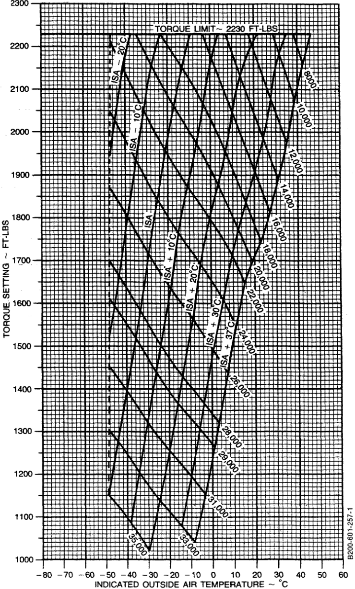

## FUEL FLOW AT NORMAL CRUISE POWER — 1700 RPM

NOTE: DURING OPERATION WITH ICE VANES EXTENDED, FUEL FLOW WILL DECREASE APPROXIMATELY 10%.

Fuel flow per engine (lbs/hr, 170-420) versus indicated outside air temperature (-80 to 60°C), lines ISA -30°C to ISA +37°C and pressure altitude 10,000 to 35,000 ft. *(5-56)*

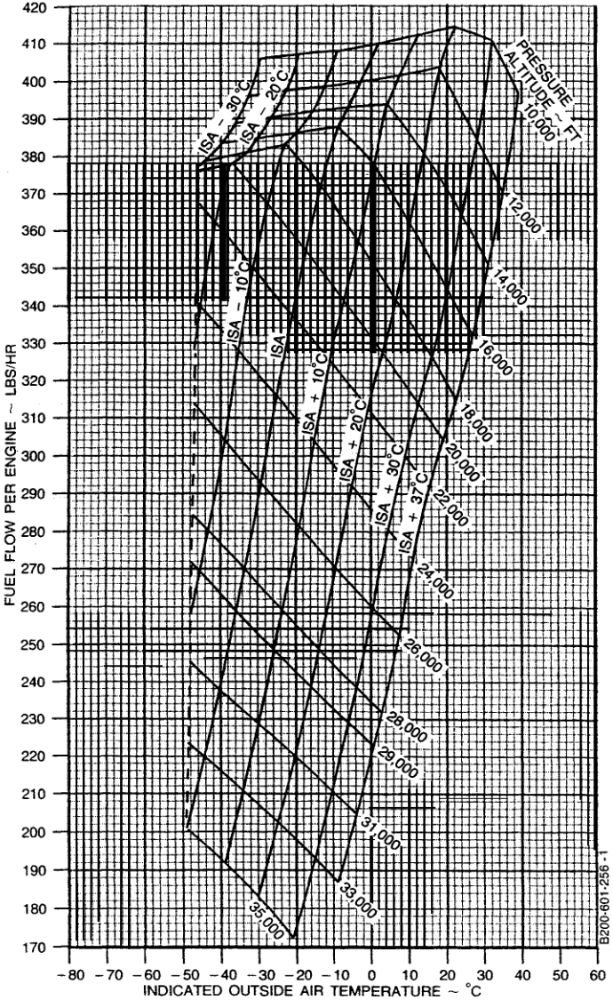


## RANGE PROFILE - NORMAL CRUISE POWER — 1700 RPM

STANDARD DAY (ISA), ZERO WIND

ASSOCIATED CONDITIONS: WEIGHT ................ 12,590 LBS BEFORE ENGINE START; FUEL ................ AVIATION KEROSENE; FUEL DENSITY ................ 6.7 LBS/GAL; ICE VANES ................ RETRACTED

EXAMPLE: PRESSURE ALTITUDE ................ 26,000 FT; FUEL LOADING ................ 2586 LBS; RANGE ................ 1018 NM

NOTE: RANGE INCLUDES START, TAXI, CLIMB, DESCENT, AND 45 MINUTES RESERVE FUEL AT MAXIMUM RANGE POWER.

Curves: FULL MAIN AND AUX TANKS (544 GAL) 3645 LBS; FULL MAIN TANKS (386 GAL) 2586 LBS; AVAILABLE FUEL AT MAX ZERO FUEL WT (237 GAL) 1590 LBS; CRUISE CLIMB DISTANCE. Cruise true airspeed (knots) is annotated along each curve. Pressure altitude SL to 35,000 ft versus range 0 to 2000 nautical miles. *(5-57)*

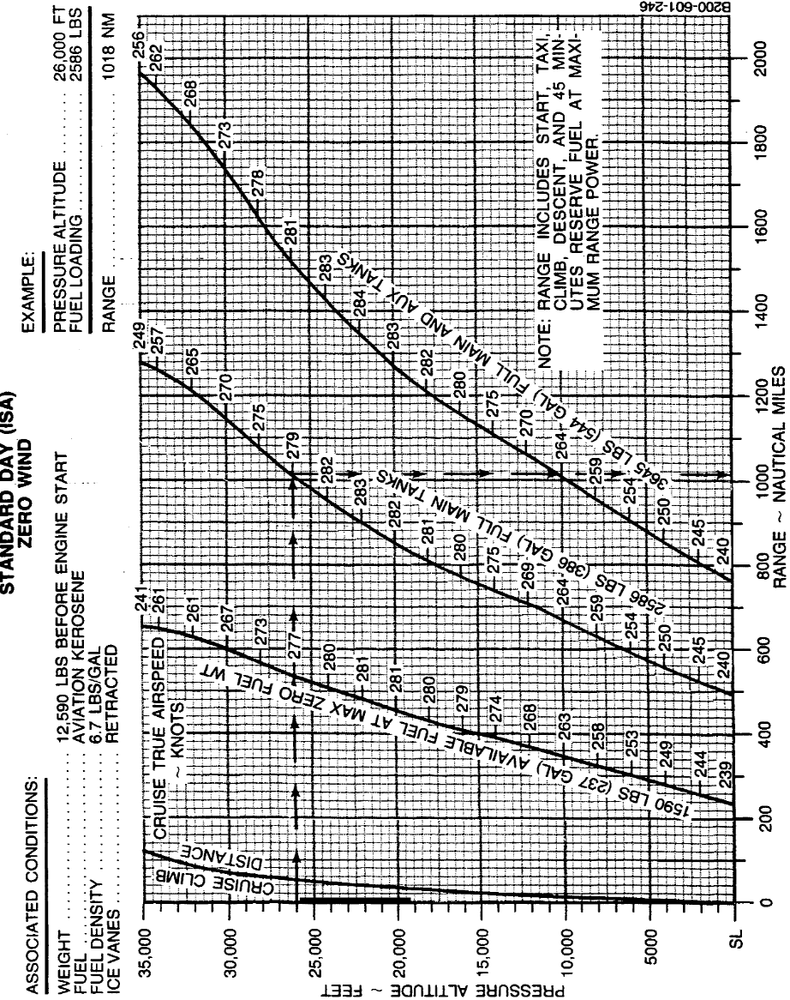

## MAXIMUM CRUISE POWER — 1700 RPM

**ISA -30°C**

NOTE: IOAT, TORQUE, AND FUEL FLOW BASED ON 11,000 POUNDS.

| PRESSURE ALTITUDE (FEET) | IOAT °C | OAT °C | TORQUE PER ENGINE (FT-LBS) | FUEL FLOW PER ENGINE (LBS/HR) | TOTAL FUEL FLOW (LBS/HR) | @12,000 LBS IAS | @12,000 LBS TAS | @11,000 LBS IAS | @11,000 LBS TAS | @10,000 LBS IAS | @10,000 LBS TAS |
|---|---|---|---|---|---|---|---|---|---|---|---|
| SL | -10 | -15 | 2230 | 463 | 926 | 243 | 231 | 244 | 232 | 245 | 233 |
| 2000 | -14 | -19 | 2230 | 452 | 904 | 241 | 235 | 242 | 236 | 243 | 237 |
| 4000 | -18 | -23 | 2230 | 439 | 878 | 239 | 240 | 240 | 241 | 240 | 242 |
| 6000 | -21 | -27 | 2230 | 428 | 856 | 237 | 244 | 237 | 245 | 238 | 246 |
| 8000 | -25 | -31 | 2230 | 417 | 834 | 234 | 249 | 235 | 250 | 236 | 251 |
| 10,000 | -29 | -35 | 2230 | 406 | 812 | 232 | 254 | 233 | 255 | 234 | 256 |
| 12,000 | -33 | -39 | 2230 | 396 | 792 | 230 | 259 | 231 | 260 | 231 | 261 |
| 14,000 | -36 | -43 | 2230 | 389 | 778 | 227 | 264 | 228 | 265 | 229 | 266 |
| 16,000 | -40 | -47 | 2230 | 384 | 768 | 225 | 269 | 226 | 270 | 227 | 271 |
| 18,000 | -44 | -51 | 2230 | 379 | 758 | 223 | 274 | 224 | 276 | 225 | 277 |

Células "---" no original (altitudes sem dados) foram omitidas das linhas acima.

*(5-58)*


## MAXIMUM CRUISE POWER — 1700 RPM

**ISA -20°C**

NOTE: IOAT, TORQUE, AND FUEL FLOW BASED ON 11,000 POUNDS.

| PRESSURE ALTITUDE (FEET) | IOAT °C | OAT °C | TORQUE PER ENGINE (FT-LBS) | FUEL FLOW PER ENGINE (LBS/HR) | TOTAL FUEL FLOW (LBS/HR) | @12,000 LBS IAS | @12,000 LBS TAS | @11,000 LBS IAS | @11,000 LBS TAS | @10,000 LBS IAS | @10,000 LBS TAS |
|---|---|---|---|---|---|---|---|---|---|---|---|
| SL | 0 | -5 | 2230 | 466 | 932 | 242 | 234 | 242 | 235 | 243 | 236 |
| 2000 | -4 | -9 | 2230 | 453 | 906 | 239 | 238 | 240 | 239 | 241 | 240 |
| 4000 | -7 | -13 | 2230 | 440 | 880 | 237 | 243 | 238 | 244 | 239 | 245 |
| 6000 | -11 | -17 | 2230 | 428 | 856 | 235 | 248 | 236 | 248 | 237 | 249 |
| 8000 | -15 | -21 | 2230 | 418 | 836 | 232 | 252 | 233 | 253 | 234 | 254 |
| 10,000 | -19 | -25 | 2230 | 408 | 816 | 230 | 257 | 231 | 258 | 232 | 259 |
| 12,000 | -22 | -29 | 2230 | 398 | 796 | 228 | 262 | 229 | 263 | 230 | 264 |
| 14,000 | -26 | -33 | 2230 | 391 | 782 | 225 | 267 | 226 | 268 | 227 | 270 |
| 16,000 | -30 | -37 | 2230 | 385 | 770 | 223 | 273 | 224 | 274 | 225 | 275 |
| 18,000 | -33 | -41 | 2230 | 381 | 762 | 220 | 278 | 221 | 279 | 223 | 280 |
| 20,000 | -37 | -45 | 2230 | 378 | 756 | 218 | 283 | 219 | 284 | 220 | 286 |
| 22,000 | -41 | -49 | 2230 | 375 | 750 | 215 | 288 | 216 | 290 | 217 | 292 |
| 24,000 | -45 | -53 | 2107 | 353 | 706 | 207 | 288 | 209 | 290 | 211 | 292 |

Células "---" no original (altitudes sem dados) foram omitidas das linhas acima.

*(5-59)*


## MAXIMUM CRUISE POWER — 1700 RPM

**ISA -10°C**

NOTE: IOAT, TORQUE, AND FUEL FLOW BASED ON 11,000 POUNDS.

| PRESSURE ALTITUDE (FEET) | IOAT °C | OAT °C | TORQUE PER ENGINE (FT-LBS) | FUEL FLOW PER ENGINE (LBS/HR) | TOTAL FUEL FLOW (LBS/HR) | @12,000 LBS IAS | @12,000 LBS TAS | @11,000 LBS IAS | @11,000 LBS TAS | @10,000 LBS IAS | @10,000 LBS TAS |
|---|---|---|---|---|---|---|---|---|---|---|---|
| SL | 10 | 5 | 2230 | 469 | 938 | 240 | 237 | 241 | 238 | 241 | 238 |
| 2000 | 6 | 1 | 2230 | 456 | 912 | 238 | 241 | 239 | 242 | 239 | 243 |
| 4000 | 3 | -3 | 2230 | 443 | 886 | 235 | 246 | 236 | 247 | 237 | 248 |
| 6000 | -1 | -7 | 2230 | 431 | 862 | 233 | 250 | 234 | 251 | 235 | 252 |
| 8000 | -5 | -11 | 2230 | 419 | 838 | 231 | 255 | 232 | 256 | 232 | 257 |
| 10,000 | -9 | -15 | 2230 | 408 | 816 | 228 | 260 | 229 | 261 | 230 | 262 |
| 12,000 | -12 | -19 | 2230 | 399 | 798 | 226 | 265 | 227 | 266 | 228 | 268 |
| 14,000 | -16 | -23 | 2230 | 392 | 784 | 224 | 271 | 225 | 272 | 226 | 273 |
| 16,000 | -20 | -27 | 2230 | 387 | 774 | 221 | 276 | 222 | 277 | 223 | 278 |
| 18,000 | -23 | -31 | 2230 | 383 | 766 | 218 | 281 | 219 | 282 | 221 | 284 |
| 20,000 | -27 | -35 | 2230 | 380 | 760 | 215 | 286 | 217 | 288 | 218 | 289 |
| 22,000 | -31 | -39 | 2141 | 364 | 728 | 209 | 287 | 211 | 289 | 212 | 291 |
| 24,000 | -35 | -43 | 2018 | 342 | 684 | 202 | 286 | 204 | 289 | 205 | 291 |
| 26,000 | -39 | -47 | 1881 | 317 | 634 | 193 | 284 | 196 | 287 | 198 | 290 |
| 28,000 | -43 | -51 | 1734 | 292 | 584 | 184 | 280 | 187 | 284 | 189 | 287 |
| 29,000 | -45 | -52 | 1661 | 260 | 560 | 179 | 277 | 182 | 282 | 184 | 285 |

Células "---" no original (altitudes sem dados) foram omitidas das linhas acima.

Nota do transcritor: na linha de 29,000 ft o Total Fuel Flow está impresso como 560 (o dobro de 260 seria 520); mantido como impresso.

*(5-60)*


## MAXIMUM CRUISE POWER — 1700 RPM

**ISA**

NOTE: IOAT, TORQUE, AND FUEL FLOW BASED ON 11,000 POUNDS.

| PRESSURE ALTITUDE (FEET) | IOAT °C | OAT °C | TORQUE PER ENGINE (FT-LBS) | FUEL FLOW PER ENGINE (LBS/HR) | TOTAL FUEL FLOW (LBS/HR) | @12,000 LBS IAS | @12,000 LBS TAS | @11,000 LBS IAS | @11,000 LBS TAS | @10,000 LBS IAS | @10,000 LBS TAS |
|---|---|---|---|---|---|---|---|---|---|---|---|
| SL | 20 | 15 | 2230 | 473 | 946 | 238 | 239 | 239 | 240 | 240 | 241 |
| 2000 | 17 | 11 | 2230 | 459 | 918 | 236 | 244 | 237 | 245 | 238 | 246 |
| 4000 | 13 | 7 | 2230 | 446 | 892 | 234 | 249 | 235 | 250 | 236 | 250 |
| 6000 | 9 | 3 | 2230 | 433 | 866 | 231 | 253 | 232 | 254 | 233 | 255 |
| 8000 | 5 | -1 | 2230 | 421 | 842 | 229 | 258 | 230 | 259 | 231 | 260 |
| 10,000 | 2 | -5 | 2230 | 410 | 820 | 227 | 263 | 228 | 264 | 229 | 265 |
| 12,000 | -2 | -9 | 2230 | 400 | 800 | 224 | 268 | 225 | 270 | 226 | 271 |
| 14,000 | -6 | -13 | 2230 | 393 | 786 | 222 | 274 | 223 | 275 | 224 | 276 |
| 16,000 | -9 | -17 | 2230 | 388 | 776 | 219 | 279 | 220 | 280 | 221 | 282 |
| 18,000 | -13 | -21 | 2230 | 385 | 770 | 216 | 284 | 217 | 286 | 219 | 287 |
| 20,000 | -17 | -25 | 2143 | 368 | 736 | 210 | 285 | 212 | 287 | 213 | 289 |
| 22,000 | -21 | -29 | 2043 | 350 | 700 | 203 | 285 | 205 | 288 | 207 | 290 |
| 24,000 | -25 | -33 | 1920 | 328 | 656 | 196 | 284 | 198 | 287 | 200 | 290 |
| 26,000 | -29 | -37 | 1789 | 305 | 610 | 187 | 281 | 190 | 285 | 192 | 288 |
| 28,000 | -33 | -41 | 1654 | 281 | 562 | 178 | 277 | 181 | 282 | 184 | 285 |
| 29,000 | -35 | -42 | 1588 | 270 | 540 | 173 | 275 | 177 | 280 | 179 | 284 |
| 31,000 | -40 | -46 | 1460 | 249 | 498 | 164 | 270 | 167 | 275 | 171 | 280 |
| 33,000 | -44 | -50 | 1334 | 229 | 458 | 153 | 261 | 158 | 269 | 162 | 275 |
| 35,000 | -48 | -54 | 1204 | 209 | 418 | 139 | 246 | 146 | 260 | 152 | 268 |

Células "---" no original (altitudes sem dados) foram omitidas das linhas acima.

*(5-61)*


## MAXIMUM CRUISE POWER — 1700 RPM

**ISA +10°C**

NOTE: IOAT, TORQUE, AND FUEL FLOW BASED ON 11,000 POUNDS.

| PRESSURE ALTITUDE (FEET) | IOAT °C | OAT °C | TORQUE PER ENGINE (FT-LBS) | FUEL FLOW PER ENGINE (LBS/HR) | TOTAL FUEL FLOW (LBS/HR) | @12,000 LBS IAS | @12,000 LBS TAS | @11,000 LBS IAS | @11,000 LBS TAS | @10,000 LBS IAS | @10,000 LBS TAS |
|---|---|---|---|---|---|---|---|---|---|---|---|
| SL | 30 | 25 | 2230 | 475 | 950 | 237 | 242 | 238 | 243 | 239 | 244 |
| 2000 | 27 | 21 | 2230 | 462 | 924 | 235 | 247 | 235 | 248 | 236 | 248 |
| 4000 | 23 | 17 | 2230 | 449 | 898 | 232 | 251 | 233 | 252 | 234 | 253 |
| 6000 | 19 | 13 | 2230 | 436 | 872 | 230 | 256 | 231 | 257 | 232 | 258 |
| 8000 | 16 | 9 | 2230 | 424 | 848 | 227 | 261 | 228 | 262 | 229 | 263 |
| 10,000 | 12 | 5 | 2230 | 412 | 824 | 225 | 266 | 226 | 267 | 227 | 269 |
| 12,000 | 8 | 1 | 2230 | 402 | 804 | 223 | 271 | 224 | 273 | 225 | 274 |
| 14,000 | 4 | -3 | 2230 | 394 | 788 | 220 | 277 | 221 | 278 | 222 | 279 |
| 16,000 | 1 | -7 | 2230 | 388 | 776 | 217 | 282 | 218 | 283 | 219 | 285 |
| 18,000 | -3 | -11 | 2146 | 371 | 742 | 211 | 283 | 213 | 285 | 214 | 287 |
| 20,000 | -7 | -15 | 2057 | 354 | 708 | 205 | 284 | 207 | 286 | 208 | 288 |
| 22,000 | -11 | -19 | 1950 | 337 | 674 | 198 | 283 | 200 | 286 | 201 | 288 |
| 24,000 | -15 | -23 | 1830 | 315 | 630 | 190 | 282 | 192 | 285 | 194 | 288 |
| 26,000 | -19 | -27 | 1703 | 292 | 584 | 181 | 279 | 184 | 283 | 186 | 286 |
| 28,000 | -23 | -31 | 1572 | 270 | 540 | 172 | 274 | 175 | 279 | 178 | 283 |
| 29,000 | -25 | -32 | 1507 | 259 | 518 | 167 | 271 | 171 | 277 | 174 | 281 |
| 31,000 | -30 | -36 | 1386 | 239 | 478 | 157 | 264 | 162 | 272 | 165 | 277 |
| 33,000 | -34 | -40 | 1271 | 221 | 442 | 146 | 255 | 152 | 265 | 156 | 272 |
| 35,000 | -39 | -44 | 1151 | 202 | 404 | 129 | 235 | 140 | 255 | 146 | 265 |

Células "---" no original (altitudes sem dados) foram omitidas das linhas acima.

*(5-62)*


## MAXIMUM CRUISE POWER — 1700 RPM

**ISA +20°C**

NOTE: IOAT, TORQUE, AND FUEL FLOW BASED ON 11,000 POUNDS.

| PRESSURE ALTITUDE (FEET) | IOAT °C | OAT °C | TORQUE PER ENGINE (FT-LBS) | FUEL FLOW PER ENGINE (LBS/HR) | TOTAL FUEL FLOW (LBS/HR) | @12,000 LBS IAS | @12,000 LBS TAS | @11,000 LBS IAS | @11,000 LBS TAS | @10,000 LBS IAS | @10,000 LBS TAS |
|---|---|---|---|---|---|---|---|---|---|---|---|
| SL | 41 | 35 | 2230 | 478 | 956 | 235 | 244 | 236 | 245 | 237 | 246 |
| 2000 | 37 | 31 | 2230 | 465 | 930 | 233 | 249 | 234 | 250 | 235 | 251 |
| 4000 | 33 | 27 | 2230 | 452 | 904 | 231 | 254 | 232 | 255 | 232 | 256 |
| 6000 | 29 | 23 | 2230 | 439 | 878 | 228 | 259 | 229 | 260 | 230 | 261 |
| 8000 | 26 | 19 | 2230 | 427 | 854 | 226 | 264 | 227 | 265 | 228 | 266 |
| 10,000 | 22 | 15 | 2230 | 415 | 830 | 223 | 269 | 224 | 270 | 226 | 272 |
| 12,000 | 18 | 11 | 2230 | 404 | 808 | 221 | 274 | 222 | 276 | 223 | 277 |
| 14,000 | 14 | 7 | 2195 | 391 | 782 | 217 | 278 | 218 | 279 | 219 | 281 |
| 16,000 | 11 | 3 | 2115 | 373 | 746 | 211 | 279 | 212 | 281 | 214 | 283 |
| 18,000 | 7 | -1 | 2034 | 355 | 710 | 205 | 280 | 207 | 282 | 208 | 284 |
| 20,000 | 3 | -5 | 1954 | 340 | 680 | 199 | 281 | 201 | 284 | 203 | 286 |
| 22,000 | -1 | -9 | 1874 | 325 | 650 | 193 | 282 | 195 | 285 | 197 | 288 |
| 24,000 | -5 | -13 | 1761 | 304 | 608 | 185 | 280 | 188 | 284 | 190 | 287 |
| 26,000 | -9 | -17 | 1629 | 281 | 562 | 176 | 276 | 179 | 281 | 182 | 284 |
| 28,000 | -13 | -21 | 1493 | 259 | 518 | 166 | 270 | 170 | 276 | 173 | 280 |
| 29,000 | -16 | -22 | 1431 | 249 | 498 | 161 | 267 | 165 | 273 | 168 | 278 |
| 31,000 | -20 | -26 | 1314 | 229 | 458 | 150 | 259 | 155 | 267 | 160 | 274 |
| 33,000 | -24 | -30 | 1201 | 211 | 422 | 138 | 246 | 145 | 260 | 150 | 268 |

Células "---" no original (altitudes sem dados) foram omitidas das linhas acima.

*(5-63)*


## MAXIMUM CRUISE POWER — 1700 RPM

**ISA +30°C**

NOTE: IOAT, TORQUE, AND FUEL FLOW BASED ON 11,000 POUNDS.

| PRESSURE ALTITUDE (FEET) | IOAT °C | OAT °C | TORQUE PER ENGINE (FT-LBS) | FUEL FLOW PER ENGINE (LBS/HR) | TOTAL FUEL FLOW (LBS/HR) | @12,000 LBS IAS | @12,000 LBS TAS | @11,000 LBS IAS | @11,000 LBS TAS | @10,000 LBS IAS | @10,000 LBS TAS |
|---|---|---|---|---|---|---|---|---|---|---|---|
| SL | 51 | 45 | 2230 | 481 | 962 | 234 | 247 | 235 | 248 | 236 | 249 |
| 2000 | 47 | 41 | 2230 | 468 | 936 | 232 | 252 | 233 | 253 | 233 | 254 |
| 4000 | 43 | 37 | 2230 | 454 | 908 | 229 | 256 | 230 | 257 | 231 | 258 |
| 6000 | 39 | 33 | 2230 | 441 | 882 | 227 | 261 | 228 | 263 | 229 | 264 |
| 8000 | 36 | 29 | 2230 | 429 | 858 | 224 | 267 | 225 | 268 | 226 | 269 |
| 10,000 | 32 | 25 | 2223 | 416 | 832 | 221 | 271 | 223 | 273 | 224 | 274 |
| 12,000 | 28 | 21 | 2108 | 388 | 776 | 215 | 271 | 216 | 273 | 217 | 275 |
| 14,000 | 24 | 17 | 2038 | 371 | 742 | 209 | 273 | 211 | 275 | 212 | 277 |
| 16,000 | 20 | 13 | 1971 | 354 | 708 | 204 | 275 | 205 | 277 | 207 | 279 |
| 18,000 | 17 | 9 | 1907 | 338 | 676 | 198 | 276 | 200 | 279 | 202 | 281 |
| 20,000 | 13 | 5 | 1853 | 325 | 650 | 193 | 278 | 195 | 281 | 197 | 284 |
| 22,000 | 9 | 1 | 1782 | 311 | 622 | 187 | 279 | 190 | 282 | 192 | 285 |
| 24,000 | 5 | -3 | 1672 | 291 | 582 | 179 | 277 | 182 | 281 | 184 | 284 |
| 26,000 | 1 | -7 | 1555 | 270 | 540 | 171 | 273 | 174 | 278 | 177 | 282 |
| 28,000 | -4 | -11 | 1435 | 249 | 498 | 161 | 267 | 165 | 274 | 168 | 279 |
| 29,000 | -6 | -12 | 1376 | 240 | 480 | 156 | 264 | 160 | 271 | 164 | 277 |
| 31,000 | -10 | -16 | 1259 | 221 | 442 | 145 | 254 | 150 | 264 | 155 | 272 |
| 33,000 | -15 | -20 | 1142 | 203 | 406 | 126 | 231 | 139 | 254 | 145 | 264 |

Células "---" no original (altitudes sem dados) foram omitidas das linhas acima.

*(5-64)*


## MAXIMUM CRUISE POWER — 1700 RPM

**ISA +37°C**

NOTE: IOAT, TORQUE, AND FUEL FLOW BASED ON 11,000 POUNDS.

| PRESSURE ALTITUDE (FEET) | IOAT °C | OAT °C | TORQUE PER ENGINE (FT-LBS) | FUEL FLOW PER ENGINE (LBS/HR) | TOTAL FUEL FLOW (LBS/HR) | @12,000 LBS IAS | @12,000 LBS TAS | @11,000 LBS IAS | @11,000 LBS TAS | @10,000 LBS IAS | @10,000 LBS TAS |
|---|---|---|---|---|---|---|---|---|---|---|---|
| SL | 58 | 52 | 2230 | 484 | 968 | 233 | 249 | 234 | 250 | 235 | 251 |
| 2000 | 54 | 48 | 2230 | 470 | 940 | 231 | 253 | 232 | 254 | 232 | 255 |
| 4000 | 50 | 44 | 2230 | 456 | 912 | 228 | 258 | 229 | 259 | 230 | 259 |
| 6000 | 47 | 40 | 2230 | 442 | 884 | 226 | 263 | 227 | 264 | 228 | 265 |
| 8000 | 43 | 36 | 2189 | 424 | 848 | 222 | 266 | 223 | 268 | 224 | 269 |
| 10,000 | 39 | 32 | 2106 | 400 | 800 | 216 | 268 | 217 | 269 | 219 | 271 |
| 12,000 | 35 | 28 | 1997 | 374 | 748 | 209 | 268 | 211 | 270 | 212 | 271 |
| 14,000 | 31 | 24 | 1936 | 357 | 714 | 204 | 270 | 206 | 272 | 207 | 274 |
| 16,000 | 27 | 20 | 1874 | 341 | 682 | 199 | 272 | 201 | 274 | 202 | 276 |
| 18,000 | 23 | 16 | 1813 | 326 | 652 | 193 | 273 | 195 | 276 | 197 | 278 |
| 20,000 | 20 | 12 | 1767 | 314 | 628 | 189 | 275 | 191 | 278 | 193 | 281 |
| 22,000 | 16 | 8 | 1710 | 302 | 604 | 183 | 276 | 185 | 280 | 187 | 283 |
| 24,000 | 12 | 4 | 1609 | 283 | 566 | 175 | 274 | 178 | 279 | 181 | 282 |
| 26,000 | 8 | 0 | 1498 | 262 | 524 | 167 | 270 | 170 | 276 | 173 | 280 |
| 28,000 | 3 | -4 | 1380 | 242 | 484 | 157 | 264 | 161 | 271 | 164 | 277 |
| 29,000 | 1 | -5 | 1323 | 232 | 464 | 151 | 260 | 156 | 268 | 160 | 274 |
| 31,000 | -3 | -9 | 1212 | 214 | 428 | 139 | 248 | 146 | 260 | 151 | 269 |
| 33,000 | -8 | -13 | 1102 | 197 | 394 | --- | --- | 134 | 249 | 141 | 261 |

Células "---" no original (altitudes sem dados) foram omitidas das linhas acima.

*(5-65)*


## MAXIMUM CRUISE SPEED — 1700 RPM

**WEIGHT 11,000 LBS**

NOTE: DURING OPERATION WITH ICE VANES EXTENDED, TRUE AIRSPEED WILL BE REDUCED APPROXIMATELY 30 KNOTS.

Pressure altitude (SL to 35,000 ft) versus true airspeed (230 to 290 knots), curves ISA -30°C, ISA and ISA +37°C. *(5-66)*

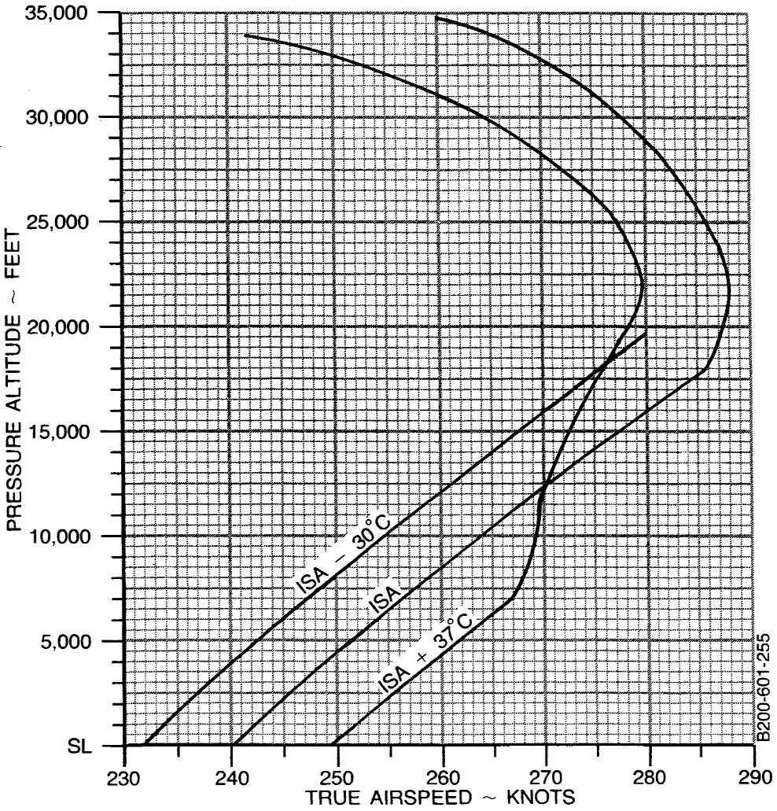

## MAXIMUM CRUISE POWER — 1700 RPM

NOTE: DURING OPERATION WITH ICE VANES EXTENDED, TORQUE WILL DECREASE APPROXIMATELY 20%.

Torque setting (ft-lbs, 1000-2300; TORQUE LIMIT 2230 FT-LBS) versus indicated outside air temperature (-80 to 60°C), lines ISA -20°C to ISA +37°C and pressure altitude 6000 to 35,000 ft. *(5-67)*


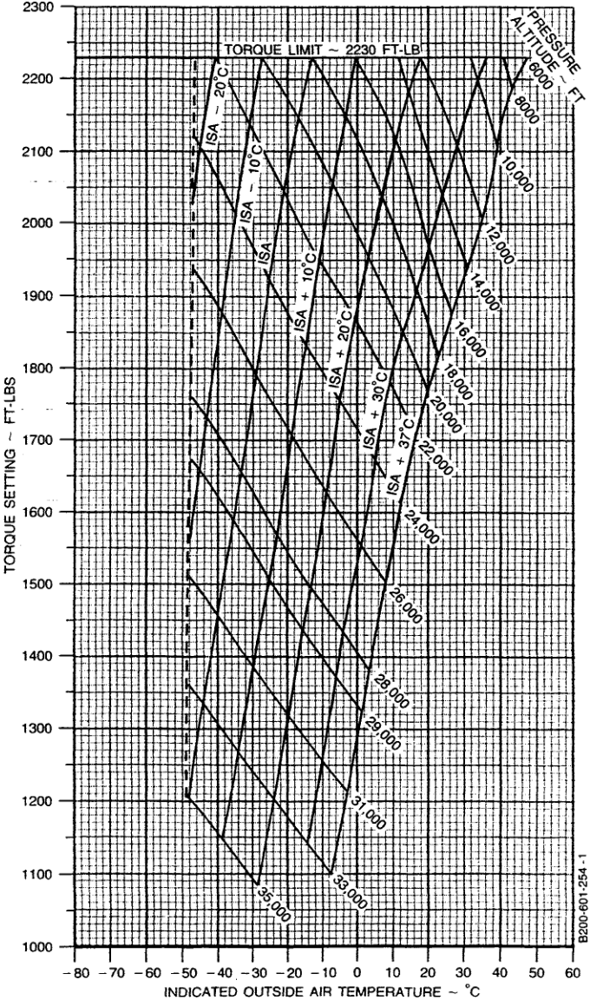

## FUEL FLOW AT MAXIMUM CRUISE POWER — 1700 RPM

NOTE: DURING OPERATION WITH ICE VANES EXTENDED, FUEL FLOW WILL DECREASE APPROXIMATELY 10%.

Fuel flow per engine (lbs/hr, 170-420) versus indicated outside air temperature (-80 to 60°C), lines ISA -30°C to ISA +37°C and pressure altitude 10,000 to 35,000 ft. *(5-68)*


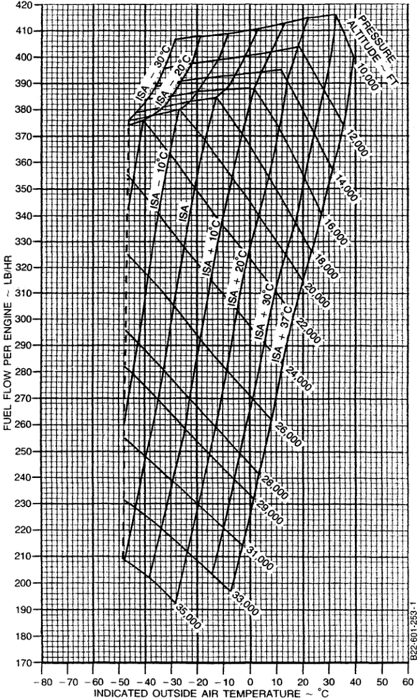

## RANGE PROFILE - MAXIMUM CRUISE POWER — 1700 RPM

STANDARD DAY (ISA), ZERO WIND

ASSOCIATED CONDITIONS: WEIGHT ................ 12,590 LBS BEFORE ENGINE START; FUEL ................ AVIATION KEROSENE; FUEL DENSITY ................ 6.7 LBS/GAL; ICE VANES ................ RETRACTED

EXAMPLE: PRESSURE ALTITUDE ................ 26,000 FT; FUEL LOADING ................ 2586 LBS; RANGE ................ 988 NM

NOTE: RANGE INCLUDES START, TAXI, CLIMB, DESCENT, AND 45 MINUTES RESERVE FUEL AT MAXIMUM RANGE POWER.

Curves: FULL MAIN AND AUX TANKS (544 GAL) 3645 LBS; FULL MAIN TANKS (386 GAL) 2586 LBS; AVAILABLE FUEL AT MAX ZERO FUEL WT (237 GAL) 1590 LBS; CRUISE CLIMB DISTANCE. Cruise true airspeed (knots) is annotated along each curve. *(5-69)*


## NORMAL CRUISE POWER — 1800 RPM

**ISA -30°C**

NOTE: IOAT, TORQUE, AND FUEL FLOW BASED ON 11,000 POUNDS.

| PRESSURE ALTITUDE (FEET) | IOAT °C | OAT °C | TORQUE PER ENGINE (FT-LBS) | FUEL FLOW PER ENGINE (LBS/HR) | TOTAL FUEL FLOW (LBS/HR) | @12,000 LBS IAS | @12,000 LBS TAS | @11,000 LBS IAS | @11,000 LBS TAS | @10,000 LBS IAS | @10,000 LBS TAS |
|---|---|---|---|---|---|---|---|---|---|---|---|
| SL | -10 | -15 | 2230 | 483 | 976 | 249 | 236 | 249 | 237 | 250 | 238 |
| 2000 | -14 | -19 | 2230 | 471 | 942 | 246 | 241 | 247 | 241 | 248 | 242 |
| 4000 | -17 | -23 | 2230 | 459 | 918 | 244 | 245 | 245 | 246 | 246 | 246 |
| 6000 | -21 | -27 | 2230 | 447 | 894 | 242 | 250 | 243 | 251 | 243 | 251 |
| 8000 | -25 | -31 | 2230 | 437 | 874 | 239 | 254 | 240 | 255 | 241 | 256 |
| 10,000 | -29 | -35 | 2230 | 426 | 852 | 237 | 259 | 238 | 260 | 239 | 261 |
| 12,000 | -32 | -39 | 2230 | 416 | 832 | 235 | 265 | 236 | 266 | 237 | 267 |
| 14,000 | -36 | -43 | 2230 | 409 | 818 | 233 | 270 | 233 | 271 | 234 | 272 |
| 16,000 | -40 | -47 | 2230 | 403 | 806 | 230 | 275 | 231 | 276 | 232 | 277 |
| 18,000 | -43 | -51 | 2230 | 398 | 796 | 228 | 281 | 229 | 282 | 230 | 283 |

Células "---" no original (altitudes sem dados) foram omitidas das linhas acima.

Nota do transcritor: na linha SL, o Total Fuel Flow está impresso como 976 (o dobro de 483 seria 966); mantido como impresso.

*(5-70)*


## NORMAL CRUISE POWER — 1800 RPM

**ISA -20°C**

NOTE: IOAT, TORQUE, AND FUEL FLOW BASED ON 11,000 POUNDS.

| PRESSURE ALTITUDE (FEET) | IOAT °C | OAT °C | TORQUE PER ENGINE (FT-LBS) | FUEL FLOW PER ENGINE (LBS/HR) | TOTAL FUEL FLOW (LBS/HR) | @12,000 LBS IAS | @12,000 LBS TAS | @11,000 LBS IAS | @11,000 LBS TAS | @10,000 LBS IAS | @10,000 LBS TAS |
|---|---|---|---|---|---|---|---|---|---|---|---|
| SL | 0 | -5 | 2230 | 486 | 972 | 247 | 239 | 248 | 240 | 248 | 241 |
| 2000 | -3 | -9 | 2230 | 473 | 946 | 245 | 244 | 245 | 244 | 246 | 245 |
| 4000 | -7 | -13 | 2230 | 460 | 920 | 242 | 248 | 243 | 249 | 244 | 250 |
| 6000 | -11 | -17 | 2230 | 448 | 896 | 240 | 253 | 241 | 254 | 242 | 255 |
| 8000 | -15 | -21 | 2230 | 438 | 876 | 238 | 258 | 238 | 259 | 239 | 260 |
| 10,000 | -18 | -25 | 2230 | 428 | 856 | 235 | 263 | 236 | 264 | 237 | 265 |
| 12,000 | -22 | -29 | 2230 | 417 | 834 | 233 | 268 | 234 | 269 | 235 | 270 |
| 14,000 | -26 | -33 | 2230 | 410 | 820 | 231 | 273 | 232 | 274 | 232 | 275 |
| 16,000 | -29 | -37 | 2230 | 404 | 808 | 228 | 279 | 229 | 280 | 230 | 281 |
| 18,000 | -33 | -41 | 2230 | 399 | 798 | 226 | 284 | 227 | 286 | 228 | 287 |
| 20,000 | -37 | -45 | 2153 | 383 | 766 | 220 | 286 | 222 | 288 | 223 | 290 |
| 22,000 | -41 | -49 | 2054 | 364 | 728 | 214 | 287 | 215 | 289 | 217 | 291 |
| 24,000 | -45 | -53 | 1936 | 342 | 684 | 207 | 286 | 208 | 289 | 210 | 291 |

Células "---" no original (altitudes sem dados) foram omitidas das linhas acima.

*(5-71)*


## NORMAL CRUISE POWER — 1800 RPM

**ISA -10°C**

NOTE: IOAT, TORQUE, AND FUEL FLOW BASED ON 11,000 POUNDS.

| PRESSURE ALTITUDE (FEET) | IOAT °C | OAT °C | TORQUE PER ENGINE (FT-LBS) | FUEL FLOW PER ENGINE (LBS/HR) | TOTAL FUEL FLOW (LBS/HR) | @12,000 LBS IAS | @12,000 LBS TAS | @11,000 LBS IAS | @11,000 LBS TAS | @10,000 LBS IAS | @10,000 LBS TAS |
|---|---|---|---|---|---|---|---|---|---|---|---|
| SL | 10 | 5 | 2230 | 488 | 976 | 245 | 242 | 246 | 243 | 247 | 243 |
| 2000 | 7 | 1 | 2230 | 475 | 950 | 243 | 246 | 244 | 247 | 244 | 248 |
| 4000 | 3 | -3 | 2230 | 462 | 924 | 240 | 251 | 241 | 252 | 242 | 253 |
| 6000 | -1 | -7 | 2230 | 450 | 900 | 238 | 256 | 239 | 257 | 240 | 258 |
| 8000 | -5 | -11 | 2230 | 438 | 876 | 236 | 261 | 237 | 262 | 238 | 263 |
| 10,000 | -8 | -15 | 2230 | 427 | 854 | 234 | 266 | 234 | 267 | 235 | 268 |
| 12,000 | -12 | -19 | 2230 | 419 | 838 | 231 | 271 | 232 | 272 | 233 | 273 |
| 14,000 | -16 | -23 | 2230 | 412 | 824 | 229 | 277 | 230 | 278 | 231 | 279 |
| 16,000 | -19 | -27 | 2230 | 406 | 812 | 226 | 282 | 227 | 284 | 228 | 285 |
| 18,000 | -23 | -31 | 2157 | 389 | 778 | 221 | 284 | 222 | 286 | 223 | 287 |
| 20,000 | -27 | -35 | 2051 | 368 | 736 | 214 | 285 | 216 | 287 | 217 | 288 |
| 22,000 | -31 | -39 | 1959 | 350 | 700 | 208 | 286 | 210 | 288 | 211 | 290 |
| 24,000 | -35 | -43 | 1845 | 329 | 658 | 201 | 285 | 202 | 287 | 204 | 290 |
| 26,000 | -39 | -47 | 1720 | 306 | 612 | 192 | 282 | 194 | 286 | 196 | 288 |
| 28,000 | -43 | -51 | 1588 | 282 | 564 | 183 | 279 | 186 | 282 | 188 | 286 |
| 29,000 | -45 | -52 | 1523 | 270 | 540 | 178 | 276 | 181 | 280 | 184 | 284 |

Células "---" no original (altitudes sem dados) foram omitidas das linhas acima.

*(5-72)*


## NORMAL CRUISE POWER — 1800 RPM

**ISA**

NOTE: IOAT, TORQUE, AND FUEL FLOW BASED ON 11,000 POUNDS.

| PRESSURE ALTITUDE (FEET) | IOAT °C | OAT °C | TORQUE PER ENGINE (FT-LBS) | FUEL FLOW PER ENGINE (LBS/HR) | TOTAL FUEL FLOW (LBS/HR) | @12,000 LBS IAS | @12,000 LBS TAS | @11,000 LBS IAS | @11,000 LBS TAS | @10,000 LBS IAS | @10,000 LBS TAS |
|---|---|---|---|---|---|---|---|---|---|---|---|
| SL | 21 | 15 | 2230 | 491 | 982 | 243 | 245 | 244 | 245 | 245 | 246 |
| 2000 | 17 | 11 | 2230 | 478 | 956 | 241 | 249 | 242 | 250 | 243 | 251 |
| 4000 | 13 | 7 | 2230 | 463 | 926 | 239 | 254 | 240 | 255 | 240 | 256 |
| 6000 | 9 | 3 | 2230 | 450 | 900 | 236 | 259 | 237 | 260 | 238 | 261 |
| 8000 | 6 | -1 | 2230 | 439 | 878 | 234 | 264 | 235 | 265 | 236 | 266 |
| 10,000 | 2 | -5 | 2230 | 429 | 858 | 232 | 269 | 233 | 270 | 234 | 271 |
| 12,000 | -2 | -9 | 2230 | 418 | 836 | 229 | 274 | 230 | 276 | 231 | 277 |
| 14,000 | -5 | -13 | 2230 | 411 | 822 | 227 | 279 | 228 | 281 | 229 | 282 |
| 16,000 | -9 | -17 | 2177 | 397 | 794 | 222 | 283 | 224 | 285 | 225 | 286 |
| 18,000 | -13 | -21 | 2048 | 373 | 746 | 215 | 282 | 216 | 284 | 217 | 286 |
| 20,000 | -17 | -25 | 1959 | 355 | 710 | 209 | 283 | 210 | 285 | 212 | 287 |
| 22,000 | -21 | -29 | 1871 | 338 | 676 | 202 | 284 | 204 | 286 | 206 | 288 |
| 24,000 | -25 | -33 | 1758 | 316 | 632 | 195 | 283 | 197 | 285 | 199 | 288 |
| 26,000 | -29 | -37 | 1635 | 293 | 586 | 187 | 280 | 189 | 283 | 191 | 286 |
| 28,000 | -33 | -41 | 1508 | 270 | 540 | 177 | 276 | 180 | 280 | 182 | 284 |
| 29,000 | -35 | -42 | 1447 | 259 | 518 | 172 | 273 | 175 | 278 | 178 | 282 |
| 31,000 | -40 | -46 | 1329 | 239 | 478 | 162 | 267 | 166 | 273 | 169 | 278 |
| 33,000 | -44 | -50 | 1218 | 220 | 440 | 151 | 258 | 156 | 267 | 160 | 274 |
| 35,000 | -49 | -54 | 1100 | 201 | 402 | 135 | 241 | 145 | 257 | 151 | 267 |

Células "---" no original (altitudes sem dados) foram omitidas das linhas acima.

*(5-73)*


## NORMAL CRUISE POWER — 1800 RPM

**ISA +10°C**

NOTE: IOAT, TORQUE, AND FUEL FLOW BASED ON 11,000 POUNDS.

| PRESSURE ALTITUDE (FEET) | IOAT °C | OAT °C | TORQUE PER ENGINE (FT-LBS) | FUEL FLOW PER ENGINE (LBS/HR) | TOTAL FUEL FLOW (LBS/HR) | @12,000 LBS IAS | @12,000 LBS TAS | @11,000 LBS IAS | @11,000 LBS TAS | @10,000 LBS IAS | @10,000 LBS TAS |
|---|---|---|---|---|---|---|---|---|---|---|---|
| SL | 31 | 25 | 2230 | 494 | 988 | 242 | 247 | 243 | 248 | 244 | 249 |
| 2000 | 27 | 21 | 2230 | 480 | 960 | 240 | 252 | 240 | 253 | 241 | 254 |
| 4000 | 23 | 17 | 2230 | 467 | 934 | 237 | 257 | 238 | 258 | 239 | 259 |
| 6000 | 19 | 13 | 2230 | 454 | 908 | 235 | 262 | 236 | 263 | 237 | 264 |
| 8000 | 16 | 9 | 2230 | 442 | 884 | 233 | 267 | 233 | 268 | 234 | 269 |
| 10,000 | 12 | 5 | 2230 | 431 | 862 | 230 | 272 | 231 | 273 | 232 | 274 |
| 12,000 | 8 | 1 | 2230 | 420 | 840 | 228 | 278 | 229 | 279 | 230 | 280 |
| 14,000 | 5 | -3 | 2167 | 402 | 804 | 223 | 280 | 224 | 282 | 225 | 283 |
| 16,000 | 1 | -7 | 2065 | 380 | 760 | 216 | 281 | 218 | 282 | 219 | 284 |
| 18,000 | -3 | -11 | 1964 | 359 | 718 | 210 | 281 | 211 | 283 | 212 | 285 |
| 20,000 | -7 | -15 | 1881 | 342 | 684 | 204 | 282 | 205 | 284 | 207 | 286 |
| 22,000 | -11 | -19 | 1787 | 325 | 650 | 197 | 282 | 199 | 285 | 200 | 287 |
| 24,000 | -15 | -23 | 1677 | 304 | 608 | 189 | 280 | 191 | 284 | 193 | 286 |
| 26,000 | -19 | -27 | 1557 | 282 | 564 | 180 | 277 | 183 | 281 | 185 | 284 |
| 28,000 | -23 | -31 | 1433 | 259 | 518 | 171 | 272 | 174 | 277 | 177 | 281 |
| 29,000 | -26 | -32 | 1373 | 249 | 498 | 166 | 269 | 169 | 275 | 172 | 279 |
| 31,000 | -30 | -36 | 1260 | 229 | 458 | 155 | 262 | 160 | 269 | 164 | 275 |
| 33,000 | -34 | -40 | 1152 | 211 | 422 | 143 | 250 | 150 | 262 | 155 | 270 |
| 35,000 | -39 | -44 | 1037 | 192 | 384 | --- | --- | 137 | 249 | 144 | 262 |

Células "---" no original (altitudes sem dados) foram omitidas das linhas acima.

*(5-74)*


## NORMAL CRUISE POWER — 1800 RPM

**ISA +20°C**

NOTE: IOAT, TORQUE, AND FUEL FLOW BASED ON 11,000 POUNDS.

| PRESSURE ALTITUDE (FEET) | IOAT °C | OAT °C | TORQUE PER ENGINE (FT-LBS) | FUEL FLOW PER ENGINE (LBS/HR) | TOTAL FUEL FLOW (LBS/HR) | @12,000 LBS IAS | @12,000 LBS TAS | @11,000 LBS IAS | @11,000 LBS TAS | @10,000 LBS IAS | @10,000 LBS TAS |
|---|---|---|---|---|---|---|---|---|---|---|---|
| SL | 41 | 35 | 2230 | 497 | 994 | 240 | 250 | 241 | 251 | 242 | 251 |
| 2000 | 37 | 31 | 2230 | 483 | 966 | 238 | 255 | 239 | 255 | 240 | 256 |
| 4000 | 33 | 27 | 2230 | 469 | 938 | 236 | 259 | 237 | 261 | 238 | 261 |
| 6000 | 30 | 23 | 2230 | 456 | 912 | 233 | 265 | 234 | 265 | 235 | 267 |
| 8000 | 26 | 19 | 2230 | 444 | 888 | 231 | 270 | 232 | 271 | 233 | 272 |
| 10,000 | 22 | 15 | 2225 | 432 | 864 | 228 | 275 | 229 | 276 | 230 | 277 |
| 12,000 | 18 | 11 | 2114 | 404 | 808 | 221 | 275 | 223 | 276 | 224 | 278 |
| 14,000 | 14 | 7 | 2027 | 383 | 766 | 215 | 276 | 217 | 278 | 218 | 279 |
| 16,000 | 11 | 3 | 1940 | 362 | 724 | 209 | 277 | 211 | 279 | 212 | 281 |
| 18,000 | 7 | -1 | 1852 | 342 | 684 | 203 | 278 | 205 | 280 | 206 | 282 |
| 20,000 | 3 | -5 | 1793 | 329 | 658 | 198 | 280 | 200 | 282 | 201 | 285 |
| 22,000 | -1 | -9 | 1719 | 314 | 628 | 192 | 281 | 194 | 284 | 196 | 286 |
| 24,000 | -5 | -13 | 1614 | 294 | 588 | 184 | 279 | 187 | 283 | 189 | 286 |
| 26,000 | -9 | -17 | 1490 | 271 | 542 | 175 | 275 | 178 | 279 | 181 | 283 |
| 28,000 | -14 | -21 | 1362 | 249 | 498 | 165 | 268 | 168 | 274 | 171 | 279 |
| 29,000 | -16 | -22 | 1304 | 239 | 478 | 160 | 265 | 164 | 271 | 167 | 276 |
| 31,000 | -20 | -26 | 1194 | 220 | 440 | 148 | 255 | 154 | 265 | 158 | 272 |
| 33,000 | -25 | -30 | 1087 | 202 | 404 | 133 | 238 | 143 | 255 | 149 | 266 |
| 35,000 | -30 | -34 | 973 | 183 | 366 | --- | --- | 128 | 237 | 137 | 255 |

Células "---" no original (altitudes sem dados) foram omitidas das linhas acima.

*(5-75)*


## NORMAL CRUISE POWER — 1800 RPM

**ISA +30°C**

NOTE: IOAT, TORQUE, AND FUEL FLOW BASED ON 11,000 POUNDS.

| PRESSURE ALTITUDE (FEET) | IOAT °C | OAT °C | TORQUE PER ENGINE (FT-LBS) | FUEL FLOW PER ENGINE (LBS/HR) | TOTAL FUEL FLOW (LBS/HR) | @12,000 LBS IAS | @12,000 LBS TAS | @11,000 LBS IAS | @11,000 LBS TAS | @10,000 LBS IAS | @10,000 LBS TAS |
|---|---|---|---|---|---|---|---|---|---|---|---|
| SL | 51 | 45 | 2230 | 499 | 998 | 239 | 252 | 240 | 253 | 241 | 254 |
| 2000 | 47 | 41 | 2230 | 485 | 970 | 237 | 257 | 238 | 258 | 238 | 259 |
| 4000 | 43 | 37 | 2230 | 471 | 942 | 234 | 262 | 235 | 263 | 236 | 264 |
| 6000 | 40 | 33 | 2230 | 458 | 916 | 232 | 267 | 233 | 268 | 234 | 269 |
| 8000 | 36 | 29 | 2153 | 434 | 868 | 226 | 269 | 227 | 270 | 228 | 271 |
| 10,000 | 32 | 25 | 2071 | 411 | 822 | 221 | 270 | 222 | 272 | 223 | 273 |
| 12,000 | 28 | 21 | 1968 | 384 | 768 | 214 | 270 | 215 | 272 | 217 | 274 |
| 14,000 | 24 | 17 | 1886 | 364 | 728 | 208 | 272 | 210 | 273 | 211 | 275 |
| 16,000 | 20 | 13 | 1809 | 344 | 688 | 202 | 273 | 204 | 275 | 205 | 277 |
| 18,000 | 16 | 9 | 1737 | 326 | 652 | 196 | 274 | 198 | 276 | 200 | 278 |
| 20,000 | 13 | 5 | 1691 | 314 | 628 | 192 | 276 | 194 | 279 | 195 | 281 |
| 22,000 | 9 | 1 | 1640 | 302 | 604 | 187 | 278 | 189 | 281 | 191 | 284 |
| 24,000 | 5 | -3 | 1535 | 282 | 564 | 179 | 276 | 181 | 280 | 184 | 283 |
| 26,000 | 1 | -7 | 1422 | 261 | 522 | 170 | 272 | 173 | 277 | 176 | 281 |
| 28,000 | -4 | -11 | 1308 | 240 | 480 | 160 | 266 | 164 | 272 | 167 | 277 |
| 29,000 | -6 | -12 | 1252 | 230 | 460 | 154 | 261 | 159 | 269 | 163 | 275 |
| 31,000 | -10 | -16 | 1142 | 212 | 424 | 141 | 248 | 149 | 261 | 153 | 269 |
| 33,000 | -15 | -20 | 1030 | 193 | 386 | --- | --- | 136 | 248 | 143 | 261 |

Células "---" no original (altitudes sem dados) foram omitidas das linhas acima.

*(5-76)*


## NORMAL CRUISE POWER — 1800 RPM

**ISA +37°C**

NOTE: IOAT, TORQUE, AND FUEL FLOW BASED ON 11,000 POUNDS.

| PRESSURE ALTITUDE (FEET) | IOAT °C | OAT °C | TORQUE PER ENGINE (FT-LBS) | FUEL FLOW PER ENGINE (LBS/HR) | TOTAL FUEL FLOW (LBS/HR) | @12,000 LBS IAS | @12,000 LBS TAS | @11,000 LBS IAS | @11,000 LBS TAS | @10,000 LBS IAS | @10,000 LBS TAS |
|---|---|---|---|---|---|---|---|---|---|---|---|
| SL | 58 | 52 | 2230 | 500 | 1000 | 238 | 254 | 239 | 255 | 240 | 256 |
| 2000 | 54 | 48 | 2219 | 485 | 970 | 235 | 258 | 236 | 259 | 237 | 260 |
| 4000 | 50 | 44 | 2176 | 465 | 930 | 231 | 262 | 232 | 263 | 233 | 264 |
| 6000 | 47 | 40 | 2117 | 444 | 888 | 226 | 264 | 227 | 265 | 228 | 266 |
| 8000 | 43 | 36 | 2043 | 420 | 840 | 221 | 266 | 222 | 267 | 223 | 268 |
| 10,000 | 39 | 32 | 1970 | 397 | 794 | 215 | 267 | 217 | 269 | 218 | 270 |
| 12,000 | 35 | 28 | 1871 | 371 | 742 | 209 | 267 | 210 | 269 | 212 | 271 |
| 14,000 | 31 | 24 | 1795 | 351 | 702 | 203 | 268 | 205 | 270 | 206 | 272 |
| 16,000 | 27 | 20 | 1722 | 333 | 666 | 197 | 269 | 199 | 272 | 201 | 274 |
| 18,000 | 23 | 16 | 1653 | 315 | 630 | 191 | 270 | 193 | 273 | 195 | 275 |
| 20,000 | 19 | 12 | 1614 | 304 | 608 | 187 | 273 | 189 | 276 | 191 | 279 |
| 22,000 | 16 | 8 | 1568 | 292 | 584 | 182 | 275 | 184 | 278 | 186 | 281 |
| 24,000 | 12 | 4 | 1475 | 273 | 546 | 174 | 273 | 177 | 277 | 180 | 281 |
| 26,000 | 7 | 0 | 1371 | 253 | 506 | 166 | 269 | 169 | 274 | 172 | 279 |
| 28,000 | 3 | -4 | 1260 | 233 | 466 | 156 | 262 | 160 | 269 | 163 | 275 |
| 29,000 | 1 | -5 | 1205 | 223 | 446 | 149 | 256 | 155 | 266 | 159 | 272 |
| 31,000 | -4 | -9 | 1099 | 205 | 410 | 135 | 241 | 144 | 257 | 150 | 266 |
| 33,000 | -8 | -13 | 992 | 188 | 376 | --- | --- | 130 | 242 | 139 | 258 |

Células "---" no original (altitudes sem dados) foram omitidas das linhas acima.

*(5-77)*


## NORMAL CRUISE SPEEDS — 1800 RPM

**WEIGHT 11,000 LBS**

NOTE: DURING OPERATION WITH ICE VANES EXTENDED, TRUE AIRSPEED WILL BE REDUCED APPROXIMATELY 30 KNOTS.

Pressure altitude (SL to 35,000 ft) versus true airspeed (230 to 290 knots), curves ISA -30°C, ISA and ISA +37°C. *(5-78)*


## NORMAL CRUISE POWER — 1800 RPM

NOTE: DURING OPERATION WITH ICE VANES EXTENDED, TORQUE WILL DECREASE APPROXIMATELY 20%.

Torque setting (ft-lbs, 900-2300; TORQUE LIMIT 2230 FT-LBS) versus indicated outside air temperature (-80 to 60°C), lines ISA -20°C to ISA +37°C and pressure altitude 4000 to 35,000 ft. *(5-79)*


## FUEL FLOW AT NORMAL CRUISE POWER — 1800 RPM

NOTE: DURING OPERATION WITH ICE VANES EXTENDED, FUEL FLOW WILL DECREASE APPROXIMATELY 10%.

Fuel flow per engine (lbs/hr, 190-440) versus indicated outside air temperature (-80 to 60°C), lines ISA -30°C to ISA +37°C and pressure altitude 10,000 to 35,000 ft. *(5-80)*


## RANGE PROFILE - NORMAL CRUISE POWER — 1800 RPM

STANDARD DAY (ISA), ZERO WIND

ASSOCIATED CONDITIONS: WEIGHT ................ 12,590 LBS BEFORE ENGINE START; FUEL ................ AVIATION KEROSENE; FUEL DENSITY ................ 6.7 LBS/GAL; ICE VANES ................ RETRACTED

EXAMPLE: PRESSURE ALTITUDE ................ 26,000 FT; FUEL LOADING ................ 2586 LBS; RANGE ................ 1025 NM

NOTE: RANGE INCLUDES START, TAXI, CLIMB, DESCENT, AND 45 MINUTES RESERVE FUEL AT MAXIMUM RANGE POWER.

Curves: FULL MAIN AND AUX TANKS (544 GAL) 3645 LBS; FULL MAIN TANKS (386 GAL) 2586 LBS; AVAILABLE FUEL AT MAX ZERO FUEL WT (237 GAL) 1590 LBS; CRUISE CLIMB DISTANCE. Cruise true airspeed (knots) is annotated along each curve. *(5-81)*


## MAXIMUM CRUISE POWER — 1800 RPM

**ISA -30°C**

NOTE: IOAT, TORQUE, AND FUEL FLOW BASED ON 11,000 POUNDS.

| PRESSURE ALTITUDE (FEET) | IOAT °C | OAT °C | TORQUE PER ENGINE (FT-LBS) | FUEL FLOW PER ENGINE (LBS/HR) | TOTAL FUEL FLOW (LBS/HR) | @12,000 LBS IAS | @12,000 LBS TAS | @11,000 LBS IAS | @11,000 LBS TAS | @10,000 LBS IAS | @10,000 LBS TAS |
|---|---|---|---|---|---|---|---|---|---|---|---|
| SL | -10 | -15 | 2230 | 483 | 966 | 250 | 236 | 249 | 237 | 250 | 238 |
| 2000 | -14 | -19 | 2230 | 471 | 942 | 246 | 241 | 247 | 241 | 248 | 242 |
| 4000 | -17 | -23 | 2230 | 459 | 918 | 245 | 245 | 245 | 246 | 246 | 247 |
| 6000 | -21 | -27 | 2230 | 447 | 894 | 242 | 250 | 243 | 251 | 243 | 251 |
| 8000 | -25 | -31 | 2230 | 437 | 884 | 239 | 254 | 240 | 255 | 241 | 256 |
| 10,000 | -29 | -35 | 2230 | 426 | 852 | 237 | 259 | 238 | 260 | 239 | 261 |
| 12,000 | -32 | -39 | 2230 | 416 | 832 | 235 | 265 | 236 | 266 | 237 | 267 |
| 14,000 | -36 | -43 | 2230 | 409 | 818 | 233 | 270 | 233 | 271 | 234 | 272 |
| 16,000 | -40 | -47 | 2230 | 403 | 806 | 230 | 275 | 231 | 276 | 232 | 277 |
| 18,000 | -43 | -51 | 2230 | 398 | 796 | 228 | 281 | 229 | 282 | 230 | 283 |

Células "---" no original (altitudes sem dados) foram omitidas das linhas acima.

Nota do transcritor: na linha de 8000 ft, o Total Fuel Flow está impresso como 884 (o dobro de 437 seria 874); mantido como impresso.

*(5-82)*


## MAXIMUM CRUISE POWER — 1800 RPM

**ISA -20°C**

NOTE: IOAT, TORQUE, AND FUEL FLOW BASED ON 11,000 POUNDS.

| PRESSURE ALTITUDE (FEET) | IOAT °C | OAT °C | TORQUE PER ENGINE (FT-LBS) | FUEL FLOW PER ENGINE (LBS/HR) | TOTAL FUEL FLOW (LBS/HR) | @12,000 LBS IAS | @12,000 LBS TAS | @11,000 LBS IAS | @11,000 LBS TAS | @10,000 LBS IAS | @10,000 LBS TAS |
|---|---|---|---|---|---|---|---|---|---|---|---|
| SL | 0 | -5 | 2230 | 486 | 972 | 247 | 239 | 248 | 240 | 248 | 241 |
| 2000 | -4 | -9 | 2230 | 473 | 946 | 245 | 244 | 245 | 244 | 246 | 245 |
| 4000 | -7 | -13 | 2230 | 460 | 920 | 242 | 248 | 243 | 249 | 244 | 250 |
| 6000 | -11 | -17 | 2230 | 448 | 896 | 240 | 253 | 241 | 254 | 242 | 255 |
| 8000 | -15 | -21 | 2230 | 438 | 876 | 238 | 258 | 238 | 259 | 239 | 260 |
| 10,000 | -18 | -25 | 2230 | 428 | 856 | 235 | 263 | 236 | 264 | 237 | 265 |
| 12,000 | -22 | -29 | 2230 | 417 | 834 | 233 | 268 | 234 | 269 | 235 | 270 |
| 14,000 | -26 | -33 | 2230 | 410 | 820 | 231 | 273 | 232 | 274 | 232 | 275 |
| 16,000 | -30 | -37 | 2230 | 404 | 808 | 228 | 279 | 229 | 280 | 230 | 281 |
| 18,000 | -33 | -41 | 2230 | 400 | 800 | 226 | 284 | 227 | 286 | 228 | 287 |
| 20,000 | -37 | -45 | 2230 | 396 | 792 | 223 | 290 | 225 | 292 | 226 | 293 |
| 22,000 | -41 | -49 | 2146 | 379 | 758 | 217 | 292 | 219 | 293 | 220 | 295 |
| 24,000 | -45 | -53 | 2011 | 354 | 708 | 209 | 290 | 211 | 293 | 213 | 295 |

Células "---" no original (altitudes sem dados) foram omitidas das linhas acima.

*(5-83)*


## MAXIMUM CRUISE POWER — 1800 RPM

**ISA -10°C**

NOTE: IOAT, TORQUE, AND FUEL FLOW BASED ON 11,000 POUNDS.

| PRESSURE ALTITUDE (FEET) | IOAT °C | OAT °C | TORQUE PER ENGINE (FT-LBS) | FUEL FLOW PER ENGINE (LBS/HR) | TOTAL FUEL FLOW (LBS/HR) | @12,000 LBS IAS | @12,000 LBS TAS | @11,000 LBS IAS | @11,000 LBS TAS | @10,000 LBS IAS | @10,000 LBS TAS |
|---|---|---|---|---|---|---|---|---|---|---|---|
| SL | 10 | 5 | 2230 | 488 | 976 | 245 | 242 | 246 | 243 | 247 | 243 |
| 2000 | 7 | -1 | 2230 | 475 | 950 | 243 | 246 | 244 | 247 | 244 | 248 |
| 4000 | 3 | -3 | 2230 | 462 | 924 | 240 | 251 | 241 | 252 | 242 | 253 |
| 6000 | -1 | -7 | 2230 | 450 | 900 | 238 | 256 | 239 | 257 | 240 | 258 |
| 8000 | -5 | -11 | 2230 | 438 | 876 | 236 | 261 | 237 | 262 | 238 | 263 |
| 10,000 | -8 | -15 | 2230 | 427 | 854 | 234 | 266 | 234 | 267 | 235 | 268 |
| 12,000 | -12 | -19 | 2230 | 419 | 838 | 231 | 271 | 232 | 272 | 233 | 273 |
| 14,000 | -16 | -23 | 2230 | 412 | 824 | 229 | 277 | 230 | 278 | 231 | 279 |
| 16,000 | -19 | -27 | 2230 | 406 | 812 | 226 | 282 | 227 | 284 | 228 | 285 |
| 18,000 | -23 | -31 | 2230 | 401 | 802 | 224 | 288 | 225 | 290 | 226 | 291 |
| 20,000 | -27 | -35 | 2143 | 383 | 766 | 218 | 289 | 219 | 291 | 220 | 293 |
| 22,000 | -31 | -39 | 2042 | 364 | 728 | 211 | 290 | 213 | 292 | 214 | 294 |
| 24,000 | -35 | -43 | 1926 | 342 | 682 | 204 | 289 | 206 | 292 | 207 | 294 |
| 26,000 | -39 | -47 | 1796 | 318 | 636 | 196 | 287 | 198 | 290 | 199 | 293 |
| 28,000 | -43 | -51 | 1657 | 293 | 586 | 186 | 283 | 189 | 287 | 191 | 290 |
| 29,000 | -45 | -52 | 1587 | 280 | 560 | 182 | 281 | 184 | 285 | 187 | 288 |

Células "---" no original (altitudes sem dados) foram omitidas das linhas acima.

*(5-84)*


## MAXIMUM CRUISE POWER — 1800 RPM

**ISA**

NOTE: IOAT, TORQUE, AND FUEL FLOW BASED ON 11,000 POUNDS.

| PRESSURE ALTITUDE (FEET) | IOAT °C | OAT °C | TORQUE PER ENGINE (FT-LBS) | FUEL FLOW PER ENGINE (LBS/HR) | TOTAL FUEL FLOW (LBS/HR) | @12,000 LBS IAS | @12,000 LBS TAS | @11,000 LBS IAS | @11,000 LBS TAS | @10,000 LBS IAS | @10,000 LBS TAS |
|---|---|---|---|---|---|---|---|---|---|---|---|
| SL | 21 | 15 | 2230 | 491 | 982 | 243 | 245 | 244 | 245 | 245 | 246 |
| 2000 | 17 | 11 | 2230 | 478 | 956 | 241 | 249 | 242 | 250 | 243 | 251 |
| 4000 | 13 | 7 | 2230 | 463 | 926 | 239 | 254 | 240 | 255 | 240 | 256 |
| 6000 | 9 | 3 | 2230 | 450 | 900 | 236 | 259 | 237 | 260 | 238 | 261 |
| 8000 | 6 | -1 | 2230 | 439 | 878 | 234 | 264 | 235 | 265 | 236 | 266 |
| 10,000 | 2 | -5 | 2230 | 429 | 858 | 232 | 269 | 233 | 270 | 234 | 271 |
| 12,000 | -2 | -9 | 2230 | 418 | 836 | 229 | 274 | 230 | 276 | 231 | 277 |
| 14,000 | -5 | -13 | 2230 | 411 | 822 | 227 | 280 | 228 | 281 | 229 | 282 |
| 16,000 | -9 | -17 | 2230 | 406 | 812 | 225 | 286 | 226 | 287 | 227 | 288 |
| 18,000 | -13 | -21 | 2140 | 388 | 776 | 218 | 287 | 220 | 289 | 221 | 290 |
| 20,000 | -17 | -25 | 2044 | 368 | 736 | 212 | 288 | 214 | 290 | 215 | 292 |
| 22,000 | -21 | -29 | 1949 | 350 | 700 | 206 | 288 | 207 | 291 | 209 | 292 |
| 24,000 | -25 | -33 | 1833 | 329 | 658 | 198 | 287 | 200 | 290 | 202 | 292 |
| 26,000 | -29 | -37 | 1708 | 305 | 610 | 190 | 285 | 192 | 288 | 194 | 291 |
| 28,000 | -33 | -41 | 1580 | 282 | 564 | 181 | 281 | 183 | 285 | 186 | 288 |
| 29,000 | -35 | -42 | 1518 | 271 | 542 | 176 | 279 | 179 | 283 | 181 | 287 |
| 31,000 | -39 | -46 | 1396 | 250 | 500 | 166 | 273 | 170 | 279 | 173 | 284 |
| 33,000 | -44 | -50 | 1277 | 230 | 460 | 156 | 266 | 160 | 273 | 164 | 279 |
| 35,000 | -48 | -54 | 1153 | 209 | 418 | 141 | 251 | 149 | 264 | 154 | 273 |

Células "---" no original (altitudes sem dados) foram omitidas das linhas acima.

*(5-85)*


## MAXIMUM CRUISE POWER — 1800 RPM

**ISA +10°C**

NOTE: IOAT, TORQUE, AND FUEL FLOW BASED ON 11,000 POUNDS.

| PRESSURE ALTITUDE (FEET) | IOAT °C | OAT °C | TORQUE PER ENGINE (FT-LBS) | FUEL FLOW PER ENGINE (LBS/HR) | TOTAL FUEL FLOW (LBS/HR) | @12,000 LBS IAS | @12,000 LBS TAS | @11,000 LBS IAS | @11,000 LBS TAS | @10,000 LBS IAS | @10,000 LBS TAS |
|---|---|---|---|---|---|---|---|---|---|---|---|
| SL | 31 | 25 | 2230 | 494 | 988 | 242 | 247 | 243 | 248 | 244 | 249 |
| 2000 | 27 | 21 | 2230 | 480 | 960 | 240 | 252 | 240 | 253 | 241 | 254 |
| 4000 | 23 | 17 | 2230 | 467 | 934 | 237 | 257 | 238 | 258 | 239 | 259 |
| 6000 | 19 | 13 | 2230 | 454 | 908 | 235 | 262 | 236 | 263 | 237 | 264 |
| 8000 | 16 | 9 | 2230 | 442 | 882 | 233 | 267 | 233 | 268 | 234 | 269 |
| 10,000 | 12 | 5 | 2230 | 431 | 862 | 230 | 272 | 231 | 273 | 232 | 274 |
| 12,000 | 8 | 1 | 2230 | 420 | 840 | 228 | 278 | 229 | 279 | 230 | 280 |
| 14,000 | 5 | -3 | 2230 | 412 | 824 | 225 | 283 | 226 | 285 | 227 | 286 |
| 16,000 | 1 | -7 | 2142 | 392 | 784 | 219 | 285 | 221 | 286 | 222 | 288 |
| 18,000 | -3 | -11 | 2045 | 372 | 744 | 213 | 286 | 214 | 287 | 216 | 289 |
| 20,000 | -7 | -15 | 1962 | 355 | 710 | 207 | 287 | 209 | 289 | 210 | 291 |
| 22,000 | -11 | -19 | 1860 | 337 | 674 | 200 | 286 | 202 | 289 | 203 | 291 |
| 24,000 | -15 | -23 | 1747 | 316 | 632 | 192 | 285 | 194 | 288 | 196 | 291 |
| 26,000 | -19 | -27 | 1626 | 293 | 586 | 184 | 282 | 186 | 286 | 188 | 289 |
| 28,000 | -23 | -31 | 1501 | 270 | 540 | 175 | 278 | 178 | 282 | 180 | 286 |
| 29,000 | -25 | -32 | 1440 | 260 | 520 | 170 | 275 | 173 | 280 | 176 | 284 |
| 31,000 | -29 | -36 | 1326 | 240 | 480 | 160 | 269 | 164 | 276 | 167 | 281 |
| 33,000 | -34 | -40 | 1216 | 221 | 442 | 149 | 260 | 155 | 270 | 159 | 277 |
| 35,000 | -38 | -44 | 1101 | 202 | 404 | 133 | 241 | 143 | 259 | 149 | 270 |

Células "---" no original (altitudes sem dados) foram omitidas das linhas acima.

*(5-86)*


## MAXIMUM CRUISE POWER — 1800 RPM

**IAS + 20°C (as printed)**

NOTE: IOAT, TORQUE, AND FUEL FLOW BASED ON 11,000 POUNDS.

| PRESSURE ALTITUDE (FEET) | IOAT °C | OAT °C | TORQUE PER ENGINE (FT-LBS) | FUEL FLOW PER ENGINE (LBS/HR) | TOTAL FUEL FLOW (LBS/HR) | @12,000 LBS IAS | @12,000 LBS TAS | @11,000 LBS IAS | @11,000 LBS TAS | @10,000 LBS IAS | @10,000 LBS TAS |
|---|---|---|---|---|---|---|---|---|---|---|---|
| SL | 41 | 35 | 2230 | 497 | 994 | 240 | 250 | 241 | 250 | 242 | 251 |
| 2000 | 37 | 31 | 2230 | 483 | 966 | 238 | 255 | 239 | 255 | 240 | 256 |
| 4000 | 33 | 27 | 2230 | 469 | 938 | 236 | 259 | 237 | 260 | 238 | 261 |
| 6000 | 30 | 23 | 2230 | 457 | 914 | 233 | 265 | 234 | 266 | 235 | 267 |
| 8000 | 26 | 19 | 2230 | 445 | 890 | 231 | 270 | 232 | 271 | 233 | 272 |
| 10,000 | 22 | 15 | 2230 | 433 | 866 | 228 | 275 | 230 | 276 | 230 | 277 |
| 12,000 | 18 | 11 | 2157 | 411 | 822 | 223 | 277 | 224 | 279 | 225 | 280 |
| 14,000 | 15 | 7 | 2084 | 391 | 782 | 218 | 279 | 219 | 281 | 220 | 282 |
| 16,000 | 11 | 3 | 2011 | 373 | 746 | 212 | 281 | 214 | 283 | 215 | 285 |
| 18,000 | 7 | -1 | 1936 | 355 | 710 | 207 | 283 | 208 | 285 | 210 | 287 |
| 20,000 | 3 | -5 | 1862 | 340 | 680 | 201 | 284 | 203 | 287 | 204 | 289 |
| 22,000 | -1 | -9 | 1785 | 325 | 650 | 195 | 285 | 197 | 288 | 199 | 290 |
| 24,000 | -5 | -13 | 1678 | 305 | 610 | 187 | 284 | 190 | 287 | 192 | 290 |
| 26,000 | -9 | -17 | 1552 | 282 | 564 | 179 | 280 | 181 | 284 | 184 | 287 |
| 28,000 | -13 | -21 | 1422 | 260 | 520 | 169 | 274 | 172 | 279 | 175 | 284 |
| 29,000 | -15 | -22 | 1368 | 249 | 498 | 164 | 271 | 167 | 277 | 169 | 282 |
| 31,000 | -20 | -26 | 1257 | 230 | 460 | 153 | 264 | 158 | 272 | 162 | 278 |
| 33,000 | -24 | -30 | 1150 | 212 | 424 | 140 | 251 | 148 | 264 | 153 | 272 |
| 35,000 | -29 | -34 | 1036 | 193 | 386 | 121 | 226 | 135 | 250 | 142 | 264 |

Células "---" no original (altitudes sem dados) foram omitidas das linhas acima.

Nota do transcritor: o subtítulo desta tabela está impresso como "IAS + 20°C" no original (provável erro de impressão para "ISA + 20°C"); mantido como impresso.

*(5-87)*


## MAXIMUM CRUISE POWER — 1800 RPM

**ISA +30°C**

NOTE: IOAT, TORQUE, AND FUEL FLOW BASED ON 11,000 POUNDS.

| PRESSURE ALTITUDE (FEET) | IOAT °C | OAT °C | TORQUE PER ENGINE (FT-LBS) | FUEL FLOW PER ENGINE (LBS/HR) | TOTAL FUEL FLOW (LBS/HR) | @12,000 LBS IAS | @12,000 LBS TAS | @11,000 LBS IAS | @11,000 LBS TAS | @10,000 LBS IAS | @10,000 LBS TAS |
|---|---|---|---|---|---|---|---|---|---|---|---|
| SL | 51 | 45 | 2230 | 499 | 998 | 239 | 252 | 240 | 253 | 241 | 254 |
| 2000 | 47 | 41 | 2230 | 485 | 970 | 237 | 257 | 238 | 258 | 238 | 259 |
| 4000 | 43 | 37 | 2230 | 471 | 942 | 234 | 262 | 235 | 263 | 236 | 264 |
| 6000 | 40 | 33 | 2230 | 458 | 916 | 232 | 267 | 233 | 268 | 234 | 269 |
| 8000 | 36 | 29 | 2192 | 440 | 880 | 228 | 271 | 229 | 272 | 230 | 273 |
| 10,000 | 32 | 25 | 2107 | 416 | 832 | 222 | 272 | 223 | 274 | 224 | 275 |
| 12,000 | 28 | 21 | 1999 | 389 | 778 | 215 | 272 | 217 | 274 | 218 | 275 |
| 14,000 | 24 | 17 | 1935 | 371 | 742 | 210 | 274 | 212 | 276 | 213 | 278 |
| 16,000 | 20 | 13 | 1874 | 354 | 708 | 205 | 276 | 207 | 278 | 208 | 280 |
| 18,000 | 17 | 9 | 1815 | 338 | 676 | 200 | 278 | 202 | 281 | 203 | 283 |
| 20,000 | 13 | 5 | 1767 | 326 | 652 | 195 | 281 | 197 | 284 | 199 | 286 |
| 22,000 | 9 | 1 | 1700 | 312 | 624 | 190 | 282 | 192 | 285 | 193 | 288 |
| 24,000 | 5 | -3 | 1597 | 292 | 584 | 182 | 281 | 184 | 284 | 186 | 287 |
| 26,000 | 1 | -7 | 1486 | 271 | 542 | 173 | 277 | 176 | 282 | 179 | 285 |
| 28,000 | -3 | -11 | 1371 | 250 | 500 | 164 | 272 | 167 | 278 | 170 | 282 |
| 29,000 | -6 | -12 | 1315 | 240 | 480 | 159 | 268 | 163 | 275 | 166 | 280 |
| 31,000 | -10 | -16 | 1205 | 221 | 442 | 147 | 259 | 153 | 269 | 157 | 276 |
| 33,000 | -14 | -20 | 1092 | 203 | 406 | 131 | 239 | 141 | 258 | 148 | 269 |
| 35,000 | -19 | -24 | 968 | 184 | 368 | 115 | 220 | 124 | 236 | 135 | 257 |

Células "---" no original (altitudes ou pesos sem dados) foram omitidas das linhas acima.

*(5-88)*


## MAXIMUM CRUISE POWER — 1800 RPM

**ISA +37°C**

NOTE: IOAT, TORQUE, AND FUEL FLOW BASED ON 11,000 POUNDS.

| PRESSURE ALTITUDE (FEET) | IOAT °C | OAT °C | TORQUE PER ENGINE (FT-LBS) | FUEL FLOW PER ENGINE (LBS/HR) | TOTAL FUEL FLOW (LBS/HR) | @12,000 LBS IAS | @12,000 LBS TAS | @11,000 LBS IAS | @11,000 LBS TAS | @10,000 LBS IAS | @10,000 LBS TAS |
|---|---|---|---|---|---|---|---|---|---|---|---|
| SL | 58 | 52 | 2230 | 501 | 1002 | 238 | 254 | 239 | 255 | 240 | 256 |
| 2000 | 54 | 48 | 2230 | 487 | 974 | 236 | 259 | 237 | 260 | 237 | 261 |
| 4000 | 51 | 44 | 2210 | 470 | 940 | 232 | 263 | 233 | 264 | 234 | 265 |
| 6000 | 47 | 40 | 2148 | 448 | 896 | 228 | 265 | 229 | 267 | 230 | 268 |
| 8000 | 43 | 36 | 2072 | 424 | 848 | 222 | 267 | 223 | 268 | 224 | 270 |
| 10,000 | 39 | 32 | 1995 | 400 | 800 | 216 | 268 | 218 | 270 | 219 | 271 |
| 12,000 | 35 | 28 | 1893 | 374 | 748 | 210 | 268 | 212 | 270 | 213 | 272 |
| 14,000 | 31 | 24 | 1836 | 357 | 714 | 205 | 271 | 206 | 273 | 208 | 275 |
| 16,000 | 27 | 20 | 1780 | 341 | 682 | 200 | 273 | 202 | 275 | 203 | 277 |
| 18,000 | 23 | 16 | 1725 | 326 | 652 | 195 | 275 | 197 | 277 | 198 | 280 |
| 20,000 | 20 | 12 | 1684 | 315 | 630 | 190 | 278 | 192 | 281 | 194 | 283 |
| 22,000 | 16 | 8 | 1631 | 302 | 604 | 185 | 280 | 187 | 283 | 189 | 286 |
| 24,000 | 12 | 4 | 1536 | 283 | 566 | 178 | 278 | 180 | 282 | 183 | 285 |
| 26,000 | 8 | 0 | 1431 | 263 | 526 | 169 | 274 | 172 | 279 | 175 | 283 |
| 28,000 | 4 | -4 | 1320 | 242 | 484 | 160 | 268 | 163 | 275 | 167 | 280 |
| 29,000 | 2 | -5 | 1265 | 233 | 466 | 154 | 264 | 159 | 272 | 162 | 278 |
| 31,000 | -3 | -9 | 1160 | 215 | 430 | 142 | 253 | 149 | 265 | 153 | 273 |
| 33,000 | -8 | -13 | 1054 | 197 | 394 | 122 | 226:7 | 137 | 253 | 144 | 266 |

Células "---" no original (altitudes ou pesos sem dados) foram omitidas das linhas acima.

Nota do transcritor: na linha de 33.000 ft, o TAS @12,000 lb está impresso como "226:7" no original (provável "226"/"227"); transcrito como impresso.

*(5-89)*


## MAXIMUM CRUISE SPEEDS — 1800 RPM

**WEIGHT 11,000 LBS**

NOTE: DURING OPERATION WITH ICE VANES EXTENDED, TRUE AIRSPEED WILL BE REDUCED APPROXIMATELY 30 KNOTS.

Pressure altitude (SL to 35,000 ft) versus true airspeed (230 to 290 knots), curves ISA -30°C, ISA and ISA +37°C. *(5-90)*


## MAXIMUM CRUISE POWER — 1800 RPM

NOTE: DURING OPERATION WITH ICE VANES EXTENDED, TORQUE WILL DECREASE APPROXIMATELY 20%.

Torque setting (ft-lbs, 900-2300; TORQUE LIMIT 2230 FT-LBS) versus indicated outside air temperature (-80 to 60°C), lines ISA -20°C to ISA +37°C and pressure altitude 4000 to 35,000 ft. *(5-91)*


## FUEL FLOW AT MAXIMUM CRUISE POWER — 1800 RPM

NOTE: DURING OPERATION WITH ICE VANES EXTENDED, FUEL FLOW WILL DECREASE APPROXIMATELY 10%.

Fuel flow per engine (lbs/hr, 170-440) versus indicated outside air temperature (-80 to 60°C), lines ISA -30°C to ISA +37°C and pressure altitude 10,000 to 35,000 ft. *(5-92)*


## RANGE PROFILE - MAXIMUM CRUISE POWER — 1800 RPM

STANDARD DAY (ISA), ZERO WIND

ASSOCIATED CONDITIONS: WEIGHT ................ 12,590 LBS BEFORE ENGINE START; FUEL ................ AVIATION KEROSENE; FUEL DENSITY ................ 6.7 LBS/GAL; ICE VANES ................ RETRACTED

EXAMPLE: PRESSURE ALTITUDE ................ 26,000 FT; FUEL LOADING ................ 2586 LBS; RANGE ................ 1015 NM

NOTE: RANGE INCLUDES START, TAXI, CLIMB, DESCENT, AND 45 MINUTES RESERVE FUEL AT MAXIMUM RANGE POWER.

Curves: FULL MAIN AND AUX TANKS (544 GAL) 3645 LBS; FULL MAIN TANKS (386 GAL) 2586 LBS; AVAILABLE FUEL AT MAX ZERO FUEL WT (237 GAL) 1590 LBS; CRUISE CLIMB DISTANCE. *(5-93)*


## MAXIMUM RANGE POWER — 1700 RPM

**ISA -30°C**

NOTE: DURING OPERATION WITH ICE VANES EXTENDED, TORQUE WILL DECREASE. IN ORDER TO MAINTAIN MAXIMUM RANGE CONFIGURATION, DO NOT RESET POWER TO ORIGINAL SETTING. FUEL FLOW WILL REMAIN ABOUT THE SAME, BUT TRUE AIRSPEED WILL BE REDUCED APPROXIMATELY 10 KNOTS.

| PRESSURE ALTITUDE (FEET) | IOAT °C | OAT °C | 12,000 LB: TORQUE PER ENG (FT-LB) | 12,000 LB: FUEL FLOW PER ENG (LB/HR) | 12,000 LB: FUEL FLOW TOTAL (LB/HR) | 12,000 LB: TAS (KNOTS) | 11,000 LB: TORQUE PER ENG (FT-LB) | 11,000 LB: FUEL FLOW PER ENG (LB/HR) | 11,000 LB: FUEL FLOW TOTAL (LB/HR) | 11,000 LB: TAS (KNOTS) | 10,000 LB: TORQUE PER ENG (FT-LB) | 10,000 LB: FUEL FLOW PER ENG (LB/HR) | 10,000 LB: FUEL FLOW TOTAL (LB/HR) | 10,000 LB: TAS (KNOTS) |
|---|---|---|---|---|---|---|---|---|---|---|---|---|---|---|
| SL | -11 | -15 | 1626 | 390 | 780 | 205 | 1561 | 383 | 766 | 203 | 1498 | 375 | 750 | 201 |
| 2000 | -15 | -19 | 1469 | 359 | 718 | 201 | 1406 | 351 | 702 | 199 | 1347 | 344 | 688 | 197 |
| 4000 | -19 | -23 | 1345 | 330 | 660 | 197 | 1280 | 322 | 644 | 195 | 1215 | 314 | 628 | 193 |
| 6000 | -23 | -27 | 1252 | 304 | 608 | 195 | 1184 | 296 | 592 | 193 | 1111 | 287 | 574 | 190 |
| 8000 | -27 | -31 | 1184 | 283 | 566 | 194 | 1107 | 273 | 546 | 191 | 1028 | 263 | 526 | 187 |
| 10,000 | -31 | -35 | 1127 | 262 | 524 | 193 | 1044 | 252 | 504 | 190 | 957 | 241 | 482 | 186 |
| 12,000 | -35 | -39 | 1096 | 246 | 496 | 194 | 1007 | 235 | 470 | 190 | 913 | 223 | 446 | 185 |
| 14,000 | -39 | -43 | 1057 | 233 | 466 | 195 | 962 | 221 | 442 | 190 | 858 | 208 | 416 | 184 |
| 16,000 | -43 | -47 | 1028 | 221 | 442 | 195 | 931 | 208 | 416 | 191 | 827 | 195 | 390 | 185 |
| 18,000 | -47 | -51 | 995 | 208 | 416 | 196 | 893 | 195 | 390 | 190 | 786 | 181 | 362 | 184 |

Células "---" no original (altitudes ou pesos sem dados) foram omitidas das linhas acima.

Nota do transcritor: na linha de 12.000 ft, 12.000 lb, o Total Fuel Flow está impresso como 496 (o dobro de 246 seria 492); mantido como impresso.

*(5-94)*


## MAXIMUM RANGE POWER — 1700 RPM

**ISA -20°C**

NOTE: DURING OPERATION WITH ICE VANES EXTENDED, TORQUE WILL DECREASE. IN ORDER TO MAINTAIN MAXIMUM RANGE CONFIGURATION, DO NOT RESET POWER TO ORIGINAL SETTING. FUEL FLOW WILL REMAIN ABOUT THE SAME, BUT TRUE AIRSPEED WILL BE REDUCED APPROXIMATELY 10 KNOTS.

| PRESSURE ALTITUDE (FEET) | IOAT °C | OAT °C | 12,000 LB: TORQUE PER ENG (FT-LB) | 12,000 LB: FUEL FLOW PER ENG (LB/HR) | 12,000 LB: FUEL FLOW TOTAL (LB/HR) | 12,000 LB: TAS (KNOTS) | 11,000 LB: TORQUE PER ENG (FT-LB) | 11,000 LB: FUEL FLOW PER ENG (LB/HR) | 11,000 LB: FUEL FLOW TOTAL (LB/HR) | 11,000 LB: TAS (KNOTS) | 10,000 LB: TORQUE PER ENG (FT-LB) | 10,000 LB: FUEL FLOW PER ENG (LB/HR) | 10,000 LB: FUEL FLOW TOTAL (LB/HR) | 10,000 LB: TAS (KNOTS) |
|---|---|---|---|---|---|---|---|---|---|---|---|---|---|---|
| SL | -1 | -5 | 1638 | 393 | 786 | 209 | 1603 | 389 | 778 | 208 | 1567 | 384 | 768 | 207 |
| 2000 | -5 | -9 | 1572 | 371 | 742 | 209 | 1513 | 364 | 728 | 207 | 1445 | 356 | 712 | 205 |
| 4000 | -9 | -13 | 1444 | 342 | 684 | 206 | 1370 | 334 | 668 | 203 | 1302 | 325 | 650 | 200 |
| 6000 | -13 | -17 | 1348 | 317 | 634 | 204 | 1272 | 308 | 616 | 200 | 1206 | 300 | 600 | 198 |
| 8000 | -17 | -21 | 1266 | 295 | 590 | 202 | 1188 | 285 | 570 | 199 | 1120 | 276 | 552 | 196 |
| 10,000 | -21 | -25 | 1182 | 271 | 542 | 200 | 1103 | 261 | 522 | 196 | 1033 | 252 | 504 | 193 |
| 12,000 | -25 | -29 | 1155 | 256 | 512 | 201 | 1069 | 245 | 490 | 197 | 991 | 236 | 472 | 194 |
| 14,000 | -29 | -33 | 1124 | 243 | 486 | 202 | 1031 | 231 | 462 | 198 | 947 | 220 | 440 | 193 |
| 16,000 | -33 | -37 | 1092 | 230 | 460 | 203 | 994 | 218 | 436 | 198 | 899 | 206 | 412 | 193 |
| 18,000 | -37 | -41 | 1068 | 219 | 438 | 204 | 967 | 206 | 412 | 199 | 870 | 194 | 388 | 193 |
| 20,000 | -41 | -45 | 1034 | 208 | 416 | 204 | 925 | 194 | 388 | 198 | 821 | 181 | 362 | 192 |
| 22,000 | -45 | -49 | 1020 | 200 | 400 | 206 | 902 | 184 | 368 | 199 | 790 | 169 | 338 | 192 |
| 24,000 | -48 | -53 | 1033 | 196 | 392 | 210 | 913 | 180 | 360 | 202 | 797 | 164 | 328 | 195 |

Células "---" no original (altitudes ou pesos sem dados) foram omitidas das linhas acima.

*(5-95)*


## MAXIMUM RANGE POWER — 1700 RPM

**ISA -10°C**

NOTE: DURING OPERATION WITH ICE VANES EXTENDED, TORQUE WILL DECREASE. IN ORDER TO MAINTAIN MAXIMUM RANGE CONFIGURATION, DO NOT RESET POWER TO ORIGINAL SETTING. FUEL FLOW WILL REMAIN ABOUT THE SAME, BUT TRUE AIRSPEED WILL BE REDUCED APPROXIMATELY 10 KNOTS.

| PRESSURE ALTITUDE (FEET) | IOAT °C | OAT °C | 12,000 LB: TORQUE PER ENG (FT-LB) | 12,000 LB: FUEL FLOW PER ENG (LB/HR) | 12,000 LB: FUEL FLOW TOTAL (LB/HR) | 12,000 LB: TAS (KNOTS) | 11,000 LB: TORQUE PER ENG (FT-LB) | 11,000 LB: FUEL FLOW PER ENG (LB/HR) | 11,000 LB: FUEL FLOW TOTAL (LB/HR) | 11,000 LB: TAS (KNOTS) | 10,000 LB: TORQUE PER ENG (FT-LB) | 10,000 LB: FUEL FLOW PER ENG (LB/HR) | 10,000 LB: FUEL FLOW TOTAL (LB/HR) | 10,000 LB: TAS (KNOTS) |
|---|---|---|---|---|---|---|---|---|---|---|---|---|---|---|
| SL | 9 | 5 | 1530 | 383 | 766 | 205 | 1509 | 381 | 762 | 206 | 1487 | 378 | 746 | 206 |
| 2000 | 5 | 1 | 1500 | 365 | 730 | 208 | 1477 | 362 | 724 | 208 | 1444 | 358 | 716 | 205 |
| 4000 | 1 | -3 | 1473 | 347 | 694 | 210 | 1429 | 342 | 684 | 209 | 1381 | 336 | 672 | 208 |
| 6000 | -3 | -7 | 1411 | 326 | 652 | 210 | 1347 | 318 | 636 | 208 | 1275 | 310 | 620 | 205 |
| 8000 | -7 | -11 | 1337 | 304 | 608 | 209 | 1257 | 294 | 588 | 206 | 1181 | 285 | 570 | 202 |
| 10,000 | -11 | -15 | 1256 | 281 | 562 | 207 | 1173 | 270 | 540 | 204 | 1097 | 261 | 522 | 200 |
| 12,000 | -15 | -19 | 1222 | 266 | 532 | 209 | 1129 | 255 | 510 | 204 | 1045 | 244 | 488 | 200 |
| 14,000 | -19 | -23 | 1183 | 252 | 504 | 209 | 1083 | 239 | 478 | 204 | 995 | 228 | 456 | 200 |
| 16,000 | -23 | -27 | 1160 | 240 | 480 | 211 | 1054 | 227 | 454 | 205 | 958 | 215 | 430 | 200 |
| 18,000 | -27 | -31 | 1138 | 229 | 458 | 213 | 1024 | 215 | 430 | 206 | 919 | 202 | 404 | 200 |
| 20,000 | -31 | -35 | 1110 | 219 | 438 | 214 | 991 | 204 | 408 | 206 | 888 | 191 | 382 | 200 |
| 22,000 | -35 | -39 | 1089 | 211 | 422 | 215 | 966 | 195 | 390 | 207 | 857 | 180 | 360 | 200 |
| 24,000 | -38 | -43 | 1097 | 206 | 412 | 219 | 974 | 190 | 380 | 211 | 859 | 174 | 348 | 204 |
| 26,000 | -42 | -47 | 1100 | 201 | 402 | 223 | 986 | 186 | 372 | 216 | 866 | 170 | 340 | 208 |
| 28,000 | -46 | -51 | 1089 | 196 | 392 | 224 | 1003 | 184 | 368 | 221 | 881 | 167 | 334 | 213 |
| 29,000 | -48 | -52 | 1097 | 196 | 392 | 227 | 1002 | 182 | 364 | 223 | 889 | 166 | 332 | 215 |

Células "---" no original (altitudes ou pesos sem dados) foram omitidas das linhas acima.

Nota do transcritor: na linha SL, 10.000 lb, o Total Fuel Flow está impresso como 746 (o dobro de 378 seria 756); mantido como impresso.

*(5-96)*


## MAXIMUM RANGE POWER — 1700 RPM

**ISA**

NOTE: DURING OPERATION WITH ICE VANES EXTENDED, TORQUE WILL DECREASE. IN ORDER TO MAINTAIN MAXIMUM RANGE CONFIGURATION, DO NOT RESET POWER TO ORIGINAL SETTING. FUEL FLOW WILL REMAIN ABOUT THE SAME, BUT TRUE AIRSPEED WILL BE REDUCED APPROXIMATELY 10 KNOTS.

| PRESSURE ALTITUDE (FEET) | IOAT °C | OAT °C | 12,000 LB: TORQUE PER ENG (FT-LB) | 12,000 LB: FUEL FLOW PER ENG (LB/HR) | 12,000 LB: FUEL FLOW TOTAL (LB/HR) | 12,000 LB: TAS (KNOTS) | 11,000 LB: TORQUE PER ENG (FT-LB) | 11,000 LB: FUEL FLOW PER ENG (LB/HR) | 11,000 LB: FUEL FLOW TOTAL (LB/HR) | 11,000 LB: TAS (KNOTS) | 10,000 LB: TORQUE PER ENG (FT-LB) | 10,000 LB: FUEL FLOW PER ENG (LB/HR) | 10,000 LB: FUEL FLOW TOTAL (LB/HR) | 10,000 LB: TAS (KNOTS) |
|---|---|---|---|---|---|---|---|---|---|---|---|---|---|---|
| SL | 19 | 15 | 1514 | 385 | 770 | 207 | 1437 | 376 | 752 | 204 | 1382 | 369 | 738 | 202 |
| 2000 | 15 | 11 | 1419 | 359 | 718 | 205 | 1367 | 352 | 704 | 204 | 1341 | 349 | 698 | 204 |
| 4000 | 11 | 7 | 1387 | 340 | 680 | 207 | 1359 | 336 | 672 | 207 | 1329 | 332 | 664 | 207 |
| 6000 | 7 | 3 | 1361 | 322 | 644 | 209 | 1328 | 317 | 634 | 209 | 1289 | 313 | 626 | 209 |
| 8000 | 3 | -1 | 1323 | 304 | 608 | 211 | 1278 | 298 | 596 | 210 | 1233 | 292 | 584 | 209 |
| 10,000 | -1 | -5 | 1283 | 285 | 570 | 212 | 1235 | 279 | 558 | 211 | 1165 | 271 | 542 | 208 |
| 12,000 | -5 | -9 | 1249 | 269 | 538 | 213 | 1192 | 262 | 524 | 212 | 1113 | 253 | 506 | 208 |
| 14,000 | -9 | -13 | 1225 | 257 | 514 | 215 | 1150 | 247 | 494 | 212 | 1057 | 236 | 472 | 207 |
| 16,000 | -13 | -17 | 1200 | 245 | 490 | 217 | 1109 | 234 | 468 | 213 | 1004 | 221 | 442 | 206 |
| 18,000 | -16 | -21 | 1177 | 235 | 470 | 219 | 1082 | 223 | 446 | 214 | 968 | 209 | 418 | 207 |
| 20,000 | -20 | -25 | 1169 | 227 | 454 | 222 | 1063 | 214 | 428 | 216 | 942 | 198 | 396 | 208 |
| 22,000 | -24 | -29 | 1148 | 219 | 438 | 223 | 1034 | 204 | 408 | 216 | 916 | 189 | 378 | 209 |
| 24,000 | -28 | -33 | 1118 | 209 | 418 | 223 | 1033 | 198 | 396 | 220 | 916 | 183 | 366 | 212 |
| 26,000 | -32 | -37 | 1094 | 201 | 402 | 224 | 1024 | 191 | 382 | 223 | 919 | 177 | 354 | 216 |
| 28,000 | -36 | -41 | 1125 | 202 | 404 | 230 | 1007 | 185 | 370 | 224 | 928 | 174 | 348 | 221 |
| 29,000 | -38 | -42 | 1131 | 202 | 404 | 233 | 1012 | 184 | 368 | 226 | 923 | 172 | 344 | 222 |
| 31,000 | -42 | -46 | 1163 | 205 | 410 | 241 | 1029 | 184 | 368 | 231 | 913 | 168 | 336 | 224 |
| 33,000 | -45 | -50 | 1258 | 218 | 436 | 254 | 1064 | 188 | 376 | 240 | 922 | 167 | 334 | 228 |
| 35,000 | -49 | -54 | 1128 | 198 | 396 | 237 | 1087 | 191 | 382 | 246 | 959 | 171 | 342 | 238 |

Células "---" no original (altitudes ou pesos sem dados) foram omitidas das linhas acima.

*(5-97)*


## MAXIMUM RANGE POWER — 1700 RPM

**ISA +10°C**

NOTE: DURING OPERATION WITH ICE VANES EXTENDED, TORQUE WILL DECREASE. IN ORDER TO MAINTAIN MAXIMUM RANGE CONFIGURATION, DO NOT RESET POWER TO ORIGINAL SETTING. FUEL FLOW WILL REMAIN ABOUT THE SAME, BUT TRUE AIRSPEED WILL BE REDUCED APPROXIMATELY 10 KNOTS.

| PRESSURE ALTITUDE (FEET) | IOAT °C | OAT °C | 12,000 LB: TORQUE PER ENG (FT-LB) | 12,000 LB: FUEL FLOW PER ENG (LB/HR) | 12,000 LB: FUEL FLOW TOTAL (LB/HR) | 12,000 LB: TAS (KNOTS) | 11,000 LB: TORQUE PER ENG (FT-LB) | 11,000 LB: FUEL FLOW PER ENG (LB/HR) | 11,000 LB: FUEL FLOW TOTAL (LB/HR) | 11,000 LB: TAS (KNOTS) | 10,000 LB: TORQUE PER ENG (FT-LB) | 10,000 LB: FUEL FLOW PER ENG (LB/HR) | 10,000 LB: FUEL FLOW TOTAL (LB/HR) | 10,000 LB: TAS (KNOTS) |
|---|---|---|---|---|---|---|---|---|---|---|---|---|---|---|
| SL | 29 | 25 | 1603 | 398 | 796 | 214 | 1529 | 389 | 778 | 211 | 1454 | 380 | 760 | 208 |
| 2000 | 25 | 21 | 1501 | 371 | 742 | 212 | 1413 | 360 | 720 | 209 | 1332 | 350 | 700 | 205 |
| 4000 | 21 | 17 | 1387 | 342 | 684 | 209 | 1306 | 332 | 664 | 206 | 1252 | 326 | 652 | 204 |
| 6000 | 17 | 13 | 1313 | 319 | 638 | 208 | 1261 | 312 | 624 | 207 | 1222 | 307 | 614 | 206 |
| 8000 | 13 | 9 | 1264 | 299 | 598 | 209 | 1219 | 293 | 586 | 208 | 1186 | 289 | 578 | 208 |
| 10,000 | 9 | 5 | 1232 | 281 | 562 | 210 | 1187 | 275 | 550 | 209 | 1150 | 271 | 542 | 209 |
| 12,000 | 5 | 1 | 1211 | 267 | 534 | 212 | 1164 | 261 | 522 | 212 | 1123 | 255 | 510 | 211 |
| 14,000 | 1 | -3 | 1189 | 254 | 508 | 214 | 1139 | 248 | 596 | 214 | 1091 | 242 | 484 | 213 |
| 16,000 | -2 | -7 | 1178 | 244 | 488 | 217 | 1122 | 237 | 474 | 216 | 1062 | 229 | 458 | 214 |
| 18,000 | -6 | -11 | 1159 | 233 | 466 | 219 | 1105 | 226 | 452 | 218 | 1027 | 216 | 432 | 215 |
| 20,000 | -10 | -15 | 1144 | 224 | 448 | 221 | 1089 | 217 | 434 | 221 | 986 | 204 | 408 | 215 |
| 22,000 | -14 | -19 | 1120 | 217 | 434 | 222 | 1075 | 210 | 420 | 223 | 976 | 197 | 394 | 218 |
| 24,000 | -18 | -23 | 1100 | 208 | 416 | 223 | 1035 | 199 | 398 | 222 | 969 | 190 | 380 | 221 |
| 26,000 | -22 | -27 | 1129 | 207 | 414 | 230 | 1005 | 190 | 380 | 222 | 948 | 182 | 364 | 222 |
| 28,000 | -26 | -31 | 1150 | 207 | 414 | 235 | 1027 | 189 | 378 | 228 | 922 | 174 | 348 | 222 |
| 29,000 | -28 | -32 | 1170 | 209 | 418 | 240 | 1039 | 189 | 378 | 231 | 921 | 173 | 346 | 224 |
| 31,000 | -31 | -36 | 1188 | 210 | 420 | 246 | 1064 | 191 | 382 | 238 | 935 | 172 | 344 | 229 |
| 33,000 | -35 | -40 | --- | --- | --- | --- | 1082 | 192 | 384 | 244 | 955 | 172 | 344 | 235 |
| 35,000 | -39 | -44 | --- | --- | --- | --- | --- | --- | --- | --- | 968 | 173 | 346 | 241 |

Células "---" no original (altitudes ou pesos sem dados) foram omitidas das linhas acima.

Nota do transcritor: na linha de 14.000 ft, 11.000 lb, o Total Fuel Flow está impresso como 596 (o dobro de 248 seria 496); mantido como impresso.

*(5-98)*


## MAXIMUM RANGE POWER — 1700 RPM

**ISA +20°C**

NOTE: DURING OPERATION WITH ICE VANES EXTENDED, TORQUE WILL DECREASE. IN ORDER TO MAINTAIN MAXIMUM RANGE CONFIGURATION, DO NOT RESET POWER TO ORIGINAL SETTING. FUEL FLOW WILL REMAIN ABOUT THE SAME, BUT TRUE AIRSPEED WILL BE REDUCED APPROXIMATELY 10 KNOTS.

| PRESSURE ALTITUDE (FEET) | IOAT °C | OAT °C | 12,000 LB: TORQUE PER ENG (FT-LB) | 12,000 LB: FUEL FLOW PER ENG (LB/HR) | 12,000 LB: FUEL FLOW TOTAL (LB/HR) | 12,000 LB: TAS (KNOTS) | 11,000 LB: TORQUE PER ENG (FT-LB) | 11,000 LB: FUEL FLOW PER ENG (LB/HR) | 11,000 LB: FUEL FLOW TOTAL (LB/HR) | 11,000 LB: TAS (KNOTS) | 10,000 LB: TORQUE PER ENG (FT-LB) | 10,000 LB: FUEL FLOW PER ENG (LB/HR) | 10,000 LB: FUEL FLOW TOTAL (LB/HR) | 10,000 LB: TAS (KNOTS) |
|---|---|---|---|---|---|---|---|---|---|---|---|---|---|---|
| SL | 39 | 35 | 1552 | 394 | 788 | 213 | 1502 | 387 | 774 | 212 | 1446 | 380 | 760 | 210 |
| 2000 | 35 | 31 | 1511 | 374 | 748 | 215 | 1449 | 366 | 732 | 213 | 1385 | 358 | 716 | 211 |
| 4000 | 31 | 27 | 1465 | 354 | 708 | 216 | 1385 | 343 | 686 | 213 | 1299 | 333 | 666 | 209 |
| 6000 | 27 | 23 | 1418 | 334 | 668 | 218 | 1317 | 321 | 642 | 213 | 1225 | 310 | 620 | 209 |
| 8000 | 23 | 19 | 1343 | 311 | 622 | 217 | 1236 | 298 | 596 | 211 | 1142 | 286 | 572 | 207 |
| 10,000 | 19 | 15 | 1266 | 287 | 574 | 215 | 1160 | 274 | 548 | 209 | 1093 | 266 | 532 | 207 |
| 12,000 | 15 | 11 | 1259 | 274 | 548 | 218 | 1137 | 259 | 518 | 211 | 1063 | 250 | 500 | 208 |
| 14,000 | 12 | 7 | 1231 | 261 | 522 | 220 | 1119 | 247 | 494 | 214 | 1052 | 239 | 478 | 211 |
| 16,000 | 8 | 3 | 1210 | 249 | 498 | 222 | 1196 | 235 | 470 | 216 | 1035 | 227 | 454 | 214 |
| 18,000 | 4 | -1 | 1190 | 239 | 478 | 224 | 1087 | 226 | 452 | 219 | 1024 | 217 | 434 | 217 |
| 20,000 | 0 | -5 | 1163 | 228 | 456 | 225 | 1074 | 217 | 434 | 221 | 1014 | 209 | 418 | 220 |
| 22,000 | -4 | -9 | 1138 | 219 | 438 | 226 | 1051 | 207 | 414 | 222 | 997 | 200 | 400 | 222 |
| 24,000 | -8 | -13 | 1152 | 215 | 430 | 231 | 1030 | 199 | 398 | 224 | 967 | 190 | 380 | 223 |
| 26,000 | -12 | -17 | 1160 | 212 | 424 | 235 | 1040 | 195 | 390 | 228 | 931 | 180 | 360 | 222 |
| 28,000 | -15 | -21 | 1209 | 216 | 432 | 245 | 1057 | 194 | 388 | 234 | 935 | 177 | 354 | 226 |
| 29,000 | -17 | -22 | 1194 | 213 | 426 | 245 | 1076 | 196 | 392 | 238 | 945 | 177 | 354 | 229 |
| 31,000 | -21 | -26 | --- | --- | --- | --- | 1090 | 195 | 390 | 244 | 962 | 176 | 352 | 235 |
| 33,000 | -25 | -30 | --- | --- | --- | --- | 1096 | 195 | 390 | 247 | 979 | 177 | 354 | 257 |
| 35,000 | -29 | -34 | --- | --- | --- | --- | --- | --- | --- | --- | 998 | 179 | 358 | 262 |

Células "---" no original (altitudes ou pesos sem dados) foram omitidas das linhas acima.

*(5-99)*


## MAXIMUM RANGE POWER — 1700 RPM

**ISA +30°C**

NOTE: DURING OPERATION WITH ICE VANES EXTENDED, TORQUE WILL DECREASE. IN ORDER TO MAINTAIN MAXIMUM RANGE CONFIGURATION, DO NOT RESET POWER TO ORIGINAL SETTING. FUEL FLOW WILL REMAIN ABOUT THE SAME, BUT TRUE AIRSPEED WILL BE REDUCED APPROXIMATELY 10 KNOTS.

| PRESSURE ALTITUDE (FEET) | IOAT °C | OAT °C | 12,000 LB: TORQUE PER ENG (FT-LB) | 12,000 LB: FUEL FLOW PER ENG (LB/HR) | 12,000 LB: FUEL FLOW TOTAL (LB/HR) | 12,000 LB: TAS (KNOTS) | 11,000 LB: TORQUE PER ENG (FT-LB) | 11,000 LB: FUEL FLOW PER ENG (LB/HR) | 11,000 LB: FUEL FLOW TOTAL (LB/HR) | 11,000 LB: TAS (KNOTS) | 10,000 LB: TORQUE PER ENG (FT-LB) | 10,000 LB: FUEL FLOW PER ENG (LB/HR) | 10,000 LB: FUEL FLOW TOTAL (LB/HR) | 10,000 LB: TAS (KNOTS) |
|---|---|---|---|---|---|---|---|---|---|---|---|---|---|---|
| SL | 49 | 45 | 1540 | 395 | 790 | 214 | 1473 | 387 | 774 | 212 | 1411 | 379 | 758 | 210 |
| 2000 | 45 | 41 | 1466 | 371 | 742 | 214 | 1406 | 363 | 726 | 212 | 1349 | 356 | 712 | 211 |
| 4000 | 41 | 37 | 1429 | 352 | 704 | 216 | 1374 | 345 | 690 | 215 | 1321 | 338 | 676 | 213 |
| 6000 | 37 | 33 | 1398 | 334 | 668 | 218 | 1340 | 326 | 652 | 217 | 1266 | 317 | 634 | 214 |
| 8000 | 34 | 29 | 1355 | 314 | 628 | 219 | 1295 | 307 | 614 | 218 | 1204 | 295 | 590 | 214 |
| 10,000 | 30 | 25 | 1308 | 295 | 590 | 220 | 1245 | 286 | 572 | 218 | 1152 | 275 | 550 | 214 |
| 12,000 | 26 | 21 | 1272 | 278 | 556 | 221 | 1205 | 269 | 538 | 219 | 1106 | 257 | 514 | 214 |
| 14,000 | 22 | 17 | 1245 | 265 | 530 | 223 | 1176 | 256 | 512 | 221 | 1065 | 242 | 484 | 215 |
| 16,000 | 18 | 13 | 1224 | 253 | 506 | 225 | 1154 | 244 | 488 | 223 | 1041 | 230 | 460 | 217 |
| 18,000 | 14 | 9 | 1207 | 242 | 484 | 227 | 1126 | 232 | 464 | 224 | 1012 | 217 | 434 | 218 |
| 20,000 | 10 | 5 | 1202 | 235 | 470 | 231 | 1097 | 221 | 442 | 225 | 995 | 208 | 416 | 220 |
| 22,000 | 6 | 1 | 1188 | 227 | 454 | 233 | 1079 | 212 | 424 | 227 | 974 | 199 | 398 | 222 |
| 24,000 | 2 | -3 | 1162 | 218 | 436 | 234 | 1081 | 206 | 412 | 231 | 963 | 191 | 382 | 224 |
| 26,000 | -1 | -7 | 1201 | 218 | 436 | 242 | 1065 | 199 | 398 | 233 | 965 | 185 | 370 | 228 |
| 28,000 | -5 | -11 | 1202 | 215 | 430 | 246 | 1089 | 198 | 396 | 240 | 967 | 181 | 362 | 232 |
| 29,000 | -7 | -12 | 1201 | 214 | 428 | 247 | 1100 | 198 | 396 | 243 | 971 | 180 | 360 | 234 |
| 31,000 | -11 | -16 | --- | --- | --- | --- | 1106 | 198 | 396 | 247 | 992 | 180 | 360 | 241 |
| 33,000 | -15 | -20 | --- | --- | --- | --- | --- | --- | --- | --- | 1000 | 180 | 360 | 246 |

Células "---" no original (altitudes ou pesos sem dados) foram omitidas das linhas acima.

*(5-100)*


## MAXIMUM RANGE POWER — 1700 RPM

**ISA +37°C**

NOTE: DURING OPERATION WITH ICE VANES EXTENDED, TORQUE WILL DECREASE. IN ORDER TO MAINTAIN MAXIMUM RANGE CONFIGURATION, DO NOT RESET POWER TO ORIGINAL SETTING. FUEL FLOW WILL REMAIN ABOUT THE SAME, BUT TRUE AIRSPEED WILL BE REDUCED APPROXIMATELY 10 KNOTS.

| PRESSURE ALTITUDE (FEET) | IOAT °C | OAT °C | 12,000 LB: TORQUE PER ENG (FT-LB) | 12,000 LB: FUEL FLOW PER ENG (LB/HR) | 12,000 LB: FUEL FLOW TOTAL (LB/HR) | 12,000 LB: TAS (KNOTS) | 11,000 LB: TORQUE PER ENG (FT-LB) | 11,000 LB: FUEL FLOW PER ENG (LB/HR) | 11,000 LB: FUEL FLOW TOTAL (LB/HR) | 11,000 LB: TAS (KNOTS) | 10,000 LB: TORQUE PER ENG (FT-LB) | 10,000 LB: FUEL FLOW PER ENG (LB/HR) | 10,000 LB: FUEL FLOW TOTAL (LB/HR) | 10,000 LB: TAS (KNOTS) |
|---|---|---|---|---|---|---|---|---|---|---|---|---|---|---|
| SL | 56 | 52 | 1586 | 402 | 804 | 219 | 1486 | 390 | 780 | 214 | 1428 | 383 | 766 | 213 |
| 2000 | 52 | 48 | 1493 | 376 | 752 | 217 | 1406 | 365 | 730 | 214 | 1341 | 357 | 714 | 212 |
| 4000 | 48 | 44 | 1423 | 353 | 706 | 217 | 1350 | 343 | 686 | 214 | 1291 | 336 | 672 | 213 |
| 6000 | 44 | 40 | 1369 | 331 | 662 | 218 | 1309 | 324 | 648 | 216 | 1251 | 316 | 632 | 214 |
| 8000 | 41 | 36 | 1329 | 313 | 626 | 219 | 1273 | 305 | 610 | 217 | 1212 | 297 | 594 | 216 |
| 10,000 | 37 | 32 | 1289 | 294 | 588 | 220 | 1235 | 287 | 574 | 219 | 1177 | 279 | 558 | 217 |
| 12,000 | 33 | 28 | 1253 | 277 | 554 | 221 | 1203 | 270 | 540 | 220 | 1145 | 263 | 526 | 219 |
| 14,000 | 29 | 24 | 1220 | 263 | 526 | 222 | 1170 | 256 | 512 | 222 | 1105 | 248 | 496 | 220 |
| 16,000 | 25 | 20 | 1203 | 252 | 504 | 225 | 1146 | 244 | 488 | 224 | 1081 | 236 | 472 | 222 |
| 18,000 | 21 | 16 | 1189 | 242 | 484 | 227 | 1126 | 233 | 466 | 226 | 1048 | 223 | 446 | 223 |
| 20,000 | 17 | 12 | 1187 | 234 | 468 | 230 | 1117 | 225 | 450 | 229 | 1015 | 212 | 424 | 223 |
| 22,000 | 13 | 8 | 1181 | 227 | 454 | 233 | 1100 | 216 | 432 | 231 | 991 | 202 | 404 | 225 |
| 24,000 | 9 | 4 | 1190 | 223 | 446 | 238 | 1081 | 207 | 414 | 233 | 993 | 195 | 390 | 229 |
| 26,000 | 6 | 0 | 1221 | 222 | 444 | 246 | 1071 | 201 | 402 | 235 | 985 | 188 | 376 | 232 |
| 28,000 | 2 | -4 | 1204 | 216 | 432 | 247 | 1119 | 203 | 406 | 245 | 966 | 182 | 364 | 233 |
| 29,000 | 0 | -5 | --- | --- | --- | --- | 1107 | 200 | 400 | 245 | 987 | 183 | 366 | 238 |
| 31,000 | -4 | -9 | --- | --- | --- | --- | 1106 | 198 | 396 | 248 | 1003 | 182 | 364 | 244 |
| 33,000 | -8 | -13 | --- | --- | --- | --- | --- | --- | --- | --- | 1003 | 181 | 362 | 247 |

Células "---" no original (altitudes ou pesos sem dados) foram omitidas das linhas acima.

*(5-101)*


## RANGE PROFILE - MAXIMUM RANGE POWER — 1700 RPM

STANDARD DAY (ISA), ZERO WIND

ASSOCIATED CONDITIONS: WEIGHT ................ 12,590 LBS BEFORE ENGINE START; FUEL ................ AVIATION KEROSENE; FUEL DENSITY ................ 6.7 LBS/GAL; ICE VANES ................ RETRACTED

EXAMPLE: PRESSURE ALTITUDE ................ 26,000 FT; FUEL LOADING ................ 2586 LBS; RANGE ................ 1188 NM

NOTE: RANGE INCLUDES START, TAXI, CLIMB, DESCENT, AND 45 MINUTES RESERVE FUEL AT MAXIMUM RANGE POWER.

Curves: FULL MAIN AND AUX TANKS (544 GAL) 3645 LBS; FULL MAIN TANKS (386 GAL) 2586 LBS; AVAILABLE FUEL AT MAX ZERO FUEL WT (237 GAL) 1590 LBS; CRUISE CLIMB DISTANCE. *(5-102)*


## RANGE PROFILE - FULL MAIN AND AUX TANKS

STANDARD DAY, ZERO WIND

ASSOCIATED CONDITIONS: WEIGHT ................ 12,590 LBS BEFORE ENGINE START; FUEL ................ AVIATION KEROSENE; FUEL DENSITY ................ 6.7 LBS/GAL; ICE VANES ................ RETRACTED

EXAMPLE: PRESSURE ALTITUDE ................ 26,000 FT; RANGE @ MAX CRUISE POWER ................ 1502 NM; RANGE @ MAX RANGE POWER ................ 1828 NM

NOTE: RANGE INCLUDES START, TAXI, CLIMB, DESCENT, AND 45 MINUTES RESERVE FUEL AT MAXIMUM RANGE POWER.

Curves: MAXIMUM CRUISE @ 1800 RPM; MAXIMUM CRUISE @ 1700 RPM; NORMAL CRUISE @ 1700 RPM; MAXIMUM RANGE @ 1700 RPM. True airspeed (knots) annotated along each curve. *(5-103)*


## ENDURANCE PROFILE - FULL MAIN AND AUX TANKS

STANDARD DAY

ASSOCIATED CONDITIONS: WEIGHT ................ 12,590 LBS BEFORE ENGINE START; FUEL ................ AVIATION KEROSENE; FUEL DENSITY ................ 6.7 LBS/GAL; ICE VANES ................ RETRACTED

EXAMPLE: PRESSURE ALTITUDE ................ 26,000 FT; ENDURANCE @ MAX CRUISE POWER ................ 5.32 HRS; ENDURANCE @ MAX RANGE POWER ................ 8.28 HRS

NOTE: ENDURANCE INCLUDES START, TAXI, CLIMB, DESCENT AND 45 MINUTES RESERVE FUEL AT MAXIMUM RANGE POWER. *(5-104)*


## RANGE PROFILE - FULL MAIN TANKS

STANDARD DAY, ZERO WIND

ASSOCIATED CONDITIONS: WEIGHT ................ 12,590 LBS BEFORE ENGINE START; FUEL ................ AVIATION KEROSENE; FUEL DENSITY ................ 6.7 LBS/GAL; ICE VANES ................ RETRACTED

EXAMPLE: PRESSURE ALTITUDE ................ 26,000 FT; RANGE @ MAX CRUISE POWER ................ 1004 NM; RANGE @ MAX RANGE POWER ................ 1185 NM

NOTE: RANGE INCLUDES START, TAXI, CLIMB, DESCENT, AND 45 MINUTES RESERVE FUEL AT MAXIMUM RANGE POWER. *(5-105)*


## ENDURANCE PROFILE - FULL MAIN TANKS

STANDARD DAY

ASSOCIATED CONDITIONS: WEIGHT ................ 12,590 LBS BEFORE ENGINE START; FUEL ................ AVIATION KEROSENE; FUEL DENSITY ................ 6.7 LBS/GAL; ICE VANES ................ RETRACTED

EXAMPLE: PRESSURE ALTITUDE ................ 26,000 FT; ENDURANCE @ MAX CRUISE POWER ................ 3.61 HR; ENDURANCE @ MAX RANGE POWER ................ 5.33 HR

NOTE: ENDURANCE INCLUDES START, TAXI, CLIMB, DESCENT AND 45 MINUTES RESERVE FUEL AT MAXIMUM RANGE POWER. *(5-106)*


*(5-107: THIS PAGE INTENTIONALLY LEFT BLANK)*


## ONE ENGINE INOPERATIVE MAXIMUM CRUISE POWER — 1900 RPM

**ISA -30°C**

NOTE: DURING OPERATION WITH ICE VANE EXTENDED, TORQUE WILL DECREASE. IF ORIGINAL POWER IS NOT OR CANNOT BE RESET, TRUE AIRSPEED WILL DECREASE APPROXIMATELY 20 KNOTS AND FUEL FLOW WILL DECREASE APPROXIMATELY 7%. IF ORIGINAL POWER IS RESET, TRUE AIRSPEED WILL BE UNCHANGED AND FUEL FLOW WILL INCREASE APPROXIMATELY 30 LBS/HR/ENG.

NOTE: IOAT, TORQUE, AND FUEL FLOW BASED ON 11,000 POUNDS.

| PRESSURE ALTITUDE (FEET) | IOAT °C | OAT °C | TORQUE PER ENGINE (FT-LBS) | FUEL FLOW PER ENGINE (LBS/HR) | TOTAL FUEL FLOW (LBS/HR) | @12,000 LBS IAS | @12,000 LBS TAS | @11,000 LBS IAS | @11,000 LBS TAS | @10,000 LBS IAS | @10,000 LBS TAS |
|---|---|---|---|---|---|---|---|---|---|---|---|
| SL | -12 | -15 | 2230 | 517 | 517 | 191 | 181 | 192 | 183 | 194 | 185 |
| 2000 | -16 | -19 | 2230 | 505 | 505 | 188 | 184 | 190 | 186 | 192 | 188 |
| 4000 | -20 | -23 | 2230 | 492 | 492 | 186 | 187 | 188 | 189 | 190 | 191 |
| 6000 | -23 | -27 | 2230 | 479 | 479 | 184 | 190 | 186 | 193 | 188 | 194 |
| 8000 | -27 | -31 | 2230 | 467 | 467 | 181 | 193 | 184 | 196 | 186 | 198 |
| 10,000 | -31 | -35 | 2230 | 454 | 454 | 179 | 197 | 181 | 199 | 183 | 201 |
| 12,000 | -35 | -39 | 2230 | 445 | 445 | 177 | 200 | 179 | 202 | 181 | 205 |
| 14,000 | -39 | -43 | 2230 | 439 | 439 | 174 | 203 | 176 | 206 | 179 | 208 |
| 16,000 | -43 | -47 | 2230 | 434 | 434 | 171 | 206 | 174 | 209 | 176 | 212 |
| 18,000 | -47 | -51 | 2155 | 416 | 416 | 165 | 205 | 169 | 209 | 171 | 213 |

Células "---" no original (altitudes ou pesos sem dados) foram omitidas das linhas acima.

*(5-108)*


## ONE ENGINE INOPERATIVE MAXIMUM CRUISE POWER — 1900 RPM

**ISA -20°C**

NOTE: DURING OPERATION WITH ICE VANE EXTENDED, TORQUE WILL DECREASE. IF ORIGINAL POWER IS NOT OR CANNOT BE RESET, TRUE AIRSPEED WILL DECREASE APPROXIMATELY 20 KNOTS AND FUEL FLOW WILL DECREASE APPROXIMATELY 7%. IF ORIGINAL POWER IS RESET, TRUE AIRSPEED WILL BE UNCHANGED AND FUEL FLOW WILL INCREASE APPROXIMATELY 30 LBS/HR/ENG.

NOTE: IOAT, TORQUE, AND FUEL FLOW BASED ON 11,000 POUNDS.

| PRESSURE ALTITUDE (FEET) | IOAT °C | OAT °C | TORQUE PER ENGINE (FT-LBS) | FUEL FLOW PER ENGINE (LBS/HR) | TOTAL FUEL FLOW (LBS/HR) | @12,000 LBS IAS | @12,000 LBS TAS | @11,000 LBS IAS | @11,000 LBS TAS | @10,000 LBS IAS | @10,000 LBS TAS |
|---|---|---|---|---|---|---|---|---|---|---|---|
| SL | -2 | -5 | 2230 | 519 | 519 | 189 | 183 | 191 | 185 | 193 | 187 |
| 2000 | -6 | -9 | 2230 | 505 | 505 | 187 | 186 | 189 | 188 | 190 | 190 |
| 4000 | -10 | -13 | 2230 | 492 | 492 | 184 | 189 | 187 | 191 | 188 | 193 |
| 6000 | -13 | -17 | 2230 | 479 | 479 | 182 | 192 | 184 | 195 | 186 | 197 |
| 8000 | -17 | -21 | 2230 | 468 | 468 | 180 | 196 | 182 | 198 | 184 | 200 |
| 10,000 | -21 | -25 | 2230 | 456 | 456 | 177 | 199 | 180 | 201 | 182 | 204 |
| 12,000 | -25 | -29 | 2230 | 446 | 446 | 174 | 202 | 177 | 205 | 179 | 207 |
| 14,000 | -29 | -33 | 2230 | 440 | 440 | 172 | 205 | 174 | 208 | 177 | 211 |
| 16,000 | -33 | -37 | 2168 | 424 | 424 | 166 | 205 | 170 | 209 | 172 | 212 |
| 18,000 | -37 | -41 | 2058 | 401 | 401 | 159 | 202 | 163 | 207 | 166 | 211 |
| 20,000 | -41 | -45 | 1957 | 380 | 380 | 152 | 199 | 157 | 205 | 160 | 210 |
| 22,000 | -45 | -49 | 1849 | 358 | 358 | 143 | 194 | 149 | 202 | 154 | 208 |
| 24,000 | -49 | -53 | 1699 | 329 | 329 | 130 | 182 | 139 | 195 | 145 | 203 |

Células "---" no original (altitudes ou pesos sem dados) foram omitidas das linhas acima.

*(5-109)*


## ONE ENGINE INOPERATIVE MAXIMUM CRUISE POWER — 1900 RPM

**ISA -10°C**

NOTE: DURING OPERATION WITH ICE VANE EXTENDED, TORQUE WILL DECREASE. IF ORIGINAL POWER IS NOT OR CANNOT BE RESET, TRUE AIRSPEED WILL DECREASE APPROXIMATELY 20 KNOTS AND FUEL FLOW WILL DECREASE APPROXIMATELY 7%. IF ORIGINAL POWER IS RESET, TRUE AIRSPEED WILL BE UNCHANGED AND FUEL FLOW WILL INCREASE APPROXIMATELY 30 LBS/HR/ENG.

NOTE: IOAT, TORQUE, AND FUEL FLOW BASED ON 11,000 POUNDS.

| PRESSURE ALTITUDE (FEET) | IOAT °C | OAT °C | TORQUE PER ENGINE (FT-LBS) | FUEL FLOW PER ENGINE (LBS/HR) | TOTAL FUEL FLOW (LBS/HR) | @12,000 LBS IAS | @12,000 LBS TAS | @11,000 LBS IAS | @11,000 LBS TAS | @10,000 LBS IAS | @10,000 LBS TAS |
|---|---|---|---|---|---|---|---|---|---|---|---|
| SL | 8 | 5 | 2230 | 522 | 522 | 188 | 185 | 189 | 187 | 191 | 189 |
| 2000 | 4 | 1 | 2230 | 508 | 508 | 185 | 188 | 187 | 190 | 189 | 192 |
| 4000 | 1 | -3 | 2230 | 494 | 494 | 183 | 191 | 185 | 194 | 187 | 195 |
| 6000 | -3 | -7 | 2230 | 480 | 480 | 180 | 194 | 183 | 197 | 185 | 199 |
| 8000 | -7 | -11 | 2230 | 468 | 468 | 178 | 198 | 180 | 200 | 182 | 202 |
| 10,000 | -11 | -15 | 2230 | 456 | 456 | 175 | 201 | 178 | 203 | 180 | 206 |
| 12,000 | -15 | -19 | 2230 | 446 | 446 | 173 | 204 | 175 | 207 | 177 | 209 |
| 14,000 | -19 | -23 | 2166 | 430 | 430 | 167 | 203 | 170 | 207 | 173 | 211 |
| 16,000 | -23 | -27 | 2061 | 407 | 407 | 160 | 202 | 164 | 206 | 167 | 210 |
| 18,000 | -27 | -31 | 1959 | 385 | 385 | 153 | 199 | 158 | 204 | 161 | 209 |
| 20,000 | -31 | -35 | 1869 | 366 | 366 | 145 | 195 | 151 | 203 | 155 | 208 |
| 22,000 | -35 | -39 | 1766 | 345 | 345 | 136 | 189 | 143 | 199 | 149 | 206 |
| 24,000 | -39 | -43 | 1631 | 318 | 318 | 117 | 168 | 133 | 191 | 140 | 201 |
| 26,000 | -44 | -47 | 1490 | 291 | 291 | --- | --- | 117 | 174 | 130 | 193 |

Células "---" no original (altitudes ou pesos sem dados) foram omitidas das linhas acima.

*(5-110)*


## ONE ENGINE INOPERATIVE MAXIMUM CRUISE POWER — 1900 RPM

**ISA**

NOTE: DURING OPERATION WITH ICE VANE EXTENDED, TORQUE WILL DECREASE. IF ORIGINAL POWER IS NOT OR CANNOT BE RESET, TRUE AIRSPEED WILL DECREASE APPROXIMATELY 20 KNOTS AND FUEL FLOW WILL DECREASE APPROXIMATELY 7%. IF ORIGINAL POWER IS RESET, TRUE AIRSPEED WILL BE UNCHANGED AND FUEL FLOW WILL INCREASE APPROXIMATELY 30 LBS/HR/ENG.

NOTE: IOAT, TORQUE, AND FUEL FLOW BASED ON 11,000 POUNDS.

| PRESSURE ALTITUDE (FEET) | IOAT °C | OAT °C | TORQUE PER ENGINE (FT-LBS) | FUEL FLOW PER ENGINE (LBS/HR) | TOTAL FUEL FLOW (LBS/HR) | @12,000 LBS IAS | @12,000 LBS TAS | @11,000 LBS IAS | @11,000 LBS TAS | @10,000 LBS IAS | @10,000 LBS TAS |
|---|---|---|---|---|---|---|---|---|---|---|---|
| SL | 18 | 15 | 2230 | 525 | 525 | 186 | 187 | 188 | 189 | 190 | 191 |
| 2000 | 14 | 11 | 2230 | 511 | 511 | 184 | 190 | 186 | 192 | 188 | 194 |
| 4000 | 11 | 7 | 2230 | 497 | 497 | 181 | 193 | 183 | 195 | 185 | 198 |
| 6000 | 7 | 3 | 2230 | 483 | 483 | 179 | 196 | 181 | 199 | 183 | 201 |
| 8000 | 3 | -1 | 2230 | 470 | 470 | 176 | 199 | 179 | 202 | 181 | 204 |
| 10,000 | -1 | -5 | 2230 | 457 | 457 | 174 | 202 | 176 | 205 | 178 | 208 |
| 12,000 | -5 | -9 | 2175 | 437 | 437 | 169 | 203 | 172 | 206 | 174 | 209 |
| 14,000 | -9 | -13 | 2074 | 413 | 413 | 162 | 201 | 166 | 205 | 168 | 209 |
| 16,000 | -13 | -17 | 1970 | 391 | 391 | 155 | 198 | 159 | 204 | 162 | 208 |
| 18,000 | -17 | -21 | 1863 | 370 | 370 | 147 | 194 | 152 | 201 | 156 | 207 |
| 20,000 | -21 | -25 | 1778 | 352 | 352 | 138 | 190 | 145 | 199 | 150 | 205 |
| 22,000 | -25 | -29 | 1683 | 333 | 333 | 126 | 180 | 137 | 194 | 143 | 203 |
| 24,000 | -29 | -33 | 1551 | 306 | 306 | --- | --- | 125 | 183 | 134 | 197 |

Células "---" no original (altitudes ou pesos sem dados) foram omitidas das linhas acima.

*(5-111)*


## ONE ENGINE INOPERATIVE MAXIMUM CRUISE POWER — 1900 RPM

**ISA +10°C**

NOTE: DURING OPERATION WITH ICE VANE EXTENDED, TORQUE WILL DECREASE. IF ORIGINAL POWER IS NOT OR CANNOT BE RESET, TRUE AIRSPEED WILL DECREASE APPROXIMATELY 20 KNOTS AND FUEL FLOW WILL DECREASE APPROXIMATELY 7%. IF ORIGINAL POWER IS RESET, TRUE AIRSPEED WILL BE UNCHANGED AND FUEL FLOW WILL INCREASE APPROXIMATELY 30 LBS/HR/ENG.

NOTE: IOAT, TORQUE, AND FUEL FLOW BASED ON 11,000 POUNDS.

| PRESSURE ALTITUDE (FEET) | IOAT °C | OAT °C | TORQUE PER ENGINE (FT-LBS) | FUEL FLOW PER ENGINE (LBS/HR) | TOTAL FUEL FLOW (LBS/HR) | @12,000 LBS IAS | @12,000 LBS TAS | @11,000 LBS IAS | @11,000 LBS TAS | @10,000 LBS IAS | @10,000 LBS TAS |
|---|---|---|---|---|---|---|---|---|---|---|---|
| SL | 28 | 25 | 2230 | 527 | 527 | 185 | 189 | 187 | 191 | 188 | 193 |
| 2000 | 25 | 21 | 2230 | 513 | 513 | 182 | 192 | 184 | 194 | 186 | 196 |
| 4000 | 21 | 17 | 2230 | 499 | 499 | 180 | 195 | 182 | 197 | 184 | 200 |
| 6000 | 17 | 13 | 2230 | 485 | 485 | 177 | 198 | 180 | 201 | 182 | 203 |
| 8000 | 13 | 9 | 2229 | 471 | 471 | 174 | 201 | 177 | 204 | 179 | 206 |
| 10,000 | 9 | 5 | 2127 | 442 | 442 | 168 | 200 | 171 | 203 | 174 | 206 |
| 12,000 | 5 | 1 | 2030 | 415 | 415 | 162 | 198 | 165 | 202 | 168 | 206 |
| 14,000 | 1 | -3 | 1958 | 396 | 396 | 155 | 197 | 160 | 202 | 163 | 206 |
| 16,000 | -3 | -7 | 1878 | 376 | 376 | 149 | 195 | 154 | 201 | 157 | 206 |
| 18,000 | -7 | -11 | 1791 | 356 | 356 | 141 | 190 | 147 | 199 | 152 | 205 |
| 20,000 | -11 | -15 | 1712 | 339 | 339 | 132 | 184 | 140 | 196 | 145 | 203 |
| 22,000 | -15 | -19 | 1600 | 319 | 319 | --- | --- | 130 | 188 | 138 | 199 |

Células "---" no original (altitudes ou pesos sem dados) foram omitidas das linhas acima.

*(5-112)*


## ONE ENGINE INOPERATIVE MAXIMUM CRUISE POWER — 1900 RPM

**ISA +20°C**

NOTE: DURING OPERATION WITH ICE VANE EXTENDED, TORQUE WILL DECREASE. IF ORIGINAL POWER IS NOT OR CANNOT BE RESET, TRUE AIRSPEED WILL DECREASE APPROXIMATELY 20 KNOTS AND FUEL FLOW WILL DECREASE APPROXIMATELY 7%. IF ORIGINAL POWER IS RESET, TRUE AIRSPEED WILL BE UNCHANGED AND FUEL FLOW WILL INCREASE APPROXIMATELY 30 LBS/HR/ENG.

NOTE: IOAT, TORQUE, AND FUEL FLOW BASED ON 11,000 POUNDS.

| PRESSURE ALTITUDE (FEET) | IOAT °C | OAT °C | TORQUE PER ENGINE (FT-LBS) | FUEL FLOW PER ENGINE (LBS/HR) | TOTAL FUEL FLOW (LBS/HR) | @12,000 LBS IAS | @12,000 LBS TAS | @11,000 LBS IAS | @11,000 LBS TAS | @10,000 LBS IAS | @10,000 LBS TAS |
|---|---|---|---|---|---|---|---|---|---|---|---|
| SL | 38 | 35 | 2230 | 530 | 530 | 183 | 190 | 185 | 193 | 187 | 194 |
| 2000 | 35 | 31 | 2230 | 515 | 515 | 181 | 193 | 183 | 196 | 185 | 198 |
| 4000 | 31 | 27 | 2230 | 500 | 500 | 178 | 197 | 180 | 199 | 183 | 201 |
| 6000 | 27 | 23 | 2160 | 475 | 475 | 173 | 197 | 176 | 200 | 178 | 203 |
| 8000 | 23 | 19 | 2064 | 447 | 447 | 167 | 196 | 170 | 199 | 173 | 202 |
| 10,000 | 19 | 15 | 1968 | 419 | 419 | 160 | 194 | 164 | 198 | 167 | 202 |
| 12,000 | 15 | 11 | 1883 | 395 | 395 | 154 | 192 | 158 | 197 | 161 | 201 |
| 14,000 | 11 | 7 | 1825 | 377 | 377 | 148 | 191 | 153 | 197 | 157 | 202 |
| 16,000 | 7 | 3 | 1766 | 360 | 360 | 141 | 188 | 147 | 196 | 152 | 202 |
| 18,000 | 3 | -1 | 1706 | 344 | 344 | 134 | 184 | 141 | 194 | 146 | 202 |
| 20,000 | -1 | -5 | 1632 | 327 | 327 | 121 | 173 | 134 | 190 | 140 | 200 |
| 22,000 | -6 | -9 | 1538 | 307 | 307 | --- | --- | 123 | 181 | 133 | 196 |

Células "---" no original (altitudes ou pesos sem dados) foram omitidas das linhas acima.

*(5-113)*


## ONE ENGINE INOPERATIVE MAXIMUM CRUISE POWER — 1900 RPM

**ISA +30°C**

NOTE: DURING OPERATION WITH ICE VANE EXTENDED, TORQUE WILL DECREASE. IF ORIGINAL POWER IS NOT OR CANNOT BE RESET, TRUE AIRSPEED WILL DECREASE APPROXIMATELY 20 KNOTS AND FUEL FLOW WILL DECREASE APPROXIMATELY 7%. IF ORIGINAL POWER IS RESET, TRUE AIRSPEED WILL BE UNCHANGED AND FUEL FLOW WILL INCREASE APPROXIMATELY 30 LBS/HR/ENG.

NOTE: IOAT, TORQUE, AND FUEL FLOW BASED ON 11,000 POUNDS.

| PRESSURE ALTITUDE (FEET) | IOAT °C | OAT °C | TORQUE PER ENGINE (FT-LBS) | FUEL FLOW PER ENGINE (LBS/HR) | TOTAL FUEL FLOW (LBS/HR) | @12,000 LBS IAS | @12,000 LBS TAS | @11,000 LBS IAS | @11,000 LBS TAS | @10,000 LBS IAS | @10,000 LBS TAS |
|---|---|---|---|---|---|---|---|---|---|---|---|
| SL | 48 | 45 | 2158 | 521 | 521 | 179 | 189 | 181 | 192 | 184 | 193 |
| 2000 | 44 | 41 | 2107 | 499 | 499 | 175 | 190 | 177 | 193 | 180 | 195 |
| 4000 | 41 | 37 | 2065 | 478 | 478 | 171 | 192 | 174 | 195 | 176 | 197 |
| 6000 | 37 | 33 | 2001 | 454 | 454 | 166 | 192 | 169 | 195 | 171 | 198 |
| 8000 | 33 | 29 | 1914 | 426 | 426 | 159 | 190 | 163 | 194 | 166 | 198 |
| 10,000 | 29 | 25 | 1826 | 398 | 398 | 153 | 188 | 157 | 193 | 160 | 197 |
| 12,000 | 25 | 21 | 1752 | 376 | 376 | 146 | 186 | 151 | 192 | 155 | 197 |
| 14,000 | 21 | 17 | 1695 | 359 | 359 | 139 | 183 | 145 | 191 | 150 | 197 |
| 16,000 | 17 | 13 | 1645 | 343 | 343 | 132 | 179 | 140 | 190 | 145 | 197 |
| 18,000 | 13 | 9 | 1602 | 329 | 329 | 122 | 172 | 134 | 188 | 140 | 197 |
| 20,000 | 9 | 5 | 1554 | 316 | 316 | --- | --- | 126 | 184 | 135 | 196 |

Células "---" no original (altitudes ou pesos sem dados) foram omitidas das linhas acima.

*(5-114)*


## ONE ENGINE INOPERATIVE MAXIMUM CRUISE POWER — 1900 RPM

**IAS + 37°C (as printed)**

NOTE: DURING OPERATION WITH ICE VANE EXTENDED, TORQUE WILL DECREASE. IF ORIGINAL POWER IS NOT OR CANNOT BE RESET, TRUE AIRSPEED WILL DECREASE APPROXIMATELY 20 KNOTS AND FUEL FLOW WILL DECREASE APPROXIMATELY 7%. IF ORIGINAL POWER IS RESET, TRUE AIRSPEED WILL BE UNCHANGED AND FUEL FLOW WILL INCREASE APPROXIMATELY 30 LBS/HR/ENG.

NOTE: IOAT, TORQUE, AND FUEL FLOW BASED ON 11,000 POUNDS.

| PRESSURE ALTITUDE (FEET) | IOAT °C | OAT °C | TORQUE PER ENGINE (FT-LBS) | FUEL FLOW PER ENGINE (LBS/HR) | TOTAL FUEL FLOW (LBS/HR) | @12,000 LBS IAS | @12,000 LBS TAS | @11,000 LBS IAS | @11,000 LBS TAS | @10,000 LBS IAS | @10,000 LBS TAS |
|---|---|---|---|---|---|---|---|---|---|---|---|
| SL | 55 | 52 | 2019 | 503 | 503 | 173 | 185 | 176 | 188 | 178 | 190 |
| 2000 | 51 | 48 | 1975 | 481 | 481 | 169 | 186 | 172 | 189 | 174 | 192 |
| 4000 | 47 | 44 | 1942 | 461 | 461 | 165 | 187 | 168 | 191 | 171 | 194 |
| 6000 | 44 | 40 | 1886 | 438 | 438 | 160 | 187 | 163 | 191 | 166 | 195 |
| 8000 | 40 | 36 | 1807 | 412 | 412 | 154 | 185 | 158 | 190 | 161 | 194 |
| 10,000 | 36 | 32 | 1728 | 385 | 385 | 147 | 183 | 152 | 189 | 156 | 194 |
| 12,000 | 32 | 28 | 1663 | 364 | 364 | 140 | 180 | 146 | 188 | 150 | 193 |
| 14,000 | 28 | 24 | 1612 | 347 | 347 | 133 | 177 | 140 | 187 | 145 | 193 |
| 16,000 | 23 | 20 | 1565 | 332 | 332 | 124 | 170 | 134 | 185 | 140 | 193 |
| 18,000 | 19 | 16 | 1523 | 318 | 318 | --- | --- | 127 | 181 | 135 | 192 |

Células "---" no original (altitudes ou pesos sem dados) foram omitidas das linhas acima.

Nota do transcritor: o subtítulo desta tabela está impresso como "IAS + 37°C" no original (provável erro de impressão para "ISA + 37°C"); mantido como impresso.

*(5-115)*


## PRESSURIZATION CONTROLLER SETTING FOR LANDING

EXAMPLE:

- ALTIMETER SETTING ................ 29.52 IN. HG
- LANDING FIELD ELEVATION ................ 2000 FT
- CABIN ALTITUDE SETTING ................ 2885 FT

Cabin altitude setting (feet, -2000 to 11,000) versus altimeter setting (28.50 to 31.00 in. Hg), lines of field elevation from -1000 to 10,000 feet; STD marks 29.92. *(5-116)*


## HOLDING TIME

POWER SETTING 800 FT-LBS AT 1700 RPM — APPLICABLE FOR ALL TEMPERATURES

NOTE: FOR OPERATION WITH ICE VANES EXTENDED, HOLDING TIME WILL BE REDUCED APPROXIMATELY 15%.

Holding time (hours, 0 to 5.0) versus fuel required (pounds, 0 to 1600), curves for pressure altitude SL, 5000, 10,000, 15,000 and 20,000 feet. *(5-117)*


## TIME, FUEL AND DISTANCE TO DESCEND

ASSOCIATED CONDITIONS: POWER ................ AS REQUIRED TO DESCEND AT 1500 FT/MIN; GEAR ................ UP; FLAPS ................ UP

EXAMPLE: INITIAL ALTITUDE ................ 26,000 FT; FINAL ALTITUDE ................ 4732 FT

- TIME TO DESCENT (17-3) ................ 14 MIN
- FUEL TO DESCEND (164-36) ................ 128 LBS
- DISTANCE TO DESCEND (82-13) ................ 69 NM

DESCENT SPEED: MMO OR 250 KNOTS, WHICHEVER IS LESS.

Pressure altitude (SL to 35,000 ft) versus time to descend (0 to 30 min), fuel to descend (0 to 200 lb) and distance to descend (0 to 120 NM). *(5-118)*


## CLIMB - BALKED LANDING

CLIMB SPEED 100 KNOTS (ALL WEIGHTS)

NOTE: FOR OPERATION WITH ICE VANES EXTENDED, ADD 10°C TO ACTUAL OAT BEFORE ENTERING GRAPH.

ASSOCIATED CONDITIONS: POWER ................ TAKE-OFF; FLAPS ................ DOWN; LANDING GEAR ................ DOWN

EXAMPLE: OAT ................ 32°C; PRESSURE ALTITUDE ................ 4732 FT; WEIGHT ................ 10,937 LBS

- RATE-OF-CLIMB ................ 1450 FT/MIN
- CLIMB GRADIENT ................ 12.8%

Rate of climb (-500 to 2500 ft/min) and climb gradient (-2 to 24%) versus weight (9000 to 12,000 lb), outside air temperature (-60 to 60°C) and pressure altitude SL to 18,000 feet. *(5-119)*


## NORMAL LANDING DISTANCE WITHOUT PROPELLER REVERSING - FLAPS DOWN

ASSOCIATED CONDITIONS: POWER ................ RETARDED TO MAINTAIN 800 FT/MIN ON FINAL APPROACH; FLAPS ................ DOWN; RUNWAY ................ PAVED, LEVEL, DRY SURFACE; APPROACH SPEED ................ IAS AS TABULATED; BRAKING ................ MAXIMUM

| WEIGHT (POUNDS) | APPROACH SPEED (KNOTS) |
|---|---|
| 12,500 | 103 |
| 12,000 | 102 |
| 11,000 | 99 |
| 10,000 | 96 |
| 9000 | 93 |

EXAMPLE: OAT ................ 32°C; PRESSURE ALTITUDE ................ 4732 FT; LANDING WEIGHT ................ 10,937 LBS; HEADWIND COMPONENT ................ 4.7 KTS

- GROUND ROLL ................ 1850 FT
- TOTAL OVER 50 FT OBSTACLE ................ 3000 FT
- APPROACH SPEED ................ 99 KNOTS

Distance (0 to 7000 ft) versus obstacle height, wind component (tailwind/headwind, knots), weight (9000 to 12,000 lb) and outside air temperature (-40 to 60°C) with pressure altitude lines SL to 10,000 ft. *(5-120)*


## LANDING DISTANCE WITHOUT PROPELLER REVERSING - FLAPS UP

ASSOCIATED CONDITIONS: POWER ................ RETARDED TO MAINTAIN 900 FT/MIN ON FINAL APPROACH; PROPELLER CONTROLS ................ FULL FORWARD; FLAPS ................ UP; RUNWAY ................ PAVED, LEVEL, DRY SURFACE; APPROACH SPEED ................ IAS AS TABULATED; BRAKING ................ MAXIMUM

| WEIGHT (POUNDS) | APPROACH SPEED (KNOTS) |
|---|---|
| 12,500 | 132 |
| 12,000 | 130 |
| 11,000 | 126 |
| 10,000 | 122 |
| 9000 | 117 |

EXAMPLE: FLAPS DOWN LANDING DISTANCE OVER 50 FT OBSTACLE ................ 3000 FT; LANDING WEIGHT ................ 10,937 LBS; FLAPS UP LANDING DISTANCE OVER 50 FT OBSTACLE ................ 4100 FT; APPROACH SPEED ................ 126 KNOTS

NOTES:

1. LANDING WITH FLAPS FULL DOWN IS NORMAL PROCEDURE. USE THIS GRAPH WHEN IT IS NECESSARY TO LAND WITH FLAPS UP.
2. TO DETERMINE FLAPS-UP LANDING DISTANCE, READ FROM THE LANDING DISTANCE WITHOUT PROPELLER REVERSING - FLAPS DOWN GRAPH THE LANDING DISTANCE APPROPRIATE TO OAT, ALTITUDE, WEIGHT, WIND, AND 50-FT OBSTACLE. THEN ENTER THIS GRAPH WITH THE DERIVED VALUE AND READ THE FLAPS-UP LANDING DISTANCE.

Flaps-up landing distance over 50 ft obstacle (2000 to 8000 ft) versus flaps-down landing distance over 50 ft obstacle (0 to 7000 ft). *(5-121)*


## LANDING DISTANCE WITH PROPELLER REVERSING - FLAPS DOWN

ASSOCIATED CONDITIONS: POWER ................ RETARD TO MAINTAIN 1000 FT/MIN ON FINAL APPROACH; FLAPS ................ DOWN; RUNWAY ................ PAVED, LEVEL, DRY SURFACE; APPROACH SPEED ................ IAS AS TABULATED; BRAKING ................ MAXIMUM; CONDITION LEVERS ................ HIGH IDLE; PROPELLER CONTROLS ................ FULL FORWARD; POWER LEVERS ................ MAXIMUM REVERSE AFTER TOUCHDOWN UNTIL FULLY STOPPED

| WEIGHT (POUNDS) | APPROACH SPEED (KNOTS) |
|---|---|
| 12,500 | 103 |
| 12,000 | 102 |
| 11,000 | 99 |
| 10,000 | 96 |
| 9000 | 93 |

EXAMPLE: OAT ................ 32°C; PRESSURE ALTITUDE ................ 4732 FT; LANDING WEIGHT ................ 10,937 POUNDS; HEADWIND COMPONENT ................ 4.7 KNOTS

- GROUND ROLL ................ 1240 FEET
- TOTAL OVER 50 FOOT OBSTACLE ................ 2260 FEET
- APPROACH SPEED ................ 99 KNOTS *(5-122)*


## LANDING DISTANCE WITH PROPELLER REVERSING - FLAPS UP

ASSOCIATED CONDITIONS: POWER ................ RETARD TO MAINTAIN 1000 FT/MIN ON FINAL APPROACH; FLAPS ................ UP; RUNWAY ................ PAVED, LEVEL, DRY SURFACE; APPROACH SPEED ................ IAS AS TABULATED; BRAKING ................ MAXIMUM; CONDITION LEVERS ................ HIGH IDLE; PROPELLER CONTROLS ................ FULL FORWARD; POWER LEVERS ................ MAXIMUM REVERSE AFTER TOUCHDOWN

| WEIGHT (POUNDS) | APPROACH SPEED (KNOTS) |
|---|---|
| 12,500 | 132 |
| 12,000 | 130 |
| 11,000 | 126 |
| 10,000 | 122 |
| 9000 | 117 |

EXAMPLE: FLAPS DOWN LANDING DISTANCE OVER 50 FOOT OBSTACLE ................ 2260 FEET; LANDING WEIGHT ................ 10,937 POUNDS; FLAPS UP LANDING DISTANCE OVER 50 FOOT OBSTACLE ................ 2820 FEET; APPROACH SPEED ................ 126 KNOTS

NOTES:

1. LANDING WITH FLAPS FULL DOWN IS NORMAL PROCEDURE. USE THIS GRAPH WHEN IT IS NECESSARY TO LAND WITH FLAPS UP.
2. TO DETERMINE FLAPS-UP LANDING DISTANCE, READ FROM THE LANDING DISTANCE WITH PROPELLER REVERSING - FLAPS DOWN GRAPH THE LANDING DISTANCE APPROPRIATE TO OAT, ALTITUDE, WEIGHT, WIND, AND 50-FT OBSTACLE. THEN ENTER THIS GRAPH WITH THE DERIVED VALUE AND READ THE FLAPS-UP LANDING DISTANCE. *(5-123)*


*(5-124: This Page Intentionally Blank)*


## SECTION VI — WEIGHT & BALANCE/EQUIP LIST TABLE OF CONTENTS — B200

| SUBJECT | PAGE |
|---|---|
| **Weighing Instructions** | 6-3 |
| **Basic Empty Weight and Balance Form** | 6-4 |
| **Dimensional and Loading Data** | 6-5 |
| Standard Seating | 6-5 |
| Cargo Configuration | 6-6 |
| **Cabin Arrangement Diagram** | 6-7 |
| **Useful Load Weights and Moments** | 6-8 |
| Occupants | 6-8 |
| Baggage | 6-9 |
| Cabinet Contents | 6-9 |
| Usable Fuel | 6-10 |
| **Density Variation of Aviation Fuel** | 6-12 |
| **Loading Instructions** | 6-13 |
| **Cargo Loading** | 6-13 |
| **Computing Procedure** | 6-13 |
| **Weight and Balance Loading Form** | 6-14 |
| **Weight and Balance Diagram** | 6-15 |
| **Moment Limits Versus Weight Graph** | 6-16 |
| **Moment Limits Versus Weight Table** | 6-17 |
| Center of Gravity Limits (Landing Gear Down) | 6-17 |
| **Equipment Item Number Location Diagram** | 6-18 |
| **Weight and Balance (B200C)** | 6-19 |
| **Equipment List** | Prepared on an Individual Airplane Basis |

*Nota do transcritor: as páginas 6-10 e 6-11 aparecem trocadas no índice do original ("Usable Fuel 6-10"); no corpo, a tabela de Usable Fuel está na página 6-11 e a de Cargo na 6-10.*


*(6-2: THIS PAGE INTENTIONALLY LEFT BLANK)*


## WEIGHING INSTRUCTIONS

Periodic weighing of the airplane may be required to keep the Basic Empty Weight current. Frequency of weighing is to be determined by the operator. All changes to the airplane affecting weight and/or balance are the responsibility of the airplane operator.

1. Airplane may be weighed on wheels or jacks points. Three jack points are provided: one on the nose section of the fuselage at station 83.5, and one on each wing center section rear spar at station 225.5. Wheel reaction locations should be measured as described in paragraph 6 below.
2. Fuel should be drained preparatory to weighing. Tanks are drained from the regular drain ports with the airplane in static ground attitude. When tanks are drained, 10.5 pounds of unusable fuel remains in the airplane at an arm of 188.0 inches. The remainder of the unusable fuel to be added to a drained system is 33.5 pounds at station 164.0.
3. Engine oil must be at the full level in each tank. Total engine oil aboard when both tanks are full is 62 pounds at an arm of 131.0 inches.
4. To determine airplane configuration at time of weighing, installed equipment is checked against the airplane equipment list or superseding forms. All equipment must be in its proper place during weighing.
5. The airplane is placed on the scales in a level attitude. Leveling screws are located on the fuselage entrance door frame. Leveling is accomplished with a plumb bob. Jack pad leveling may require the nose gear shock to be secured in the static position to prevent its extension. Wheel weighings can be leveled by varying the amount of air in the shocks and tires.
6. Measurement of the reaction arms for a wheel weighing is made using the nose jacking point for a reference. Using a steel measuring tape, measurements are taken with the airplane level on the scales from a reference (a plumb bob hung from the center of the nose jacking point) to the axle center line of the nose gear and then from the nose gear axle center line to the main wheel axle center line. The main wheel axles center line is best located by stretching a string across from one main wheel to the other. All measurements are to be taken with the tape level with the hangar floor and parallel to the fuselage center line. The locations of the wheel reactions will be approximately at an arm of 209 inches for main wheels and 30 inches for the nose wheel.
7. The Basic Empty Weight and Moment are determined from the scale readings. Items weighed which are not part of the empty airplane are subtracted, i.e., usable fuel. Unusable fuel and engine oil are added if not already in the airplane.
8. Weighing should always be made in a enclosed area which is free from air currents. The scales used should be properly calibrated and certified in accordance with the Bureau of Standards.

## NOTE

The certificated maximum weight (this is 12,590 lbs ramp weight for a normal category airplane) may not be exceeded with:

a. Full fuel and minimum crew (one pilot, 170 lbs.) and/or

b. Each seat occupied and enough fuel for one-half hour operation at maximum continuous power. *(6-3)*


## BASIC EMPTY WEIGHT AND BALANCE

DATE: ____ SERIAL NO: ____ REGISTRATION NO: ____ PREPARED BY: ____

| STRUT POSITION | NOSE | MAIN |
|---|---|---|
| EXTENDED | 29.4 | 208.5 |
| COMPRESSED | 30.8 | 210.5 |

JACK POINT LOCATION: FORWARD 83.5; AFT 225.5

| REACTION WHEEL - JACK POINTS | SCALE READING | TARE | NET WEIGHT | STATION OR ARM | MOMENT |
|---|---|---|---|---|---|
| LEFT MAIN | | | | (shaded) | (shaded) |
| RIGHT MAIN | | | | (shaded) | (shaded) |
| SUB TOTAL | | | | | |
| NOSE | | | | | |
| TOTAL (AS WEIGHED) | | | | (shaded) | |

SPACE BELOW PROVIDED FOR ADDITIONS AND SUBTRACTIONS TO AS WEIGHED CONDITION

| ITEM | WEIGHT | STATION OR ARM | MOMENT |
|---|---|---|---|
| EMPTY WEIGHT | | | |
| ENGINE OIL | 62 | 131 | 8122 |
| UNUSABLE FUEL | 44 | 170 | 7480 |
| BASIC EMPTY WEIGHT | | | |

*(6-4)*


## DIMENSIONAL AND LOADING DATA

REFERENCE DATUM F.S. 0.0; overall length 525.0"; LEMAC 171.23"; MAC 70.41"; MOLD LINE MAIN SPAR F.S. 190.0; LEVELING POINTS F.S. 309.25; FRONT JACK POINT F.S. 83.5; REAR JACK POINTS (MOLD LINE REAR SPAR) F.S. 225.5; distance between main and nose gear 179.5"; height 179.5".

**SEATING**

Cockpit, Cabin, Foyer and Aft Cabin; reference stations F.S. 30, F.S. 84, F.S. 152, F.S. 279, F.S. 305, F.S. 348.

| OCCUPANT | CENTROID |
|---|---|
| CREW | F.S. 129 |
| ROW I | F.S. 176 |
| ROW II | F.S. 215 |
| ROW III | F.S. 259 |
| LI | F.S. 293 |

| CONFIGURATION | BAGGAGE COMPARTMENT | BAGGAGE CAPACITY | CENTROID |
|---|---|---|---|
| SIDE PASSENGER SEAT AND TOILET | \* FOYER | 150 | F.S. 293 |
| SIDE PASSENGER SEAT AND TOILET | AFT CABIN | \*\* | F.S. 325 |

NOTE: FOYER IS NOT EQUIPPED FOR LOOSE BAGGAGE; CLOTHING ON HANGERS MAY BE HUNG FROM THE ROD PROVIDED.

\* LOADING DATA FOR STANDARD CONFIGURATIONS ONLY.

\*\* 410 LBS FOR SERIALS PRIOR TO BB-1091, EXCEPT BB-1052 NOT EQUIPPED WITH BEECH KIT P/N 101-5068; 550 LBS FOR SERIALS BB-1052, BB-1091 AND AFTER, AND PRIOR AIRPLANES EQUIPPED WITH BEECH KIT P/N 101-5068. *(6-5)*


## LOADING DATA — CARGO CONFIGURATION

NOTES:

1. ALL CARGO IN SECTIONS A, B, C & D MUST BE SUPPORTED ON AND SECURED TO THE SEAT TRACKS BY AN FAA APPROVED SYSTEM.
2. CONCENTRATED CARGO LOADS IN SECTIONS A, B, C & D MUST NOT EXCEED 200 LBS. PER SQUARE FOOT & MUST BE SUPPORTED ON THE SEAT RAILS.
3. CARGO IN SECTION E IS TO BE SECURED BY BEECH FURNISHED BAGGAGE NET, WEBBING, OR STRAPS.
4. FOOTMAN LOOPS IN SECTION E ARE TO BE USED TO SECURE CARGO BAGGAGE IN THAT AREA ONLY.
5. CONCENTRATED FLOOR LOADINGS OF CARGO OR BAGGAGE IN SECTION E MUST NOT EXCEED 100 LBS. PER SQUARE FOOT.
6. ANY EXCEPTIONS TO THE ABOVE PROCEDURES WILL REQUIRE APPROVAL BY A LOCAL FAA OFFICE.
7. 410 LBS FOR SERIALS PRIOR TO BB-1091, EXCEPT BB-1052, NOT EQUIPPED WITH BEECH KIT P/N 101-5068; 550 LBS FOR SERIALS BB-1052, BB-1091 AND AFTER AND PRIOR AIRPLANES EQUIPPED WITH BEECH KIT P/N 101-5068.

CARGO TIEDOWN PROVISIONS ARE NOT PROVIDED.

Fuselage stations: F.S. 30.0 and F.S. 84.0 (equipment compartment), F.S. 129.0, F.S. 152.0, SECTION A (to F.S. 190.0, mold line main spar), SECTION B (to F.S. 230.0), SECTION C (to F.S. 270.0), SECTION D (to F.S. 305.0), SECTION E (to F.S. 348.0).

| SECTION | MAXIMUM | CENTROID ARM |
|---|---|---|
| A | 880 LB. | F.S. 171 |
| B | 860 LB. | F.S. 210 |
| C | 830 LB. | F.S. 250 |
| D | 550 LB. | F.S. 288 |
| E | SEE NOTE 7 | F.S. 325 | *(6-6)*


## CABIN ARRANGEMENT DIAGRAM

Seating arrangements (passenger locations are averages): standard chairs at F.S. 176, 215, 259 on both sides; two-place couch forward at F.S. 163 and F.S. 183 with chairs at F.S. 215 and 259; chair at F.S. 171 with four-place couch aft at F.S. 208, 228, 247 and 266. Aft options: side-facing toilet (pass. F.S. 293), side-facing toilet with vanity (pass. F.S. 293), aft fold-up seats (pass. F.S. 330 and F.S. 330), front-facing toilet (pass. F.S. 335).

NOTES: (space for entries)

The cabin seating may be arranged in different combinations. The diagrams marked ☒ above represent the seating arrangement established for this airplane prior to delivery. The passenger locations shown on the designated diagram are averages. Additional data for modified arrangements are noted. No diagrams are included for Hi-density versions. *(6-7)*


## USEFUL LOAD WEIGHTS AND MOMENTS

**OCCUPANTS** — MOMENT/100

| WEIGHT | CREW F.S. 129 | CABIN CHAIRS F.S. 171 | CABIN CHAIRS F.S. 176 | CABIN CHAIRS F.S. 215 | CABIN CHAIRS F.S. 259 | LAVATORY SEAT F.S. 293 | LAVATORY SEAT F.S. 335 |
|---|---|---|---|---|---|---|---|
| 80 | 103 | 137 | 141 | 172 | 207 | 234 | 268 |
| 90 | 116 | 154 | 158 | 194 | 233 | 264 | 302 |
| 100 | 129 | 171 | 176 | 215 | 259 | 293 | 335 |
| 110 | 142 | 188 | 194 | 237 | 285 | 322 | 369 |
| 120 | 155 | 205 | 211 | 258 | 311 | 352 | 402 |
| 130 | 168 | 222 | 229 | 280 | 337 | 381 | 436 |
| 140 | 181 | 239 | 246 | 301 | 363 | 410 | 469 |
| 150 | 194 | 257 | 264 | 323 | 389 | 440 | 503 |
| 160 | 206 | 274 | 282 | 344 | 414 | 469 | 536 |
| 170 | 219 | 291 | 299 | 366 | 440 | 498 | 570 |
| 180 | 232 | 308 | 317 | 387 | 466 | 527 | 603 |
| 190 | 245 | 325 | 334 | 409 | 492 | 557 | 637 |
| 200 | 258 | 342 | 352 | 430 | 518 | 586 | 670 |
| 210 | 271 | 359 | 370 | 452 | 544 | 615 | 704 |
| 220 | 284 | 376 | 387 | 473 | 570 | 645 | 737 |
| 230 | 297 | 393 | 405 | 495 | 596 | 674 | 771 |
| 240 | 310 | 410 | 422 | 516 | 622 | 703 | 804 |

**OCCUPANTS** — MOMENT/100

| WEIGHT | TWO PLACE COUCH FORWARD POSITION F.S. 163 | TWO PLACE COUCH FORWARD POSITION F.S. 183 | FOUR PLACE COUCH AFT POSITION F.S. 208 | FOUR PLACE COUCH AFT POSITION F.S. 228 | FOUR PLACE COUCH AFT POSITION F.S. 247 | FOUR PLACE COUCH AFT POSITION F.S. 266 | AFT FOLD UP SEATS F.S. 330 |
|---|---|---|---|---|---|---|---|
| 80 | 130 | 146 | 166 | 182 | 198 | 213 | 264 |
| 90 | 147 | 165 | 187 | 205 | 222 | 239 | 297 |
| 100 | 163 | 183 | 208 | 228 | 247 | 266 | 330 |
| 110 | 179 | 201 | 229 | 251 | 272 | 293 | 363 |
| 120 | 196 | 220 | 250 | 274 | 296 | 319 | 396 |
| 130 | 212 | 238 | 270 | 296 | 321 | 346 | 429 |
| 140 | 228 | 256 | 291 | 319 | 346 | 372 | 462 |
| 150 | 245 | 275 | 312 | 342 | 371 | 399 | 495 |
| 160 | 261 | 293 | 333 | 365 | 395 | 426 | 528 |
| 170 | 277 | 311 | 354 | 388 | 420 | 452 | 561 |
| 180 | 293 | 329 | 374 | 410 | 445 | 479 | 594 |
| 190 | 310 | 348 | 395 | 433 | 469 | 505 | 627 |
| 200 | 326 | 366 | 416 | 456 | 494 | 532 | 660 |
| 210 | 342 | 384 | 437 | 479 | 519 | 559 | 693 |
| 220 | 359 | 403 | 458 | 502 | 543 | 585 | 726 |
| 230 | 375 | 421 | 478 | 524 | 568 | 612 | 759 |
| 240 | 391 | 439 | 499 | 547 | 593 | 638 | 792 |
| 250 | 408 | 458 | 520 | 570 | 618 | 665 | 825 | 

*(6-8)*


## USEFUL LOAD WEIGHTS AND MOMENTS

**BAGGAGE** — MOMENT/100

| WEIGHT | FOYER F.S. 292 (clothing on hangers) MOMENT/100 | AFT CABIN F.S. 325 MOMENT/100 |
|---|---|---|
| 10 | 29 | 33 |
| 20 | 58 | 65 |
| 30 | 88 | 98 |
| 40 | 117 | 130 |
| 50 | 146 | 163 |
| 60 | 175 | 195 |
| 70 | 204 | 228 |
| 80 | 234 | 260 |
| 90 | 263 | 293 |
| 100 | 292 | 325 |
| 200 |  | 650 |
| 300 |  | 975 |
| 370 |  | 1203 |
| 400 |  | 1300 |
| 500 |  | 1625 |
| 510 |  | 1658 |
| 550 |  | 1788 |

\*SEE CABIN ARRANGEMENT DIAGRAM

**CABINET CONTENTS** — MOMENT/100

| WEIGHT | CHART CASES F.S. 148 | FORWARD CABINET F.S. 158 | MIDDLE CABINET F.S. 196 | AFT CABINET F.S. 272 | COUCH DRAWERS F.S. 173 |
|---|---|---|---|---|---|
| 10 | 15 | 16 | 20 | 27 | 17 |
| 20 | 30 | 32 | 39 | 54 | 35 |
| 30 | 44 | 47 | 59 | 82 | 52 |
| 40 | 59 | 63 | 78 | 109 |  |
| 50 | 74 | 79 |  |  |  |
| 60 |  | 95 |  |  |  |
| 70 |  | 111 |  |  |  |
| 80 |  | 126 |  |  |  |
| 90 |  | 142 |  |  |  |
| 100 |  | 158 |  |  |  |

NOTE: Weight and Moment/100 of Cabinet Contents must be included in all loading computations. *(6-9)*


## USEFUL LOAD WEIGHTS AND MOMENTS

**CARGO** — COMPARTMENT \* — MOMENT/100

| WEIGHT | A F.S. 152-190 (centroid F.S. 171) | B F.S. 190-230 (centroid F.S. 210) | C F.S. 230-270 (centroid F.S. 250) | D F.S. 270-305 (centroid F.S. 288) | E F.S. 305-348 (centroid F.S. 325) |
|---|---|---|---|---|---|
| 10 | 17 | 21 | 25 | 29 | 33 |
| 20 | 34 | 42 | 50 | 58 | 65 |
| 30 | 51 | 63 | 75 | 86 | 98 |
| 40 | 68 | 84 | 100 | 115 | 130 |
| 50 | 86 | 105 | 125 | 144 | 163 |
| 60 | 103 | 126 | 150 | 173 | 195 |
| 70 | 120 | 147 | 175 | 202 | 228 |
| 80 | 137 | 168 | 200 | 230 | 260 |
| 90 | 154 | 189 | 225 | 259 | 293 |
| 100 | 171 | 210 | 250 | 288 | 325 |
| 200 | 342 | 420 | 500 | 576 | 650 |
| 300 | 513 | 630 | 750 | 864 | 975 |
| 400 | 684 | 840 | 1000 | 1152 | 1300 |
| 500 | 855 | 1050 | 1250 | 1440 | 1625 |
| 510 | 872 | 1071 | 1276 | 1469 | 1658 |
| 550 | 940 | 1155 | 1375 | 1584 | 1788 |
| 600 | 1026 | 1260 | 1500 |  |  |
| 700 | 1197 | 1470 | 1750 |  |  |
| 800 | 1368 | 1680 | 2000 |  |  |
| 830 | 1419 | 1743 | 2075 |  |  |
| 860 | 1471 | 1806 |  |  |  |
| 880 | 1505 |  |  |  |  |

NOTE: All cargo must be supported by the seat tracks in a uniform distribution and tied down to the tracks by an FAA approved method.

\*Refer to LOADING DATA CARGO CONFIGURATION. *(6-10)*


## USEFUL LOAD WEIGHTS AND MOMENTS

**USABLE FUEL**

| GALLONS | 6.4 LB/GAL WEIGHT | 6.4 MOMENT/100 | 6.5 LB/GAL WEIGHT | 6.5 MOMENT/100 | 6.6 LB/GAL WEIGHT | 6.6 MOMENT/100 | 6.7 LB/GAL WEIGHT | 6.7 MOMENT/100 |
|---|---|---|---|---|---|---|---|---|
| 10 | 64 | 99 | 65 | 100 | 66 | 102 | 67 | 103 |
| 20 | 128 | 197 | 130 | 200 | 132 | 203 | 134 | 206 |
| 30 | 192 | 305 | 195 | 310 | 198 | 314 | 201 | 319 |
| 40 | 256 | 423 | 260 | 430 | 264 | 436 | 268 | 443 |
| 50 | 320 | 542 | 325 | 550 | 330 | 559 | 335 | 567 |
| 60 | 384 | 662 | 390 | 672 | 396 | 683 | 402 | 693 |
| 70 | 448 | 782 | 455 | 794 | 462 | 807 | 469 | 819 |
| 80 | 512 | 904 | 520 | 918 | 528 | 932 | 536 | 946 |
| 90 | 576 | 1023 | 585 | 1039 | 594 | 1055 | 603 | 1071 |
| 100 | 640 | 1142 | 650 | 1160 | 660 | 1178 | 670 | 1196 |
| 110 | 704 | 1260 | 715 | 1280 | 726 | 1300 | 737 | 1319 |
| 120 | 768 | 1379 | 780 | 1400 | 792 | 1422 | 804 | 1443 |
| 130 | 832 | 1496 | 845 | 1519 | 858 | 1543 | 871 | 1566 |
| 140 | 896 | 1615 | 910 | 1640 | 924 | 1665 | 938 | 1690 |
| 150 | 960 | 1734 | 975 | 1761 | 990 | 1788 | 1005 | 1815 |
| 160 | 1024 | 1852 | 1040 | 1881 | 1056 | 1910 | 1072 | 1939 |
| 170 | 1088 | 1971 | 1105 | 2002 | 1122 | 2033 | 1139 | 2064 |
| 180 | 1152 | 2090 | 1170 | 2122 | 1188 | 2155 | 1206 | 2188 |
| 190 | 1216 | 2209 | 1235 | 2244 | 1254 | 2279 | 1273 | 2313 |
| 200 | 1280 | 2328 | 1300 | 2365 | 1320 | 2401 | 1340 | 2437 |
| 210 | 1344 | 2447 | 1365 | 2486 | 1386 | 2524 | 1407 | 2562 |
| 220 | 1408 | 2567 | 1430 | 2607 | 1452 | 2647 | 1474 | 2687 |
| 230 | 1472 | 2686 | 1495 | 2728 | 1518 | 2770 | 1541 | 2812 |
| 240 | 1536 | 2806 | 1560 | 2850 | 1584 | 2894 | 1608 | 2938 |
| 250 | 1600 | 2926 | 1625 | 2971 | 1650 | 3017 | 1675 | 3063 |
| 260 | 1664 | 3045 | 1690 | 3093 | 1716 | 3140 | 1742 | 3188 |
| 270 | 1728 | 3164 | 1755 | 3213 | 1782 | 3263 | 1809 | 3312 |
| 280 | 1792 | 3283 | 1820 | 3334 | 1848 | 3386 | 1876 | 3437 |
| 290 | 1856 | 3402 | 1885 | 3455 | 1914 | 3508 | 1943 | 3562 |
| 300 | 1920 | 3521 | 1950 | 3576 | 1980 | 3631 | 2010 | 3686 |
| 310 | 1984 | 3641 | 2015 | 3698 | 2046 | 3754 | 2077 | 3811 |
| 320 | 2048 | 3760 | 2080 | 3819 | 2112 | 3878 | 2144 | 3936 |
| 330 | 2112 | 3880 | 2145 | 3940 | 2178 | 4001 | 2211 | 4062 |
| 340 | 2176 | 3999 | 2210 | 4062 | 2244 | 4124 | 2278 | 4187 |
| 350 | 2240 | 4119 | 2275 | 4184 | 2310 | 4248 | 2345 | 4312 |
| 360 | 2304 | 4244 | 2340 | 4310 | 2376 | 4377 | 2412 | 4443 |
| 370 | 2368 | 4365 | 2405 | 4434 | 2442 | 4502 | 2479 | 4570 |
| 380 | 2432 | 4489 | 2470 | 4560 | 2508 | 4630 | 2546 | 4700 |
| 386 | 2470 | 4562 | 2509 | 4634 | 2548 | 4706 | 2586 | 4776 |
| 400 | 2560 | 4741 | 2600 | 4815 | 2640 | 4889 | 2680 | 4963 |
| 410 | 2624 | 4869 | 2665 | 4945 | 2706 | 5021 | 2747 | 5097 |
| 420 | 2688 | 4997 | 2730 | 5075 | 2772 | 5153 | 2814 | 5231 |
| 430 | 2752 | 5126 | 2795 | 5206 | 2838 | 5286 | 2881 | 5366 |
| 440 | 2816 | 5255 | 2860 | 5337 | 2904 | 5419 | 2948 | 5501 |
| 450 | 2880 | 5386 | 2925 | 5470 | 2970 | 5554 | 3015 | 5638 |
| 460 | 2944 | 5514 | 2990 | 5600 | 3036 | 5686 | 3082 | 5773 |
| 470 | 3008 | 5645 | 3055 | 5733 | 3102 | 5821 | 3149 | 5909 |
| 480 | 3072 | 5775 | 3120 | 5866 | 3168 | 5956 | 3216 | 6046 |
| 490 | 3136 | 5907 | 3185 | 5999 | 3234 | 6091 | 3283 | 6184 |
| 500 | 3200 | 6040 | 3250 | 6134 | 3300 | 6229 | 3350 | 6323 |
| 510 | 3264 | 6172 | 3315 | 6269 | 3366 | 6365 | 3417 | 6462 |
| 520 | 3328 | 6307 | 3380 | 6405 | 3432 | 6504 | 3484 | 6602 |
| 530 | 3392 | 6441 | 3445 | 6542 | 3498 | 6643 | 3551 | 6743 |
| 540 | 3456 | 6573 | 3510 | 6676 | 3564 | 6779 | 3618 | 6881 |
| 544 | 3482 | 6626 | 3536 | 6729 | 3590 | 6832 | 3645 | 6936 |

*(6-11)*


## DENSITY VARIATION OF AVIATION FUEL

BASED ON AVERAGE SPECIFIC GRAVITY

| FUEL | AVERAGE SPECIFIC GRAVITY |
|---|---|
| JET A (JP-5) (JP-8) AND JET A1 | 0.819 AT 15°C |
| JET B (JP-4) | 0.764 AT 15°C |
| AV GAS GRADE 100/130 | 0.706 AT 15°C |

Specific weight (lbs/US gal, 5.0 to 7.5) versus temperature (-50 to 60°C), lines for aviation kerosene Jet A (JP-5) (JP-8) and Jet A1, aviation kerosene Jet B (JP-4), and aviation gasoline grade 100/130. *(6-12)*


## LOADING INSTRUCTIONS

It is the responsibility of the airplane operator to ensure that the airplane is properly loaded. At the time of delivery, Beech Aircraft Corporation provides the necessary weight and balance data to compute individual loadings. All subsequent changes in airplane weight and balance are the responsibility of the airplane owner and/or operator.

The basic empty weight and moment of the airplane at the time of delivery are shown on the Basic Empty Weight and Balance form. Useful load items which may be loaded into the airplane are shown on the Useful Load Weight and Moment tables. The minimum and maximum moments approved by the FAA are shown on the Moment Limits vs. Weight graph or table. These moments correspond to the forward and aft center of gravity flight limits (landing gear down) for a particular weight. All moments are divided by 100 to simplify computations.

## CARGO LOADING

The method of loading cargo, its placement in the airplane and the method of restraint should each be determined before starting the actual loading.

For loads that are evenly distributed in a given section, the useful Load Table under the heading of Cargo Compartment should be used. For any load that cannot be located at the centroid of a section or that extends over more than one section, it will be necessary to determine its own CG and its location in the airplane. Determine the CG arm (Fuselage Station) by measuring in inches, from a known location in the cabin to the CG of the load. Determine the "moment" for the load by multiplying the weight by the CG arm (Fuselage Station). This resultant should be divided by 100 to be compatible with other loading data.

## COMPUTING PROCEDURE

1. Record the basic empty weight and moment from the Basic Empty Weight and Balance form (or from the latest superseding forms). The moment must be divided by 100 to correspond to Useful Load Moments.
2. Record the weight and corresponding moment of each item to be carried. These values are found on the Useful Load Weight and Moment tables.
3. Total the weight column and moment column. The total weight without usable fuel must not exceed the Maximum Zero Fuel Weight limitation of 11,000 pounds. All weight in excess of this limitation must be fuel. The auxiliary tanks may be used only when the main tanks are completely filled. The total take-off weight must not exceed the maximum allowable take-off weight and the total moment must be within the minimum and maximum moments shown on the Moment Limits Vs. Weight table or graph.
4. Using the page titled Useful Load Weights and Moments - Usable Fuel, determine the weight and corresponding moment of fuel to be used by subtracting the amount on board on landing from the amount on board at takeoff.
5. For landing configuration weight and balance, subtract the weight and moment of fuel to be used from the take-off weight and moment. The landing moment must be within the minimum and maximum moments shown on Weight and Moment Limits table for that weight. If the total moment is less than the minimum moment allowed, useful load items must be shifted aft, or forward load items reduced. If the total moment is greater than the maximum moment allowed, useful load items must be shifted forward, or aft load items reduced. If the quantity or location of load items is changed, the calculations must be revised and the moments rechecked.
6. Loadings may be made on the Weight and Balance Loading Form. *(6-13)*


## WEIGHT AND BALANCE LOADING FORM — SUPER KING AIR B200/B200C

SERIAL: ____ REGISTRATION NO: ____ DATE: ____

| REF | ITEM | WEIGHT | MOM/100 |
|---|---|---|---|
| 1. | BASIC EMPTY COND. | | |
| 2. | PILOT | | |
| 3. | PASSENGERS OR CARGO | | |
| 4. | BAGGAGE | | |
| 5. | CABINET CONTENTS | | |
| 6. | SUB TOTAL — ZERO FUEL CONDITION. DO NOT EXCEED 11,000 LBS | | |
| 7. | FUEL LOADING | | |
| 8. | SUB TOTAL — RAMP CONDITION | | |
| 9. | \*LESS FUEL FOR START, TAXI, AND TAKE OFF | | |
| 10. | SUB TOTAL — TAKE OFF CONDITION | | |
| 11. | LESS FUEL TO DESTINATION | | |
| 12. | LANDING CONDITION | | |

PASSENGERS OR CARGO (left side of the form): columns ITEM / LOCATION (ROW, F.S., ETC), WEIGHT, MOM/100; line TOTAL PASSENGERS OR CARGO.

\*Fuel for start, taxi and take-off is normally 90 lbs at an average moment/100 of 177. *(6-14)*


## WEIGHT AND BALANCE DIAGRAM

Weight (7600 to 12,600 lb) versus center of gravity (180 to 196 inches aft of datum). Envelope: Max Take-Off/Landing Weight 12,500 lb; Max Zero Fuel Weight 11,000 lb (dashed). Forward limit 185.0 in. at 12,500 lb, straight line to 181.0 in. at 11,279 lb, then 181.0 in. down to the lowest weight; aft limit 196.4 in. at all weights. *(6-15)*


## MOMENT LIMITS vs WEIGHT

Graph: weight (7600 to 12,600 lb) versus center of gravity (180 to 196 inches aft of datum), with MOMENT/100 lines from 14000 to 24000 (in steps of 500); shaded areas outside the limits; Max Take-Off/Landing Weight and Max Zero Fuel Weight (11,000 lb) lines. The numeric limits are in the table on the next page. *(6-16)*


## MOMENT LIMITS VS. WEIGHT

| WEIGHT (LB) | MINIMUM MOMENT/100 | MAXIMUM MOMENT/100 |
|---|---|---|
| 7200 | 13032 | 14141 |
| 7250 | 13122 | 14239 |
| 7300 | 13213 | 14337 |
| 7350 | 13304 | 14435 |
| 7400 | 13394 | 14534 |
| 7450 | 13484 | 14632 |
| 7500 | 13575 | 14730 |
| 7550 | 13666 | 14828 |
| 7600 | 13756 | 14926 |
| 7650 | 13846 | 15025 |
| 7700 | 13937 | 15123 |
| 7750 | 14028 | 15221 |
| 7800 | 14118 | 15319 |
| 7850 | 14208 | 15417 |
| 7900 | 14299 | 15516 |
| 7950 | 14390 | 15614 |
| 8000 | 14480 | 15712 |
| 8050 | 14570 | 15810 |
| 8100 | 14661 | 15908 |
| 8150 | 14752 | 16007 |
| 8200 | 14842 | 16105 |
| 8250 | 14932 | 16203 |
| 8300 | 15023 | 16301 |
| 8350 | 15114 | 16399 |
| 8400 | 15204 | 16498 |
| 8450 | 15294 | 16596 |
| 8500 | 15385 | 16694 |
| 8550 | 15476 | 16792 |
| 8600 | 15566 | 16890 |
| 8650 | 15656 | 16989 |
| 8700 | 15747 | 17087 |
| 8750 | 15838 | 17185 |
| 8800 | 15928 | 17283 |
| 8850 | 16018 | 17381 |
| 8900 | 16109 | 17480 |
| 8950 | 16200 | 17578 |
| 9000 | 16290 | 17676 |
| 9050 | 16380 | 17774 |
| 9100 | 16471 | 17872 |
| 9150 | 16562 | 17971 |
| 9200 | 16652 | 18069 |
| 9250 | 16742 | 18167 |
| 9300 | 16833 | 18265 |
| 9350 | 16924 | 18363 |
| 9400 | 17014 | 18462 |
| 9450 | 17104 | 18560 |
| 9500 | 17195 | 18658 |
| 9550 | 17286 | 18756 |
| 9600 | 17376 | 18854 |
| 9650 | 17466 | 18953 |
| 9700 | 17557 | 19051 |
| 9750 | 17648 | 19149 |
| 9800 | 17738 | 19247 |
| 9850 | 17828 | 19345 |
| 9900 | 17919 | 19444 |
| 9950 | 18010 | 19542 |
| 10000 | 18100 | 19640 |
| 10050 | 18190 | 19738 |
| 10100 | 18281 | 19836 |
| 10150 | 18372 | 19935 |
| 10200 | 18462 | 20033 |
| 10250 | 18552 | 20131 |
| 10300 | 18643 | 20229 |
| 10350 | 18734 | 20327 |
| 10400 | 18824 | 20426 |
| 10450 | 18914 | 20524 |
| 10500 | 19005 | 20622 |
| 10550 | 19096 | 20720 |
| 10600 | 19186 | 20818 |
| 10650 | 19276 | 20917 |
| 10700 | 19367 | 21015 |
| 10750 | 19458 | 21113 |
| 10800 | 19548 | 21211 |
| 10850 | 19638 | 21309 |
| 10900 | 19729 | 21408 |
| 10950 | 19820 | 21506 |
| 11000 | 19910 | 21604 |
| 11050 | 20000 | 21702 |
| 11100 | 20091 | 21800 |
| 11150 | 20182 | 21899 |
| 11200 | 20272 | 21997 |
| 11250 | 20362 | 22095 |
| 11300 | 20461 | 22193 |
| 11350 | 20570 | 22291 |
| 11400 | 20679 | 22390 |
| 11450 | 20789 | 22488 |
| 11500 | 20898 | 22586 |
| 11550 | 21008 | 22684 |
| 11600 | 21118 | 22782 |
| 11650 | 21228 | 22881 |
| 11700 | 21338 | 22979 |
| 11750 | 21449 | 23077 |
| 11800 | 21559 | 23175 |
| 11850 | 21670 | 23273 |
| 11900 | 21781 | 23372 |
| 11950 | 21892 | 23470 |
| 12000 | 22003 | 23568 |
| 12050 | 22115 | 23666 |
| 12100 | 22226 | 23764 |
| 12150 | 22338 | 23863 |
| 12200 | 22450 | 23961 |
| 12250 | 22562 | 24059 |
| 12300 | 22674 | 24157 |
| 12350 | 22787 | 24255 |
| 12400 | 22899 | 24354 |
| 12450 | 23012 | 24452 |
| 12500 | 23125 | 24550 |

MAX ZERO FUEL WEIGHT = 11,000 lb (minimum 19910, maximum 21604).

Nota: no original a tabela está em duas colunas lado a lado (7200–9850 lb à esquerda e 9900–12,500 lb à direita); aqui está numa só, em ordem crescente de peso.

**CENTER OF GRAVITY LIMITS (LANDING GEAR DOWN)**

| WEIGHT CONDITION | FORWARD CG LIMIT | AFT CG LIMIT |
|---|---|---|
| 12,500 LBS (MAX. TAKE-OFF OR LANDING) | 185.0 | 196.4 |
| 11,279 LBS OR LESS | 181.0 | 196.4 | *(6-17)*


## EQUIPMENT ITEM NUMBER LOCATION DIAGRAM

| LOCATION | ITEM NUMBERS |
|---|---|
| NOSE (F.S. 14.2 to 84) | 1-0, 2-0 |
| COCKPIT (F.S. 84 to 152) | 3-0, 4-0 |
| CABIN (F.S. 152 to 279) | 5-0, 6-0 |
| FOYER AND AFT CABIN (F.S. 279 to 348) | 7-0, 8-0 |
| AFT FUSELAGE (from F.S. 348) | 9-0, 10-0 |
| WING | 11-0, 12-0 |
| TAIL | 13-0, 14-0 |
| NACELLE | 15-0, 16-0 |

FS 190.0 MOLD LINE MAIN SPAR.

**EQUIPMENT LIST**

THIS LIST ITEMIZES THE EQUIPMENT IN THE BASIC EMPTY CONDITION SPECIFIED TO BE INSTALLED WHEN THE AIRPLANE IS DELIVERED. LOCATIONS SHOWN FOR AVIONIC ITEMS INSTALLED IN THE NOSE AND AFT BAYS ARE APPROXIMATELY THE CENTER OF THE BAY. WHEN REPLACING OR RELOCATING EQUIPMENT ACTUAL LOCATION DIMENSIONS SHOULD BE USED. *(6-18)*


## SECTION VI — WEIGHT & BALANCE/EQUIP LIST TABLE OF CONTENTS — B200C

| SUBJECT | PAGE |
|---|---|
| **Weighing Instructions** | 6-21 |
| **Baisc Empty Weight and Balance Form** (as printed) | 6-22 |
| **Change from Passenger to Cargo Configuration** | 6-23 |
| **Dimensional and Loading Data** | 6-24 |
| Standard Seating | 6-24 |
| Cargo Configuration | 6-25 |
| **Cabin Arrangement Diagrams** | 6-26 |
| **Useful Load Weights and Moments** | 6-27 |
| Occupants | 6-27 |
| Baggage | 6-28 |
| Cabinet Contents | 6-28 |
| Cargo Compartment | 6-29 |
| Usable Fuel | 6-30 |
| **Density Variation of Aviation Fuel** | 6-31 |
| **Loading Instructions** | 6-32 |
| **Cargo Loading** | 6-32 |
| **Computing Procedure** | 6-32 |
| **Weight and Balance Loading Form** | 6-33 |
| **Weight and Balance Diagram** | 6-34 |
| **Moment Limits Versus Weight Graph** | 6-35 |
| **Moment Limits Versus Weight Table** | 6-36 |
| Center of Gravity Limits (Landing Gear Down) | 6-36 |
| **Equipment Item Number Location Diagram** | 6-37 |
| **Equipment List** | Prepared on an Individual Airplane Basis |

*(6-19)*


*(6-20: THIS PAGE INTENTIONALLY LEFT BLANK)*


## WEIGHING INSTRUCTIONS

Periodic weighing of the airplane may be required to keep the Basic Empty Weight current. Frequency of weighing is to be determined by the operator. All changes to the airplane affecting weight and/or balance are the responsibility of the airplane operator.

1. Airplane may be weighed on wheels or jacks points. Three jack points are provided: one on the nose section of the fuselage at station 83.5, and one on each wing center section rear spar at station 225.5. Wheel reaction locations should be measured as described in paragraph 6 below.
2. Fuel should be drained preparatory to weighing. Tanks are drained from the regular drain ports with the airplane in static ground attitude. When tanks are drained, 10.5 pounds of unusable fuel remains in the airplane at an arm of 188.0 inches. The remainder of the unusable fuel to be added to a drained system is 33.5 pounds at station 164.0.
3. Engine oil must be at the full level in each tank. Total engine oil aboard when both tanks are full is 62 pounds at an arm of 131.0 inches.
4. To determine airplane configuration at time of weighing, installed equipment is checked against the airplane equipment list or superseding forms. All equipment must be in its proper place during weighing.
5. The airplane is placed on the scales in a level attitude. Leveling screws are located on the fuselage entrance door frame. Leveling is accomplished with a plumb bob. Jack pad leveling may require the nose gear shock to be secured in the static position to prevent its extension. Wheel weighings can be leveled by varying the amount of air in the shocks and tires.
6. Measurement of the reaction arms for a wheel weighing is made using the nose jacking point for a reference. Using a steel measuring tape, measurements are taken with the airplane level on the scales from a reference (a plumb bob hung from the center of the nose jacking point) to the axle center line of the nose gear and then from the nose gear axle center line to the main wheel axle center line. The main wheel axles center line is best located by stretching a string across from one main wheel to the other. All measurements are to be taken with the tape level with the hangar floor and parallel to the fuselage center line. The locations of the wheel reactions will be approximately at an arm of 209 inches for main wheels and 30 inches for the nose wheel.
7. The Basic Empty Weight and Moment are determined from the scale readings. Items weighed which are not part of the empty airplane are subtracted, i.e., usable fuel. Unusable fuel and engine oil are added if not already in the airplane.
8. Weighing should always be made in a enclosed area which is free from air currents. The scales used should be properly calibrated and certified in accordance with the Bureau of Standards.

## NOTE

The certificated maximum weight (this is 12,590 lbs ramp weight for a normal category airplane) may not be exceeded with:

a. Full fuel and minimum crew (one pilot, 170 lbs.) and/or

b. Each seat occupied and enough fuel for one-half hour operation at maximum continuous power. *(6-21)*


## BASIC EMPTY WEIGHT AND BALANCE

DATE: ____ SERIAL NO: ____ REGISTRATION NO: ____ PREPARED BY: ____

| STRUT POSITION | NOSE | MAIN |
|---|---|---|
| EXTENDED | 29.4 | 208.5 |
| COMPRESSED | 30.8 | 210.5 |

JACK POINT LOCATION: FORWARD 83.5; AFT 225.5

| REACTION WHEEL - JACK POINTS | SCALE READING | TARE | NET WEIGHT | STATION OR ARM | MOMENT |
|---|---|---|---|---|---|
| LEFT MAIN | | | | (shaded) | (shaded) |
| RIGHT MAIN | | | | (shaded) | (shaded) |
| SUB TOTAL | | | | | |
| NOSE | | | | | |
| TOTAL (AS WEIGHED) | | | | (shaded) | |

SPACE BELOW PROVIDED FOR ADDITIONS AND SUBTRACTIONS TO AS WEIGHED CONDITION

| ITEM | WEIGHT | STATION OR ARM | MOMENT |
|---|---|---|---|
| EMPTY WEIGHT | | | |
| ENGINE OIL | 62 | 131 | 8122 |
| UNUSABLE FUEL | 44 | 170 | 7480 |
| BASIC EMPTY WEIGHT | | | |

*(6-22)*


## CHANGE FROM PASSENGER TO CARGO CONFIGURATION

Date ____ Ser. No. ____ Reg. No. ____

| Item | Weight | Arm | Moment |
|---|---|---|---|
| Basic Empty Wt - Pass Config. (Pg 25) | | | |
| (blank lines for changes) | | | |
| Basic Empty Wt - Cargo Config. | | | |

| Item | Weight | Arm | Moment |
|---|---|---|---|
| Basic Empty Wt - Pass Config. | | | |
| (blank lines for changes) | | | |
| Basic Empty Wt - Cargo Config. | | | |

*(6-23)*


## DIMENSIONAL AND LOADING DATA

REFERENCE DATUM F.S. 0.0; overall length 525.0"; LEMAC 171.23"; MAC 70.41"; MOLD LINE MAIN SPAR F.S. 190.0; LEVELING POINTS F.S. 309.25; FRONT JACK POINT F.S. 83.5; REAR JACK POINTS (MOLD LINE REAR SPAR) F.S. 225.5; distance between main and nose gear 179.5"; height 179.5".

**STANDARD SEATING** — COCKPIT, CABIN, AFT CABIN (reference stations F.S. 30, 84, 152, 305, 348; LAVATORY).

| OCCUPANT | CENTROID |
|---|---|
| CREW | F.S. 129 |
| ROW I | F.S. 171 |
| ROW II | F.S. 222 |
| ROW III | F.S. 258 |
| LAV PASS | F.S. 335 |

| CONFIGURATION | BAGGAGE COMPARTMENT | BAGGAGE CAPACITY | CENTROID |
|---|---|---|---|
| AFT PASSENGER SEAT AND TOILET | AFT CREW | \* | F.S. 325 |

NOTE \*: MAXIMUM STRUCTURAL CAPACITY OF AFT CABIN IS 410 LBS FOR SERIALS PRIOR TO BL-58 NOT EQUIPPED WITH BEECH KIT P/N 101-5068; 550 LBS FOR SERIALS BL-58 AND AFTER, AND PRIOR AIRPLANES EQUIPPED WITH BEECH KIT P/N 101-5068. BAGGAGE CAPACITY IS AMOUNT REMAINING AFTER SUBTRACTING WEIGHT OF THE TOILET AND OTHER EQUIPMENT INSTALLED (SEE EQUIPMENT LIST) AND LAVATORY PASSENGER WHEN CARRIED. *(6-24, April 1996)*


## LOADING DATA - CARGO CONFIGURATION

| SECTION | MAXIMUM STRUCTURAL CAPACITY | CENTROID ARM |
|---|---|---|
| I | 800 LBS | F.S. 170 |
| II | 1300 LBS | F.S. 218 |
| III | 1370 LBS | F.S. 276 |
| IV | SEE NOTE 7 | F.S. 325 |

Section boundaries: I F.S. 152-188; II F.S. 188-248; III F.S. 248-305; IV (aft cabin) F.S. 305-348; moldline main spar F.S. 190.

NOTES:

1. ALL CARGO IN SECTIONS I, II, & III MUST BE SUPPORTED ON AND SECURED TO THE SEAT TRACKS BY AN FAA APPROVED SYSTEM.
2. CONCENTRATED CARGO LOADS IN SECTIONS I, II & III MUST NOT EXCEED 200 LBS. PER SQUARE FOOT & MUST BE SUPPORTED ON THE SEAT RAILS.
3. CARGO IN SECTION IV IS TO BE SECURED BY BEECH FURNISHED BAGGAGE NET, WEBBING, OR STRAPS.
4. FOOTMAN LOOPS IN SECTION IV ARE TO BE USED TO SECURE CARGO/BAGGAGE IN THAT AREA ONLY.
5. CONCENTRATED FLOOR LOADINGS OF CARGO OR BAGGAGE IN SECTION IV MUST NOT EXCEED 100 LBS. PER SQUARE FOOR (as printed).
6. ANY EXCEPTIONS TO THE ABOVE PROCEDURES WILL REQUIRE APPROVAL BY A LOCAL FAA OFFICE.
7. 410 LBS FOR SERIALS PRIOR TO BL-58 NOT EQUIPPED WITH BEECH KIT P/N 101-5068; 550 LBS FOR SERIALS BL-58 AND AFTER, AND PRIOR AIRPLANES EQUIPPED WITH BEECH KIT P/N 101-5068.

LOADING DATA (CARGO CONFIGURATION) *(6-25, April 1997)*


## CABIN ARRANGEMENT DIAGRAM

Seating arrangements (passenger locations are averages): chairs at F.S. 176 or 171, 206 and 258 or 251 on both sides; two-place couch forward at F.S. 163 and F.S. 183 with chairs at 206, 258 and 171 or 176; chair at F.S. 171 or 176 with four-place couch aft at F.S. 208, 228, 247 and 266 and chairs 176 or 171, 206 and 258 or 251; chairs at F.S. 171 or 176, 222 and 258. Aft options: side facing toilet (pass. F.S. 293, partition or baggage web), aft fold up seats (pass. F.S. 330 and F.S. 330), front facing toilet (pass. F.S. 335).

NOTES: (space for entries)

The cabin seating may be arranged in different combinations. The diagrams marked ☒ above represent the seating arrangement established for this airplane prior to delivery. The passenger locations shown on the designated diagram are averages. Additional data for modified arrangements is noted. No diagrams are included for Hi-density versions. *(6-26)*


## USEFUL LOAD WEIGHTS AND MOMENTS

**OCCUPANTS** — MOMENT/100

| WEIGHT | CREW F.S. 129 | CABIN CHAIRS F.S. 171 | CABIN CHAIRS F.S. 176 | CABIN CHAIRS F.S. 206 | CABIN CHAIRS F.S. 222 | CABIN CHAIRS F.S. 251 | CABIN CHAIRS F.S. 258 | LAVATORY F.S. 335 |
|---|---|---|---|---|---|---|---|---|
| 80 | 103 | 137 | 141 | 165 | 178 | 201 | 206 | 268 |
| 90 | 116 | 154 | 158 | 185 | 200 | 226 | 232 | 302 |
| 100 | 129 | 171 | 176 | 206 | 222 | 251 | 258 | 335 |
| 110 | 142 | 188 | 194 | 227 | 244 | 276 | 284 | 369 |
| 120 | 155 | 205 | 211 | 247 | 266 | 301 | 310 | 402 |
| 130 | 168 | 222 | 229 | 268 | 289 | 326 | 335 | 436 |
| 140 | 181 | 239 | 246 | 288 | 311 | 351 | 361 | 469 |
| 150 | 194 | 257 | 264 | 309 | 333 | 377 | 387 | 503 |
| 160 | 206 | 274 | 282 | 330 | 355 | 402 | 413 | 536 |
| 170 | 219 | 291 | 299 | 350 | 377 | 427 | 439 | 570 |
| 180 | 232 | 308 | 317 | 371 | 400 | 452 | 464 | 603 |
| 190 | 245 | 325 | 334 | 391 | 422 | 477 | 490 | 637 |
| 200 | 258 | 342 | 352 | 412 | 444 | 502 | 516 | 670 |
| 210 | 271 | 359 | 370 | 433 | 466 | 527 | 542 | 704 |
| 220 | 284 | 376 | 387 | 453 | 488 | 552 | 568 | 737 |
| 230 | 297 | 393 | 405 | 474 | 511 | 577 | 593 | 771 |
| 240 | 310 | 410 | 422 | 494 | 533 | 602 | 619 | 804 |

**OCCUPANTS** — MOMENT/100

| WEIGHT | TWO PLACE COUCH FORWARD POSITION F.S. 163 | TWO PLACE COUCH FORWARD POSITION F.S. 183 | FOUR PLACE COUCH AFT POSITION F.S. 208 | FOUR PLACE COUCH AFT POSITION F.S. 228 | FOUR PLACE COUCH AFT POSITION F.S. 247 | FOUR PLACE COUCH AFT POSITION F.S. 266 | AFT FOLD UP SEATS F.S. 330 |
|---|---|---|---|---|---|---|---|
| 80 | 130 | 146 | 166 | 182 | 198 | 213 | 264 |
| 90 | 147 | 165 | 187 | 205 | 222 | 239 | 297 |
| 100 | 163 | 183 | 208 | 228 | 247 | 266 | 330 |
| 110 | 179 | 201 | 229 | 251 | 272 | 293 | 363 |
| 120 | 196 | 220 | 250 | 274 | 296 | 319 | 396 |
| 130 | 212 | 238 | 270 | 296 | 321 | 346 | 429 |
| 140 | 228 | 256 | 291 | 319 | 346 | 372 | 462 |
| 150 | 245 | 275 | 312 | 342 | 371 | 399 | 495 |
| 160 | 261 | 293 | 333 | 365 | 395 | 426 | 528 |
| 170 | 277 | 311 | 354 | 388 | 420 | 452 | 561 |
| 180 | 293 | 329 | 374 | 410 | 445 | 479 | 594 |
| 190 | 310 | 348 | 395 | 433 | 469 | 505 | 627 |
| 200 | 326 | 366 | 416 | 456 | 494 | 532 | 660 |
| 210 | 342 | 384 | 437 | 479 | 519 | 559 | 693 |
| 220 | 359 | 403 | 458 | 502 | 543 | 585 | 726 |
| 230 | 375 | 421 | 478 | 524 | 568 | 612 | 759 |
| 240 | 391 | 439 | 499 | 547 | 593 | 638 | 792 |
| 250 | 408 | 458 | 520 | 570 | 618 | 665 | 825 | 

*(6-27)*


## USEFUL LOAD WEIGHTS AND MOMENTS

**BAGGAGE** — MOMENT/100

| WEIGHT | AFT CABIN F.S. 325 MOMENT/100 |
|---|---|
| 10 | 33 |
| 20 | 65 |
| 30 | 98 |
| 40 | 130 |
| 50 | 163 |
| 60 | 195 |
| 70 | 228 |
| 80 | 260 |
| 90 | 293 |
| 100 | 325 |
| 200 | 650 |
| 300 | 975 |
| 400 | 1300 |
| 500 | 1625 |
| 510 | 1658 |
| 550 | 1788 |

\*SEE CABIN ARRANGEMENT DIAGRAM

**CABINET CONTENTS** — MOMENT/100

| WEIGHT | CHART CASES F.S. 148 | FORWARD CABINET F.S. 158 | MIDDLE CABINET F.S. 196 | AFT CABINET F.S. 272 | COUCH DRAWERS F.S. 173 |
|---|---|---|---|---|---|
| 10 | 15 | 16 | 20 | 27 | 17 |
| 20 | 30 | 32 | 39 | 54 | 35 |
| 30 | 44 | 47 | 59 | 82 | 52 |
| 40 | 59 | 63 | 78 | 109 |  |
| 50 | 74 | 79 |  |  |  |
| 60 |  | 95 |  |  |  |
| 70 |  | 111 |  |  |  |
| 80 |  | 126 |  |  |  |
| 90 |  | 142 |  |  |  |
| 100 |  | 158 |  |  |  |

NOTE: Weight and Moment/100 of Cabinet Contents must be included in all loading computations. *(6-28)*


## USEFUL LOAD WEIGHTS AND MOMENTS

**CARGO COMPARTMENT** — MOMENT/100

| WEIGHT | SECTION I F.S. 152-188 (centroid F.S. 170) | SECTION II F.S. 188-248 (centroid F.S. 218) | SECTION III F.S. 248-305 (centroid F.S. 276) | SECTION IV (AFT CABIN) F.S. 305-348 (centroid F.S. 325) |
|---|---|---|---|---|
| 10 | 17 | 22 | 28 | 33 |
| 20 | 34 | 44 | 55 | 65 |
| 30 | 51 | 65 | 83 | 98 |
| 40 | 68 | 87 | 110 | 130 |
| 50 | 85 | 109 | 138 | 163 |
| 60 | 102 | 131 | 166 | 195 |
| 70 | 119 | 153 | 193 | 228 |
| 80 | 136 | 174 | 221 | 260 |
| 90 | 153 | 196 | 248 | 293 |
| 100 | 170 | 218 | 276 | 325 |
| 200 | 340 | 436 | 552 | 650 |
| 300 | 510 | 654 | 828 | 975 |
| 400 | 680 | 872 | 1104 | 1300 |
| 500 | 850 | 1090 | 1380 | 1625 |
| 510 | 867 | 1112 | 1408 | 1658 |
| 550 | 935 | 1199 | 1518 | 1788 |
| 600 | 1020 | 1308 | 1656 |  |
| 700 | 1190 | 1526 | 1932 |  |
| 800 | 1360 | 1744 | 2208 |  |
| 900 |  | 1962 | 2484 |  |
| 1000 |  | 2180 | 2760 |  |
| 1100 |  | 2398 | 3036 |  |
| 1200 |  | 2616 | 3312 |  |
| 1300 |  | 2834 | 3588 |  |
| 1370 |  |  | 3781 |  |

NOTE: All cargo in Sections I, II & III must be supported by the seat tracks in a uniform distribution and tied down to the tracks by an FAA approved method.

\*Refer to LOADING DATA CARGO CONFIGURATION *(6-29)*


## USEFUL LOAD WEIGHTS AND MOMENTS

**USABLE FUEL**

| GALLONS | 6.4 LB/GAL WEIGHT | 6.4 MOMENT/100 | 6.5 LB/GAL WEIGHT | 6.5 MOMENT/100 | 6.6 LB/GAL WEIGHT | 6.6 MOMENT/100 | 6.7 LB/GAL WEIGHT | 6.7 MOMENT/100 |
|---|---|---|---|---|---|---|---|---|
| 10 | 64 | 99 | 65 | 100 | 66 | 102 | 67 | 103 |
| 20 | 128 | 197 | 130 | 200 | 132 | 203 | 134 | 206 |
| 30 | 192 | 305 | 195 | 310 | 198 | 314 | 201 | 319 |
| 40 | 256 | 423 | 260 | 430 | 264 | 436 | 268 | 443 |
| 50 | 320 | 542 | 325 | 550 | 330 | 559 | 335 | 567 |
| 60 | 384 | 662 | 390 | 672 | 396 | 683 | 402 | 693 |
| 70 | 448 | 782 | 455 | 794 | 462 | 807 | 469 | 819 |
| 80 | 512 | 904 | 520 | 918 | 528 | 932 | 536 | 946 |
| 90 | 576 | 1023 | 585 | 1039 | 594 | 1055 | 603 | 1071 |
| 100 | 640 | 1142 | 650 | 1160 | 660 | 1178 | 670 | 1196 |
| 110 | 704 | 1260 | 715 | 1280 | 726 | 1300 | 737 | 1319 |
| 120 | 768 | 1379 | 780 | 1400 | 792 | 1422 | 804 | 1443 |
| 130 | 832 | 1496 | 845 | 1519 | 858 | 1543 | 871 | 1566 |
| 140 | 896 | 1615 | 910 | 1640 | 924 | 1665 | 938 | 1690 |
| 150 | 960 | 1734 | 975 | 1761 | 990 | 1788 | 1005 | 1815 |
| 160 | 1024 | 1852 | 1040 | 1881 | 1056 | 1910 | 1072 | 1939 |
| 170 | 1088 | 1971 | 1105 | 2002 | 1122 | 2033 | 1139 | 2064 |
| 180 | 1152 | 2090 | 1170 | 2122 | 1188 | 2155 | 1206 | 2188 |
| 190 | 1216 | 2209 | 1235 | 2244 | 1254 | 2279 | 1273 | 2313 |
| 200 | 1280 | 2328 | 1300 | 2365 | 1320 | 2401 | 1340 | 2437 |
| 210 | 1344 | 2447 | 1365 | 2486 | 1386 | 2524 | 1407 | 2562 |
| 220 | 1408 | 2567 | 1430 | 2607 | 1452 | 2647 | 1474 | 2687 |
| 230 | 1472 | 2686 | 1495 | 2728 | 1518 | 2770 | 1541 | 2812 |
| 240 | 1536 | 2806 | 1560 | 2850 | 1584 | 2894 | 1608 | 2938 |
| 250 | 1600 | 2926 | 1625 | 2971 | 1650 | 3017 | 1675 | 3063 |
| 260 | 1664 | 3045 | 1690 | 3093 | 1716 | 3140 | 1742 | 3188 |
| 270 | 1728 | 3164 | 1755 | 3213 | 1782 | 3263 | 1809 | 3312 |
| 280 | 1792 | 3283 | 1820 | 3334 | 1848 | 3386 | 1876 | 3437 |
| 290 | 1856 | 3402 | 1885 | 3455 | 1914 | 3508 | 1943 | 3562 |
| 300 | 1920 | 3521 | 1950 | 3576 | 1980 | 3631 | 2010 | 3686 |
| 310 | 1984 | 3641 | 2015 | 3698 | 2046 | 3754 | 2077 | 3811 |
| 320 | 2048 | 3760 | 2080 | 3819 | 2112 | 3878 | 2144 | 3936 |
| 330 | 2112 | 3880 | 2145 | 3940 | 2178 | 4001 | 2211 | 4062 |
| 340 | 2176 | 3999 | 2210 | 4062 | 2244 | 4124 | 2278 | 4187 |
| 350 | 2240 | 4119 | 2275 | 4184 | 2310 | 4248 | 2345 | 4312 |
| 360 | 2304 | 4244 | 2340 | 4310 | 2376 | 4377 | 2412 | 4443 |
| 370 | 2368 | 4365 | 2405 | 4434 | 2442 | 4502 | 2479 | 4570 |
| 380 | 2432 | 4489 | 2470 | 4560 | 2508 | 4630 | 2546 | 4700 |
| 386 | 2470 | 4562 | 2509 | 4634 | 2548 | 4706 | 2586 | 4776 |
| 400 | 2560 | 4741 | 2600 | 4815 | 2640 | 4889 | 2680 | 4963 |
| 410 | 2624 | 4869 | 2665 | 4945 | 2706 | 5021 | 2747 | 5097 |
| 420 | 2688 | 4997 | 2730 | 5075 | 2772 | 5153 | 2814 | 5231 |
| 430 | 2752 | 5126 | 2795 | 5206 | 2838 | 5286 | 2881 | 5366 |
| 440 | 2816 | 5255 | 2860 | 5337 | 2904 | 5419 | 2948 | 5501 |
| 450 | 2880 | 5386 | 2925 | 5470 | 2970 | 5554 | 3015 | 5638 |
| 460 | 2944 | 5514 | 2990 | 5600 | 3036 | 5686 | 3082 | 5773 |
| 470 | 3008 | 5645 | 3055 | 5733 | 3102 | 5821 | 3149 | 5909 |
| 480 | 3072 | 5775 | 3120 | 5866 | 3168 | 5956 | 3216 | 6046 |
| 490 | 3136 | 5907 | 3185 | 5999 | 3234 | 6091 | 3283 | 6184 |
| 500 | 3200 | 6040 | 3250 | 6134 | 3300 | 6229 | 3350 | 6323 |
| 510 | 3264 | 6172 | 3315 | 6269 | 3366 | 6365 | 3417 | 6462 |
| 520 | 3328 | 6307 | 3380 | 6405 | 3432 | 6504 | 3484 | 6602 |
| 530 | 3392 | 6441 | 3445 | 6542 | 3498 | 6643 | 3551 | 6743 |
| 540 | 3456 | 6573 | 3510 | 6676 | 3564 | 6779 | 3618 | 6881 |
| 544 | 3482 | 6626 | 3536 | 6729 | 3590 | 6832 | 3645 | 6936 |

*(6-30)*


## DENSITY VARIATION OF AVIATION FUEL

BASED ON AVERAGE SPECIFIC GRAVITY

| FUEL | AVERAGE SPECIFIC GRAVITY |
|---|---|
| JET A (JP-5) (JP-8) AND JET A1 | 0.819 AT 15°C |
| JET B (JP-4) | 0.764 AT 15°C |
| AV GAS GRADE 100/130 | 0.706 AT 15°C |

Specific weight (lbs/US gal, 5.0 to 7.5) versus temperature (-50 to 60°C), lines for aviation kerosene Jet A (JP-5) (JP-8) and Jet A1, aviation kerosene Jet B (JP-4), and aviation gasoline grade 100/130. *(6-31)*


## LOADING INSTRUCTIONS

It is the responsibility of the airplane operator to ensure that the airplane is properly loaded. At the time of delivery, Beech Aircraft Corporation provides the necessary weight and balance data to compute individual loadings. All subsequent changes in airplane weight and balance are the responsibility of the airplane owner and/or operator.

The basic empty weight and moment of the airplane at the time of delivery are shown on the Basic Empty Weight and Balance form. Useful load items which may be loaded into the airplane are shown on the Useful Load Weight and Moment tables. The minimum and maximum moments approved by the FAA are shown on the Moment Limits vs. Weight graph or table. These moments correspond to the forward and aft center of gravity flight limits (landing gear down) for a particular weight. All moments are divided by 100 to simplify computations.

## CARGO LOADING

The method of loading cargo, its placement in the airplane and the method of restraint should each be determined before starting the actual loading.

For loads that are evenly distributed in a given section, the useful Load Table under the heading of Cargo Compartment should be used. For any load that cannot be located at the centroid of a section or that extends over more than one section, it will be necessary to determine its own CG and its location in the airplane. Determine the CG arm (Fuselage Station) by measuring in inches, from a known location in the cabin to the CG of the load. Determine the "moment" for the load by multiplying the weight by the CG arm (Fuselage Station). This resultant should be divided by 100 to be compatible with other loading data.

## COMPUTING PROCEDURE

1. Record the basic empty weight and moment from the Basic Empty Weight and Balance form (or from the latest superseding forms). The moment must be divided by 100 to correspond to Useful Load Moments.
2. Record the weight and corresponding moment of each item to be carried. These values are found on the Useful Load Weight and Moment tables.
3. Total the weight column and moment column. The total weight without usable fuel must not exceed the Maximum Zero Fuel Weight limitation of 11,000 pounds. All weight in excess of this limitation must be fuel. The auxiliary tanks may be used only when the main tanks are completely filled. The total take-off weight must not exceed the maximum allowable take-off weight and the total moment must be within the minimum and maximum moments shown on the Moment Limits Vs. Weight table or graph.
4. Using the page titled Useful Load Weights and Moments - Usable Fuel, determine the weight and corresponding moment of fuel to be used by subtracting the amount on board on landing from the amount on board at takeoff.
5. For landing configuration weight and balance, subtract the weight and moment of fuel to be used from the take-off weight and moment. The landing moment must be within the minimum and maximum moments shown on Weight and Moment Limits table for that weight. If the total moment is less than the minimum moment allowed, useful load items must be shifted aft, or forward load items reduced. If the total moment is greater than the maximum moment allowed, useful load items must be shifted forward, or aft load items reduced. If the quantity or location of load items is changed, the calculations must be revised and the moments rechecked.
6. Loadings may be made on the Weight and Balance Loading Form. *(6-32)*


## WEIGHT AND BALANCE LOADING FORM — SUPER KING AIR B200/B200C

SERIAL: ____ REGISTRATION NO: ____ DATE: ____

| REF | ITEM | WEIGHT | MOM/100 |
|---|---|---|---|
| 1. | BASIC EMPTY COND. | | |
| 2. | PILOT | | |
| 3. | PASSENGERS OR CARGO | | |
| 4. | BAGGAGE | | |
| 5. | CABINET CONTENTS | | |
| 6. | SUB TOTAL — ZERO FUEL CONDITION. DO NOT EXCEED 11,000 LBS | | |
| 7. | FUEL LOADING | | |
| 8. | SUB TOTAL — RAMP CONDITION | | |
| 9. | \*LESS FUEL FOR START, TAXI, AND TAKE OFF | | |
| 10. | SUB TOTAL — TAKE OFF CONDITION | | |
| 11. | LESS FUEL TO DESTINATION | | |
| 12. | LANDING CONDITION | | |

PASSENGERS OR CARGO (left side of the form): columns ITEM / LOCATION (ROW, F.S., ETC), WEIGHT, MOM/100; line TOTAL PASSENGERS OR CARGO.

\*Fuel for start, taxi and take-off is normally 90 lbs at an average moment/100 of 177. *(6-33)*


## WEIGHT AND BALANCE DIAGRAM

Weight (7600 to 12,600 lb) versus center of gravity (180 to 196 inches aft of datum). Envelope: Max Take-Off/Landing Weight 12,500 lb; Max Zero Fuel Weight 11,000 lb (dashed). Forward limit 185.0 in. at 12,500 lb, straight line to 181.0 in. at 11,279 lb, then 181.0 in. down to the lowest weight; aft limit 196.4 in. at all weights. *(6-34)*


## MOMENT LIMITS vs WEIGHT

Graph: weight (7600 to 12,600 lb) versus center of gravity (180 to 196 inches aft of datum), with MOMENT/100 lines from 14000 to 24000 (in steps of 500); shaded areas outside the limits; Max Take-Off/Landing Weight and Max Zero Fuel Weight (11,000 lb) lines. The numeric limits are in the table on the following page. *(6-35)*


## MOMENT LIMITS VS. WEIGHT

| WEIGHT (LB) | MINIMUM MOMENT/100 | MAXIMUM MOMENT/100 |
|---|---|---|
| 7200 | 13032 | 14141 |
| 7250 | 13122 | 14239 |
| 7300 | 13213 | 14337 |
| 7350 | 13304 | 14435 |
| 7400 | 13394 | 14534 |
| 7450 | 13484 | 14632 |
| 7500 | 13575 | 14730 |
| 7550 | 13666 | 14828 |
| 7600 | 13756 | 14926 |
| 7650 | 13846 | 15025 |
| 7700 | 13937 | 15123 |
| 7750 | 14028 | 15221 |
| 7800 | 14118 | 15319 |
| 7850 | 14208 | 15417 |
| 7900 | 14299 | 15516 |
| 7950 | 14390 | 15614 |
| 8000 | 14480 | 15712 |
| 8050 | 14570 | 15810 |
| 8100 | 14661 | 15908 |
| 8150 | 14752 | 16007 |
| 8200 | 14842 | 16105 |
| 8250 | 14932 | 16203 |
| 8300 | 15023 | 16301 |
| 8350 | 15114 | 16399 |
| 8400 | 15204 | 16498 |
| 8450 | 15294 | 16596 |
| 8500 | 15385 | 16694 |
| 8550 | 15476 | 16792 |
| 8600 | 15566 | 16890 |
| 8650 | 15656 | 16989 |
| 8700 | 15747 | 17087 |
| 8750 | 15838 | 17185 |
| 8800 | 15928 | 17283 |
| 8850 | 16018 | 17381 |
| 8900 | 16109 | 17480 |
| 8950 | 16200 | 17578 |
| 9000 | 16290 | 17676 |
| 9050 | 16380 | 17774 |
| 9100 | 16471 | 17872 |
| 9150 | 16562 | 17971 |
| 9200 | 16652 | 18069 |
| 9250 | 16742 | 18167 |
| 9300 | 16833 | 18265 |
| 9350 | 16924 | 18363 |
| 9400 | 17014 | 18462 |
| 9450 | 17104 | 18560 |
| 9500 | 17195 | 18658 |
| 9550 | 17286 | 18756 |
| 9600 | 17376 | 18854 |
| 9650 | 17466 | 18953 |
| 9700 | 17557 | 19051 |
| 9750 | 17648 | 19149 |
| 9800 | 17738 | 19247 |
| 9850 | 17828 | 19345 |
| 9900 | 17919 | 19444 |
| 9950 | 18010 | 19542 |
| 10000 | 18100 | 19640 |
| 10050 | 18190 | 19738 |
| 10100 | 18281 | 19836 |
| 10150 | 18372 | 19935 |
| 10200 | 18462 | 20033 |
| 10250 | 18552 | 20131 |
| 10300 | 18643 | 20229 |
| 10350 | 18734 | 20327 |
| 10400 | 18824 | 20426 |
| 10450 | 18914 | 20524 |
| 10500 | 19005 | 20622 |
| 10550 | 19096 | 20720 |
| 10600 | 19186 | 20818 |
| 10650 | 19276 | 20917 |
| 10700 | 19367 | 21015 |
| 10750 | 19458 | 21113 |
| 10800 | 19548 | 21211 |
| 10850 | 19638 | 21309 |
| 10900 | 19729 | 21408 |
| 10950 | 19820 | 21506 |
| 11000 | 19910 | 21604 |
| 11050 | 20000 | 21702 |
| 11100 | 20091 | 21800 |
| 11150 | 20182 | 21899 |
| 11200 | 20272 | 21997 |
| 11250 | 20362 | 22095 |
| 11300 | 20461 | 22193 |
| 11350 | 20570 | 22291 |
| 11400 | 20679 | 22390 |
| 11450 | 20789 | 22488 |
| 11500 | 20898 | 22586 |
| 11550 | 21008 | 22684 |
| 11600 | 21118 | 22782 |
| 11650 | 21228 | 22881 |
| 11700 | 21338 | 22979 |
| 11750 | 21449 | 23077 |
| 11800 | 21559 | 23175 |
| 11850 | 21670 | 23273 |
| 11900 | 21781 | 23372 |
| 11950 | 21892 | 23470 |
| 12000 | 22003 | 23568 |
| 12050 | 22115 | 23666 |
| 12100 | 22226 | 23764 |
| 12150 | 22338 | 23863 |
| 12200 | 22450 | 23961 |
| 12250 | 22562 | 24059 |
| 12300 | 22674 | 24157 |
| 12350 | 22787 | 24255 |
| 12400 | 22899 | 24354 |
| 12450 | 23012 | 24452 |
| 12500 | 23125 | 24550 |

MAX ZERO FUEL WEIGHT = 11,000 lb (minimum 19910, maximum 21604).

Nota: no original a tabela está em duas colunas lado a lado; aqui está numa só, em ordem crescente de peso.

**CENTER OF GRAVITY LIMITS (LANDING GEAR DOWN)**

| WEIGHT CONDITION | FORWARD CG LIMIT | AFT CG LIMIT |
|---|---|---|
| 12,500 LBS (MAX. TAKE-OFF OR LANDING) | 185.0 | 196.4 |
| 11,279 LBS OR LESS | 181.0 | 196.4 | *(6-36)*


## EQUIPMENT ITEM NUMBER LOCATION DIAGRAM

| LOCATION | ITEM NUMBERS |
|---|---|
| NOSE (F.S. 14.2 to 84) | 1-0, 2-0 |
| COCKPIT (F.S. 84 to 152) | 3-0, 4-0 |
| CABIN (F.S. 152 to 279) | 5-0, 6-0 |
| FOYER AND AFT CABIN (F.S. 279 to 348) | 7-0, 8-0 |
| AFT FUSELAGE (from F.S. 348) | 9-0, 10-0 |
| WING | 11-0, 12-0 |
| TAIL | 13-0, 14-0 |
| NACELLE | 15-0, 16-0 |

FS 190.0 MOLD LINE MAIN SPAR.

**EQUIPMENT LIST**

THIS LIST ITEMIZES THE EQUIPMENT IN THE BASIC EMPTY CONDITION SPECIFIED TO BE INSTALLED WHEN THE AIRPLANE IS DELIVERED. LOCATIONS SHOWN FOR AVIONIC ITEMS INSTALLED IN THE NOSE AND AFT BAYS ARE APPROXIMATELY THE CENTER OF THE BAY. WHEN REPLACING OR RELOCATING EQUIPMENT ACTUAL LOCATION DIMENSIONS SHOULD BE USED. *(6-37)*


*(6-38: THIS PAGE INTENTIONALLY LEFT BLANK)*


## SECTION VII — SYSTEMS DESCRIPTION — TABLE OF CONTENTS

| SUBJECT | PAGE |
|---|---|
| **Airframe** | 7-5 |
| Structure | 7-5 |
| Seating Arrangements | 7-5 |
| **Flight Controls** | 7-5 |
| Control Surfaces | 7-5 |
| Operating Mechanisms | 7-5 |
| Manual Elevator Trim | 7-5 |
| Electric Elevator Trim | 7-5 |
| Rudder Boost | 7-5 |
| **Instrument Panel** | 7-6 |
| **Annunciator System** | 7-6 |
| **Ground Control** | 7-12 |
| **Flaps** | 7-12 |
| **Landing Gear** | 7-12 |
| Mechanical Landing Gear | 7-12 |
| Landing Gear Warning System (Mechanical System) | 7-13 |
| Manual Landing Gear Extension (Mechanical System) | 7-13 |
| Hydraulic Landing Gear | 7-13 |
| Landing Gear Extension and Retraction (Hydraulic System) | 7-13 |
| Landing Gear Warning System (Hydraulic System) | 7-14 |
| Manual Landing Gear Extension (Hydraulic System) | 7-14 |
| Brake System | 7-15 |
| Tires | 7-15 |
| **Baggage Compartment** | 7-15 |
| **Seats, Seatbelts, And Shoulder Harnesses** | 7-15 |
| Seats | 7-15 |
| Cockpit | 7-15 |
| Cabin | 7-15 |
| Foyer | 7-16 |
| Aft-Cabin Area | 7-16 |
| Seatbelts | 7-16 |
| Shoulder Harnesses | 7-16 |
| Cockpit | 7-16 |
| Cabin | 7-16 |
| Aft-Cabin Area | 7-17 |
| **Doors, Windows, And Exits** | 7-18 |
| Airstair Entrance Door (B200) | 7-18 |
| Airstair Entrance Door (B200C) | 7-19 |
| Cargo Door (B200C) | 7-21 |
| Emergency Exit | 7-21 |
| B200: | 7-22 |
| B200C: | 7-22 |
| Interior Doors | 7-22 |
| Cabin Windows | 7-22 |
| Polarized Type | 7-22 |
| Shade Type | 7-22 |
| Sunvisors | 7-22 |
| Operating Instructions | 7-22 |
| **Control Locks** | 7-22 |

*(7-1)*

## SECTION VII SYSTEMS DESCRIPTION TABLE OF CONTENTS (Continued)

| SUBJECT | PAGE |
|---|---|
| **Engines** | 7-23 |
| Propulsion System Controls | 7-24 |
| Power Levers | 7-24 |
| Propeller Levers | 7-24 |
| Condition Levers | 7-24 |
| Propeller Reversing | 7-24 |
| Friction Locks | 7-25 |
| Engine Instrumentation | 7-25 |
| Propeller Synchrophaser (Optional) | 7-25 |
| Type I System | 7-25 |
| Type II System | 7-25 |
| Engine Lubrication System | 7-26 |
| Magnetic Chip Detector | 7-26 |
| Starting And Ignition System | 7-27 |
| Auto Ignition | 7-27 |
| Induction Air System | 7-27 |
| Ice Protection | 7-27 |
| Engine Air Inlet | 7-27 |
| Ice Vanes (Inertial Separator System) | 7-27 |
| Fuel Control | 7-28 |
| Fire Detection System | 7-29 |
| Fire Extinguisher System | 7-30 |
| **Propeller System** | 7-30 |
| Description | 7-30 |
| Primary Low Pitch Stop | 7-31 |
| Propeller Governors | 7-31 |
| Autofeather System | 7-31 |
| **Fuel System** | 7-31 |
| Fuel Pumps | 7-31 |
| Serials BB-734, BB-793, BB-829, BB-854 thru BB-870, BB-874 thru BB-891, BB-894, BB-896 thru BB-911, BB-913 thru BB-1095, and BB-1097; BL-37 thru BL-57: | 7-32 |
| Serials BB-1096, BB-1098 and After; BL-58 and After: | 7-32 |
| Auxiliary Fuel Transfer System | 7-32 |
| Use Of Aviation Gasoline | 7-34 |
| Crossfeed | 7-34 |
| Firewall Shutoff | 7-34 |
| Fuel Routing In Engine Compartment | 7-34 |
| Fuel Drains | 7-34 |
| Fuel Purge System | 7-34 |
| Fuel Gaging System | 7-34 |
| **Electrical System** | 7-34 |
| External Power | 7-35 |
| **Lighting Systems** | 7-37 |
| Cockpit | 7-37 |
| Cabin | 7-37 |
| Exterior | 7-37 |
| **Environmental System** | 7-37 |
| Pressurization System | 7-37 |
| Flow Control Unit (Thru BB-1179, BL-69) | 7-40 |
| Flow Control Unit (BB-1180 and After, BL-70 and After, and Earlier Airplanes In Compliance With Beech Service Bulletin 2002). | 7-41 |
| Unpressurized Ventilation | 7-42 |
| Heating | 7-42 |
| Radiant Heating | 7-44 |
| Air Conditioning System | 7-44 |
| Environmental Controls | 7-46 |
| Heating Mode | 7-46 |
| Cooling Mode | 7-46 |
| Automatic Mode Control | 7-46 |
| Manual Mode Control | 7-46 |

*(7-2)*

## SECTION VII SYSTEMS DESCRIPTION TABLE OF CONTENTS (Continued)

| SUBJECT | PAGE |
|---|---|
| Bleed Air Control | 7-47 |
| Vent Blower Control | 7-47 |
| **Oxygen System** | 7-47 |
| **Pitot And Static System** | 7-51 |
| **Engine Bleed Air Pneumatic System** | 7-53 |
| Bleed Air Warning System | 7-53 |
| **Automatic Devices In The Control System** | 7-53 |
| Yaw Damp | 7-53 |
| **Stall Warning System** | 7-53 |
| **Ice Protection Systems** | 7-53 |
| Windshield Heat | 7-53 |
| Propeller Electric Deice System | 7-53 |
| Prior To BB-829, And Prior To BL-37: | 7-53 |
| BB-829 And After, BL-37 And After: | 7-54 |
| Pitot Mast Heat | 7-55 |
| Surface Deice System | 7-55 |
| Stall Warning Vane Heat | 7-57 |
| Fuel Heat | 7-57 |
| **Comfort Features** | 7-57 |
| Toilet | 7-57 |
| Relief Tubes | 7-57 |
| **Cabin Features** | 7-57 |
| Fire Extinguishers | 7-57 |
| **Windshield Wipers** | 7-57 |
| **Cargo Restraint (B200C)** | 7-58 |

*(7-3)*

*(7-4: THIS PAGE INTENTIONALLY LEFT BLANK)*

## AIRFRAME

### STRUCTURE

The BEECHCRAFT Super King Air B200/B200C is an all-metal, low-wing monoplane. It has fully cantilevered wings, and a T-tail empennage.

### SEATING ARRANGEMENTS

The pilot and copilot seats are mounted in a separate forward compartment. Various configurations of passenger chairs and two- or four-place couch installations may be installed on the continuous tracks mounted on the cabin floor. One or two fold-up seats may be installed in the aft cabin area. The toilet is also equipped for use as a seat. Seating for up to 15 persons, including crew, is available. For additional information, refer to the "Cabin Arrangement Diagram" in Section VI, WEIGHT AND BALANCE/ EQUIPMENT LIST.

## FLIGHT CONTROLS

### CONTROL SURFACES

The airplane is equipped with conventional ailerons and rudder. It utilizes a T-tail horizontal stabilizer and elevator, mounted at the extreme top of the vertical stabilizer.

### OPERATING MECHANISMS

The airplane is equipped with conventional dual controls for the pilot and copilot. The ailerons and elevators are operated by conventional control wheels interconnected by a T-bar. The rudder pedals are interconnected by linkage below the floor. These systems are connected to the control surfaces through push-rod and cable-and-bellcrank systems. Rudder, elevator, and aileron trim are adjustable with controls mounted on the center pedestal. A position indicator for each of the trim tabs is integrated with its respective control.

### MANUAL ELEVATOR TRIM

Manual control of the elevator trim is accomplished with a handwheel located on the left side of the pedestal. It is a conventional trim wheel which is rolled forward for nose-down trim, and aft for nose-up trim.

### ELECTRIC ELEVATOR TRIM

The electric elevator-trim system, if installed, is controlled by an ELEV TRIM - ON - OFF switch located on the pedestal, a dual-element thumb switch on each control wheel, a trim-disconnect switch on each control wheel, and a PITCH TRIM circuit breaker in the FLIGHT group on the right side panel. The ELEV TRIM switch must be ON for the system to operate. Both elements of either dual-element thumb switch must be simultaneously moved forward to achieve nose-down trim, aft for nose-up trim; when released, they return to the center (OFF) position. Any activation of the trim system by the copilot's thumb switch can be overridden by the pilot's thumb switch. A before take-off check of both dual element thumb switches should be made by moving each of the four switch elements individually. No one switch element should activate the system; moving the two switch elements on either the pilot's or copilot's control wheel in opposite directions should not activate the system - only the simultaneous movement of a pair of switch elements in the same direction should activate the electric elevator-trim system.

A bi-level, push-button, momentary-on, trim-disconnect switch is located inboard of the dual-element thumb switch on the outboard grip of each control wheel. The electric elevator-trim system can be disconnected by depressing either of these switches. If an autopilot is installed, depressing either trim-disconnect switch to the first of the two levels disconnects the autopilot and the yaw damp system; depressing the switch to the second level disconnects the autopilot, the yaw damp system, and the electric elevator-trim system. If an autopilot is not installed, depressing the switch to the first level does not do anything, since the yaw damp system is controlled by a separate YAW DAMP switch on the pedestal; depressing the switch to the second level disconnects the electric elevator-trim system. A green annunciator on the caution/advisory annunciator panel, placarded ELEC TRIM OFF, alerts the pilot whenever the system has been disabled with a trim-disconnect switch and the ELEV TRIM switch is ON. The system can be reset by cycling the ELEV TRIM switch on the pedestal from ON to OFF, then back to ON again. The manual-trim control wheel can be used to change the trim anytime, whether or not the electric trim system is in the operative mode.

### RUDDER BOOST

A rudder boost system is provided to aid the pilot in maintaining directional control in the event of an engine failure or a large variation of power between the engines. Incorporated into the rudder cable system are two pneumatic rudder-boosting servos that actuate the cables to provide rudder pressure to help compensate for asymmetrical thrust.

During operation, a differential pressure valve accepts bleed air pressure from each engine. When the pressure varies between the bleed air systems, the shuttle in the differential pressure valve moves toward the low pressure side. As the pressure difference reaches a preset tolerance, a switch on the low pressure side closes, activating the rudder boost system. The system is designed only to help compensate for asymmetrical thrust. Appropriate trimming is to be accomplished by the pilot. Moving either or both of the bleed air valve switches on the copilot's subpanel to the INSTR & ENVIR OFF position will disengage the rudder boost system.

The system is controlled by a toggle switch, placarded RUDDER BOOST - ON - OFF, located on the pedestal below the rudder trim wheel. The switch is to be turned ON before flight. A preflight check of the system can be performed during the run-up by retarding the power on one engine to idle and advancing power on the opposite engine until the power difference between the engines is great enough to close the switch that activates the rudder boost system. Movement of the appropriate rudder pedal (left engine idling, right rudder pedal moves forward) will be noted when the switch closes,

*(7-5)*

indicating the system is functioning properly for low engine power on that side. Repeat the check with opposite power settings to check for movement of the opposite rudder pedal.

## INSTRUMENT PANEL

The floating instrument panel design allows the flight instruments to be arranged in a group directly in front of the pilot and the copilot. Complete pilot and copilot flight instrumentation is installed, including dual navigation systems, two course indicators, dual gyro horizons, and dual turn and slip indicators.

The operation and use of the instruments, lights, switches, and controls located on the instrument panel is explained under the systems descriptions relating to the subject items.

## ANNUNCIATOR SYSTEM

The annunciator system consists of a warning annunciator panel (with red readout) centrally located in the glareshield, and a caution/advisory annunciator panel (caution - yellow; advisory - green) located on the center subpanel. Two red MASTER WARNING flashers located in the glareshield (one in front of the pilot and one in front of the copilot) are a part of the system, as are two yellow MASTER CAUTION flashers (located just inboard of the MASTER WARNING flashers), and a PRESS TO TEST button located immediately to the right of the warning annunciator panel.

The annunciators are of the word-readout type. Whenever a fault condition covered by the annunciator system occurs, a signal is generated and the appropriate annunciator is illuminated.

If the fault requires the immediate attention and reaction of the pilot, the appropriate red warning annunciator in the warning annunciator panel illuminates and both MASTER WARNING flashers begin flashing. Any illuminated lens in the warning annunciator panel will remain on until the fault is corrected. However, the MASTER WARNING flashers can be extinguished by depressing the face of either MASTER WARNING flasher, even if the fault is not corrected. In such a case, the MASTER WARNING flashers will again be activated if an additional warning annunciator illuminates. When a warning fault is corrected, the affected warning annunciator will extinguish, but the MASTER WARNING flashers will continue flashing until one of them is depressed.

Whenever an annunciator-covered fault occurs that requires the pilot's attention but not his immediate reaction, the appropriate yellow caution annunciator in the caution/advisory panel illuminates, and both MASTER CAUTION flashers begin flashing. The flashing MASTER CAUTION lights can be extinguished by pressing the face of either of the flashing lights to reset the circuit. Subsequently, when any caution annunciator illuminates, the MASTER CAUTION flashers will be activated again. An illuminated caution annunciator on the caution/advisory annunciator panel will remain on until the fault condition is corrected, at which time it will extinguish. The MASTER CAUTION flashers will continue flashing until one of them is depressed.

The caution/advisory annunciator panel also contains the green advisory annunciators. There are no master flashers associated with these annunciators, since they are only advisory in nature, indicating functional situations which do not demand the immediate attention or reaction of the pilot. An advisory annunciator can be extinguished only by correcting the condition indicated on the illuminated lens.

The warning annunciators, caution annunciators, advisory annunciators and yellow MASTER CAUTION flashers feature both a "bright" and a "dim" mode of illumination intensity. The "dim" mode will be selected automatically whenever all of the following conditions are met: a generator is on the line; the OVERHEAD FLOOD LIGHTS are OFF; the PILOT FLIGHT LIGHTS are ON; and the ambient light level in the cockpit (as sensed by a photoelectric cell located in the overhead light control panel) is below a preset value. Unless all of these conditions are met, the "bright" mode will be selected automatically. On later airplanes, and earlier airplanes with modified annunciator circuitry, the MASTER WARNING flasher also features both a "bright" and "dim" mode of illumination.

The lamps in the annunciator system should be tested before every flight, and anytime the integrity of a lamp is in question. Depressing the PRESS TO TEST button, located to the right of the warning annunciator panel in the glareshield, illuminates all the annunciator lights, MASTER WARNING flashers, and MASTER CAUTION flashers. Any lamp that fails to illuminate when tested should be replaced (refer to LAMP REPLACEMENT GUIDE in Section VIII, HANDLING, SERVICING AND MAINTENANCE).

*(7-6)*

## WARNING PANEL ILLUSTRATION

| | | | | |
|---|---|---|---|---|
| L ENG FIRE | INVERTER | CABIN DOOR | ALT WARN | R ENG FIRE |
| L FUEL PRESS | — | — | — | R FUEL PRESS |
| L OIL PRESS | L GEN OVHT | A/P TRIM FAIL | R GEN OVHT | R OIL PRESS |
| L CHIP DETECT | L BL AIR FAIL | A/P DISC | R BL AIR FAIL | R CHIP DETECT |

\* Optional Equipment

Nota: no original as células indicadas com "—" estão em branco (traço).

## WARNING PANEL DESCRIPTION

| NOMENCLATURE | COLOR | CAUSE FOR ILLUMINATION |
|---|---|---|
| *L ENG FIRE* | *Red* | *Fire in left engine compartment* |
| *INVERTER* | *Red* | *The inverter selected is inoperative* |
| *CABIN DOOR* | *Red* | *Cabin/cargo door open or not secure* |
| *ALT WARN* | *Red* | *Cabin altitude exceeds 12,500 feet* |
| *R ENG FIRE* | *Red* | *Fire in right engine compartment* |
| *L FUEL PRESS* | *Red* | *Fuel pressure failure on left side* |
| *R FUEL PRESS* | *Red* | *Fuel pressure failure on right side* |
| *\*L OIL PRESS* | *Red* | *Low oil pressure left engine* |
| *\*L GEN OVHT* | *Red* | *Left generator temperature too high* |
| *\*A/P TRIM FAIL* | *Red* | *Improper trim or no trim from autopilot trim command* |
| *\*R GEN OVHT* | *Red* | *Right generator temperature too high* |
| *\*R OIL PRESS* | *Red* | *Low oil pressure right engine* |
| *L CHIP DETECT* | *Red* | *Contamination in left engine oil is detected* |
| *L BL AIR FAIL* | *Red* | *Melted or failed plastic left bleed air failure warning line* |
| *\*A/P DISC* | *Red* | *Autopilot is disconnected* |
| *R BL AIR FAIL* | *Red* | *Melted or failed plastic right bleed air failure warning line* |
| *R CHIP DETECT* | *Red* | *Contamination in right engine oil is detected* |

\* Optional Equipment

*(7-7)*

## CAUTION/ADVISORY PANEL ILLUSTRATION

| | | | | | |
|---|---|---|---|---|---|
| L DC GEN | ††HYD FLUID LOW | †\*PROP SYNC ON | RVS NOT READY | — | R DC GEN |
| — | — | — | DUCT OVERTEMP | — | — |
| L ICE VANE | — | BATTERY CHARGE | EXT PWR | — | R ICE VANE |
| L AUTOFEATHER | — | ELEC TRIM OFF | AIR COND N₁ LOW | — | R AUTOFEATHER |
| L ICE VANE EXT | BRAKE DEICE ON | LDG/TAXI LIGHT | PASS OXY ON | — | R ICE VANE EXT |
| L IGNITION ON | L BL AIR OFF | — | FUEL CROSSFEED | R BL AIR OFF | R IGNITION ON |

Nota: no original as células indicadas com "—" estão em branco (traço).

## CAUTION/ADVISORY PANEL DESCRIPTION

| NOMENCLATURE | COLOR | CAUSE FOR ILLUMINATION |
|---|---|---|
| *L DC GEN* | *Yellow* | *Left generator off the line* |
| *††HYD FLUID LOW* | *Yellow* | *Hydraulic fluid in the landing gear system is low* |
| *†\*PROP SYNC ON* | *Yellow* | *Synchrophaser "ON" with landing gear extended* |
| *RVS NOT READY* | *Yellow* | *Propeller levers are not in the high rpm, low pitch position with landing gear extended* |
| *R DC GEN* | *Yellow* | *Right generator off the line* |
| *DUCT OVERTEMP* | *Yellow* | *Duct air too hot* |
| *L ICE VANE* | *Yellow* | *Left ice vane malfunction. Ice vane has not attained proper position* |
| *BATTERY CHARGE* | *Yellow* | *Excessive charge rate on battery* |
| *EXT PWR* | *Yellow* | *External power connector is plugged in* |
| *R ICE VANE* | *Yellow* | *Right ice vane malfunction. Ice vane has not attained proper position* |
| *\*L AUTOFEATHER* | *Green* | *Autofeather armed with power levers advanced above 90% N₁* |
| *\*ELEC TRIM OFF* | *Green* | *Electric trim de-energized by a trim disconnect switch on the control wheel with the system power switch on the pedestal turned on.* |
| *AIR COND N₁ LOW* | *Green* | *Right engine rpm too low for air conditioning load* |
| *\*R AUTOFEATHER* | *Green* | *Autofeather armed with power levers advanced above 90% N₁* |
| *L ICE VANE EXT* | *Green* | *Ice vane extended* |
| *\*BRAKE DEICE ON* | *Green* | *Brake deice system in operation* |
| *LDG/TAXI LIGHT* | *Green* | *Landing or taxi lights on with landing gear up* |

\* Optional Equipment
† *Not required when type II synchrophaser is used*
†† *On airplanes BB-1158, BB-1167, BB-1193 and after, BL-73 and after, and those prior airplanes incorporating Beech Kit P/N 101-8018-1*

*(7-8)*

## CAUTION/ADVISORY PANEL DESCRIPTION (Continued)

| NOMENCLATURE | COLOR | CAUSE FOR ILLUMINATION |
|---|---|---|
| *PASS OXY ON* | *Green* | *Passenger oxygen system charged* |
| *R ICE VANE EXT* | *Green* | *Ice vane extended* |
| *L IGNITION ON* | *Green* | *Left starter/ignition switch is in the engine/ignition mode or left auto ignition system is armed and left engine torque is below approximately 410 ft-lbs* |
| *L BL AIR OFF* | *Green* | *Left environmental bleed air valve closed* |
| *FUEL CROSSFEED* | *Green* | *Crossfeed valve is open* |
| *R BL AIR OFF* | *Green* | *Right environmental bleed air valve closed* |
| *R IGNITION ON* | *Green* | *Right starter/ignition switch is in the engine/ignition mode or right auto ignition system is armed and right engine torque is below approximately 410 ft-lbs* |

*(7-9)*


*Figura (página girada no original): painéis da aeronave — "PILOT'S CONTROL WHEEL", "OVERHEAD LIGHT CONTROL PANEL", "COPILOT'S CONTROL WHEEL" e "TYPICAL INSTRUMENT PANEL" (desenho 200-390-13). Apenas ilustração; não transcrita.*

*(7-10)*


*Figura (página girada no original): "FUEL CONTROL PANEL", "PEDESTAL" e "RIGHT SIDE PANEL", com a legenda "POSITIONS RESERVED FOR OPTIONS SHOWN" (desenho 200-390-12). Apenas ilustração; não transcrita.*

*(7-11)*

## GROUND CONTROL

Direct linkage from the rudder pedals allows for nose wheel steering. When the rudder control is augmented by a main wheel brake, the nose wheel deflection can be considerably increased.

The minimum wing-tip turning radius, using partial braking action and differential engine power, is 39 feet 10 inches.

## FLAPS

Two flaps are installed on each wing. Power is delivered from an electric motor to a gearbox mounted on the forward side of the rear spar. The gearbox drives four flexible driveshafts which are connected to jackscrews, one of which operates each flap. The motor incorporates a dynamic braking system, through the use of two sets of motor windings. This feature helps prevent overtravel of the flaps. A safety mechanism is provided to disconnect power to the electric flap motor in the event of a malfunction which would cause any flap to be three to six degrees out of phase with the other flaps.

The flaps are operated by a sliding switch handle on the pedestal just below the condition levers. Flap travel, from 0% (full up) to 100% (full down) is registered on an electric indicator on top of the pedestal. A side detent provides for quick selection of the APPROACH position (40% flaps). From the UP position to the APPROACH position, the flaps cannot be stopped in an intermediate position. Between APPROACH and DOWN, the flaps can be stopped anywhere by moving the handle to the DOWN position until the flaps reach the desired position, then moving the flap-switch handle back to APPROACH. The flaps can be raised to any position between DOWN and APPROACH by raising the handle to UP until the desired setting is reached, then returning the handle to APPROACH. Selecting the APPROACH position will stop flap travel anytime the flaps are deflected more than 40%.

The flap-motor power circuit is protected by a 20-ampere flap-motor circuit breaker placarded FLAP MOTOR, located on the left circuit breaker panel below the fuel control panel. A 5-ampere circuit breaker for the control circuit (placarded FLAP CONTROL) is also located on this panel.

Lowering the flaps will produce these results:

ATTITUDE - Nose UP

AIRSPEED - Reduced

STALL SPEED - Lowered

TRIM - Nose-Down Adjustment Required to Maintain Attitude

## LANDING GEAR

### MECHANICAL LANDING GEAR

A 28-volt motor and gear box, located on the forward side of the center-section main spar, extends and retracts the landing gear. The landing gear motor is controlled by the handle placarded LDG GEAR CONTROL - UP - DN on the pilot's right subpanel. The landing gear control handle must be pulled out of a detent before it can be moved from either the UP or the DN position. The motor incorporates a dynamic braking system controlled with "up" and "down" limit switches, which in conjunction with the landing gear locking mechanism prevents overtravel of the landing gear.

Torque shafts drive main gear actuators, and duplex chains drive the nose gear actuator. A spring-loaded friction-type overload clutch in the gearbox prevents damage to the structure and to the torque shafts in the event of a malfunction. A 150 amp limiter, located on the landing gear panel forward of the main spar under the center floorboard, protects the system from electrical overload.

The Beech air-oil type shock struts are filled with compressed air and hydraulic fluid. Linkage from the rudder pedals permits nose wheel steering when the nose gear is down. One spring-loaded link in the system absorbs some of the force applied to any of the interconnected rudder pedals until the nose wheel is rolling, at which time the resisting force is less and more pedal motion results in more nose wheel deflection. Since motion of the pedals is transmitted via cables and linkage to the rudder, rudder deflection occurs when force is applied to any of the rudder pedals. With the nose landing gear retracted, some of the force applied to any of the rudder pedals is absorbed by the spring-loaded link in the steering system so that there is no motion at the nose wheel, but rudder deflection still occurs. The nose wheel is self centering upon retraction.

When force on the rudder pedal is augmented by a main wheel braking action, the nose wheel deflection can be considerably increased.

A safety switch on the right main gear torque knee opens the control circuit when the strut is compressed. The safety switch also activates a solenoid-operated down-lock hook on the landing gear control handle located on the pilot's right subpanel. This mechanism prevents the landing gear control handle from being raised when the airplane is on the ground. The hook automatically unlocks when the airplane leaves the ground. In the event of a malfunction of the down-lock solenoid, the down lock can be released by pressing downward on the red down-lock release button. The release button is located just left of the landing gear control handle. The landing gear control handle should never be moved out of the DN detent while the airplane is on the ground; if it is, the landing gear warning horn will sound intermittently and the red gear-in-transit lights in the landing gear control handle will illuminate (provided the MASTER SWITCH is ON), warning the pilot to return the handle to the DN position.

Visual indication of landing gear position is provided by individual green GEAR DOWN annunciators placarded NOSE - L - R on the pilot's right subpanel. The annunciators may be checked in flight by pressing the annunciator. Two red, parallel-wired indicator lights located in the control handle illuminate to show that the gear is in transit or not locked. They also illuminate when the landing gear warning horn is actuated. Absence of illumination indicates that the gear is up and locked or down and locked. The red control handle

*(7-12)*

lights may be checked by pressing the HDL LT TEST button located to the right of the landing gear control handle.

#### LANDING GEAR WARNING SYSTEM (MECHANICAL SYSTEM)

The landing gear warning system is provided to warn the pilot that the landing gear is not down and locked during specific flight regimes. Various warning modes result, depending upon the position of the flaps.

With the flaps in the UP or APPROACH position and either or both power levers retarded below approximately 80% N₁, the warning horn will sound intermittently and the landing gear control handle lights will illuminate. The horn can be silenced by pressing the WARN HORN silence button adjacent to the landing gear control handle; the lights in the landing gear control handle cannot be cancelled. The landing gear warning system will be rearmed if the power lever(s) are advanced sufficiently.

With the flaps beyond the APPROACH position, the warning horn and landing gear control handle lights will be activated regardless of the power settings, and neither can be cancelled.

#### MANUAL LANDING GEAR EXTENSION (MECHANICAL SYSTEM)

Manual landing gear extension is provided through a separate, chain-drive system. To engage the system, pull the LDG GEAR RELAY circuit breaker, located to the left of the landing gear control handle on the pilot's right subpanel, and ensure that the landing gear control handle is in the DN position. Pull up on the alternate engage handle (located on the floor) and turn it clockwise until it stops. This will electrically disconnect the motor from the system and lock the alternate drive system to the gear box. With the alternate drive locked in, the chain is driven by a continuous-action ratchet, which is activated by pumping the alternate extension handle located adjacent to the alternate engage handle. Stop pumping when all three green gear-down annunciators are illuminated. Further movement of the handle could damage the drive mechanism and prevent subsequent electrical gear retraction. Refer to LANDING GEAR MANUAL EXTENSION (MECHANICAL SYSTEM) in Section IIIA, ABNORMAL PROCEDURES. If any of the following conditions exist, it is likely that an unsafe gear indication is due to an unsafe gear and is not a false indication.

1. The inoperative gear down annunciator illuminates when tested.
2. The red light in the handle is illuminated.
3. The gear warning horn sounds when one or both power levers are retarded below a preset N₁.

After a practice manual extension of the landing gear, the gear may be retracted electrically. Refer to LANDING GEAR RETRACTION AFTER PRACTICE MANUAL EXTENSION (MECHANICAL SYSTEM) in Section IV, NORMAL PROCEDURES.

### HYDRAULIC LANDING GEAR

The retractable tricycle landing gear is electrically controlled and hydraulically actuated. The system utilizes folding braces, called drag legs, that lock in place when the gear is fully extended. The nose gear actuator incorporates an internal mechanical down-lock to hold the gear in the fully extended position. The main gear incorporate mechanical locks on the drag leg and no locks on the actuators. The landing gear is held in the up-lock position by hydraulic pressure.

Hydraulic pressure to the system is supplied by a hydraulic power pack. A hydraulic reservoir located in the left center wing section provides hydraulic fluid to the power pack. The reservoir incorporates a dip stick to provide a visual check of fluid level.

Electrically actuated control valves control the flow of hydraulic fluid to the individual gear actuators. The control valves receive electrical power through the landing gear control handle.

Accidental retraction of the landing gear is prevented through safety switches located on the main landing gears.

#### LANDING GEAR EXTENSION AND RETRACTION (HYDRAULIC SYSTEM)

The nose and main landing gear assemblies are extended and retracted by a hydraulic power pack in conjunction with hydraulic actuators. The hydraulic power pack is located in the left center section, just forward of the main spar. One hydraulic actuator is located at each landing gear. The power pack consists of: a hydraulic pump, a 28VDC motor, a two section fluid reservoir, filter screens, gear selector valve, two solenoids, a fluid level sensor, and an up-lock pressure switch. For manual extension the system has a hand-lever-operated pump located on the floor between the crew seats. Hydraulic lines, one for normal extension, and one for retraction, routed from the power pack, and one for manual extension from the hand pump, are routed to the nose and main gear actuators. The normal extension lines and the manual extension lines are connected to the upper end of each hydraulic actuator. The hydraulic lines for retraction are fitted to the lower ends of the actuators. Hydraulic fluid under pressure generated by the power pack pump and contained in the accumulator acts on the piston faces of the actuators which are attached to folding drag braces resulting in the extension or retraction of the landing gear.

An internal mechanical lock in the nose gear actuator and the over-center action of the nose gear drag leg assembly lock the nose gear in the down position. Notched hook, lock link and lock link guide attachments fitted to each main gear upper drag leg provide positive down-lock action for the main gear.

Electrical overload to the system is prevented through the use of a 60 ampere circuit breaker located below the floor-ing near the hydraulic power pack.

The landing gear hydraulic power pack motor is controlled by the use of the landing gear control handle placarded LDG GEAR CONTROL - UP - DN located on the pilot's subpanel. The control handle must be pulled out of a detent before it can be moved from either the UP or DN position.

Safety switches, called squat switches, on the main gear torque knees open the control circuit when the strut is compressed. The squat switches must close to actuate a solenoid which moves a down-lock hook on the landing gear

*(7-13)*

control handle to the released position. This mechanism prevents the landing gear control handle from being placed in the UP position when the airplane is on the ground. The hook automatically disengages when the airplane leaves the ground, and can be overridden by pressing down on the red down-lock release button located to the left of the landing gear control handle.

In flight, as the landing gear moves to the full down position, the down lock switches are actuated and interrupt current to the pump motor. When the red gear in-transit lights in the landing gear control handle extinguish and the three green GEAR DOWN annunciators illuminate, the landing gear is in the fully extended position.

Two gear select solenoids located on the valve body of the pump are energized through positioning of the landing gear control switch handle either to the UP or DN position. Once energized, the gear select valve is actuated, allowing hydraulic fluid to flow to the actuators.

Hydraulic system pressure performs the up-lock function, holding the landing gear in the retracted position. When the hydraulic pressure reaches 2775 ±55 psi, the up-lock pressure switch will cause the landing gear relay to open and interrupt the current to the pump motor. The same pressure switch will cause the pump to actuate, should the hydraulic pressure drop to approximately 2400 psi.

A caution annunciator, placarded HYD FLUID LOW, in the caution/advisory annunciator panel will illuminate (yellow) whenever the hydraulic fluid level in the hydraulic power pack is low. The annunciator is tested by pressing the HYD FLUID SENSOR TEST button located on the pilot's subpanel.

The landing gear control handle should never be moved out of the DN detent while the airplane is on the ground. If it is, the landing gear warning horn will sound intermittently, and the red gear-in-transit lights in the landing gear control handle will illuminate (provided the MASTER SWITCH is ON), warning the pilot to return the handle to the DN position.

Landing gear position is indicated by an assembly of three green annunciators. When illuminated, the annunciators indicate that the particular gear is down. Absence of illumination indicates that the gear is up.

Two red parallel-wired indicator lights, located in the landing gear control handle, illuminate to show that the gear is in transit or unlocked. The red lights in the handle also illuminate when the landing gear warning horn is actuated.

The red lights may be checked by pressing the HDL LT TEST button located adjacent to the landing gear control handle.

#### LANDING GEAR WARNING SYSTEM (HYDRAULIC SYSTEM)

The landing gear warning system is provided to warn the pilot that the landing gear is not down during specific flight regimes. Various warning modes result, depending upon the position of the flaps.

With the flaps in the UP or APPROACH position and either or both power levers retarded below approximately 80% N₁, the warning horn will sound intermittently and the landing gear control handle lights will illuminate. The horn can be silenced by pressing the WARN HORN silence button adjacent to the landing gear control handle; the lights in the landing gear control handle cannot be cancelled. The landing gear warning system will be rearmed if the power lever(s) are advanced sufficiently.

With the flaps beyond APPROACH position, the warning horn and landing gear switch handle lights will be activated regardless of the power settings, and neither can be cancelled.

#### MANUAL LANDING GEAR EXTENSION (HYDRAULIC SYSTEM)

An alternate extension handle, placarded LANDING GEAR ALTERNATE EXTENSION, is located on the floor on the pilot's side of the pedestal. To engage the system, pull the LANDING GEAR RELAY circuit breaker, located to the left of the landing gear control handle on the pilot's right subpanel, and ensure that the landing gear control handle is in the DN position. Remove the alternate extension handle from the securing clip and pump up and down. While pumping, do not lower the handle below the level of the securing clip during the down stroke as this will allow accumulated hydraulic pressure to bleed off. Continue the pumping action until the three green gear-down annunciators are illuminated, then stow the handle in the securing clip. If one or more gear down annunciators do not illuminate, the alternate handle must not be stowed. Instead, leave it at the top of the up stroke. Continue to pump the handle when conditions permit until the gear is mechanically secured after landing. Refer to LANDING GEAR MANUAL EXTENSION in Section IIIA, ABNORMAL PROCEDURES. If any of the following conditions exist, it is likely that an unsafe gear indication is due to an unsafe gear and is not a false indication.

1. The inoperative gear down annunciator illuminates when tested.
2. The red light in the handle is illuminated.
3. The gear warning horn sounds when one or both power levers are retarded below a preset N₁.

After a practice manual extension of the landing gear, the gear may be retracted hydraulically. Refer to LANDING GEAR RETRACTION AFTER PRACTICE MANUAL EXTENSION in Section IV, NORMAL PROCEDURES.

*(7-14)*

## BRAKE SYSTEM

The dual hydraulic brakes are operated by depressing the toe portion of either the pilot's or copilot's rudder pedals. The series system plumbing enables braking by either pilot or copilot.

Dual parking-brake valves are installed adjacent to the rudder pedals between the master cylinders of the pilot's rudder pedals and the wheel brakes. A control for the valves, placarded PARKING BRAKE, is located below the pilot's left subpanel. After the pilot's brake pedals have been depressed to build up pressure in the brake lines, both valves can be closed simultaneously by pulling out the parking brake handle. This retains the pressure in the brake lines. The parking brake is released by depressing the pedals briefly to equalize the pressure on both sides of the valve, then pushing in the parking brake handle to open the valve.

**CAUTION**

The parking brake should be left off and wheel chocks installed if the airplane is to be left unattended. Changes in the ambient temperature can cause the brakes to release or to exert excessive pressures.

## TIRES

The airplane is normally equipped with dual 18x5.5 Type VII, 8-ply-rated, tubeless, rim-inflated tires on each main gear. For increased service life, 10-ply-rated tires of the same size may be installed.

Optionally, the airplane may be equipped with dual 22x6.75-10, 8-ply-rated, tubeless tires on each main gear. These tires provide higher flotation, and permit operation at approximately 2/3 the inflation pressure required for the standard 18x5.5 tires.

The nose gear is equipped with a 22x6.75-10, 8-ply-rated, tubeless tire.

## BAGGAGE COMPARTMENT

The entire aft-cabin area (which is aft of the foyer) may be utilized as a baggage compartment. A nylon web is provided for the restraining of loose items. See "Dimensional and Loading Data" and "Cabin Arrangement Diagrams" in Section VI, WEIGHT AND BALANCE/EQUIPMENT LIST.

**WARNING**

Unless authorized by applicable Department of Transportation Regulations, do not carry hazardous material anywhere in the airplane.

Do not carry children in the baggage compartment unless secured in a seat.

**CAUTION**

Baggage and other objects should be secured by webs in order to prevent shifting in turbulent air.

Items stored in the aft-cabin area are accessible in flight. The aft-cabin area can be closed off from the foyer by pulling the optional baggage compartment curtain across the opening and securing it with the snap fasteners provided. Alternatively, a latching compartment door may be installed. The door is unlatched by rotating the latch handle clockwise, and latched by rotating the handle counterclockwise.

## SEATS, SEATBELTS, AND SHOULDER HARNESSES

### SEATS

#### COCKPIT

The pilot and copilot seats are adjustable fore and aft, as well as vertically. When the release lever under the front inboard corner of the seat is lifted, the seat can be moved forward or aft as required. When the release lever under the front outboard corner of the seat is lifted and no weight is on the seat, the seat will rise in half-inch increments to its highest position. When weight is on the seat and the lever is lifted, the seat will slowly move downward in half-inch increments until the lever is released, or until the seat reaches its lowest point of vertical travel. The armrests pivot at the aft end and can be raised to facilitate entry to and egress from the seats.

#### CABIN

Various configurations of passenger chairs and 2- or 4-place couches may be installed on the continuous tracks which are mounted on the cabin floor. All passenger chairs are placarded either FRONT FACING ONLY or FRONT OR AFT FACING on the horizontal leg cross brace. Only chairs placarded FRONT OR AFT FACING may be installed facing aft. All aft-facing chairs (and all forward-facing chairs that are equipped with shoulder harnesses) are equipped with adjustable headrests.

**WARNING**

Before takeoff and landing, the headrest should be adjusted as required to provide support for the head and neck when the passenger leans against the seatback.

*(7-15)*

Some passenger chairs can be moved fore and aft, to suit legroom requirements of different passengers, by lifting a horizontal release lever that extends laterally under the front of adjustable seats. ("Front" is the direction opposite the seatback, regardless of whether the chair faces fore or aft.)

The seatbacks can be adjusted to any angle from fully upright to fully reclining, by depressing the release lever located on the side of the seat at the front inboard corner. When the lever is depressed and the passenger leans against the seatback, the seatback will slowly recline until the lever is released, or until the fully reclining position is attained. When no weight is placed against the seatback and the lever is depressed, the seatback will rise until the lever is released, or until the fully upright position is reached. The seatbacks of all occupied seats must be upright for takeoff and landing.

The passenger-chair seatback can also be folded flat over the seat cushion, after releasing the lock lever located on the side of the seat at the back inboard corner.

The optional lateral-tracking passenger chairs incorporate a flat, rectangular release lever underneath the front inboard corner of the seats. When this lever is lifted, the chairs can be adjusted fore and aft, as well as laterally. The seatback adjustments are the same as those on the standard passenger chairs. When occupied, these seats must be in the outboard position (i.e., against the cabin wall) for takeoff and landing.

Inboard armrests on passenger chairs - and both armrests on couches and lateral-tracking chairs - can be folded flush with the top of the seat cushions to facilitate entry to and egress from the seat. The armrests can be lowered by lifting the flat, rectangular release plate located under the front end of the armrest, then moving the armrest toward the front of the seat and downward. The armrest can be raised by pulling the armrest upward and toward the seatback until it locks into place.

The couches are not adjustable.

#### FOYER

Hinged seat-cushion halves mounted on top of the toilet form an extra passenger seat when the toilet is not in use.

#### AFT-CABIN AREA

One or two optional folding seats may be installed in the aft-cabin area. They are mounted on the cabin sidewall and swing inboard when unfolded. A latch mechanism on the leg locks the seats in place when they are unfolded. When this seating is not needed, the seat(s) may be folded against the cabin sidewall and held in place with retaining straps.

### SEATBELTS

Every seat in the airplane is equipped with a seatbelt. The seatbelt can be lengthened by turning the male half of the buckle at a right angle to the belt, then pulling the male half in the direction away from the anchored end of the belt. The buckle is locked by sliding the male half into the female half of the buckle. The belt is then tightened by pulling the short end of the belt through the male half of the buckle until a snug fit is obtained. The buckle is released by lifting the large, hinged release lever on the female buckle half and pulling the male half of the buckle free. All occupants must wear seat belts during takeoff and landing.

### SHOULDER HARNESSES

#### COCKPIT

The shoulder harness installations for the pilot and copilot seats consist of two straps each. Each strap is routed from the lower aft area of the seat, up the seatback, and through a retaining loop on top of the seatback. One strap is worn over each shoulder. Each strap terminates in a slotted bayonet-blade fastener which is aligned with one edge of the strap. When the two bayonet blades are placed together, the shoulder harness straps can be secured by sliding the male half of the seatbelt buckle through the bayonet slots and into the female half of the seatbelt buckle.

The shoulder harness straps proceed from inertia reels built into the crew chairs. Spring loading at the inertia reels keeps the shoulder harnesses snug, but allows the pilot and copilot all the freedom of movement normally required in flight. However, the inertia reels incorporate a locking device that will secure the harness straps in the event of sudden forward movement.

#### CABIN

The shoulder harness on passenger chairs consists of a single strap. It is routed through the top of the seatback and terminates in a triangular metal fastener. The strap is worn diagonally. It runs from the outboard shoulder to the inboard hip area, where it is secured by hooking the metal fastener around the securing stud on the male half of the seatbelt buckle.

The shoulder harness strap coils and uncoils from an inertia reel built into the passenger chair. Spring loading at the inertia reel keeps the shoulder harness strap snug, but allows considerable freedom of movement. However, the inertia reel incorporates a locking device that will secure the harness strap in the event of sudden forward movement. If the seat is equipped with a shoulder harness, it must be worn during takeoff and landing.

*(7-16)*

**WARNING**

Ensure the seatback is in the fully upright position and that the headrest is properly adjusted whenever the shoulder harness is used.

#### AFT-CABIN AREA

The shoulder harness for the aft-cabin area fold-up chairs is of a double-strap configuration. The middle portion of the strap is secured by a metal slip ring which is anchored to the aft pressure bulkhead. The two ends (which actually function as two separate straps) extend downward toward the seatbelt-buckle area. One end of the shoulder harness strap terminates in a slotted bayonet-blade fastener. The other end is attached to the upper edge of the shoulder harness adjuster. A short adjusting strap, which is also equipped with a slotted bayonet blade fastener, extends upward from the area of the seatbelt buckle and slides through the lower portion of the shoulder harness adjuster. A small, flexible adjusting tab is also attached to the lower edge of the adjuster.

One shoulder harness strap is worn over each shoulder. When the two bayonet blades are placed together, the shoulder harness straps can be secured by sliding the male half of the seatbelt buckle through the bayonet slots and into the female half of the seatbelt buckle. The shoulder harness strap can be lengthened by grasping the tab on the adjuster and pulling upward. The strap can be tightened by grasping the loose end of the adjusting strap and pulling it through the adjuster until the shoulder harness is snug.

*(7-17)*

## DOORS, WINDOWS, AND EXITS

### AIRSTAIR ENTRANCE DOOR (B200)

The airstair entrance door (cabin door) is hinged at the bottom. It swings outward and downward when opened. A stairway is built onto the outboard side of the door. Two of the stairsteps fold flat against the door when the door is closed. A hydraulic damper ensures that the door will swing down slowly when it opens. While the door is open, it is supported by a plastic-encased cable, which also serves as a handrail. Additionally, this cable is utilized when closing the door from inside the airplane. An inflatable rubber seal is installed around the perimeter of the door, and seats against the door frame as the door is closed. When weight is off the landing gear, engine bleed air supplies pressure to inflate the door seal, which provides a positive pressure-vessel seal around the door. The outside door handle can be locked with a key, for security of the airplane on the ground.

**CAUTION**

Only one person should be on the airstair door stairway at any one time.

#### AIRSTAIR DOOR

The door locking mechanism is operated by rotating either the outside or the inside door handle. The handles are linked together, so they move together. Two latch bolts at each side of the door, and two latch hooks at the top of the door, lock into the door frame to secure the airstair door.

Whether unlocking the door from the outside or the inside, the release button adjacent to the door handle must be held depressed before the handle can be rotated (counterclockwise from inside the airplane, clockwise from outside) to unlock the door. Consequently, unlocking the door is a two-hand operation requiring deliberate action. The release button acts as a safety device to help prevent accidental opening of the door. As an additional safety measure, a differential-pressure-sensitive diaphragm is incorporated into the release-button mechanism. The outboard side of the diaphragm is open to atmospheric pressure, the inboard side to cabin air pressure. As the cabin-to-atmospheric pressure differential increases, it becomes increasingly difficult to depress the release button, because the diaphragm moves inboard when either the outboard or inside release button is depressed.


*Figura: desenho da aeronave com a porta airstair aberta e detalhe da escada. Apenas ilustração (200-104-54); não transcrita.*

*(7-18)*

**WARNING**

Never attempt to unlock or even check the security of the door in flight.

If the CABIN DOOR annunciator illuminates in flight, or if the pilot has any reason whatever to suspect that the door may not be securely locked, the cabin should be depressurized (after first considering altitude), and all occupants instructed to remain seated with their seatbelts fastened. After the airplane has made a full-stop landing and the cabin has been depressurized, a crew member should check the security of the cabin door.

To close the door from outside the airplane, lift up the free end of the airstair door and push it up against the door frame as far as possible. Then grasp the handle with one hand and rotate it clockwise as far as it will go. The door will then move into the closed position. Then rotate the handle counterclockwise as far as it will go. The release button should pop out, and the handle should be pointing aft. Check the security of the airstair door by attempting to rotate the handle clockwise without depressing the release button; the handle should not move.

To close the door from inside the airplane, grasp the handrail cable and pull the airstair door up against the door frame. Then grasp the handle with one hand and rotate it counterclockwise as far as it will go, continuing to pull inward on the door. The door will then move into the closed position. Then turn the handle clockwise as far as it will go. The release button should pop out, and the handle should be pointing down. Check the security of the door by attempting to rotate the handle counterclockwise without depressing the release button; the handle should not move. Next, lift the folded stairstep that is just below the door handle. A placard adjacent to the round observation window advises the observer that the safety lock arm should be in position around the diaphragm shaft (plunger) when the handle is in the locked position. The placard also presents a diagram showing how the arm and shaft should be positioned. A red push-button switch near the window turns on a lamp inside the door, which illuminates the area observable through the window. If the arm is properly positioned around the shaft, proceed to check the indication in each of the visual inspection ports, one of which is located near each corner of the door. The green stripe painted on the latch bolt should be aligned with the black pointer in the visual inspection port. If any condition specified in this door-locking procedure is not met, DO NOT TAKE OFF.


*Figura: desenho da aeronave com a porta airstair aberta (200-107-27). Apenas ilustração; não transcrita.*

### AIRSTAIR ENTRANCE DOOR (B200C)

The airstair door is built into the cargo door. It is hinged at the bottom, and swings downward when opened. It has a stairway built onto the inboard side. Two of the stairsteps fold flat against the door when the door is closed. When the door is opened, a self-storing platform automatically folds down over the door sill to protect the rubber door seal. A hydraulic damper ensures that the door will swing down slowly when it opens. While the door is open, it is supported by a plastic-encased cable, which also serves as a handrail. Additionally, this cable is utilized when closing the door from inside the airplane. An inflatable rubber seal is installed around the perimeter of the door, and seats against the door frame as the door is closed. When the cabin is pressurized, air seeps into the rubber seal through small holes in the outboard side of the seal. The higher the cabin differential pressure, the more the seal inflates. This is a passive-seal system with no mechanical connection to a bleed air source. The outside door handle can be locked with a key, for security of the airplane on the ground.

*(7-19)*

**CAUTION**

Only one person should be on the airstair door stairway at any one time.

The door locking mechanism is operated by rotating either the outside or the inside door handle, both of which move simultaneously. Three hollow, crescent latches on each side of the door rotate to capture or release latch posts mounted in the cargo door to secure the airstair door. When latched, the airstair door becomes an integral part of the cargo door.

Whether unlocking the door from the outside or the inside, the release button adjacent to the door handle must be held depressed before the handle can be rotated (counterclockwise from inside the airplane, clockwise from outside) to unlock the door. Consequently, unlocking the door is a two-hand operation requiring deliberate action. The release button acts as a safety device to help prevent accidental opening of the door. As an additional safety measure, a differential-pressure-sensitive diaphragm is incorporated into the release-button mechanism. The outboard side of the diaphragm is open to atmospheric pressure, the inboard side to cabin air pressure. As the cabin-to-atmospheric pressure differential increases, it becomes increasingly difficult to depress the release button, because the diaphragm moves inboard when either the outboard or inside release button is depressed.

**WARNING**

Never attempt to unlock or even check the security of the door in flight.

If the CABIN DOOR annunciator illuminates in flight, or if the pilot has any reason whatever to suspect that the door may not be securely locked, the cabin should be depressurized (after first considering altitude), and all occupants instructed to remain seated with their seatbelts fastened. After the air-

*(7-20)*

plane has made a full-stop landing and the cabin has been depressurized, a crew member should check the security of the airstair door and the cargo door.

To close the door from outside the airplane, lift up the free end of the airstair door and push it up against the door frame as far as possible. Then grasp the handle with one hand and rotate it clockwise as far as it will go. The door will then move into the closed position. Then rotate the handle counterclockwise as far as it will go. The release button should pop out, and the handle should be pointing aft. Check the security of the door by attempting to rotate the handle clockwise without depressing the release button; the handle should not move.

To close the door from inside the airplane, grasp the handrail cable and pull the airstair door up against the door frame. Then grasp the handle with one hand and rotate it counterclockwise as far as it will go, continuing to pull inward on the door. The door will then move into the closed position. Then turn the handle clockwise as far as it will go. The release button should pop out, and the handle should be pointing down. Check the security of the door by attempting to rotate the handle counterclockwise without depressing the release button; the handle should not move. Next, lift the second folded airstep below the door handle. A placard adjacent to the round observation window advises the observer that the safety lock arm should be in position around the diaphragm shaft (plunger) when the handle is in the locked position. The placard also presents a diagram showing how the arm and shaft should be positioned. A red push-button switch near the window turns on a lamp inside the door, which illuminates the area observable through the window. If the arm is properly positioned around the shaft, proceed to check the orange stripe on each of the six rotary latches (three on each side of the airstair door) and ensure each is aligned with the notch in the plate on the door frame. Finally, turn the battery switch ON and check the warning annunciator panel in the cockpit; ensure that the red CABIN DOOR annunciator is extinguished. It will illuminate when the battery switch is ON and the airstair door is not closed and securely latched. With the BATtery switch OFF and the airstair door closed but not latched, the CABIN DOOR annunciator will illuminate. If any condition specified in this door-latching procedure is not met, DO NOT TAKE OFF.


*Figura: desenho da aeronave com a porta de carga (200-107-26). Apenas ilustração; não transcrita.*

### CARGO DOOR (B200C)

A large, swing-up cargo door, hinged at the top, provides access for the loading of large items. The cargo door latch system is operated by two handles: one in the upper aft area of the door, and the other in the lower forward area of the door. Two separate access covers must be opened in order to operate the two handles. In order to move the upper aft handle out of the latched position, depress the black release button in the handle and rotate the yellow handle upward as far as it will go. This movement is transmitted via cables to two hollow, crescent latches on the forward side and two on the aft side of the cargo door. The latches rotate to release latch posts mounted in the cargo door frame.

In order to move the lower latch handle out of the CLOSED position (forward), lift the orange lock hook from the stud on the yellow latch handle, and rotate the handle aft as far as it will go. This movement is transmitted via linkage to four latch pins on the bottom of the cargo door. The pins move aft to disengage latch lugs mounted at the bottom of the cargo door frame.

*(7-21)*

**CAUTION**

After unlatching the bottom latch pins, close the forward latch handle access cover. If this cover is left open, it will rotate on its hinge until a portion of it extends below the bottom of the cargo door when the cargo door is opened. Then, when the cargo door is subsequently closed, the access cover will be broken.

To open the cargo door after it is unlatched, push out on the bottom of the door. After the cargo door is manually opened a few feet, gas springs take over and raise the door to the fully open position.

To close the cargo door, pull it down and inboard. The gas springs will resist the closing effort until the door is only open a few feet. Then, as the springs move over center, they begin applying a closing force to the door.

An inflatable rubber seal is installed around the perimeter of the cargo door, and seats against the door frame when closed. When the cabin is pressurized, air seeps into the rubber seal through small holes in the outboard side of the seal. The higher the cabin differential pressure, the more the seal inflates. This is a passive-seal system and has no mechanical connection to a bleed air source.

There are no latch handles on the outside of the cargo door, so it can be opened and closed from inside the airplane only.

To latch the cargo door after it is closed, rotate the lower forward latch handle forward until the orange lock hook engages the stud on the handle. Check the security of this handle by attempting to move it aft without raising the lock hook; it should not move. Close the access cover. Next, check the observation window at the lower aft corner of the cargo door. Ensure that the orange stripe on the latch pin linkage is aligned with the orange pointer in the observation window.

Next, rotate the upper aft latch handle down until the black release button pops up. Check the security of this handle by attempting to pull it out and up without depressing the release button; it should not move. Close the access cover. Then, ensure that the orange stripe on each of the four rotary latches (two on each side of the cargo door) is aligned with the notch in the plate on the door frame. Finally, check the caution annunciator panel in the cockpit and ensure that the amber CABIN DOOR annunciator is extinguished. With the battery switch ON, it will be illuminated if either the airstair door or the cargo door is open. With the battery switch OFF, it will be illuminated only if the airstair door is closed but not securely latched. Perform the "Cabin/Cargo Door Circuitry Check" in the NORMAL PROCEDURES Section prior to the first flight of the day. If any condition specified in this door-latching procedures is not met, DO NOT TAKE OFF.

### EMERGENCY EXIT

The emergency exit door is located on the right side of the fuselage at the forward end of the passenger compartment. From the inside, the door is released with a pull-down

*(7-22)*

handle, placarded EXIT-PULL. From the outside, the door is released with a flush-mounted, pull-out handle. The non-hinged, plug-type door removes completely from the frame into the cabin when the latches are released.

*B200:*

The door can be locked so that it cannot be removed or opened from the outside using the flush-mounted pull-out handle. The door is locked when the lock-lever (inside) is in the down or locked position. Locking the door is for security when the airplane is parked. The lock-lever should be in the up or unlocked position prior to flight, to allow removal of the door from the outside in the event of an emergency. Removal of the door from the inside is possible at all times using the EXIT-PULL handle, since this handle is not locked by the lock-lever. An exit lock placard is placed on the lock-lever so that it can be read when the lever is in the locked position.

*B200C:*

The door can be locked with a key from the inside, to prevent opening from the outside. The inside handle will unlatch the door, whether or not it is locked, by overriding the locking mechanism. The key lock should be unlocked prior to flight, to allow removal of the door from the outside in the event of an emergency. The keyhole is in the horizontal position when the door is locked. The key cannot be removed in this position.

A wiper-type disconnect for the air duct that supplies air to the eyeball outlet in the emergency exit door is located on the upper-aft edge of the door. As the door is removed, the duct is disconnected, since it is an integral part of the door.

Located on the lower-forward edge of the door is an electrical disconnect for the wiring that goes to the reading light and the fluorescent light in the emergency exit door. It will unplug as the door is being removed. Upon reinstalling the door, the electrical disconnect should be reconnected before moving the door into the closed position.

## INTERIOR DOORS

Sliding doors are provided between the cockpit and cabin, and between the cabin and foyer. These doors provide privacy, and prevent the spilling of light from one compartment into another. The doors are closed by sliding the two partition-type door panels to the center of the aisle, where they are held together by a magnetic strip in the edge of each door.

## CABIN WINDOWS

Each cabin window pane, which is composed of a sheet of polyvinyl butyral (PVB) laminated between two sheets of clear acrylic plastic, is stressed to withstand the cabin-to-ambient air pressure differential. It is then sealed into a window opening in the fuselage, and forms an integral part of the pressure vessel.

### POLARIZED TYPE

Two dust panes are mounted inboard of the cabin window pane in each window frame. Each of these dust panes is composed of a film of polarizing material laminated between two sheets of acrylic plastic. The inboard dust pane rotates freely in the window frame and has a protruding thumb knob near the edge. Rotating the pane through an arc of 90° permits complete light regulation as desired. Rotation changes the relative alignment between the polarizing films, thus providing any degree of light transmission from full intensity to almost none.

**WARNING**

Do not look directly at the sun, even through polarized windows, because eye damage could result.

**CAUTION**

When the airplane is to be parked in areas exposed to intense sunlight, the polarized windows should be rotated to the clear position to prevent deterioration of the polarization coating. Sufficient ultraviolet protection is provided to prevent fading of the upholstery.

### SHADE TYPE

A dust pane, which is a single sheet of tinted acrylic plastic, is mounted inboard of the cabin window pane in each window frame. An adjustable window shade is provided to control the amount of light admitted. The shade is adjusted by squeezing the two latch handles located on the lower center of the shade, then positioning the shade as desired. Detents in the shade tracks provide positive latching action at various positions.

## SUNVISORS

### OPERATING INSTRUCTIONS

*TO OPERATE FROM STOWED POSITION:*

Push straight back and pull down. Move along track to desired place and pivot out near windshield (or window), rotate knob clockwise to lock.

*To change position:*

Rotate knob counterclockwise to unlock, move to desired location and position, then relock knob by turning clockwise.

*To stow:*

Rotate knob counterclockwise to unlock, move along track to aft end, pivot up against headliner to allow catch to retain sunvisor assembly.

## CONTROL LOCKS

The control locks consist of a U-shaped clamp and two pins, all connected by a chain. The pins lock the primary flight controls; the U-shaped clamp fits around the engine control levers, serving to warn the pilot not to start the engines with the control locks installed. It is important that all the locks be installed and removed together, to preclude the possibility of attempting to taxi or fly the airplane with the engine control levers released, but with the pins still installed in the flight controls.

*(7-22)*

Install the control locks in the following sequence:

1. Position the U-clamp around the engine control levers.
2. Move the control column as necessary to align the holes, then insert the L-shaped pin that is attached to the middle of the chain (approx.). The control wheel position: full forward and rotated approximately 15° to the left.
3. Insert the L-shaped pin (attached to the end of the chain) through the hole provided in the floor aft of the rudder pedals. The rudder pedals must be centered to align the hole in the rudder bellcrank with the hole in the floor. The pin is then inserted until the flange is resting against the floor. This will prevent any rudder movement.


*Figura: desenho do pedestal e dos controles com trava instalada (200-150-6). Apenas ilustração; não transcrita.*

**WARNING**

Before starting engines, remove the control locks, reversing the above procedure.

**CAUTION**

Remove the control locks before towing the airplane. If towed with a tug while the rudder lock is installed, serious damage to the steering linkage can result.

## ENGINES

The BEECHCRAFT Super King Air B200/B200C is powered by two Pratt & Whitney Canada PT6A-42 turbopropeller engines, each rated at 850 SHP. Each engine has a three-stage axial flow, single-stage centrifugal-flow compressor, which is driven by a single-stage reaction turbine. The power turbine - a two-stage reaction turbine counter-rotating with the compressor turbine - drives the output shaft. Both the compressor turbine and the power turbine are located in the approximate center of the engine, with their shafts extending in opposite directions. Being a reverse flow engine, the ram air supply enters the lower portion of the nacelle and is drawn in through the aft protective screens. The air is then routed into the compressor. After it is compressed, it is forced into the annular combustion chamber, and mixed with fuel that sprayed in through 14 nozzles mounted around the gas generator case. A capacitance discharge ignition unit and two spark igniter plugs are used to start combustion. After combustion, the exhaust passes through the compressor turbine and two stages of power turbine and is routed through two exhaust ports near the front of the engine. A pneumatic fuel control system schedules fuel flow to maintain the power set by the gas generator power lever. Propeller speed within the governing range remains constant at any selected propeller control lever position through the action of a propeller governor, except in the beta range where the maximum propeller speed is controlled by the pneumatic section of the propeller governor.

The accessory drive at the aft end of the engine provides power to drive the fuel pumps, fuel control, the oil pumps, the refrigerant compressor (right engine), the starter/generator, and the tachometer transmitter. At this point, the speed of the drive (N₁) is the true speed of the compressor side of the engine, 37,500 rpm (which corresponds to 100% N₁). Maximum continuous speed of the engine is 38,100 rpm, which equals 101.5% N₁, with a transient overspeed of 38,500 rpm, which equals 102.6% N₁.

The reduction gearbox forward of the power turbine provides gearing for the propeller and drives the propeller tachometer transmitter, the propeller overspeed governor, and the propeller governor. The turbine speed on the power side of the engine is 30,000 rpm. After reduction gearing the propeller rpm is 2000.

Engine torque at the propeller shaft is indicated by a torquemeter located inside the first stage reduction gear housing. The torquemeter is a hydromechanical torque measuring device. It consists of: a ring gear and case (helical splines between ring gear and case), torquemeter cylinder, torquemeter piston, valve plunger and spring, differential pressure sensor and servo transmitter combination, and servo indicator calibrated to indicate ft-lbs.

*(7-23)*

Torque at the power turbine shaft and the resisting torque at the propeller shaft gears is converted from rotary motion by the helical splines to a translating motion at the piston face. A change in torquemeter oil pressure results from the piston translation. The valve plunger and spring maintains oil pressure proportional to engine torque. The differential pressure sensor uses a bellows system to sense differences between torquemeter oil pressure and a reference pressure. Bellows movement drives the transmitter servo. The electric signal from the transmitter drives the servo motor in the torquemeter indicator. Torque is indicated by indicator needle position on a calibrated dial.


*Figura: corte esquemático do motor PT6A-42 com as indicações "EXHAUST", "COMBUSTION CHAMBER", "ENGINE INLET", "REDUCTION GEAR", "POWER TURBINES", "COMPRESSOR TURBINE" e "COMPRESSOR" (200-241-2). Apenas ilustração; não transcrita.*

Deceleration on the ground is achieved by bringing the propeller blades through the Beta range into a reversing pitch by utilizing the pitch change mechanism. The power levers must be retarded below the IDLE position by raising them over a detent. Reversing power is available in direct proportion to the retarding of the levers in the reversing range.

## PROPULSION SYSTEM CONTROLS

The propulsion system is operated by three sets of controls; the power levers, propeller levers, and condition levers. The power levers serve to control engine power. The condition levers control the flow of fuel at the fuel control outlet and select fuel cutoff, low idle and high idle functions. The propeller levers are operated conventionally and control the constant speed propellers through the primary governor.

### POWER LEVERS

The power levers provide control of engine power from idle through take-off power by operation of the gas generator (N₁) governor in the fuel control unit. Increasing N₁ rpm results in increased engine power.

### PROPELLER LEVERS

Each propeller lever operates a speeder spring inside the primary governor to reposition the pilot valve, which results in an increase or decrease of propeller rpm. For propeller feathering, each propeller lever lifts the pilot valve to a position which causes complete dumping of high pressure oil, allowing the counterweights and feathering spring to change the pitch. Detents at the rear of lever travel prevent inadvertent movement into the feathering range. Operating range is 1600 to 2000 rpm.

### CONDITION LEVERS

The condition levers have three positions; FUEL CUT-OFF, LOW IDLE and HIGH IDLE. Each lever controls the fuel cutoff function of the fuel control unit and limits idle speed at 56% N₁ for low idle, and 70% N₁ for high idle.

### PROPELLER REVERSING

When the power levers are lifted over the IDLE detent, they control engine power through the Beta and reverse ranges.

*(7-24)*

**CAUTION**

Propeller reversing on unimproved surfaces should be accomplished carefully to prevent propeller erosion from reversed airflow and, in dusty conditions, to prevent obscuring the operator's vision.

Condition levers, when set at HIGH IDLE, keep the engines operating at 70% N₁ high idle speed for maximum reversing performance.

**CAUTION**

Power levers should not be moved into the reversing position when the engines are not running because the reversing system will be damaged.

### FRICTION LOCKS

Four friction locks are located on the power quadrant of the pedestal. When they are rotated counterclockwise, the propulsion system control levers can be moved freely. As the friction locks are rotated clockwise, the control levers progressively become more resistant to movement, so that they will not creep out of position.

## ENGINE INSTRUMENTATION

Engine instruments, located to the left of the center portion of the instrument panel, are grouped according to their function. At the top, the ITT (Interstage Turbine Temperature) indicators and torquemeters are used to set take-off power. Climb and cruise power are established with the torquemeters and propeller tachometers while observing ITT limits. Gas generator (N₁) operation is monitored by the gas generator tachometers. The lower grouping consists of the fuel flow indicators and the oil pressure/temperature indicators.

The ITT indicator gives an instantaneous reading of engine gas temperature between the compressor turbine and the power turbines.

The torquemeters give an indication in foot-pounds of the torque being applied to the propeller.

The propeller tachometer is read directly in revolutions per minute. The N₁ or gas generator tachometer is read in percent of rpm, based on a figure of 37,500 rpm at 100%. Maximum continuous gas generator speed is limited to 38,100 rpm or 104.5% N₁.

Nota do transcritor: neste parágrafo o original imprime "104.5% N₁", enquanto na página 7-23 o mesmo limite de 38.100 rpm está impresso como "101.5% N₁". Mantido como impresso em cada página.

Proper observation and interpretation of these instruments provide an indication of engine performance and condition.

A propeller synchroscope, located to the left of the oil pressure/temperature indicators, operates to give an indication of synchronization of the propellers. If the right propeller is operating at a higher rpm than the left, the face of the synchroscope, a black and white cross pattern, spins in a clockwise rotation. Left, or counterclockwise, rotation indicates a higher rpm of the left propeller. This instrument aids the pilot in obtaining complete synchronization of propellers.

## PROPELLER SYNCHROPHASER (OPTIONAL)

### TYPE I SYSTEM

The Propeller Synchrophaser system automatically matches the RPM of the right propeller (slave propeller) to that of the left propeller (master propeller) and maintains the blades of one propeller at a predetermined relative position with the blades of the other propeller. To prevent the right propeller from losing excessive rpm if the left propeller is feathered while the synchrophaser is on, the synchrophaser has a limited adjustment range from the manual governor setting. Normal governor operation is unchanged but the synchrophaser will continuously monitor propeller rpm and reset the governor as required. A magnetic pickup mounted in each propeller overspeed governor and adjacent to each propeller deice brush block transmits electric pulses to a transistorized control box installed forward of the pedestal.

The control box converts any pulse rate differences into correction commands, which are transmitted to a stepping type actuator motor mounted on the right engine cowl forward support ring. The motor then trims the right propeller governor through a flexible shaft and trimmer assembly to exactly match the left propeller. The trimmer, installed between the governor control arm and the control cable, screws in or out to adjust the governor while leaving the control lever setting constant. A toggle switch installed adjacent to the synchroscope turns the system on. With the switch off, the actuator automatically runs to the center of its range of travel before stopping to assure normal function when used again. To operate the system, synchronize the propellers in the normal manner and turn the synchrophaser on. The system is designed for in-flight operations and is placarded to be off for takeoff and landing. Therefore, with the system on and the landing gear extended, the caution flashers and a yellow light on the caution/advisory annunciator panel, PROP SYNCH ON, will illuminate.

The right propeller rpm and phase will automatically be adjusted to correspond to the left. To change rpm, adjust both propeller controls at the same time. This will keep the right governor setting within the limiting range of the left propeller. If the synchrophaser is on but is unable to adjust the right propeller to match the left, the actuator has reached the end of its travel. To re-center, turn the switch off, synchronize the propellers manually, and turn the switch back on.

### TYPE II SYSTEM

The Propeller Synchrophaser system is an electronic system certified for all operations including takeoff and landing. The system automatically matches the RPM of both propellers and positions them at a preset phase relationship in order to reduce cabin noise.

Before engaging the system, manually set the RPM of each engine to within 10 RPM of each other. When the prop sync

*(7-25)*

switch is turned on, engagement will automatically occur when the relative phase angle of the propellers is within 30° of the preset angle. When the system engages, both propeller speeds are increased by one-half the holding range of the system. To maintain synchronization, the system increases the RPM of the slower propeller and simultaneously reduces the RPM of the faster propeller. The system will never reduce RPM below that selected by the propeller control lever.

To change RPM with the system on, adjust both propeller controls by the same amount. If the synchrophaser is on but does not maintain synchronization, the system has reached the end of its range. Increasing the setting of the slow propeller, or reducing the setting of the fast propeller, will bring the speeds within the limited synchrophaser range. If preferred, the synchrophaser switch may be turned off, the propellers re-synchronized manually, and the synchrophaser turned back on.

## ENGINE LUBRICATION SYSTEM

Engine oil, contained in an integral tank between the engine air intake and the accessory case, cools as well as lubricates the engine. An oil radiator located inside the lower nacelle, keeps the engine oil temperature within the operating limits. A thermal element is used to regulate a bypass door which controls the volume of cooling air through the radiator. Engine oil also operates the propeller pitch change mechanism and the engine torquemeter system.

The lubrication system capacity per engine is 3.5 U.S. gallons. The oil tank capacity is 2.3 gallons with 5 quarts measured on the dipstick for adding purposes. Recommended oils and oil changing procedures are listed in the SERVICING Section.

## MAGNETIC CHIP DETECTOR

A magnetic chip detector is installed in the bottom of each engine nose gearbox. This detector will activate a red annunciator, L CHIP DETECT or R CHIP DETECT, to alert the pilot of oil contamination indicating possible or pending engine failure.

*(7-26)*

## STARTING AND IGNITION SYSTEM

Each engine is started by a three-position switch located on the pilot's left subpanel, placarded IGNITION AND ENGINE START - LEFT - RIGHT - ON - OFF - STARTER ONLY. Each switch may be moved downward to the STARTER ONLY position to motor the engine for the purpose of clearing it of fuel without the ignition circuit on. The switch is spring loaded and will return to the center position when released. Moving the switch upward to the ON position activates both the starter and ignition, and the appropriate green IGNITION ON light on the annunciator panel will illuminate. When engine speed has accelerated through 50% N₁ or above on starting, the starter drive action is stopped by placing the switch in the center OFF position.

## AUTO IGNITION

The auto ignition system provides automatic ignition to prevent engine loss due to combustion failure. This system is provided to ensure ignition during takeoff, landing, turbulence, and penetration of icing or precipitation conditions. Arming the system prior to takeoff and turning the system off after landing is required to assure the system being armed in the required conditions. To arm the system, move the required ENG AUTO IGNITION switches, located on the pilot's subpanel, from OFF to ARM. If for any reason the engine torque falls below approximately 410 foot-pounds, the igniter will automatically energize and the IGNITION ON light on the caution/advisory annunciator panel will illuminate. For extended ground operation, the system should be turned off to prolong the life of the igniter units.

## INDUCTION AIR SYSTEM

The PT6A-42 is a reverse-airflow engine. The compressor wheels draw ambient air into the engine through the induction air inlet at the lower front of the engine nacelle. As airspeed increases, ram air pressure rises, compressing the air inside the induction air duct. The air then flows into an annular inlet-air chamber located at the aft end of the engine compartment. It then passes through a protective screen and into the primary compressor impeller, where it is further compressed. Then the air is forced through a stator ring and successively through the second and third axial-flow compressor stages. It is finally compressed in the centrifugal-flow compressor stage, then discharged into the turbine plenum assembly. Air from the plenum enters the annular combustion chamber through a series of holes in the aft end of the combustion chamber, and mixes with fuel that is sprayed into the combustion chamber through 14 nozzles mounted around the gas generator case. The air-fuel mixture burns inside the combustion chamber, then the hot gases expand forward out of the chamber and pass through the compressor turbine stage, both stages of the power turbine, and out to the atmosphere through two exhaust ports located at the side of each nacelle, near the front.

## ICE PROTECTION

### ENGINE AIR INLET

Engine exhaust heat is utilized for heating the engine air inlet lips. Hot exhaust is picked up by a scoop inside each engine exhaust stack and plumbed downward to connect into each side of the inlet lip. Exhaust flows through the inside of the lip downward to the bottom where it is plumbed out through the bottom of the nacelle. No shut-off or temperature indicator is necessary for this system.

### ICE VANES (INERTIAL SEPARATOR SYSTEM)

An inertial separation system is built into each engine air inlet to prevent moisture particles from entering the engine inlet plenum under icing conditions. A movable vane and a bypass door are lowered into the airstream when operating in visible moisture at +5°C or colder, by energizing electrical actuators with the switches, placarded ICE VANE - EXTEND - RETRACT - LEFT & RIGHT, located on the pilot's subpanel. The vane deflects the ram airstream slightly downward to introduce a sudden turn in the airstream to the engine, causing the moisture particles to continue on undeflected, because of their greater momentum, and to be discharged overboard.

While in the icing flight mode, the extended position of the vane and by-pass door is indicated by green annunciator lights, L ICE VANE EXT and R ICE VANE EXT.

In the non-ice-protection mode, the vane and by-pass door are retracted out of the airstream by placing the ice vane switches in the RETRACT position. The green annunciator lights will extinguish. Retraction should be accomplished at +15°C and above to assure adequate oil cooling. The vanes should be either extended or retracted; there are no intermediate positions.


*Figura: esquema ENGINE ICE PROTECTION, com a entrada de ar da indução, a tela, a vane inercial e a porta de by-pass. Apenas ilustração; não transcrita.*

*(7-27)*

If for any reason the vane does not attain the selected position within 15 seconds, a yellow L ICE VANE or R ICE VANE light illuminates on the caution/advisory panel. In this event, a mechanical backup system is provided, and is actuated by pulling the T-handles just below the pilot's subpanel placarded ICE VANE EMERGENCY - MANUAL EXTENSION - PULL - LEFT ENG - R ENG. Decrease airspeed to 160 knots or less to reduce forces for manual extension. Normal airspeed may then be resumed.

**CAUTION**

Once the manual override system has been engaged (i.e., anytime the manual ice vane T-handle has been pulled out), do not attempt to retract or extend the ice vanes electrically, even if the T-handle has been pushed back in, until the override linkage in the engine compartment has been properly reset on the ground. (See the maintenance manual for resetting procedure.)

When the vane is successfully positioned with the manual system, the yellow annunciator lights will extinguish. The vane may also be retracted with the manual system. During manual system use, the electric motor switch position must match the manual handle position for a correct annunciator readout.

## FUEL CONTROL

The engine fuel system consists of an engine-driven fuel pump, a fuel control unit (FCU), a flow divider and dump valve, dual fuel manifold, fourteen fuel nozzles, and two fuel drain valves. The fuel pump/fuel control unit assembly is mounted on the engine accessory case and is shaft-driven at a speed proportional to that of the compressor turbine. The fuel pump delivers fuel to the FCU. Engine power output is established by power lever position. The power lever is linked to the governor in the FCU which regulates fuel flow to the combustion section and thereby controls N₁ and power output. Increasing N₁ rpm results in increased engine power. System function depends upon the interaction of the fuel control unit governor and the propeller governor. The position of the fuel control unit metering valve is determined by differential pressures that vary proportionately with power required (as sensed by the fuel control unit) and propeller RPM.

The flow divider directs fuel from the metering valve to the primary and secondary fuel manifolds (or primary manifold only, depending on engine power requirements) and thence to the fuel nozzles. The flow divider also incorporates a dump valve that automatically drains residual fuel from both manifolds at engine shutdown. The fuel drain valves drain fuel from the combustion chamber at engine shutdown and at engine false starts. A fuel purge system has been installed in this case and on engine shutdown when fuel manifold pressure subsides, allows the dump poppett valve to open, the purge tank pressure forces fuel out of the engine fuel manifold lines through the nozzles and into the combustion chamber where the fuel is consumed. Constant fuel pressure is maintained by a fuel filter bypass valve and a pressure relief valve.

The oil-to-fuel heater mounted below the fuel pump on the accessory case is a heat exchanger that transfers heat from the engine lubricating oil to preheat the fuel. A fuel temperature-sensing oil bypass valve regulates the fuel temperature by either allowing oil to flow through the heater circuit, or bypass it to the engine oil tank.


*(7-28)*

## FIRE DETECTION SYSTEM

The fire detection system is designed to provide immediate warning in the event of fire in either engine compartment. The system consists of the following: three photoconductive cells for each engine; a control amplifier for each engine; two red warning lights on the warning annunciator panel, one placarded FIRE L ENG, the other FIRE R ENG; a test switch on the copilot's left subpanel; and a circuit breaker placarded FIRE DET on the right side panel. The six photoconductive-cell flame detectors are sensitive to infrared radiation. They are positioned in each engine compartment so as to receive both direct and reflected rays, thus monitoring the entire compartment with only three photoconductive cells.

Conductivity through the photocell varies in direct proportion to the intensity of the infrared radiation striking the cell. As conductivity increases, the amount of current from the electrical system flowing through the flame detector increases proportionally. To prevent stray light rays from signaling a false alarm, a relay in the control amplifier closes only when the signal strength reaches a preset alarm level. When the relay closes, the appropriate left or right warning annunciators illuminate. When the fire has been extinguished, the cell output voltage drops below the alarm level and the relay in the control amplifier opens. No manual resetting is required to reactivate the fire detection system.

The test switch on the copilot's left subpanel, placarded TEST SWITCH - FIRE DET & FIRE EXT, has six positions: OFF - RIGHT EXT - LEFT EXT - 3 - 2 - 1 (if the optional engine-fire-extinguisher system is not installed, the RIGHT EXT and LEFT EXT positions on the left side of the test switch will not be installed.) The three test positions for the fire detector system are located on the right side of the switch (3 - 2 - 1). When the switch is rotated from OFF (down) to any one of these three positions, the output voltage of a corresponding flame detector in each engine is increased to a level sufficient to signal the amplifier that a fire is present. The following should illuminate: the red pilot and copilot MASTER WARNING flashers, and, if the optional engine-fire-extinguisher system is installed, the red lenses placarded L ENG FIRE - PUSH TO EXT and R ENG FIRE - PUSH TO EXT on the fire-extinguisher activation switches. The system may be tested anytime, either on the ground or in flight. The TEST SWITCH should be placed in all three positions, in order to verify that the circuitry for all six fire detectors is functional. Illumination failure of all the fire detection system annunciators when the TEST SWITCH is in any one of the three flame-detector-test positions indicates a malfunction in one or both of the two detector circuits (one in each engine) being tested by that particular position of the TEST SWITCH.


*Figura: FIRE DETECTION SYSTEM SCHEMATIC, com os detectores de chama, o amplificador de controle e o interruptor de teste (200-482-3). Apenas ilustração; não transcrita.*

*(7-29)*

## FIRE EXTINGUISHER SYSTEM

The optional engine-fire-extinguisher system incorporates a pyrotechnic cartridge inside the nacelle of each engine. When the activation valve is opened, the pressurized extinguishing agent is discharged through a plumbing network which terminates in strategically located spray nozzles.

The fire extinguisher control switches used to activate the system are located on the glareshield at each end of the warning annunciator panel. Their power is derived from the hot battery bus. Each push-to-activate switch incorporates three indicator lenses. The red lens, placarded L (or) R ENG FIRE - PUSH TO EXT, warns of the presence of fire in the engine. The amber lens, placarded D, indicates that the system has been discharged and the supply cylinder is empty. The green lens, placarded OK, is provided only for the test function. To discharge the cartridge, raise the safety-wired clear plastic cover and press the face of the lens. This is a one-shot system and will be completely expended upon activation. The amber D light will illuminate and remain illuminated, regardless of battery switch position, until the pyrotechnic cartridge has been replaced.

The fire-extinguisher-system test functions incorporated in the TEST SWITCH - FIRE DET & FIRE EXT test the circuitry of the fire extinguisher pyrotechnic cartridges. During preflight, the pilot should rotate the TEST SWITCH to each of the two positions (RIGHT EXT and LEFT EXT) and verify the illumination of the amber D light and the green OK light on each fire-extinguisher-activation switch on the glareshield.

A gage, calibrated in psi, is provided on each supply cylinder for determining the level of charge. The gages should be checked during preflight.

## PROPELLER SYSTEM

### DESCRIPTION

Each engine is equipped with a conventional three-blade, full-feathering, constant-speed, counter-weighted, reversing, variable-pitch propeller mounted on the output shaft of the reduction gearbox. The propeller pitch and speed are controlled by engine oil pressure, through single-action, engine-driven propeller governors. Centrifugal counterweights, assisted by a feathering spring, move the blades toward the low rpm (high pitch) position and into the feathered position. Governor boosted engine oil pressure moves the propeller to the high rpm (low pitch) hydraulic stop and reverse position. The propellers have no low rpm (high pitch) stops; this allows the blades to feather after engine shutdown.

Propeller tie-down boots are provided for use on the moored airplane to prevent windmilling at zero oil pressure.


*Figura: FIRE EXTINGUISHER SYSTEM SCHEMATIC, com os cilindros de agente, as linhas de alimentação e o interruptor de teste (200-482-2). Apenas ilustração; não transcrita.*

*(7-30)*

## PRIMARY LOW PITCH STOP

Low pitch propeller position is determined by the primary low pitch stop which is a mechanically actuated hydraulic stop. Beta and reverse blade angles are controlled by the power levers in the Beta and reverse range.

## PROPELLER GOVERNORS

Two governors, a constant speed governor and an overspeed governor, control the propeller rpm. The constant speed governor, mounted on top of the gear reduction housing, controls the propeller through its entire range. The propeller control lever operates the propeller by means of this governor. If the constant speed governor should malfunction by requesting more than 2000 rpm, the overspeed governor cuts in at 2080 rpm and dumps oil from the propeller to keep the rpm from exceeding approximately 2080 rpm. A solenoid actuated by the PROP GOV TEST switch located on the pilot's subpanel, is provided for resetting the overspeed governor error to approximately 1830 to 1910 rpm for test purposes.

If the propeller sticks or moves too slowly during a transient condition causing the propeller governor to act too slowly to prevent an overspeed condition, the power turbine governor, contained within the constant speed governor housing, acts as a fuel topping governor. When the propeller reaches 2120 rpm, the fuel topping governor limits the fuel flow to the gas generator, reducing N₁ rpm, which in turn prevents the propeller rpm from exceeding approximately 2200 rpm. During operation in the reverse range, the fuel topping governor is reset to approximately 95% propeller rpm before the propeller reaches a negative pitch angle. This ensures that the engine power is limited to maintain a propeller rpm somewhat less than that of the constant speed governor setting. The constant speed governor therefore will always sense an underspeed condition and direct oil pressure to the propeller servo piston to permit operation in Beta and reverse ranges.

## AUTOFEATHER SYSTEM

The automatic feathering system provides a means of immediately dumping oil from the propeller servo to enable the feathering spring and counterweights to start the feathering action of the blades in the event of an engine failure. Although the system is armed by a switch on the pilot's subpanel, placarded AUTOFEATHER - ARM - OFF - TEST, the completion of the arming phase occurs when both power levers are advanced above 90% N₁ at which time both the right and left indicator lights on the caution/advisory annunciator panel indicate a fully armed system. The annunciator panel lights are green, placarded L AUTOFEATHER and R AUTOFEATHER. The system will remain inoperative as long as either power lever is retarded below 90% N₁ position. The system is designed for use only during takeoff and landing and should be turned off when establishing cruise climb. During takeoff or landing, if torquemeter oil pressure on either engine drops below a prescribed setting, the oil is dumped from the servo, the feathering spring starts the blades toward feather, and the autofeather system on the other engine is disarmed. Disarming of the autofeather portion of the operative engine is further indicated when the annunciator indicator light for that engine extinguishes.

## FUEL SYSTEM

The fuel system consists of two separate systems connected by a valve-controlled crossfeed line. The fuel system for each engine is further divided into a main and auxiliary fuel system. The main system consists of a nacelle tank, two wing leading edge tanks, two box section bladder tanks, and an integral (wet cell) tank, all interconnected to flow into the nacelle tank by gravity. This system of tanks is filled from the filler located near the wing tip.

The auxiliary fuel system consists of a center section tank with its own filler opening, and an automatic fuel transfer system to transfer the fuel into the main fuel system.

When the auxiliary tanks are filled, they will be used first. During transfer of auxiliary fuel, which is automatically controlled, the nacelle tanks are maintained full. A swing check valve in the gravity feed line from the outboard wing prevents reverse fuel flow. Upon exhaustion of the auxiliary fuel, normal gravity transfer of the main wing fuel into the nacelle tanks will begin.

An anti-siphon valve is installed in each filler port which prevents loss of fuel or collapse of a fuel cell bladder in the event of improper securing or loss of the filler cap.

The two systems are vented through a recessed ram vent coupled to a protruding heated ram vent on the underside of the wing adjacent to the nacelle. One vent is recessed to prevent icing and the protruding vent, added as a backup, is heated to prevent icing.

All fuel is filtered with a firewall-mounted 20-micron filter. These filters incorporate an internal bypass which opens to permit uninterrupted fuel supply to the engine in the event of filter icing or blockage. In addition, a screen strainer is located at each tank outlet before the fuel reaches the boost and transfer pumps. The main engine driven fuel pump has an integral strainer to protect the pump.

A "differential pressure" fuel purge system is provided and is located in the aft compartment of each nacelle. The system purges the fuel that is left in the fuel manifolds at engine shutdown by forcing the fuel into the nozzles so that it is consumed in the combustion chamber.

## FUEL PUMPS

The engine driven fuel pump (high pressure) is mounted on the accessory case in conjunction with the fuel control unit. Failure of this pump results in an immediate flameout. The primary boost pump (low pressure) is also engine driven and is mounted on a drive pad on the aft accessory section of the engine. This pump operates when the gas generator (N₁) is turning and provides sufficient fuel for start, takeoff, all flight conditions (except operation with hot aviation gasoline above 20,000 feet altitude) and operation with crossfeed.

In the event of a primary boost pump failure, the respective red FUEL PRESS light in the annunciator panel will illuminate. This light illuminates when pressure decreases below 10 ± 1 psi. The light will be extinguished by switching on the standby fuel pump on that side, thus increasing pressure above 11 ± 2 psi.

*(7-31)*

**CAUTION**

Engine operation with the fuel pressure light on is limited to 10 hours between overhaul, or replacement, of the engine driven fuel pump.

When using aviation gasoline during climbs above 20,000 feet, the first indication of insufficient fuel pressure will be an intermittent flicker of the FUEL PRESS lights. A wide fluctuation of the fuel flow indicator may also be noted. These conditions can be eliminated by turning on a standby pump.

An electrically driven standby boost pump (low pressure), located in the bottom of each nacelle tank, performs three functions; it is a backup pump for use in the event of a primary fuel boost pump failure, it is for use with hot aviation gasoline above 20,000 feet, and it is used during crossfeed operations. In the event of an inoperative standby pump, crossfeed can only be accomplished from the side of the operative pump.

*SERIALS BB-734, BB-793, BB-829, BB-854 thru BB-870, BB-874 thru BB-891, BB-894, BB-896 thru BB-911, BB-913 thru BB-1095, and BB-1097; BL-37 thru BL-57:*

Electrical power to operate the standby boost pumps is controlled by lever lock toggle switches, placarded STANDBY PUMP - ON - OFF, located on the fuel control panel and is supplied power from two independent sources. One source of power for either the right or the left standby pump is provided through the number 3 or number 4 feeder bus and is protected by a 10-ampere circuit breaker located on the fuel control panel. This power is only available when the master switch is turned on. Another source of power comes directly from the battery through the hot battery bus and is protected by dual 5-ampere fuses located in the right wing center section. The fuse panel may be serviced through an access door on the bottom side of the wing outboard of the battery. This power source makes power available for the pumps at all times, regardless of the battery master switch position. These circuits are protected by diodes to prevent the failure of one circuit from disabling the other circuit. During shutdown, make certain both standby pump switches are off to prevent battery discharge.

*SERIALS BB-1096, BB-1098 and After; BL-58 and After:*

Electrical power to operate the standby boost pumps is controlled by lever lock toggle switches, placarded STANDBY PUMP - ON - OFF, located on the fuel control panel. It is supplied power from the number 3 or number 4 feeder bus, and is protected by a 10-ampere circuit breaker located on the fuel control panel. This power is only available when the master switch is turned on. These circuits are protected by diodes to prevent the failure of one circuit from disabling the other circuit.


## AUXILIARY FUEL TRANSFER SYSTEM

The auxiliary tank fuel transfer system automatically transfers the fuel from the auxiliary tank to the nacelle tank without pilot action. Motive flow to a jet pump mounted in the auxiliary tank sump is obtained from the engine fuel plumbing system downstream from the engine driven boost pump and routed through the transfer control motive flow valve. The motive flow valve is energized to the open position by the control system to transfer auxiliary fuel to the nacelle tank to be consumed by the engine during the initial portion of the flight. When an engine is started, pressure at the engine driven boost pump closes a pressure switch which, after a 30 to 50 second time delay to avoid depletion of fuel pressure during starting, energizes the motive flow valve. When the auxiliary fuel is depleted, a low level float switch de-energizes the motive flow valve after a 30 to 60 second time delay provided to prevent cycling of the motive flow valve due to sloshing fuel.

In the event of a failure of the motive flow valve or the associated control circuitry, the loss of motive flow pressure when there is still fuel remaining in the auxiliary fuel tank is sensed by a pressure switch and float switch, respectively, which illuminates a light placarded NO TRANSFER on the fuel control panel. During engine start, the pilot should note that the NO TRANSFER lights extinguish 30 to 50 seconds after engine start. A manual override is incorporated as a backup for the automatic transfer system. This is initiated by placing the AUX TRANSFER switch, located in the fuel control panel to the OVERRIDE position.

## USE OF AVIATION GASOLINE

If aviation gasoline must be used as an emergency fuel, it will be necessary to determine how many hours the airplane is operated on gasoline. Since the gasoline is being mixed with the regular fuel, it is expedient to record the number of gallons of gasoline taken aboard for each engine. Each engine is permitted 150 hours of operation on aviation gasoline between overhauls. This means that if one engine has an average fuel consumption of 50 gallons per hour, for example, it is allowed 7500 gallons of aviation gasoline between overhauls. (Two engines; 15,000 gallons between overhauls.)

*(7-32)*


*Figura: FUEL SYSTEM SCHEMATIC — diagrama completo do sistema de combustível (tanques, bombas, válvulas, transferência, crossfeed, drenos e ventilações), com a legenda dos tipos de linha (AVIATION FUEL, FUEL AT STRAINER OR FILTER, FUEL UNDER PUMP PRESSURE, FUEL CROSSFEED, FUEL RETURN, FUEL PURGE, FUEL VENT) e a nota "\* SERIALS BB-1376 AND AFTER AND PRIOR SERIALS WITH KIT 101-9058." Apenas ilustração; não transcrita.*

*(7-33)*

## CROSSFEED

During emergency single-engine operation, it may become necessary to supply fuel to the operative engine from the fuel system on the opposite side. The simplified crossfeed system is placarded for fuel selection with a diagram on the upper fuel control panel. Place the standby fuel pump switches in the OFF position when crossfeeding. A lever-lock switch, placarded CROSSFEED FLOW, is moved from the center OFF position to the left or to the right, depending on direction of fuel flow. This opens the crossfeed valve, energizing the standby pump on the side from which crossfeed is desired, and de-energizes the motive flow valve in the fuel system on the side being fed. When the crossfeed mode is energized, a green FUEL CROSSFEED light on the caution/advisory panel will illuminate.

## FIREWALL SHUTOFF

The system incorporates two firewall shutoff valves controlled by two switches, one on each side of the fuel system circuit breaker panel, located on the fuel control panel. These switches, respectively LEFT and RIGHT, are placarded FIREWALL SHUTOFF VALVE - OPEN - CLOSED. A red guard over each switch is an aid in preventing inadvertent operation. The firewall shutoff valves receive electrical power from the main buses and also from the hot battery bus which is connected directly to the battery.

## FUEL ROUTING IN ENGINE COMPARTMENT

Just forward of the firewall shutoff valve is the primary engine driven boost pump. From the primary boost pump, the fuel is routed to the main fuel filter, the fuel flow indicator transmitter, through a fuel heater that utilizes heat from the engine oil to warm the fuel, through the engine driven fuel pump, then to the fuel control unit. From there it is directed through the dual fuel manifold to the fuel outlet nozzles and into the annular combustion chamber. Fuel is also taken from just downstream of the main fuel filter to supply the jet transfer pump motive flow.

## FUEL DRAINS

During each preflight, the fuel sumps on the tanks, pumps and filters should be bled to check for fuel contamination. There are five sump drains and one filter drain in each wing. They are located as follows:

| DRAINS | LOCATION |
|---|---|
| Leading Edge Tank | Outboard of nacelle underside of wing |
| Integral Tank | Underside of wing forward of aileron |
| Firewall Fuel Filter | Underside of cowling forward of firewall |
| Sump Strainer | Bottom center of nacelle forward of wheel well |
| Gravity Feed Line | Aft of wheel well |
| Auxiliary Tank | At wing root just forward of the flap |

## FUEL PURGE SYSTEM

Engine compressor discharge air (P₃ air) pressurizes a small purge tank. During engine shutdown, fuel manifold pressure subsides, thus allowing the engine fuel manifold poppett valve to open. The purge tank pressure forces fuel out of the engine fuel manifold lines, through the nozzles, and into the combustion chamber. As the fuel is burned, a momentary surge in (N₁) gas generator rpm should be observed. The entire operation is automatic and requires no input from the crew.

During engine starting, fuel manifold pressure closes the fuel manifold poppett valve, allowing P₃ air to pressurize the purge tank.

## FUEL GAGING SYSTEM

The airplane is equipped with a capacitance type fuel quantity indication system. A maximum indication error of 3% full scale may be encountered in the system. The system is designed for the use of Jet A, Jet A1, JP-5 and JP-8 aviation kerosene, and compensates for changes in fuel density due to temperature changes. If other fuels are used, the system will not indicate correctly. See OTHER NORMAL PROCEDURES in Section IV for instructions when using Jet B, JP-4, or aviation gasoline.

The LEFT fuel quantity indicator on the fuel control panel indicates the amount of fuel remaining in the left-side main fuel system tanks when the FUEL QUANTITY SELECT switch is in the MAIN (upper) position, and the amount of fuel remaining in the left-side auxiliary fuel tank when the FUEL QUANTITY SELECT switch is in the AUXILIARY (lower) position. The RIGHT fuel quantity indicator indicates the same information for the right-side fuel systems, depending upon the position of the FUEL QUANTITY switch. The gages are marked in pounds.

## ELECTRICAL SYSTEM

The airplane electrical system is a 28-VDC (nominal) system with the negative lead of each power source grounded to the main airplane structure. DC electrical power is provided by one 34-ampere-hour, air cooled, 20-cell, nickel-cadmium battery, and two 250-ampere starter/generators connected in parallel. The system is capable of supplying power to all subsystems that are necessary for normal operation of the airplane. A hot battery bus is provided for emergency operation of certain essential equipment and the cabin entry threshold light circuit. Power to the main bus from the battery is routed through the battery relay which is controlled by a switch placarded BAT - ON - OFF, located on the pilot's subpanel. Power to the bus system from the generators is routed through reverse-current-protection circuitry. Reverse current protection prevents the generators from absorbing power from the bus when the generator voltage is less than the bus voltage. The generators are controlled by switches, placarded GEN 1 and GEN 2, located on the pilot's subpanel.


*(7-34)*

**NOTE**

In order to turn the generator ON, the generator control switch must first be held upward in the spring-loaded RESET position for a minimum of one second, then released to the ON position.

Starter power to each individual starter/generator is provided from the main bus through a starter relay. The start cycle is controlled by a three-position switch for each engine, placarded IGNITION AND ENGINE START - ON - OFF - STARTER ONLY, on the pilot's subpanel. The starter/generator drives the compressor section of the engine through the accessory gearing. The starter/generator initially draws approximately 1100 amperes, then drops rapidly to about 300 amperes as the engine reaches 20% N₁.

Power is supplied from three sources: the battery, the right generator, and the left generator. The generator buses are interconnected by two 325-ampere current limiters. The entire bus system operates as a single bus, with power being supplied by the battery and both generators. There are four dual-fed sub-buses. Each sub-bus is supplied power from either generator main bus through a 60-amp limiter, a 70-amp diode, and a 50-amp circuit breaker. All electrical loads are divided among these buses except as noted on the accompanying Power Distribution Schematic. The equipment on the buses is arranged so that all items with duplicate functions (such as right and left landing lights) are connected to different buses. Among the loads on the generator buses are the number 1 and number 2 inverters. Through relay circuitry, the INVERTER selector switch activates the selected inverter, which provides 400-hertz, 115-volt, alternating current to the avionics equipment, and 400-hertz, 26 VAC to the torquemeters. The volt/frequency meter indicates the voltage and frequency of the alternating current being supplied to the avionics equipment.

The generators are controlled by individual voltage regulators which maintain a constant voltage during variations in engine speed and electrical load requirements. The generators are connected to the voltage regulating circuits by means of control switches located on the pilot's left subpanel. The voltage regulating circuit will automatically disable or enable a generator's output to the bus. The load on each generator is indicated by the respective left and right volt/loadmeter located in the overhead panel.

Overheating of the nickel-cadmium battery will cause the battery charge current to increase. Therefore, a yellow BATTERY CHARGE caution annunciator light is provided in the caution/advisory annunciator panel to alert the pilot of the possibility of battery overheating. A Battery Charge Current Detector will cause illumination of the yellow BATTERY CHARGE annunciator whenever the battery charge current is above 7 amps. Thus, the BATTERY CHARGE annunciator may occasionally illuminate for short intervals when heavy loads switch off. Following a battery-powered engine start, the battery recharge current is very high and causes illumination of the BATTERY CHARGE annunciator, thus providing an automatic self-test of the detector and the battery. As the battery approaches a full charge and the charge current decreases below 7 amps, the annunciator will extinguish. This will normally occur within a few minutes after an engine start, but may require a longer time if the battery has a low state of charge, low charge voltage per cell (20-cell battery), or low battery temperature. This system is designed for continuous monitoring of the battery condition.

Illumination of the BATTERY CHARGE annunciator in flight cautions the pilot that conditions may exist that may eventually damage the battery. The operator should check the battery charge current with the loadmeter. This is accomplished by turning off one generator and noting the load on the remaining generator. Turn off the battery and note the loadmeter change. If the change is greater than .025, the battery should be left off the bus and should be inspected after landing. If the annunciator remains on after the battery switch is moved to the OFF position, a malfunction is indicated in either the battery system or charge current detector, in which case the airplane should be landed as soon as practicable. The battery switch should be turned ON for landing in order to avoid electrical transients caused by power fluctuations.

## EXTERNAL POWER

For ground operation, an external power socket, located under the right wing outboard of the nacelle, is provided for connecting an auxiliary power unit. A relay in the external power circuit will close only if the external source polarity is correct. The battery switch must be on before the external power relay will close and allow external power to enter the airplane electrical system. The battery will also tend to absorb voltage transients when operating avionics equipment and during engine starts. Otherwise, the transients might damage the many solid state components in the airplane.

For starting, an external power source capable of supplying up to 1000 amperes (300 amperes maximum continuous) should be used. A caution light on the caution/advisory annunciator panel, EXT PWR, is provided to alert the operator when an external DC power plug is connected to the airplane.

*(7-35)*


*Figura: ELECTRICAL SYSTEM SCHEMATIC (B200-603-50) — diagrama completo do sistema elétrico, com os barramentos, geradores, inversores, bateria, luzes de anúncio, proteções e cargas. Apenas ilustração; não transcrita.*

*(7-36)*

## LIGHTING SYSTEMS

### COCKPIT

An overhead light control panel, easily accessible to both pilot and copilot, incorporates a functional arrangement of all lighting systems in the cockpit. Each light group has its own rheostat switch placarded BRT - OFF. The MASTER PANEL LIGHTS - ON - OFF switch controls the overhead light control panel lights, fuel control panel lights, engine instrument lights, radio panel lights, subpanel and console lights, pilot and copilot instrument lights, and gyro instrument lights. The instrument indirect lights in the glareshield and overhead map lights are individually controlled by separate rheostat switches.

The push-button FREE AIR TEMP switch, located on the left sidewall panel next to the gage, turns ON and OFF the lights near the outside air temperature gage.

### CABIN

A three-position switch on the copilot's subpanel, placarded CABIN LIGHTS - START BRIGHT - DIM - OFF, controls the fluorescent cabin lights. The switch to the right of the interior light switch activates the cabin NO SMOKING/FASTEN SEAT BELT signs and accompanying chimes. This three-position switch is placarded CABIN LIGHTS - NO SMOKE & FSB - FSB - OFF.

The baggage-area light is controlled by a two-position switch just inside the airstair door aft of the door frame and is connected to the hot battery bus.

A threshold light is located forward of the airstair door at floor level, and an aisle light is located at floor level aft of the spar cover. A switch adjacent to the threshold light turns both these lights on and off. The switch also turns the exterior entry light on and off. When the airstair door is closed, all the lights controlled by the threshold light switch will extinguish.

When the master switch is on, the individual reading lights along the top of the cabin may be turned on or off by the passengers with a push-button switch adjacent to each light.

### EXTERIOR

Switches for the landing lights, taxi lights, wing ice lights, navigation lights, recognition lights, rotating beacons, and wing-tip and tail strobe lights are located on the pilot's subpanel. They are appropriately placarded as to their function.

Tail floodlights, if installed, are incorporated into the horizontal stabilizers and are designed to illuminate both sides of the vertical stabilizer. A switch for these lights, placarded LIGHTS - TAIL FLOOD - OFF, is located on the pilot's subpanel.

A flush-mounted floodlight forward of the flaps in the bottom of the left wing may be installed. This entry light provides illumination of the area around the airstair door, to provide passenger convenience at night. It is controlled by the threshold light switch just inside the door on the forward door frame, and will extinguish automatically whenever the cabin door is closed.

## ENVIRONMENTAL SYSTEM

The environmental system consists of the bleed air pressurization, heating and cooling systems, and their associated controls.

## PRESSURIZATION SYSTEM

The pressurization system is designed to provide a normal working pressure differential of 6.5 ± .1 psi, which will provide cabin pressure altitudes of approximately: 2800 feet at an airplane altitude of 20,000 feet, 8600 feet at 31,000 feet, and 10,400 feet at 35,000 feet.

Bleed air from the compressor section of each engine is utilized to pressurize the pressure vessel. A flow control unit in the nacelle of each engine controls the pressure of the bleed air and mixes ambient air with it, in order to provide an air mixture suitable for the pressurization function. The mixture is controlled by a switch placarded BLEED AIR VALVE - LEFT (or) RIGHT - OPEN - ENVIR OFF - INSTR & ENVIR OFF in the ENVIRONMENTAL controls group on the copilot's subpanel. When this switch is in either the ENVIR(onmental air) OFF or the INSTR(ument air) & ENVIR(onmental air) OFF position, the valve is closed. When it is in the OPEN position, the air mixture flows through the valve and to the air-to-air heat exchanger. Depending upon the position of the bypass valves, a greater or lesser volume of the air mixture will be routed through or around the heat exchanger. The temperature of the air flowing through the heat exchanger is lowered as heat is transferred to cooling fins, which are in turn cooled by ram airflow through the fins of the heat exchanger. The air leaving both (left and right) bypass valves, is then ducted into a single muffler, located under the right floorboard forward of the main spar, which helps ensure quiet operation of the environmental bleed air system. The air mixture is then ducted from the muffler into the mixing plenum, located under the copilot's floorboard.

*(7-37)*


*Figura: B200 ENVIRONMENTAL SYSTEM SCHEMATIC (B200-410-7 001) — corte da fuselagem com o duto de ar ambiental, o trocador de calor ar-a-ar, os evaporadores dianteiros, o condensador, o compressor de refrigeração, o defroster e as tomadas de piso e teto, com legenda dos tipos de ar (HOT ENGINE BLEED AIR, ENVIRONMENTAL BLEED AIR, RECIRCULATED CABIN AIR, AMBIENT AIR, PRESSURE VESSEL). Apenas ilustração; não transcrita.*

*(7-38)*

A partition divides the mixing plenum into two sections. One section supplies the floor-outlet duct, and the other supplies the ceiling-outlet duct. Both sections receive recirculated cabin air from the forward vent blower. This air passes through the forward evaporator, so it will be cooled if the air conditioner is operating. Even in the event that the forward vent blower becomes inoperative, some air will still be circulated, due to a special nozzle in the discharge side of the mixing plenum.

The environmental bleed air duct is routed into the floor-duct section of the mixing plenum, then curves back to discharge the environmental bleed air toward the aft end of the floor-duct section of the mixing plenum. Forward of the discharge end of the environmental bleed air duct, warm air is tapped off and ducted up through the top of the mixing plenum and into the crew heat duct, which also receives recirculated cabin air from the mixing plenum. A valve on the forward side of the crew heat duct allows air to be tapped off for delivery to the windshield defroster when the DEFROST AIR knob on the pilot's left subpanel is pulled out. Eyeball outlets at the left and right sides of the glareshield are also supplied air from the defrost air tap.

The air from the environmental bleed air duct is mixed with recirculated cabin air (which may or may not be air conditioned) in the mixing plenum, then routed into the floor-outlet duct. This pressurized air is then introduced into the cabin through the floor registers. Finally, the air flows out of the pressure vessel through the outflow valve, located on the aft pressure bulkhead. A silencer on the outflow and safety/dump valves ensures quiet operation.

The mixture from both flow control units is delivered to the pressure vessel at a rate which can vary from about 8 to 16 pounds per minute, depending upon ambient temperature and pressure altitude. Pressure within the cabin and the rate of cabin-pressure changes are regulated by pneumatic modulation of the outflow valve, which controls the rate at which air can escape from the pressure vessel.

A vacuum-operated safety valve is mounted adjacent to the outflow valve on the aft pressure bulkhead. It is designed to serve three functions: to provide pressure relief in the event of malfunction of the normal outflow valve; to allow depressurization of the pressure vessel whenever the cabin pressure switch is moved into the DUMP position; and to keep the pressure vessel unpressurized while the airplane is on the ground with the left landing-gear safety switch compressed. A negative-pressure relief function is also incorporated into both the outflow and the safety valves. This prevents outside atmospheric pressure's exceeding cabin pressure by more than 0.1 psi during rapid descents, even if bleed air inflow ceases.

On airplanes BB-1284 and after, both the outflow valve and the safety valve are vented overboard, to preclude moisture build-up in the aft fuselage.

When the BLEED AIR VALVE switches on the copilot's subpanel are OPEN (up), the air mixture from the flow control units enters the pressure vessel. While the airplane is on the ground, a left landing gear safety-switch-activated solenoid valve in each flow control unit keeps the ambient-air intake port closed, allowing only bleed air to be delivered into the pressure vessel. At lift-off, the safety valve closes and the ambient air shutoff solenoid valve in the left flow control unit opens; approximately 6 seconds later, the solenoid in the right flow control unit opens. Consequently, by increasing the volume of airflow into the pressure vessel in stages, excessive pressure bumps during takeoff are avoided.

An adjustable cabin pressurization controller is mounted in the pedestal. It commands modulation of the outflow valve. A dual-scale indicator dial is mounted in the center of the pressurization controller. The outer scale (CABIN ALT) indicates the cabin pressure altitude which the pressurization controller is set to maintain. The inner scale (ACFT ALT) indicates the maximum ambient pressure altitude at which the airplane can fly without causing the cabin pressure altitude to climb above the value selected on the outer scale (CABIN ALT) of the dial. The indicated value on each scale is read opposite the index mark at the forward (top) position of the dial. Both scales rotate together when the cabin altitude selector knob, placarded CABIN ALT, is turned. The maximum cabin pressure altitude is selected by turning the cabin altitude selector knob until the desired setting on the CABIN ALT dial is aligned with the index mark. The maximum cabin altitude selected may be anywhere from -1000 to +15,000 feet MSL. The rate control selector knob is placarded RATE - MIN - MAX. The rate at which the cabin pressure altitude changes from the current value to the selected value is controlled by rotating the rate control selector knob. The rate of change selected may be from approximately 50-300 to approximately 2000 ±500 feet per minute.

The actual cabin pressure altitude is continuously indicated by the cabin altimeter, which is mounted in the right side of the panel that is located between the caution/advisory annunciator panel and the pedestal. Immediately to the left of the cabin altimeter is the cabin vertical speed (CABIN CLIMB) indicator, which continuously indicates the rate at which the cabin pressure altitude is changing.

The cabin pressure switch, located forward of the pressurization controller on the pedestal, is placarded CABIN PRESS - DUMP - PRESS - TEST. When this switch is in the DUMP (forward) position, the safety valve is held open, so that the cabin will depressurize and/or remain unpressurized. When it is in the PRESS (center) position, the safety valve is normally closed in flight, and the outflow valve is controlled by the pressurization controller, so that the cabin will pressurized. When the switch is held in the spring-loaded TEST (aft) position, the safety valve is held closed, bypassing the landing-gear safety switch, to facilitate testing of the pressurization system on the ground.

Prior to takeoff, the cabin altitude selector knob should be adjusted so that the ACFT ALT scale on the indicator dial indicates an altitude approximately 1000 feet above the planned cruise pressure altitude, and the CABIN ALT scale indicates an altitude at least 500 feet above the takeoff field pressure altitude. The rate control selector knob should be adjusted as desired; setting the index mark at the 12-o'clock position will provide the most comfortable cabin rate of climb. The cabin pressure switch should be checked to ensure that it is in the PRESS position. As the airplane climbs, the cabin pressure altitude climbs at the selected rate of change until the cabin reaches the selected pressure altitude. The system then maintains cabin pressure altitude at the selected value. If the airplane climbs to an altitude higher than the value indexed on the ACFT ALT scale of the dial on the face of the controller, the cabin-to-ambient pressure differential will reach the pressure relief setting of the outflow valve and safety valve. Either or both valves will then override the cabin pressurization controller in order to limit the cabin-to-ambient pressure differential to 6.5 ± .1 psi. If the cabin pressure altitude should reach a value of 12,500 feet, a pressure-sensing switch mounted on the overhead light control panel will close. This causes the ALT WARN annunciator light to illuminate, warning the pilot of operation requiring the use of oxygen. If an auto-deployment oxygen system is installed, a pressure-sensing switch mounted on the cabin sidewall forward of the emergency exit also closes, signalling the passenger oxygen masks to drop out. During cruise operation, if the flight plan calls for an altitude change of 1000 feet or more, reselect the new altitude plus 1000 feet on the CABIN ALT dial.

During descent and in preparation for landing, the cabin altitude selector should be set to indicate a cabin altitude of approximately 500 feet above the landing field pressure altitude, and the rate control selector should be adjusted as required to provide a comfortable cabin-altitude rate of descent. The airplane rate of descent should be controlled so that the airplane does not catch up with the cabin pressure altitude until the cabin pressure altitude reaches the selected value and stabilizes. Then, as the airplane descends to and reaches the cabin pressure altitude, the negative-pressure relief function modulates the outflow and the safety valve poppets toward the fully open position, thereby equalizing the pressure inside and outside the pressure vessel. As the airplane continues to descend below the pre-selected cabin pressure altitude, the cabin will be unpressurized and will follow the airplane rate of descent to touchdown.

*(7-39)*

## FLOW CONTROL UNIT (THRU BB-1179, BL-69)

Each flow control unit consists of an ejector and an integral bleed air modulating valve, a firewall shutoff valve, ambient air modulating valve, and a check valve that prevents the bleed air from escaping through the ambient air intake. The flow of bleed air through the flow control unit is controlled as a function of atmospheric pressure and temperature. Ambient air flow is controlled as a function of temperature only.


*Figura: BLEED AIR FLOW CONTROL UNIT (Thru BB-1179, BL-69) — diagrama com o termostato pneumático, o regulador de pressão, a válvula solenoide, a válvula de derivação (bypass), a válvula moduladora de ar ambiente, o filtro, o ejetor e a válvula de retenção, com a nota "NOTE: Relative size of components intentionally exaggerated" e a legenda "N.C. - normally closed", "N.O. - normally open" e "LH LG - left hand Landing Gear". Apenas ilustração; não transcrita.*

## BLEED AIR FLOW CONTROL UNIT (Thru BB-1179, BL-69)

When the BLEED AIR VALVE switches on the copilot's subpanel are OPEN, an electronic solenoid valve on each flow control unit opens to allow the bleed air into the unit. As the bleed air enters the flow control unit, it passes through a filter before going to the reference pressure regulator. The regulator will reduce the pressure to a constant value (18 to 20 psi). This reference pressure is then directed to the various components within the flow control unit that regulate the output to the cabin. One reference pressure line is routed to the firewall shutoff valve located downstream of the ejector. An orifice is placed in the line immediately before the shutoff valve to provide a controlled opening rate. At the same time, the reference pressure is directed to the ambient air modulating valve located upstream of the ejector. A pneumatic thermostat with a variable orifice is connected to the modulating valve. The pneumatic thermostat is located on the lower aft side of the fireseal forward of the firewall. The bimetallic sensing discs of the thermostat are inserted into the cowling intake. These discs sense ambient temperature and regulate the size of the thermostat orifices. Warm air will open the orifice; cold air will restrict it, until, at -30°F, the orifice will completely close. When the variable orifice is closed, the pressure buildup will cause the modulating valve to close off the ambient air source. An electric solenoid valve located in the line to the pneumatic thermostat is wired to the left landing gear safety switch. When the airplane is on the ground, the solenoid valve is closed, thereby directing the pressure to the modulating valve, causing it to shut off the ambient air source. The exclusion of ambient air allows faster cabin warmup during cold weather operation.

*(7-40)*

An electric circuit containing a time-delay relay is wired to the above-mentioned solenoid valves to allow the left valve to operate approximately 6 seconds before the right valve. This precludes the simultaneous opening of the shutoff valves, which would result in a sudden pressure surge into the cabin. A check valve, located downstream from the modulating valve, prevents the loss of bleed air through the ambient air intake. At the same time the above operations have been taking place in the control unit, reference pressure is directed to the ejector flow control actuator. This actuator is connected to another variable orifice of the pneumatic thermostat and avariable orifice controlled by an isobaric aneroid. The thermostat orifice is restricted by decreasing ambient temperature, and the isobaric aneroid orifice is restricted by decreasing ambient pressure. The restriction of either orifice will cause a pressure buildup on the ejector flow control actuator, permitting more bleed air to enter the ejector.

Nota do transcritor: o original imprime "avariable orifice" (sem espaço entre "a" e "variable"); mantido como impresso.

## FLOW CONTROL UNIT (BB-1180 AND AFTER, BL-70 AND AFTER, AND EARLIER AIRPLANES IN COMPLIANCE WITH BEECH SERVICE BULLETIN 2002)

To meet cabin pressurization and heating requirements, bleed air is routed from the compressor section of each engine to electronic flow control valves mounted on the firewall. The flow control unit controls the flow of ambient and bleed air. Each flow control unit consists of an ambient temperature sensor, an electronic controller and a pneumatic control valve. The control valve consists of an air ejector, bleed air flow modulating valve with bypass, bleed air valve switch, ambient air flow modulating valve, firewall shut-off valve, a check valve that prevents the bleed air from escaping through the ambient air intake, solenoid valve, bleed air flow transducer, and an ambient air flow transducer.

The ambient air flow modulating valve is actuated by a safety switch located on the left-hand landing gear. When weight is on the landing gear, the ambient air valve is closed off, preventing entry of contaminants into the environmental system during ground operations. After the engine is started and the flow control unit energized, the bleed air modulating valve will close and actuate the bleed air shaft microswitch. When the microswitch is actuated, the electronic controller signals the solenoid to open, this enables the pneumatic line to the firewall shutoff valve to be pressurized and to open the valve. The bleed air shaft continues to open until the desired bleed air flow rate to the cabin is attained. The correct flow rate is determined by the bleed air flow transducer, the ambient air temperature sensor, and the electronic controller.

As the airplane climbs to higher altitudes or enters a cooler environment, the ambient air flow is gradually reduced and the bleed air flow is increased to maintain cabin heat. At approximately 50°F ambient temperature, the ambient air valve is completely closed and the bleed air valve bypass section is opened to allow more bleed air flow around the air ejector.


*Figura: BLEED AIR FLOW CONTROL UNIT (BB-1180 and After, BL-70 and After, and Earlier Airplanes In Compliance With Beech Service Bulletin 2002) — diagrama com o transdutor de fluxo de ar de sangria, o sensor de fluxo de massa, a válvula de retenção, o controlador eletrônico, o interruptor de squat, o motor de controle de fluxo, o solenoide, a válvula pneumática de corte e o sensor de temperatura ambiente (200-450-5). Apenas ilustração; não transcrita.*

The bleed air mixture passes from the flow control valves to heat exchangers located in each side of the center section. The heat exchangers remove any excess heat from the bleed air mixture by passing it through an air cooled core. The cooling air from the heat exchanger core is ducted from the leading edge of the center section through the heat exchanger core and exhausted through the louvered plates on the lower side of the center section. Should full utilization of the bleed air be required for the cabin environment, bypass valves provide an alternate path around the heat exchangers. At the juncture of the LH and RH bleed air ducts is a check valve that assures continued cabin pressurization and heat, even though one engine is shut down. Forward of the check valve is the muffler which quiets the movement of air in the system. From the muffler, the bleed air mixture moves to the mixing plenum where it is mixed with recirculated cabin air. If additional cooling of the bleed air mixture is desired, cool air from the air conditioner may be injected into the mixing plenum.

On takeoff, the safety switch immediately reopens the LH ambient air valve. A time delay module integrated into the ambient air circuitry delays opening of the RH valve for approximately seven seconds after opening the LH valve. This delay prevents cabin pressurization surges.

Three-position toggles switches on the RH subpanel f the flow control valves. When these switches are in the up position (Bleed Air Valves OPEN), the flow control valves provide the required cabin heat and pressurization. With the

Nota do transcritor: o original imprime "Three-position toggles switches on the RH subpanel f the flow control valves", sem a palavra que ligaria as duas partes da frase (provável "control"); mantido como impresso.

*(7-41)*

switches in the center or neutral position (ENVIR OFF), the flow controls shut off all environmental bleed air. In this position the pneumatic bleed air, which tees off the bleed air lines forward of the flow control valves, is still in operation. When the switches are moved to the down or keying position (INST & ENVIR OFF), all bleed air to the cabin is shut off at the firewalls.

The rate of ambient air flow through the flow control valve is in direct proportion to the temperature of the air in which the airplane is operating. At high atmospheric temperatures, the amount of bleed air used is minimized by mixing ambient air inside the control valve through an air ejector. When atmospheric temperatures drop, the ambient air is reduced or shut off. An ambient air temperature sensor (thermistor), adjacent to the ambient air inlet, sends temperature signals to the electronic controller enabling the controller to determine the correct mix of ambient and bleed air for the cabin environment.

If bleed air pressure or temperature become excessive, the electronic controller will automatically shut off the environmental air at the affected valve.

## UNPRESSURIZED VENTILATION

Fresh-air ventilation is provided from two sources. One source, which is available during both the pressurized and the unpressurized mode, is the bleed air heating system. This air mixes with recirculated cabin air and enters the cabin through the floor registers. The volume of air from the floor registers is regulated by using the CABIN AIR control knob located on the copilot's subpanel.

The second source of fresh air, which is available during the unpressurized mode only, is ambient air obtained (through a check valve) from the condensor section in the nose of the airplane. During pressurized operation, cabin pressure forces the check valve closed. During the unpressurized mode, a spring holds the check valve open, so that the forward blower can draw this air into the cabin. The ambient air then mixes with recirculated cabin air, goes through the forward blower, through the forward evaporator, (if it is operating, the air will be cooled), into the mixing plenum, into both the ceiling-outlet and the floor-outlet duct, and into the cabin through all the ceiling and floor outlets. Air ducted to each individual ceiling eyeball outlet can be directionally controlled by moving the eyeball in the socket. Volume is regulated by twisting the outlet to open or close the damper.

## HEATING

When air is compressed, its temperature is increased. Therefore, the bleed air extracted from the compressor section of each engine for pressurization purposes is hot. This heat is utilized to warm the cabin.

When the left landing gear safety switch is in the on-the-ground position, the ambient air valve in each flow control unit is closed. Consequently, only bleed air is delivered to the environmental bleed air duct when the airplane is on the ground. In flight, the ambient air valve is open, and ambient air is mixed with the engine bleed air in the flow control unit. This environmental bleed air mixture is then routed into the cabin.

If the environmental bleed air mixture is too warm for cabin comfort, the bypass valve routes some or all of it through the air-to-air heat exchanger, located in the wing center section. The position of the damper in the cabin-heat control valve is determined by positioning of the controls in the ENVIRONMENTAL group on the copilot's subpanel. An air intake on the leading edge of the inboard wing brings ram air into the heat exchanger to cool the bleed air. After leaving the heat exchanger, the ram air is ducted overboard through louvers on the underside of the wing.

After the bleed air passes through or around the air-to-air heat exchanger, it is ducted to the mixing plenum. Some of the environmental bleed air is tapped off and delivered to the pilot/copilot heat duct, which is located below the instrument panel. An outlet at each end of this duct is provided to deliver warm air to the pilot and copilot. A mechanically controlled damper in each outlet permits the volume of airflow to be regulated. The pilot's damper is controlled by the PILOT AIR knob, located on the pilot's subpanel just below the outboard of the control column. The copilot's damper is controlled by the CO-PILOT AIR knob, located on the copilot's subpanel just below and outboard of the control column. The DEFROST AIR control knob is located on the pilot's subpanel just below and inboard of the control column. This knob controls a valve at the forward side of the pilot/copilot heat duct which admits air to two ducts that deliver the warm air to the defroster, located just below the windshields in the top of the glareshield. An air plenum built into the glareshield feeds air to "eyeball" outlets on the left and right sides. Defrost air is the air source for the "eyeball" outlets; thus the use of the DEFROST AIR control knob also controls air to the eyeball outlets.

*(7-42)*


*Figura: B200C ENVIRONMENTAL SYSTEM SCHEMATIC (B200C-410-5 001) — corte da fuselagem do B200C com o duto de ar ambiental, o trocador de calor ar-a-ar, o evaporador traseiro opcional, o condensador, o compressor de refrigeração, o defroster e as tomadas de piso e teto, com legenda dos tipos de ar (HOT ENGINE BLEED AIR, ENVIRONMENTAL BLEED AIR, RECIRCULATED CABIN AIR, AMBIENT AIR, PRESSURE VESSEL). Apenas ilustração; não transcrita.*

*(7-43)*

The remainder of the air in the environmental bleed air duct is discharged into the floor-outlet-duct section of the mixing plenum and mixed with recirculated cabin air. This air mixture is then ducted aft through the floor-outlet duct. If the air temperature inside the duct becomes excessive, a sensor inside the duct causes the yellow DUCT OVERTEMP caution annunciator to illuminate. Refer to the ILLUMINATION OF "DUCT OVERTEMP" ANNUNCIATOR procedure in the EMERGENCY PROCEDURES Section of this manual for corrective action.

After passing the temperature sensor, the air passes through the cabin air control valve. This valve is controlled by the CABIN AIR control knob on the copilot's subpanel, just below and inboard of the control column. When this knob is pulled out to the stop, only a minimum amount of warm air will be permitted to pass through the valve, thereby increasing the amount of warm air available to the pilot and copilot heat outlets, and to the defroster. When this knob is pushed fully in, the valve is open and the air in the duct will be directed to the floor-outlet registers in the cabin.

## RADIANT HEATING

A supplemental electric radiant heating system is available for cabin comfort. It is turned on and off by a switch in the ENVIRONMENTAL group on the copilot's left subpanel placarded RADIANT HEAT - OFF. This system can be used in conjunction with an auxiliary power unit for warming the cabin prior to starting the engines, and it can be used as supplemental heat in flight. However, it should be used in conjunction with the manual temp control mode only.

On the B200C, a radiant heater element is installed in the cargo door. It is controlled by the Cabin Temperature Mode switch and operates in all heating modes. This unit provides supplemental heat to the cabin for additonal passenger comfort.

Nota do transcritor: o original imprime "additonal"; mantido como impresso.

## AIR CONDITIONING SYSTEM

Cabin air conditioning is provided by a refrigerant-gas-vapor-cycle refrigeration system consisting of: a belt-driven, engine-mounted compressor, installed on the right engine accessory pad; refrigerant plumbing; an N₁ speed switch; high- and low-pressure-protection switches; a condensor coil; a condensor blower; an evaporator; a receiver-dryer; an expansion valve; and a bypass valve. The plumbing from the compressor is routed through the right-wing inboard leading edge to the fuselage. It is then routed forward to the condensor coil, receiver-dryer, expansion valve, bypass valve, and evaporator, which are all located in the nose of the airplane.

The high- and low-pressure-limit switches and the N₁ engine speed switch are provided to prevent compressor operation outside of established limitation parameters. The N₁ speed switch will prevent the flow of electric current to the compressor clutch when the engine speed is below 62% N₁. When the N₁ speed switch is open and there is a demand for air conditioning, the green AIR COND N₁ LOW advisory annunciator will illuminate. If either the high or low freon pressure limit is exceeded, an electronic system will cause the electronic circuit to trip and the reset switch light will illuminate. Reset switch and light are located in the nose gear wheel well. Depressing the reset switch one time may restore the airconditioning function. The switch is between the power source and the electrically activated compressor clutch and condensor blower. The interruption of power will cause the compressor clutch and condensor blower to disengage. In the event the airconditioner does not work after the reset switch is depressed one time, the system should be thoroughly checked. The compressor-clutch circuit breaker is located in the D.C. power distribution panel inside the lower forward equipment bay.

The forward evaporator utilizes a solenoid-operated hot-gas-bypass valve to prevent icing. A 33°F thermal switch on the forward evaporator controls the valve solenoid.

The forward vent blower draws recirculated cabin air (plus outside ambient air if the cabin is unpressurized) through the forward evaporator, into the mixing plenum, and into both the floor-outlet and ceiling-outlet ducts. If the cooling mode is operating, refrigerant will be circulating through the evaporator and the air leaving it will be cool. All the air entering the ceiling-outlet duct will be cool. This air is discharged through "eyeball" outlet nozzles in the cockpit and cabin. Each nozzle is movable, so that the airstream can be directed as desired. When the nozzle is twisted, a damper opens or closes to regulate airflow volume.

Cool air will enter the floor-outlet duct, but in order to provide cabin pressurization, warm environmental bleed air will also enter the floor-outlet duct anytime either BLEED AIR valve is OPEN. Therefore, pressurized air discharged from the floor registers will always be warmer than that discharged at the ceiling outlets, no matter what temperature mode is in use.

A vane-axial blower in the nose section draws ambient air through the condensor when the cooling mode is operating. This blower shuts off when the airplane is airborne. The current limiter for the blower is located in the DC power distribution panel in the lower forward equipment bay.

The receiver-dryer and sight gage are located high in the condensor compartment. They can be viewed by removing the upper-compartment access panel, located on top of the nose section just left of the centerline.

*(7-44)*


*Figura: ENVIRONMENTAL SYSTEM SCHEMATIC (Optional Aft Evaporator System Shown) (B200-410-6 001) — corte da fuselagem com o evaporador traseiro opcional, o duto de piso traseiro e o DETAIL A (vista lateral: FLOOR DUCT, DOOR, AIR CONDITIONED AIR FROM AFT, TO AFT FLOOR OUTLETS, TO CEILING OUTLETS). Apenas ilustração; não transcrita.*

*(7-45)*

*(7-46)*

An optional aft evaporator and blower may be installed in the fuselage center aisle equipment bay behind the rear spar. Refrigerant will flow through the aft evaporator anytime it flows through the forward evaporator. However, it will provide additional cooling only when the aft blower is operating, recirculating cabin air through the aft evaporator and delivering it to the aft floor and ceiling outlets. See the VENT BLOWER CONTROL description for details concerning operating of the aft blower.

## ENVIRONMENTAL CONTROLS

The ENVIRONMENTAL control section on the copilot's subpanel provides for automatic or manual control of the system. This section contains all the major controls of the environmental function: bleed air valve switches; a forward vent blower control switch; an aft evaporator blower on/off switch; a radiant heat on/off switch; a manual temperature switch for control of the cabin temperature control valves in the air-to-air heat exchangers; a cabin-temperature-level control; and the cabin temp mode selector switch, for selecting automatic heating or cooling, manual heating or cooling, or off. Four additional manual controls on the main instrument subpanels may be utilized for partial regulation of cockpit comfort when the cockpit partition door is closed and the cabin comfort level is satisfactory. They are: pilot's air, defroster air, cabin air, and copilot's air control knobs. The fully out position of all these controls will provide the maximum airflow to the cockpit, and the fully in position will provide minimum airflow to the cockpit.

For warm flights, such as short, low-altitude flights in summer, all the cabin ceiling outlets should be fully open for maximum cooling. For cold flights, such as high-altitude flights, night flights, and flights in cold weather, the ceiling outlets should all be closed for maximum heating in the cabin.

If the cabin temperature is comfortable but the cockpit temperature is not, the following procedures are suggested:

## HEATING MODE

*If The Cockpit is Too Cold:*

1. **PILOT AIR, COPILOT AIR, and DEFROST AIR knobs - PULLED FULLY OUT, or as required.**
2. **CABIN AIR knob - PULLED OUT IN SMALL INCREMENTS (Allow 3 to 5 minutes after each adjustment for system to stabilize.)**

*If The Cockpit is Too Hot:*

3. **PILOT AIR, COPILOT AIR, DEFROST AIR, and CABIN AIR knobs - PUSHED FULLY IN, or as required.**

## COOLING MODE

*If The Cockpit is Too Cold:*

1. **PILOT AIR, COPILOT AIR, and DEFROST AIR knobs - PUSHED FULLY IN, or as required.**
2. **Cockpit overhead eyeball outlets - CLOSED, or as required.**

*If The Cockpit is Too Hot:*

3. **PILOT AIR and COPILOT AIR knobs - PULLED FULLY OUT, or as required.**
4. **CABIN AIR knob - PUSHED IN IN SMALL INCREMENTS (Allow 3 to 5 minutes after each adjustment for system to stabilize.)**

## NOTE

If the CABIN AIR knob is fully in before obtaining satisfactory cockpit temperature, it may be necessary to place the aft vent blower switch in the ON position, so that cabin air will recirculate through the aft evaporator to provide additional cooling.

## AUTOMATIC MODE CONTROL

When the CABIN TEMP MODE selector switch on the copilot's left subpanel is in the AUTO position, the heating and air conditioning systems operate automatically. The systems are connected to a control box by means of a balanced bridge circuit. When the temperature in the cabin has reached the selected setting, the automatic temperature control modulates the bypass valves to allow heated air to bypass the air-to-air heat exchangers in the wing center sections. The warm bleed air is mixed with recirculated cabin air (which may or may not be air-conditioned) in the forward mixing plenum.

When the automatic control drives the environmental system from a heating mode to a cooling mode, the cabin-heat control valves close. When the left valve reaches the fully closed position, the refrigeration system will begin cooling, provided the right engine speed is above 60% N1. When the bypass valve is opened to approximately the 30° position, the refrigeration system will turn off.

The CABIN TEMP - INCR control provides regulation of the temperature level in the automatic mode. A temperature-sensing unit in the cabin, in conjunction with the control setting, initiates a heat or cool command to the temperature controller, requesting the desired pressure-vessel environment. A duct anticipator temperature probe (duct stat) allows the system to anticipate changes in temperature of inlet air, thereby providing more even temperature control.

## MANUAL MODE CONTROL

When the CABIN TEMP MODE selector is in the MAN HEAT or MAN COOL position, regulation of the cabin temperature is accomplished manually by momentarily holding the MANUAL TEMP switch to either the INCR or DECR position as desired. When released, this switch will return to the center (no change) position. Moving this switch to the INCR or DECR position results in modulation of the cabin-heat control valves in the bleed air lines. Allow approximately 30 seconds per valve (1 minute total time) for the valves to move to the fully open or fully closed position. Only

*(7-47)*

one valve at a time moves. Movement of these valves varies the amount of bleed air routed through the air-to-air heat exchanger. Consequently, the temperature of the incoming bleed air will vary. This bleed air mixes with recirculated cabin air (which will be air-conditioned if the refrigeration system is operating) in the mixing plenum, and is then ducted to the floor registers. As a result, the cabin temperature will vary according to the position of the cabin-heat control valves, whether or not the air conditioner is operating.

When the CABIN TEMP MODE selector is in the MAN COOL position, the air conditioner system will operate, provided the speed of the right engine is above 60% N1.

## NOTE

The air conditioner compressor will not operate unless the cabin-heat control valves are closed. To ensure that the valves are closed, hold the MANUAL TEMPerature switch in the DECRease position for one minute.

## BLEED AIR CONTROL

Bleed air entering the cabin is controlled by the switches placarded BLEED AIR VALVE - LEFT - OPEN - RIGHT - ENVIR OFF - INSTR & ENVIR OFF. When the switch is in the OPEN position, the environmental flow control unit and the pneumatic instrument air valve are open. When the switch is in the ENVIR OFF position, the environmental flow control unit is closed and the pneumatic instrument air valve is open; in the INSTR & ENVIR OFF position, both are closed. For maximum cooling on the ground, turn the bleed air valve switches to the ENVIR OFF position.

## VENT BLOWER CONTROL

The forward vent blower is controlled by a switch in the ENVIRONMENTAL group placarded VENT BLOWER - HI - LO - AUTO. When this switch is in the AUTO position, the forward vent blower will operate at low speed if the CABIN TEMP MODE selector switch is in any position other than OFF (i.e., MANUAL COOL, MANUAL HEAT, or AUTOMATIC).

When the VENT BLOWER switch is in the AUTO position and the CABIN TEMP MODE selector switch is in the OFF position, the blower will not operate. Anytime the VENT BLOWER switch is in the LO position, the forward vent blower will operate at low speed, even if the CABIN TEMP MODE selector switch is OFF. Anytime the VENT BLOWER switch is in the HI position, the forward vent blower will operate at high speed, regardless of the position of the CABIN TEMP MODE selector switch (i.e., MAN COOL, MAN HEAT, OFF, or AUTO).

If the optional aft evaporator unit is installed in the air conditioning system, an aft blower is also installed under the floor.

The aft blower draws in cabin air, blows it across the aft evaporator, and to the aft floor and ceiling outlets. This blower operates at high speed only. It is controlled by a switch placarded AFT BLOWER - OFF, located in the ENVIRONMENTAL group on the copilot's subpanel. The blower is independent of any other control. The aft blower is intended for use only when maximum cabin cooling (air conditioning) is desired. If the blower should be turned on during a heating mode of operation, the door between the aft blower duct and the warm-air (floor-outlet) duct will open. This will stop the flow of heated air to the aft floor registers, and deliver recirculated cabin air (which is not cooled, since refrigerant is not flowing through the aft evaporator) to the aft floor registers and ceiling outlets.

Both blower circuit breakers are located in the DC power distribution panel in the lower forward equipment bay.

## OXYGEN SYSTEM

The Super King Air B200/B200C oxygen system is based on an adequate oxygen flow for a pressure altitude of 35,000 feet. The masks and Oxygen Duration Chart, Section IV, NORMAL PROCEDURES, are based on a flow rate of 3.9 Liters Per Minute (LPM-NTPD). The only exception is the diluter-demand crew mask. For oxygen duration computation, each diluter-demand mask being used is counted as two masks at 3.9 LPM-NTPD. At cabin altitudes above 20,000 feet, SELECT 100% MODE.

A push/pull handle (PULL ON - SYStem READY), located aft of the overhead light control panel, is used in conjunction with the automatically deployed passenger oxygen system. This handle operates a cable which opens and closes the shut-off valve located at the oxygen supply bottle in the aft, unpressurized area of the fuselage. When this handle is pushed in, no oxygen supply is available anywhere in the airplane. It should be pulled out prior to engine starting to ensure that oxygen will be immediately available anytime it is needed. When this handle is pulled out, the primary oxygen supply line is charged with oxygen, provided the oxygen supply bottle is not empty (Check the oxygen supply pressure gage on the right subpanel and verify that sufficient oxygen is available for the flight). The primary oxygen supply line delivers oxygen to the two crew oxygen outlets in the cockpit, to the first aid oxygen outlet in the toilet area, and to the passenger oxygen system shutoff valve.

The crew is provided with diluter-demand, quick-donning oxygen masks. These masks hang on the aft cockpit partition behind and outboard of the pilot and copilot seats. They are held in the armed position by spring-tension clips, and can be donned immediately with one hand. The diluter-demand crew masks deliver oxygen to the user only upon inhalation. Consequently, there is no loss of oxygen when the masks are plugged in and the PULL - ON - SYStem READY handle is pulled out, even though oxygen is immediately available upon demand.

A small lever on each diluter-demand oxygen mask permits the selection of two modes of operation: NORMAL and 100%. In the NORMAL position, air from the cockpit is mixed with the oxygen supplied through the mask. This reduces the rate of depletion of the oxygen supply, and it is

*(7-48)*

more comfortable to use than 100% aviators breathing oxygen. However, in the event of smoke or fumes in the cockpit, the 100% position should be used to prevent the breathing of contaminated air. For this reason, the selector lever should be left in the 100% position when the masks are not in use.

Anytime the primary oxygen supply line is charged, oxygen can be obtained from the first aid oxygen mask located in the toilet area, by manually opening the overhead access door (placarded FIRST AID OXYGEN - PULL) and opening the ON-OFF valve inside the box. A placard (NOTE: CREW SYStem MUST BE ON) reminds the user that the PULL ON - SYStem READY handle in the cockpit must be pulled out before oxygen will flow from the first aid oxygen mask.

The passenger oxygen system is of the constant flow type. Anytime the cabin pressure altitude exceeds approximately 12,500 feet, a barometric-pressure switch automatically energizes a solenoid which opens the passenger oxygen system shut-off valve. The pilot can open the valve manually anytime by pulling out the PASSENGER MANUAL OverRIDE handle, located aft of the overhead light control panel. Once the passenger oxygen system shut-off valve has been opened (either automatically or manually), oxygen will flow into the passenger oxygen supply line, if the primary oxygen system line has been charged (i.e., if the oxygen supply bottle contains oxygen and the PULL ON - SYStem READY handle in the cockpit is pulled out). When oxygen flows into the passenger oxygen system supply line, a pressure-sensitive switch in the line closes a circuit to illuminate the green PASS OXYGEN ON annunciator on the cautionary/advisory annunciator panel. This switch will also cause the cabin lights (all fluorescent lights, the foyer light and the center baggage compartment light) to illuminate in the full right mode, regardless of the position of the interior lights switch placarded CABIN LIGHTS - START BRIGHT - DIM - OFF located on the copilot's left subpanel.

The pressure of the oxygen in the passenger oxygen system supply line then automatically extends a plunger against each of the passenger oxygen mask dispenser doors, forcing the doors open. The oxygen masks then drop down about 9 inches below the dispensers. The lanyard valve pin at the top of the oxygen mask hose must be pulled out in order for oxygen to flow from the mask. The pin is connected to the oxygen mask via a flexible cord; when the oxygen mask is pulled down for use, the cord pulls the pin out of the lanyard valve. The lanyard valve pin must be manually reinserted into the valve in order to stop the flow of oxygen when the mask is no longer needed. The passenger oxygen can be shut off and the remaining oxygen isolated to the crew and first aid outlets by pulling the OXYGEN CONTROL circuit breaker in the ENVIRONMENTAL group on the right side panel, providing the PASSENGER MANUAL O'RIDE handle is pushed in to the OFF position.

*(7-49)*


*Figura: B200 OXYGEN SYSTEM SCHEMATIC (200-341-19) — esquema do sistema de oxigênio do B200, com o annunciator "ALT WARN", o annunciator "PASS OXY ON", o gage de oxigênio do cockpit, o interruptor de pressão barométrica ligado eletricamente ao annunciator "ALT WARN" e ao disjuntor do barramento de energia, as máscaras da tripulação, o PASSENGER MANUAL OVERRIDE, a alça PULL ON - SYSTEM READY, as tomadas de oxigênio para as máscaras diluter-demand do piloto e do copiloto, as máscaras de oxigênio (2) e recipientes com acionamento automático (típico 5 lugares), a máscara de primeiros socorros acondicionada em caixa de operação manual, o alívio externo de alta pressão, a válvula de enchimento, o cilindro de oxigênio, o regulador de pressão e a válvula de corte, e os detalhes VIEW A e VIEW B. Apenas ilustração; não transcrita.*

*(7-50)*


*Figura: B200C OXYGEN SYSTEM SCHEMATIC (200-341-18) — esquema do sistema de oxigênio do B200C, com o annunciator "ALT WARN", a luz annunciadora "PASS OXY ON", o gage de oxigênio do cockpit, o interruptor de pressão barométrica ligado eletricamente ao annunciator "ALT WARN" e ao disjuntor do barramento de energia, as máscaras da tripulação, o PASSENGER MANUAL OVERRIDE, a alça PULL ON - SYSTEM READY, as máscaras de oxigênio (3) e recipientes com acionamento automático (típico 3 lugares), o cabo de controle, a máscara de primeiros socorros acondicionada em caixa de operação manual, o painel traseiro pressurizado, o alívio externo de alta pressão, o cilindro de oxigênio, o regulador de pressão e a válvula de corte, a linha de alta pressão, a linha de baixa pressão, o cabo, e os detalhes VIEW A e VIEW B. Apenas ilustração; não transcrita.*

*(7-51)*

## PITOT AND STATIC SYSTEM

The pitot and static system provides a source of impact air and static air for operation of the flight instruments. A heated pitot mast is located to each side of the lower portion of the nose. Tubing from the left pitot mast is connected to the pilot's airspeed indicator, and tubing from the right pitot mast is connected to the copilot's airspeed indicator.

The normal static system provides two separate sources of static air - one for the pilot's flight instruments, and one for the copilot's. Each of the normal static air lines opens to the atmosphere through two static air ports - one on each side of the fuselage.

An alternate static air line is also provided for the pilot's flight instruments. In the event of a failure of the pilot's normal static air source (e.g., if ice accumulations should obstruct the static air ports), the alternate source should be selected by lifting the spring-clip retainer off the PILOT'S STATIC AIR SOURCE valve handle, located on the right side panel, and moving the handle aft to the ALTERNATE position. This will connect the alternate static air line to the pilot's flight instruments. The alternate line obtains static air just aft of the rear pressure bulkhead, from inside the unpressurized area of the fuselage.

The pilot's altimeter, vertical speed indicator, and airspeed indicator are connected to the pilot's static air source. When the system is switched to the pilot's alternate air source, the pilot's altimeter and vertical speed indicator are affected as well as the pilot's airspeed indicator. The copilot's airspeed indicator, altimeter, and vertical speed indicator are all on the copilot's static air source and cannot be switched to alternate source. See SCHEMATIC DIAGRAM of PITOT AND STATIC SYSTEM.

**WARNING**

The pilot's airspeed and altimeter indications change when the alternate static air source is in use. Refer to the Airspeed Calibration - Alternate System, and the Altimeter Correction - Alternate System graph in Section V, PERFORMANCE for operation when the alternate static air source is in use.


*Imagem: moldura gráfica do aviso WARNING acima; o texto do aviso está transcrito.*

When the alternate static air source is not needed, ensure that the PILOT'S STATIC AIR SOURCE valve handle is held in the forward (NORMAL) position by the spring-clip retainer.

Three petcocks are provided to facilitate draining moisture from the static air lines. They are located behind an access cover below the circuit breakers on the right side panel. The drain valves should be opened to release any trapped moisture at each 150-hour inspection, and after exposure to visible moisture on the ground. They must be closed after draining.

*(7-52)*


*Figura: PITOT AND STATIC SYSTEM SCHEMATIC (B200T-394-18) — esquema com o pitot do piloto, as linhas para os instrumentos do piloto e do copiloto, o ar estático alternativo do piloto, o ar estático do piloto e o ar estático do copiloto, as três válvulas de drenagem, e o DETAIL A com a válvula de controle da fonte de ar estático do piloto (NORMAL/ALTERNATE) e a observação "SEE FLIGHT MANUAL PERFORMANCE SECTION FOR INSTR CAL ERROR", com a nota "NOTE: ALTIMETERS AND VERTICAL INDICATORS OMITTED FROM THIS VIEW FOR CLARITY". Apenas ilustração; não transcrita.*

*(7-53)*

## ENGINE BLEED AIR PNEUMATIC SYSTEM

High-pressure bleed air from each engine compressor, routed through the firewall shutoff valves and regulated at 18 psi, supplies pressure for surface deice system and vacuum source. Vacuum for the flight instruments is derived from a bleed air ejector. One engine can supply sufficient bleed air for all these systems.

During single-engine operation, a check valve in the bleed air line from each engine prevents flow back through the line on the side of the inoperative engine. A suction gage calibrated in inches of mercury, located on the copilot's subpanel, indicates instrument vacuum. To the right of the suction gage is a pneumatic pressure gage, calibrated in pounds per square inch, which indicates air pressure available to the deice distributor valve.

Refer to the Pneumatic Bleed Air and Surface Deice System Schematic.

## BLEED AIR WARNING SYSTEM

The bleed air lines from the engines to the cabin are shielded with insulation to protect other components from heat. Heat is also dissipated in the air-to-air heat exchanger in the center wing section. The bleed air lines are accompanied in close proximity by plastic tubing from the engines to the cabin. One end of the tubing is plugged off; the other end is connected to a bleed air source in the cabin, to supply the line with pressure. Excessive heat on the plastic tubing caused by a ruptured bleed air line will cause the tubing to fail. Upon release of pressure in the tubing, a normally open switch in the line, located under the copilot's floor in the fuselage, will close, causing a circuit to be completed to the respective BL AIR FAIL light in the warning annunciator panel. When the indication of bleed air line failure becomes evident, the bleed air for that side should be turned off by placing the respective lever-lock BLEED AIR VALVE switch on the copilot's subpanel in the INSTR & ENVIR - OFF position.

## AUTOMATIC DEVICES IN THE CONTROL SYSTEM

### YAW DAMP

A yaw damp system is provided to aid the pilot in maintaining directional control, and to increase ride comfort. The system may be used at any altitude, and is required for flight above 17,000 feet. It should be deactivated for takeoff and landing.

If the system is equipped with an autopilot, the yaw damp system will be a part of the autopilot. Operating instructions for this system will be contained in the appropriate Airplane Flight Manual Supplement.

If an autopilot is not installed in the airplane, yaw damping is provided by an independent yaw damp system. The components include a yaw sensor, amplifier, and control valve. Regulated air pressure from the control valve is directed to the same pneumatic servos used for the rudder boost system. The system (on airplanes without an autopilot) is controlled by a YAW DAMP switch adjacent to the RUDDER BOOST switch on the pedestal. In the event the YAW DAMP switch is inadvertently left ON during takeoff or landing, the circuit for the yaw damping system will be interrupted by the left landing gear safety switch while the airplane is on the ground, rendering it inoperative.

## STALL WARNING SYSTEM

The stall warning system consists of a transducer, a lift computer, a warning horn, and a test switch. Angle of attack is sensed by aerodynamic pressure on the lift transducer vane located on the left wing leading edge. When a stall is imminent, the output of the transducer activates a stall warning horn.

The system has preflight capability through the use of a switch placarded STALL WARN - TEST - OFF on the copilot's left subpanel. Holding this switch in the TEST position activates the warning horn.

## ICE PROTECTION SYSTEMS

### WINDSHIELD HEAT

Windshield heat switches are located on the pilot's subpanel (inboard) and are placarded ICE - WSHLD ANTI-ICE - NORMAL - OFF - HI - PILOT - COPILOT.

Two levels of heat are provided. When the switches are in the NORMAL (up) position, heat is supplied to the major portion of the windshields. When they are in the HI (down) position, a higher level of heat is supplied to a smaller area of the windshields. Each switch must be lifted over a detent before it can be moved into the HI position. This lever-lock feature prevents inadvertent selection of the HI position when moving the switches from NORMAL to the OFF (center) position.

Controllers with temperature-sensing units provide for proper heat at the windshield surfaces. Five-ampere circuit breakers, located on a panel on the forward pressure bulkhead, protect the control circuits. The power circuit of each system is protected by a 50-ampere circuit breaker located in the power distribution panel under the floor forward of the main spar.

## NOTE

Erratic operation of the magnetic compass may occur while windshield heat is being used.

## PROPELLER ELECTRIC DEICE SYSTEM

## PRIOR TO BB-829, AND PRIOR TO BL-37:

The propeller electric deice system includes: an electrically heated boot with two elements, (inner and outer) for each

*(7-54)*

propeller blade, brush assemblies, slip rings, an ammeter, a timer for automatic operation, and a circuit for manual control for backup.

A 20-ampere circuit breaker switch on the pilot's subpanel, placarded PROP - AUTO - OFF, is provided to activate the automatic system. A deice ammeter on the right subpanel registers the amount of current (14 to 18 amperes) passing through the system being used. During AUTO operation, power to the timer will be cut off if the current rises above the circuit breaker switch rating. Current flows from the timer to the brush assembly and then to the slip rings installed on the spinner backing plate. The slip rings carry the current to the deice boots on the propeller blades. Heat from the boots reduces the grip of the ice, which is then thrown off by centrifugal force aided by the air blast over the propeller surfaces. Power to the two heating elements on each blade, the inner and outer element, is cycled by the timer in the following sequence: right propeller outer elements, right propeller inner elements, left propeller outer elements, and left propeller inner elements. Loss of one heating element on one side does not mean that the entire system will be inoperative.

Proper operation can be checked by noting the correct level of current usage on the ammeter. An intermittent flicker of the needle approximately every 30 seconds indicates switching to the next group of heating elements by the timer.

The manual prop deice system is provided as a backup to the automatic system. A control switch located on the left subpanel, placarded PROP - INNER - OUTER, controls the manual override relays. When the switch is in the OUTER position, the automatic timer is overridden and power is supplied to the outer elements of both propellers simultaneously. The switch is of the momentary type and must be held in position until the ice has been dislodged from the propeller surface. After deicing with the outer elements, the switch must be held in the INNER position to perform the same function for the inner elements of both propellers. The loadmeters will indicate approximately a .05 increase of load per meter when manual prop deice is operating. The prop deice ammeter will not indicate any load in the manual mode of operation.

## BB-829 AND AFTER, BL-37 AND AFTER:

The propeller electric deice system includes: electrically heated deice boots, slip rings and brush block assemblies, a timer for automatic operation, an ammeter, three circuit breakers located on the fuel control panel for left and right propeller and control circuit protection, and two switches located on the pilot's subpanel for automatic or manual control of the system.

A circuit breaker switch located on the pilot's subpanel, placarded PROP - AUTO - OFF, is provided to activate the automatic system. Upon placing the switch to the AUTO position, the timer diverts power through the brush block and slip ring to all heating elements on one propeller. Subsequently, the timer then diverts power to all heating elements on the other propeller for the same length of time. This cycle will continue as long as the switch is in the AUTO position. The system utilizes a metal foil type single heating element energized by 28 VDC voltage. The timer switches every 90 seconds, resulting in a complete cycle in approximately 3 minutes.

The manual prop deice system is provided as a backup to the automatic system. A control switch located on the left subpanel, placarded PROP - MANUAL - OFF, controls the manual override relay. Upon placing the switch is in the MANUAL position, the automatic timer is overridden and power is supplied to the heating elements of both propellers simultaneously. This switch is of the momentary type and must be held in position for aproximately 90 seconds to dislodge from the propeller surface. Repeat this procedure as required to avoid significant buildup of ice which will result in loss of performance, vibration, and impingement upon the fuselage. The prop deice ammeter will not indicate a load while the propeller deice system is being utilized in the manual mode. However, the loadmeters will indicate an approximate .05 increase of load per meter while the manual prop deice system is operating.

Nota do transcritor: o original imprime "aproximately 90 seconds" (com "pr" omitido); transcrito como impresso.

*(7-55)*


*Figura: PROPELLER ELECTRIC DEICE SYSTEM SCHEMATIC (200-251-1) — esquema do sistema de deice com os boots de deice, o interruptor de controle manual/automático, o subpainel, o bloco de escovas, os anéis deslizantes, o amperímetro e shunt da hélice, os disjuntores do circuito de deice da hélice, o temporizador do deice da hélice, os relés e diodos de override manual do deice esquerdo e direito, o painel de controle de combustível e o longarron principal. Apenas ilustração; não transcrita.*

## PITOT MAST HEAT

Heating elements are installed in the pitot masts located on the nose. Each heating element is controlled by an individual circuit breaker switch placarded PITOT - LEFT - RIGHT, located on the pilot's subpanel. It is not advisable to operate the pitot heat system on the ground except for testing or for short intervals of time to remove ice or snow from the mast.

## SURFACE DEICE SYSTEM

The surface deice system removes ice accumulations from the leading edges of the wings and horizontal stabilizers. Ice removal is accomplished by alternately inflating and deflating the deice boots. Pressure-regulated bleed air from the engines supplies pressure to inflate the boots. A venturi ejector, operated by bleed air, creates vacuum to deflate the boots and hold them down while not in use. To assure operation of the system in the event of failure of one engine, a check valve is incorporated in the bleed air line from each engine to prevent loss of pressure through the compressor of the inoperative engine. Inflation and deflation phases are controlled by a distributor valve.

**CAUTION**

Operation of the surface deice system in ambient temperatures below -40°C can cause permanent damage to the deice boots.


*Imagem: moldura gráfica do aviso CAUTION acima; o texto do aviso está transcrito.*

A three-position switch in the ICE group on the pilot's subpanel identified: DEICE CYCLE - SINGLE - OFF - MANUAL, controls the deicing operation. The switch is spring-loaded to return to the OFF position from SINGLE or MANUAL. When the SINGLE position is selected, the distributor valve opens to inflate the wing boots. After an inflation period of approximately 6 seconds, an electronic timer switches the distributor to deflate the wing boots, and a 4-second inflation begins in the horizontal stabilizer boots. When these boots have inflated and deflated, the cycle is complete.

When the switch is held in the MANUAL position, all the boots will inflate simultaneously and remain inflated until the switch is released. The switch will return to the OFF position when released. After the cycle, the boots will remain in the vacuum hold-down condition until again actuated by the switch.


## PNEUMATIC BLEED AiR SYSTEM AND SURFACE DEICE SYSTEM SCHEMATIC

For most effective deicing operation, allow at least 1/2 inch of ice to form before thin ice may crack and cling to the boots instead of shedding: Subsequent cyclings of the boots will then have a tendency to build up a shell of ice outside the contour of the leading edge, thus making ice removal efforts ineffective: Very

## STALL WARNING VANE HEAT

The lift transducer is equipped with anti-icing capability on both the mounting plate and the vane The heat is controlled by a switch in the ice group located on the pilot's right subpanel identified: STALL WARN. The level of heat is minimal for ground operation, but is automatically increased tor flight operation through the left landing gear safety switch.


The heating elements protect the litt transducer vane ad face plate from ice. However, a buildup of ice on the may change or disrupt the airilow and prevent the system from accurately indicating an immiRemember that the stall speed increases whenever ice accumulates on any airplane. wing

## FUEL HEAT

An oil-to-fuel heat exchanger; located on the engine accessOry case, operates continuously and automatically to heat the tuel sufficiently to prevent ice from collecting in the fuel control unit when the procedure under "APPROVED FUEL ADDITIVE" located in LIMITATIONS Section is complied with

Each pneumatic fuel control line is protected against ice by an electrically heated jacket Power is supplied to each fuel control air line jacket heater by two switches actuated by moving the condition levers in the pedestal out of the fuel cutott range. Fuel control heat is automatically turned on for all flight operations

## ComFORT FEATURES

## TOILET

The side facing toilet is installed in the fover and faces the airstair door. The foyer can be closed off trom the cabin by sliding the two partition-type door panels to the center of the fuselage, where are held closed by magnetic strips: A cargo area and is enclosed by the cargo partition: The toilet may be either the chemical type or the electrically flushing type. In either case, the two hinged lid haltf-sections must be raised to access t0 the toilet A toilet tissue dispenser is contained in a slide-out compartment on the forward side of the toilet compartment. they gain If a Monogram  electrically flushing toilet is installed, the sliding knife valve should be open at all times, except when actually servicing the unit The cabinet below the toilet must be opened in Order to access to the knife valve actuator handle. gain relief tuba is contained in a special tilt-out compartment at the aft side of the toilet cabinet: A relief tube may also be installed in the cockpit and stowed under the pilot or copilot chair. The hose on the cockpit relief tube is of sufficient length to permit use by either pilot or copilot:


valve lever is located on the side of the relief tube horn: This valve lever must be depressed at all times while the relief tube is in use. Each tube drains into the atmosphere through its own special drain port; which protrudes from the bottom of the fuselage. Each drain port atomizes the discharge to keep it away from the skin Of the airplane:

## NOTE

The relief tubes are for use during fight only:

## CABIN FEATURES

An optional portable fire extinguisher may be installed on the floor on the left side of the airplane forward of the airstair entrance door, just att of the rearmost seat: Another one may also be installed underneath the copilot's seat:

## WINDSHIELD WIpERS

The dual windshield wiper installation consists of an electric motor arm and wiper assemblies, drive shafts, and converters, all located forward of the instrument panel, The system also includes a control switch, located in the upper left cOrner of the overhead light control panel, and a circuit breaker located on the right circuit breaker panel. The control knob, placarded WINDSHIELD WIPER PARK OFF SLOW FAST, controls the wipers:  The wipers have two speeds; one for light and one for heawy precipitation After the control is turned to PARK to the wiper ars t0 their most inboard position, spring-loading returns the control to the OFF position bring

Windshield wipers may be used during either ground or flight operations.


Do not operate windshield wipers on dry glass.

## CARGO RESTRAINT (B200C)

Beech Aircraft Corporation offers an FAA approved cargo restraint  system as Kit No. 101-5040. other restraint Any system used in this airplane must be approved by the FAA Such approval is the sole responsibility of the ownerl operator of the airplane.


## SECTION VIII HANDLING, SERVICING &amp; MAINTENANCE

## TABLE OF CONTENTS

| SUBJECT                                                                                                                  | PAGE   |
|--------------------------------------------------------------------------------------------------------------------------|--------|
| Introduction To Servicing                                                                                                | 8-3    |
|                                                                                                                          |        |
|                                                                                                                          |        |
|                                                                                                                          |        |
| Preventive Maintenance That May Be Accomplished By A Certificated Pilot . . . . . . . . . . . . . . . . . . . 8-4        |        |
| Alterations Or Repairs To Airplane                                                                                       | 8-4    |
|                                                                                                                          |        |
| Towing                                                                                                                   | 8-4    |
|                                                                                                                          |        |
|                                                                                                                          |        |
| Jacking And Leveling                                                                                                     |        |
|                                                                                                                          |        |
| Engine Care In Salty Environments                                                                                        |        |
|                                                                                                                          |        |
|                                                                                                                          |        |
|                                                                                                                          |        |
|                                                                                                                          |        |
| Maintenance Practices To Prevent Battery Overheating                                                                     | 8-6    |
|                                                                                                                          | 8-6    |
|                                                                                                                          |        |
| Nose Gear Strut                                                                                                          |        |
|                                                                                                                          |        |
|                                                                                                                          |        |
|                                                                                                                          |        |
|                                                                                                                          |        |
| Oil Filter Servicing                                                                                                     |        |
|                                                                                                                          |        |
|                                                                                                                          |        |
| Fuel Grades And Types                                                                                                    | 8-9    |
|                                                                                                                          |        |
|                                                                                                                          |        |
|                                                                                                                          |        |
| Cleaning Firewall Fuel Filters and Engine Driven Fuel Pump Filter. . . . . . . . . . . . . . . . . . . . . . . . . . 8-9 |        |
|                                                                                                                          |        |
|                                                                                                                          |        |
|                                                                                                                          |        |
|                                                                                                                          |        |
|                                                                                                                          |        |
|                                                                                                                          |        |
| Oxygen Cylinder Retesting                                                                                                |        |
|                                                                                                                          |        |
|                                                                                                                          |        |
| Forward Evaporator Filter Replacement.                                                                                   | 8-11   |
| Aft Evaporator Filter Replacement (When Opt. Evaporator Installed)                                                       | 8-11   |
| Return Air Filter Replacement                                                                                            | 8-11   |
|                                                                                                                          |        |
|                                                                                                                          |        |
| Frost Removal                                                                                                            | 8-12   |


## SECTION VIII HANDLING, SERVICING &amp; MAINTENANCE TABLE OF CONTENTS (CONTD)

| SUBJECT                                                                                                                    | PAGE   |
|----------------------------------------------------------------------------------------------------------------------------|--------|
|                                                                                                                            |        |
|                                                                                                                            |        |
| Miscellaneous Maintenance                                                                                                  | 8-12   |
|                                                                                                                            |        |
|                                                                                                                            |        |
|                                                                                                                            |        |
|                                                                                                                            |        |
|                                                                                                                            |        |
|                                                                                                                            |        |
| Surface Deice Boot Cleaning                                                                                                |        |
|                                                                                                                            |        |
|                                                                                                                            |        |
|                                                                                                                            |        |
| Resetting Override Assembly For Normal Operation . . . . . . . . . . . . . . . . . . . . . . . . . . . . . . . . . .. 8-14 |        |
|                                                                                                                            |        |
|                                                                                                                            |        |

## Rayheon Aircraft

## INTRODUCTION TO SERVICING

7. Wiring Diagram Manual

The purpose of this section is to outline to the Owner and Operator the requirements for maintaining the Super King Air B2OO &amp; BZOOC in a condition equal to that of its original manufacture. This information sets the time intervals at which the airplane should be taken to a Raytheon Aircraft Authorized Outlet for periodic servicing or preventive maintenance.

The Federal Aviation Regulations place the responsibility for the maintenance of this airplane on the Owner and the Operator, who should make certain that all maintenance is done by qualified mechanics in conformity with all airworthiness requirements established for this airplane.

AIl limits, procedures, safety practices, time limits, servicing and maintenance requirements contained in this handbook are considered mandatory:

Raytheon Aircraft Authorized Outlets can provide recommended modification, service, and operating procedures issued by both FAA and Beech Aircraft Corporation, which are designed to get maximum utility and safety from the airplane.

If a question arises concerning the care 0f the King Air B2Oo &amp; BZOOC , it is important that the airplane serial number be included in any correspondence. The serial number appears on the Manufacturer's Identification Plaque, located either on the aft frame of the airstair door opening; or on the fuselage exterior, left side, aft of the airstair door: Super


The Beech Super King Air B2OO &amp; B2OOC is a pressurized airplane. Drilling, modification, or any type of work which creates a break in the pressure vessel is considered the responsibility of the owner or facility performing the work Obtaining approval of the work is, therefore, their responsibility:

## PUBLICATIONS

The following publications for the Super King Air B2OO &amp; BZOOC are available through Raytheon Aircraft Authorized Outlets:

- Pilot's Operating Handbook and FAA Approved Airplane Flight Manual
2. Pilot' s Check List
3. Maintenance Manual
4. Component Maintenance Manual   (Includes   Supplier
- 5 Structural Inspection and Repair Manual
6. Components Maintenance Manual
8. Parts Catalog
- 9 Service Instructions and Service Bulletins

The following publications will be provided, at no charge, to the registered ownerloperator of this airplane:

- Reissues and revisions of Pilots Operating Handbook and FAA Approved Airplane Flight Manual.
- Original issues and revisions of FAA Approved Airplane Flight Manual Supplements:
- Original issues and revisions of Raytheon Aircraft Service Bulletins:

The above publications will be provided to the registered ownerloperator at the address listed on the FAA Aircraft Registration Branch List or the Raytheon Aircraft Domesticl International Owners Notification List  Further, the ownerl operator will receive only those publications pertaining to the registered airplane serial number For detailed information on to obtain "Revision Service" applicable to this handbook or other Raytheon Aircraft Service Publications, consult any Raytheon Aircraft authorized outlet, or refer to the latest revision of Raytheon Aircraft Service Bulletin No. 2001. how

## AIRPLANE INSPECTION PERIODS

Refer to the following for required inspections:

- Structural Inspection and Repair Manual
- 2 Maintenance Manual

## NOTE

The FAA may require other inspections by issuance of Airworthiness Directives applicable to the airplane, engines, propellers, and components. It is the responsibility of the ownerloperator to ensure that all applicable Airworthiness Directives are complied with, and when repetitive inspections are required, to prevent inadvertent noncompliance with subsequent inspection requirements. It is also the responsibility of the ownerloperator to ensure that all FAA-required inspections and most Raytheon-recommended inspections are accomplished by properly certificated mechanics at properly certificated agencies (both meeting FAR 91 and FAR 43 requirements) Consult a Raytheon Aircraft Authorized Outlet for assistance in determining and complying with these requirements.

## SPECIAL CONDITIONS CAUTIONARY NOTICE

Airplanes operated for Air Taxi or other than normal operations and airplanes operated in humid tropics or cold and damp climates, etc-, may need more frequent inspections for

## Beech Super King Air B200 &amp; B2OOC Section VIII Handling Serv &amp; Maint


periodic inspections should be performed until the operator can set his own inspection periods based on experience The required periods do not constitute a guarantee that the item will reach the period without malfunction, as the aforementioned factors cannot be controlled by the manufacturer.

limit is exceeded  The maximum nose wheel turn angle is 489 left and right: When ground handling the airplane, do not use the propellers or control surfaces as hand holds to push or move the airplane.

## PREVENTIVE MAINTENANCE THAT MAY BE ACCOMPLISHED BY A CERTIFICATED PILOT

A certificated pilot may perform limited maintenance. Refer to FAR Part 43 for the items which may be accomplished To ensure that proper procedures are followed, obtain a Beech Super King Air 200 Series Maintenance Manual prior to performing preventive maintenance. All other maintenance must be performed by properly certificated personnel. Contact a Raytheon Aircraft Authorized Outlet for further information.

## NOTE

Pilots operating airplanes of other than U. S. regshould refer to the regulations of the country of registry for information on preventive maintenance that may be performed by a pilot: istry -

## ALTERATIONS OR REPAIRS TO AIRPLANE

The FAA should be contacted prior to any alterations on the violated:

## NOTE

Alterations or repairs to the airplane must be accomplished by properly licensed personnel.

## GROUND HANDLING

## TOWING

The tow bar connects to the upper torque knee fitting of the nose strut. The airplane is steered with the tow bar when moving the airplane by hand, or an optional tow bar is available for towing the airplane with a tug: Although the tug will control the steering of the airplane, someone should be positioned in the pilots seat to operate the brakes in case of an


Always ensure that the control locks are removed before towing the airplane. Serious damage to the steering linkage can result if the airplane is towed while the control locks are installed. Do not tow the airplane with a flat shock strut:

The nose gear strut has turn limit warning marks to warn the tug driver when turning limits of the gear will be exceeded. Damage will occur to the nose gear and linkage if the turn Do not exert force on the propellers or control surfaces. Do not place weight on the stabilizers to raise the nose wheel. When towing; limit turns to prevent damage to the nose gear: Do not tow the airplane backward using the tail tie down ring as an attach point:


## PARKING

The parking brake may be set by pulling outward on the parking brake control, located on the extreme left side, below the pilot's subpanel, and depressing the toe portion of the pilots rudder pedals. The parking control closes dual valves in the brake lines that trap the hydraulic pressure applied to the brakes and prevents pressure loss through the master cylinders. To release the parking brake, depress the pilots brake pedals to equalize the pressure on both sides of the parking brake valves and push the parking brake control fully in.

## NOTE

Avoid setting the parking brake when the brakes are hot from severe usage, or when moisture conditions and freezing temperatures could form ice locks:


The parking brake should be left off and wheel chocks installed while the airplane is unattended: Changes in ambient temperature can cause the brakes to release or to exert excessive pressures.

## TIE-DOWN

Three mooring eyes are provided: one underneath each wing, and one in the ventral fin. To moor the airplane, chock the wheels fore and aft, install the control locks, and tie the airplane down at all three points: If extreme weather is anticipated, it is advisable to nose the airplane into the wind before tying it down. Install engine inlet and exhaust covers, propeller tie-down boots (one blade down), and pitot mast covers when mooring the airplane.

## NOTE

Unrestrained propellers are apt to windmill: Prolonged windmilling at zero oil pressures can result in bearing damage: Windmilling propellers are a SAFETY HAZARD\_

## Raytheon Aircraft

## JACKING AND LEVELING

The Beech Super King Air B2OO &amp; BZOOC is provided with three jacking to raise the airplane for servicing: The forward point is on the left side of the nose wheel well opening near the aft end of the nose wheel doors: The main gear points are on the rear spar just inboard of the nacelle fairing: AIl three points are easily identified by the placarding JACK PAD adjacent to the jack points: The areas around the jack pads are unobstructed to facilitate the use of jacks All adapters extend 0.7 inch or more below the structure surface. points

Leveling screws are located on the fuselage entrance door frame. Leveling is accomplished with a plumb bob. Jack pad leveling may require the nose-gear shock strut to be secured in the static position to prevent its extension. Wheel weighings can be leveled by varying the amounts of air in the shocks and tires:

## PROLONGED OUT-OF-SERVICE CARE

Refer to the Beech Super King Air 200 Series Maintenance Manual

## ENGINE CARE IN SALTY ENVIRONMENTS

When the airplane is operated in a salty atmosphere (such as near the sea) or off airstrips treated with salt:

- 1\_ Wash engine exterior as soon as possible with clean water:
- 2 Start engine and run at ground idle for a minimum of 10 minutes to remove moisture and salt residue.
- 3 Spray rust preventive material on fuel control assembly, controls linkage assembly, and any exposed metal parts:
- Inspect the entire gearcase for corrosion and spray with rust preventive material at one-week intervals: particular attention to the areas around studs and inserts: Pay

## SERVICING

## EXTERNAL POWER

The airplane is equipped with an external power receptacle, located just outboard of the right engine in the lower side of the wing center section. The receptacle will accept a standard AN-type plug: The airplane electrical system is automatically protected from reverse polarity (i.e-, positive ground) by a diode network A amber EXT PWR caution light on the cautionladvisory annunciator panel will flash when the external power plug is engaged

External power can be used to operate all the airplane electrical equipment (this includes avionics checkouts) during ground operations without the engines running; and it can be

## Beech Super King Air B2Oo Section VIII Handling Serv &amp; Maint

used to start the engines: The external power unit should be capable of producing 1000 amperes for 5 seconds, 500 amperes for 2 minutes and 300 amperes continuously. A maximum continuous load of 350 amperes will damage the external power relay and power cables of the airplane.


current in excess of 1000 amperes may overtorque the drive shaft of the starter-generator Or produce heat sufficeint to shorten the life of the unit. Any

The following precautions must be observed when using an external power source:

1. AVIONICS MASTER PWR Switch (pilot's left subpanel) OFF
2. GENerator 1 and GENerator 2 Switches OFF
3. BATtery Switch ON
4. 4 VoltLoadmeter (overhead panel) DEPRESS SWITCH on face of either meter, and read battery voltage.


NEVER CONNECT AN EXTERNAL POWER SOURCE TO THE AIRPLANE UNLESS A BATTERY INDICATING A CHARGE OF AT LEAST 20 VOLTS IS IN THE AIRPLANE. If the battery voltage is less than 20 volts, the battery must be recharged, or replaced with a battery indicating at least 20 volts, before connecting external power:

- 5 Auxiliary Power Unit Output Voltage SET AT 28.0 28.4 VOLTS
6. Auxiliary Power Unit TURN OFF before connecting to airplane.


Only use an external power source fitted with an AN-type plug:

- External Power Source PLUG INTO AIRPLANE RECEPTACLE Plug
8. Auxiliary Power Unit TURN ON
- Volt/Loadmeter (overhead panel) DEPRESS SWITCH on face of either meter, and read voltage. (If external power is properly connected, the value will be greater than it was when reading battery voltage only:)

## Beech Super King Air B2Oo Section VIII Handling Serv &amp; Maint


## BATTERY

5. Keep battery clean.

Servicing the 24-volt, 20-cell, air-cooled, nickel-cadmium battery is normally limited to checking the electrolyte level, cleaning the battery box and associated components, and equalizing the cells For detailed servicing of the battery, refer to the Beech Super King Air 200 Series Maintenance Manual


The electrolyte in the nickel-cadmium battery is an alkali solution. Use equipment reserved for nickel-cadmium batteries only. Even minute traces of acid can damage a nickel-cadmium bat-tery\_

Add only distilled water when liquid level is low. The battery electrolyte level is related to the amount of electrical charge stored in the battery- When the charge is the electrolyte will appear to be low, therefore the distilled water should only Iow,

## BATTERY OVERHEAT FACTORS

Battery overheating can be caused or accelerated by the following factors:

- 1 \_ Frequent engine starts and excessive engine cranking:
- Airplane generator bus voltage too high.
3. Improper charging:
4. Unnecessary use of the airplane battery to run auxiliary equipment such as lights, avionics equipment, ventilation systems, etc-, during ground operations
5. Loose cell-to-cell connectors (links):
6. Ground operations using power units with voltage settings higher than the recommended airplane bus volt-

## MAINTENANCE PRACTICES TO PREVENT BATTERY OVERHEATING

1. Service the battery at the interval recommended in the maintenance manual; however; more frequent servicing may be necessary, depending upon the type of operation to which the airplane is subjected:
2. The voltage regulators should be checked periodically for proper calibration, thereby reducing the possibility of overcharging and concurrent rise in battery temperature
3. Keep battery loads to a minimum during extended ground operation.
4. 4 Reduce the probability of localized heating of the cells by checking torque values of the cell-to-cell connectors
6. observe the following:
- a. Provide adequate ventilation for the battery compartment
- b. The auxiliary power unit voltage should not exceed the specified airplane voltage. Make certain the unit is well regulated and that its ammeters are accurate.
8. Open the battery cavity during charging, to allow visual monitoring and increased ventilation.

## tirES

The airplane is equipped with dual tires on the main gear, and a single tire on the nose gear. The standard configuration features 18x5.5, 8-ply-rated (or optionally, 10-ply-rated) tubeless tires on the main gear, and a 22x6.75-10, 8-ply-rated tire is installed on the nose gear.

Airplanes equipped with the optional high flotation landing gear are equipped with 22x6.75-10, 8-ply-rated tubeless tires on the main and on the nose gear gear.


Tires that have picked up a film of fuel, hydraulic fluid, or oil should be washed down as soon as possible, in order to prevent deterioration of the rubber:

Maintaining proper tire inflation pressures will help prolong tire service life. Check tires frequently to maintain pressures within recommended limits, and maintain equal pressures on both tires of each dual-wheel installation. Proper inflation pressures will help avoid damage from landing shocks; contact with sharp stones and ruts, and will minimize tread wear: When inflating the tires, inspect them for cuts, cracks, breaks, and tread wear\_

## NOTE

This procedure is recommended only for those airplanes equipped with rim-inflated tubeless tires: The leak rate of tires to be sealed by this method should not exceed 5% over a 24-hour period:

Refer to the Beech Super King Air 200 Series Maintenance Manual for more detailed inspection and repair procedures:

Inflate the standard main wheel tires (18x5.5) to 96 +2 Inflate the optional high flotation main wheel tires (22x6.7510) to 62 +2 psi  Both the standard and high flotation configuration nose wheel tires should be inflated to between 55 and 60 psi

## Raytheon Aircraft

## NOTE

## BRAKE SYSTEM

While Raytheon Aircraft Company cannot recommend the use of recapped tires, tires retreaded by an FAA-approved repair station with a specialized service-limited rating tor TSOC62c may be used.

Brake servicing is limited to maintaining adequate fluid in the reservoir mounted on the bulkhead in the upper left corner of the nose avionics compartment: A dipstick is provided as part of the reservoir lid to measure the fluid level. When the fluid is low, add sufficient quantity of approved hydraulic fluid to raise the level to the full mark on the dipstick

## SHOCK STRUTS

Servicing the shock struts is normally part of each 200-hour phase inspection procedure. If it becomes necessary to service the shock struts due to the leakage of either the hydraulic oil or the air, the following procedure should be followed:


Release the air pressure entirely before removing the valve adapter:

NEVER FILL SHOCK STRUTS WITH

## NOSE GEAR STRUT

- 1\_ Release all of the air the strut by depressing the core Of the air valve on of the strut: from top
- 2 Remove the air valve and wipe clean. With the strut fully compressed, the end of the filler neck on the air valve should touch the oil. If the oil is below this level, add approved hydraulic fluid. Reinstall and safety the air valve
- 3 With the airplane empty except for full fuel and oil, inflate the nose gear until the inner cylinder is extended approximately 3 to 3.5 inches:

## MAIN GEAR STRUT

- 1 . Release all of the oil from the strut through the air valve, and remove the core from the valve.
2. Fully compress the strut and attach a small hose over the air valve and immerse the other end of the hose in hydraulic fluid  Slowly extending the strut will create a partial vacuum, thereby drawing the oil into the cylinder Cycling the strut slightly as it is extended will expel any trapped air. Slowly return the strut to the fully compressed position; this will force the excess oil back into the container, and the strut will be properly filled with oil.
3. With the airplane empty except for full fuel and oil, inflate the strut until the inner cylinder is extended approximately 3.93 to 4.19 inches. If the optional high flotation gear is installed, inflate the strut until the inner cylinder is extended approximately 5.56 to 5.93 inches


Brake assemblies are equipped with automatic adjusters to assure a positive clearance between disc and lining when the brakes are not applied:

Each wheel cylinder (except those airplanes equipped with optional brake deice) is provided with a means of conveniently checking brake wear The distance between the piston housing and the lining carrier will increase with lining wear. When the distance exceeds 0.250 inch (as indicated by the accompanying illustration) the brakes should be replaced. This check should be accomplished with brake pressure applied. For more detail on servicing of the wheels and brakes, and airplanes equipped with brake deice, refer to the Beech Super King Air 200 Series Maintenance Manual.

## OIL SYSTEM

Servicing the engine oil system primarily involves maintaining the engine oil at the proper level, inspecting and cleaning or replacing the filter element, and changing the oil as conditions require. See the Beech Super King Air 200 Series Maintenance Manual and Pratt and Whitney Service Bulletin 3001 for oil system servicing procedures and requirements.


Do not mix different brands of oi} when adding oil between oil changes. Different brands or types of oil may be incompatible because of the difference in their chemical structures:

The oil tank is provided with an oil filler neck and quantity dipstick cap which protrude through the accessory gearcase at the eleven-0'clock position: The dipstick is marked in U.S: quarts and indicates the last five quarts required to bring the system up full. Access to the dipstick cap is gained through an access door on the aft engine cowl Service the oil system with oil as specified in Pratt and Whitney SB 3001. Do not mix different oil brands together. Total oil tank capacity is 2.3 U. S. gallons. When a engine is first serviced, it will require approximately 5 quarts in addition to tank capacity to fill the lines and cooler, giving a total system capacity of 14 U.S. quarts (3.50 U.S. gallons): The engine will approximately 1.5 quarts which cannot be drained; therefore, when performan oil change, refill the system with 12 quarts and add additional oil based on the dipstick reading: While the airplane is standing idle, engine oil could possibly seep into the scavenge pump reservoir, causing a low dipstick reading: dry ing

## Raytheon Aircraft

Anytime an engine has been shut down for 12 hours or more, or if the oil has just been changed, run the engine for at least two minutes before checking the oil level

## NOTE

The normal oil level is at the one quart mark Overfilling may cause a discharge of oil through the breather until a satisfactory level is reached:


Spilled oil should be removed immediately to prevent possible tire contamination or damage.

## CHANGING THE ENGINE OIL


When changing to a different brand of oil, completely drain the airplane oil system. Remove the oil filter and immerse it in the brand of oil to be used. Reinstall the oil filter and drain plugs Fill the system to the proper level, and ground run the engine for 20 minutes to thoroughly circulate the new brand of oil throughout the system. Completely drain the airplane oil system and again remove the oil filter and immerse it in the new brand of oil. Refill the airplane oil system. This will prevent chemical interaction between it and the new brand:

Refer to the Beech Super King Air 200 Series Maintenance Manual for detailed procedures for changing the engine oil.

## OIL FILTER SERVICING

The engine oil filter is located under the square coverplate at the three-0'clock position of the compressor inlet case and just behind the aft fire seal. The filter element should be replaced according to the time periods specified in the Beech Super King Air 200 Series Maintenance Manual


This filter element is not cleanable and must be replaced if it has been subjected to ultrasonic cleaning, or heavy contamination from the engine oil system

Light contaminants collected on the external protective screen may be removed by hand flushing the element with Varsol, The filter element may be removed; inspected, and replaced in accordance with the Beech Super King Air 200

## FUEL SYSTEM

## FUEL HANDLING PRACTICES

AII hydrocarbon fuels contain some dissolved, suspended water. The quantity of water contained in the fuel depends on temperature and the type of fuel. Kerosene, with its higher aromatic content, tends to absorb and suspend more water than aviation gasoline. with the water, it will suspend rust, and other foreign materials longer. Given sufficient time, these suspended contaminants will settle to the bottom of the tank: However, the settling time for kerosene is five times that of aviation gasoline. Due to this fact, jet fuels require good fuel handling practices to assure that the airplane is serviced with clean fuel. If recommended ground procedures are carefully followed, solid contaminants will settle and free water can be reduced to 30 parts per million (ppm) , a value that is currently accepted by the major airlines. Since most suspended matter can be removed from the fuel by sufficient settling time and proper filtration, it is not a major problem. Dissolved water has been found to be the major fuel contamination problem. Its effects are multiplied in airplanes operating primarily in humid regions and warm climates. Along lint,

Dissolved water cannot be filtered from the fuel with micronic type filters, but can be released by lowering the fuel temperexample, a kerosene fuel may contain 65 ppm (8 fl 0z per 1000 gallons) of dissolved water at 809F. When the fuel temperature is lowered to 15*F, only about 25 ppm will remain in solution. The difference of 40 ppm will have been released as supercooled water droplets which need only a piece of solid contaminant or an impact shock to convert them to ice crystals. Tests indicate that these water droplets will not settle since the specific gravity of ice is approximately equal to that of kerosene. The 40 ppm of suspended water seems like a very small quantity, but when added to suspended water in the fuel at the time of delivery, is sufficient to a filter. While the critical fuel temperature range is from 0PF to ~209F, which produces severe system icing; water droplets can freeze at any temperature For ice

Water in jet fuel also creates an environment favorable to the growth of microbiological sludge in the settlement areas of the fuel cells: This sludge, plus other contaminants in the fuel, can cause corrosion of metal parts in the fuel system as well as clogging of the fuel filters:

Since fuel temperature and settling time affect total water content and foreign matter suspension, contamination can be minimized by keeping equipment clean: Use adequate filtration equipment and careful water drainage procedures, store the fuel in the coolest areas possible, and allow adequate settling time. Underground storage is recommended for fuels. Filtering the fuel each time it is transferred will minimize the quantity of suspended contaminants carried by the fuel.

## Raytheon Aircraft

The primary means of contamination control by the ownerl operator is careful handling: This applies not only to fuel sup ply, but to keeping the airplane system clean The following is a list of steps that may be taken to prevent and recognize contamination problems

1. Know your supplier. It is impractical to assume that fuel free of contaminants will always be available, but it is feasible to exercise precaution and be watchful for signs of fuel contamination.
2. 2 Assure, as much as possible, that the fuel obtained has been properly stored, filtered as it is pumped to the truck, and filtered again as it is pumped from the truck to the airplane.
3. 3 Perform filter   inspections to determine if sludge is present.
4. Periodically flush the fuel tanks and systems The frequency of flushing should be determined by the climate and the presence of sludge.
5. Use only clean fuel servicing equipment
6. 6 Atter refueling, allow a three hour settle period, whenever possible, then drain a small amount of fuel from each drain:


Fuel spills on tires have a deteriorating effect and the tires should be cleaned promptly:

## FILLING THE TANKS

When filling the airplane fuel tanks, always observe the following:

- 1 Make sure the airplane is statically grounded to the servicing unit and that the airplane and servicing unit are both grounded to ground:
- 2 The main filler cap is located on top of the outboard wing section, and the auxiliary filler cap is located on top of the center wing section. Do not rest fuel nozzle in tank filler neck, because this may damage the filler neck


Do not fill auxiliary tanks unless main tanks are full.

3. Allow a three-hour settle period whenever possible, then drain a small amount of fuel into a container from each drain point  Check fuel at each drain point for contamination:

## FUEL GRADES AND TYPES

Aviation Kerosene Grades Jet A, Jet A-1, Jet B, JP-4, JP-5, and JP-8 may be mixed in any ratio. Aviation Gasoline Grades 80 (80/87), 100 (100/130), 1OOLL, and 115/145 are emergency fuels and may be mixed with the recommended fuels in any ratio; however; use of the lowest octane rating available is recommended. Operation on Aviation Gasoline shall be limited to 150 hours per engine during each timebetween-overhaul (TBO) period  Refer to LIMITATIONS Section for additional limitations on the use of Aviation Gasoline:


Do not allow the fuel cells to dry out and crack At a later servicing, the cracks would allow fuel to diffuse through the walls of the fuel cell: If any fuel cell is to remain erpty for an extended interval, ensure that the fuel cells last contained jet fuel; if the fuel cells last contained aviation gasoline, coat them with oil.

## DRAINING THE MAIN FUEL SYSTEM

rapid defueling adapter is installed in the nacelle tank sump strainer \_ A valve in the adapter opens as a standard AN-type fuel connector is screwed into the adapter. This facilitates rapid, complete draining of the main fuel system.

## DRAINING THE AUXILIARY FUEL SYSTEM

The auxiliary fuel system can be drained by either transferring it to the main system with the transfer system, or by draining it into a container by removing the drain plug located in the bottom of the auxiliary tank sump strainer:

The auxiliary tank need not be drained to replace the standby fuel pump:

## ENGINE FUEL FILTERS AND SCREENS

## NOTE

Inspect fuel filters and screens any time fuel that is suspected of contamination has been used. In addition to such precautions, all fuel filters and the tank should be cleaned any time the submerged boost pump is removed.

## CLEANING FIREWALL FUEL FILTERS AND ENGINE DRIVEN FUEL PUMP FILTER

Refer to the Beech Super King Air 200 Series Maintenance Manual for cleaning and replacement of the firewall fuel filters.

Refer to the Pratt and Whitney Engine Maintenance Manual for the PT6A-41/42 engine for proper servicing procedures for the engine driven fuel pump screens and filters:

## P3 AIR FILTER

An air filter is installed in the P3 air line between the gas erator case and the fuel control unit. The filter is located on the lower right side of the engine immediately aft of the rear fireseal mount ring: Inspect andlor replace in accordance with the Beech Super King Air 200 Series Maintenance Manual. gen-

## INSTRUMENT VACUUM AIR

Vacuum for the flight instruments is obtained by operating an ejector with bleed air from the engines. During operation;, the ejector draws air in through the instrument filter and the gyros: A vacuum relief regulator valve regulates instrument pressure

## Raytheon Aircraft

recharging cart into the system and permitting oxygen to flow through the lines and outlets until any offensive odors have been carried away\_ The following precautions should be observed when purging or servicing the oxygen system:

- 1\_ Avoid any operation that could create sparks Keep all burning cigarettes or fire away from the vicinity of the airplane when the outlets are in use\_
2. Inspect the filler connection cleanliness before attaching it to the filler valve.
3. Make sure that your hands, tools, and clothing are clean, particularly of grease or oil stains, for these contaminants are extremely dangerous in the vicinity of oxygen:

The instrument filter, located at the of the avionics compartment; is of prime importance and should be replaced in accordance with the Beech Super King Air 200 Series Maintenance Manual, or more often if conditions warrant (smoky, dusty conditions) top

The vacuum relief regulator valve, located on the forward pressure bulkhead in the bottom of the avionics compartment; is protected by a foam sponge type filter which should be cleaned in accordance with the Beech Super King Air 200 Series Maintenance Manual. If vacuum pressure rises above reading, clean the filter and recheck vacuum pressure before attempting to adjust the valve:

## SERVICING THE OXYGEN SYSTEM

## OXYGEN COMPONENTS

Oxygen for unpressurized; high-altitude flight is supplied by a cylinder located in the compartment immediately aft of the aft pressure bulkhead A 22-, 49-, 66-, 76-, or 115-cubic-footcylinder may be installed  The oxygen system is serviced by a filler valve accessible by removing an access plate on the right side of the aft fuselage: The system has two pressure gages, one located on the right subpanel in the crew compartment for in-flight use, and one adjacent to the filler valve for checking system pressure during filling:

Refer to OXYGEN SYSTEM SCHEMATIC in Section VII; SYSTEMS DESCRIPTION:

A shutoff valve and regulator, located on the cylinder, controls the flow of oxygen to the crew and passenger outlets. The shutoff valve is actuated by a push-pull type control located aft of the overhead light control in the cockpit. The regulator is a constant-ilow type which supplies low pressure oxygen through system plumbing to the outlets.

## OXYGEN SYSTEM PURGING

Otfensive odors may be removed from the oxygen system by purging: The system should also be purged anytime system pressure drops below 50 psi, or a line in the system is opened. Purging is accomplished simply by connecting a

- As a further precaution against fire, open and close all oxygen valves slowly during filling:

## FILLING THE OXYGEN SYSTEM

When the oxygen system, only use Aviators Breathing Oxygen, MIL-0-27210. filling


DO NOT USE MEDICAL or INDUSTRIAL OXYGEN. It contains moisture which can cause the oxygen valve to freeze.

Fill the oxygen system slowly by adjusting the recharging rate with the pressure regulating valve on the servicing cart, because the oxygen, under high pressure, will cause excessive heating of the filler valve. Fill the cylinder (22-cubic-foot cylinder installation) to a pressure of 1800 + 50 psi at a temperature of 70PF. This pressure may be increased an additional 3.5 psi for each degree of increase in temperature; similarly, for each degree of drop in temperature, reduce the pressure for the cylinder by 3.5 psi. The oxygen system, after filling, will need to cool and stabilize for a short period before an accurate reading on the gage can be obtained. The 49\_ 64-, 76-, or 115-cubic-toot cylinders may be charged to a pressure of 1850 # 50 psi at a temperature of 609F. When the system is properly charged, disconnect the filler hose from the filler valve and replace the protective cap on the filler valve.

## OXYGEN CYLINDER RETESTING

Oxygen cylinders used in the airplane are of two types: Light weight cylinders, stamped "3HT" on the plate on the side, must be hydrostatically tested every three years and the test date stamped on the cylinder. This bottle has a service life of 4,380 pressurizations or 24 years, whichever occurs first; and then must be discarded: Regular weight cylinders, stamped or "3AA must be hydrostatically tested every five years and stamped with the retest date. Service life on these cylinders is not limited:

## Raytheon Aircraft

## AIR CONDITIONER

If an extended period of time occurs during which the air conditioning system is not operated, moisture may condense and settle in the system low spots, resulting in corrosion of the refrigerant lines. Also, the system seals may dry out, shrink, and crack; due to the lack of lubrication. In order to protect the integrity of the system, the air conditioner should be operated at least 10 minutes every month:


Do not attempt to operate the air conditioner when the ambient temperature is below 10PC (50*F): If for several weeks it is impossible to obtain an ambient temperature of at least 10PC (50 F) , the recommended monthly interval for operating the air conditioner may be extended somewhat:

For air conditioner system servicing information, refer to Beech Super King Air 200 Series Maintenance Manual.


Refrigerant and oil are under pressure within the refrigeration system: Injury to personnel or damage to the system could occur if the maintenance is not perfomed properly: The refrigerant system should be serviced only by qualified air conditioner technicians:

## CABIN AIR FILTERS

flexible, fiberglass-type air filter covers the coils of the forward air conditioner evaporator. When an aft evaporator is installed, another flexible filter is used at the aft evaporator coils. A foam-rubber type recirculated-air filter is also installed over the return-air valve, at floor level forward of the copilots rudder pedals. All these filters should be inspected in accordance with the Beech Super Air 200 Series Maintenance Manual: King

## FORWARD EVAPORATOR FILTER REPLACEMENT

- 1\_ Remove the access door in the nose-wheel-well keel under the refrigerant plumbing:
- 2 Pull the filter down and out of the retaining springs on the evaporator coil
3. Fold the new filter to insert it through the access doors The filter must be carefully inserted between the coil assembly and the refrigerant plumbing under the retain-
- 4 Replace the access doors

## AFTEVAPORATORFILTER REPLACEMENT (WHEN OPT. EVAPORATOR INSTALLED)

- Remove the carpet and panel behind the rear spar, and remove the cover of the evaporator plenum: floor
- 2 Remove the old filter from behind the retaining springs on the evaporator coil.
3. Insert the new filter between the retaining springs and the evaporator coil.
- 4 Replace the plenum cover, floor panel, and carpet

## RETURN AIR FILTER REPLACEMENT

1. Reach forward of the copilot s rudder pedals to the pressure bulkhead at floor level\_
2. 2 Pull out the two (left and right) flexible filters
3. Insert one new filter into the left half of the channel on of the filter support grill, and one into the right half. top
4. Tamp the filters into place by hand and smooth them out:

## DEICING AND ANTI-ICING OF AIRPLANES ON THE GROUND

Deicing is the removal of ice, frost, and snow from the airplane's exterior after it has formed Anti-icing is a means of ice, snow and frost.

Snow and ice on an airplane will seriously affect its pertor-mance\_ Even formation of a smooth covering of ice on the will change the contour of the wing, producing an increase in drag and a reduction in ettective lift coefficient. Frost or frozen snow may present an even greater hazard since the surface texture is rough and will seriously disrupt the smooth flow of air across the wing: wing

## SNOW REMOVAL

The best way to remove snow is to brush it off with &amp; squeegee, soft brush, or mop. Exercise care So as not to damage any components that may be attached to the outside of the airplane, such as antennas, vents, stall warning devices, etc\_ Remove loose snow from the airplane before heating the airplane interior; otherwise, at low temperatures, the snow may melt and refreeze to build up a considerable depth of ice. Never attempt to chip or break frozen snow from the airplane If the airplane has been hangared and snow is falling, coat the airplane surfaces with an anti-icing solution; snow falling on the warm surface will have a tendency to melt; then refreeze.

After snow has been removed from the airplane, inspect the airplane for evidence of residual snow , particularly in the area of control surface gaps and in the hinge areas: Carefully inspect the static ports for evidence of obstruction. Check the exterior of the airplane for damage to external components that may have occurred during the snow removal operations

## Beech Super King Air B2oo &amp; BzOOC Section VIII Handling Serv &amp; Maint

## Raytheon Aircraft

Control surfaces should be moved to ascertain that they have full and free movement: The landing gear mechanism, doors, wheel wells, uplocks and microswitches should be checked for ice deposits that may impair function.

When the airplane is hangared to melt snow, any melted snow may freeze again if the airplane is subsequently moved into subzero temperatures measures taken to remove frozen deposits while the airplane is on the ground must also prevent the possibility of refreezing of the liquid. Any

Following snow removal, should freezing precipitation continue, the airplane surface should be treated for anti-icing:

## FROST REMOVAL

Heavy frost that cannot be removed by wiping with a gloved hand or soft towel must be removed by placing the airplane in a warm hangar or by the application of a deicing fluid

After removal of all frost from the airplane exterior; check all external components for damage that may have occurred during frost removal

## ICE REMOVAL

Moderate or heavy ice and residual snow deposits should be removed with a deicing fluid: No attempt should be made to remove ice deposits or break an ice bond by force:

After completing the deicing process, the airplane should be inspected to ensure that its condition is satisfactory for flight: All external surtaces should be examined tor residual ice or snow, particularly in the vicinity of control surface gaps and hinges. Static ports should be carefully inspected for any signs of obstruction:

Control surfaces should be moved to ascertain that have full and free movement  The landing gear mechanism, doors, wheel wells, uplocks and microswitches should be checked for ice deposits that may impair function: they

When the airplane is hangared to melt ice, any melted ice may freeze again if the airplane is subsequently moved into subzero temperatures: measures taken to remove frozen deposits while the airplane is on the ground must also prevent the possible refreezing of the liquid Any

Following ice removal, should freezing precipitation continue, the airplane surface should be treated for anti-icing:

## DEICING AND ANTI-ICING FLUID APPLICATION

Airplane deicing fluids may be used diluted or undiluted according to manufacturers recommendations for deicing: For anti-icing purposes, the fluids should always be used undiluted. Deicing fluids may be applied either heated or unheated. Refer to Section II, LIMITATIONS, for a listing of approved airplane deicinglanti-icing fluids

## NOTE

Type Il and Type IV deicing fluids should only be applied at low pressure by trained personnel with proper equipment.

If a sprayer is not available, deicing fluid may be brushed or painted onto the airplane's surface.

## MISCELLANEOUS MAINTENANCE

## CLEANING

EXTERIOR PAINTED SURFACES


Polyester urethane undergoes a curing process for a period of 30 days after application. Wash uncured painted surfaces with a mild non-detergent soap (MILD detergents can be used on urethane finishes) and cold or lukewarm water only: Use soft cloths, keeping them free of dirt and grime rubbing of the surface should be done gently and held to a minimum to avoid damaging the paint film. Rinse thoroughly with clear water: Stubborn oil or soot deposits be removed may with automotive tar removers:

Prior to cleaning, cover the wheels, making certain the brake or mask off all other openings. Be particularly careful to mask off all static air buttons before washing or waxing: Use special care to avoid removing lubricant from lubricated areas\_

Hand washing may be accomplished by flushing away loose dirt with clean water, then washing with a mild soap and water; soft cleaning cloths or a chamois: Avoid harsh, abrasive or alkaline soaps or detergents which could cause corrosion or scratches. Thorough clear-water rinsing prevents buildup of cleaning agent residue, which can dull the paint's appearance. To remove oily residue or exhaust soot, use a cloth dampened with an automotive tar remover: Wax or polish the affected area if necessary: using Do not expose elevator, rudder, and aileron trim tab hinge lines and their pushrod systems to the direct stream or spray of high-pressure soapand-water washing equipment: Fluid dispensed at high pressure could remove the protective lubricant, allowing moisture from or prolonged rain to collect at hinge lines, and then to freeze at low temperatures: After high-pressure or hand washing; and at each periodic inspeclubricate trim tab hinge lines and trim tab pushrod end fittings (Brayco 300 per Federal Specification VV-L-8O0 preferred). heavy tion, When using high-pressure washing equipment, keep the spray or stream clear of wheel bearings, propeller hub bearings, etc-, and openings such as pitot tubes, static air buttons, and battery and avionics equipment cooling ducts which should be securely covered or masked off. Avoid directing high-pressure sprays toward the fuselage, wings, and empennage from the rear, where moisture and chemicals might more easily enter the structure, causing corrosion damage to structural members and moving parts:


When cleaning wheel well areas with solvent;, especially if high-pressure equipment is used, exercise Care to avoid washing away grease from landing gear components After washing the wheel well areas with solvent, lubricate all lubrication points, or premature wear may result:

wax on any exterior paint finish will yellow with age; therefore, wax should be removed periodically. Generally, alphatic naphtha is adequate and safe for this purpose

## NOTE

Before returning the airplane to service, remove all maskings and coverings, and relubricate as necessary\_

## WINDOWS AND WINDSHIELDS

## WINDOWS

The plastic windows should be kept clean and waxed To prevent scratches, wash the windows carefully with plenty of mild soap and water, using the palm of the hand to dislodge dirt and mud: Flood the surface with clean water to rinse away moist chamois Rubbing the surace of the plastic with a dry cloth should be avoided, as it builds up an electrostatic charge on the surface, which attracts dust particles

If oil or grease is present on the surface of the plastic, remove it with a cloth moistened with kerosene, aliphatic naptha, or hexene, then rinse the surface with clear water: Never use gasoline, benzine, alcohol, acetone, carbon tetrachloride, fire-extinguisher or anti-ice fluid, lacquer thinner, or glass cleaner. These materials will soften the plastic and may

If it is desired to use a commercial cleaner to clean the plastic windows, use only cleaners that are approved by Raytheon Aircraft Company and follow the directions on the container. It will not be necessary to apply wax to windows after use of the above commercial cleaners, as these cleaners contain wax, aS well as cleaning agents.

During the curing period, do not make prolonged flights in rain or sleet, and avoid all operating conditions which might cause abrasion or premature finish deterioration:


Do not apply wax, polish, rubbing compound, or abrasive cleaner to any uncured painted surface. Use of such items can permanently damage the surface finish. Also, waxes and polishes seal the paint from the air and prevent curing:

Waxing of polyester urethane finishes, although not required, is permitted; however, never use abrasive cleaner type waxes, polishes, or rubbing compounds, as these products cause eventual deterioration of the characteristic urethane gloss;

For waxing, select a high quality automotive or aircratt waxing product: Do not use a wax containing silicones, as silicone polishes are difficult to remove from surfaces A buildup of After thoroughly cleaning; wax the surface with a grade of commercial wax that does not have an acrylic base. The wax will fill in minor scratches and help prevent further high polish by rubbing lightly with a clean, soft;, flannel cloth. Do not use a power butfer; the heat generated by the buffing may soften the plastic; good dry; pad

## POLARIZED CABIN WINDOWS

The polarized cabin windows consist of two plastic window panels installed with the polarized surfaces facing each other in a sealed assembly: To clean the interior exposed surface of the window requires only careful application of the practices for cleaning plastic windows. If it should become necessary to clean the inner surface of the sealed assembly and the inside of the pressure glass, the sealed assembly may be removed by removing the escucheon, four screws, and the sealed assembly- Clean the interior windows and reinstall the sealed assembly and escucheon:

## WINDSHIELDS

Glass windshields with antistatic coating should be cleaned as follows:

- 1\_ Wash excessive dirt and other substances the glass with clean water. from
2. Clean the windshield with mild soap and water or a 50/ 50 solution of isopropyl alcohol and water. Wipe the glass surface in a straight rubbing motion with a soft cloth or sponge. Never use any abrasive materials or any strong acids or bases to clean the glass:
- 3\_ Rinse the glass thoroughly and dry, but do not apply wax:

## SURFACE DEICE BOOT CLEANING

The deice boots are made of soft, flexible stock, which may be damaged if fuel hoses are dragged over the surface of the boots or if ladders and platforms are rested against them: Keep deice boots free of oil, fuel, paint remover, solvents, and other injurious substances. Deice boots should be cleaned regularly with a mild soap and water solution: The temperature of the solution should not exceed 1809F.

## ENGINE

Clean the engine with neutral solvent. Spray or brush the fluid over the engine, then wash off with water and allow to dry:


Do not use solutions which may attack rubber or seals; fluid applied at high pressure can unseat seals, resulting in contamination of the sealed systems

## INTERIOR CARE

To remove dust and loose dirt from the upholstery, headliner, and carpet, clean the interior regularly with a vacuum cleaner:

Blot up any spilled liquid promptly with cleansing tissue or rags: Do not pat the spot  Press the blotting material firmly and hold it for several seconds. Continue blotting until no more liquid is taken up. Scratch off sticky materials with a dull knife, then spot clean the area.

## Raytheon Aircraft


The colors of many leathers may only be accomplished by surface dye processing: The color may be rubbed off by continuously dragging hard or coarse material across the leather. While working in the cabin, use protective covers on the leather upholstery: Use only mild detergent with a soft cloth to clean soiled leather.

The plastic trim, instrument panel, and control knobs need only be wiped with a damp cloth: Oil and grease on the control wheel and control knobs can be removed with a cloth moistened with kerosene. Volatile solvents, such as those mentioned in the article on care of plastic windows, should never by used, since soften and craze the plastic. they

## ICE VANES (INERTIAL SEPARATOR SYSTEM)

## RESETTING OVERRIDE ASSEMBLY FOR NORMAL OPERATION

Once the manual extension handle has been pulled out, do not use the electric actuator system on the affected side again until the override is disengaged as follows:

- Open the forward cowling:
2. Push up on the latch where it protrudes into the slot in the override assembly until the clevis bolt on the side of the manual override arm is free to travel forward in the slot:
3. lf necessary, center the clevis bolt on the end of the actuator arm in the semicircular slot in the override assembly: This will align the clevis bolt with the pin in the override assembly: When in this position, the actuator arm clevis engages the cam slot and is properly locked in place for the extent of travel required to operate the inertial vane:


Failure to properly position the end of the actuator arm in the semicircular slot of the override assembly will prevent full travel of the actuator and could result in damage to the electrical actuator.

Oily spots may be cleaned with household spot removers, used sparingly- Before using any solvent, read the instructions on the container and test it on an obscure place on the fabric to be cleaned Never saturate the fabric with a volatile solvent; it may damage the padding and backing materials

Soiled upholstery and carpet may be cleaned with foam-type detergent, used according to the manufacturer's instructions: To minimize wetting the fabric, keep the foam as dry as sible and remove it with a vacuum cleaner: pos -

## CONSUMABLE MATERIALS

Refer to the Beech King Air 200 Series Maintenance Manual for consumables (type and brand name) approved for use in the Beech Super King Air B2OO &amp; BZOOC.


## LAMP REPLACEMENT GUIDE

## EXTERIOR

| Entry Light (under Left Wing)                                            | MS24513-4174          |
|--------------------------------------------------------------------------|-----------------------|
| Wing Ice Light                                                           | A7079B-24             |
| Landing Lights                                                           | 4596                  |
| Rotating Beacons (Upper/Lower)                                           | A7079B-24 / A7079B-25 |
| Strobe Light Flash Tubes                                                 | 55-0221-1             |
| Empennage Floodlight                                                     | DS0079-BJ             |
| Tail Navigation Light                                                    | A-2064-1683           |
| Taxi Light                                                               | 4587                  |
| Wing Navigation Light                                                    | A7512-24              |
| Wing-tip Recognition Light                                               | 1982                  |
| PASSENGER COMPARTMENT                                                    | PASSENGER COMPARTMENT |
| Aft Dome and Baggage Compartment Light                                   | 303                   |
| Aisle Light                                                              | MS25231-313           |
| Spar Cover Light                                                         | 1495                  |
| Cabin Sign Light                                                         | D158-100-4            |
| Cabin Door Observer and Overhead Lights                                  | 1864                  |
| Cabin Table Light                                                        | 1309                  |
| Flood Light                                                              | MS35478-1683          |
| Fluorescent Light Tube                                                   | 5108WW                |
| O.A.T. Light                                                             | MS25237-327           |
| Reading and Chair Light                                                  | 1864                  |
| Step Light                                                               | 313                   |
| Threshold Light                                                          | 313                   |
| Window Fluorescent light                                                 | PW 20B or 6900026     |
| FLIGHT COMPARTMENT                                                       | FLIGHT COMPARTMENT    |
| All Edge-lighted Placards and Panels                                     | 0158-100-5            |
| Cabin Door Lock Light                                                    | 1864                  |
| Fuel Quantity Indicator Light                                            | 267                   |
| Glareshield Light                                                        | 1864                  |
| Instrument Indirect Lights (RedlWhite)                                   | 1864R / 1864          |
| Map Overhead Light (RedlWhite)                                           | 1309 / 1495           |
| Map Overhead Floodlight                                                  | 303                   |
| Lights for all other Instruments, Indicators, Annunciators, and Switches | 327                   |


THIS PAGE INTENTIONALLY LEFT BLANK

## SECTION IX SUPPLEMENTS

## NOTE

When a new airplane is delivered from the factory, the handbook delivered with it contains either an STC (Supplemental Type Certificate) Supplement or a Beech Flight Manual Supplement for every installed item requiring a supplement: If a new handbook for operation of the airplane is obtained at a later date, it is the responsibility of the ownerloperator t0 ensure that all required Flight Manual Supplements and STC Supplements (as well as weight and balance and other pertinent data) are transferred into the new handbook:

## THIS PAGE INTENTIONALLY LEFT BLANK

Beectraft

## Hawker Beechcraft Corporation

## LOG OF SUPPLEMENTS

Super King Aird B2OO/BZOOC Landplanes

Pilot's Operating Handbook and FAA Approved Airplane Flight Manual

PIN 101-590010-147C

## June, 2010

FAA Supplement must be in the airplane for all flight operations when subject equipment is installed:

|   PART NUMBER | SUBJECT                                                                                                                       | REV NO.   | DATE              |
|---------------|-------------------------------------------------------------------------------------------------------------------------------|-----------|-------------------|
|        131536 | Beech Cargo Restraint System Kit No. 101-5040-1 P                                                                             |           | 1 January, 1981   |
|               | 90-590010-81 King KNS-81 Integrated Navigation System                                                                         |           | 3 September, 1985 |
|               | 90-590010-85 Ground Communications Electric Power Bus                                                                         |           | 7 September, 1994 |
|               | 101-590010-23 Woodward Electronic Propeller Synchrophaser (Type 1 System)                                                     |           | 3 January, 1981   |
|               | 101-590010-29 Collins AP-105/FD-108Y/Z or AP-105/FD-109Y/Z Automatic Flight Control System                                    |           | 7 January, 1981   |
|               | 101-590010-35 King KFC-300 Automatic Flight Control System                                                                    |           | 4 December, 1982  |
|               | 101-590010-55 King KNC-610 Area Navigation System                                                                             |           | 8 April, 1984     |
|               | *101-590010-65 Pilot's Operating Handbook Supplement for Aeroplanes Registered in Australia                                   |           | G April 21, 1982  |
|               | 101-590010-69 King KNR-665 or KNR-665A Area Navigation System                                                                 |           | 3 January, 1981   |
|               | 101-590010-71 Collins ANS-31/31A Area Navigation System or Collins NCS-31/31A Navigation Control System                       |           | 8 December, 1983  |
|               | 101-590010-87 Camera Well Installation                                                                                        |           | 2 January, 1981   |
|               | 101-590010-93 Sperry SPZ-200A/STARS IV D or SPZ-200A/SPI-80/81 or SPZ-200A/SPI-400/500 Series Automatic Flight Control System |           | 7 May, 1982       |
|               | 101-590010-97 Bendix RNS 3500 Area Navigation System                                                                          |           | 4 December, 1983  |
|               | 101-590010-105 AirData AD611/D Area Navigation/Vertical Navigation System                                                     |           | 6 December, 1983  |
|               | 101-590010-107 Brake Deice System                                                                                             |           | 5 August, 1993    |
|               | 101-590010-109 Collins LRN-70 (ONTRAC IIIA)/LRN-80 (ONTRAC III) VLF/OMEGA Navigation System                                   |           | 7 December, 1983  |
|               | *101-590010-113 King KFC-300 Automatic Flight Control System Modified for United Kingdom Registered Aircraft                  |           | Jan 10, 1977      |
|               | 101-590010-125 Flight With Cabin Entrance Door Removed                                                                        |           | 3 January, 1981   |
|               | 101-590010-137 Global GNS-500A VLF/OMEGA Navigation System, Series 2                                                          |           | 5 December, 1983  |
|               | 101-590010-139 Lear-Siegler Model 23069-016 300-Amp Starter/Generator                                                         |           | 2 December, 1984  |

## Of Supplements (Cont'd) PIN 101-590010-147C June, 2010 Log

| PART NUMBER   | SUBJECT                                                                                                                                                                                                                                                                 | REV NO.   | DATE              |
|---------------|-------------------------------------------------------------------------------------------------------------------------------------------------------------------------------------------------------------------------------------------------------------------------|-----------|-------------------|
|               | 101-590010-145 Collins FCS-80 Automatic Flight Control System, Category 1, and Collins EFIS-85 (EFIS-85A-1a or EFIS-85A-2a) Electronic Flight Instrument System                                                                                                         |           | 4 January, 1984   |
|               | 101-590010-165 Canadian Marconi CMA-734 (-003 with Mod 7) VLF/OMEGA Navigation System                                                                                                                                                                                   |           | 1 May, 1981       |
|               | 101-590010-169 Airplanes Equipped With A Secondary Encoding Altimeter                                                                                                                                                                                                   |           | 3 January, 1994   |
|               | 101-590010-171 Collins LRN-85 VLF/OMEGA Navigation System (Dual System Optional)                                                                                                                                                                                        |           | February, 1981    |
|               | *101-590010-173 High Flotation Landing Gear                                                                                                                                                                                                                             |           | 3 April, 1999     |
|               | 101-590010-175 Foster AirData RNAV-612 Area Navigation System                                                                                                                                                                                                           |           | 1 December, 1983  |
|               | 101-590010-177 Global GNS-500A VLF/OMEGA Navigation System Series 3A, 3B, 3C, or 4 with Optional Vandling Navigation Data Bank                                                                                                                                          |           | 4 July, 1987      |
|               | *101-590010-179 Auxiliary Electric Power Bus (Serial BB-882 only)                                                                                                                                                                                                       |           | June, 1981        |
|               | *101-590010-181 Auxiliary Electric Power Bus (Serials BB-900, BB-916 and BB-927 only)                                                                                                                                                                                   |           | July, 1981        |
|               | *101-590010-185 Pilot's Operating Handbook Supplement for Aeroplanes Registered in the United Kingdom                                                                                                                                                                   |           | C August, 1988    |
|               |                                                                                                                                                                                                                                                                         |           | 1 August, 1993    |
|               | 101-590010-193 Collins ANS-31C Area Navigation System                                                                                                                                                                                                                   |           | 3 September, 1984 |
|               | *101-590010-195 Auxiliary Electric Power Bus (Serials BB-1063, BB-1066 and BB-1077 only)                                                                                                                                                                                |           | 1 July, 1982      |
|               | *101-590010-197 Auxiliary Electric Power Bus (Serials BB-1074 and BB-1075 only)                                                                                                                                                                                         |           | June, 1982        |
|               | *101-590010-199 Delco Carousel IV E Inertial Navigation System (Serial BL-53 only)                                                                                                                                                                                      |           | August, 1982      |
|               | *101-590010-201 Auxiliary DC Bus (Serial BB-1089 only)                                                                                                                                                                                                                  |           | August, 1982      |
|               | *101-590010-203 Teledyne TDL-424 Loran Navigator (Serial BL-53 only)                                                                                                                                                                                                    |           | August, 1982      |
|               | 101-590010-205 Sperry SPZ-4000 Automatic Flight Control System, Category I, and Sperry EDZ-600/ EDZ-800/ EDZ-601/ EDZ-801/ EDZ-603/ EDZ-803 Electronic Flight Instrument System (EFIS)                                                                                  |           | 5 November, 1988  |
|               | 101-590010-211 Collins FMS-90 Flight Management System                                                                                                                                                                                                                  |           | March, 1983       |
|               | 101-590010-213 Collins FCS-65 Automatic Flight Control System, Category I, with Collins EFIS-85 (EFIS-85A-1a or EFIS-85-2a) Electronic Flight Instrument System or Collins EHIS-74 Electronic Horizontal Situation Indicator or Collins Electro-Mechanical Instruments. |           | 7 April 26, 1995  |
|               | *101-590010-219 Hydraulic Landing Gear (Serials BB-1158 and BB-1167 only)                                                                                                                                                                                               |           | 1 March, 1984     |
|               | *101-590010-221 McCauley Four-bladed Propeller System (BL-73 thru BL-112)                                                                                                                                                                                               |           | March, 1984       |
|               | 101-590010-225 King KNS-660 Flight Management System                                                                                                                                                                                                                    |           | 2 September, 1986 |
|               | 101-590010-227 Foster LNS616A Long Range NAV System                                                                                                                                                                                                                     |           | 3 April, 1985     |
|               | 101-590010-229 Lear-Siegler Model 23085-001 300-Amp Starter/Generator                                                                                                                                                                                                   |           | 1 August, 1993    |
|               | *101-590010-231 Auxiliary Power Unit, Kit No. 101-5079                                                                                                                                                                                                                  |           | 1 March, 1986     |
|               | *101-590010-233 Beech Modified U.S. Forest Service Surveillance Airplane (Serial BL-124 only)                                                                                                                                                                           |           | Sept, 1985        |

## Of Supplements (Cont'd) PIN 101-590010-147C June, 2010 Log

| PART NUMBER   | SUBJECT                                                                                                                                                                                                                                                               | REV NO.   | DATE             |
|---------------|-----------------------------------------------------------------------------------------------------------------------------------------------------------------------------------------------------------------------------------------------------------------------|-----------|------------------|
|               | *101-590010-235 Beech Modified Chinese Dual Camera Well Aerial Surveillance Airplanes (Serials BB-1204 and BB-1205 only) and Chinese Flight Inspection Airplane (Serial BB-1206 only)                                                                                 |           | 2 October, 1990  |
|               | *101-590010-241 Royal Hong Kong Auxiliary Air Force Multi-Mission Surveillance Airplane, Serials BL-128 and BL-130                                                                                                                                                    |           | A5 June, 1993    |
|               | 101-590010-243 Sperry MLZ-910 Microwave Landing Receiver System                                                                                                                                                                                                       |           | February, 1988   |
|               | 101-590010-245 King KNS-660 Flight Management System with King KLN-670 Global Positioning System                                                                                                                                                                      |           | January, 1988    |
|               | *101-590010-247 High Density Configuration (HDC) Airplanes Equipped with External Baggage Pod and Certified in accordance with FAR 135 Appendix A                                                                                                                     |           | 2 August, 1990   |
|               | 101-590010-249 King Single or Dual KFC 400 Automatic Flight Control System, Category I, with Bendix EFS-10 Electronic Flight Instrument System (3-Tube EFIS or 4-Tube EFIS) or King Electro-Mechanical Instruments and optional King KNS 660 Flight Management System |           | 4 February, 1995 |
|               | 101-590010-253 Foster LNS616B Long Range NAV System                                                                                                                                                                                                                   |           | 1 November, 1991 |
|               | *101-590010-257 Thailand Flight Inspection Airplane (S/N BB-1315 Only) and Thailand Aerial Surveillance Airplanes (BB-1436, BB-1441 & BB-1443 Only)                                                                                                                   |           | A2 April, 1992   |
|               | *101-590010-259 Sperry SPZ-4000 Automatic Flight Control System, Category I, and Sperry EDZ-605 Electronic Flight Instrument System (EFIS) when modified in accordance with Sperry Service Bulletin 21-1989-183 dated 11-10-89 (Serial BB-1322 only)                  |           | 1 February, 1990 |
|               | 101-590010-263 Collins FCS-65 Automatic Flight Control System, Category I, and Collins EFIS-85B(14) Electronic Flight Instrument System                                                                                                                               |           | 4 January, 1994  |
|               | *101-590010-265 Auxiliary Power Unit, Kit No. 101-5120                                                                                                                                                                                                                |           | August, 1991     |
|               | *101-590010-269 Japan Air System Trainer                                                                                                                                                                                                                              |           | 3 November, 1993 |
|               | 101-590010-271 Collins FCS-65 Automatic Flight Control System, Category I, and Collins EFIS- 85B(14) (5-Tube) Electronic Flight Instrument System (EFIS)                                                                                                              |           | 3 January, 1994  |
|               | 101-590010-313 Honeywell SPZ-4000 Automatic Flight Control System, Category I, and Honeywell EDZ-605 Electronic Flight Instrument System (EFIS) (S/N BB-1425 and after), (S/N BL-138 and after)                                                                       |           | April, 1992      |
|               | *101-590010-317 Turkish Ministry of Defense Aerial Surveillance Airplane (BB-1434 Only)                                                                                                                                                                               |           | September, 1992  |
|               | 101-590010-353 Continuous Loop Fire and Overheat Detection System                                                                                                                                                                                                     |           | June, 1995       |
|               | 101-590010-373 ARTEX ELT 110-4-002 With Remote Cockpit Switch (Raytheon Aircraft Kit P/N 101-3210 or 101-3214)                                                                                                                                                        |           | December, 1998   |
|               | 101-590010-391 Pitot Heat Annunciators                                                                                                                                                                                                                                |           | August, 2000     |
|               | *101-590010-399 Bendix/King CAS 66A TCAS I System - C-12F (BL-77 and BL-78)                                                                                                                                                                                           |           | March, 2000      |
|               | *101-590010-401 Fairchild A200S Solid-State Cockpit Voice Recorder - C-12F (BL-77 and BL- 78)                                                                                                                                                                         |           | March, 2000      |
|               | *101-590010-403 Fairchild F1000 Series Solid-State Flight Data Recorder (SSFDR) - C-12F (BL- 77 and BL-78)                                                                                                                                                            |           | March, 2000      |
|               | *101-590010-411 Airplanes Registered In France                                                                                                                                                                                                                        |           | June, 2002       |
|               | *101-590010-417 Wing Fatigue Limitations (BB-950 Only)                                                                                                                                                                                                                |           | July, 2001       |

## Of Supplements (Cont'd) PIN 101-590010-147C June, 2010 Log

| PART NUMBER   | SUBJECT                                                                                   | REV NO.   | DATE            |
|---------------|-------------------------------------------------------------------------------------------|-----------|-----------------|
|               | *101-590010-441 Wing Fatigue Limitations (BB-1125 and BB-1189)                            |           | September, 2003 |
|               | *101-590010-465 Wing Fatigue Limitations (BB-968, BB-1008, BB-1054, BB-1087, and BB-1178) |           | September, 2005 |
|               | *101-50010-505 Wing Fatigue Limitations (BB-944 and BB-1048 Only)                         |           | June, 2010      |
|               | 101-590037-23 Decca Doppler 72 Navigation System (TANS Computer, Type 9447C)              |           | 1 January, 1981 |

## NORMAL procedurES

Beech Drawing No. 101-5040, provided with Kit No. 101-5040-1P shall, when accompanied by this page become an integral part of this supplement and constitute the NORMAL PROCEDURES Section thereof.

No change

WeIGHT AND BALANCE No change

SYSTEMS DESCRIPTION No change

HANDLING , SERVICING AND MAINTENANCE No change

Approved:

H. Schultz Beech Aircraft Corporation DOA CE-?


## BEECHCRAFT SUPER KING AiR

## PILOTS OPERATING HANDBOOK AND FAA APPROVED AIRPLANE FLIGHT MANUAL SUPPLEMENT tor the P

## GENERAL

is FAA Approved material and must be attached to the Pilot's Operating Handbook and FAA Approved Airplane Flight Manual when the airplane is flown with the Beech Cargo Restraint System in use

The information in this supplement supersedes or adds to (he basic Pilot's Operating Handbook and FAA Approved Airplane Flight Manual only as set forth below. Users of the manual are advised always to refer to the   supplement   for   possibly  superseding information and placarding applicable to operation of the airplane:

## LIMITATIONS

Beechcraft Drawing No. 101-5040 , provided with Kit No. 101-5040-1P, contains all limitations required for use of the Beech Cargo Restraint System. Kit Drawing No. 101-5040 must be attached to this supplement any time the Beech Cargo Restraint System is used.

No change

## GENERAL

The information in this supplement is FAA-approved material and must beattached to the Pilot's Operating Handbookand FAA Approved Airplane Flight Manualwhen the airplane has been modified by installation of the King KNS-81 Navigation System in accordance with Beech-approved data.

The information in this supplement supersedes or adds to the basic Pilot's Operating Handbook and FAA always to refer to the supplement for possibly superseding information and placarding applicable to operation of the airplane.

For airplanes s0 equipped, the Pilots Guide for the TACAN-compatible KNS-81 Integrated Navigation System, Road, Olathe, KS 66062. It is the responsibility of the ownerloperator to maintain the above pilots guide in current status:

## LIMITATIONS

1. The Area Navigation mode may not be used as a primary system under IFR conditions except on approved approach procedures, approved airways, and random area navigation routes when approved by Air Traffic Control:
2. 2 The Area Navigation and VOR-PAR modes can only be used with colocated facilities (VOR and DME signals originate from the same geographical location):
3. 3 VOR or VOR-PAR modes may be selected only when flying directly to or from a VORTAC facility. TAC mode may be selected only when ftying to or trom a VORTAC or TAC-only facility:
4. 4 An area navigation installation located on the right instrument panel may be used for primary navigation only if a qualified pilot occupies the riaht seat:
5. 5\_ In addition to this supplement; operation of the TACAN-compatible KNS-81 system must be in conformity with King Radio Pilots Guide for the TACAN-Compatible KNS-81 Integrated Navigation System, KPN 006-8369-

## EMERGENCY PROCEDURES

## except LJ-670), CIOA (LJ-1063 and after) E90, F9O

## PILOTS OPERATING HANDBOOK AND FAA APPROVED tor the KING KNS-81 INTEGRATED NAVIGATION SYSTEM

## CAUTION

DME may unlock due to loss Of signal with certain combinations of distance from station, altitude and angle of bank

1. If NAV flag appears while in the Area Navigation mode, use CHKbutton to check for validity of raw DME and VOR data:
2. If VOR or DME equipment is intermittent or lost, utilize other navigation equipment as required.

3. If NAV appears andlor DME information is lost during an approach, execute published missed approach and utilize another approved facility: flag

## NORMAL PROCEDURES

For airplanes equipped with the optional TACAN-compatible KNS-81, refer to the Pilot's Guide (item 5 of Limitations) for procedures related to the TACAN mode of operation

## PREFLIGHT

## AREA NAVIGATION FUNCTIONAL TEST

The following procedure applies only to airports equipped with, or in range of, a colocated VORIDME STATION:

- Place the KNS-81 in VOR mode.

2 Find and record the angle from the VOR station by centering the course deviation needle with the TOIFROM flag giving &amp; "FROM" indication.

- 3\_ Program a waypoint radial angle equal to the OBS value determined in Step 2
4. Program a waypoint distance equal to the indicated DME value.
5. Place the KNS-81 in RNAV.

The KNS-81 is operating properly if the distance to waypoint is 0 + 1.0 NMand the course deviation needle is within a dot of centered: being

## PROGRAMMING

Pertinent information (waypoint number, station frequency, waypoint radial, and waypointdistance) can be entered into the memory: Programming may be completed prior to takeoff or during the flight combination of navigational facilities (RNAV waypoint, VORIDME, ILS) may be loaded into the computer, however, it is desirable that each facility be numbered and loaded in the sequence it is to be used. Any

## RNAV WAYPOINTS

- 1 Turn the system on by rotating the ONIOFF switch clockwise.
2. Put waypoint in the WPT window by turning the WPT knob. Tumn the knob in either direction to "1 get

3 Select the waypoint 1 frequency using the data input controls which are the two concentric knobs 0n the right:

4. Select the waypoint radial by depressing the DATA button. This will move the (caret) from FRQ to RAD. Select the new radial with the data input controls:

5. Select the waypoint 1 distance by again depressing the DATA button. This will move the &gt; from RAD to DST. Select the new distance with the data input controls:

6\_ This completes the programming for the first waypoint Follow these procedures for all selected waypoints

## CONVENTIONAL VOR

1 \_ The programming technique for conventional navigation directly toward or away from a VOR facility withouta colocated DME is similar to that for RNAVwaypoints Putting the waypointnumber and frequency into the memory is accomplished in the same manner. The RAD and DST displays will display dashesduring VOR and VOR-PAR operation:

ILS APPROACH (Front course and Back course)

1. Programming and ILS approach is accomplished in the same manner as programming conventional VOR

## MISSED APPROACH

If the published missed approach utilizes an RNAV waypoint or VOR facility, it may be entered into the memory any time prior to the approach: This is accomplished in the same manner set forth in CONVENTIONAL VOR and RNAV WA YPOINTS in this section:

## INFLIGHT

1 Preset waypoints may be recalled from memory and put into active use as required. Turn the WPT knob as required to select the desired waypoint: The preset waypoint number; frequency radial and distance will appear in their respective displays. The WPT display will blink to indicate that the waypoint displayed is other than the active waypoint.

- 2 Verify that the data is correct:

## NOTE

Revisions to the waypoint data can be programmed at this time by entering the new waypoint parameters.

3. When retum to the activve waypointis desired, press the RTN button. The active waypoint along with its data will be displayed

4. When navigation to the displayed (blinking WPT) waypoint is desired, press the USE button. The WPT display will cease blinking and the displayed waypoint becomes the active waypoint,

5. The raw VOR &amp; DME data can be checked at any time by pressing the CHK button: The radial from the VOR will be displayed above RAD and the DME distance will be displayed above DST.

## RNAV OPERATION

If the system is receiving valid signals from a colocated VOR-DME facility, it will supply linear deviation information to the Horizontal Situation Indicator (or Course Deviation Indicator)  Enroute (RNAV) sensitivity, available by turning the MODE selector knob until RNAV is displayed, provides a constant course width of *5 NM full scale

Approach (RNAV-APR) sensitivity, available by turning the MODE selector knob until RNAV-APR is just prior to final approach course interception. Time and distance to the waypoint, and computed groundspeed are displayed on the DME display:

## CONVENTIONAL VOR OPERATION

VOR or VOR-PAR modes are selected by turning the MODE selector knob until VOR or VOR-PAR is displayed: In VOR mode the remote DME is automatically tuned when the KNS-81 is selected as the tuning source. Upon lock-on, distance,groundspeed and timeto the VORTAC station will be displayed on theDME display: The HSI (CDI) will display conventional angular crosstrack deviation from the selected course (+109 full scale): In VOR-PAR mode, operation is identical to VOR except the HSI (CDI) will display crosstrack deviation of +5 NM full scale from the selected course: Course width will be constant irrespective of distance from the VORTAC. The VOR-PAR mode is not available in the TACAN-compatible KNS-81.

Anytime the RAD button is engaged, the radial from the waypoint/station will be displayed on the DME

knots display along with an F on the DME time to station display.

## NOTE

The RAD switch is not the momentary type, therefore, the switch must be pressed again for the normal DME information to be displayed.

## ILS OPERATION

Whenever an ILS Frequency is put "IN USE' the mode display will remain the same (either VOR, VOR-PAR, RNAV-APR displayed) but the RAD &amp; DST displays will be blanked. Absence of the LOCIGS functions is annunciated by theNAVand GS flags in the HSI (CDI) Only angular deviation is provided in the ILS Mode:

## RNAV APPROACH

approach end of the runway) during an approach to an airport: Turn the MODE selector knob to select RNAV-APR: In RNAV-APR the deviation needle on the HSI (CDI) will display crosstrack deviation of +1V4 NM full scale. All other aspects of the RNAV-APR mode are identical to the RNAV mode:

## RANGE MONITOR (OPTIONAL)

The range monitor feature provides for the separation of the RNAV computed rangeto a waypoint from the steering guidance of the pilot's horizontal situation indicator. Pressing the SPLIT switch in the cluster of nav function switches will result in the RNAV computer (NAV-2) distance and bearing being presented on the pilot's horizontal situation indicator NAV-1 steering will be retained: This is indicated by the background illumination of the DME-2, HSI- 1 and RMI-2 legends on the SPLIT switch.

On an ILS approach, for example, itis desirable to knowdistanceto the outer marker and then to therunway threshold. By selecting SPLIT and setting the appropriate NAV-? frequency and waypoint parameters into the system;, the distance to the desired fix will be continuously displayed while ILS steering guidanceon the horizontal situation indicator will be conventional  The result is the ability to fly a localizer or full ILS steering situation while retaining RNAV computed distance to a selected fix

## CAUTION

It is imperative the NAV-2 switch be selected during RNAV operation or the NAV-1 or NAV-?switch be selected during conventional VORIILS operation: If the SPLIT switch is activated, the range display will be based on the NAV-2 trequency and waypoint parameters, and the pilot's horizontal situation indicator will display conventional VOR steering based on theselected NAV-1 frequency:

PERFORMANCE No change

WEIGHT AND BALANCE No change

## SYSTEM DESCRIPTION

The King KNS-81 is an integrated navigation system combininga 200 channel VORILocalizer receiver,a 40 channel glideslope receiver and a digital RNAV computer with a capability Of preselection and storage of 9, DME System must be used in conjunction with the KNS-81.

The KNS-81 can be operated in any one of three basic modes: VOR, RNAV, r ILS To change from one

mode to another the rotary MODE selector knob on the left side of the panel is rotated, except that the ILS Mode is entered automatically whenever an ILS frequency is channeled as the ACTIVE frequency. The display will annunciate the mode by lighting a message beside the WPT display, except in the ILS mode in which case the RAD &amp; DST displays are blanked t0 denote the ILS mode. In addition to the standard VOR &amp; RNAV enroute (RNAV) modes, the KNS-81 has a constant course width or parallel VOR mode (VOR-PAR) and an RNAV approach mode (RNAV-APR): The same rotary MODE selector knob is used to place the unit ineither of these secondary modes The VOR-PAR modeis notavailablein the TACAN-compatible KNS-81.

AIl waypoint information (station frequency, waypoint distance and waypoint radial) is entered with the incrementldecrement rotary switch on the right side of the panel and displayed in their respective displays: The small knob affects the least significant digits while the large knob changes the most significant digits: The tenth's position of waypoint radial and distance can be changed by pulling the small knob to the out position. The type of data being selected is indicated by the illuminated carets located by either FRQ, RAD or DST. Frequency, radial or distance information for a waypoint can be selected sequentially by pressing the DATA push button. The incrementldecrement switch changes only the information being displayed with the carets:

The KNS-81 can store frequency, radial and distance information for up to ten waypoints. The waypoint number of the data being displayed is located above the message WPT. This waypoint number is changed different from the displayed Waypoint (WPT blinking) , pressing the USE button will cause the displayed WPT to become the waypoint in use.

## DISPLAYS

- FRQ, RAD, DST Display
- FRQ Display

Displays frequency from 108.00 to 117.95 MHZ in increments of .05 MHz. Least significant digit displays only zero or five.

- b RAD Display

Displays ground station radial on which waypoint is located from 0.0 to 359.9 degrees:

- C. DST Display

Displays the offset distance of the waypoint from the ground station over a range of 0.0 to 199.9 NM:

- VOR, PAR, RNAV, RNAV-APR Displays

System mode lights

- 3 WPT Display

Displays waypoint number of data being displayed.

- 4\_ Carets &gt; Display

Indicates which waypointdata (FRQ,RADor DST) the increment/decrement rotary switch will change.

5. DME Indicator (Remote)

Displays NM tolfrom the waypointlstation, KT ground speed and MIN time to the waypoint/station. Also, the waypoint radial is displayed whenever the KNS-81 RAD button is pressed.

- RMI Display (Optional)

Displays the bearing to the waypointlstation:

## 1\_ WPT IMODE Control

Dual concentric knobs:

- a The outer knob selects the MODE of unit operation: Turning theknob clockwise causes the mode to sequence thru VOR, VOR-PAR, RNAV, RNAV-APR and then back to the VOR mode:
- b The center knob selects the WPT to be displayed Turning the knob causes the displayed waypoint to increment by one thru the waypoint sequence of 1, 2, 8,9, 1,or on later models 0, 1, 8,9,0.

## 2 USE Button

Momentary pushbutton which, when pressed, causes the active waypoint to take on the same value as the displayed waypoint

## 3. RTN Button

Momentary pushbutton which, when pressed, causes the active waypoint to return to the display:

4. RAD Button

Push-on, push-off button which, when pushed on, causes the radial from the waypoint and "F' to be displayed on the remote DME display:

## 5. CHK Button

Momentary pushbutton which, when pressed, causes the raw data from the NAV Receiver and DME to be displayed: The radial from the VOR Ground Station will be displayed on the RAD display and the distance from the station will be displayed on the DST display: There is no effect on any other data output

## 6\_ DATA Button

Momentary pushbutton which, when pressed, causes the caret (&gt; display to change from FRQ tc RAD to DST ad back to FRQ.

## 7 ONIOFFIPull ID Control

Rotary switchIpotentiometer  which, when turned clockwise, applies power to the KNS-81 anc increases NAV audio level. The switch may be pulled out to hear VOR ident

## 8 DATA INPUT Control

Dual concentric knobs with the center knob having an 'in' and "out" position.

- a. Frequency Data

The outer knob varies the 1 MHz and 10 MHz digits and the center knob varies the frequency in .05 MHz increments which carry tolfrom the \_ 1 MHz digit regardless of whether the switch isin its "in Or out" position

## b Radial Data

The outer knob varies the 10 degree digit with a carryover occuring from the tens to hundreds position. The center knob in the "in" position varies the 1 degree digit and in the "out" position varies the 0.1 degree digit;

- Distance Data

The outer knob varies the 10 NMdigit with a carryover occuring from the tens to hundreds place.

The center knob in the "in" position varies the NM digit and in the "out" position varies the 0.1 NM digit.

HANDLING, SERVICE AND MAINTENANCE No change

Approved:

Beech Aircraft Corporation DOA CE-2


## Beechcrafte

KING AlRo C90 (LJ-668 thru LJ-1062, except LJ-670), C9OA (LJ-1063 and after), E90, F9O and B1OO LANDPLANES

Pilot's Operating Handbook and FAA Approved Airplane Flight Manual Supplement for the

This Supplement is applicable to the following manual(s):

PIN 90-590010-61\_ PIN 90-590010-87 , PIN 90-590012-3, PIN 90-590024-5, PIN 90-590024-23, PIN 90-590024-35, PIN 90-590024-43, PIN 90-590024-61, PIN 90-590024-69\_ PIN 101-590010-327 , PIN 101-590037-29, PIN 101-590037-57 , PIN 109-590010-3 and PIN 109-590010-57

Airplane Seral Number:

Airplane Registration Number:

FAA Approved:


COPYRIGHT BEECH 1994

|    |
|----|
|    |
|    |
|    |
|    |
|    |
|    |
|    |
|    |

## GENERAL

The information in this supplement is FAA-approved material and must be attached t0 the Pilot's Operating Handbook and FAA Approved Airplane Flight Manual when the airplane has been modified by installation of the Ground Communications Electric Power Bus in accordance with Beech-approved data.

The infomation in this supplement supersedes or adds to the basic Pilots Operating Handbook and FAA Approved Airplane Flight Manual only as set forth within this document  Users of the handbook are advised always t0 refer to the supplement for possibly superseding information and placarding applicable to operation of the airplane

## LIMITATIONS

The Ground Communications Electric Power Bus must not be used when refueling the airplane:

## EMERGENCY PROCEDURES

No change.

## ABNORMAL PROCEDURES

No change:

## NORMAL PROCEDURES

## SYSTEM ACTIVATION:

1. Battery and Generator Switches OFF
2. 2 GND COMM PWR Switch Press ON (GND COMM PWR annunciator illuminates )

## NOTE

Activation of this system by any means other than the prescribed procedure is not approved:

## SYSTEM DEACTIVATION:

1. GND COMM PWR Switch Press OFF (GND COMM PWR annunciator extinguishes)


Ensure the ground communications power switch is off before leaving the airplane SO a drain on the battery will not occur:

## PERFORMANCE

No change.

## WEIGHT &amp; BALANCE

No change:

## SYSTEMS DESCRIPTION

The Ground Communications Electric Power Bus provides electric power directly from the battery (auxiliary battery, if installed) when selected by the pilot. Control of the system consists of a push onpush off solenoid-held annunciator switch located on the instrument panel. Circuit protection is provided by the GND COMM circuit breaker. Audio is provided in the headphones\_ with speaker audio optional. Subsequent activation of the battery switch (or appropriate generator switch with engine running) will result in automatic disconnection of the ground communications bus from the comm system; however; the normal method for deactivation of the systemn is accomplished by pressing the GND COMM PWR switch:

## HANDLING, SERVICING &amp; MAINTENANCE

No change.

## THIS PAGE INTENTIONALLY LEFT BLANK

## BeeCHCRAFT SUPER KING AND BzOOCT LANDPLANES

## PILOTS OPERATING HANDBOOK AND FAA APPROVED

tor the

## WOODWARD ELECTRONIC PrOPELLER SYNCHROPHASER (TYPE SYSTEM)

The information in this document is FAA Approved material which, together with the basic Airplane Flight Manual is applicable and must be attached to the basic manual when the airplane is modified by the installation of the Woodward Electronic Propeller Synchrophaser in accordance with STC SAZSOCE.

The information in this document supersedes the basic manual only where covered in the itemns contained herein: For Limitations, Procedures, and Pertormance not contained in the supplement, consult the basic Airplane Flight Manual.

## LIMITATIONS

When the Type System is installed the following placard must be mounted on or near the synchrophaser control switch:

PROP SYN

OFF FOR T.O: LDG

## NORMAL ProcedurES

- Synchronize the engines manually.
2. Position control switch to ON position:
- 3 If change in rm setting is desired, move both master (left) and slave propeller governor control levers together.
- If synchronization is not maintained with the switch ON, indicating the actuator has reached the end With the switch in the OFF position, the actuator is returned t0 the center of its travel:

## PERFOrMANCE

No change in the airplane performance results from the installation of the synchrophaser.

## FUNCTIONAL TEST

The rpm range of the synchrophaser may be checked in cruise by slowly moving only the master propeller control toward both high and Iow rpm until propellers are longer synchronized.

Note the range of rpm over which the slave engine remains synchronized with the master engine. This is the limited range provided for safety and is the maximum speed adjustment range beyond which the slave engine cannot be adjusted by the synchrophaser:

Approved:

Beech Aircraft Corporation


## BEECHCRAFT SUPER KING B200T AND BzOCT LANDPLANES

## PILOTS OPERATING HANDBOOK AND SUPPLEMENT

tor the

COLLINS AP-105/FD-108Y/Z AUTOMATIC FLIGHT CONTROL SYSTEM

or the

## COLLINS AP-1O5/FD-109Y/Z AUTOMATIC FLIGHT CONTROL SYSTEM Category

## GENERAL

The information in this supplement is FAA-approved material and must be attached to the FAA Approved Airplane   Flight Manual when the  airplane has been modified by installation of the Collins AP-1OS/FD108Y{Z or AP-1O5/FD-1O9YIZ Automatic Flight Control System in accordance with Beech-approved dala.

The intormation in this supplement supersedes or adds to the basic FAA Approved Airplane Flight Manual only as set forth within this document: Users of the manual are advised always to reler Io the supplement tor possibly superseding information and placarding applicable to operation of the airplane.

## LIMITATIONS

- Maximum speed limit for autopilot operation is unchanged from Ihe airplane maximum airspeed limit
- 2 Do not use
- 3\_ Do not use autopilot or yaw damper during takeoff or landing:
- 4 Pilot must be seated at the controls with the seat belt fastened during autopilot operations.
5. Do not use propeller in the range ol 1750-1850 rpm during coupled ILS approaches
- 6 Do not extend landing gear above 15,000 teet with autopilot engaged.
- Do not optional wing-tip fuel tanks are installed. The following placard must be mounted on the instrument panel or glareshield in pilot' $ view:

## APPROVED FoR USE With Tip TANKS

NOTE; The CAA version of autopilot has 522-2900-027 Autopilot Compuler and 777-1406-027 Yaw Damper Computer.

## EMERGENCY PROCEDURES

The autopilot can be disengaged by any of (he following methods:

- Press the AP YD disconnect swilch on the pilot s or copilot's control wheel

- 2 Move the engage lever to the DISENGAGE position.
- Engage tte go-around mode
- 4\_ Pull out (off) the AP power circuit breaker.
- 5 Turn ott the airplane master switch.
- 6\_ Turn off the avionics master switch\_

The following conditions will cause the autopilot to disengage automatically:

- Any interruption or failure of power.
- 2 Vertical gyro failure indication.
- 3

In the event of an engine failure:

- Disengage the autopilot, retrim the airlane, and re-engage the autopilot  Maintain 120 KIAS for single engine approach speed until landing is assured

Maximum altitude losses malfunction tests were\_ during

## OPERATION CONRIGURATION

|    |
|----|
|    |
|    |
|    |
|    |
|    |

## NOTE

The switches on the mode selector are the push-on, push-oft type that activate button. For operation at night the switches are illuminated by the OVERHEAD SUBPANEL AND CONSOLE light control. When the switch is on, the green bar will illuminate with an ON placarding visible.

The autopilot incorporates its own annunciator panel located just above the flight director display on the instrument panel. The modes and indications given on the annunciator are placarded on the tace of the plastic lenses and illuminate when the respective conditions are indicated. Depending upon the type of flight director installation, dimming of the annunciator panel is provided for by a switch located adjacent to the annunciator panel; or by the airplane's navigation lights switch. panel

## prEFLIGHT CHECK

The preflight check assures the pilot that the safety and failure warning features of the system are operating property .

Single Engine Aproach/ILS Coupled

- Turn on airplane power , an inverter and the avionics master switch. Check that the vertical gyro has erected (GYRO flag oul of view), and that the gyrostabilized magnetic compass is slaved. Tune the navigation receiver to a local VOR frequency: Set the heading marker under the lubber line, and select HDG mode.

## NOTE

The pressure of air flw that normally opposes movement of control surtaces is absent during any preflight check. It is possible to get a hardover control surtface deflection if an autopilot command is allowed t0 remain active for any appreciable time. If it is desired to check operation of the TURN or PITCH controls, move them the center position. only

- 2 Engage the autopilot. Check that the controls resist movement  Move the heading marker t0 either side of the lubber line. Observe that the command bars indicate a bank toward the new heading and the control wheel responds in the appropriate direction:
- 3 Press the VG FAST ERECT button. Observe that the GYRO and COMPUTER flags appear &amp;d the autopilot disengages. Release VG FAST ERECT button:

FD-109YIZ Only

Press the TEST button on the flight director indicator. Observe that the GYRO and CMPTR Ilags appear and the attitude display indicates 20 degrees right bank and 10 degrees pitch up. Release the TEST button

- Pull the control wheel att to mid-travel and engage the autopilot Push forward on the control wheel and annunciator  should illuminate. Continue to hold the control wheel and press the control wheel trim switches to the NOSE DN position. Observe that the TRIM FAIL annunciator illuminates. Pull the control wheel att and hold: The trim wheel should move to the nose-down direction , and again the ELEV TRIM annunciator should illuminate Press the control wheel trim switches t0 the NOSE UP position and obsenve the TRIM FAIL annunciator illuminates
5. Press the APND disconnect button on the control wheel . Observe that the engage levers move to the DISENGAGE position and that the {light controls operate freely:
- 6 Set the course arrow to a VOR radial approximately 15 degrees either side of the course trom the airplane.position to the VOR station. Select NAVILOC mode Observe that the NIL ARM annunicator illuminates and the command bars still follow the heading marker tor bank commands\_
- Move the course arrow t0 center the course deviation bar\_ Observe that the course arrow indicates the proper radial to the VOR station and that the to-from arrow points to the head of the course arrow.
- 8 Move the heading marker So that the command bars indicate a bank, select any lateral mode (HDG, NAVILOC , APPR) on the mode selector and engage the autopilt. Press the GA button on the left power lever and observe the GA annunciator illuminates, the autopilot disengages and the command bars move to indicate a wings-level, pitch-up attitude.

## ENGAGING AUTOPILOT

- Place the ENGAGE-DISENGAGE switch lever on the autopilot controller in the ENGAGE position.

The autopilot and flight director are coupled when both units are engaged. If the optional AP CPLD pushbutton switch is installed, then the autopilot is either coupled or uncoupled from the flight  director. When coupled, the autopikt accepts guidance commands the flight director. When uncoupled, the autopilot accepts pitch and roll commands from the vertical command and tum controls as selected by the pilot  The autopilot may be uncoupled by depressing the AP CPLD push button on the mode selector t0 the OFF position. from

- 2 The autopilot may be engaged in any reasonable attitude and in either the coupled or uncoupled mode\_ The autopilot will smoothly acquire the command attitude. When uncoupled, the autopilot will maintain the bank (heading, if bank is less than 2 degrees) and pitch attitude at the time of engagement

## MANEUVERING

- appoar at the edge of the button and the autopilot annunciator lights on the instrument panel will iliuminate, indicating the respective modes in operation.
- 2 With the AP CPLD mode switch off, use the TURN knob for turns.
3. In any function except atter  glideslope capture' use the autopilot pitch control tor climbing and descending: Movement of the pitch control determines a pitch rate that is proportional to knob displacement
- With the optional altitude preselect feature, the flight director gives commands to climbldescend to and A rate of climbldescent toward the selected altitude must be established manually or with the autopilot: Movement of the altitude alerter selector knob during the level-off maneuver results in desengagement of the mode. If a new altitude is selected while tracking previously selected altitude, a command at a rate of approximately 700 FPM toward the newly selected altitude is given. If a different rate is desired, the altitude preselect mode must be disengaged, the desired rate established, and the mode reengaged:
- 5\_ If any vertical mode button (except altitude preselect before the selected altitude is captured) has been selected, it will automatically release when the AP pitch control is rotated.
6. When the HDG mode is selected, the autopilot will command the airplane to turn and maintain the heading marker.

## YAW DAMPER OPERATION

- The rudder channel of the autopilot may be selected separately tor yaw damping by moving the YD lever on the autopilot controller to the ENGAGE position
- 2 To disengage the yaw damper, press the disconnect button on the pilot's or copilot's control wheel to the first detent or manually place the YD lever to the DISENGAGE position.
- 3 Reter to EMERGENCY PROCEDURES for other means of disconnecting the yaw damper .

## DISCONNECTING AUTOPILOT

- Press the release button on the outboard horn of either control wheel to the first detent or manually place the AP lever to the disengage position to disengage the autopilot for transition to manual control.

NOTE

After assuming manual control, fly the airplane using the same Course Indicator and Approach Horizon used to monitor autopilot operation to assuming manual control. prior

- Tune NAV receiver to the appropriate trequency:
- 2 Set the desired course to or from the station on the pilot's Course Indicator by tuming the course knob.
3. Set the desired beam intercept heading with the HDG knob. The intercept angle with respect to the radio beam may be ay angle of 90 degrees or less. Depress the HDG button on the mode selector and establish the intercept heading:
- Depress the NAVILOC button on the mode selector. The system is then armed t0 capture the beam as indicated by the NL ARM annunciator light on the instrument panel. At the point of capture the NL CAP annunciator light will illuminate , indicating that the system has captured the selected course. Correction for proper tracking of the radial is automatically provided:

NOTE

once course and intercept have been programmed or capture achieved: To select a different course or VOR frequency, return the HDG mode, select the course andlor frequency and then return to the NAVILOC mode.

- 5\_ Aadio course may be changed over VOR station when operating in NAVILOC mode as long as the course change is not more than 10 degrees. If the course change is more than 10 degrees, HDG mode a new intercept and then NAVILOC mode reselected t0 set up a new capture:
- 6 When crossing a VOR station in the NAVILOC mode, Ihe flight director automatically swilches to a dead reckoning (DR) mode until the airplane is positioned to receive reliable VOR signals. While in the DR mode, the flight director maintains the heading required to track over the station. On airplanes SIN BB-88 , BB-202, BB-204 and atter, BT-3 and after, BL-1 and atter and BN-1 and after this mode is annunciated by flashing of the NL CAP light:

AUTOMATIC APPROACH FRONT COURSE

NOTE

The localizer and glideslope are captured automatically and independently of each Other on an ILS front course approach . Either one may capture betore the other. The localizer is always captured from a selecled heading, but the glideslope may be captured from any Of the vertical modes and from above or below the glideslope.

- To intercept the localizer beam, turn the NAV receiver to the correct ILS frequency: Set the course selector to the inbound runway heading and set the heading marker to the desired intercept angle. Program DH if radio altimeter is installed.
- Press the APPR button on the mode selector. The NIL ARM and GS ARM annunciator lights will illuminate indicating the system is armed for localizer and glideslope capture. As the airplane approaches the localizer beam, the N/L CAP annunciator light will illuminate, indicating the system has captured the localizer course At the point of glideslope intercept;, Ihe GIS CAP annunciator light will illuminate and all vertical modes preselected will be cleared, indicating the system is in glideslope operation.
- 3 The DH lights on the pilot's and copilot'$ instrument panels will illuminate when the airplane reaches the decision height previously selected on the radio altimeter, if installed.
- FD-109YIZ Only

the runway symbol on the flight director will begin to rise toward the airplane symbol, while continuing to show localizer deviation:

- 5\_ Go-around mode may be activated by pressing the GA button on the left power lever, and may be actuated fromn any lateral mode (HDG, NAVILOC, APPR) with the following results:
- Illuminates the GA light on the autopilot annunciator panel
- b Disengages the autopilot
- Gives command presentation wing level 7o nose Up climb attitude. tor

## NOTE

The heading marker may be preset t0 the go-around heading after the localizer is captured. After gO-around airspeed and power settings are established, the autopilot may be engaged in the HDG mode. Select PITCH SYNC or any desired vertical mode (except ALT SEL) t0 clear the g0-around mode, If PITCH SYNC is selected before HDG, command bars g0 Out Of view. To track outbound on the ILS course, use the NAVILOC mode to prevent false glide-slope capture.

6. To assume manual control of the airplane for landing, press the disengage button on the control wheel.

## BACK COURSE APPROACH

As in a front course approach, the localizer is captured automatically. The airplane should be maneuvered into Ihe approach area by setting the heading marker and functioning in the HDG mode.

- 1 \_ Tune the NAV receiver to localizer frequency:
- 2 Set course selector to front course inbound localizer bearing:
- 3 Set heading marker for desired intercept heading: (Intercept angle must be within 75" of the back course inbund localizer bearing).
- 4 When the airplane heading is within 758 of the back course inbound annunciator light will illuminate.
- 5\_

## NOTE

The HDG mode should be used if intercept is within one mile of the runway due to the large radio deviations encountered when flying over the localizer transmitter \_

- 6\_ The DH lights on the pilot's and copilots instrument panels will illuminate when the airplane reaches the decision height previously selected on the radio altimeter , if installed:
- If minimum altitude is attained before visual contact is achieved, arrest the rate of descent using the pitch elapsed.
- 8\_
- FD-109YIZ The rising runway symbol on the flight director indicator operales as in Front Course Approach. Only
- Go-around mode may be activated by pressing the GA button on the left power lever, with the results specified in the AUTOMATIC APPROACH-FRONT COURSE PROCEDURE. as

## SPECIAL NOTES

- The V bars on the flight director indicator will disappear to the top of the instrument when the optional AP CPLD button on the autopilot controller is pressed to the off position and all lateral modes are cleared
- 2 When the autopilot engage lever is in the DISENGAGED position, the system may be used as a manual flight director system by selecting the desired mode of operation on the mode selector\_
- 3\_ To synchronize the vertical command t0 airplane attitude, depress the PITCH SYNC button on the pilot's control wheel. When the autopilot is engaged, the vertical command remains synchronized atter the first
- 4 Altitude hold information is displayed on the V-bars in Ilight director function by pushing the ALT button on the mode selector.
- 5 After selection of APPR mode, test functions for Nav , Marker Beacons and Radio Altimeter are disarmed to prevent operation.
- 6\_ The APPR mode should be used for flying all approaches (Front Course, Back Course, VOR and RNAV). Fly all approaches at 120 kts with 40% flap.
- The autopilot may disengage manual extension of the landing gear. Reengage if required after gear extension. during
- 8 FD-1O8ZIFD-109Z To maintain a desired indicated airspeed, press the IAS button on the mode selector. To maintain Only

desired climb or descent, press the VS button on the mode selector

PERFORMANCE

No Change

Approved:

H. Schultz Beech Aircratt Corporation DOA CE-?


## AND B20CT LANDPLANES

## PILOTS OPERATING HANDBOOK AND FAA APPrOVED AIRPLANE FLIGHT MANUAL SUPPLEMENT

tor the

## KING KFC 300 AUTOMATIC FLIGHT CONTROL SYSTEM (RNAV AND VNAV OPTIONAL) CATEGORY

The information in this supplement is FAA-approved material and must be attached to the FAA Approved Airplane Flight Manual when the airplane has been modified by installation of the KFC 300 Automatic Flight Control System in accordance with Beech-approved data King

The information in this supplement supersedes or adds to the basic FAA Approved Airplane Flight Manual only as set forth within this document: Users of the manual are advised always to refer to the supplement for possibly superseding information and placarding applicable to operation of the airplane

## LIMITATIONS

- 1\_ Do not use autopilot on the tip tuel tanks are installed: Super
2. Do not use autopilot at gross weights in excess of 12,500 Ibs.
- 3
- Maximum speed limit tor autopilot operation is unchanged trom the airplane maximum airspeed limit (VMOMMO):
5. Do not use autopilot under 200 feet above terrain.
6. Do not use autopilot or yaw damper during takeoff or landing:
- Do not use propeller in the range of 1750-1850 rpm during coupled ILS approach;
- 8 The Vertical   Navigation (VNAV) function does not   adversely operations must no: be predicated on its use as the primary source of vertical guidance.
- Reengagement of autopilot following use of the control-wheel-steering switch (placarded PITCH SYNC &amp; CWS) shall be made at a rate of climb or descent not t0 exceed 500 teet per minute , if altitude hold is engaged:

## NOTE

The autopilot incorporates its own annunciator panel located just above the flight  director  display on the instrument panel. The modes and indications given on the annunciator panel are placarded on the face of the plastic lenses and illuminate when the respective conditions are indicated. Located on the left side of the autopilot annunciator panel is a light sensitive dimmer switch to control light intensity for night operation. The switches on the mode selector are push-on, push-off type. When engaged, the corresponding ilight director annunciator   light illuminates: For  operation at night, the OVERHEAD SUBPANEL AND CONSOLE light control for the backlighting of the switches is located on the overhead console.

## PrEFLIGHT

Neither the autopilot nor the flight director may be turned on if the attitude flag is visible on the flight command indicator or if the gyros are not up to operating speed.

- Check that all circuit breakers for the autopilot are in.
- 2 Turn the battery, inverter \_ and avionics  switches on and director to bring the command bars into view.
- Engage  the autopilot and yaw damper. (The autopilot will not engage when the flight director is inoperative.) Check that the system can be overpowered in all three axes.
- 4\_ Press and hold test button located on the lower left corner of the flight command indicator \_ This will activate self test cycle provided to preflight the autopilot and flight director system\_ Note the following sequence for the test cycle:
- All autopilot and flight director warning and mode lights should illuminate and remain lighted until the test has been completed.
- b\_ A simulated climbing right turn of 10 pitch up and 10 right roll will appear on the attitude display.
- The command bars will remain centered with the airplane  reference symbol until the   flight director, autopilot computer , and servos check valid.
- d\_ All three servo actuator monitors will trip.
- The autopilot and vaw damper will disengage to demonstrate proper computer monitor operation.
- f\_ The command bars will come into exact alignment with the original horizon display after the flight director computer, autopilot computer, and servos check valid.
5. Release the preflight test button and check to see that warning and mode lights extinguish . A warning light illuminated after the test button is released indicates malfunction for that mode.
- 6\_ Check for proper trim action as follows\_
- Position the command bars approximately 5" above the airplane reference symbol with the vertical trim switch (on mode controller) \_
- b. Engage the autopilot and yaw damper. Trim should run in nose up direction 3 to 4 seconds after autopilot engagement:
- C. Depress and hold the TRIM TEST switch (on pedestal) . The trim should cease operation and the A/P TRIM FAIL light should illuminate in 15 to 20 seconds.
- d\_ Release and depress the TRIM TEST switch\_ Actuate the control wheel trim switches to the nose down direction. The trim should run in the nose down direction and the A/P TRIM FAIL light should illuminate immediately \_
- e. Repeat the procedures with the command bars positioned approximately 5 below the aircraft symbol. Trim operation should be reversed from the previous as specified.
- 7 Disengage the autopilot by depressing the AP/YD DISC switch on the pilot's control wheel.

## INFLIGHT

## ENGAGING THE AUTOPILOT

- 1 Engage the flight director by depressing the FLT DIR switch on the mode controller or by depressing the PITCH SYNC &amp; CWS switch on the pilot'$ control wheel. The existing pitch attitude and heading information will be retained on the flight command indicator command bars as they are brought into view.

- 2\_ Engage the autopilot: The autopilot action is always in response to, and consistent with, flight director commands. When engaged by the solenoid-held toggle switch on the mode controller, the autopilot will respond to any operating mode through a fader circuit, which allows engagement into a unsatisfied flight director command without an abrupt control transient.
- 3\_ Depressing the control wheel steering (PITCH SYNC &amp; CWS) button located on the horn of the pilot's control wheel, allows the pilot to momentarily revert to manual control in pitch and roll (yaw damper stays engaged) , while retaining his previous mode program, and conveniently resuming that profile upon disengagement;
- 4\_ The autopilot, together with the yaw damper, provides three-axis rate Stabilization, automatic turn coordination, and automatic elevator trim as well as automatic response to all flight director modes.

## HEADING CONTROL OPERATION

The flight control system is electrically connected to the directional gyro for heading hold information whenever the system is in basic flight director mode. Heading hold is automatically disengaged when an incompatible   lateral mode is engaged or when the control wheel PITCH SYNC &amp; CWS switch is depressed and held:

Pressing the HDG SEL mode button automatically causes the airplane to execute a pre-selected heading change as set on the pictorial navigation indicator with either the HDG control knob on the indicator or the HDG SEL spring loaded knob on the mode controller Heading changes HDG SEL mode will bank the airplane two degrees for every degree of heading change selected up to maximum bank angle of 25 degrees\_ using

## VERTICAL CONTROL OPERATION

- 1 \_ Vertical Trim:

Operation of the vertical trim switch (on mode controller) , provides a convenient means of adjusting the reference parameter of all the vertical modes except glideslope and vertical navigation. This permits the pilot to change his vertical reference without disengaging and re-engaging modes.

- 2 Altitude Hold:

The altitude hold mode may be engaged by pressing the ALT mode switch on the mode controller The airplane will maintain the pressure altitude existing at the time the switch is depressed\_ Altitude hold may be engaged at any rate-of-climb or descent. best performance, engagement should be made after establishing stabilized operation in any other vertical mode. Altitude hold is   automatically disengaged when any other vertical mode is selected. The vertical trim switch may be used to trim the referenced altitude up or down at approximately 500 fpm: For

- 3\_ Altitude Select:

This mode allows to select, arm, and upon approaching the pre-set  altitude, obtain an automatic visual pitch command to capture and hold the preselected altitude. Prior to selecting the function, the pilot must set the desired altitude (by means of rotary control knobs) into the selected altitude readout of the vertical navigation computer. The ALT ARM button on the vertical navigation computer may be depressed any time during climb or descent, to arm the altitude capture circuitry and the ALT ARM amunciator will illuminate: As the airplane approaches the selected altitude, the ALT ARM annunciator will extinguish, and as the airplane passes through the selected altitude, the altitude hold will automatically engage and the ALT HOLD annunciator light will illuminate.

- 4 Indicated Airspeed Hold:

Engaging the indicated airspeed hold mode will introduce computed, visually-displayed pitch command to maintain the reference airspeed. The mode is utilized by maneuvering the airplane, and setting engine power\_ to attain the desired speed in climb, descent, or Ievel flight and then depressing the IAS button; The reference airspeed may be adjusted at a rate of approximately one knot per second

FAA Approved Revleed: December, 1982 PIn 101-590010-35

by operation of the vertical trim switch on the mode controller.

## 5. Speed Profile:

mode will introduce visually displayed pitch command on the flight command indicator which varies the indicated climb or descent speed as a function of altitude. During climb, airspeed is decreased at the rate of 1.75 knots per 1000 feet: The proper initial airspeed must be set up by the pilot and correct power settings maintained before depressing the SPD PRF button: After engagement; airspeed reference may be trimmed using the vertical trim switch\_

## 6\_ Vertical Navigation:

The vertical navigation computer provides a computed pitch command, which is displayed on the flight command indicator, to capture and maintain vertical track angle in ascent or descent to a selected waypoint or VORTAC facility.

## 7 Altitude Alerting:

Two altitude alert lights, one on the vertical navigation computer and one on the servoed altimeter\_ provide altitude alerting with the vertical navigation computer\_ When the airplane climbs, or descends , to within 1000 feet of the selected altitude, the alert lights illuminate and remain illuminated through a 500 foot altitude warning band: At 500 feet from the selected altitude, the lights extinguish. When the airplane reaches the selected altitude, a two-second aural tone indicates the desired flight altitude has been achieved, The two-second tone is also heard when the lights first illuminate upon penetration of a warning band.

An MDA toggle  switch on the vertical navigation computer allows the pilot to activate the MDA annunciator and warning horn for warning when the minumum descent altitude is reached.

## 8. Go-around:

Engagement of the go-around mode using the go-around button on the left power lever will introduce a wings level 7 nose-up display on the flight command indicator command bars Operation of go-around cancels all other vertical modes and also disengages the autopilot, if the autopilot has been engaged, The autopilot be re-engaged in the go-around mode\_ The go-around mode may be used as take-off pitch reference, if desired, by engaging go-around mode o the runway Momentary operation of the trim switch disengages the go-around mode\_ may

## FLYING RADIO FACILITIES

## VOR PROCEDURES

- 1 \_ Tune the NAV receiver to the appropriate frequency (RNAV mode selector in VOR-DME.)
- 2 Set the desired course to or from the station on the pilot's course indicator\_
3. Set the desired intercept heading: (Heading hold or HDG SEL may be used)

## NOTE

The intercept angle with respect to the VOR radial selected may be any angle up to 90"

- 4 Arm the navigation mode by depressing the NAV switch on the mode controller. The NAV ARM light on the flight director annunciator panel illuminates indicating that the system is armed to capture the selected radial. At the point of capture, the NAV ARM light o the annunciator extinguishes and the NAV CPLD annunciator light illuminates, indicating the system has captured the selected course.
- 5\_ The selected track may be changed while in the tracking mode, by setting a new course using the

COURSE knob on the pictorial navigation indicator. Course changes made at less than 40 per second with the COURSE knob are acquired without leaving the tracking mode, however if the COURSE knob is moved at a rate exceeding 4" per second, a pre-programmed intercept agle of 458 is automatically engaged without having to return to the heading mode. When over the navigational facility , the course selection should be made at the change from "to" to "from for best results\_

## AREA NAVIGATION ENROUTE

- Tune the NAV ad DME receivers supplying information to the area navigation computer to the radio facility (VORTAC) used. The signal must be valid. being
2. Set the area navigation bearing and distance to establish the desired waypoint:
- 3 Set the area navigation mode switch to RNAV position.
- 4 Set the desired course using the COURSE knob on the pilot'$ pictorial navigation indicator.
- 5 Set the desired intercept heading (heading hold or HDG SEL may be used) .

## NOTE

The intercept angle, relative to the RNAV radial, may be any angle of 90" or less ,

- 6 Arm the navigation mode by depressing the NAV switch on the mode controller. The NAV ARM light on the flight director annunciator panel illuminates indicating that the system is armed to capture the selected radial. At the point of capture, the NAV ARM light on the annunciator will extinguish and the NAV CPLD annunciator light illuminates, indicating the system has captured the selected course\_

## VERTICAL NAVIGATION (VNAV)

Vertical navigation provides a computed pitch command, displayed on the flight command indicator, to capture and maintain a vertical track angle in ascent or descent to an RNAV waypoint or VORTAC facility. The following prerequisites must be fulfilled prior to flight directorlautopilot coupling to the vertical navigation system:

- Tune the NAV and DME receivers supplying information to the RNAV computer to the radio facility (VORTAC) being used. The signal must be valid:
- 2 The desired course to a selected waypoint or VORTAC facility must be set on the pictorial navigation indicator and "TO must be in view flag
- 3 The RNAV computer mode switch must be placed in the RNAV or APPR position.
- 4 The selected climb or descent track angle must be less than 55 degrees.

Programming the vertical navigation computer:

- 1 Preset the desired altitude in the selected altitude window\_
- 2 Set the altitude of the VORTAC facility being used, using the VTAC ALT 1000 FT tab.
- 3\_ If altitude acquisition is desired to reaching the selected waypoint or VORTAC facility , program the mileage offset (0 to 30 miles) using the DIST BIAS MILES knob. (Bias is the distance short of the prior

If the NAV receiver, RNAV computer, servo allimeter and DME are valid, the vertical Irack angle will be indicated on the right display scale of the flight command indicator in degrees of angle, to a maximum of

5 As the airplane flies loward the waypoint VORTAC facility a1 a constant allilude. the displayed vertical track angle will slowly increase\_ When the vertical track angle has reached a value desired by the pilot, the pilot must manually couple VNAV by depressing the VNAV CPLD button on the VNAV computer. display pointer then becomes a deviation display above or below the selected flight path  The maximum scale deflection in the VNAV coupled mode is 250 feet. Selection of the VNAV CPLD mode automatically activates ALT ARM to capture the selected altitude.

- 4 On ` appropriately equipped   airplanes the HDG SEL mode may be used with VNAV coupled to deviate the selected course momentarily , for radar vectors, traffic, etc HDG SEL turns of more than 90 are not recommended: from

## NOTE

VNAV accuracy to make good the selected VNAV waypoint cannot be guaranteed with tracking offsets of more. than 2 nautical miles on the selected RNAV course\_

## APPROACH

- 1 VOR

VOR approaches may be made by coupling VOR in the approach mode. This gives proper responses for a close in non-precision approach.

## 2. ILS FRONT COURSE

- Tune the NAV receiver to the correct ILS frequency, the course selector to the inbound runway heading, set the heading to the desired intercept angle, and set the decision height o the radio altimeter . set bug

## NOTE

With both NAV receivers tuned to the same ILS facility, if the number 2 NAV receiver deviates more millivolts   from the number NAV receiver on either localizer Or glideslope, the appropriate APPR CPLD or GS CPLD annunciator will flash indicating monitor limits have been exceeded:

Localizer and glideslope are captured automatically on front course\_ The localizer must be captured before glideslope capture is possible:

If' the airplane heading is within 90' of the back course heading, the REV LOC annunciator will illuminate\_

- b. Engage HDG mode and arm the APPR mode \_ The APPR ARM annunciator will illuminate\_ indicating the system is armed to capture the localizer beam. As the airplane nears the beam, the APPR CPLD annunciator will illuminate and the system will intercept the localizer \_ At the point of glide path intercept, the GS CPLD annunciator and all vertical  modes will be disengaged, indicating the system is locked on to the glide slope.
2. The decision height light on the flight command indicator will illuminate when the aircraft reaches the decision height previously selected by the pilot on the radio altimeter.
3. To assume manual control of the airplane for landing, depress the autopilot disengage switch on the pilot'$ control wheel.
4. e Disengage the autopilot at no less than 200 feet above the ground prior to manually landing the aircraft.
5. Go-around mode may be selected by pressing the go-around button on the left power lever any time the pilot needs to execute missed approach. The autopilot will be disengaged and the flight

command indicator will command a 7 nose-up wings level attitude.

## 3. ILS BACK COURSE

- a, Tune the NAV receiver to the correct ILS frequency. set the course selector to the inbound front course runway heading, set the heading indicator to establish the desired intercept angle ad set decision height on the radio altimeter.

## NOTE

With both NAV receivers tuned to the same ILS facility, if the number 2 NAV receiver millivolts   from the number NAV receiver APPR CPLD annunciator will   flash indicating monitor limits have been exceeded,

- b. Engage HDG mode and arm the APPR mode \_ The APPR ARM annunciator will illuminate, indicating the system is armed to capture the localizer beam As the aircraft nears the beam, the APPR CPLD annunciator will illuminate and the system will intercept the localizer If the airplane heading is within 90" of the back course heading, the REV LOC annunciator will light
2. Indicated airspeed hold or pitch attitude hold may be used to establish a descent while on reverse localizer \_
3. Disengage the autopilot at no less than 200 feet above the ground prior to manually landing the aircraft.
4. Go around operation is the same as for front course operation.

## RNAV APPROACH

- Tune the NAV receiver and DME to the appropriate VORTAC frequency\_
- b Set RNAV bear and  distance as given on the navigation charts for RNVAV approaches\_ Set RNAV to APPR mode when within ten miles of the selected waypoint; ing
- Set vertical navigation to give minimum descent altitude and bias as desired. Set the MDA switch to the MDA WARN position.
- d Set the required course on the pictorial navigation indicator and establish an intercept angle to the inbound radial. Arm the approach mode.
- After RNAV approach is coupled, observe the vertical navigation deviation on the flight command
- f When the MDA annunciator on the flight director indicator illuminates, go-around should be executed unless the pilot has the field in sight.

## DISENGAGING THE AUTOPILOT

- 1 Monitor the controls prior to disengagement: Under normal operating conditions the automatic pitch trim will have the aircraft properly trimmed in the pitch axis at the pitch attitude existing when the system is disengaged.
2. Disengage  the  system by pressing the pilot's or copilot quick disconnect switch, pilot/copilot trim

switches, or returning the autopilot engage switch to OFF. The flight director may be turned off, then on, which will also disengage the autopilot.

## SPECIAL NOTES

- 1\_ The V-bars on the flight director indicator will disappear to the top of the instrument when no flight director modes are engaged:
- 2 The V-bars must be in view before the autopilot can be engaged.
- 3, When the autopilot is not engaged, the system may be used as a manual flight director system\_

## EMERGENCY PROCEDURES

The autopilot can be disengaged by any of the following methods:

- 1 Press the A/P disconnect switch on the pilot'$ or copilot's control wheel.
- 2 Move the on-off switch to the off position:
3. Engage the gO-around mode: (Yaw damper will remain engaged )
- Pull the flight director/autopilot circuit breaker out (off) .
- 5\_ Turn off the aircraft master switch\_
- 6 Turn off the avionics master switch\_
- 7 . interruption or failure of power. Any
8. Operate main trim switches UP or DN. (Yaw damper will remain engaged.)

The following conditions will cause the autopilot to disengage automatically:

- 1 \_ Vertical gyro failure indication.
2. Flight control system power or circuit failure.

The following will cause a servo to disengage:

- Rapidly overpowering any servo will cause disengagement of only that servo through operation of the servo monitor \_ The servo may be re-engaged by turning off the autopilot ad waiting for the monitor light to extinguish before re-engaging the autopilot:
2. hardover failure in any of the primary servos will result in only that servo being automatically disengaged.

In the event of an engine failure:

- Disengage the autopilot, retrim the aircraft, and re-engage the autopilot: Maintain at least 120 knots for single-engine approach.

## CONFIGURATION

## ALTITUDE LOSS

|    |    |    |    |    |    |    |    |    |    |    |    |    |    |    |    |    |    |    |    |    |    |    |    |    |    |
|----|----|----|----|----|----|----|----|----|----|----|----|----|----|----|----|----|----|----|----|----|----|----|----|----|----|
|    |    |    |    |    |    |    |    |    |    |    |    |    |    |    |    |    |    |    |    |    |    |    |    |    |    |
|    |    |    |    |    |    |    |    |    |    |    |    |    |    |    |    |    |    |    |    |    |    |    |    |    |    |
|    |    |    |    |    |    |    |    |    |    |    |    |    |    |    |    |    |    |    |    |    |    |    |    |    |    |
|    |    |    |    |    |    |    |    |    |    |    |    |    |    |    |    |    |    |    |    |    |    |    |    |    |    |
|    |    |    |    |    |    |    |    |    |    |    |    |    |    |    |    |    |    |    |    |    |    |    |    |    |    |

Approved:

Beech Aircratt Corporation DOA CE-2


## BEECHCRAFT KING AIR C90 (LJ-502 thru LJ-1062), C9OA (LJ-1063 and atter); E90, F90, A100, B1OO,

and

## B2OOCT LANDPLANES

## PILOT'S OPERATING HANDBOOK

and

## FAA APPROVED AIrPLANE FLIGHT MANUAL SUPPLEMENT tor the KING KNC-610 AREA NAVIGATION SYSTEM

## GENERAL

The information in this supplement is FAA-approved material and must be attached to the Pilots Operating Handbook and FAA Approved Airplane Flight Manual when the airplane has been modified by installation of the King KNC-610 Area Navigation System in accordance with Beech-approved data.

The information in this supplement supersedes or adds to the basic Pilots Operating Handbook and FAA Approved Airplane Flight Manual only as set forth within this document: Users of the handbook are edvised always to refer to the supplement for possibly superseding information and placarding applicable to operation ol the airplane.

## LIMITAMIONS

- may not be used as a primary  system under Ifr conditions except on approved approach procedures, approved area navigation airways, and random area navigation routes when approved by Air  Traffic Control.
- 2 This system can only be used with co-lcated facilities. (VOR and DME signals originate trom the same geographical location)
- An area navigation   installation located On the right   instrumentpanelmay be used for primary navigation only if a qualified pilot occupies Ihe right seat

## EmerGENCYPROCEDURES

- Selected Frequency

## CAUTION

- VOA or Distance flag appears while in RNAV mode:
- VOR or Distance intermittent or lost UTILIZE OTHEA NAV EQUIPMENT AS REQUIRED flag
- a It appears while on an approach,  execule published missed approach and utilize other approved facility: flag
- 2 VOR or Distance appears while i APPR mode: fag

## NORMAL procedures

- 1, VHF NAV ON
2. DME ON
- 3 Mode Selector SELECT VORIDME RNAV , or APPR (whichever is appropriate)

## NOTE

Assure Mode Selector switch is in VORIDME position for best Flight Director performance in a ILS approach mode:

- 4 NAV Frequency SET
- 6 Waypoint Bearing SET WAYPOINT RADIAL FroM VORTAC
5. DME Frequency SET
- Waypoint Distance SET WAYPOINT DISTANCE FROM VORTAC
8. OBS Control DESIRED MAGNETIC COURSE
- 9\_ Self-Test PRESS BUTTON (must have VOR reception)

No change

No change

KNC-610 system pertorms a vector display of the magnetic bearing and distance t a selected waypoint   The computer, in etfect, VORDME facility) to 0 different kocation called a waypoint The waypoint, wich is expressed in terms of nautical miles alng a selected radial from King

Steerng guidance is presented &amp;s a leftright  display on Horizontal Situation Indicator (HSI): The deviation" Rather , course deviation is presented in nautical miles from tte course centerline. This feature, the waypoint levels of sensitivity are available for area navigation: The enroute sensitivity. available when the Mode Selector switch is positioned t0 RNAV, provides a constant course width ot 5 nautical miles\_ constant course width Ot Approach sensitivity should be used whan within ten nautical miles of the terinal waypoint: Two

The Range Monitor feature (optional) provides for the separation of the RNAV computed range 1 waypoint the steering guidance 0f the pilots Horizontal Situation Indicator. Selecting the Range The pilots Horizontal Situation Indicator will be retained on the NAV receiver

runway By selecting RANGE MONITOR and setting the appropriate NAV 2 frequency and waypoint parameters into the system, the distance t0 the desired fix will be continuousty displayed while ILS steering guidance on the Horizontal Situation Indicator will ba conventional, fly a localizer or full ILS steering situation while relaining ANAV computed distance t0 a selected fix

## CAUTION

It is imperative the Range Monitor switch be placed in the NORMAL position the pilot's Horizontal Situation Indicator will   display   conventional Vor steering based on the selecled NAV 1 trequency:

HANDLING , SErVICING AND MAINTENANCE Na change

Approved:

W. H. Schultz Beech Aircraft  Corporation DOA CE-?


FAA Approved Revised: April, 1984 PIn 101-590010-55

## GENERAL

This document is to be attached to the Pilot s Operating Handbook for aeroplanes on the Australian Register . The contenls are in addition to or override\_ the contents of the Pilot s Operating Handbook and FAA Approved Flight Manual . Conversion charts for feet-metres, pounds-kilograms. inches-millimetres, and U.S. gallons-liters are shown\_

DEPARTMENT OF TRANSPORT

## BEECHCRAFT LANDPLANE MODELS 200/200C/B2O0/B200C PILOTS OPERATING HANDBOOK SUPPLEMENT FOR AEROPLANES REGISTERED IN AUSTRALIA


## APPROVED FLIGHT MANUAL FOR BEECH MODELS 200/200C/B2O0/B200C

## DEPARTMENT OF TRANSPORT

## FLIGHT MANUAL APPROVAL

Nationality and Registration Marks

Aeroplane Serial Number

Manutacturer VH

BEECH AIRCRAFT CORPORATION

Designation of Aeroplane

Certification Category or Categories Beech Model Normal

This Flight Manual has been approved by the Secretary to the Department 0f Transport and is the Flight Manual referred t0 in Certificate of Airworthiness Number.

Date:

for Secretary , D.O.T


person finding  this Manual should return it t0 the nearest Regional Office of the Department of Transport , Air Transport Group. Any

## INTRODUCTION

This Flight Manual applies only to the particular aeroplane identified by registration marking and serial number on the cover page. It is the responsibility of the pilot in command to be familiar with the contents of this manual and to comply with all directions contained herein relating to the operation of the aeroplane.

Unless exempt under the provisions of Air Navigation Regulation 113-(3), it is required that the Flight Manual be carried in the aeroplane on all flights:

This Flight Manual shall be read in conjunction with the Pilot's Operating Handbook: Where conflict may arise between these documents, the data contained in the Australian Flight Manual shall take precedence over that in the Pilot's Operating Handbook:

are not  applicable in Australia, and where reterence is made in the Pilot's Operating Handbook to those regulations, the pilot should refer to the appropriate Australian requirements.

Amendments will be issued by the Secretary as necessary and will take the form of replacement pages with changes to the text indicated by a vertical line in the margin together with the amendment number. It is the responsibility to  incorporate in this manual all such amendments and to enter  the date   of incorporation and his signature on the   appropriate amendment record sheet: No other entries Or

The aeroplane has been certificated on the basis of the equipment fitted at the time of certilication. Changes in equipment are subject to approval by the Secretary.

## GENERAL AMENOMENT RECORD SHEET

|    |    |    |    |
|----|----|----|----|
|    |    |    |    |

Incorporation ol a General Amendment must be certified by inserting the date of incorporation and signature in the appropriate columns\_ AlI amendments must be embodied consecutively. This page will be reissued with each General Amendment, and previous copies should be relained in the Flight Manual t0 serve as record of amendments issued. Superseded Flight Manual pages should be removed and destroyed.

Date


## PARTICULAR AMENDMENT RECORD SHEET

|    |    |    |    |
|----|----|----|----|
|    |    |    |    |

Incorporation of Particular Amendment must of  incorporation and signature in the appropriate columns. reissued with each Particular Amendment, and previous copies should be retained in the Flight Manual Io serve as record amendments issued. Superseded Flight Manual pages should be removed and destroyed

Date for Secretary,

## LiST OF CONTENTS

## INTAODUCTORY PAGES

|    |    |    |
|----|----|----|
|    |    |    |
|    |    |    |
|    |    |    |
|    |    |    |
|    |    |    |
|    |    |    |
|    |    |    |
|    |    |    |
|    |    |    |
|    |    |    |
|    |    |    |
|    |    |    |
|    |    |    |
|    |    |    |
|    |    |    |
|    |    |    |
|    |    |    |
|    |    |    |
|    |    |    |
|    |    |    |
|    |    |    |
|    |    |    |
|    |    |    |
|    |    |    |
|    |    |    |
|    |    |    |
|    |    |    |
|    |    |    |
|    |    |    |
|    |    |    |
|    |    |    |
|    |    |    |
|    |    |    |
|    |    |    |
|    |    |    |
|    |    |    |
|    |    |    |
|    |    |    |
|    |    |    |
|    |    |    |
|    |    |    |
|    |    |    |

## LIST OF CONTENTS (CONT'D)

|    |    |    |
|----|----|----|
|    |    |    |
|    |    |    |
|    |    |    |

## SECTION 2 LIMITATIONS

## 2.1 APPROVED FUEL GRADES AND ADDITIVES

The use of wide cut type fuel is restricted. Prior approval must be obtained from the Secretary, Department Refer AN.O. 108.46.

## 2.2 ALTITUDE LIMITATIONS

Maximum Operating Altitude.

Note: Maximum operating altitude of 35,000 feet subject to compliance with oxygen system requirements of AN.O. 108.26

## 2.3 EQUIPMENT FoR VARIOUS CONDITIONS OF FLIGHT.

Information given in P.O.H. Section II, Required Equipment for Various Conditions, is not applicable. Refer to relevant sections of AN.O. Part 20 and Section 5 of this supplement;

For other information related to aeroplane limitations refer to the Pilots Operating Handbook:

PIN 101-590010-127

PIN 101-590010-147

200/200C

B2OO/B2OOC

35,000 feet

## SECTION 4 PERFORMANCE

## 4.1

The charts in this Section contain data establishing weight limitations for takeoff and landing in accordance with Air Navigation Orders Section 20.7.4.

Extrapolation outside the boundaries of the performance charts is not permitted: When the outside air temperature andlor pressure  height is below the lowest range scheduled on the charts, the aeroplane performance shall be assumed to be no better than that appropriate to this lowest range. The performance information is the outside air temperature andlor pressure height exceed the maximum

## 4.2 TAKE-OFF

The weight of the aeroplane for takeoff shall not exceed the lesser of:

- the maximum takeoff weight specitied in Section 2 of this Manual; ad
- the weight for takeoff determined from the take-off weight chart of this Section.

operating at take-off power. The surface corrections on the chart are based on standard factors related to strips with a tirm surface. Soft ground and unusually long andlor wet grass will increase the take-otf distance over that scheduled and the pitot should therefore ensure that adequate strip length is available to cover these conditions

The technique used in establishing the take-off distance is such that the aeroplane is held on or close to the ground until the appropriate take-off safety speed is approached, and the climb away then commenced so that this speed is achieved and maintained at

The required 6 percent climb gradient for two engine operation and the required 1 percent climb gradient for single engine operation can be achieved at the maximum take-off weight specified in Section 2 of this manual:

## 4.3 SUPPLEMENTARY TAKE-OFF WEIGHT CHART

The Supplementary Take-off Weight Chart is based on factored take-off distances rest to a height of 50 feet with the engines operating at take-off power: It may be used in lieu of the basic Take-off Weight Chart only for Airfield Pressure Heights of 3000 feet or less: from

The technique used and take-off safety speeds remain the same\_

## 4.4 LANDING

The weight of the aeroplane for landing shall not exceed the lesser of:

- the maximum landing weight specified in Section 2 of this Manual; and
- the weight for landing determined from the landing weight chart of this Section.

The landing weight chart is based on (actored landing distances from height of 50 feet to stop, and is applicable to sealed, short dry grass, earth or gravel strips. Wet andlor slippery surfaces will increase the landing distances over that scheduled and the pilot should therefore ensure that adequate strip length is available t0 cover these conditions:

The technique used in establishing the landing distance is such that the aeroplane approaches at the given approach speed, with power as required to maintain 1000 ftImin rate of descent through the 50 foot height point at the strip threshold. After passing the 50 foot height point, touchdown is effected as soon as possible\_ After touchdown, maximum wheel braking and maximum available propeller beta range is used to bring the aeroplane to

The required 3.2 percent climb gradient during a baulked landing can be achieved all altitudes al Ihe maximum landing weight specified in Section 2 of this Manual.

## INDEX TAKE-OFF AND LANDING CHARTS

|    |    |
|----|----|
|    |    |
|    |    |
|    |    |
|    |    |
|    |    |
|    |    |
|    |    |
|    |    |
|    |    |
|    |    |
|    |    |
|    |    |
|    |    |
|    |    |
|    |    |
|    |    |
|    |    |
|    |    |
|    |    |
|    |    |


## TAKE-OFF SAFETY SPEEDS


## LANDING APPROACH SPEEDS


8


## 8 2


## LANDING WEIGHT CHART

## LANDING WEIGHT CHART TO BE PROVIDED BY HAWKER PACIFIC

## SECTION 5 INSTRUMENT AND EQUIPMENT INSTALLATIONS

## 5.1 MANDATORY INSTRUMENTS

required by Air Navigation Orders Section 20.18, the following indicators and instruments are also installed:

- (a) Position indicalors
- Trim position indicators
- Flap position indicators
- Landing gear position indicator
- (b) Power Plant Instruments and Indicators
- Fuel quantity indicator for each tank (auxiliary and main)
- Fuel pressure indicator for each engine
- iii) Oil pressure indicator tor each engine
- iv) Oil temperature indicator for each engine
- Propeller tachometer for each engine
- Interstage turbine temperature indicator (ITT)
- (vii) Gas generator tachometer
- (viii) Torquemeter
- (c) Other Airworthiness  Instruments Or Indicators
- Stall warning horn
- ii) Gear up warning horn
- (iii) Two electrical loadmeters

## 6.1 GENERAL

This Section contains basic weight and centre of gravity information necessary to ensure correct loading of the aeroplane and comprises Aeroplane Weight and Loading System pages Both of these documents , separately approved by the Secretary of the Department of Transport or an aircraft weight control design signatory, are to be carried in the Flight Manual at all times

## SECTION 6 LOADING DATA

## 6.2 AEROPLANE WEIGHT

Aeroplane Type:

Registration Marking: VH:

|    |    |    |    |
|----|----|----|----|
|    |    |    |    |

Aeroplane Weight and Centre of Gravity Data:

|    |    |    |    |    |
|----|----|----|----|----|
|    |    |    |    |    |

NOTE: The above weight(s) include Approval Stamp

## 6.3 LOADING SYSTEM

Aeroplane Type

Registration Marking: VH-- Approval Stamp

|    |    |    |
|----|----|----|
|    |    |    |

## SECTION 7 RADIO SYSTEMS AND OPERATIONAL LIMITATIONS

## 7.1 GENERAL

The radio communication and radio navigation systems in the aeroplane are approved for the types of operation and maximum operating altitudes shown in the Aadio Systems Approval table of this Section. Approval of a radio system for particular type of operation is signified in this table by inclusion o the maximum operating  altitude of the appropriate headings:

Before the aeroplane may engage in the types of operation for which the radio systems are approved, the instruments, radio systems and equipment which are required, in accordance with the appropriate Sections of Air Navigation Orders Part 20, tor the operation to be performed shall be installed and airworthy to the standards required for that operation.

NOTE: Reported unserviceability of instruments, radio systems and equipment will be indicated on the Maintenance Release.

## 7.2 RADIO SYSTEMS APPROVAL


## 8.1 GENERAL

Flight Manual Supplements covering the special operations for which this aeroplane is approved are listed below

The operations listed shall be conducted in accordance with the limitations and instructions contained in the appropriate Supplements included in this Manual.

## SUPPLEMENT TITLE

L.FR. and/or Limited I.F.R: Operations Night V.M.C. Operations

- Automatic Flight Control System Operation
- Transport Category Operation

SUPPLEMENTAL CRUISE PERFORMANCE (Model 200/200C)

Provided by Hawker Pacilic

## SECTION 8 SUPPLEMENTS

## Flight Manual Supplement

## ANDIOA LIMITED I.F.R: OPERATIONS

This aeroplane is eligible for operation under the Instrument Flight Rules andlor Limiled Instrument Flight Rules provided:

- (a) The radio communication and radio navigation systems installed in the aeroplane are approved for the particular type of operation see Flight Manual  Supplement "Radio Systems Operational Limitations' and
- (b) standards are appropriate, in accordance with Air Navigation Orders Part 20, to the operation to be performed.
- NOTE: Reported unserviceability of instruments, radio systemns and equipment will be indicated on the Maintenance Release. Air Navigation Orders Part 20   require the placarding Or removal of

## Flight Manual Supplement

## NIGHT V.M.C. OPERATIONS

This aeroplane is eligible for Night V.M.C. operations provided that the radio communication and radio navigation systems installed in the aeroplane are approved for this type of operation see Flight Manual Supplement Radio Systems Operational Limitations'

NOTE: Reported unserviceability of instruments, radio systems and equipment will be indicated On the Maintenance Release: Air Navigation Orders Part 20   require the placarding Or removal of unserviceable instruments, radio systems and equipment.

## SUPPLEMENTAL CRUISE PERFORMANCE

MODEL 200/200C

## INDICATED CRUISE AIRSPEED

## ASSOCIATED CONDITIONS:

CRUISE SPEED

PROP RPM

ICE VANES

250 KTAS 1700 RPM RETRACTED


## CRUISE TORQUE SETTING

## ASSOCIATED CONDITIONS:


## FUEL FLOW SETTING

## ASSOCIATED CONDITIONS:

|    |    |
|----|----|
|    |    |
|    |    |


## GENErAL

The infonmation in this supplement is FAA-approved materal and must be attached t0 the Pilots Operating Handbook and FAA Approved Airplane Flight Manualwhen the airplane has been modified by installation of the King KNR-685 Or -665A Area Navigation System in accordance with Beech-Approved data.

Approved Airplane Flight Manual only as set forth within this document Users of the manual are advised always t0 reter to the supplement  for possibly   superseding information and placarding applicable to operation of the airplane:

## LIMITATIONS

- The Area Navigation Function may not be used as a primary System under IFR conditions except on approved approach procedures, approved area navigation ainways, and random area navigation routes when approved by Air Traffic Controll
- 2 The Area Navigation Function can only be used with co-located facilities (VOA and DME signals originate from same geographical location).

## EMERGENCY PROCEDURES

## &amp; B20CT LANDPLANES

## PILOTS OPERATING HANDBOOK AND FAA APPROVED AIRPLANE FLIGHT MANUAL SUPPLEMENT for the KING KNR-665 Or KNR-665A AREA NAVIGATION SYSTEM

## CAUTION

DME may unbck due t0 loss of signal with certain combinations of distance from station, altitude, and angle ot bank:

- # NAV flag appears while in the ENROUTE mode, check for correct frequency
- 2 # Vor or DME equipment is intermittent or last, utilize other navigation equipment as required
- 3 If NAV flap appears during &amp;n approach while in the APPR mode, execule published missed approach and utilize another approved facility-

trequencies, electronically "move" the VOR to a phantom location called a Waypoint, and set the navigation course in the Flight Director:

a conventional Two Area Navigation modes are available: designated ENROUTE ard APPR for use in enroute ar teninallapproach navigation For Avea Navigation; the course deviation is presented in nautcal miles 0 te Pictoral Navigation Indicator rather than in degrees as with tte VOR mode. This is referred t0 as constant course width" per 1.25 nautical miles (1/4 nautical mile per 1 dot deviation) and should be used when within ten miles o the terminal waypoint: They

## CONTROL FUNCTIONS

The KNR-665 or 685A Area Navigation System is programmed and operated trom a panel mounted control memory from te keyboard o the control unit During the fight, the desired waypoints are recalled from

- 1

This three position switch selects conventinal VORIDME operation designated "VOR"\_ enroute Area Navigation designated "ENROUTE"

- 2 0 thru 9 Keys: Each depression Of one d these keys enters
3. FREQKEYBOARD Window:
- b Serves as a "scratch pad"
- 4 COURSE Window:

Displays the selected course in degrees:

5. WPT Radial Window:
6. WPT DISTANCE Window:
3. 7 Load Keys:

Load are bcated to the right of the FREQKEYBOARD, COURSE, WPT AADIAL and WPT DISTANCE windows: The load keys cause data from the keyboard to be laded into the respective windows. keys

- 8.

Annunciates the waypoint and course being displayed:

- 9\_ WPT-CRS-IN USE Window:
10. Transter Key:

Puts the displayed waypoint into use.

11. CRS Key:

Selects Course (Inbound cOurse):

- 12 CRS 2 Key:
13. AUTO CRS Key:

Computes and enters the direct course from present position t0 the facility- VOR (In VOA mode) or

14. KYBD CLR Key:

The Keyboard Clear clears the "scratch pad" (FREQKKEYBOARD window when flashing): Key

15. NAV TEST Key:

Initiates an automatic, three-part, sequential self-test Active in ENROUTE mode only.

## PREFLIGHT

a a lest Of the

- Set moda selector switch t0 ENROUTE
- 2 for approximately 15 seconds t0 initiate three-part selt-test key
- Part 1 ae illuminated to numeral "8" (except the extreme
- Part 2 The
- Part 3. window: Tha Pictoral Navigation Indicator course needle will rotate t0 908.

## PROGRAMMING

## RMAV WAYPOINTS

- 1

combination ot navigational tacilities (RNAV waypoint;, Any =

## NOTE

"1" and CRS 2 pushbuttons:

- 2 Select tha VORTAC frequency by depressing the keyboard buttons in the number sequence: total of The frequency adjacent t the FREQKEYBOARD window: The flashing presentation will become steady which
- Select  inbound course to the   waypoint keyboard: The   frequency the course numbers and store into memory with the load inbound course number in the FREQKEYBOARD windkw will transter t the COURSE window and the VOATAC frequency will reappear in te FREQIKEYBOARD window: koy
- 5\_ Select the waypoint radial on the keyboard and enter into memory (after checking) by depressing the Key
- 6 Select the waypoint distance following the same procedure as with the selection Of the waypoint radial Enter the value into memory by depressing the bad adjacent t0 the WPT DISTANCE windw. key

## NOTE

WPT RADIAL ad WPT DISTANCE are decimal readouts: Program these

## NOTE

the keyboard, confimm its accuracy in the flashing FREQKEYBOARD window, and reload the value into the appropriate window:

The programming technique for conventional navigation directty toward or away from a VOR facility is similar into the memory is accomplished in the sama manner. Since the Station is not t0 be electonkally 'moved" to new lacation (waypoint) , windows:

## ILS APPROACH (Front Course and Back Course)

Programming an ILS approach is accomplished in the same manner as programming conventional VOR window for both front course and back course approaches This will assure that the Pictonal Navigation Indicator and autopilot maintain the proper lefUright bgic:

MISSED APPROACH

# the published missed approach utilizes an ANAV waypoint or VOR facility, it may ba entered into memory anytima prior t0 tha approach: It is recommended that WPT "0 (keytoard numaral 0) be reserved for this operation habitual Any

## ENROUTE OPERATION

Prior the mode switch  Flight in this mode is recommended ot "constant course width" and smoothes the received signals t0 improve autopilot operation An exception the VOA mode would be selected:

- 1 Place WPT 1 CRS in DSPY window by depressing keybard number "1 and CRS pushbuttons This calls UP waypoint 1 infomation from the memory bank and displays that information in the appropriate windows tor checking:

## NOTE

At this point changes t0 a waypoint parameter may be made by replacing the original numbers with a new entry without aftecting tte Other parameters that

- 2 Depress (transter key) t0 place the displayed information into active use. The waypoint numbers WPT 1 CRS will appear in the IN USE window. This action also automatically tunes the VORDME receivers t0 the approprate frequencies and causes te curse needle on the Pictorial Navigation Indicator t0 be driven t0 the displayed course\_
- 3 As te waypoint is approached, recall the outbound course by depressing the CRS 2 pushbutton: This places WPT are displayed for checking: However, navigation continues on the inbound course The IN USE windbw will flash WPT 1 CRS 1 t0 advise the waypoint and course currentty displayed are nOt in use. Transition to the outbound course is accomplished by depressing the (transter key): The displayed waypoint parameters will be placed in use and WPT 1 CRS 2 will appear steady in the IN USE window.
- 4 Follow these procedures for subsequent waypoints:

## AUTOCOURSE OPERATION

The "autocourse tunction allows tor navigation from the airplane's present location direct to an IN USE

- 1 DiRECT TO WAYPOINT

Depress AUTO CRS pushbutton  The direct course will be computed and displayed in the COURSE window. The course needle on the Pictorial Navigation Indicator will be driven t0 the displayed course\_

- 2\_ DIRECT TO VORTAC

Select VOR on mode switch: Depress AUTO CRS pushbutton: The direct course will be computed and load 0 nautical miles into the WPT DISTANCE window and retum the made switch t ENROUTE:)

Approved;


W.H. Schulz Beech Aircratt Corporation DOA CE-2


## GENERAL

The information in this supplement is FAA-approved material and must be attached t0 the FAA Approved Airplane Flight Manual when the airplane has been modified by installation of the Collins ANS-31 Area Navigation System or the Collins NCS-31 Navigation Control System in accordance with Beech-approved data

The information in this supplement supersedes or adds t0 the basic FAA Approved Airplane Fight Manual only as set forth within this document Users of the manual are advised always t0 refer t0 the supplemnent for possibly superseding information and placarding applicable to operation of the airplane:

Except as noted, all references to the ANS-31 or NCS-31 systems also apply respectively to the ANS-31A or NCS-31A systems:

## LIMITATIONS

- The Area Navigation mode not be used as primary system under IFR conditions except on approved approach procedures, approved ainways, and random area navigation routes when approved may
2. The Area Navigation mode can only be used with colcated facilities. (VOR and DME signals originate trom same geographical location )

## CAUTION

DME from station, altitude and angle of bank may

- If NAV appears while in the enroute mode, check tor corect frequencyflag
- 2 # VoR
- 3\_ NAV appears during an approach, execute published missed approach and utilize another approved facility. flag

## NORMAL PROCEDURES

The Collins ANS-31/NCS-31 Systems are push-button operated navigation computers with ten waypoint memory capacities  They contain a numerical keyboard for data entry and digital displays for data readout: Included is the capability to tune the VORIDME, localizer and glideslope receivers, and electronically 'move' the VOR to a phantom location called &amp; waypoint A waypoint is a convenient navigational position either at or within reception range of a selected VORIDME station. The position of the waypoint is a function of its bearing and distance from the station.

In addition to the navigation function; the NCS-31 system can provide for the frequency control of two VHF communications radios, two ADF radios, two ATC transponders, and a second VOR and DME radio. Refer to the appropriate Collins manual for specific operating instructions of this feature.

## Atoo AND B10 LANDPLANES

## PILOTS OPERATING HANDBOOK AND FAA APPROVED

## AIRPLANE FLIGHT MANUAL SUPPLEMENT for the

COLLINS ANS-31 OR ANS-31A AREA NAVIGATION SYSTEM OR COLLINS NCS-31 OR NCS-31A NAVIGATION CONTROL SYSTEM

The ANS-B1NNCS-31 systems operate in three fundamental modes: VOR, localizerlglideslope, ad Area Navigation. In the VOR mode; the units operate as conventional VOR converters with an "angular course deviation scale  factor of 1 10 degrees  presented the Horzontal   Situation   Indicator. The localizerlglideslope mode presents data in a conventional display with an "angular course deviation" scale factor appropriate to the specific approach facility:

## CAUTION

Atways operate the ANS-31/NCS-31 systems in the VOR mode when the system is used during takeoff.

For Area Navigation, course deviation is presented in nautical miles on the Horizontal Situation Indicator rather than in degrees as with the VOR mode. This feature, refered to as linear course deviation provides for a constant Two levels of sensitivity are available in the Area Navigation mode: are designated ENROUTE and APPROACH for use in enroute and terminalapproach navigation   The ENROUTE sensitivity, available when the flight control system is not in the approach mode, provides a constant course width of * 10 nautical miles. APPROACH sensitivity, nautical miles: APPROACH sensitivity should be used when within ten nautical miles of the terminal They

## DISPLAYS AND CONTROLS

The ANS-31/NCS-31 systems are programmed and operated from a panel mounted control unit\_ Information such as waypoint number , station frequency, station elevation, waypoint bearing, and waypoint distance are entered into memory from te keyboard on the control unit  During the fight, the desired waypoints are recalled from memory and the modes of operation are selected on the control unit

- 1\_ WPT Window:

Identiies the waypoint defined by the displayed data. precedes the waypoint number blinks when the displayed data is on the scratch pad only:

- 2 FREQ Window:

Displays the programmed VORDMEIlocalizer trequency (108.00 through 117.95).

3. EL 100' Window:
2. Displays the programmed VORVDME Station elevation in hundreds of feet
3. b Displays the VOR-only mode of operation (VOR)
4. Displays tne localizer mode Of operation (LOC):
5. BRG Window:
6. a
7. b Displays the localizer bearing in the LOC mode through 359 )-
8. Displays the held VORIDME frequency when DME HOLD is in use:
5. DIST Window:
10. a
11. Annunciates DME HOLD is in use (dh):

## 6 TEST Button:

Momentary button t0 initiate ANS-31NNCS-31 selt-test push

- 7 Data Keyboard:
- 8 CLR Key:

Momentary key t0 clear scratch pad for corection of entry errors Or revision of Stored data

- 9\_ PRE Key:
10. WPT Key:

Momentary t0 display active waypoint data on the scratch pad. When used in conjunction with a digital the WPT recalls the desired waypoint data from memory to the scratch pad: key key; key

11. USE Key:

Momentary t0 transter displayed data on the scratch t0 the navigation computer and the VORDMEJlcalizer receivers  Annunciates active data by blanking the display for 1/2 second before displaying active data pad Key

## NOTE

NAVIDME TEST and DME HOLD keys are located on the panel mounted control unit (ANS-31) or the mode select unit (NCS-31). The momentary NAVIDME TEST key only serves t0 initiate the VOR ard DME receivers self-test The particular system under test should be monitored for proper test indications\_ These tests will not affect te ANS-31/NCS-31 operation provided the is not depressed for more than 8 seconds in the enroute mode; Or more than second in the approach The DME HOLD is an on-off pushbutton t0 hold the DME trequency: key key

A second panel-mounted component, the remote readout unit, displays the active navigation infonation in use. Distance or time to the waypoint, waypoint number, computed ground speed, waypoint passage alert, and vanous navigational modes are displayed on this unit:

## 1\_ MILESIMIN Window:

Displays either the distance or time to or the waypoint as selected by the MILESIMIN toggle switch from

## 2 WPT Window:

- Displays the active waypoint number in use.
- b Displays the active VORIDME frequency when DME HOLD is in use

## KTS Window:

- Displays the computed ground speed
- b Annunciates the VOR-only mode of operation is in use (VOR):

- Annunciates the localizer mode of operation is in use (LOC):
- Annunciates computer is in dead reckoning mode of operation (d-r):
- Annunciates DME HOLD is in use (dh)
- 4 ALERT Light:
- Indicates approach of waypoint (steady light):
- b Indicates crossing the TOIFROM line (filashing light):
- Indicates recovery of valid VORVDME signal after a prolonged loss in the dead reckoning, enroute mode (flashing light)
- Or

## MEMORY FUNCTION

## CAUTION

Memory function is intended for a maximum use period of three hours with airplane's main electrical system off. Memory should be tumed off if down time is t0 exceed three hours:

control unit when avionic power is applied: If the memory has been erased, &amp;s would normally be the case

Actuation of the remote memory Switch pior t0 removing avionic power will hold the programmed data in the computer memory- Subsequent reapplication of avionic power will confirm the program has been saved by activated  A small light adjacent to the memory switch indicates the memory function has been selected

PREFLIGHT

SELF-TEST

self-test procedures for maintenance checks are available in the system maintenance section (523 0765313/523-0765291) of the Collins ANS-31/NCS-31 Navigation Contral System Instruction Manual (523 0765309/523-0765286). Abbreviated self-test procedures without fault isolation are available in the Collins

- 1\_ Press the TEST button once on the control unit  The figure "8" will appear in all positions 0f the upper scratch pad:
2. Press the TEST button the second time. The figure "8' will extinguish from all positions and the fgure "2" will appear in the WPT display: AJll other positons will be blank
3. Press the TEST button the third time:
- a Press the USE button, the numeral "1 key, and the numeral "8" The figure "8" will again appear in all positins Of the upper scratch key: pad:
- b Press the USE button, the numeral "2 and the numeral "8" The figure "8" will appear in all key, key:

- will appear in all positions (except position 5} of the remote readout unit
- Press the CLR to exit the self-test program. key

## CAUTION

Engaging the ANS-31/NCS-31 self-test in flight may disrupt navigation calculations:

## AREA NAVIGATION FUNCTIONAL TEST

The' following procedure applies only t0 airports equipped with, or in range of, a colocated VORIDME station

- Place the MILESIMIN switch on the remote readout unit in the MILES position;
- 2 Press WPT key-
- 3 Press any number key:'
- 4 Enter the lacal VORIDME station frequency ad elevation.
- 5 Press USE
- 6\_
- 7 The course artow on the Horizontal Situation Indicator will point t0 the local Station and the remote readout unit will display the distance:

## PROGRAMMING

distance) for up t0 ten waypoints isentered into memory from the control unit  Programming the computer may be completed prior to take-off or during te flight combination 0f navigational facilities (RNAV waypoint, VORIDME, ILS) may be baded into the computer; however, it is desirable that each facility be numbered and loaded in tthe sequence it iS t0 be used Any

## RNAV WAYPOINTS

- 1 Press the WPT One f two display conditions will occur on the control unit: key-
- The display will be blank indicating the absence of an active waypoint This is anomal display when loading the initial waypoint parameters.
- b Active waypoint data will appear on the display-
- 2 Select the first waypoint by pressing the keyboard number "1 key-
- If the number "1 will appear on the display:
- b\_ If the selected waypoint has been preset, the letter "P' the waypoint number, and the waypoint parameters will appear on the display:
- 3\_ Select the VORIDME frequency by pressing the keyboard number keys in the proper sequence. A total of Prior data is blanked when the first frequency digit is entered  The letter "P" will blink as 2s data displayed is on the scratch pad only (not stored in memory:) long

Entries beyond the allwable range of navigational frequencies (108.00 through 117.95 MHz in .05 MHz increments) are annunciated immediately by the letters "CLR" appearing on the right edge of the scratch Further entries are inhibited until the CLR is pressed t0 erase tte talse digit: pad key

- Select the VORVDME station elevation in hundreds of feet by pressing the keyboard number keys in the
- 5 Successively press te keyboard number keys t select the waypoint bearing (radial) and waypoint distance from the station All four digits must be entered, using leading zeros as required  Bearing and distance entries are not required when the waypoint is colocated with the VORIDME station site.

Entries beyond the allwable range Of values for bearing (00O.O? through 359.99) and distance (000.0 through 249.9 nautical miles) are annunciated immediately by te letters "CLR" appearing on the right edge of the scatchpad Further entries are inhibited until the CLR key is pressed toerase the false digit

## NOTE

# a the programming, corrections Or revsions of data within the allwable range 0f values can be made by pressing the CLR Of each time CLA is pressed. Enter the corect data Values for felds of corect data that were erased must be reentered: durng key: enty

- 6 Press the PRE t0 place the displayed data into memory: This action will cause the display to g0 blank key "
7. This completes the programming for the first waypoint  Follow these procedures for all sekcted waypoints up t0 a maximum of ten.

## CONVENTIONAL VOR

The programming technique for conventional navigation directly toward or away from a VOR facility without a colcated DME is similar t0 that for RNAV waypoints\_ Inputing the waypoint number and frequency into the memory is accomplished in the same manner\_ Since the Station has m DME , it cannot be electronically "moved" t0a new ocation (waypoint) Therefore, m values are programmed in the EL 100' , BRG or DIST displays Only angular deviation on the Horzontal Situation Display is available in this mode:

## ILS APPROACH (Front Course and Back Course)

Programming an ILS approach is accomplished in the same manner as programming conventional VOR The "LOC" are annunciated immediately in the EL 10O' display thereby inhibiting an elevation enty- Atthough not for convenient reference. Only angular deviation is provded in the ILS mode

## MISSED APPROACH

If the published missed approach utilizes an RNAV waypoint or VOR facility, it may be entered into memory operation other waypoint storage (1 thru 9) could be used; however, habitual use of WPT "0" eliminates the possibility of error that could be experienced when selecting an intermediate digit during this critical fight phase. Any "

## INFLIGHT

Preset waypoints may be recalled from memory and put into active use as required.

- Press the WPT key: If an active waypoint is displayed on the remote readout unit, the waypoint data will appear on the control unit display: Otherwise, the display will be blank

- 2 Press the appropriate number t0 select the desired waypoint The preset waypoint data will replace any active waypoint data on the control unit display- The letter readout unit, Horizontal Situation Indicator, and signals supplied t0 the flght control system will continue to reference the active waypoint and selected course Key
- 3\_ Verify that the displayed data is correct

NOTE

Revisions to the waypoint data can be prograrmmed at this time by entering the new remainder of the display.

- The letter "P" is blanked t0 indicate that this is now the active waypoint;  The Horizontal Situation Indicator NAV will momentarily come into view, the deviation signals supplied t0 the course deviation bar and flight control system will be zero, and the remte readout unit will be blanked the NAV radios complete retuning the new active waypoint flag until
- 5\_ Select the desired course on the Horizontal Situation Indicator course artow

NOTE

waypoint may used without being preset (PRE key) by entering the waypoint data in the normal manner and immediately pressing thie USE The waypoint data will be put into active use and also stored into memory\_ Any be key:

## RNAV OPERATION

VORIDME station, the ANS-31/NCS-31 computer will supply linear deviation information t0 the Horizontal Situation Indicator. The ENROUTE sensitivity, available when the flight control system is not in the approach APPROACH sensitivity should be used when within ten nautical miles of the terminal waypoint:

Distance or time to the waypoint, waypoint number, and computed groundspeed are displayed on the remote readout unit The ANS-31NNCS-31 computer combines inputs from the encoding altimeter with the VORIDME

NOTE

The RNAV mode of operation requires the programming of Station elevation t0 correct DME slant range error. Operation in this mode is recommended even if advantages of linear deviation and smooths the received signals t0 improve autopilot operation:

## CONVENTIONAL VOR OPERATION

This is the mode of operation when either DME is not available or the DME is not colocated with the desired VOR facility- The VOR mode is annunciated by the letters VOR" appearingon the control unit display in place of Station elevation, and on the remote readout unit in place of ground speed Raw DME distance will be displayed on the remote readout unit if a valid DME signal is received. However, slant range correction and computed ground speed will not be available: The ANS-31/NCS-31 computer supplies angular deviation intormation t0 the Horizontal Situation Indicator:

## ILS OPERATION (Front Course and Back Course)

This is the mode of operation when the navigation receiver is tuned t0 a localizer frequency: The localizer mode is annunciated by the letters "LOC" appearing on the control unit display in place of Station elevation, and on the remote readout unit in place of ground speed. Raw DME distance will be displayed on the remote readout unit if a valid DME signal is received: It is essential that onty the inbound front course localizer bearing be set on the Horizontal Situation Indicator for both front course and back course approaches This will assure the Flight Director display and autopilot maintain the proper leftright lgic: angular deviation information is provided in the ILS mode: Only

## DEAD RECKONING OPERATION

The ANS-31/NCS-31 will automatically enter the dead reckoning mode either the enroute or approach RNAV mode whenever the VOR or DME signal is lost or when passing over the VORDME station used for navigation. Navigation calculations will continue using the ground speed and wind values available at the time the dead reckoning mode is entered: Changes in ground speed or wind while in the dead reckoning mode will result in degradation of the accuracy of position estimates from being velocity

The loss of the VOR or DME signal tor less than 9 seconds in the enroute mode or second in the approach mode will not affect normal operation.

When operating in the enroute mode, loss of signal for more than 9 seconds forces the ANS-31/NCS-31 into dead reckoning: The dead reckoning mode is annunciated by displaying the letters "d-r" in place ot ground speed on the remote readout unit Recovery Of the signal after 9 seconds but before 72 seconds retumns the invalid signal condition exceeds 72 seconds, the NAV on the Horizontal Situation Indicator will come into view and automatic reentry t0 the enroute mode will be inhibited:

Signal recovery atter the NAV has been displayed is indicated by the ALERT light flashing: Normal operation may be regained by pressing the WPT the desired waypoint number and the USE key: flag key,

## NOTE

filashing ALERT light may also indicate crossing the TOIFROM line This is verified by a zero distance or time t0 the waypoint displayed on the remote readout unit\_ Press the WPT t0 extinguish the light: key

When operating in the approach mode, loss Of signal for more than 1 second forces the ANS-31/NCS-31 into dead reckoning: The ketters "d-r" will again appear on the remote readout unit Loss of signal in excess 0f 9 seconds causes the NAV on the Horizontal Situation Indicator t0 come into view. Recovery of the signal at any time retums tte ANS-31/NCS-31 t0 te nommal approach mode of operation and replaces the letters "d-r' with ground speed.

When operating under conventional VOR (including DME HOLD) conditions, the system will not enter dead reckoning in the event of an invalid signal. However, the NAV will be displayed and the annunciation "VOR" on the remote readout unit will be blanked flag

## WAYPOINT ALERT

Active waypoint approach is annunciated by an illuminated ALERT light on the remote readout unit when within 24 seconds flying time from the waypoint: This feature is available only in the enroute and approach RNAV modes of operation Crossing the TOIFROM line is indicated by a flashing ALERT light and reversal of the TOIFROManow on the Horizontal Situation Indicator. The ALERT light will automatically extinguish 24 seconds after crossing the TOIFROM line or it may be manually extinguished by pressing the WPT key-

## DME HOLD OPERATION

The DME HOLD function inhibits changing the DME receiver frequency- Engaging DME HOLD and then selecting a new into either a conventional VOR or LOC mode of operation according t0 the newly selected frequency:

If the waypoint t0 be selected is conventional VOR or LOC waypoint, engage the DME HOLD as follows

- Press the DME HOLD key.
- 2 Select the new waypoint data on the scratch pad by pressing the WPT and the appropriate waypoint number key: key =
- 3 Press the USE once. The upper scratch of the control unit will display the letter "P' waypoint number, frequency and the letters "VOR" or "LOC" . The lower scratch pad will display the active pad key
- Verify the displayed data:
- 5\_ Press the USE key the second time The NAV receiver will be tuned t0 the new waypoint frequency- The DME will remain tuned t0 the previously active frequency\_ The held DME frequency and the letters "dh will be displayed steadily on the lower scratch pad, and also will appear on the remote readout unit in the place of waypoint number and computed ground speed. Raw DME distance t0 the held DME facility will be displayed on the remote readout unit:

## NOTE

Only VOR radials may be Ilown with angular deviation provided

Releasing the DME HOLD key will tune the DME receiver to the active NAV frequency. The lower scratch pad on the control unit will be cleared  Raw DME distance (if the signal is valid) , waypoint number, and tte letters ~VOR" or "LOC" will appear on the remote readout unit

## CAUTION

The DME HOLD function should not be used when navigating between RNAV waypoints   These waypoints require valid signals from colocated VOR and DME facilities to establish their geographical positions: If the VOR and DME cause raw DME distance t0 the held facility t0 be displayed on the remote readout unit and angular deviation t0 the VOR facility on the Horizontal Situation Indicator.

PERFORMANCE No change


W: H. Schultz Beech Aircraft Corpration DOA CE-2


## BEECHCRAFT SUPER KING AiR 200 AND B2OO LANDPLANES

## PILOT'S OPERATING HANDBOOK AND

## FAA APPROVED AIRPLANE FLIGHT MANUAL SUPPLEMENT for the CAMERA WELL INSTALLATION

## GENERAL

The information in this supplement is FAA-approved material and must be attached to the Pilot s Operating Handbook and FAA Approved Airplane Flight Manual when the airplane has been moditied for special photographic purposes by installation of forward camera an aft camera well or both forward and an aft camera well in accordance with Beech-approved data.

The information in this Supplement supersedes or adds to the basic Pilot's Operating Handbook and FAA as set  forth within  this document, Users of the Handbook are advised always to refer to the Supplement for possibly superseding information and placarding applicable to operation of the airplane.

The camera well installation results in modification of the bottom contour of the fuselage, in order to accommodate the optical glass camera ports and covers doors port

The airplane is eligible for certitication in the Restricted Category for special photographic purposes when it is equipped with Beech-installed camera well installation and an appropriate Pilot's Operating Handbook and FAA Approved Airplane Flight Manual Supplement is attached to the Handbook.

The' airplane has been issued Multiple   Airworthiness Certificate permitting operation in the Restricted Category under FAR 21.187.

## LIMITATIONS

## OPERATION UNDER RESTRICTED CATEGORY AIRWORTHINESS CERTIFICATION

Operation shall be in accordance with the provisions and limitations of FAR 91.39 (Restricted Category Civil Aircraft; Operation Limitations) anytime the airplane is to be flown above 25,000 feet with the cabin pressurized and any internal camera well cover removed,

The airplane shall be identified RESTRICTED' per-FAR 45.23(b).

Anytime an internal camera well cover is removed, a camera shall be installed in the camera well for pressurized flight. The cabin shall be unpressurized while removing or exchanging camera in flight,

Occupancy shall be   restricted to those persons   specitied in FAR 91.39(c). Personnel   required tor performance of photographic missions qualify.

Each time Ihe airplane is operated in the Restricted Category, a post-flight  inspection of the camera installation shall be made to assure camera security, and to assure that no chips or cracks are present in the optical glass, and a record of the inspection shall be made.

Maximum cabin pressurization shall be 6.1 p.s.i,

## OPERATION UNDER NORMAL CATEGORY AIRWORTHINESS CERTIFICATION

The internal camera well cover(s) (identitied by number) shall be installed for all flight. part

Maximum cabin pressurization shall be 6.1 p.s.i

## EMERGENCY PROCEDURES

No Change

## PREFLIGHT INSPECTION

If the camera well installation is equipped with external sliding doors, the doors should be closed before starting the engines, in order to protect the optical glass from flying debris

If the camera well installation is equipped with external bolt-on covers, they should be securely in place to a non-photographic mission, and removed prior to photographic mission. prior

## TAKEOFF , CLIMB, CRUISE, DESCENT , APPROACH, AND LANDING

On airplanes equipped with external sliding doors below the camera wells, the doors should remain closed except during the actual photographic session, in order to protect the optical quality of the glass against unnecessary exposure to possible degradation

## PERFORMANCE

|    |    |    |
|----|----|----|
|    |    |    |
|    |    |    |
|    |    |    |

Approved:

H. Schultz Beech Aircralt Corporation DOA CE-2


## PILOTS OPERATING HANDBOOK AND FAA APPROVED AIRPLANE FLIGHT MANUAL SUPPLEMENT

for the

SPERRY SPZ-?OOASPI-80/81 AUTOMATIC FLIGHT CONTROL SYSTEM or SYSTEM CATEGORY |

## GENERAL

The information in this supplement is FAA-Approved material and must be attached to the Pilot s Operating Handbook and FAA Approved Airplane Flight Manual when the airplane has been modified by installation of the Sperry SPZ-ZOOAISTARS IV D or SPI-80/81 or SPI-400/500 Series Automatic Flight Control System in accordance with Beech-approved data.

The information in this supplement supersedes or adds to the basic Pilot's Operating Handbook and FAA Approved Airplane Flight Manual only as set forth within this document: Users of the manual are advised always to refer to the supplement for possibly superseding information ad placarding applicable to operation of the airplane.

## LIMITATIONS

- During autopilot operations, pilot must be seated at the controls with seat belt fastened.
- 2 Maximum speed limit tor autopilot operation is unchanged from the airplane maximum airspeed limit (VmdMmo)
- Do not use autopilot under 200 feet above the terrain:
- 4\_ Do not use autopilot or yaw damper during takeoff or landing:
5. Do not use propeller in the range of 1750-1850 rpm during coupled ILS approach.
- 6\_ Autopilot preflight check must be conducted and found satisfactory prior to each flight on which the autopilot is to be used.
- The accuracy of the VNAV system has not been shown to meet the requirements of advisory circular 90-45A and is therefore not to be used as the primary source of vertical guidance information.

## EMERGENCY PROCEDURES

If the AP TRIM FAIL and MASTER WARNING annunciators illuminate while the autopilot is engaged, immediately disconnect while restraining the control wheel for a possible out of trim force

IN THE EVENT OF AN AUTOPILOT MALFUNCTION, disengagement can be accomplished by one of the tollowing:

- Pressing (momentarily) to the tirst level the pilot's or copilot's APIYD &amp; TRIM DISC button on the control wheel:
- 2 Pressing (momentarily) the go-around button on the left power lever:

3. Pressing the TEST button on the Autopilot Engage Controller:
2. Opening the autopilot circuit breaker.
3. 5 If necessary, the autopilot may be overpowered by either pilot

## IN THE EVENT OF AN ENGINE FAILURE:

- Disengage the autopilot, retrim the airplane and re-engage the autopilot  Maintain at least 120 knots for one-engine-inoperative approach.

MAXIMUM ALTITUDE LOSSES DURING MALFUNCTION TESTS WERE:

|    |    |
|----|----|
|    |    |
|    |    |
|    |    |
|    |    |
|    |    |
|    |    |

## FLIGHT DIRECTOR OPERATION

The pilot can select any of the following flight modes using the flight director mode selector pushbuttons which provide both the flight director and autopilot mode control and annunciation. All modes on the mode selector have push on push off capability. When no mode has been selected, the command bars on the Attitude Display Indicator (ADI) are retracted from view\_

- Standby (SBY): In this mode, flight director is ready tor operation of the other modes The command bars on the Attitude Display Indicator are retracted from view. Depressing the SBY pushbutton tests all flight control system annunciators and resets the flight director mode.
2. Heading Select (HDG): This mode provides lateral commands on the Attitude Display Indicator command bar to acquire and maintain the heading displayed on the heading cursor on the Horizontal Situation Indicator. The desired heading is selected by turning the heading select knob.
- 3\_ Low Bank: This mode, used only with Heading Select, provides reduced bank-angle commands on the Attitude Display Indicator command bar. The pushbutton LOW BANK switch is located on the autopilot controller.
- VORIRNAVIFront Course Localizer (NAV): Selecting NAV with the radio tuned to a VOR or localizer frequency results in the NAV ARM Iight illuminating: The desired radial or inbound course is set on the Horizontal Situation Indicator course selector by turning the course knob. When NAV is selected with cursor can be used to set the intercept angle to the beam. When the capture point is reached, the HDG mode drops out, the NAV mode goes from ARMto CAP,and the flight director command bars provide commands to track the VOR radial or localizer beam Crosswind correction is automatically provided
- 5\_ ILS Approach (APRJ: Selecting APR with the radio tuned to a localizer frequency will result in both the APR ARMand NAV ARMlights illuminating which indicate glideslope and localizer signals respectively are armed\_ The inbound course should be set on the Horizontal Situation Indicator course selector\_ The heading mode will be automatically selected if the airplane is outside the edge of the localizer beam. An appropriate intercept angle should be set with the heading select cursor When the localizer is captured, the HDG mode drops out and the NAV mode goes from ARMto CAP. The APR mode goes from ARM to CAP upon intercepting the glideslope. Glideslope capture will not occur until after the localizer has been captured If ALT, VS or IAS modes were selected, will drop out at glideslope capture. they

- 6 Back Course Localizer (BC): This mode provides lateral commands on the flight director to fly back course approaches or outbound on the front course The inbound front course should be set on the Horizontal Situation Indicator course selector: Lateral beam sensor operation is as described in the NAV mode\_
- VORIRNAV Approach (VOR APR): Selecting VOR APR with the radio tuned to a VOR frequency results in the VOR APR ARM and NAV ARM lights illuminating: Course intercept and capture operation is as described in the NAV mode When the course capture is accomplished, the ARM lights will extinguish and the VOR APR CAP and NAV CAP lights will illuminate This mode provides optimum gains for the VORIRNAV approach:
- 8\_ Altitude Hold (ALT): This mode provides pitch commands on the flight director to maintain the engaged altitude. If the autopilot is engaged, selection of the ALT mode should be made at vertical speeds less than 2000 feet per minute.
- 9\_ Altitude Preselect (ALT SEL): This mode operates in conjunction with the Altitude Alert Controller on which the desired altitude is set. Pressing ALT SEL will illuminate the ARM annunciator indicating the flight director is armed to automatically capture the selected altitude. Pitch hold, IAS or VS modes may be used t0 fly to the selected altitude\_ When the difference between the airplane $ altitude and the selected altitude is approximately one quarter of the vertical rate\_ the ARM and any selected vertical mode annunciators will extinguish and the CAP annunciator will illuminate. The flight director will command a programmed flare to the selected altitude. When the altitude is reached, the altitude hold mode automatically engages and the CAP annunciator will extinguish.
10. pitch commands on the flight director.
11. Airspeed Hold (IAS): The IAS mode is used to maintain a constant indicated airspeed by controlling pitch attitude TheIAS mode is selected when the airplane is at the desired airspeed. The flight director commands pitch attitude changes to maintain the selected airspeed.
- Go-Around: This mode provides commands to the flight director when an approach is to be terminated. A fixed pitch-up, wings-level command of degrees is presented: The GO-AROUND mode cancels all other modes and is selected by depressing the go-around switch on the left power lever. Selection of the GO-AROUND mode will disengage the autopilot; however\_ the yaw damper will be retained.

After GO-AROUND is selected, any roll mode can be selected and will cancel the wings level roli engaging the autopilot.

- 13\_ Vertical Navigation (VNAV): This optional mode operates in conjunction with the optional VNAV computericontroller to compute and display pitch commands to capture and maintain a vertical track angle in ascent or descent t0 a selected waypoint or VORTAC facility

## AUTOPILOT FEATURES

- Autopilot Controller: The autopilot controller provides the means Of engaging the yaw damper and autopilot The controller also containsapitch wheeland turn knob for manual control of the autopilot
- 2 Damper Engage: The yaw damper is engaged by depressing the YID ENGAGE button the autopilot controller: The YAWDAMPER may be engaged independently ofthe autopilot to provide yaw stabilization\_ Yaw on
- 3\_ Autopilot Engage: When the AP ENGAGE button is pressed the yaw damper is engaged and, with no modes selected on the Flight Director mode selector, pitch attitude is held, roll attitude is brought to zero\_ and airplane heading is maintained.

NOTE

To engage the autopilot, the yaw damper must be operable.

- 4\_ Elevator Trim Annunciator: The elevator trim light illuminates when a sustained signal is being applied to the elevator servo. IF EITHER THE DN OR UP TRIM ANNUNCIATOR IS ILLUMINATED, THE AUTOPILOT SHOULD NOT BE ENGAGED:
- 5\_ Soft Ride Mode: Selection of the SOFT RIDE mode on autopilot controller reduces autopilot response in both roll and pitch axes This mode should be used for turbulence penetration or any other time that softer response is desired.
6. Turn Knob: Rotation of the turn knob out of its detent results in a roll command proportional to, and in direction of, the turn knob rotation. If HDG, NAV,APR, BC, or VOR APR is on the flight director mode selector, rotation of the turn knob cancels the mode. These modes cannot be reselected and the autopilot cannot be engaged until the turn knob is in its detent:
- 7\_ Pitch Wheel: Rotation of the pitch wheel results in change of pitch attitude proportional to the rotation of the pitch wheel and in the direction of wheel movement: If IAS, ALT, VS, ALT SEL CAP,or VNAV CAP is on the flight director mode selector, rotation of the pitch wheel cancels the mode.
- 8 Touch Control Steering: When the touch control steering (TCS) switch on the control wheel is depressed, the elevator and aileron axes of the autopilot will disengage, the AP ENGAGE annunciator will extinguish, and the pilot can manually control the airplane: When the TCS switch is released, the autopilot will re-engage and illuminate the AP ENGAGE annunciator TCS can only be used with the turn knob in the center detent.

If no mode has been selected on the flight director, the existing pitch attitude will be maintained when the TCS switch is released. If the airplane roll attitude is more than 6 degrees, the roll attitude will be maintained: It the roll attitude is less than 6 degrees, the airplane heading will be maintained.

The TCS feature also allows the pilot to modify the commanded flight path from the tlight director computer. When coupled to ALT, VS, IAS, or APR, touch control steering can be selected and the altitude, vertical speed, airspeed or position on the glideslope can be manually changed through pitch attitude or power changes: Upon release of the TCS switch, the new reference will be held or the autopilot will recouple to APR: If the autopilot is coupled to the roll mode; TCS allows maneuvering in roll while the switch is depressed. Upon release, the autopilot will couple to the previously selected lateral mode\_

NOTE

If the ALT hold mode is engaged, vertical speed should be less than 2000 feet per minute prior to release of the TCS switch\_

## AUTOPILOT COUPLING TO FLIGHT DIRECTOR

The autopilot uses the Flight Director computer for autopilot commands. Whenever autopilot is engaged, it will fly the roll andlor pitch mode selected except for the GO-AROUND mode: When the autopilot is engaged and a roll mode is on the flight director, operation of the turn knob will cancel the selected roll mode. When the autopilot is engaged with a pitch mode on the flight director, operation of the pitch wheel will cancel the selected pitch mode. If a roll mode is selected prior t0 moving the pitch wheel, the command indicator will synchronize to the existing attitude.

The following modes on the flight director are also autopilot modes:

HDG Heading Select NAV VOR, RNAV or Front Course Localizer Beam Tracking APR Front Course ILS Beam Tracking BC Back Course Localizer Beam Tracking VOR APR VOR or RNAV Approach ALT Altitude Hold ALT SEL Altitude Preselect

VS Vertical Speed Hold

PIN 101-590010-93

IAS Airspeed Hold VNAV Vertical Navigation LOw BANK

If no mode is selected, the autopilot will fly heading hold and pitch hold. When GO-AROUND mode is selected, the autopilot will disengage; however, the yaw damper will remain engaged. Re-engagement of the autopilot when the Flight Director is in the GO-AROUND mode results in a pitch attitude hold command for the autopilot: If a Flight Director mode is previously selected, the autopilot will couple to the selected mode.

## AUTOPILOT OPERATION

## PREFLIGHT

- 1 \_ Elevator Trim Annunciator CHECK (Observe that autopilot trim light on autopilot controller is not indicating UP or DN. A steady UP or DN light denotes automatic synchronization is not functioning and the autopilot should not be engaged )
2. Turn Knob IN CENTER DETENT POSITION:
- 3 Autopilot TEST
- a Control Wheel to mid-travel DEPRESS AP ENGAGE ANNUNCIATOR SWITCH
- Control movement- CHECK (that the system can be overpowered by slowly moving the controls of all three axes )

## CAUTION

If autopilot disengages, do not use\_

- Elevator Trim followup CHECK
- Hold control wheel forward of mid-travel, trim wheel will run nose up after approximately 2 seconds: Actuate control wheel trim switches t0 nose down. AP TRIM FAIL and MASTER WARNING annunciators will illuminate\_
- (2) Hold control wheel aft of mid-travel. AP TRIM FAILannunciator will extinguish and trim wheel will run nose down after approximately 2 seconds. Actuate control wheel trim switches to nose up\_ AP TRIM FAIL and MASTER WARNING annunciators will illuminate\_
- d\_ APIYD &amp; TRIM DISC Button - DEPRESS THROUGH SECOND LEVEL (Autopilot will disengage and ELEC TRIM OFF annunciator will illuminate.
- Re-engage Autopilot.
- Autopilot TEST Button DEPRESS (Autopilot will disengage and AP DISC and MASTER WARNING annunciators will illuminate:)

## CAUTION

If autopilot does not disengage when the test button is depressed, it indicates autopilot torque monitors are not functioning properly. DO NOT USE AUTOPILOT IN FLIGHT UNTIL CORRECTIVE ACTION HAS BEEN TAKEN:

- g Annunciators CLEAR (AP DISC annunciator will extinguish by depressing the control wheel its face.)

- h\_ ELEV TAB CONTROL Switch - OFF, then ON (resets electric trim and ELEC TRIM OFF annunciator will extinguish:)
- Elevator Trim RESET AS REQUIRED:

## IN-FLIGHT ENGAGEMENT OF AUTOPILOT

- All autopilot and Flight Director Circuit Breakers IN
- Elevator Trim Indicator CHECK (Observe that autopilot trim annunciators on autopilot controller are not illuminated )
- 3\_ Turn Knob IN CENTER DETENT POSITION
- 4 Autopilot Controller ENGAGE Annunciator Switch DEPRESS AP

## DISENGAGING THE AUTOPILOT

The autopilot may be disengaged by:

- Actuation of the APIYD &amp; TRIM DISC buttons on either control wheel to the first level. (Copilot's button causes MASTER WARNING and AP DISC annunciators to illuminate:)

## NOTE

The APIYD &amp; TRIM DISC button is a two-level switch. The first level disengages the autopilot while the second level disengages both autopilot and electric trim\_

- 2 Pressing the TEST button on the Autopilot Engage Controller (MASTER WARNING and AP DISC annunciator will illuminate )
- 3\_ Pressing the go-around mode switch on the lett power lever. (AP DISC annunciator will illuminate:)

## NOTE

The AP DISC annunciator light is extinguished by depressing the pilot's APIYD &amp; TRIM DISC button. The MASTER WARNING annunciator is extinguished by depressinc ~S face\_

## DISENGAGING THE YAW DAMPER

The yaw damper may be disengaged by actuation of the APIYD &amp; TRIM DISC button on either control wheel to the first level:

## PREFLIGHT ALTITUDE ALERTING

The alerting sequence can be verified by the following procedure:

- Set the altitude on the altitude alert controller for 1500 feet above the altitude on the pilot's altimeter
2. Using the baro set on the pilot's altimeter, adjust altitude toward the alert controller reading: At 1000 feet from the desired altitude, the alert light on the altimeter will illuminate and the alert tone will sound.
3. Within 250 feet of selected altitude\_ the alet light will extinguish.
- 4\_ Then using the baro set to return to the original altitude, the alert light will illuminate and the tone will the selected altitude, the alert light will extinguish

VERTICAL NAVIGATION OPERATION (optional)

The VNAV computer/controller (VNCC) provides for both altitude alerting and vertical navigation.

Altitude Alerting: The desired altitude is selected by placing the VNCC selector switch to ALT and setting the display to the desired altitude using the SET knob. This altitude can be attained by using either the altitude preselect (ALT SEL) or vertical navigation (VNAV) modes of the flight director.

Vertical Navigation: To utilize the VNAV for capturing and maintaining a vertical track to the selected (VANG) must be set atter selecting the desired altitude.

- STA EL: Station elevation is set in 100 foot increments by selecting the STA EL position and using the SET knob: When using RNAV in conjunction with VNAV, it is only necessary to clear the dashes from the display by setting any arbitrary STA EL such as zero (O00) unless the RNAV system does not correct for slant range error.
- TOIFR: The TO and FR settings, respectively represent the distance prior to or beyond a VORTAC or waypoint at which a desired altitude is to be reached These distances are set in tenths of nautical miles up to a maximum of 35.0 miles on the 902 VNCC or 99.9 miles on the 906 VNCC.
- VANG: If ALT and STA EL parameters have been set, selection of the VANG position results in the display of the vertical angle from present position to the selected altitude at the offset distance. The display can also be set to a desired vertical angle in tenths of a degree up to a maximum of 6 degrees using the set knob unless the Flight Director VNAV mode has been selected. This display will revert to computed angle if an attempt is made to set an angle less than the computed angle.

After the above values have been set, the Flight Director VNAV mode may be used to either capture the displayed vertical angle or if a desired angle has been set, to arm and capture the desired angle when it is reached: The Flight Director will then display commands to follow the vertical angle so as to level off at the selected altitude at the specified along track offset distance. The VNCC supplies a vertical deviation signal similar to a glideslope signal which is displayed on the course indicator. When the selected altitude is reached, the STA EL, TOIFR, and VANG settings revert to dashes to prevent erroneous VORTAC data from used on subsequent VNAV uses\_ Furthermore , should the computed angle reach the preset maximum, the above displays will be cancelled in the same manner. This automatic cancellation will be preceded by flashing of the display for the last degree of computed vertical path angle: being

Proper operation of the VNAV mode requires that the distance information to the VNAV corresponds with the VORTAC (or waypoint) utilized for navigation. Always assure this requirement is satistied prior to engaging the VNAV mode and that the VNAV mode is disconnected prior to changing the navigation mode coupled to the flight director

NOTE

DME (or waypoint) invalid renders the VNAV inoperative during the invalid condition, but does not disconnect the VNAV mode\_

PERFORMANCE No Change

Approved:

W. H. Schultz Beech Aircraft Corporation DOA CE-2


## GENERAL

The infonation in this supplement is FAA-approved material and must bo attached t0 tta FAA Approved System in eccordance with Beech-approved data:

## LIMITAMIONS

- approved approach procedures, approved area navigation airways, and random area navigation routes wten appioved by Air Tratfic Control:
2. The Area Navigation Function can only be used with co-located lacilities: (VOR and DME signals originate from the same geographical bcatin )
- 3 The Area Navigation installation located on the right instrument panel may be used for primary navga-
- The Bendix RNS 3500 Area Navigation System must have a minimum electrical power supply of 23.0 volts to function properly and t0 provide accurate information:
- 5.

## PILOTS OPERAMNG HANDBOOK AND FAA APPROVED AIrPLANE FLIGHT MANUAL SUPPLEMENT

## tor the

## BENDIX RNS 3500 AREA NAVIGATION SYSTEM

## CAUTION

DME may unlock due to kss ol signal with certain combinations of distance

- #NAV flag
- 2 # VOR or DME equipment is intermittent or Iost, utilize other navigation equipment as required:
- utilize anothar approved lacility:

## NORMAL procedureS

The RNS-3500 Area Navigation System; is an airbome system that provides a capability for navgating and flying an airplane on any desired course within the coverage of co-lcated VORDME (TACAN) ground stations. The RNS-3500 system has been designed t0 compliment the airlane NAV system The RNS-3500 system is a station oriented two-dimensional navigation device whose primary position determining data sources are: (1) barometric encoded altitude, (2) VOR bearing, and (3) DME distance relative to a selected VORTAC or colocated VORIDME station installed at some specified elevation above mean sea Ievel.

When operated within the  service volume of colocated VORIDME ground station, this system will provide position information relative to ay desired or specified location defined as a waypoint: This way point is sometimes referred to as phantom station. The position of the way point is arbitrary and is defined in terms of bearing and distance from the reference ground station Area navigation is accomplished circuitry that corrects  for the  slant range DME distance to provide the true ground distance to the VORIDME station:

Correcting the slant range error places the navigation triangle in the horizontal plane which permits te RNS-3500 system to operate at all altitudes ad distances within the service volume of any selected VORIDME (VORTAC) facility

The position information computed by the RNS-3500 system is presented in terms of bearing and distance to or from the waypoint This information is provided in terms of deviation from a selected track through the wavpoint in the horizontal plane determined by the OBS setting:

Linearized deviation signals are proportional to cross-track error in the horizontal plane at any distance from the waypoint and are developed for display on conventional Horizontal Situation /Course Deviation Indicators and for use by autopilot and flight director svstems:

In addition to outputs for flight instruments ad flight control systems, the RNS-3500 system provides outputs to drive the Radio Magnetic Indicator (RMI) and external distance indicators. The system also has of which are relative to thhe waypoint: Remote mode and alert annunciator drive capabilities are additional features of the RNS-3500 system:

## CONTROL FUNCTIONS

MODE SWITCH:

Controls the mode of operation (off, VORILOC, RNAV , or APR) for the system:

TEST PUSHBUTTON:

Used to initiate a comprehensive system test:

DISPLAY SWITCH:

Controls selection of readout display.

SBY:

The parameters for the standby waypoint are displayed and may be reprogrammed as desired:

ACT:

The parameters for the active waypoint are displayed:

Displays bearing and distance to the wavpoint if the MODE selector is in the RNAV or APR position. Displays   bearing and  distance to the VORIDME (VORTAC)  station MODE selector is in the VORILUC position:

Displays ground speed and time relative to the waypoint in te RNAV or APR mode or to the VORIDME

## Puchbutton:

Depressing the pushbutton reverts RMI and remote distance display readouts to NAV receiver and DME system to provide VORIDME   station orientation without   interrupting RNAV guidance to HSI and atopilot:

## ADDRESS PUSHBUTTONS:

SBY:

Depressing the standby (SBY) address pushbutton allows te SBY WIP number to be changed from through 31. Use of tis pushbutton is required only when displaving SBY WIP parameters and then only if another address pushbutton has been depressed; otherwise, te SBY WPP number is constantly addressed as

EL:

Depressing the station ekevation (EL) address pushbutton when the DISPLAY selector is set to SBY, Causes the EL legend to flash indicating that the station elevation of the SBY WPP can be altered:

BRG:

Depressing the bearing (BRG) address pushbutton when te DISPLAY selector is set to SBY , causes te BrG to flash indicating that the bearing of the SBY WIP can be altered:

DST:

Depressing te distance (DST) address pushbutton wten the DISPLAY selector is set to SBY , causes te DST lamp to flash indicating that the distance to te SBY WIP can be altered.

After SBY. EL, BrG, Or DST inforation has been inserted the associated legend will continue to flash until another address pushbutton is depressed or the position of the DISPLAY selector is changed:

## PADDLE SWITCHES:

There are four paddle switches each of which is associated with a specific vertical column of 7-segment indicators. The left most paddle switch controls the left most digit in te EL BRG, or DST display: The scond paddle from the left controls the second column of digits; etc switch actuated in the Up or down position slews the ` associated digit 'in an decreasing count direction:

## NUMERIC DISPLAY:

Seven-segment numeric displays that illuminate to indicate WIP number , elevation; bearing distance, speed, and time data:

SBY WPP:

Two digit display that indicates the standby waypoint number.

Two digit display tat indicates the active waypoint number

EL:

Single display that indicates waypoint station elevation to the nearest thousand feet:

BRG:

Three digit display tat indicates bearing to waypoint or station.

DST:

Four digit display that indicates distance to waypoint or station:

KTS:

Three digit display that indicates ground speed in nmhr.

TMe:

Intensity of 'all seven-segment numeric displays and logic controlled legends is automatically controlled by an ambient light sensor and its associated circuitry. The legends are WIP, EL, KTS, BRG, TME, and DST .

There are integral panel lamps that provide halo lighting for displav address pushbuttons and back lighting for the MODE and DISPLAY controls:

The light intensity for these controls is set by the instrument panel light dimmer control,

## PROGRAMMING

Pertinent information (elevation, bearing, distance and wavpoint number) for up to thirty two waypoints is entered into memory from the panel mounted unit  Programming the computer may be completed prior to take-off or during flight: The computer memory is non-volatile and program data is not lost with power loss: Any combination of navigational facilities (RNAV waypoint VORIDME, ILS) may be loaded into the computer; however ,it is desirable that each facility be numered and loaded in the sequence it is Used:

Tum the MODE control to VORILOC: If the seven-segment numeric displays illuminate, power is being applied to te equipment: If displays are not illuminated, check the circuit breaker and input power.

ground station or to the frequency of the portable VORIDME test sets.

Set MODE to VORILOC, RNAV, or APR. Select SBY WIP number for which parameters are to be altered: Set DISPLAY to SBY.

Select values for way point parameters (elevation, bearing, &amp;d distance) . Depress EL address pushbutton; insert station EL by actuating paddle switch. Depress BRG address pushbutton; insert station BRG by actuating paddle switches. Depress DST address pushbutton; insert station DST actuating paddle switches.

## PREFLIGHT OR SYSTEM TEST

This is a comprehensive system test of the RNS-3500 Area Navigation System: It tests associated airplane remote distance display and annunciz: ors.

Place autopilot in heading hold mode.

NOTE

The RNS-3500 provides a signal which causes some flight control systems to automatically revert to the heading hold mode whenever the test (T) is initiated:

Tune VOR ad DME to the same frequency- Display te active WIP data by setting the display control to the active position, to show the parameters to be tested:

Press the test (T) pushbutton and hold for the duration of the test:

Lighting Test (2 seconds)

The HSI nav will be displaved, and the remote distance indicator will indicate a flagged condition:

Computed BRG/DST Test

For the remainder of the test (until the pushbutton is released) the active WIP bearing and distance parameters are computed and displayed: The computed values should agree with the active WIP bearing and distance within normal system tolerances: Thebearing accuracy should be within t29 and distance within *1.5% Or +0.3 NMI: A WIP with a distance of 1Cnm Or more should be used. Accuracy will be degraded slightly when no nav signal is present In the RNAV or APR mode the optional remote distance indicator and RMI will repeat the computed bearing ad distance: The RMI (optional) will point to the active WIP bearing:

Left-Right; To-From Test

With the test button still depressed, turn the CRS knob to center the L-R needle with a "To" indication. CRS knob to center the L-R needle with a "From" indication: The CRS should point to the reciprocal of the active WIP bearing within the above tolerances.

The constant course width feature of RNAV can be used when flying conventional VOR airways. Set the mode control the RNAV and the active bearing and distance parameters to zero. This method will locate the waypoint at the same location as the vortac  Linear needle displacement may be flown. During flight, the direction and true ground distance to the vortac will be continuously displayed on the control display unit The Left/Right indicator will indicate the distance in nautical miles left or right of the airway:

## APPROACH PROCEDURES

Flying the RNS-3500 system for an approach is similar to making a iocalizer approach However the system is VOR and DME information ad the MDA will be higher than when flying a precision approach . Insert the waypoint parameters from the approach chart: These parameters must be taken from an approved RNAV approach procedure. Place the mode selector in the APR mode Select the inbound heading on the course indicator of the HSI. Activate each successive WPP by depressing the transfer switch as each WIP is passed. Similar to a localizer approach, the leftlright needle movement will be more active than enroute because full needle deflection is equal to 1.25 nm when in the APR mode. If landing cannot be initiated upon reaching MDA, follow the missed approach procedure outlined on the approved plate, using additional wavpoints as required. using

waypoints. The waypoint parameters move the VORTAC. Once this is accomplished, the HSI , OBS, remote DME indicator &amp;d RMI functions are the same as the pilot has been using for VOR &amp;d DME. Insert the waypoint parameters as explained in the programming procedures. Waypoint parameters may be taken from RNAV enroute charts, Or plotted and measured on other charts. In either case, it is important to assure that altitude and distance from the VORTAC will result in a Satisfactory NAVIDME signal . Random wavpoints may be used only during VFR conditions. Select the proper VORTAC frequency. Flace mode selector in RNAV mode:   Select desired course to first waypoint on the HSI. Pilot must select the next outbound course at each waypoint and the next inbound course and wavpoint at each change-over point: Transfer to next active WPP; select te proper VORIDME frequency: Select proper course on the HSI for next WIP at the change-over point, and continue to fly the left-right needle on the nav indicator.

PERFORMANCE No change


## BEECHCRAFT SUPER KING AIR

## B1oo, F-90, E90 C9O (LJ-668 thru LJ-1062, EXCEPT LJ-670), and CIOA (LJ-1063 AND AFTER) LANDPLANES

## PILOT'S OPERATING HANDBOOK AND FAA APPROVED AIRPLANE FLIGHT MANUAL SUPPLEMENT

## for the

## AIRDATA AD611/D AREA NAVIGATIONIVERTICAL NAVIGATION SYSTEM

## GENERAL

The infomation in this supplement is FAA-approved material and must be attached to the FAA Approved Airplane Flight Manual when the airplane has been modified by installation of the AirData AD61I/D Area NavigationNertical Navigation System in accordance with Beech-approved data.

The information in this supplement supersedes or adds to the basic FAA Approved Airplane Flight Manual only as set forth within this document: Users of the manual are advised always t0 refer to the supplement for possibly superseding information and placarding applicable to operation of the airplane.

The RNAV function of the AirData AD6T1/D system performs a vector computation that results in a visual display of the magnetic bearing and distance tO or from a selected waypoint. The computer, in effect, moves the selected reference facility (VORTAC or colocated VORIDME facility) to a difterent location called waypoint   The waypoint, which is expressed in terms of nautical miles along selected radial from the VORTAC , is programmed into the on the Manual Waypoint Setter. system

Steering guidance is presented as a leftright display on the Horizontal Situation Indicator(HSI) . The display format differs from the conventional VOR course deviation of 10 degrees called "angular course deviation' Rather, course deviation is presented in nautical miles from the course centerline. This feature\_ referred to as 'linear course deviation' provides tor constant course width   irrespective of the distance to the waypoint. Two levels of sensitivity are available for area navigation. The enroute senstivity , available when the APPR pushbutton on the system'$ range indicator is not activated, provides a constant course width Of 5 nautical miles. Approach sensitivity, available with the APPR pushbutton depressed, provides a constant course width of 25 nautical miles. Approach sensitivity should be used when within ten nautical miles of the terminal waypoint:

The Multi-Waypoint Memory System is an option to the basic AD6I1/D Area Navigation Computer System: This system consists of a Horizontal Display Unit (61HDU) and the Data Entry Unit (61DEU): These units may be used in conjunction with or in lieu of the Manual Waypoint Setter. The Multi-Waypoint System stores RADIALDISTANCE and TRACKIFREQUENCY information for up to 10 ditterent waypoints. The memory does not erase when electrical power t0 the unit is turned off.

nor does it drive the vertical needle on the HSI. It does not depend on wind or groundspeed, but is based solely on vertical  triangulation.  Two versions of the VNAV controller are available\_ the 61CAC ad the 541CAC\_ With the 61CAC installed , the VNAV displays as a set of numbers the MSL altitude the airplane "should be at' for a 3.0 degree (330 feet per nautical mile) approach slope to the runway waypoint: The compares the computed "should altitude with the standard altimeter in the cockpit and manually adjusts the required The display takes into account the MSL elevation of the waypoint, which is a value entered by the There is also  provision for entering an MDA value appropriate to the approach conditions. The count down of the altitude display ceases at the MDA value and the screen blinks to indicate that further descent must be based on visual observations. pilot

Airplanes equipped with the 541CAC operate the same as those equipped with the 61CAC except that &amp; 1.59 (165 feet per nautical mile) slope is also available Operation is the same as for the 39 slope except NO MDA FUNCTION IS PROVIDED: A 1.5 descent should NEVER be used to a waypoint placed at a runway elevation.

## LIMITATIONS

- The area navigation system may not be used as primary system under IFR conditions except on approved approach procedures, approved airways, and random area navigation routes when approved by Air Tralfic Control.
2. This geographical location ) system
- 3 An area navigation installation located on the right instrument panel may be used for primary navigation only if a qualified pilot occupies the right seat:
- 4 The vertical navigation system does not adversely aftect any other airplane system: The computed vertical slope on those systems with the 61CAC controller is preprogrammed to a single value of 3.0 degrees Systems with the optional 541CAC controller offer an additional 1.5 degree vertical slope. This mode MUST NOT be used for an approach descent. Pending publication of certification requirements , use of the 3.0 degree computed vertical slope to stabilize the flight path is permitted provided the maximum/minimum altitudes specified in the published procedures are observed

## EMERGENCY PROCEDURES

## CAUTION

DME may unlock due to loss of signal with certain combinations of distance from station, altitude and angle of bank:

- 1 If NAV appears while in the enroute mode\_ flag
- 2 If VOR or DME equipment is intermittent or lost, utilize other navigation equipment as required
- 3 If NAV appears  during an approach , execute published missed approach and utilize another approved facility: flag

## NORMAL PROCEDURES

more Waypoint Setter Units, and a Command Altitude Computer for VNAV display. Frequency selection and course display are provided by the standard navigation controls and HSI

## CONTROLS AND DISPLAYS

DIGITAL RANGEJMODE CONTROL UNIT (RNAV 61 DRM)

- RNAV ON-OFF Pushswitch:

Used to activate and deactivate the RNAV system. It is a push on/push off switch that is backlighted whenever it is in the ON state\_ When selected ON, it connects the RNAV computer to the HSI  When

- 2 APPR Pushswitch:

Used to activate or deactivate the RNAV approach mode of operation. This operation increases the sensitivity of the HSI presentation and is used when approaching a waypoint in an approach to landing: The switch is backlighted whenever it is switched ON:

- Digital Display:

Normally indicates the distance to the waypoint in nautical miles trom present position. The airplane'$

standard DME distance indicator will continue to display DME distance to the reference VORTAC.

## 4 BRG Pushbutton:

Used to temporarily cause the digital display to indicate the magnetic bearing from the airplane to the selected waypoint:

## 5\_ TEST Pushbutton:

digital display to indicate the waypoint DISTANCE value entered on the active waypoint setter unit; Also, a relerence bearing output is sent t0 the HSI which causes the leftright needle to center when the course selector is set to the RADIAL value entered on the active waypoint setter unit: Depressing both the TEST and BRG buttons simultaneously causes the waypoint RADIAL value entered on the active waypoint setter unit to appear on the digital display:

These tests require at least 10 nautical miles to be set into the waypoint DISTANCE and reception of a valid VOR signal.

## 6 Diagnostic Lights:

Each of the three fault annunciators will flash and the digital display will be blank under the specified conditions

Indicates that "distance to be made\_ This can an excessive distance (over 199.9 N.M to waypoint) , excessive RADIAL setting (over 359.99) Or computer malfunction. be

Indicates that computation quality of VOR signal has been lost

DME: Indicates loss of DME signal:

## WAYPOINT SETTER UNIT (RNAV 61 WPS)

## RADIAL Thumbwheels:

Set to indicate the bearing trom the VOR to the waypoint: The DTW diagnostic annunciator will flash if a RADIAL entry exceeds 359.9 degrees or results in distance-to-waypoint exceeding 199.9 nautical miles\_

## 2 DISTANCE Thumbwheels:

Set to indicate the distance from the VOR to the waypoint:

## 3\_ ACTIVATE Pushbutton:

Depressing white pushbutton, located above the RADIAL thumbwheels, activates that waypoint setter unit, placing its RADIAL and DISTANCE information into the RNAV computer. In systems containing more than one waypoint setter unit, the number unit is automatically activated when the RNAV ON-OFF switch is selected ON. other waypoint setter unit can then be activated by depressing the ACTIVATE pushbutton on the desired waypoint setter unit. Any

Depressing the ACTIVATE pushbutton also pertorms a 'fast update' function for the RNAV computer each time it is depressed. Fast update allows current VOR and DME information on airplane psition into the computer without averaging out the errors in these signals. Fast update would be used atter channeling a new frequency into the NAV equipment, after regaining DME lock-on, or after changing a thumbwheel setting on an active waypoint  setter unit:

## Waypoint Indicator Light:

Yellow light, located above DISTANCE thumbwheels, illuminates whenever its waypoint setter unit is activated: These lights are numbered when more than one waypoint setter unit is installed:

## HORIZONTAL DISPLAY UNIT (61 HDU)

## RADIAUDISTANCE Pushswitch:

Depressing pushswitch causes RADIAL (upper line) and DISTANCE (lower line) information to be displayed from either the active waypoint or from a new waypoint being entered into the MEMORY.

## 2 TRACKFREQUENCY Pushswitch:

Depressing pushswitch causes prestored the  selected waypoint to be displayed:

## DATA ENTRY UNIT (61 DEU)

## ACTIVE Pushbutton:

This pushbutton selects the Memory Waypoint System for use when installed in conjunction with a Manual   Waypoint   Setter  (61WPS): The   pushbutton also engages the 'Fast Update'

## 2 MEMORY Pushbutton:

Pressing pushbutton opens the MEMORY allowing data to be stored in the MEMORY. After data has been entered, pressing the pushbutton again closes the MEMORY and permanently stores the data.

## 3\_ Thumbwheel SCRATCH PAD'

Set t0 indicate information to be entered into MEMORY.

## ENTER Pushbuttons:

MEMORY; Upper pushbuttons enter RADIAL or TRACK information and the lower pushbuttons enter DISTANCE or FREQUENCY information.

## WAYPOINT Number Window:

- 6\_ WAYPOINT Select Pushbuttons:

These pushbuttons, located above and below the waypoint number window, are used to change the waypoint number selected to larger number (upper   pushbutton) Or a smaller number (lower pushbutton):

## COMMAND ALTITUDE COMPUTER (VNAV 61CAC)

## Digital Display:

Normally displays COMMAND ALTITUDE (altitude MSL that airplane currently "should be at" in order to achieve a 3.02/330 feet per nautical mile approach descent angle to the runway waypoint): It also displays values waypoint altitude and MDA

## 2 ON-STBY Switch:

Turns the VNAV computer ON: WIP MSL and MDA MSL values be set in either ON or STBY switch positions. may

- WIP-SET-MDA Switch:

WIP position enters the value set by the WIP MSL knob into the VNAV computer. MDA position enters the value set by the MDA MSL knob into the VNAV computer. It should be in the SET position for normal VNAV operation:

- 4 WIP MSL Knob:

Sets the altitude MSL of the waypoint:

- 5 MDA MSL:

Sets the selected minimum decision altitude.

## COMMAND ALTITUDE COMPUTER (VNAV 541CAC)

- 1 Digital Display:

Normally displays COMMAND ALTITUDE (altitude MSL that airplane currently "should be at" in order to achieve a 39/330 feet per nautical mile approach descent angle to the runway waypoint or a 1.59/165 teet per nautical mile cruise descent). It also displays values set for waypoint altitude and, in the 39 descent; MDA

- 2 ON Lamp/Pushbutton:

An illuminated push-on/push-off switch which illuminates when in the ON position Turns the VNAV computer ON:

- 3\_ ALT-SET-MDA Switch:

ALT position enters the value set by the rotary knob into the computer for desired altitude at the waypoint; MDA position enters the value set by the rotary knob for minimum decision altitude into the computer. It should be in the SET position for normal VNAV operation.

- Lamp/Pushbuttons:

When pushed these switches select either the 1.59 Or 39 descent angle: The   appropriate   switch illuminates when that descent angle is selected:

5. Rotary Knob:

Sets the altitude MSL of the waypoint or the minimum decision altitude, depending on the setting of the ALT SET MDA Switch

## PREFLIGHT (MANUAL WAYPOINT SELECTOR)

The preflight check is to test the computation accuracy of the computer and t0 assure the proper operation of the controls and displays This procedure should be completed prior to programming for the intended

- Depress RNAV pushswitch to ON:
- 2 Set RADIAL thumbwheels to 000.0
- 3 Set DISTANCE thumbwheels t0 25.0 NM
- 4\_ Set NAV receiver to a VOR or VORTAC within receiving range.
- 5\_ Press and hold TEST button  Adjust course control on HSI to produce centered needle with "TO" indication. Check that:
- a\_ Digital display indicates 25.0
- b\_ The course 1 2
- setting is 000 degrees:

- 6\_ Press and hold BRG ad TEST buttons. Check that:
- a Digital display indicates 0 degree.
- 7 Release BRG and TEST buttons.

## NOTE

If any of the preflight tests are not within the prescribed tolerances, the RNAV system will nol meet   the   required standards Corrective adjustment or maintenance is required. This procedure does not test the DME:

## PREFLIGHT (Multi-Waypoint Memory System)

To preflight check the RNAV system using the Multi-Waypoint Memory System prior to flight, the following procedure should be used:

- 2 Press ACTIVE pushbutton on Data Entry Unit (providing unit is used in conjunction with one or more manual
- 3 Firmly press MEMORY pushbutton to open MEMORY (Horizontal  display unit  readout will flash indicating MEMORY is open):
- 4 \_ Set thumbwheel "SCRATCH PAD' to OO0.00.
5. Press upper ENTER button to enter data into MEMORY.
- 6 Set thumbwheel "SCRATCH PAD to 25.00.
- 7 Press lower ENTER pushbutton.
- 8\_ Set NAV receiver to VOR or VORTAC within receiving range.
- 9\_ Press and hold TEST button. Adjust course control on HSI to produce centered needle with "TO' indication.
- Digital display indicates 25.0 NM:
- b Course setting is O00 2 degrees:
10. Press and hold BRG and TEST buttons. Check that digital display indicates 0 degree.
- 11\_ Release BRG and TEST buttons.

NOTE

If any of the preflight tests are not within the prescribed tolerances, the RNAV system will not meet the required standards of  accuracy. Corrective adjustment or maintenance is required. This procedure does not test the DME.

## PROGRAMMING

- 1 RNAV ON-OFF Pushswitch ON (switch illuminated)

## NOTE

The number waypoint setter unit is automatically selected when the RNAV pushswitch is turned ON:

- 2 Waypoint Definition Determine in terms of RADIAL and DISTANCE from a specific VORTAC.

## NOTE

The maximum allowable RADIAL setting is 359.9 degrees: If a RADIAL of 360.0 degrees is desired, use value The maximum allowable DISTANCE setting is 199.9 NM: The maximum allowable range from the airplane t0 the waypoint is also 199.9 NM. If any of these restrictions are exceeded, select a waypoint that is within these values.

- 3\_ Manual Waypoint Setter Units or Multi-Waypoint Memory System:
- a\_ Manual Waypoint  Setters Set RADIAL and DISTANCE thumbwheels:
- b\_ Multi-Waypoint Memory System Enter data\_
- Press MEMORY pushbutton to 'open' MEMORY Digital display will blink:
- 2 Select category of data to be entered (RADIALDISTANCE or TRACKIFREQUENCY) and press appropriate pushswitch:
- 3 Select waypoint number.
- Set proper data on "SCRATCH PAD" thumbwheels.
5. Enter data If RADIAL or TRACK data, press upper ENTER pushbutton; If DISTANCE 0r FREQUENCY data, press lower ENTER pushbutton.

## NOTE

RADIALDISTANCE   intormation entered is used by the RNAV to compute course information. TRACKIFAEQUENCY information entered is used as reference only and is provided as a reminder of what information is pertinent to that waypoint: TRACKIFREQUENCY information is not used by the RNAV tor computation of any kind.

- Check digital display for proper data entry
- Press MEMORY pushbutton t0 close MEMORY, digital display will stop blinking:

## NOTE

The MEMORY does not erase when power to the RNAV unit is turned off.

- NAV Receivers (VOR &amp;nd DME) ON. Frequency set,
- 5\_ Digital Display Check to insure that distance to waypoint value appears:
- 6, HSI Course Control SET to desired magnetic course\_

## ENROUTE

Using the AirData AD6I 1/D system enroute corresponds to flying VOR ainways, except navigation is now to Or from waypoints: The waypoint parameters (radial and distance) in effect "move" the VORTAC. Once this to the waypoint similar to conventional VORVDME navigation. The only notable difference is that the course deviation needle on the HSI will maintain a constant sensitivity of 1 5 nautical miles irrespective of the distance to the waypoint: The range indicator will count down to approximately 0.2 nautical mile when, upon reaching the waypoint, the "TO" will change to "FROM' flag

When the next waypoint is required for navigation, depress the ACTIVATE pushbutton on the next waypoint setter unit in sequence, confirm the proper VORTAC frequency is set, and set the desired magnetic course on the horizontal situation indicator:

The next waypoint is selected on the Multi-Waypoint Memory System by pressing the appropriate waypoint select pushbutton until the desired waypoint number appears in the waypoint number window.

## NOTE

If an ILS frequency is selected on NAV while in an RNAV mode, the NAV will appear on the horizontal situation indicator and the VOR diagnostic light will flash: The RNAV must be selected OFF for ILS or conventional VOR operation (except for Approach Range Monitor operation): flag

is being used in flight. The MEMORY may be opened at any time to enter or review data When this happens, the waypoint data currently being used is locked in to the computer; the RNAV continues to use this data for navigation while the MEMORY is open: Data may be entered at this time as previously described. After all desired data changes or reviews have been made, the MEMORY is closed: This causes the data displays t0 revert back to the currently active waypoint.

## APPROACH

system is using VOR and DME information and the MDA will be higher than when conducting a precision approach. Insert the waypoint paramneters from the approach chart into the waypoint setter units. These parameters must be taken from an approved RNAV approach procedure for IFR operations  Activate the approach mode by depressing the APPR pushswitch. navigation   sensitivity to a 1.25 nautical miles course width. For   smoother operation, the computed distance to the waypoint should not exceed 30 nautical miles while in the approach mode:

Set the appropriate inbound course t0 each waypoint in turn and depress the ACTIVATE pushbutton on the appropriate waypoint setter unit to establish the next waypoint: If landing cannot be made upon reaching the MAP, follow the missed approach procedure outlined on the approved plate.

## VERTICAL NAVIGATION (VNAV 61CAC)

The digital display screen of the Command Altitude Computer indicates the altitude the airplane "should be at" on a descent profile of 3.08 (330 feet per nautical mile) to the runway waypoint; The screen will count down as the airplane proceeds toward the runway waypoint and will count up as the airplane flies from the display will flash the MDA value The maximum altitude of the display is 9900 feet

- ON-STBY Switch STBY .
- 2 SET Switch WIP Position:
- 3\_ WIP MSL Knob TURN until altitude MSL of runway waypoint shows in display:
- 4 SET Switch MDA Position.

- 5\_ MDA MSL Knob TURN until altitude MSL of MDA shows in display.
6. SET Switch Center Position;

Immediately prior to reaching descent waypoint:

- 7\_ ON-STBY Switch ON:
- 8\_ Command Altitude READ from digital display:
- 9 MDA Reached Display starts flashing and stops decreasing:

## CAUTION

It is essential that the runway end waypoint setter unit be activated when the Command Altitude Computer is used. DO NOT activate the VNAV while navigating to the Final Approach Fix waypoint: being

## VERTICAL NAVIGATION (VNAV 541CAC)

## PROCEDURES FOR 30 DESCENT ANGLE

should be at" on a descent profile of 3.09 (330 feet per nautical mile) to the runway waypoint  The screen will count down as the airplane proceeds toward the runway waypoint and will count up as the airplane flies

- 1\_ ALT-SET-MDA Switch ALT Position:
- 2 Rotary Knob TURN until altitude MSL of runway waypoint shows in display:
- 3 ALT-SET-MDA Switch MDA Position:
- Rotary Knob TURN until altitude MSL of MDA shows in display:
5. ALT-SET-MDA Switch SET Position

Immediately prior to reaching descent waypoint:

- 6\_ ON Button PRESS.
- 7 39 Button PRESS.
- 8 Command Altitude READ from digital display:
- 9 MDA Reached Display starts flashing and stops decreasing:

## CAUTION

It is essential that the runway end waypint setter unit be activated when the Command Altitude Computer is being used DO NOT activate the VNAV while navigating to the Final Approach Fix waypoint

## PROCEDURES FOR 1.50 DESCENT ANGLE

The digital display screen of the Command Altitude Computer indicates the altitude the airplane "should be

on a cruise descent profile of 1.59 feet per nautical mile) to a selected altitude at waypoint: The flashing while counting down when the airplane is within 1000 leet of the set altitude The 39 lamp also commences flashing at this time to assure the pilot is aware that the 39 slope must be selected t0 complete an approach. (165

- Complete steps thru for 39 slope.
2. ALT-SET-MAD Switch ALT Position.
- ON LampiPushbutton ON:
4. 1.59 Lamp/Pushbutton PUSH, 39 lamp extinguishes and 1.59 lamp illuminates.

continues:

## CAUTION

an approach descent.

5. Lamp/Pushbutton 39 altitude data presented
2. 6 ALT-SET-MDA Switch SET Position, 39 altitude data presented:


## APPROACH RANGE MONITOR

RNAV computed range to a waypoint from the steering guidance of the pilot's horizontal situation indicator. Selecting the Approach Range Monitor switch to the RANGE MONITOR position will connect the RNAV computer to the NAV 2 receiver The pilot's horizontal situation indicator will be retained the NAV receiver \_

On an ILS approach, for example, it is desirable to know distance to the outer marker and then to the runway threshold: By selecting RANGE MONITOR and setting the appropriate NAV 2 frequency and waypoint parameters in the waypoint setter unit, the distance t0 the desired fix will be continuously displayed while ILS steering guidance on the horizontal situation indicator will be conventional. The result is the ability to fly a localizer or full ILS steering situation while retaining' RNAV computed distance to a selected fix

## CAUTION

It is imperative the Approach Range Monitor switch be placed in the NORMAL position during RNAV operations: If left in the RANGE MONITOR position , the range display will be based on the NAV 2 frequency and waypoint setter unit parameters, and the pilots   horizontal  situation indicator will   display conventional VOR steering based on the selected NAV frequency:


## Beechcrafte @

## Landplanes

Pilot's Operating Handbook and

FAA Approved Airplane Flight Manual Supplement

for the

Brake Deice System

This Supplement is applicable to the following manual(s): 101-590010-127 , 101-590010-147, 101-590037-3, 101-590037-29 &amp; 101-590037-57

Airplane Serial Number:

Airplane Registration Number:

FAA Approved:


COPYRIGHT BEECH 1993

## CONTENTS

|    |
|----|
|    |
|    |
|    |
|    |
|    |
|    |
|    |

## GENERAL

The information in this supplement is FAA-approved material and must be attached t0 the Pilots Operating Handbook and FAA accordance with Beech-approved data.

## LIMITA TIONS

1. The brake deice system is not to be operated above 15'C ambient temperature:
2. retracted   If operation does nat automatically terminate 10 minutes after gear retraction, the system must be manually selected off.
3. 3 Maintain 85% Nz or higher during periods Of simultaneous brake deice and wing boot operation If inadequate pneumatic pressure is developed for proper wing bot inflation, select brake deice system dff.
4. 4 Both sources of instrument bleed air must be In operation: Select brake deice system off during single engine operation;

## EMERGENCY PROCEDURES

## RUDDER BOOST OPERATION

The rudder boost system may not operate when the brake deice system is in use. Consequently, increased rudder-pedal forces should be anticipated in the event 0f single-engine operation: Availability of the rudder boost system will be restared to normal when the brake deice System is turned off.

## ILLUMINA TION OF BLEED AIR FAIL ANNUNCIATOR

If either BLEED AIR FAIL light illuminates in flight, shut dff the INSTR ENVIR bleed air valves on the affected engine. Select brake deice system dff.

## NOTE

BLEED AIR FAIL lights may momentarily illuminate during simultaneous wing boat and brake deice operation at low N speeds: If lights immediately extinguish, may ba disregarded they

## NORMAL PROCEDURES

## AFTER STAATING

If Brakes Require Deicing:

- 1 Bleed Air Valves OPEN
2. Brake Deice ON (check annunciator illuminated; check for operation)

## NOTE

Brake deice control valves may become inoperative if valves are not cycled periodically. One cycle of operation is required daily regardless of weather conditions:

3. Condition Levers HIGH IDLE

## NOTE

Once brakes have been deiced; the condition levers may be returned to LOW IDLE:

## BEFORE LANDING

If it is possible that brakes may be restricted by ice accumulations from previous graund operatian or inflight icing conditions:

1. Brake Deice ON (check annunciator illuminated)

## NOTE

If automatic timer has terminated brake deice operation after last retraction of the landing gear,

## PERFORMANCE

Use of the brake deice system during certain ambient conditions may reduce available engine power. Consult the MINIMUM TAKE-OFF POWER chart in the FAA Performance Section of the POHIAFM to determine the minimum torque value permitoff until after the take-Off has been completed

climb and cruise power:

## WEIGHT AND BALANCEJEQUIPMENT LIST

No change.

## SYSTEMS DESCRIPTION

Hign temperature engine compressor bleed air is directed onto the brake assemblies by a distributor manifold on each main landing gear: This high pressure air is supplied by the standard bleed air pneumatic System which also provides regulated pressure t0 the surface deice system and vacuum source. High temparature air from the pneumatic system is routed through solenoid contra valve in each main wheel well, thraugh a flexible hose on the main gear strut, and to the distribution manifold around the brake assembly:

A switch on the pilats subpanel, placarded BRAKE DEICE, controls the brake deice system: When this switch is activated, nated to advise the system is in operation;

The brake deice system may be operated as required on a continuous basis with the landing gear extended provided the appropriate LIMITATIONS are observed To avoid excessive wheel well temperatures with the landing gear retracted, a timer is incorporated to autornatically terminate system operation approximately ten minutes after the landing gear is retracted The operation has not automatically terminated within approximately ten minutes. The landing gear must be extended before the timer is reset and the system can be activated again.

## HANDLING, SERVICING AND MAINTENANCE

No change.

THIS PAGE INTENTIONALLY LEFT BLANK

## BEECHCRAFT SUPER KING AIR 200, 200C, C9O (LJ-668 THRU LJ-1062, EXCEPT LJ-670) AND C9OA (LJ-1063 AND AFTER) LANDPLANES

## PILOTS OPERATING HANDBOOK AND for the COLLINS LRN-7O (ONTRAC IIIA) AND LRN-80 (ONTRAC Iii)

## VLFIOMEGA NAVIGATION SYSTEMS

## GENERAL

The information in this supplement is FAA-approved material and must be attached to the FAA Approved Airplane Flight Manual when the airplane has been modified by installation of the Collins Or LRN-80 (ONTRAC III) VLFIOMEGA Navigation System in accordance with Beechapproved data:

The information in this supplement supersedes or adds lo the basic FAA Approved Airplane Flight Manual only as set forth within this document. Users of the manual are advised always to refer to the supplement for possibly superseding information and placarding applicable to operation of Ithe airplane.

## LIMITATIONS

The LRN-7O/LRN-8O meet the approved criteria for VLFIOmega navigation systems as established by AC 20-101A It may be used as a means of VFRIIFR enroute navigation provided the following limitations are observed:

- enroute operations in the conterminous United States and Alaska are approved Only
- 2 The system is not to be used for navigation in terminal areas Or departures from Or approaches to airports or into valleys or between peaks in mountainous terrain or below Minimum Enroute Altitude (MEA): during
- 3 Additional equipment which would permit navigation appropriate to the available ground facilities must be installed and operating:
- VOR and DME equipment must  be installed and operating during navigation On approved RNAV routes:
5. IFR {light is not approved based on VLFIOMEGA navigation into any area in which such Operation could not be  approved based on the  installed  equipment  required by paragraph 3. This includes overwater tlights beyond the range of approved ground navigation facilities.
- 6 The VLFIOMEGA position information must be checked for accuracy (reasonableness) against visual ground fix or other approved navigation equipment under the lollowing conditions:
- a Prior to compulsory reporting points during IFR operation when not under radar surveillance or control:
- b At or prior to arrival at each enroute waypoint operation on an approved RNAV route\_ during
- At hourly intervals during operation otf of approved RNAV routes.
- The VLFIOMEGA position information should be updated when Cross-check with other onboard approved navigation equipment reveals an error greater than 2 nautical miles   along track Or crosstrack:
- Navigation shall not be predicated on the use of this system periods of dead reckoning: during

- 9 Following period of dead reckoning, the VLFIOMEGA position information must be verified and updated as required by a visual ground fix or by using other approved navigation equipment:

An emergency battery pack is provided in the event the primary power source is lost. If the primary power is interrupted, the system will switch to the emergency battery pack until the primary power is restored, at which time the system will switch back to primary power. The system cannot be turned on using only the emergency battery. Battery power will only function with loss %f primary power: It is important the system power switch be selected off at the conclusion of flight to avoid depleting the emergency battery: The system can operate from the emergency battery pack for approximately 30 seconds at 70"F The battery pack will recharge in approximately ten hours when the system is on the primary power source.

In the event that the WARN light illuminates, or any time the navigational information is questioned based on information from Other onboard navigation equipment, the other onboard navigational equipment must be used as the primary source of navigational information.

The LRN-7O/LRN-80 is a very low frequency (VLF) radio navigation system designed for area navigation utilizing existing VLF and OMEGA transmitting stations  Airplane position is determined by automatically making position fixes by time referencing radio signals from several stations. Generally, two stations can determine a position on the surface of the earth. From changes in latitutdellongitude position, the system derives distance to bearing, desired track, cross track error\_ ground speed and   time to waypoint/destination. With an  airplane true   airspeed input, the  system can compute the  current wind direction and speed.

Navigation is computed along a Great Circle flight path t0 provide the shortest distance between positions. Course deviation is presented in nautical miles on the Pilot's Course Indicator rather than in degrees as with conventional VOR navigation. This feature provides for a constant course width of approximately + 3 nautical miles regardless of the distance to the waypoint;

## CONTROLS AND DISPLAYS

The is programmed and operated from a pedestal mounted controlldisplay unit (CDU): The control display section provides navigational information to the pilot. It also displays the data to be entered into the computer. system

- Data Keyboard:

Ten momentary keys for entry of data into the computer Digit keys (0 through 9) enter numerical data:

- 2\_ CLR Key:
- 3\_

Clears the computer of data in the position selected by the FUNCTION selector.

CAL Key: Activates the calibration of the system to known position.

- ONIOFF Switch: Applies power to all system components:
- 5\_ WAYPOINT Selector\_ Ten position switch to select either the start position or one of nine waypointdestination positions.
- 6\_
- LAMP TEST Switch: Tests all lights on the display section, except BATT. All digits display the number "8"\_

- 7 DIM Switch:

Adjusts background lighting for display section.

8. FUNCTION Selector:

Twelve position switch to select the desired input or output mode of operation:

9. Numerical Display Registers:

Left display is a five digit register to indicate latitude, bearing, desired track, wind direction, and time to selected waypoint.  Right display is a six digit register to indicate longitude, distance to selected

10. Function Indicators:

Lamps to indicate S (south) and N (north) for latitude; E (east) and W (west) for longitude and magnetic variation.

11. DR (Dead Reckoning) Light:

VLFIOMEGA transmitting stations are being received or when only stations of unusable geometry are being received (see Enroute Operation) : In the DR mode, the airplane's position is updated based on true airspeed, heading, and last known wind information: DR will remain illuminated until the system is recalibrated or the position is checked.

12. WARN light:

Illuminates with a computer or system malfunction or improper pilot operation procedure. Navigational information should be considered unreliable.

13. BATT Light;

Illuminates when the system is operating on the emergency batlery pack:

14. SY Light:

Illuminates to indicate the received OMEGA stations are being synchronized;

15. STD Light:

Illuminates when the Frequency Standard is stabilizing: The computer is ready to navigate when the STD and SY lights extinguish.

## 16. Station Received Indicators:

Illuminate to indicate those VLF and OMEGA stations which are being received:

## NOTE

The LRN-70 is a condensed version of the LRN-8O intended primarily for operation in the United States. VLF station availability is limited to Maine, Washington, Maryland and England in this installation;

VLF STATIONS

## OMEGA STATIONS

- -MAIN
- ~WASHINGTON

A -NORWAY

8. ~LIBERIA

- 3 -AUSTRALIA

C. -HAWAII

- ~ENGLAND

D. ~NORTH DAKOTA

5. -MARYLAND

E. ~LA REUNION

6. ~TBD

F -ARGENTINA

- 8 ~NORWAY
- 9\_ ~SPARE

G -TRINIDAD

-JAPAN

## 17\_ ENROUTE Light:

Illuminates when the system is calibrated and navigating:

FAA Approved Revised: December, 1983

18. OFFSET Light:
19. ALERT Light:

Illuminates approximately one minute from selected waypointldestination:

20. L-R Lights:

Illuminate in conjunction with the FUNCTION selector XTK (crosstrack) position. Indicate airplane's position left or right of the desired track:

## 21 \_ DECIMALS:

Each   decimal   point   illuminates in the proper  position   appropriate  to the   data FUNCTION selector.

22. FD NAVIFD VLF Selector:

Lighted push switch which selects and indicates which course information is displayed on the pilot's course indicator (NAV or VLF) Selection of VLF provides for display of VLF course information.

## NOTE

For the airplanes listed below, localizer information is always displayed when an ILS frequency is tuned on the selected NAV control. Models 200 (prior to BT-21).

23. VLF MSG Light:

Illuminates to call attention to the CDU for one or more of the following messages: DR, WARN, BATT , Or ALERT.

## PROGRAMMING

Prior to take-off , the departure point latitudellongitude data is entered into the computer This is referred to as START position. Allhough the following procedures specify use of the START (S) position for system calibration , any waypoint position may be used for this purpose, provided that the position used is selected each time the START (S) position appears in the procedures. After calibration is complete, the waypoint position used for calibration may then be used as an additional enroute waypoint. In addition, the date and time of day are entered for the computer to compensate for diurnal shift while navigating:  Coordinates (latitudellongitude) for up to nine waypoints (len if system is calibrated) can be entered while the airplane is on the ground or atter take-off.

1. Turn on airplane's avionics master-switch.
2. 3 Depress TEST switch: Verify all lights On display section are functional.
2. Set system master switch to ON:
4. 4\_
5. Set FUNCTION switch to DATE:

## NOTE

Verify that six zero's are shown on the right display register. This indicates ready to The STD and SY light should be illuminated:

- 6 Enter  present month (one or two digits) (two digits) and year (two digits) by depressing the keyboard buttons in the number sequence. The date entered must be the current Greenwich Mean Date. day

DATA FORMAT: XXXXXX 12-29-75 Or 1-01-76 i.e ,

NOTE

Leading zeros need not be entered, but all subsequent zeros must be entered

- Set FUNCTION switch to GMT. Enter current Greenwich Mean Time (within +5 minutes)

DATA FORMAT: XXXX 22-06 Or 02-27

- 8\_ Set FUNCTION switch to VAR; Enter existing variation to the nearest 0.1 degree. If variation is not known to a 0.1 degree, enter a zero for this digit.

DATA FORMAT: EN XX-X ie-, E9.5 Or W10.0

## NOTE

Magnetic variation need not be entered unless it is desired that the bearing and desired track outputs be referenced to magnetic north. If no variation is entered, bearing and desired track information displayed will be referenced to true north and the N function indicator will illuminate in both tunctions Variation MUST be entered for accurate WIND calculations.

- 9 Enter departure position into computer.
- a\_ Assure WAYPOINT switch is set to S (start):
- b\_ Set FUNCTION switch to LAT. Enter  latitude (5 digits) of departure position, N (north) or S (south) must be entered prior to latitude digits

DATA FORMAT: NIS-XX XXX i.e.

N-33.40.2

- Set\_FUNCTION switch to LON. Enter longitude (6 digits) of departure position: E (east) Or W (west) must be entered prior to longitude digits.
10. Calibrate the system to the previously entered present position:

DATA FORMAT: EN-XXXXX i.e.

W-117.48.0

## NOTE

Do not attempt to calibrate the system or calculate distances until the STD and SY lights have extinguished   This may require a period of up to 10 minutes in very low start up temperatures  This time may be used to enter desired waypoints.

If the airplane is located in or near a hangar, or near a noise source where good signals   cannot be   received, the  system  cannot  synchronize to the OMEGA pattern. In these conditions, the SY light will remain illuminated until adequate signals are received and the system has synchronized:

- a Set the WAYPOINT selector to S (start):
- b Set the FUNCTION selector to POS (CAL will flash). key
- Press the CAL ONCE, verify that displayed data agrees with the actual start position (CAL will continue to flash). key key
- d. Press the CAL again (it will stop flashing): key
- insufficient navigation signals are received).

## NOTE

After the is navigating and sensing airplane movement: It is preferable to calibrate the system near the start of the take-oft roll to minimize any errors which may be incurred while taxiing long distances while being exposed to extraneous ground interterence.

## WAYPOINT ENTRIES

Coordinates (latitudellongitude) for up to nine (ten after system calibration) waypoints can be entered while the airplane is on the ground or atter take-otf, Once entered, waypoints remain in the computer until new waypoints are entered. Waypoints may be changed any time during the flight by eliminating one previously: entered: If entered waypoint data is incorrect , press CLR button ad re-enter. All navigational information is automatically cleared when the ONIOFF  switch is set to OFF, The  waypoint data and last known position will be retained.

- 1 Set WAYPOINT switch to and FUNCTION switch to LAT. Enter latitude ot first waypoint North or south must be entered prior to latitude digits.
- 2 WAYPOINT switch remains at 1\_ Set FUNCTION switch to LON. Enter longitude of first waypoint. East Or west must be entered to longitude digits prior

DATA FORMAT: EN-XXX XXX ie., W-86.03.0

- 3 Set WAYPOINT switch to 2 through 9. Enter coordinates of additional waypoints as required:

distance (DME) from known  latitudellongitude   waypoint are known; this information can be inserted into the computer to define a new waypoint OFFSET from the latitudellongitude waypoint: This is accomplished as follows:

- Enter latitude and longitude of reference waypoint as described above.
- 2 Set FUNCTION selector to DME enter distance to the offset position to the nearest 0.1

DATA FORMAT: XXXX 30.0 ie ,

- 3 Set FUNCTION selector to RADNAR
- a\_ Enter bearing from waypoint (RAD) to the nearest 0.1 degree leading zeros must be entered:
- b Enter  variation (VAR):

The OFFSET light will illuminate indicating the selected waypoint has been offset by the values of RAD and DME.

## PREFLIGHT

The preflight check is to test  the computation accuracy of the computer and to assure its capability for proper operation. This procedure should be completed to programming for the intended flight. prior

Coordinates for a calibrated start position and destination are programmed into the computer along with the current date and Greenwich Mean Time. Upon selecting the BRGIDIS enroute mode, predetermined bearing and distance should be displayed

- 1 Set WAYPOINT switch to S (start).
2. Set FUNCTION switch to DATE. Enter current date\_
- Set FUNCTION switch to GMT. Enter  current Greenwich Mean Time.
- 4 Set FUNCTION switch to LAT.
- 5 Set FUNCTION switch to LON: Enter: W-117,48.0
- 6 Calibrate the system (See Step 10 Above PROGRAMMING):

## NOTE

The test waypoint be entered while waiting for the STD light to extinguish: may

- 7 Set WAYPOINT switch to
- 8, Set FUNCTION switch to LAT. Enter; N-44.38.9
- 9\_ Set FUNCTION switch to LON. Enter: W-67.16.9
10. Set FUNCTION switch to BRGIDIS (after system calibration). The numerical display registers should indicate bearing of 058.6 degrees and

## ENROUTE OPERATION

The desired waypoint/destination may be selected prior to take-off or when airborne When the desired waypoint is selected, the computer determines the desired track (DTK) , bearing (BRG), and distance (DIS) from the airplane's position when the waypoint is selected: If autopilot tracking is desired, set the displayed value of desired track course indicator and select FD VLF with the selector switch.  The computed course information is now displayed on the Autopilot   tracking is accomplished by selecting the ilight director's navigation mode and engaging the autopilot  While enroute, the tollowing functions of navigational information are available. These functions are selected by placing the FUNCTION switch to the appropriate position and reading (he display.

## POS Function (Latitude/Longitude)

This   position   displays the current Airplane position is updated every five seconds and is stable to approximately 2/10 minutes of latitude:

## BRGIDIS Function (Bearing/Distance)

The bearing and distance to the waypoint as selected on (he WAYPOINT switch will be displayed. Bearing is defined as the Great Circle angle from the airplane's current position to the waypoint as referenced to North (true Or N light will be displayed if the bearing is defined to true North (i.e-, no variation has been entered): If a magnetic course or route is desired, the magnetic variation for the area of flight should be entered and periodically updated in the VAR position of the FUNCTION switch: The N light will not be displayed if the bearing is magnetic; Bearing is calculated to 1/10 degree and distance to 1/10 nautical mile. The display is updated every four seconds:

## DTKIXTK Function (Desired Track/Cross Track)

The desired track is defined as a Great Circle path from the airplane's position to the selected waypoint: This track is established when  the  waypoint is selected on the WAYPOINT switch:   The DTK function displays to the nearest 1/10 degree the angle of the desired track flight palh as referenced to North (true Or A magnetic desired track will be displayed provided the area magnetic variation has been entered:

Bearing (BRG) and desired track (DTK) will always agree when the airplane is centered on the prescribed Great Circle Course. If a deviation is made from the course, the bearing will update to provide the angle, as relerenced to North, from the current position to the selected waypoint: The desired track angle will vary only as required to define the previously established Great Circle course

## NOTE

If it is desired to approach a waypoint on a predetermined track, this track may be inserted into the computer by (1) selecting DTKIXTK, (2) entering desired track to the nearest 0.1 degree. (If 0.1 degree is not known, enter a zero tor this   digit). The   entered desired   track will be   referenced to the entered   magnetic variation: This   track  should also be set the   pilot's course indicalor.

Approximately one minute from the selected waypoint, the ALERT light will flash. The WAYPOINT selector should  be set to the next waypoint, the desired track read in the DTKIXTK mode, and the Horizontal Situation Indicator course set to agree:

Crosstrack is defined as the lateral deviation from the desired track. The crosstrack error is displayed to the nearest 1/10 nautical mile. The LR lights indicate whether the airplane is to the left or right of the desired track:

## TIME/GS Function Time/Ground speed)

Time lo any of the programmed waypoints is available by setting the WAYPOINT switch to the desired waypoint. The computed time is presented in hours, minutes, and tenths of minutes and is updated every seconds and

The GS (ground speed) function is independent of the selected waypoint and indicates the true ground speed in knots. The ground speed display will remain valid even when not tracking t0 a waypoint. Ground speed is not accurate supplied to the system, ground speed is updated every six seconds; otherwise , ground speed is updater every three to five minutes.

## WIND FUNCTION

Wind direction, to the nearest 0.1 degree referenced to true north, is displayed in the left display register If the computer does not have enough information to calculate the wind, the following flags will appear when the WIND position is selected:

- The left display register will indicate four zeros if no VAR is entered.

- 2\_ The right display register will indicate.
- a The digit 1 with no TAS input
- b. The digit 2 with no HDG input
- The digit 3 with no HDG and no TAS input.

The  heading input  comes from the pilot's  compass system and can not be entered manually. True airspeed must be manually entered, unless the airplane is equipped with an Air Data System with a TAS TAS in knots (three digits) , and (3) selecting a different function , such as BRGIDIS, for several seconds and then returning to the WIND   position. The   displayed wind information will not be reliable tor approximately 6 minutes after TAS is manually  inserted. During this time, TIME and GS are also not reliable.

## Unusable Station Geometry

If the airplane's position is such that the geometry of the received stations is not suitable for navigation, the  system will g0 into the DR (dead reckoning) mode. This is because stations makes for potentially large navigation errors\_ This condition usually happens in cases of only two station reception, but in very rare situations can happen with three stations. The airplane'$ position will be updated based on true airspeed, heading, and last known wind information: When the airplane flys out of the unusable   geometry   condition, the ENROUTE light will   again  illuminate. However , illuminated, and navigation is not approved utilizing the LRN-7O/LRN-8O. To resume normal navigation and extinguish the DR Iight, the  system's position must be recalibrated to a visual ground fix or to other approved navigation equipment:

## ~NFLIGHT CALIBRATION

During flight, accumulated error can be reduced by calibrating over an entered waypoint or an offset waypoint.

- 1 \_ Set the WAYPOINT selector to the upcoming waypoint or reference waypoint (if otfset):
- 2 If the calibration point is the waypoint (no offset) , assure that the DME position reads zero. If offset, enter the DME and RADIVAR to define the offset
- 3\_
- 4\_ Prior to crossing the calibration point, press the CAL once, the latitudellongitude of the waypoint will be displayed verification and the CAL will flash: key for key
- 5, Directly at the reference point, press the CAL a second time. The computer will calibrate on the coordinates of the selected waypoint (or waypoint otfset). The enroute light will extinguish for up to 30 seconds during the calibration process and illuminate after calibration. key

## NOTE

To minimize DME slant range error \_ all inflight calibrations using a VORTAC as calibration "point   should be  restricted to a distance greater than twice the airplane altitude and less than 60 NM the VORTAC. from

## OMEGA RE-SYNCHRONIZATION PROCEDURE

The system will automatically synchronize to the OMEGA stations with system turn on. Re-synchronization is only to be done if incorrect synchronization is suspected.

Never re-synchronize for normal calibration (up-date) of the system. Once the system has synchronized and has not been switched off, the OMEGA receivers lock to the frequency standard and the system will remain synchronized:

If the  system has mis-synchronized, do not   attempt to re-synchronize until the extinguishes:

- Set FUNCTION switch to WIND
2. Set WAYPOINT switch to S
- 3 Press CAL key

## NOTE

The SY light will illuminate  for  approximately two to synchronization. The system must be calibrated after manual synchronization:

## SYNCHRONIZATION BYPASS

When the   system is synchronizing (SY   light   illuminated) , it cannot be computations.  If OMEGA reception is poOr, such as in Or near a hangar, the system may in the synchronization mode   indetinitely. The   synchronization bypass   procedure  permits   preflight   navigation computations to normal synchronization. stay prior

## BYPASS PROCEDURE

- Set FUNCTION switch to GMT
- 2\_ Enter all 8's on display
- 3 SY light will extinguish

## RESYNCHRONIZATION PROCEDURE

- 1\_ Set FUNCTION switch to GMT
- Press CLR key
- 3\_ Set FUNCTION switch to Wind
- 4\_ Set WAYPOINT switch to S
5. Press CAL once\_ key
- 1 \_ Turn system OFF; then back ON:

## CAUTION

Prior to flight operations , the system must be synchronized to Ihe OMEGA tormat and calibrated. Use of the LRN-7O/LRN-80 as an additional means of navigation is not authorized while using fewer than two OMEGA stations.

- An illuminated BATT light indicates the system is operating on the emergency battery pack and not on the primary power source\_ applied: The emergency battery pack should not be used for ground check or warm-up.
- 2 To redefine a new desired track from the airplane's present position to the waypoint being used, set the WAYPOINT selector to another waypoint position for at least five seconds, then switch back to
- 3 While enroute, the system calibration can be checked utilizing VORIDME equipment. This can be as waypoints, known VORTAC VORTAC stations) and comparing the system indications relative to these waypoints against the VOR and DME indications. Any fix whose latitude and longitude are known (visual, VOR, VORIDME, ADF or combination thereof) may be utilized to check for system calibration by entering its location as a equipment:

Approved:


W, H. Schultz Beech Aircraft Corporation DOA CE-2

## GENERAL

The information in this supplement is FAA Approved material  and Must be attached to the Operating Handbook ad FAA Approved Airplane Flight Manual when the airpplane is flown with the cabin entrance door removed\_

The intormation in this supplement supersedes or adds t the basic Pilol s Operating Handbook and FAA Approved Airplane Flight Manual only as set forth below:

Beechcraft drawing number 100-4006, included in Ihe applicable model kit, specifies required modifications which shall be accomplished to flight with the cabin entrance door removed prior

## LIMITATIONS

- in-motion warning is not audible without headset.
- 2 Maximum speed 208 knots CAS (205 knots IAS):
- 3 All occupants, except crew\_ must be properly equipped wilh parachutes when conducting operations restraint straps, equipped with parachutes if away from pikt Or copilot seats
- Smoking is prohibited
5. or equivalent salety device must be provided
6. All loose articles must be tied down Or stowed\_
- 7 Parachutist's static lines shall be kept tree of pilot's controls and control surfaces
- 8 All   tlights with the cabin entrance dor removed must be for the purpose of intentional egress of personnel material or equipment
- 9

"for FLIGHT WITH CABIN DOOR REMOVED, SEE AIRCRAFT OPERATING LIMITATIONS DOOR REMOVED "

- 10.
- Center of gravity limits: Aft limit: No change Forward limit: No change.

FAA Approved Revised: January, 1981 PIN 101-590010-125

BEECHCRAFT KING AIR 65-90, 65-A90, 890, C9O, E90, 100, A100, B1oo, SUPER KING AND BzOOCT LANDPLANES

## PILOTS OPERATING HANDBOOK AND FAA APPROVED FLIGHT MANUAL SUPPLEMENT

for

## FLIGHT WItH CABIN ENTRANCE DOOR REMOVED

EMERGENCY PrOCEDuRES No change.

No change

PERFORMANCE

MAXIMUM TAKE-OFF WEIGHT: No change:

TAKE-OFF: No change

CLIMB;

Models 100. rate of climb from climb graph (TWO ENGINES and ONE ENGINE INOPERATIVE)

Models 65-90. 65-A90. B9O.

CRUISE

SPEEDS

Models 100. true airspeed Irom graph values\_

Models 65-90\_ 65-Ag0. B9O, C9O and E9O: No change.

LANDING: No change.

## WEIGHT AND BALANCE:

All airplane loadings must account for the ilems removed from the airplane. Weight &amp; Cenler o Gravity data tor the airstair   entrance door are included in Beech drawing No 100-4006. Consult Ihe airplane Equipment List or superseding forms for weight and C.G. data on other items removed. For any ilems not listed above use actual weight ad arm:

Approved:


Sov

w: H. Schultz Beech Aircraft Corporation DOA CE-?


## General

## CIOA (LJ-1063 AND AFTER) AND E9O LANDPLANES

## PILOT'S OPERATING HANDBOOK AND FAA APPROVED AIRPLANE FLIGHT MANUAL SUPPLEMENT

for the

## GLOBAL GNS-SOOA VLFIOMEGA NAVIGATION SYSTEM SerIES 2

The information in this supplement is FAA-approved material and must be attached to the Pilots Operating Handbook and FAA Approved Airplane Flight Manual when the airplane has been modified by installation data:

The information in this supplement supersedes or adds to the basic Pilot's Operating Handbook and FAA Approved Airplane   Flight as are advised always to refer to the supplement for possibly superseding information and placarding applicable to the operation of the airplane.

## LIMITATIONS

The GNS-SOOA Series 2 may be used as an additional means of enroute navigation during VFRIFR conditions provided the following limitations are observed:

- Only enroute operations in the conterminous United States and Alaska are approved.
- The system is not to be used tor navigation in terminal areas or during departures from or approaches to airports or into valleys or between peaks in mountainous terrain or below Minimum Enroute Altitude (MEA):
3. Additional equipment which would permit navigation appropriate to the available ground facilities must be installed and operating:
- VOR and DME equipment  must be installed and operating during navigation on approved RNAV routes:
5. IFR flight is not approved based on VLFIOMEGA navigation into any area in which such operation This includes overwater flights beyond the range Of approved ground navigation facilities:
- 6 The VLFIOMEGA position information must be checked for accuracy (reasonableness) against \_ visual ground fix or other approved navigation equipment under the following conditions:
- a Prior t0 compulsory reporting points during IFR operation when not under radar surveillance or control:
- b\_ At Or to arrival at each enroute waypoint during operation on an approved RNAV route. prior
- At hourly intervals during operation' off of approved RNAV routes:
- 7 The VLFIOMEGA position information should be updated when cross-check with other onboard approved navigation equipment reveals an error greater than 2 nautical miles along track Or crosstrack
- 8 Navigation shall not be predicated on the use of this system during periods Of dead reckoning;
- Following a period of dead reckoning, the VLFIOMEGA position information must be verified and updated as required by a visual ground fix or by using other approved navigation equipment:

- 10\_ IFR flight is not approved based on VLFIOMEGA navigation when the VLFIOMEGA is operating in the search mode:

## EMERGENCY PROCEDURES

display Quality Factor over a value of "100" represents the possible failure of a system component,

- 1 \_ Revert to the other installed navigation equipment appropriate to the available ground facilities.
- 2\_

## NORMAL PROCEDURES

## 1 PREDEPARTURE

## A POWER ON

- 1 Mode Selector Switch M
2. DIM knob as required
3. Depress BACK to test readouts and CDU annunciators key

## B GMT ad DATE ENTRY

- Display Selector Switch GMTIDATE
- 2 GMTIDATE VERIFY

If data displayed' is accurate:

If update is required:

- Depress ENTER twice key
- 4 the GMT Key
- 6 the DATE (daylmonthlyear) Key
- Depress ENTER once key
- 7\_ Depress ENTER once key

## DEPARTURE COORDINATES ENTRY

- 1 Display Selector Switch POS
- Position Coordinates VeRIFY

If data displayed is accurate:

- 3 Depress ENTER key once

If update is required:

- 4 Insert  departure point latitude
6. Insert  departure point   longitude
5. Depress ENTER key once
- 7 Depress ENTER once key
9. Depress flashing ENTER key
8. Verify position display accurate

## A WAYPOINT ENTRY

To verify waypoint coordinates:

- Display Selector Switch WPT
- 3 Verify waypoint coordinates
- Depress desired waypoint number key
- 4 Repeat Steps 2 &amp;nd 3 for remaining waypoints.

To update or change waypoint coordinates:

## NOTE

For waypoint perform steps 1, 2, 3, and 7 only.

- Display Selector Switch WPT
3. Depress WPT DEF key
2. Verify desired waypoint number
4. Insert waypoint latitude
6. Insert waypoint longitude
5. Depress ENTER once key
7. Depress ENTER key once
- 8 Repeat Steps 2 through tor remaining waypoints

To erase stored waypoint coordinates:

- 1 Display Selector Switch WPT
3. Depress WPT DEF key
2. Depress desired waypoint number key
- 4 Depress BACK key
- 5 Depress ENTER key once

## MAGNETIC VARIATION ENTRY

## NOTE

south latitudes. For all other areas refer to Manual Magnetic Variation Entry:

## C INITIAL LEG SELECTION

- 1 Depress LEG CHG key
- 3 Depress desired "TO" waypoint reference number
- 2 Depress desired "FROM" waypoint reference number
- 4 Verify new BRG and DIS reasonable

## D MANUAL TAS ENTRY

- 1 Display Selector Switch QIAS
- 3 Depress ENTER key
- 2 TAS in knots Key

## D RUNWAY LINE UP *(Departure point)

- 1\_ Verify DR light flashing
3. Depress HOLD key
2. Display Selector Switch POS
- 4 Depress ENTER key
5. Verify: VLF light steady DR light off

## 2 ENROUTE OPERATION

## A MANUAL LEG CHANGE AT WAYPOINT

- 1\_ Mode Selector Switch M
- 2 Depress LEG CHG key
4. Verlfy now BRG and DIS reasonable
3. Depress desired "FROM" and "TO" waypoint reference numbers

## B AUTOMATIC LEG CHANGE AT WAYPOINT

- Mode Selector Switch A
2. Verify proper leg changes
3. Verify new BRG and DIS reasonable

## PRESENT POSITION DIRECT ANY WAYPOINT

- 7 Depress LEG CHG key
- Depress desired "TO" waypoint reference number
- 2 Depress "0" key
- 4 Verify new BRG and DIS reasonable


## D. WAYPOINT DEFINE/REDEFINE

- Display Selector Switch WPT
- 3 Depress WPT DEF key
2. Depress waypoint reference number key
4. Insert waypoint latitude
6. Insert waypoint longitude
- 5\_ Depress ENTER once key
7. Depress ENTER key

## E DEAD RECKONING (TO VLF) (See Limitations, Par. 6)

Whenever the system is operating in the VLF mode and the Quality Factor deteriorates to a value of 8 Or greater, the system will automatically revert to the Dead Reckoning (DR) mode:

When the Quality Factor improves t0 a value of 7 or lower, the system will, after approximately 30 seconds, automatically revert t0 the VLF mode. The green VLF light will come on steady and the DR light will be flashing to inform the pilot that the system had been operating in the DR mode.

To Turn The Flashing DR Light Oft:

- 1\_ Display Selector Switch POS
3. Depress ENTER key
- 2 Depress HOLD key

## POSITION (ACCURACY) CHECK AND UPDATE (See Limitations Par. 5 and 7)

- 1 Display Selector Switch POS
- 3\_ Check POS display against known coordinates
2. Depress HOLD key over identifiable point
4. Insert known latitude if required
- Insert known longitude if required
5. Depress ENTER key

- Depress ENTER key
8. Depress ilashing ENTER key

## NOTE

To update latitude only: Steps 4, 5, 7, 8 To update longitude only: Steps 6, 7, 5, 8

## G, PARALLEL COURSE

- Display Selector Switch XTKSX
3. offset distance (NM and tenths) Key
- 2 Depress "R" Or "L" key
- 4\_ Depress ENTER key


## GNS-SOOA INITIALIZATION ENROUTE

Five Minutes (Minimum) Prior to Reaching Known Point:

- 1\_ Mode Selector Switch M
2. DIM knob as required
3. Verity DATE and GMT
4. Enter coordinates of point
5. Verify flashing VLF light OFF
- 6.

## Within 10 NM ot Known Point:

- 7\_ Verify DR light flashing
- 9 Depress HOLD key
- Display Selector' Switch POS
10. Depress ENTER key
11. Verify VLF light ON steady

## NOTE

VLF initiated automatically with AUTO TAS:

Over Known Point:

12. Depress HOLD key

Shortly After Passing the Point:

13. Re-insert proper coordinates of the point ad ENTER
2. 14, Verify: VLF light steady DR light off

Enter the Following Information as Required:'

Waypoint coordinates Local magnetic variation (if required) FROMITO leg selection

## 1 PSEUDO-VORTAC

- 1 Mode Selector Switch M
2. If necessary, defining coordinates of waypoint to be used (use Waypoint Define/Redefine procedure)
- 3 Depress LEG CHG key
5. Display Selector Switch BRGNAR
- 4\_ Depress waypoint reference number twice (may use "0" for present position pseudo VORTAC) key
6. once key
8. Depress ENTER key
- 7 . desired bearing Key


## MANUAL MAGNETIC VARIATION ENTRY

NOTE

This procedure required only for latitudes above 70 degrees North and below 60 degrees South:

- 1\_ Display Selector Switch BRGNAR
3. Depress ENTER key
- 2 Insert Local Variation (E or W first)

To Return t0 Automatic    Variation:

- 1 Display Selector Switch BRGNAR
2. Depress E Or "W" key

## K RATE-AIDING MODE

With the X-2 computer program (noted in 3.B), the following applies:

In the event that VLF Communications station reception drops to less than 3 stations, the system automatically incorporates a rate-aiding function utilizing TAS, Heading and Magnetic Variation inputs. When reverting to this mode, the HSI NAV flag will appear if all the data is not entered.

## 3 COMPUTER ACCESS MODE

## A FLIGHT PLANNING

- 1 Waypoint entries must be made or have been made previously
- With Mode Selector Switch M or A enter planned groundspeed (Manual TAS Entry)

## NOTE

Omit groundspeed entry if airborne

- 3, Mode Selector Switch
- 4 Depress LEG CHG key
- 6\_ Use Display Selector Switch to select: DIS, ETE, Desired Course (BAG)
5. waypoint reference numbers detining desired leg Key
- 7 Repeat Steps 2 through 6 for remaining legs desired
8. Mode Selector Switch M Or A


## B COMPUTER PROGRAM IDENTIFICATION

- Mode Selector Switch C
- the Code 1777 into the Left Data Display Key
2. Display Selector Switch

- 4\_ Depress ENTER key
- 5 The number that appears in the Right Data Display represents the computer version and Comm slot tuning configuration shown:

|    |    |    |    |    |    |    |
|----|----|----|----|----|----|----|
|    |    |    |    |    |    |    |

NOTE: For the X-2 program, receiver slots are tuned to receive the individual slations according to the following:

- Slot 0 is always tuned to "G" Slot to "R"\_
2. Slot 2 is not used. The system scans Stations A, according to the following:
- a The most distant station is never used\_
- Normally M is used only when A is not available. A and M are both tuned if airplane is within  1000 NM of either station:

## C\_ STATION USAGE

This procedure allows the operator to determine which stations are being used for navigation and the order in which were selected  Up to eight stations may be used simultaneously for navigation, with any additional stations being received held as backups: they

- 1 \_ Mode Selector Switch
- 2 Display Selector Switch QIAS
- 4\_ Depress the ENTER key
- 3 the desired entry code into the left data display Key

The left data display will blank momentarily and when it reappears a number will also appear in the right data display: This number represents a particular station as shown in the table below:

|    |    |    |    |    |
|----|----|----|----|----|
|    |    |    |    |    |
|    |    |    |    |    |
|    |    |    |    |    |
|    |    |    |    |    |
|    |    |    |    |    |
|    |    |    |    |    |
|    |    |    |    |    |
|    |    |    |    |    |
|    |    |    |    |    |
|    |    |    |    |    |
|    |    |    |    |    |
|    |    |    |    |    |
|    |    |    |    |    |
|    |    |    |    |    |
|    |    |    |    |    |
|    |    |    |    |    |
|    |    |    |    |    |
|    |    |    |    |    |

## D. DETERMINING COMM RECEIVERUSLOT LOCATION CORRELATION

This procedure provides a means of determining which Comm station the computer has tuned each receiver 'slot" to

- Mode Selector Switch
3. the code for the Comm slot desired. The digits keyed will appear in the left data display and the ENTER light will illuminate. Key
2. Display Selector Switch QITAS
- 4 Depress the ENTER key

The left data display will blank momentarily and when it reappears a number will also appear in the right data display- This number represents the Comm station which that particular slot is tuned to as shown in the table below:

|    |    |    |
|----|----|----|
|    |    |    |
|    |    |    |
|    |    |    |
|    |    |    |
|    |    |    |
|    |    |    |
|    |    |    |
|    |    |    |
|    |    |    |
|    |    |    |

## E INDIVIDUAL COMMUNICATIONS OMEGA STATION SIGNAL AMPLITUDE

This procedure is designed to provide a means of checking the amplitude (or strength) of each station's signal individually-

- 1\_ Mode Selector Switch
- the code tor the Comm slot or OMEGA station desired. The digits keyed will appear in Key
- Display Selector Switch
- 4 Depress the ENTER key

a six-digit number will appear in the right data display:

|    |    |
|----|----|
|    |    |
|    |    |
|    |    |
|    |    |
|    |    |
|    |    |
|    |    |
|    |    |

|    |    |    |
|----|----|----|
|    |    |    |
|    |    |    |

II no OMEGA stations are received during flight, refer to the GNS-SOOA Maintenance Manual, Report No\_ 1030, for failure analysis.

Revised: December , 1983

## 4\_ CDU ANNUNCIATORS

- A
1. Steadily illuminated: The "VLF" annunciator light is illuminated steadily whenever the GNS5OOA is operating in the navigational mode with sutficient VLFIOMEGA signals to be used for navigation:
- 2.
- 3 OFF:
- a If the "VLF" and amber DR" annunciators are Off , the navigation computer has failed:
- If the "VLF" annunciator is off while the amber "DR" annunciator is flashing, the system is ready to be placed into the navigational mode (see Paragraph

## B "DR" (Amber)

- 1\_ Steady illuminated: The DR" annunciator light is illuminated steadily whenever the GNS-

## NOTE

Operation near a ground power cause electrical   interference, preventing station aquisition and causing steady illumination of the DR light This has no atfect on data entry or computer functions.

## 2 Flashing:

- VLF annunciator off: Indicates that the system has sufficient inputs for navigation and is ready to be placed into the "VLF" navigation mode. If the system had not yet been in the VLF mode this indication will continue until the pilot manually selects the VLF mode: (See Runway Lineup, 1.D.) # the system had previously been in the VLF mode, this indication will continue for approximately 30 seconds and then automatically change t0 that of subparagraph b. below:
- b VLF annunciator steadily illuminated: (With the DR annunciator flashing) indicates that the system is operating in the VLF mode but had been in the DR mode for a period of time. The Nav Warning will retract when the VLF light comes on steady: Flag
- 3 OFF:
- a
- b. The DR" annunciator will be off during normal operations in the "VLF' navigational mode:

## C "ENTER" (White)

1. Steadily illuminated: The word ENTER will be steadily illuminated whenever the computer expects t0 receive some new intormation:

## 2. Flashing:

- a\_ The ENTER light will flash if the computer needs t0 have the information just entered verified by the pilot:
- b Continued   flashing will result  whenever   totally   unreasonable information  is being programmed, i.e-, latitude over 90 or GMT over 2400.

## WAYPOINT ALERT

Flashing  digits in the window   indicate that the automatic change is impending: leg

## 5. NAVIGATION DISPLAYS

Once a navigation leg or pseudo-VORTAC mode has been selected, left and right course information will be displayed on the HSI when VLF is selected, A green FLT DIR VLF light will illuminate on the flight director annunciator   panel when VLF information is   being   supplied to the HSI: Course information is provided for enroute navigation with a constant course width of * 7Vz nautical miles raw DME distance to a tuned VORTAC, not distance to a VLF waypoint, unless indicated otherwise. On installations which include a VLF mode switch on the Ilight director selector, VLF distance will be displayed on the HSI when the VLF mode switch is selected.

NOTE

For the below listed airplanes the NAV frequency selector must be placed in the VOR range. Frequency selection in the ILS range will automatically switch the flight director to the ILS mode. C9O (prior to LJ-925) , E9O (prior to LW-42) , 200 (prior to BB-746) , 200C (prior to BL-14).

The GNS-SOOA drives the normal VORILOC warning flag when VLF information is displayed on the HSI, The warning flag will be in view anytime the VLF information is invalid (e.g;, invalid leg selection or computer malfunction) or the system goes into the DR mode.

The course deviation indicator (CDI) displacement on the HSI is independent of the course selected (similar to a localizer). Theretore,\_ to get relative bearing as well as displacement  information , the current selected leg bearing must be set on the HSI course selector\_ In the MANUAL Or AUTO modes, the BRG displayed on the GNS-SOOA display unit is always the bearing from the present position to the selected "TO' waypoint;   Therefore, the selected leg bearing will be displayed only when the CDI is centered: The bearing of the selected leg will change in flight because the Great Circle route between selected waypoints will be displayed: Theretore , the course selector must be reset periodically to agree with Ihe displayed bearing:

After a selected cross-track (SX) has been entered, Ihe CDI will be centered when the airplane is positioned on the selected  parallel A green VLF SX light will  illuminate on the flight director annunciator panel to indicate the displayed course guidance is with respect to pilot-selected offset parallel leg: leg:

## AUTOPILOT OPERATION

Depending on the system installed, once the navigation on the pseudo-VORTAC mode has been selected, the flight director may be coupled to the GNS-SOOA by either: leg

- 1 placing the flight director switch in the FD VLF position and selecting the NAV mode, or
2. selecting the flight director VLF mode switch:

## NOTE

To obtain reliable autopilot operation, the current selected leg bearing must be set on the HSI course selector.

If a course change of more than 30" is made at a waypoint, the new and course must be selected to waypoint passage. When operating in the AUTO mode and a course change of more than 30 is anticipated;, MANUAL must be selected and the and course change made prior to waypoint leg prior leg director HDG and NAV ARM (or VLF ARM) modes, and establish heading which will recapture (he new course\_

When VLF is operating in the surveillance mode "SM' the flight director will revert to the DR mode tor grid turns. The heading mode "HDG" must be used for autopilot tracking 0f the VLF course signal.

## MARINE SURVEILLANCE SEARCH PATTERNS

## WARNING

GNS-SOOA operating modes are not FAA approved if either "SQR" or "LDR" is illuminated on the Multiple Annunciator Unit (MAU):

## REQUIRED EQUIPMENT

- Marine Surveillance PROM board Series 2\_
- 2 Multiple Annunciator Unit (MAU):

## B. INDENTIFYING A MARINE SURVEILLANCE SYSTEM

A GNS-SOOA Marine Surveillance System can be readily distinguished from the normal GNS5OOA by the presence of the MAU. The operator may be assured that the correct program has been installed by the following procedure

- 1\_ Mode Selector Switch M
- 2 Display Selector Switch GMTIDATE
3. Verify that GMT illuminates on the Multiple Annunciator Unit:
- 4

## GNS-SOOA SEARCH PATTERN PROGRAMMING

Normal navigation functions are performed by the GNS-SOOA Marine Surveillance System when the Marine Search Mode is not active, thus allowing normal Compute Mode functions of flight planning and system self-checking: When entering into the Marine Surveillance Mode, Compute Mode "C" or "SQR" pattern selected. Normal   navigation   functions are dash in the   Waypoint  Display window after the selection of Mode "C" If 0-9 is displayed, a marine surveillance pattern has been programmed and may be active as indicated by the Multiple Annunciator Unit.

## D. PROGRAMMING AN EXPANDING SQUARE SEARCH

- Determine the starting latitude and longitude of the search pattern: Using normal waypoint entry procedures, enter latitude and longitude as the "Starting Waypoint' (Point B of the Expanding Square Search Pattern):

## EXPANDING SQUARE SEARCH PATTERN


- 2 Select Mode "C" with Mode Selector Switch
3. Depress WAYPOINT DEFINE and enter the waypoint number assigned to the start of key

- 4 Select "BRGIVAR" with Display Selector Switch.
- 5 Or "W' followed by local in   degrees. If   operation with   respect to True North is desired, depress "W' followed by the "0" key: The magnetic varialion entered at this time will be used during the Surveillance operating mode.
- 6 Depress ENTER key:
- 7\_ Input the initial leg bearing:
- 8 Depress ENTER which will estinguish. key
- 9 Select "DISIETE' with Display Selector Switch:
10. Input initial leg length.  The length of the initial leg in nautical miles and tenths will appear in the Left Data Display.
- 11\_ Depress ENTER and the display will extinguish: key
12. Select "XTKISX" with Display Selector Switch.
- 13\_ which will appear in the Right Data Display: key,
- 14, Depress ENTER which will extinguish key

## NOTE

This   completes programming of an expanded square search pattern: Programming may to  flight Or enroute  and held in memory until required. Proceed in M' Or "A" mode to the search area using normal navigation procedures. Refer to the course line between "A" and "B in the Expanding Square Search Pattern: As the approach is made to the search area, the airplane   heading should be  similar to that of the initial search leg: When 0.6 minutes from steps to activate the search program:

- 1 . Select Mode "C with Mode Selector Switch:

## NOTE

If computer access mode is used after programming of surveillance mode, the following is required to recall the surveillance mode.

- a WPTIDEFINE Depress
- b Starting WPT number Depress
- Verify "SM' is illuminated on MAU:
- 2 Depress LEG CHANGE key
3. the initial search "SQR" is illuminated on MAU. leg, Verify

There are 01 through 99 search  legs available with GNS-SOOA search patterns.

- with Mode Selector Switch and proceed with the search:

## NOTE

The GNS-SOOA Maritime   Surveillance Mode is and  active. Alway fly search patterns in Mode "A' to allow automatic sequencing of legs.

## PROGRAMMING A LADDER SEARCH

- procedures, enter latitude and longitude as the "Starting Waypoint" (Point B of the Ladder Search Pattern). entry

## LAODER SEARCH PATTERN


- 2 Select Mode "C' with Mode Selector Switch;
- 3, Depress WAYPOINT DEFINE and enter the waypoint number assigned t0 the start of the search. Verify "SM" being illuminated on MAU. key
- 4\_ Select 'BRGNAR" with Display Selector Switch.
5. Re-enter the magnetic variation being displayed. Depress "E' or "W" followed by the local variation in  degrees. to True North is desired, depress "W" Magnetic  variation entered at this time will be used during the resultant search Automatic magnetic variation will return upon termination of the Marine Surveillance Operating mode. key:
- 6\_ Depress ENTER key:
- 7 Insert the initial leg bearing:
- 8\_ Depress ENTER which will extinguish. key
- 9 Select "DISIETE' with Display Selector Switch.
10. Insert initial leg length. The length of the initial leg in nautical miles and tenths will appear in
- 11\_ Depress ENTER which will extinguish: key
12. Select "XTKISX" with Display Selector Switch:
13. Define   direction of  initial turn by keying 'L" or followed by between legs. "L" or "R" followed by spacing between legs in nautical miles and tenths will
14. Depress ENTER which will extinguish. key

## NOTE

Programming of a ladder search is now completed   Programming may be accomplished prior to flight or enroute and held in memory until required. Proceed to the search area using normal navigation procedures. Refer to the course line between "A" and "B" in the LADDER SEARCH PATTERN: When 0.6 minutes from this location, complete the following step to activate the Search program:

- 1 Select Mode "C' with Mode Selector Switch

NOTE

If computer access mode is used after programming of surveillance mode, the following is required to recall the surveillance mode.

- a\_ WPT DEFINE Depress
- b Starting WPT number Depress
- C Verify "SM" is illuminated on MAU.
- 2 Depress LEG change key:

3. Insert "01 the  initial search leg: Reference "C" (LADDER SEARCH PATTERN)   Verify "LOR" is illuminated 0n MAU.

## NOTE

There are 01 through 99 search  legs   available with GNS-SOOA search patterns:

- 4\_ Select Mode "A= with mode selector switch and proceed with the search:

## NOTE

The GNS-SOOA Maritime   Surveillance Mode is now selected and active . Always fly search  patterns in to allow automatic sequencing of legs.

- F. TERMINATING THE EXPANDING SQUARE (SQR) Or LADDER SEARCH (LDR)
2. With   mode 'selector  switch set to "A" manual entry of any leg change instructions will immediately terminate the active search. This procedure should be used upon completion of search, low fuel, etc; For example, present position to home base might be programmed leg change 0-1. Refer to Leg E of the Expanding Square Search Pattern or of the Ladder Search Pattern. If an abandoned search is to be resumed from this point at a later date, or with another airplane , record the present position coordinates and airplane heading at this time.  Verify "SQR" or "LDR" extinguished on MAU,
3. 2 To return to standard navigation displays in Compute Mode: Set Mode Selector Switch to "C"\_ depress "WPT DEF' key; then, depress ENTER Normal flight planning displays are now available in Mode "C" key:
- G. RESUMING THE SEARCH

Utilizing the previous recorded latitude and longitude identifying the point at which the search had been abandoned (Point D on either Expanding Square Search Pattern or Ladder Search Pattern) , proceed from the base of operations to "WPT X" (Leg F of either "SQR" or

## NOTE

The previously  recorded latitude and longitude must be detined as WPT other than the slarting point of the search:

- 1 Select Mode "C 0.6 minutes from "WPT X"

## NOTE

In the event Search Mode was cancelled from Compute Mode, or if another airplane is continuing the search, WPT DEF and insertion of original search starting waypoint may be necessary as if verifying the MAU annunciator light functions\_

## NOTE

It may be helpful to approach "WPT X" while flying the previously recorded airplane heading:

- 2\_ Depress "LEG CHG" key. The FROMITO Display will display the last search leg ilown and the ENTER key will illuminate.
- 3 Depress ENTER The two digit  leg number  identifying the  last  leg flown   will be displayed in the FROMTTO window and, the ENTER light will extinguish. Depending upon the search pattern programmed, the MAU "SQR" Or "LOR" annunciator will illuminate at this time \_ key:
- 4 Select Mode "A with the Mode Selector Switch and resume search:

## NOTE

This procedure allows resumption of search at ay point on any leg:

## H, MAU ANNUNCIATORS

- "SM (Orange) SURVEILLANCE MODE OF OPERATION
2. "SQR" (Orange) EXPANDING SQUARE SEARCH PATTERN
- 3 "LDR" (Orange) LADDER SEARCH PATTERN

## PERFORMANCE No Change

## SYSTEMS DESCRIPTION

The GNS-SOOA, Series 2 is an automatic navigation system which utilizes a digital computer in conjunction with Very Low Frequency (10-30 kHz) radio transmissions to continuously keep track 0f the airplane's position and to provide Great Circle navigation to pilot-selected waypoints or destinations.

The transmissions used by the system are provided by both Very Frequency U.S. Naval Communications   stations and the stations comprising the OMEGA Navigation network. The computer automatically selects eight signals which are used   simultaneously to   optimize the navigational coverage in the Low

The system is capable o VLFIOMEGA navigation using as few as two stations, provided the Rubidium Frequency Standard in the OEU is operational: If it is not; three stations are required:

Should the number Or quality of incoming signals become unacceptable, the computer will automatically with the previously computed winds until such time as these factors improve to an acceptable level: The pilot can select for display the computer's assessment of its ability to function with the signals available , called Quality Factor or "Q". A Dead Reckoning "DR" annunciator light will indicate periods of unacceptable signal reception.

The computer is   constantly   processing all available   inputs: While the displays of Distance-to-go, and Cross-track, are updated once each updated once each second, the displays of Drift Angle, Track, Track Angle Deviation, Wind, Groundspeed, and Estimated Time Enroute are averaged over ten second periods

The GNS-SOOA, Series 2 utilizes latitude ad longitude information to extablish the desired track and to enroute, as well as Ihe tinal destination.  This information can be derived from airport reference charts, area navigation charts Or airport   and navaid   positional reference data, as found in the "Enroute Supplements' published by the Defense Mapping Agency Aero Centers.

The   continuously  operating clock and the non-volitile memory will provide GMT and date, last present the present position as soon as the system is energized, Prior to departure these values must be checked and updated, if necessary, particularly it the system has been removed trom the airplane.

The pilot will have available a Course   guidance inputs   for the autopilot,  and flight  director  systems are continuously provided. Enroute, the pilot may select  either  automatic Or manual leg changes at each waypoint, Should it be desired to deviate slightly form the planned course, the GNS-SOOA offers a variety of methods for the pilot to quickly establish the alternate course guidance he may require, such as present position direct to any waypoint, waypoint bypassing, offset parallel courses, and pseudo-VORTAC establishment at any waypoint  location. Should a completely new course become necessary, the pilot need only detine the new waypoints.

Approved

W.H: Schultz Beech Aircralt Corporation DOA CE-2


## GENERAL

The must

indcated

|    |    |    |
|----|----|----|
|    |    |    |
|    |    |    |

N Change

N Change

PerforMANCE No Change

Approved:

W\_H Schultz Beech Aircralt Coporation DOA CE-2


## AND B20CT LANDPLANE

## GENERAL

The information in this supplement is FAA-approved material and must be attached t0 the Pilot's Operating Handbook and FAA Approved Airplane Flight Manual when the airplane has been modified by installation of the Collins FCS-80 Automatic Flight Control System with or without the Collins EFIS-85 Electronic Flight Instrument System in accordance with Beech-approved data.

Approved Airplane Flight Manual only as set forth within this document. Users of the manual are advised always to refer to the supplement   for 'possibly   superseding   information and  placarding  applicable to operation of the airplane

dated March 9 and the Vertical Navigation Indicator (VNI-8OA) No\_ 523-0772019, dated 1982 or later issue, are available from Collins General Aviation Division, 400 Collins Road NE, Cedar Rapids, lowa 52498. It is the responsibility of the ownerloperator to maintain the appropirate pilot's guides in current status. May

## LIMITATIONS

- Do not use autopilot on the Super King Air 2O0T , 2OOCT , B2OOT , or B2OOCT when the optional wing-tip fuel tanks are installed.
- 2 Maximum speed limit for autopilot operation is unchanged from the airplane maximum airspeed limit (VMOMMO)
- 3 Do not use autopilot under 200 teet above terrain.
- 4 Do not use autopilot or yaw damper during takeoff or landing:
- 5\_ during autopilot operations.
- 6\_ Do not use propeller speeds in the range of 1750-1850 rpm during ILS approaches
- 7 \_ Autopilot preflight check must be conducted and tound satistactory to each flight on which the autopilot is to be used. prior
- 8\_ Disengage autopilot if TRIM FAIL annunciator illuminates:
- 9 Operation of the VNI-8OA VNAV system must be in conformity with the Collins Pilot's Guide, No. 523 0772019, dated 31 \_ 1982 or later issue. May:
10. The VNAV system has not been shown t0 meet the accuracy requirements ol Advisory Circular 90-454 and is theretore not t0 be used as the primary source of vertical guidance intormation.
- 11\_ Autopilot coupled VNAV descent angles exceeding 10 degrees are prohibited.

## BEECHCRAFT SUPER KING AND B2OOCT LANDPLANES

## HANDBOOK AND MANUAL SUPPLEMENT

## tor the COLLINS FCS-80 AUTOMATIC FLIGHT CONTROL SYSTEM CATEGORY

and

## COLLINS EFIS-85 (EFIS-85A-1a or EFIS-85A-2a) ELECTRONIC FLIGHT INSTRUMENT SYSTEM

- 12 Operation of the EFIS-85A-Ia or EFIS-854-2a system must be in conformity with the Collins Pilot's Guide, No. 523-0772833, dated March 9, 1983 or later issue or No. 523-0773278, dated October 15, 1983, or later issue, respectively:
13. Navigation and checklist data on the Multifunction Display (MFD-85) is provided only as an aid and is not approved as primary information.
14. IFR operation is prohibited in the CMPST (Composite) mode:
15. VORIDME approaches are prohibited in the LINEAR ENABLED (linear deviation) mode on airplanes equipped with the EFIS-85A-1a system.

## EMEAGENCY PAOCEDURES

The autopilot can be disengaged by any of the following methods:

- 1 \_ Press the AP-YDITRIM disconnect switch on the pilot's or copilot's control wheel.
2. Move the engage levers t0 the DISENGAGED position.
- 3 Select the g0-around mode.
4. Pull out (ofl) the AP POWER circuit breaker. (Yaw damper will remain on.)
5. Pull out (off) the AP ENGAGE circuit breaker. (Yaw damper will remain on.)
- 6\_ Pull out (off) the YAW DAMP circuit breaker.
- Turn oftf the airplane MASTER SWITCH (Gang Bar DOWN)
- Turn off the AVIONICS MASTER PWR switch. (Yaw damper will remain on:)
- 9\_ Operate the electric trim\_

The following conditions will cause the autopilot to disengage automatically:

- 1 interruption or failure of power\_ Any
- 2 Vertical gyro failure indication:
- 3

In the event of an engine failure:

- Disengage the autopilot , retrim the airplane , and re-engage the autopilot  Maintain at least 120 KIAS until landing is assured

Maximum altitude losses during malfunction tests were:

## OPERATION CONFIGURATION

ALTITUDE LOSS

|    |
|----|
|    |
|    |
|    |
|    |
|    |

For the optional EFIS-85 system:

- In the event of a Display Processor failure: Activate the AUX DRIVE switch.

80 feet

2. In the event of an EADI Or EKSI display failure: Activation of the CMPST switch will  provide composite display on the remaining indicator.
2. In the event of number dual fed electrical bus failure\_ Activation of the AUX DRIVE and CMPST switches will provide attitude information (minimum) on the EHSI in the composite (ormat: (Inverter #2is required for AC power:)

## NOTE

The push buttons on the {light director mode selector are the push-on, pushoff type. When  engaged, amber "gull wings' appear above the   selected bulton For operation at nighl, buttons are illuminated by the OVERHEAD SUBPANEL &amp; CONSOLE LIGHTS control.

The FCS-80 either incorporates its own annunciator panel or provides mode annunciation the EADI should the optional EFIS-85 The annunciator panel is above the instrument panel. The modes and indications given on the annunciator panel are placarded on the face of the plastic lenses and illuminate when the respective  conditions are indicated: Mode anunciation will be displayed on the EADI if the EFIS-85 is installed:

## PREFLIGHT CHECK

## AUTOPILOT

- Pull the control wheel aft to nose-down direction.
- 2 Move the pitch wheel (UP DN) and the TURN knob. The control wheel should respond accordingly.
- 3 The control wheel should respond accordingly.
- Depress the autopilot-yaw dampitrim disconnect switch on the control wheel. Ensure that the AP paddle switch moves aft to the DISENGAGED position. If the amber AP DISC annunciator (or APIL or APIR EADI annunciator) begins Ilashing, recycle the AP-YDITRIM disconnect switch to extinguish it.
- 5\_ Apply force t0 the primary controls. should not  resist movement. They

## NOTE

The position of the elevator trim tab should be checked after the autopilot is disengaged , to ensure that the trim servo did not move it trom the desired position.

## ELECTRIC ELEVATOR

- Depress the ELEV TRIM push-butlon switch (on pedestal) t0 ON (ELEV TRIM illuminates on face of the push button):

- 2 Check operation of dual-element thumb switches as detailed in the Pilot's Operating Handbook except that if the pilot and copilot initiate trim in opposite directions, the trim

## WARNING

Operation of the electric trim system should occur only by movement of pairs of switches: movement of the elevator trim wheel while actuating only one switch   denotes a system  malfunction. If a malfunction of the electric trim system is indicated, electric trim must be disengaged and trim changes made with manual trim ONLY Any

- Press ad hold the cockpit-mounted ADC TEST switch for the Air Data Computer. Check for the following:
- A Air data instrument flags come into view, and Ihe instruments go into the loss-of-data mode.
- B Altitude pointer goes to the 250-foot mark.
- Vertical speed pointer goes t0 6000-ftmin rate of descent mark.
- D\_ Airspeed Indicator IAS and VMO pointers g0 to zero
- 2 Release the ADC TEST switch and check for the following:
- A are restored.
- Press and hold the TEST swilch on the Vertical Speed Indicator, and check for the following:
- A The warning flag comes into view\_
- 8\_
- Release the TEST switch, and check for the following:
- A\_ The goes out of view\_ flag
- B. The pointer returns t0 zero\_
- 5\_ Press and hold the PUSH TEST switch on the Airspeed Indicator, and check for the following:
- A The warning comes into view, and both pointers (IAS and VMO) slew to 160 knots. flag
- B Atter  approximately second, both pointers slew t0 zero\_
- Release the PUSH TEST switch and check for the following:
- A The flag
- B The barber pole VMO indicator) returns to 260 knots

The following items apply only to installations incorporating the Collins Barometric Altimeter:

- 7 Press and hold the TEST switch on the Barometric Altimeter, and check for the following:
- A. The warning tlag comes into view in approximately Vz second.

- B The altitude pointer goes t0 the 750-foot mark:

## NOTE

The output from the altimeter t0 the transponder is inhibited during the self test.

- 8\_ Release the altimeter TEST switch, and check for the following:
- A\_ The goes out ol view\_ flag
- B. The altitude pointer returns to the actual altitude\_
- 9 Turn the BARO knob on the altimeler and observe that the baroset digits and altitude pointer respond accordingly.
10. Push BARO knob in to obtain baroset values in in. Hg: Set the barometric display to the correct local pressure value (Pull BARO knob out if display of baroset values in millibars is desired )
- 11\_ Press and hold the ALT ALERT annunciatorIswitch on the Altitude Preselector/Alerter, and check for the following:
- A The ALT ALERT annunciator illuminales\_
- B The warning flag comes into view
- C. Both remote ALT ALERT annunciators illuminate.
- 12 Release the ALT ALERT annunciatoriswitch, and check for the following:
- A The ALT ALERT annunciator extinguishes.
- The warning goes out of view\_ flag
- C\_ Both remote ALT ALERT annunciator extinguish:

## GENERAL OPERATION

Hold the AP ENGAGED DISENGAGED switch lever on the autopilot controller in the ENGAGED position momentarily The damp system may be engaged separately by moving the YD paddle switch to the ENGAGED position. yaw

## DISENGAGING AUTOPILOT

Press the control wheel AP-YDITRIM disconnect switch for normal autopilot andlor YD disengagement:

## OPERATING MODES

## MANUAL MODE

When the autopilot is engaged (engage lever in the ENGAGED position) and no modes are selected on the

flight  guidance panel or with the go-around button, the autopilot is in the manual mode. The   autopilot accepts pitch and roll rate commands from the pitch wheel (UP DN) and the TURN knob on Ihe autopilot panel:

## GUIDANCE MODE

When the autopilot is engaged and a lateral and/or vertical mode is selected, the autopilot is in the guidance mode and accepts steering commands from the flight guidance computer (or EFIS-85 Display Processor

## AUTOPILOT SYNC MODE

Autopilot sync mode is controlled by the PITCH SYNC &amp; CWS (control wheel steering) button on the control wheel. With the autopilot engaged and in either manual or guidance mode, depressing the PITCH SYNC &amp; CWS button allows the pilot to maneuver the airplane, with servo assistance , without disengaging the autopilot: When the PITCH SYNC &amp; CWS button is released, the autopilot maintains the attitude existing at the time the button is released if in manual mode, or follows commands received from the flight guidance computer if in guidance mode.

## NOTE

The PITCH SYNC &amp; CWS button simultaneously controls autopilot sync mode and the Ilight director system vertical sync mode.

## FLIGHT DirECTOR

The flight director system supplies steering commands tor the pilot and the autopilot: When the autopilot is engaged, the pilot monitors autopilot pertormance on the attitude director indicator. When the autopilot is not engaged, the pilot tlies the airplane manually in response to the attitude director indicator commands. When the EFIS-85 is installed, the Ilight director supplies steering commands to the EFIS which in turn supplies these commands for the pilot and autopilot system

## EFIS-85 SYSTEM (if installed)

The EFIS-85 Electronic Flight  Instrument  System replaces the conventional electro-mechanical  Attitude Director (ADI) ad Horizontal  Situation (HSI) indicators. The CRT displays (EADI &amp; EHSI) provide the necessary information for manner as with conventional instruments\_ The system also includes additional features which allow (he pilot to select alternate tormats as a navigation aid or in the event of specific failures. The operator is cautioned that the primary displays (attitude and directional intormation) are required to be operational prior to initiating flight in conditions for which these displays are required. Operation ot the alternate modes is described in the Collins The   Owner/Operator ol the   airplane is responsible for  obtaining and maintaining Ihis manual:

## 1/2 BANK

In Vz BANK mode, the bank limit in HDG or NAV mode is reduced t0 one-hall the normal value\_ The BANK mode is interlocked sO that selection o APPR mode or Iocalizer capture clears the Yz BANK mode if selected , Or prevents its selected. being

## VERTICAL MODES

All of the air data hold modes (i.e. identically. Commands are generated to hold the relerence value which exists at the time the desired mode is selected: Only one of the air data hold modes can be selected at any given time.

When the optional slewing bugs are installed on the airspeed and vertical speed indicators, selecting either the IAS HOLD mode or Ihe VS HOLD mode causes the respective bug to immediately slew to the existing value. This becomes the reference value that the system will hold. The reference indicated airspeed or vertical speed can be changed while the IAS or VS HOLD mode is engaged by: 1) turning the respective PUSH TEST knob; or 2) manually Ilying the airplane to the new reference value with the PITCH SYNC &amp; CWS button depressed.

## WARNING

Do not slew the IAS bug beyond airspeed limits nor the VS bug beyond 6000 ftmin with the respective IAS HOLD or VS HOLD mode engaged

## TAKEOFF (FLIGHT DIRECTOR ONLY)

While rotating to climb attitude, press the PITCH SYNC &amp; CWS button and establish climb airspeed. As soon as the desired climb attitude is established, release the PITCH SYNC &amp; CWS button on the control wheel. The command bars then command (light to the pitch attitude that existed at the time the PITCH SYNC &amp; CWS button was released. Selection ot another vertical mode cancels pitch hold mode.

## WARNING

## NOTE

lateral mode must be selected to bring the command bars into view and to obtain vertical sync.

CLIMB

Engage the autopilot: Make heading changes by moving the heading marker on the HSI (or EHSI) The tlight control system maneuvers the airplane in a coordinated turn to the new heading: The course arrow can be set to the first VOR course. Adjust (he COURSE knob until the desired course appears in the course display window on the HSIEHSI. The head of the course arrow now indicates the direction of the selected course\_

## CRUISE ALTITUDE CAPTURE (With ALTITUDE PRESELECT)

Set desired altitude on Altitude Preselector. Engage ALT SEL mode. Using desired vertical mode , maneuver the airplane toward the desired altitude. As the airplane approaches Ihe selected altitude , the ALT CAP annunciator (ALTS annunciator On EADI) and the VS Or IAS automatically disengage.

## CRUISE ALTITUDE CAPTURE (WITHOUT ALTITUDE PRESELECT)

Prior t0 reaching cruise altitude. lower vertical speed to not When at Ihe cruise altitude, press the ALT button

## VOR NAVIGATION

To establish the airplane on a desired VOR course, pertorm the following:

- With the autopilot engaged and HDG mode selected, maintain the lateral flight by adjusting the heading marker as required: vertical mode may be selected t0 maintain the desired vertical Ilight path. path Any

- 2 Tune the navigation receiver to the desired VOR and verify the station identifier.
3. Set the COURSE display on the course indicator to the desired course\_ The head of the course arrow now represents the desired VOR course\_
- 4\_ Set the heading marker on the course indicator to the desired intercept heading, and allow the autopilot to establish the airplane
- 5 With the airplane established on the intercept heading, press the NAV button on the mode selector. The NL ARM annunciator (white VOR annunciator on EADI) will illuminate, indicating that the system is armed for VOR capture

With the above procedures completed, the airplane follows the selected heading to the point of beam capture. At VOR course capture, the NL CAP annunciator (green VOR annunciator on EADI) illuminates and the HDG ad NL ARMwhite VOR annunciators extinguish.

After   capture , commands rollout on the VOR course , correction:

Normally, the lateral deviation bar on the HSV EHSI represents angular deviation from the selected course\_ However, in NAV mode , Or 2 NM in APPR mode. place the Ilight director deviation selector switch (FLT DIR DEV ANGULAR LINEAR ENABLED) on the pilot'$ instrument panel down into the LINEAR ENABLED position. If valid VOR and DME signals are being received and either NAV or APPR mode is selected on the flight guidance panel, the LIN DEV annunciator in the FCS-80 annunciator panel (LIN annunciator on EADI) will illuminate, t0 advise the pilot that the lateral deviation bar is indicating linear deviation.

## NOTE

with a tull-scale otlset of 10 NM: This presentation is displayed in both NAV and APPR modes. Consequently , VORIDME approaches are prohibited in the LINEAR ENABLED (linear deviation) mode.

When passing over VOR station, the autopilot  computer may g0 into the Dead Reckoning submode, indicated by the flashing NL CAP annunciator (DR annunciator on EADI). In the Dead Reckoning submode, the bank angle goes to zero and the airplane maintains the average course value tlown just before entering the signal cone\_ Atter passing (he station , the system will resume tracking the outbound course when the computer  switches out of Dead Reckoning submode, indicated by  steady illumination of the NL CAP annunciator (extinguishing of DR annunciator on EADI):

Outbound course changes may be selected when passing the VOR station , provided the course change is not more than 60 degrees. Set the course arrow t0 the new outbound course at the time the to-from arrow changes from inbound to outbound. The autopilot will turn the airplane to attain the new selected course, and station passage will be as described above

## VOR APPROACH

To fly a typical VOR approach, track in t0 the station in NAV mode The flight control system tracks the selected course to the station. The to-from pointer will reverse at station passage: Set the heading marker under the lubber Iine and select HDG mode. Then proceed as follows:

- Track outbound by adjusting the heading marker to position the airplane on the desired track. Set the course arrow to the published inbound course at this time. To start the procedure turn, adjust the heading marker to the appropriate heading for the published procedure turn.

2. Continue adjusting the heading marker not more than 135 degrees at a time for the 80-degree portion of the procedure turn. If letdown is desired during the turn, use the pitch wheel on the Autopilot Panel to set the desired rate of descent. If altitude hold is desired, press the ALT button on the mode selector at the desired altitude.
2. 3\_ Maneuver the airplane I0 the intercept angle (nol to exceed 90 degrees) in the HDG mode. When established on the desired intercept course , select APPR mode\_ The NL ARM annunciator (white VOR annunciator on EADI) will   illuminale. course the HDG and NL ARWwhite VOR annuncialors will extinguish, and the NL CAP annunciator (green VOR annunciator on EADI) will illuminate.

## FRONT COURSE APPROACH

On an ILS front course approach, the localizer and glideslope are automatically and independently captured: The localizer is always captured from a selecled heading: The glideslope can be captured from any of the vertical  modes and from above Or below the glideslope. a front course approach, periorm the following:

- Set the heading marker to current airplane heading: Select HDG and any vertical mode o the tlight guidance panel.
- 2 Turn the navigation receiver to the localizer frequency and verify the station identifier . Set the course arrow t0 the published inbound course\_ The runway symbol at the bottom of the ADIEADI appears when the ILS frequency is tuned and a valid localizer signal is received. With HDG mode still set the heading marker to the desired intercept heading (intercept angle not to exceed 75 and allow the autopilot t0 establish the airplane on the intercept heading: With the airplane established on the intercept heading, press the APPR button on the flight guidance panel: being
- 3 The HDG, NL ARM, and GS AAM annunciators (HDG , white LOCIGS annunciators on EADI) illuminate to indicate that the system is armed for ILS capture. As the airplane nears the localizer, the HDG and NL ARM annunciators (HDG and white LOC annunciators on EADI) extinguish and the NL CAP annunciator (green LOC annunciator on EADI) illuminates: The airplane makes a coordinated rollout on the localizer .

## NOTE

The published missed approach heading may be set with the heading marker at this time.

- Maneuver the airplane toward the glideslope using the pitch knob or any vertical mode. When the glideslope is captured, the GS ARM annunciator (white GS annunciator on EADI) extinguishes and the GS CAP annunciator (green GS annunciator on EADI) illuminates selected vertical mode aulomatically releases at glideslope capture. localizer and glideslope. Any
- 5 If a radio allimeter is installed, the decision height (DH) annunciator illuminates when the preselected radio altitude is reached.
- 6\_ At decision height, disengage the autopilot for landing or select go-around mode , required:

## BACK-COURSE APPROACH

As in a front course approach, the localizer is captured automatically. Glideslope circuits are automatically inhibited a back course approach. To perform a back course approach, perform the following: during

- vertical mode may be selected. Any

- 2 Tune navigation receiver to localizer frequency and verify the station identifier. Set course arrow t the published inbound (front) course. Note that course arrow is always set to the Iront localizer course\_ With HDG mode still selected, set heading marker to the desired intercept heading (intercept angle not to exceed 75 and allow the autopilot to establish the airplane on the intercept heading:
- 3 With the airplane established on the intercept heading, press the APPR button on the mode selector\_ The NL AAM, and BL annunciators (white LOC or BIC annunciator on EADI) illuminate to indicate that the system is armed for back localizer capture.
- As the airplane nears the center ol Ihe localizer, the HDG and NL ARM annunciators (HDG and white LOC Or BIC annunciators on EADI) extinguish and the NL CAP annuncialor (green LOC BIC annuncialor on EADI) illuminates. The airplane makes a coordinaled turn and rollout to track the center of the back course localizer.
- 5 If desired, set minimum altitude on the Altitude Preselector and select ALT SEL mode. Use the pitch wheel on the autopilot panel t0 establish the desired rate of descent. If minimum altitude is reached before visual contact is made and ALT SEL mode has not been used, select ALT hold t0 maintain minimum altitude until   visual contact is made Or until  time t0 missed approach has elapsed. The autopilot must be disengaged for landing:
- 6\_ The decision height (DH) annunciator and go-around operation are the same as for a front course approach:

## NOTE

It is recommended that the HDG mode be used if less than mile Irom the runway, due to the large radio deviations encountered when flying near (he localizer transmitter on a back course approach:

## GO-AROUND

The runway heading or published missed approach heading may be set with the heading marker 0 the HSVEHSI as soon as localizer capture occurs\_

Execute missed approach as follows:

- Press the GA button: All other  modes will cancel, the autopilot will disengage (yaw damp remains engaged) , and steering commands will be provided for a wings-level, 7"-pitch-up attitude.

## NOTE

Go-around mode can be selected anytime during (he approach.

2. The 7"-nose-up pitch reference can be changed by depressing the PITCH SYNC &amp; CWS button on the control wheel, flying the airplane to the desired pitch attitude, then releasing the PITCH SYNC &amp; CWS
2. 3 the flight guidance panel (cancels go-around mode): Commands are generated t0 maintain the desired existed at the time HDG mode was selected.
3. Engage the autopilot  Make heading changes by adjusting the heading marker. Use the pitch wheel on the autopilot panel t0 change pitch attitude.

## TURBULENCE MODE

Pressing the TURB button softens the autopilol gains to provide proper control in turbulence. The TURB button is a push-on, push-off switch. An interlock disables TURB mode when APPR mode is selected. The "gull wings' above the button illuminate when the TURB mode is selected.

## SPECIAL NOTES

- 1\_ With the autopilot disengaged, always maneuver the airplane to "Ily' the ADI/EADI airplane symbol into the command bars to satisty pitch and bank commands:
- 2 The pilot may preset the missed approach heading during the approach (atter localizer capture occurs) so that missed approach steering commands will be available by selecting the HDG mode\_
- 3\_ Course be changed over VOR station when operating in NAV mode as long as the course change is not more than 60 degrees: If the course change is more than 60 degrees, select new intercept heading with Ihe HSIEHSI heading marker, select HDG, set the desired VOA course\_ then cycle will occur may
- When Ilying inbound toward a VOR at normal cruise speeds, do not set up a VOR capture problem within approximately 15 miles of Ihe VOR station. The system does not have time to solve the problem and stabilize on course betore passing over the station:
5. Limit all VOR intercept angles to 90 degrees or less, and LOC front course and back course intercept angles to 75 degrees or less\_ When setting the capture angle, allow for speed and distance Irom station, SO that the system can capture without excessive overshoots.
6. When tracking outbound on VOR course (system in VOR capture mode), the can retune (he next VOR and Irack inbound on the proper course without selecting HDG remain in VOR capture mode from pointer o the HSVEHSI will change and indicate the new station. If the signal is unreliable , the NAV on the HSIEHSI will appear. In this case\_ HDG mode should be selected t0 maintain the flight path. pilot during flag
- Closely monitor outbound tracking atter VOR station passage to ensure Ihat the system is maintaining the desired track \_ especially after course changes Or during low-altitude   operations. The NL CAP annunciator will Ilash anytime the system is in Dead Reckoning mode (DR annunciator on EADI):
8. Unless otherwise annunciated , distance displayed on the pilot s
- 9 The APPR mode should be used for flying all approaches (Front Course, Back Course, VOR, and landing gear extended.
- 10\_ Linear deviation is inhibited if a localizer frequency is tuned, regardless of Ihe position of the selector switch:
- 11\_ If the autopilot automatically disengages. (he flashing AP DISC annunciator (APIL or APIR annunciator on EADI) can be extinguished by depressing the AP-YDITRIM disconnect switch on the control wheel:

PERFORMANCE Change No

WEIGHT AND BALANCEIEQUIPMENT LIST No Change

## SYSTEMS DESCRIPTIONS

## AUTOPILOT ANNUNCIATOR PANEL

|    |    |    |
|----|----|----|
|    |    |    |
|    |    |    |
|    |    |    |
|    |    |    |
|    |    |    |
|    |    |    |
|    |    |    |
|    |    |    |
|    |    |    |
|    |    |    |
|    |    |    |
|    |    |    |
|    |    |    |
|    |    |    |
|    |    |    |
|    |    |    |
|    |    |    |
|    |    |    |
|    |    |    |

FAA Approved Revised: January, 1984 Pin 101-590010-145

## WARNING FLAGS

The flight control system {lags are positive monitoring: The proper operating signals must be present I0 keep the associated flags from view Limited system operation is possible with sore of the flags in view. The following paragraphs describe malfunctions that cause each to appear , and specify the information that remains reliable in each case Check t0 determine whether or not the apparent malfunction can be corrected by resetting circuit breakers, recycling associated receiver , Or slaving or erecting a gyro. With an EFIS-85 installed , a flag condition results in removal of the data trom the display ad display of a red box with an abbrevialion of the failed function inscribed. Pilot action remains the same flag an

## HEADING

The HEADING ilag indicates a failure of the compass system. All heading display and command information is unusable\_ command bars from view For terminal operation, VORILOC deviation and glideslope information is correct,

## GLIDESLOPE

The GS flags indicate a malfunction of the glideslope receiver or an unreliable glideslope signal when tuned to a localizer frequency. Vertical commands in approach mode are unusable. Command information in the heading or NAV mode is correct, Attitude, heading, and VORILOC position information is correcl\_

## NAV

The NAV flag indicates either a malfunction of the navigation receiver Or an unreliable radio signal, and warns that the Iateral deviation displays and roll commands computed from VOR or localizer information are unusable\_

## COMPUTER

The computer monitors the active inputs to the flight director system. command information is unusable\_ Attitude, heading\_ VORILOC position, and glideslope intormation may still be reliable . Display of one more additional tlags indicates which information is unreliable. flag

## GYRO

The GYRO indicates failure of the vertical reference gyro or attitude circuits. Attitude and command inlormation is unusable. flag

## HANDLING, SERVICING AND MAINTENANCE

## SERVICING SCHEDULE

- a Collins Altimeler is installed, one additional static-line drain is installed. It is located inside the nose computer . This drain should be opened t0 release any trapped moisture at each 100-hour inspection , and atter exposure t0 visible moisture on the ground. It must be closed atter draining:

- 2 If a Collins EFIS-85 is installed, fans are installed to aid in cooling of the Display Processor Unit (DPU85) , Multi-function Processor Unit (MPU-85) , and the pilot CRT displays. At each 100-hour inspection and at any sign of abnormal equipment operation, verify these fans are operating properly.

Approved:


w. H. Schultz Beech Aircraft Corporation DOA CE-2

## PILOTS OPERATING HANDBOOK AND FAA APPROVED AIRPLANE FLIGHT MANUAL SUPPLEMENT

## for the

## NAVIGATION SYSTEM

## GENERAL

The information in this supplement is FAA-approved material and must be attached to the Pilot's Operating Handbook and FAA Approved Airplane Flight Manual when the airplane has been moditied by installation of the Canadian Marconi CMA-734 (-003 with Mod 7) VLFIOmega Navigation System in accordance with Beech-approved data.

The information in this supplement supersedes or adds to the basic Pilot's Operating Handbook and FAA Approved Airplane Flight Manual only as set forth within this document Users of the manual are advised always to refer operation of the airplane.

## LIMITATIONS

The CMA-734 (-003 with Mod 7) meets the  approval criteria for VLFIOmega navigation systems as established by AC 20-101A\_ It may be used as means of VFRIIFR enroute navigation provided the following limitations are observed:

- Only enroute operations within the conterminous United States ad Alaska are approved.
- 3 not to be used for navigation in terminal areas or during departures approaches to airports or into valleys, between peaks in mountainous terrain, or below Minimum Enroute Altitude (MEA): from
- 2 IFR operations are not approved in the Absolute Omega (hyperbolic) navigation mode.
- 4 Additional equipment which would perit navigation appropriate to the available ground facilities must be installed and operating:
5. VOR and DME equipment must be installed and operating during navigation on approved RNAV routes
6. IFR   flight is not   approved based VLFIOmega   navigation into any area in which such operation could not be approved based o the installed equipment required by paragraph 4. This includes over-water flights beyond the range of approved ground navigation facilities
- The VLFIOmega position information must be checked for accuracy (reasonableness) against a visual ground fix or Other approved navigalion equipment under the following conditions:
- a Prior to compulsory reporting points during IFR operation when not under radar surveillance and control.
- At or prior to arrival al each enroule waypoint during operation on approved RNAV routes\_
- At hourly intervals during operation o approved RNAV routes
- 8\_ The VLFIOmega position information should be updated when a crosS-check with other on-board an Or
- 9 Navigation shall not be predicated on the use of this during extended periods of dead reckoning: system
10. Following a period of dead reckoning; the VLFIOmega position information must be verified and updated as required by a visual ground fix or by using other approved navigation equipment

- Power Interruption

The only situation requiring immediate pilot action occurs when power to the system is restored after a signilicant period of primary power interruption. If the interruption exceeds seconds, the system is automatically put in HOLD mode from the time power is restored. CMT and present position must be updated.

- a Note incorrecl displayed GMT to oblain time elapsed since power interruption.
- b Enter correct GMT.
- C Note displayed present  position. Based on elapsed time (from "a") and best estimate of airplane (rack and ground speed, calculate present position at the time power was restored
- Provided acceptable Omega signals are available , the SYN annunciator should extinguish within 3 minutes.
- d Enter best estimated position as calculated in "c" The system will automatically update this position for airplane movement since power was restored:
- Operation   should now be normal: However, position should be trealed with caution until

## 2. SYS Annunciator Illuminated

In the event that the SYStem annunciator illuminates, no VLFIOmega displayed information can be relied upon. The other on-board navigation equipment must be used as the primary source of navigational information. Refer to Computer Access Mode in NORMAL PROCEDURES Section for failure analysis.

- 3 Compass Failure
- In the event of compass  failure, the   system will continue to operate. However , the airplane rate of turn must not exceed 20 degrees per minute.
- b By Ilying the CROSS TRACK ad TRACK ANGLE ERROR at zero, the airplane will follow the DESIRED TRACK.

## NORMAL PROCEDURES

The CMA-734 (-003 with Mod 7) is a fully automatic, computerized navigation system designed for point to point, area navigation. The system utilizes the Omega ground transmitter navigation network and the U.S: Navy Low  Frequency (VLF) communication stations to provide   continuous   position and navigational   information On a world-wide basis. In the  unlikely are not available  from Omega andlor VLF, the system automatically goes into Dead Reckoning (DR) mode As soon as adequate signals are again received, the   system automatically reverts to its normal mode of operation. Very

Navigation is computed along a Great Circle Ilight path to provide the shortest distance between positions. Course deviation is presented in nautical miles on the pilot's Course Deviation Indicator (CDI) rather than in degrees as wilh conventional VOR navigation. Full-scale deflection represents a constant course width of approximately 7V2 nautical miles regardless of the distance to the waypoint

After initializalion, the CMA-734 (-003 with Mod 7) will automatically operate in the Relative (normal) mode of navigation. Relative navigation requires an accurate initial position input and provides the best overall accuracy for   navigation. It is the only Ifr enroute operations. However , position accuracy will slowly degrade with time unless manually updaled:

An Absolute  Omega mode of navigation utilizing the principles of   hyperbolic   navigation with lane to Manual Lane Resolution in NORMAL PROCEDURES Section: This mode is not  approved for IFR operations.

## CONTROLS AND DISPLAYS

The CMA-734 (-003 with Mod 7) is programmed and operaled from pedestal mounted Control/Display Unit   (CDU): The control section is used to enter data into the computer and select the   computed information to be displayed. The display seclion, along with the pilot's Horizontal Situalion Indicator (HSI) , provides navigational information to the pilot The display section also shows the data to be entered inlo the computer .

- ONIOFF Switch:

Applies power to CMA-734 (-003 with Mod 7) system: Detented in both positions and must be pulled oul to unlock before changing:

Ten position  switch to select the desired output or input data on the Iett and right numerical displays:

- 2 Display Mode Selector Switch:
- 3 Dimmer Control (DIM):
- 4 Waypoint Number Display (WPT):
- 5\_

Adjusts illumination intensity of displays.

Indicates which waypoint coordinates are being displayed on the left and right displays.

Displays FROM and TO waypoint numbers of leg being navigated

- Annunciators (L, R N, S and L, R E W):

Displays Left or Right , North Or South, East Or West, Or are blanked, dependent  upon the position of the Display Mode Selector Switch.

- 8 Status Annunciators:
- Left Right Numerical Displays: Displays the data selected by the Display Mode Selector Switch.

When illuminated, indicate respectively, SYStem failure (Red warning lamp and SYS); Dead Reckoning mode of operation (DR); Position AMBiguity (AMB); Omega SYNchronization stalus (SYN); Relative (normal) mode of operation (VLF)

- 9 Dala Keyboard:
- a Provides 12 keys, of which 10 (0 through 9) are used for entry of numerical data into lhe computer . N (north) , E (east) , S (south) , W (west) keys enter the sign of latitudellongitude information\_
- b
- Hold Key (HLD):
- Backspace (BK): Key

Allows data entry lo be backspaced one digil at a time if an error iS made during entry. Also frees information frozen by Hold operation. Key

- Waypoint Detine (WPT DEF): Allows entry of waypoint coordinates. Key
- 10.
- 11\_
- 12 ENTER Indicator Light:
- Change (LEG CHG): Allows manual initialization of leg change. Leg Key

Indicates system is in Data Entry Mode.

Transfers entered data into the computer\_

13. Enter (ENT): Key
2. 14\_ Automatic/Manual Change Switch (AUTOIMAN): Leg
15. FD NAVIFD VLF Selector:

Allows for automatic sequential selection of route legs, or manual selection ol route legs.

Lighted, panel mounted, push switch which selects and indicates which course intormation is displayed on the pilot's horizontal situation indicator (NAV Or VLFIOMEGA):

## NOTE

On airplane   Serial  Numbers BL-5, BB-343, BB-646, BB-676 and BB-689 only, localizer   intormation when an ILS frequency is tuned on the selected NAV control:

16. HSI NAV WARNING FLAG:

Appears to call atlention to the CDU for displayed information.

## PROGRAMMING

Switching on the CMA-734 (-003 with Mod 7) automalically initializes a synchronization sequence which, under normal signal conditions, takes a maximum of three minutes. Confirmalion that the synchronization process has finalized is indicated when (he DR and SYN annunciators extinguish and the VLF annunciator illuminales. Synchronization is an independent function which allows the pilot to carry Out other programming procedures while the synchronization sequence is in progress:

Prior to departure, Greenwich Mean Time (GMT). date; and the present position (latitude and longitude) are entered inlo Ihe computer The time of and date are entered t0 compensate for diurnal shift while navigating Coordinates (latitude and longitude) for up to nine waypoints can be entered while the airplane is ground or after takeoff. day

After the pilot enters the data and initializes the first leg; Ihe system automatically navigates from waypoint to waypoint (CDU switched lo AUTO) Manual operation is also provided (CDU switched to MAN), which allows waypoints to be bypassed or sequence changed to allow for Ilight plan alterations:

the memory\_ and the value appropriate to present position is automatically selected. All angular displays are relerenced to magnetic north.

## POWER ON

- Turn on airplane's Avionics Masler Swilch:
- 2.

## NOTE

SYN and DR annunciators illuminale. SYN annunciator extinguishes within approximately three minutes. DR annunciator e xtinguishes and VLF annunciator illuminates when the   system slarts tracking three Or more EIW and NIS annunciators flash continuously.

3. Set Display Mode Selector switch to TEST.
2. 4 Verify that displays and annuncialors are as follows:
3. a All numerical readouts show 8's.
4. AIl annunciators are illuminated.
5. All decimal points are illuminated:
- d. E\_

## GMT AND DATE ENTRY

- Set Display Mode Selector switch lo GMTID.
2. Insert Greenwich Mean Time via Data Keyboard to an accuracy of one minute. Display resolution is to 0.1 minutes (e.g , 09.30.5). An entry must be made for the tenth minute display.
3. Press ENT once \_ ENTER indicator remains illuminated. key
- 4 Insert day (one or two digits), month (two digits) , and year (two digits) via Data Keyboard (e.g-, 29.12.79 or 01.01.80). The date entered must be the current Greenwich Mean Date.
5. Press ENT once\_ ENTER indicator extinguishes, indicating the GMT and DATE have been accepled. key

## NOTE

DR illuminates for about 90 seconds atter entry of GMT ad date.

GMT will not advance until both GMT and date have been inserted and the ENTER indicator extinguishes.

update of GMT will cause the   system to revert to mode momentarily. Re-check position atter the DR annunciator extinguishes

## PRESENT POSITION ENTRY

- Set Display Mode Selector switch to POS.
3. Press ENT once\_ ENTER indicator remains illuminated. key
2. Insert present position latitude. N (north) Or S (south) must be inserted prior to latitude digits (e.g ,
- 4 Insert present position longitude. E (east) Or W (west) must be entered prior to longitude digits w 97.13.2).
5. Press ENT once\_ ENTER indicator extinguishes, indicating present position coordinates have been accepted, key

## NOTE

ENTER indicator   flashes, unreasonable data has been   inserted. Turn Display Mode Selector switch to WPT; then back to POS. Repeat steps 2 through 5.

## WAYPOINT ENTRY

Coordinates   (latitudellongitude) for up to nine waypoints can be  entered while the airplane is on the ground or in flight Once entered, waypoints remain in the computer until new waypoints are entered. Coordinates o the first enroute waypoint are normally entered as Waypoint 1 \_ with subsequent waypoints being entered sequentially. Waypoints may be changed any time by entering new coordinate data in any of the nine waypoint positions

- Set Display Mode Selector switch to WPT.
- 3 Press WPT DEF ENTER indicator illuminates: key.
- 2 Press on Data Keyboard. Number appears in waypoint number display:
- 4\_
5. Press ENT key once\_
- 7 Press ENT ENTER indicator extinguishes. key
- 6 Enter longitude of initial enroute waypoint:
- 8\_
- 9 When all waypoints have been  entered, display each waypoint in sequence by pressing the appropriate waypoint number on the Data Keyboard. Verity the latitude and longitude for each waypoint are correct:

## RUNWAY LINE-UP (Departure Point)

- Verify that SYS, DR, and SYN annunciators are extinguished  and that VLF annunciator is illuminated.
- 2 Verify that airplane compass is in the slaved mode.
- 3 Verify that latitude and longitude displayed in POS are correcl. re-enter\_

## WARNING

Initial position must be correct: initial position error will be retained until updated. Any

## NOTE

If a CDU annunciator is illuminated, the NAV on the pilot's HSI will also illuminaled. In this case the NAV can be retracted by pressing the BK button. flag (lag

## INITIAL LEG SELECTION

- 1 Press LEG CHG ENTER indicator illuminates. key:
3. Press ENT once\_ ENTER indicator extinguishes: key
2. Press 0; then number of first selected waypoint.
- 4\_
5. Set Display Mode Selector switch to WPT . Press 0 on Data Keyboard. Verify displayed latitude and longitude is that of airplane when ENT was pressed in Step 3. key
6. Set   Display Mode Selector switch lo BRGIDIS. Verify   displayed  bearing and  distance are reasonable\_
- 7\_ Set FD NAVIFD VLF push switch to FDNLF mode
8. Set Display Mode Selector switch to DSRTKITK . Set HSI course indicator to displayed Desired Track

## NOTE

the NAV appears, it may be necessary to press the BK t0 obtain a VLFIOmega display on the HSI flag key

The bearing and distance displayed refer to the Great Circle route from airplane present position to the selected waypoint. Waypoint zero will be the latitude and longitude of the airplane at the moment ENT was pressed. key

## TOP OF CLIMB

The following procedure can be used to reduce the time required for the system to update the computed ground speed errors developed during the climb

- Set Display Mode Selector switch to GSIETE.
- Press ENT once\_ ENTER indicator extinguishes. key
- 2 Insert true airspeed or approximate ground speed. ENTER indicator illuminates

The displayed ground speed and estimated time enroute will adjust for the headwindltailwind conditions. The time required will depend on the extent of the adjustment.

## ENROUTE OPERATION

- MANUAL LEG CHANGE AT WAYPOINT
- a Set mode selector swilch to MAN,
- b Press LEG CHG ENTER indicator illuminates\_ key:
- C Press present waypoint  number on Dala Keyboard, then next selected waypoint number FRom number and TO number windows show present and next waypoint numbers

FAA Approved Revised: May, 1981 PIN 101-590010-165

- Press ENT ENTER indicator extinguishes. key:
- Verify new BRG and DIS are reasonable
- Set displayed DSRTK on HSI course indicator.

## NOTE

Waypoints may be selected in any sequence in this mode

## 2 AUTOMATIC LEG CHANGE AT WAYPOINT

- a Set mode selector switch to AUTO.
- b\_ Two minutes before reaching waypoint;, the TO waypoint number display flashes and the VLF WPT annunciator illuminates: Before the airplane reaches the waypoint, the FRITO waypoint display changes automatically to show the next leg waypoints
- d\_ Set displayed DSRTK on HSI course indicator.
- Verify new BRG ad DIS are reasonable

## NOTE

When in the automatic leg change mode, the system will switch to the next highest  waypoint number; therefore, the bearing and distance will present position Io whatever latitude and   longilude are stored in thal waypoint. When last desired waypoint appears in the TO window, switch to manual.

- 3\_ PRESENT POSITION DIRECT TO ANY WAYPOINT
- a Press LEG CHG key. ENTER indicator illuminates.
- C Press ENT once\_ ENTER indicator extinguishes. key
- b\_ Press 0 on Data Keyboard, then number of desired TO waypoint.
- d. Verify new BRG and DIS are reasonable.
- Set displayed DSRTK on HSI course indicator.

## NOTE

Waypoint 0 (present position) becomes new stored waypoint and replaces those coordinates established in INITIAL LEG SELECTION, step 2

- BEARING AND DISTANCE DIRECT TO ANY WAYPOINT
- a Set Display Mode Selector switch to BRGIDIS
- Press desired waypoint number on Data Keyboard:
- Press 0 on Data Keyboard.
- Great Circle bearing/distance from present position to selected waypoint is displayed.
- In similar manner , bearing/distance between any two waypoints can be displayed.

## NOTE

During this   function, the ENTER   indicator will   illuminate  and the normal navigation program continues uninterrupted. To return to normal navigation displays, rotate the Display Mode Selector switch to any other position.

## DISPLAYED DATA

The following functions ol navigalional information displays are available. These functions are selected by placing the Display Mode Selector switch to the appropriate position.

- GREENWICH MEAN TIME AND DATE (GMTID)
- Time , to the nearest tenth of minute is shown in the left display.
- Date , in the order daylmonthlyear, is shown in the right display. must be the correct Greenwich dale\_ Day

HEADING AND DRIFT ANGLE (HDGIDA) Heading is shown in the left display; drift in the right. Appropriate annunciation (L or R) above the DA indicates drift Ieft or right of the heading: If compass heading input fails, heading and drift angle displays go to 000/000.

- 2
- 3 DESIRED TRACK AND TRACK (DSRTKITK)
- a\_ Desired track iS the computed Great Circle course, as referenced in degrees to magnetic North, from WPT FR to WPT TO and is shown in the left display. This value will update periodically as the airplane progresses along the Great   Circle  route. The   pilot   should maintain this displayed value on the HSI course indicator.
- Track is the actual track  made good as referenced It is shown in the right display.
- CROSS TRACK DISTANCE AND TRACK ANGLE ERROR (XTKITKE)
- Cross Irack distance, to the nearest tenth of nautical mile, Appropriate annunciation (L Or R) above the XTK indicates whether the airplane'$ present position is to the left or right of the desired track (DSRTK):
- b\_ Track angle error , to the nearest degree, is shown in the right display.
- 5\_ PRESENT POSITION (POS)

Airplane present position coordinates in latitude and longitude, to the nearest tenth of a minute are displayed.

- 6\_ WAYPOINT (WPT)

The latitude and longitude which have been stored for a given waypoint can be displayed by on the Data Keyboard.

- 7 \_ BEARING AND DISTANCE (BRGIDIS)
- a next waypoint as relerenced to magnetic North.
- b Distance along the Great Circle to the next waypoint is shown in the right display: path

## NOTE

Bearing (BRG) and desired track (DSRTK) will  always agree when the airplane is centered o the prescribed Great Circle course. If a deviation is made from the course \_ the as referenced from magnetic North, from the present position to the selected waypoint The desired track agle will vary only as required to define the previously established Great Circle course.

- 8 GROUND SPEED AND ESTIMATED TIME ENROUTE (GSIETE)
- Ground speed is an estimated speed and is shown in knols in the left display:

- b Estimated Time Enroute is shown in the right display: The ETE is calculated at the current ground speed, using the distance from   present   position to line perpendicular to the desired track through the TO waypoint;
- 9\_ WIND DIRECTION AND SPEED (WIND)
- a With optional true airspeed (TAS) input provided to the system:
- (1) Wind direction is shown in the lett display and is always referenced to True North.
- (2) Wind speed is shown in the right display.
- b Without TAS input to the system: No wind information is available. Display should indicate 000/0.
10. TEST

See COMPUTER ACCESS MODE, paragraphs 2 through 9.

## POSITION CHECK AND UPDATE

During flight, accumulated errors to present position can be reduced by updating over a known reference point

- Set Display Mode Selector switch to POS.
2. Press HOLD (HLD) key when directly over the known reference N or S and E Or annunciators Ilash continuously point.
- 3\_ Compare displayed coordinates with those of reference point;
- 5\_ If update is required:
- 4\_ If displayed position is satistactory, press BK to return system to normal mode of operation key
- a Insert known latitude.
- b\_ Press ENT key:
- C Insert known longitude.
- d\_ Press ENT key:
6. N or S and E or W annunciators stop flashing:

## NOTE

While in HOLD, the system keeps track of airplane movement, Therefore , when BK is pressed in step 4 Or ENT pressed in step 5d, the position is   immediately updated to  include all position movement since pressing HOLD key. key key

## WARNING

Do not press HOLD before arriving at known reference point as this will cause an error in the new position inserted key

## DEAD RECKONING (DR) AND AMBIGUITY (AMB)

- The system is constantly monitoring the accuracy of the position in latitude and longitude. It does this by evaluating the DR data, the predicted position and the VLFIOmega position which is resolved from all available stations The signal-to-noise ratio and station geometry are evaluated. If signals are received from fewer than three slations, the DR annuncialor illuminates and the VLF annunciator  extinguishes. After   approximately   three minutes, the will illuminate.

The DR annunciator means there are insufficient signals for VLFIOmega navigation. The AMB annunciation signifies that the position error as estimaled by the system is greater than NM:

If the   system loses   synchronization tor   any reason , the AMB ad DR annunciators stay

- 2 When the syster synchronizes again, the SYN annunciator will extinguish, and the AMB and DR annuncialors will remain illuminated.
- 3 When sutticient   signals are available for   VLFIOmega navigation, the DR annunciator will extinguish and the VLF annunciator will illuminate.
- 4 In the VLF mode, the AMB annunciator will not extinguish automatically. To extinguish the AMB annunciator, the indicated position must be verified and updaled, or re-confirmed, as necessary \_ To re-confirm the position, set Display Mode Selector switch to POS and press ENT twice. To updale position, refer to POSITION CHECK AND UPDATE:

The AMB annunciator will not extinguish:

- 5\_ During Absolute Omega (hyperbolic) operation, the system monitors the position as in Paragraph 1 If the position error is estimated to exceed nm,

The HSI warning flag is activated. When the operator updates position or verifies it to be correct, the VLF MESSAGE and HSI FLAG can be cancelled by pressing BK key:

- 6\_ When in full DR operation, the system uses the last VLFIOmega estimate of groundspeed and track.

## MANUAL LANE RESOLUTION

On recovery from an extended period of DR, Or the AMB annunciator is on and no VOR or other means is  available 10 update position, then a manual lane resolution can be forced by selecting the Absolute Omega (hyperbolic) mode (VLF annunciator exlinguished) , as detailed below:

TO FORCE ABSOLUTE OMEGA NAVIGATION TRIGGER FOR LANE RESOLUTION:

- Turn Display Mode  Selector switch to TEST . Press 660 on Keyboard Press ENT twice. 660 should appear in left display. Press ENT once Press 100 on Keyboard. Press ENT once\_ Verify that VLF annunciator is extinguished.
- LAR completed
- 2\_ Press 310 on keyboard. Press ENT twice. 310 should appear in left display. Press ENT once\_ Press on the keyboard. Press ENT once. The right display then modifies as follows:
- LAR in progress
- 3 LAR armed, inadequate geometry for trigger
- 2 LAR armed insufficient signals to trigger

## TO RETURN TO RELATIVE NAVIGATION MODE:

- 3 Turn Display Mode  Selector switch to TEST. Press 660 on Keyboard. Press ENT twice.  660 should   appear in Press ENT once\_ Verify 0 appears in WPT number display and that ENT is illuminated, Press 20 on Keyboard. Press ENT once\_
- 5\_ Treat position (POS) with caution until verified by some Other approved navigation procedure.
- Turn  Display Mode Selector switch any  display mode except TEST and verify VLF annunciator is illuminated and all other annunciators are extinguished.

## COMPUTER ACCESS MODE

- FLIGHT PLANNING
- Waypoint entries must have been previously made.

- b\_ Turn Display Mode Selector switch to BRGIDIS.
- d\_ After several seconds the Great Circle bearing will be displayed in the left window, and the Great Circle distance will be displayed in the right window.
- Press desired FRom and TO waypoint number on data keyboard.
- I 0 is  selected as the will be from the present airplane position to the selected waypoint;
- If bearing and distance t0 Waypoint 0 from any waypoinl is desired, waypoint; then 0. This 0 is not   airplane present position, but that established in paragraph 5 of INITIAL LEG SECTION.

## 2\_ STATION USAGE

This procedure allows Ihe operator to determine which VLFIOmega stations were used for the

- a\_ Display Mode Selector switch Io TEST.
- C Press ENT twice \_ ENT annunciator extinguishes. key
- Press 737 on dala keyboard.
- d\_ Press WPT DEF key:
- e Press 0 on data keyboard.

Memory content appears on right display window.

This number is the numerical sum of the station identifiers.

## OMEGA STATIONS VLF STATIONS

|    |    |    |    |    |    |
|----|----|----|----|----|----|
|    |    |    |    |    |    |
|    |    |    |    |    |    |
|    |    |    |    |    |    |
|    |    |    |    |    |    |
|    |    |    |    |    |    |
|    |    |    |    |    |    |
|    |    |    |    |    |    |

Thus, the number 54356 indicates:

```
40,000 NLK 10,000 NPM 4000 NAA 200 Japan 100 Australia 40 Argentina 10 North Dakota Hawaii 2 Liberia 54356 TOTAL
```

## NOTE

As a temporary measure, reception of the Australia Omega station is disabled. See SERVICE NOTE later in this supplement for information regarding reception of this station.

- Turning the Display Mode Selector switch to any other position  restores the system to normal operation.
- 9 This function has

- 3 INDIVIDUAL OMEGA STATION SIGNAL-TO-NOISE RATIO

This procedure provides means of checking individual stalion signal strength.

- a Display Mode Selector switch to TEST.
- Press ENT key twice
- b\_ Press 140 on data keyboard. 140 appears in left display window.
- d\_ Press WPT DEF key:
- e Press 3 on data keyboard. ENTER indicator extinguishes.

## NOTE

Memory content appears in righl display window. This number is the signal strength of Omega station Norway, based on increasing strength scale 100. Thirteen or above is accepted for navigation.

- Press the HLD (hold) once to increment memory localion by one. Nole that the number now 141. The right display window number Is now the quality factor Ior Liberia. key
- 140 Norway
- 141 Liberia
- 142 Hawaii
- 143 North Dakota
- 144 Reunion
- 145 Argentina
- 146 Australia
- 147 Japan
- can be backed up in steps Of one by pressing BK (back) key:
- INDIVIDUAL VLF STATION SIGNAL-TO-NOISE RATIO
- Follow the same procedure used 3 with the following exceptions.
- In step read:
- b In step b, press 170 on data keyboard.
- 170 Australia
- 171 Japan
- 172 England
- 173 Maine
- 174 Hawaii
- 175 Maryland
- 176 Washington Stale
- 5 DISPLAY OF SYSTEM FAILURE STATUS

```
140 to 147 is the 10 kHz Omega Frequency 150 to 157 is the 13 kHz Omega Frequency 160 to 167 is the 11 kHz Omega Frequency (Not displayed in relative mode)
```

Illumination of the red Failure Warning lamp andlor SYS anunciator, if all other displays are blank, indicates a catastrophic No operator action is possible. system

an input such as compass heading fails Or if a failure occurs in the system itself, Ihe SYS annunciator will illuminate. The operator can generally identify the tailure in the following manner:

- a Display Mode Selector switch to TEST.

- b Press 670 o data keyboard.
- d The number the   right   display   window is the numerical sum of the  system   failure identification.
- Press ENTER key twice. 670 appears in lett display window. ENTER indicator extinguishes:
- normal analog-to-digital failure 2 true-airspeed failure 4 compass failure 20 oscillator drift 100 self-test receiver 400 processor/memory failure Thus, for example, the number 24 would consist of: compass failure 20 oscillator drift

## 6 DISPLAY OF RECEIVER FAILURE

- Same as in Paragraph 5, steps a through C, except substitute "666" in steps b ad c
- b\_ The number in the right   display window is the numerical sum of the  receiver   failure identification:
- normal
- 10 kHz receiver failure
- 13 kHZ receiver failure
- 4 11 kHz receiver failure
- 10 VLF receiver failure

## 7 DISPLAY OF SYNCHRO FALURE

- Same as in Paragraph 5, steps a through €, except substitute "671 in steps b and €
- b The number in the   right   display window is the   numerical sum of the   synchro  failure identification:
- 0 normal
- 2 true-airspeed discrete failure
- 12 true-airspeed synchro failure
- compass discrete failure
- 24 compass synchro ' failure

## 8 MAGNETIC VARIATION

This variation is applied to the magnetic compass input automatically:

use:

- Display Mode Selector switch to TEST.
- Press ENTER twice\_ 1032 appears in left display window. key
- b\_ Press 1032 on data keyboard
- d Press WPT DEF key:
- e Press on data keyboard. ENTER indicator extinguishes

The right display is the variation in degrees X 10. If the and R annunciators are both on, the variation is WEST. If both L and R annunciators are off, the variation is EAST.

## 9 STATION REJECTION

VLFIOmega station can be manually rejected if required: Any

- Display Mode Selector switch to TEST.
- Press ENTER twice. 657 appears in lett display window. ENTER indicator extinguishes. key
- b Press 657 on data keyboard:

If 0 appears in right display window , all stations are being used. Station can be rejected by means of the data keyboard.

- d\_ Press ENTER key once\_
- e Insert desired content from table, via data keyboard. For example, to reject Omega Stations
- Press ENT key: ENT indicator extinguishes:

## OMEGA STATIONS VLF STATIONS

200

```
use all stations 400 reject NWC (Australia) reject Norway reject NDT (Japan) 2 reject Liberia 2000 reject GBR (England) 4 reject Hawaii 4000 reject NAA (Maine) 10 reject North Dakota 10000 reject NPM (Hawaii) 20 reject Reunion 20000 reject NSS (Maryland) 40 reject Argentina reject NLK (Washington State) 00 reject Australia reject Japan
```

## 10. AUTOMATIC STATION REJECTION

Inhibit provisions are included in the to automatically diselect the Liberian Station: This occurS as a function of airplane position and time of To inhibit this automatic feature: system

- Set display mode selector switch to TEST.
- Press ENTER twice. 661 will appear in Ieft display window. key
- b Press 661 on data keyboard
- d\_ Press ENTER once\_ key
- Press on data keyboard:
- Press ENTER key once. Verify ENTER light extinguishes.

## CONTROL DISPLAY UNIT  ANNUNCIATORS

- SYS (System)

When illuminated, there is an internal   failure , Or one of the system inputs has failed: See COMPUTER ACCESS MODE, Paragraphs 5, 6 and 7.

- 2 DR (Dead Reckoning)

Whenever the VLFIOmega system annunciator will be on steady.

3. AMB (Ambiguily)
2. a If the displayed position is estimated to be outside a circular area which exceeds a radius of four nautical miles, the AMB annunciator will be o steady:
3. b If the AMB annunciator is flashing, there has been some loss Of operator-inserted data due to a main power recycling: POSITION ENTRY. Verify all waypoints are correct AMB annunciator should extinguish.

- 4 DR and AMB

If both DR &amp;nd AMB are on steady, this indicates that the system has not received sufficient stations fcr some time. If the displayed latitude and longitude in POS can be substantiated with a visual ground fix or Other approved navigation equipment, the ENT key should be pressed twice. AMB will extinguish. DR extinguishes when full operation is resumed.

- 5\_ SYN (Synchronization)

When illuminated , this indicates synchronization to the Omega sequence is in progress. During the DR annunciator will be illuminated.

- 6\_ VLF

The VLF annunciator will   illuminate when the syslem is in its primary  (relalive) navigation mode VLFIOmega

- 7 \_ WAYPOINT ALERT

Two minutes before reaching the active waypoint, the TO waypoint  number flashes and continues I0 do SO as airplane approaches active waypoint

## NAVIGATION DISPLAYS

Once a navigation leg has been selected, left and right course information will be displayed on the HSI when the  flighl  director switch is selected to the FD VLF position. Course information is provided for enroule navigation with a constant course width of 7V2 nautical miles irrespective of the distance t0 the waypoint. The TOIFROM on the HSI reads TO when the airplane has not passed a line at right angles to the desired track which passes through the active TO waypoint: It reads FROM when the airplane has passed that line\_ If the Automatic/Manual leg change switch is in the automatic mode, the flag will always indicale TO. flag

The CMA-734 (-003 with Mod 7) drives the normal VORILOC warning when VLFIOmega information is displayed on Ihe HSI The warning flag will be in view anytime the VLFIOmega information is invalid or suspect (e.gsystem failure SYS; SYN; AMB annunciators). The HSI DME readoult will display raw DME distance to Ihe tuned VORTAC; not distance to a VLFIOmega waypoint, unless annunciated otherwise. flag

The course deviation indicator (CDI) displacement on the HSI is independent of the course selected (similar t0 localizer) . Therefore , to get relative bearing as well as displacement information, the current desired track (DSRTK) must be set on the HSI course indicator. The BRG displayed on the CMA-734 (-003 with Mod 7) display unit is always the bearing from the present position to the selected TO waypoint. Therefore, the selected leg bearing will be displayed oly when the CDI is centered. The bearing of the selecled leg will change in flight because the path established between waypoints is Great Circle route\_ Therefore , the course indicator must be reset  periodically  t0 agree with the  displayed desired Irack (DSRTK)

## AUTOPILOT OPERATION

Once the navigation leg has been selecled and the flight director swilch is in the FD VLF position , the autopilot can be coupled to the CMA-734 (-003 with Mod 7) using the normal NAV mode\_

NOTE

To obtain reliable  autopilot operation, the displayed desired track (DSRTK) must be maintained on the HSI course indicator.

If a course change of more than 30 is made at a waypoint while operating in the VLFIOmega MANual mode, the new leg and course indication should be selected and set to waypoint passage. When operating in the AUTO mode, the only required action is to set Ihe new course\_ prior PERFORMANCE No change.

## HANDLING, SERVICING, AND MAINTENANCE

The Australian station is currently under construction. Contact of  Canadian Marconi Company or Beech Aircraft Service to find out to enable reception of Omega Station Australia when appropriale how

Approved:


H. Schultz Beech Aircraft Corporation DOA CE-2


## Beechcraft=

B200T, BZOOCT &amp; KING AlRo C90 (LJ-668 thru LJ-1062, except LJ-670), |

## Pilot's Operating Handbook and FAA Approved Airplane Flight Manual Supplement for

## AIRPLANES EQUIPPED WITH A SECONDARY ENCODING ALTIMETER

This Supplement is applicable to the following manual(s):

90-590010-61\_ 90-590010-87 , 90-590012-3, 90-590024-5, 90-590024-23, 90-590024-35, 90-590024-69, 100-590032-1 , 100-590038-1 , 101-590010-127\_ 101-590010-147, 101-590010-327 \_ 101-590037-3, 101-590037-29, 101-590037-57 , 109-590010-3, 109-590010-57

Airplane Serial Number:

Airplane Registration Number:

FAA Approved:

A.C. Jackson Beech Aircraft Corporation DOA CE-2


COPYRIGHT BEECH 1994

|    |
|----|
|    |
|    |
|    |
|    |
|    |
|    |
|    |
|    |

## GENERAL

The information in this supplement is FAA-approved material and must be attached to the Pilot's Operating Handbook and FAA Approved Airplane Flight Manual when the airplane has been modified by installation of a secondary encoding altimeter on the copilot's instrument panel in addition to the primary encoding altimeter installed on the pilot's instrument panel in accordance with Beech-approved data:

The information in this supplement supersedes or adds to the Pilot's Operating Handbook and FAA Approved Airplane Flight Manual only as set forth in this document; Users of the manual are advised always to refer to the supplement for possibly superseding information and placarding applicable to operation of the airplane.

## LIMITATIONS

No change.

## EMERGENCY PROCEDURES

No change.

## ABNORMAL PROCEDURES

No change.

## NORMAL PROCEDURES

## PERFORMANCE

No change.

## WEIGHT AND BALANCEIEQUIPMENT LIST

No change.

## SYSTEMS DESCRIPTION

Airplanes equipped with a secondary encoding altimeter on the copilot's side may be configured in either of the following ways\_

1. Encoded altitude information either altimeter is provided to both transponders using the Altimeter Select switch as follows: from
2. Altimeter Select Switch on No. Pilot's altimeter will provide encoded information to both transponders.
3. Altimeter Select Switch on No. 2 Copilot's altimeter will provide encoded information to both transponders.
4. 2 Encoded altitude information from the pilots altimeter is provided only to the No. transponder: Encoded altitude information from the copilot's altimeter is provided only to the No. 2 transponder. Airplanes configured in this manner do not have an Altimeter Select Switch.

## NOTE

Encoded altitude information is not dependent on the altimeter setting:

## HANDLING, SERVICING, AND MAINTENANCE

No change.

THIS PAGE INTENTIONALLY LEFT BLANK

PIN 101-590010-169

at the conclusion of flight to avoid depleting the emergency battery. The system can operate from the for approximately 15 minutes at will recharge   in approximately ten hours when the system is on the primary power source

In the WARN annunciator   illuminates, and  anytime the   navigational information is questioned based on information from other onboard navigation equipment, the other onboard navigation equipment must be used as the primary source of navigation information.

## BEFORE TAKEOFF

Mean Time (GMT) and date, enters present The waypoints may be entered by enters the data and initializes the first leg, the LRN-85 automatically navigates waypoint to waypoint (AUTOIMAN Switch in AUTO position) , or the operator may use the manual operation (AUTOIMAN Switch in MAN position) mode to bypass   waypoints Or change   waypoints in order alterations. The LRN-85 may also be interfaced with the autopilot through the flight director system The LRN-85   continuously   performs a self-test routine. Annunicators operational status. from

## SYSTEM START-UP

- Airplane Master  Switch ON
- Avionics Master Power Switch ON
- Depress ENTER once\_ key

## NOTE

The system cannot be turned on using the internal emergency battery only; airplane electrical power must be applied.

- 3 LRN-85 Mode Selector Switch PULL and TURN to NAV position. (Knob must be pulled out before it can be turned:)
- 4\_ Verify that all displays illuminate for approximately seconds \_
- 5\_ (The "DR" annunciator will remain illuminated until the airplane position is entered and the system has been initialized )
- Verify that the red warning annunciator ("WRN' is extinguished. If it remains illuminated, reter to the WARNING ("WRN") ANNUNCIATOR write-up and clear the warning before continuing:

## GREENWICH MEAN TIME (GMT) VERIFICATION AND ENTRY

- Set Mode Selector Switch to NAV.
- 2 Set Function Selector Switch to GMTIDATE:
- 3\_ Ensure that Alpha Register displays "GMT'
- 4 \_

If displayed data is correct:

- 5\_ Depress ENTER key:

If displayed data is not correct:

- 5,
- 7\_ Enter Date in format of Month/Day/Year. Alpha register will display "MDY" Data Format: MM-DD-YY (i.e. 0-7-0-4-8-0)

Do Not update GMT or DATE after position has been entered. If an incorrect GMT or DATE is entered, position must be re-initialized.

## WAYPOINT SELECTION AND ENTRY USING LATITUDE AND LONGITUDE

To verify waypoint coordinates:

- Turn FUNCTION selector to WPT
2. Press WPT key
3. waypoint number, Key

waypoint 55 as 5-5)

- 4 Press ENTER key
- 5\_ Verify coordinates of waypoint presented in display

If data displayed is accurate:

- Press ENTER to select next waypoint in numerical order. (Pressing BACK key will select previous waypoint) key

To Or change waypoint coordinates: update

- 7 Enter waypoint latitude
9. Enter waypoint longitude
8. Depress ENTER key
10. Depress ENTER key

## NOTE

Latitudes and Longitudes may be entered in either  order. Leading zeros need not be entered: Waypoints may be entered in any order: However, they should be entered in  flight sequence if automatic leg switching is desired: The system will not automatically advance to a waypoint   with coordinates NOO.OO.0, EOO0.00.0. These coordinates should be entered after the final waypoint in a route to prevent automatic advance to an erroneous waypoint; plan

## WAYPOINT SELECTION AND ENTRY USING COORDINATES FROM COMPUTER MEMORY

Reter t0 ADVANCED PROCEDURES Section

## SYSTEM INITIALIZATION

Close  proximity to hangars, ground power carts, and  terminal  buildings can cause interference with VLFIOmega signals: For best results, the system should be initialized away from such noise sources.

- Set function selector to POS.
- 3 Key in start position waypoint number (start position must be one of the 99 waypoints )
2. Depress WPT key:
- 4\_ Depress ENTER key:
- 5\_ Verify start position coordinates in display.
- 6 Depress BACKIHOLD key.
- 7 . Depress ENTER a second time. key

- 8 Verify both DR and NAV annunciators extinguished:
- 9 Verify NAV annunciator illuminates after 15 seconds.

## NOTE

Do not attempt to initialize the system until the green NAV annunciator is on\_ The NAV annunciator will illuminate when the system is receiving sufficient signals to navigate. The red DR annunciator will remain on until position has been entered and the system is initialized:

Data Format: Initialize with waypoint no\_ 01: i.e. WPT-0-1-ENTER-ENTER

## LEG SELECTION

- 1 Press LEG key.
2. Key in the FROM waypoint number.
- 4\_ Press ENTER:
3. in the TO waypoint number. Key

Data Format: To define leg between WPT 36 to WPT 64: LEG-3-6-6-4-ENTER

## MAGNETICETRUE NORTH SELECTION

Place the MAGITRUE Selector switch in the MAG or TRUE position as desired:

## AUTOMATICMMANUAL LEG CHANGE SELECTION

The AUTOIMAN selector switch determines whether  legs are advanced manually by the operator Or automatically by the computer. The difference between the two modes occurs when the   airplane approaches the TO waypoint: With the switch set to AUTO, the system will automatically advance to the next leg 60 seconds prior to reaching the TO waypoint: The LEG will begin to flash 1.5 minutes before the selected waypoint is reached to alert the pilot: key

## IN-FLIGHT PROCEDURES

## FLIGHT DIRECTORIAUTOPILOT INTERFACE

VLFIOMEGA navigation information may be presented on the flight director by use of a selector switch located on the pilot's instrument panel. When accomplished, all enroute modes of flight directorlautopilot operation are available for use with the VLFIOMEGA system:

## CAUTION

The VLFIOMEGA system MUST have a true airspeed input, either automatically from a TAS sensor or manually inserted, to ensure proper flight directorlautopilot VLFIOMEGA course tracking:

With the MODE selector set to NAV and the FUNCTION selector set to BRGIDIS, the Bearing to the TO waypoint from present position is displayed in the left register to the nearest degree. BRG is referenced to true Or magnetic north, depending on the position of the MAGITRUE switch: If the BRG is referenced to true north, the N annunciator will be on. The distance (DIS) between present position and the TO waypoint is displayed in the right register to tenths of a nautical mile.

FAA Approved Issued: February, 1981 PIN 101-590010-171

## DETERMINATION OF DESIRED TRACK, AND CROSSTRACK DISTANCE

With the MODE selector set to NAV and the FUNCTION selector set to DTKIXTK, the Desired Track (DTK) from the FROM waypoint through the TO waypoint is displayed in the left register to the nearest degree: DTK is reterenced t0 true Or magnetic north , depending on the position of the MAGITRUE switch. referenced to true north, the N on; a slowly

The crosstrack distance (XTK) between present position and the defined course is displayed in the right register to tenths of a nautical mile. The L and R lights indicate whether the airplane is left (L) or right (R) of track:

## NOTES

- If a parallel course set crosstrack (SX) has been entered, the E annunciator will illuminate.
2. DTK and TK are also output on hardware synchros: These outputs are either true Or magnetic, depending on the state of an external program pin, usually controlled by a cockpit switch. The MAGITRUE switch on the CDU controls only the CDU displays
- 3 Normally , track  legs are defined between  waypoints, Or present position to a waypoint: An additional feature allows any desired track through any waypoint to be keyed in. XTK and autopilot outputs will then be referenced to the new desired course\_ The FROM waypoint display will read 00. from

## DETERMINATION OF ESTIMATED TIME ENROUTE, AND GROUND SPEED

With the MODE selector set to NAV and the FUNCTION selector set to ETEIGS, ground speed to the nearest knot is displayed in the right register. Ground speed is updated once per second but integrated over the previous two minutes:

The Estimated Time Enroute (ETE) to the nearest tenth of a minute is displayed in the left register. ETE is defined as the remaining along-track distance divided by the current ground speed.

Estimated Time of Arrival (ETA ETE GMT) may be accessed by pressing the ENTER in the ETEIGS function position: In this mode, "ETA' will be displayed in the alpha register. Pressing ENTER again will resume the ETE display. key

## DETERMINATION OF WIND DATA

With the MODE selector set to NAV and the FUNCTION selector set to WIND, the wind direction to the Or magnetic north, depending on the position of the MAGITRUE switch. If wind direction is referenced to true north, the N annunciator is on\_

The wind velocity to the nearest knot is displayed in the right register.

Wind outputs are available only if true  airspeed (TAS) and Heading (HDG) are supplied to the system. Both TAS and HDG may be keyed in if external interfaces are not available. If TAS and HDG are not available and have not been keyed in, the left register will read OFF.

## NOTE

Wind outputs are updated every second, but are integrated over the previous two minutes.

## DETERMINATION OF TRUE AIRSPEED AND DRIFT ANGLE

With the FUNCTION selector set to TASIDA and the MODE selector set to NAV, True Airspeed (TAS) is The TAS display repeats the input of an external TAS sensor. If external TAS is not available and has not been keyed in (see TAS Update below) , OFF will be displayed in the left register.

as the difference between the airplane's Track and Heading: The L and R annunciators  indicate whether the Heading is left (L) Or right (R) of Track If external or keyed-in Heading is not  available , OFF will be displayed in the right register.

## Manual TAS Entry

If external TAS is not available, TAS may be keyed in manually. To ensure that WIND and DR calculations are accurate, manually entered TAS should be as accurate as possible. This may require   frequent updating: To update TAS, perform the following:

- 1\_ Turn FUNCTION selector to TASIDA
2. in TAS value in knots Key
- 3\_ Press ENTER key.

## NOTE

Prior  to climb-out or descent, an average TAS should be entered: If the external TAS sensor is valid, manual TAS entry is inhibited.

## Manual TAS Clearing

To resume use of external TAS, manually entered TAS must be cleared as follows:

- Turn FUNCTION switch to TASIDA
2. in 999. Key
- 3 Press ENTER key.

## LEG CHANGES AT WAYPOINT

## Automatic Sequencing

With the AUTOIMAN switch in AUTO, the change to the next sequential leg is automatic   This occurs 60 seconds prior to reaching the TO waypoint If the TO waypoint number is less than the FROM waypoint the next TO waypoint will be one less than the current  TO waypoint: If the current FROM waypoint is 00 (present position}, the next TO waypoint number will be determined by the leg: prior

## NOTE

The  system will not automatically advance to a waypoint with coordinates NOO.00.0, EOOO.OO.O. waypoint in a route to prevent automatic advance to an erroneous waypoint:

## Manual Sequencing

With the AUTOMMAN switch in MAN; the change to the next leg may be performed manually as follows:

1. Turn FUNCTION selector to BRGIDIS
2. Press LEG key
3. Press ENTER key.

The next leg numbers in sequence will appear in the FROMTO waypoint display.

EXAMPLE:

- FROMITO display currently reads 05/06
- 2 Turn FUNCTION selector to BRGIDIS.
- 3 Press LEG-ENTER:
- 4\_ FROMITO display now reads 06/07 .

## NOTE

The LEG will flash approximately 1.5 minutes prior to reaching the TO waypoint: key

The flashing leg light may be cancelled by pressing LEG-O-ENTER:

## LEG CHANGE (WAYPOINT BYPASS)

new leg from present position to any waypoint may be entered as follows:

- 1\_ Turn FUNCTION selector to BRGIDIS
- 2 Press LEG key:
4. Press ENTER key:
3. in number of desired TO waypoint: Key

EXAMPLE:

To establish new leg to WPT 36

- 1 FROMITO display reads 05/06 (old leg)
2. Turn FUNCTION selector to BRGIDIS
3. Press LEG-3-6-ENTER
- 4\_ FROMITO display now reads 00/36 (new leg):

## LEG CHANGE (DEFINE NEW LEG)

new leg between any two waypoints may be entered as follows:

- 1\_ Turn FUNCTION selector to BRGIDIS
2. Press LEG key:
- Press ENTER key:
- 3, Key in numbers of the desired FROM and TO waypoints:

## NOTE

After all leg changes, verify that the new BRGIDIS is reasonable:

To establish a new leg between waypoints 07 and 14:

- FROMITO display reads 05/06 (old leg)

EXAMPLE:

- 2 Turn FUNCTION switch to BRGIDIS
- Press LEG-0-7-1-4-ENTER
- 4\_ FROMITO display now reads 07/14 (new leg):

## POSITION UPDATE

error in present position may be eliminated by updating the system over a known waypoint; To update the system, perform the following: Any

- 1 Turn FUNCTION selector to POS
- 2\_ Press WPT key:
4. Press ENTER key.
- in number of waypoint to be used for update: Key
5. As the airplane flies directly over the checkpoint, press the HOLD (BACKIHOLD) key.

## NOTE

The   latitudellongitude displayed is the difference between the   system's present position and the selected waypoint:.

- 6 After one second, the left and right registers will display the latitude and longitude components of error in degreeslminutesltenths format: This display will be frozen until the operator completes step 7

To correct the error:

- 7 If the operator wishes to correct this error out of the system, press ENTER: After a delay of a few seconds, present position will be displayed with the error corrected

To retain the error:

- 7 If the error is acceptable, simply rotate the FUNCTION selector to any other position and the HOLD mode is cancelled:

## NAVIGATION STATUS ANNUNCIATION

## ""Nav Annunciator

The NAV annunciator will illuminate wien enough VLF and Omega signals are received for navigation. This should be within three minutes after system turn-on if the system is located where signals can be received. the NAV annunciator comes on, the red DR (Dead Reckoning) annunciator will remain on until the system is initialized. After

## CAUTION

Do not initialize the system until the NAV light comes on

## "Dr" (Dead Reckoning) Annunciator

The red DR annunciator will illuminate when the system is turned on and remain on until the system has

FAA Approved Issued: February, 1981 PIN 101-590010-171

annunciator will illuminate and the NAV annunciator will extinguish. During periods of DR, the system will navigate on the basis of last known winds, current TAS and Heading, and any remaining VLF or Omega stations:

If the DR annunciator illuminates, perform the following:

- 1 Ensure that TAS and Heading inputs are correct:
- 3\_ If the DR period was short and the current position is accurate, the DR annunciator may be turned off by turning the FUNCTION selector to POS and pressing the 0 (zero) key:
2. When sufficient  stations are again being received and the NAV annunciator is o, check indicated position for accuracy.
- 4\_ If the accuracy of the present position cannot be ascertained, the system must be initialized at a known position:
5. If a period of DR was longer than 30 seconds, the will attempt to use Omega signals to relane When signals are reacquired after a dead reckoning period of 30 seconds or longer, the green NAV annunciator will flash until Omega signals are sufficient for re-laning:  Re-laning can correct position errors up to 200 nautical miles After re-laning is complete , the NAV annunciator stays on continuously. The DR annunciator will also stay on until position is checked (see items 2, 3, and 4 above). system

## Warning ("WRN") Annunciator

The system constantly monitors itself for hardware, software, and receiver failures. If the system detects a failure, the red WRN annunciator will illuminate. If this happens, the operator should perform the following:

- Set the MODE selector to NAV and rotate the FUNCTION selector through several function positions. If the system fails to respond to rotating the FUNCTION selector, switch power off for five seconds, then turn power back on. The system should reset normally ad position should be checked. If the system will not reset, it is inoperative and service personnel should be contacted,
- 3 The WRN annunciator can be cleared by keying in the code 1-0-0-2-ENTER in the TEST mode.
- If the system responds normally to the FUNCTION selector , set the MODE selector to TEST and the code 0-0-0-2-ENTER: Record  the number displayed in the right register. The Warning Codes Table below indicates the appropriate user action. In all cases, the warning code should be recorded and transmitted to service personnel: key

## WARNING CODES TABLE

|    |    |    |
|----|----|----|
|    |    |    |
|    |    |    |
|    |    |    |
|    |    |    |

|    |    |    |
|----|----|----|
|    |    |    |
|    |    |    |
|    |    |    |
|    |    |    |
|    |    |    |
|    |    |    |
|    |    |    |

## "BATT" Annunciator

The battery annunciator indicates that the system is operating on the internal emergency battery. Under be taken to restore external power.

## SHUTDOWN AND SECURING

After landing, shut down the system as follows:

- Check WRN annunciator:

WRN annunciator is illuminated

- Perform the test procedure given under WARNING "WRN") ANNUNCIATOR Section above.

If WRN annunciator is not illuminaled:

2. Pull and turn the Mode Selector Switch counterclockwise to the OFF position;
2. 3 Verify that all displays are blank:
3. 4 Verify that the BATT annunciator is extinguished

## ADVANCED PROCEDURES

The LRN-85 has the capability to perform many additional navigation functions that are extensions to the basic navigation   functions described. Also, the allows many additional  procedures that greatly system

## STATION DESELECT/RESELECT

The LRN-85 computer automatically selects the best stations in a given area. Occasionally, NOTAMSs are not be used for a period of time. In addition, user experience sometimes indicates that navigation accuracy is improved if certain stations are not used in a given area\_ In these cases, the operator can command the computer not to use certain stations. This is accomplished by 'deselecting"

To Deselect an Omega or VLF station, perform the following:

- 1 Turn MODE selector to TEST.
2. Key
3. Press ENTER: The three-letter identifier for the station will be displayed in the alpha register.

## STATION CODES TABLE

|    |    |    |    |    |
|----|----|----|----|----|
|    |    |    |    |    |
|    |    |    |    |    |
|    |    |    |    |    |
|    |    |    |    |    |
|    |    |    |    |    |
|    |    |    |    |    |
|    |    |    |    |    |
|    |    |    |    |    |
|    |    |    |    |    |
|    |    |    |    |    |
|    |    |    |    |    |
|    |    |    |    |    |
|    |    |    |    |    |
|    |    |    |    |    |
|    |    |    |    |    |
|    |    |    |    |    |

FAA Approved Issued: February, 1981 PIN 101-590010-171

To Display Stations Deselected By The Computer:

- Turn MODE selector to TEST
- 2 in 1998 Key
- 3 Press ENTER

The deselected stations will appear in the station present display.

## NOTE

All stations are selected after system power is turned ON.

## ALPHANUMERIC DATA ENTRY

In using several of the advanced procedures, it is necessary to enter alphanumeric data (letters or letters and number): To in alphanumeric data, use the following procedure: key

## NOTE

Each input that is a letter must be preceded by pressing the ALPHA If the desired input is a number that is part of a letterInumber combination, it too must be preceded by pressing the ALPHA key: key:

- 1 Press the ALPHA key
- 3 Repeat steps 1 and 2 for each letter or number to be entered:
2. Press the desired letter once for the first letter appearing on the key, twice for the second letter appearing on the three times for the third letter appearing o the key, and four times for the number appearing on the key: key key,
- 4 When the desired input is displayed correctly in the alpha display, press the ENTER key:
- 5\_ If an error is made when entering a letter , the BACK may be used to clear that entry. key

## EXAMPLE: To enter LAX:

- 1 Press ALPHA key
2. Press the (key 4) three times key
3. Press ALPHA key
- 4\_ Press the A key (key 1) once
5. Press ALPHA key
- 6 Press the X (key 8) three times key
- 7\_ Verify that LAX appears in the alpha display
8. Press ENTER Key

## EXAMPLE: ALPHA-4-4-4-ALPHA-1-ALPHA-8-8-8-ENTER

(L)

(A)

## Alphanumeric Waypoint Names (User-Defined)

The   operator can give a three-character name to each waypoint, if desired. To enter the name, the

EXAMPLE:

If the operator wants waypoint 12 to be named "LAX"

- 1 Mode Selector NAV Position
2. Function Selector WPT Position
3. Select waypoint 12 with the following keystrokes: WPT-1-2-ENTER
- Assign the name LAX with the tollowing keystrokes:

(L)

(A)

If the operator wants waypoint 76 to be named "Y6A"

- Mode Selector NAV Position
2. Function Selector WPT Position
3. Select waypoint 76 with the following keystrokes: WPT-7-6-ENTER
- 4\_ Assign the name "Y6A' with the following keystrokes: ALPHA-9-ALPHA-6-6-6-6-ALPHA-1-ENTER

(6)

(A)

NOTE

Duplicate names are allowed:

EXAMPLE;

## VHF NAVAID LOOK-UP

The LRN-85 has the coordinates of most of the world's VOR's, DME's and VORTAC's preprogrammed into the system's memoryThese coordinates can be accessed by their three-letter identifier , and loaded To load the coordinates of a VORTAC (VORTAC here includes all VHF Navaids, VOR's and DME's) , first select the desired waypoint: Set FUNCTION selector to WPT and key in WPT-WPT#-ENTER. Next, press the MEM then enter the three-letter international code for the station as described in ALPHANUMERIC DATA ENTRY. The coordinates of the desired station will be loaded into the selected waypoint's latitude and longitude. If no station was found with the entered identifier , zeros will be displayed: For example, to load the coordinates of the LAX VORTAC into waypoint 12, the operator does the following: key,

- Turn FUNCTION selector to WPT
2. in WPT 12: WPT-1-2-ENTER Key
- 4 in LAX: ALPHA-4-4-4-ALPHA-1-ALPHA-8-8-8-ENTER: Key

(L)

(A)

The coordinates of the LAX VORTAC will be loaded into waypoint 12 and displayed for verification. The letters LAX will appear in the alpha register.

- 3 Press MEM key

While VHF Navaid identifiers are not duplicated within a country, there are occasional   duplications in different  countries. If the selected name is duplicated in difterent   locations  around the world, closest Navaid will be displayed and the ENTER will continue to flash, indicating the duplication. The  operator should displayed coordinates as approximately correct If the  operator  wishes to select a Navaid other than the closest, press MEM-ENTER again: The coordinates of the next closest Navaid with  the  same  identifier This process can be repeated until all coordinates having the same identifier are displayed. When the desired coordinates are found, press ENTER to load them into the waypoint: key again

## AIRPORT LOOK-UP

The LRN-85 has memory-stored coordinates of all the airports in the United States with runways over 5000 feet long, and many of the world's other major airports. The procedure for loading the coordinates of an airport is the same as loading a VHF Navaid, except the MEM is pressed twice. key

For example , to load the coordinates of Los Angeles International Airport (LAX) into waypoint 12, the operator performs the following:

- 1 \_ Turn FUNCTION selector to WPT
2. in WPT 12: WPT-1-2-ENTER Key
- 4' Press MEM key
3. Press MEM key
5. in LAX: ALPHA-4-4-4-ALPHA-1-ALPHA-8-8-8-ENTER (A) Key

The coordinates of LAX airport will be loaded into waypoint 12 and displayed for verification. The letters

## COMPUTE MODE

The distance , bearing, desired track and enroute time between any two waypoints may be calculated in the Compute mode (CMPT) First, set the Mode Selector to CMPT. To compute the BRG, DIS, DTK and ETE between any two waypoints, enter the waypoint numbers in the FROM and TO legs.

For example , to calculate the distance between waypoints 06 and 37:

- Turn Mode Selector to CMPT, Function Selector to BRGIDIS:
2. Enter the leg: LEG-0-6-3-7-ENTER:
- 3 The bearing and distance between waypoints 06 ad 37 are displayed in the upper registers:

The user may enter a test ground speed in the ETEIGS position and calculate ETE for various legs

## NOTES

- 1 Pressing LEG-ENTER will advance the computer to the next leg:
- 2 Use of mode does not affect  position,  navigation , Or autopilot outputs in any fashion: When the NAV mode is reselected, all outputs will be referenced to the original leg:
- 3 The   accumulated distance and accumulated time along a sequence of waypoints can be displayed in Extended Functions.

- 4\_ Waypoint coordinate entry,   position   entry, GMT and date entry are inhibited in the Compute mode Dashes are displayed in these functions.
5. In the Compute mode, leading blanks in the CDU display are replaced by leading dashes to prevent inadvertent misinterpretation of the displayed data:

## EXTENDED FUNCTIONS (XFCN)

By setting the user can access several other inputloutput functions not specified as CDU switch positions. These functions are:

- 1\_ Set Crosstrack (SX)
- 3\_ Variation (VAR)
- Heading (HDG)
- 4 Track (TK)
5. Track Angle Error (TKE)
6. Accumulated Distance (ACD)
- 7 . Cross Load (CRL) (optional with dual installation)

These functions are accessed by setting the FUNCTION selector to XFCN and repeatedly pressing the ENTER Or BACK until the selected   function name is displayed: displayed in the alpha register. Each of the following inputsloutputs can be accessed through XFCN: keys

## SX Set Crosstrack Parallel (Offset) Course

great circle course\_ To establish an offset navigation leg, perform the following:

- 1\_ Turn FUNCTION selector to XFCN (Extended Function)
2. Press ENTER until SX appears in the alpha display key
- in crosstrack to tenths of a nautical mile Key
- 3 Press the L (1) key Or R (3) key
5. Press ENTER
- 6 Return FUNCTION selector to desired position

The LRN-85 now outputs analog deviation relative to the offset navigation leg: The displayed crosstrack (XTK) will be reterenced to the new course center line.

## CAUTION

A selected parallel  track should not be entered while the airplane is within 1.5 minutes of a waypoint.

Once a track is defined by a FROMITO the track can be modified by defining an offset, If the user has entered a non-zero Set Crosstrack (SX) , the E (East) annunciator will be on in the DTKIXTK mode. leg;

## HDG Heading

The airplane heading in whole degrees is displayed in the right register: Heading may be true or magnetic, depending on the position of the MAGITRUE switch: sensor is not  supplying heading information, OFF is displayed.

To manually enter a heading, simply key in the heading value (in true or magnetic as indicated by the MAGITRUE switch) .

If the external heading input is valid, (flag out of view) the manual heading entry is inhibited

## VAR Variation

The magnetic variation, to the nearest whole degree, is displayed in the right register. This variation is output from the computer's variation mode. (NOTE: Output only:)

$$\begin{smallmatrix} 5 . & S \\ & 0 \end{smallmatrix}$$

The airplane'$ track over the ground to the nearest whole degree is displayed in the right register. TK may

## TKE Track Angle Error

The airplane's track angle error (DTK TK) to the nearest whole degree is displayed in the right register. L indicates that the track is left of the DTK; R indicates that the track is right of the DTK. (NOTE: Output only.)

## ACD Accumulated Distance

This function is used in the Compute mode only to display the total distance along a course of waypoints. For example, to compute the distance from waypoint 10 to waypoint 16 along the course from 10 to 11, 11 to 12, 12 to 13, 13 to 14, 14 to 15 and 15 to 16, in LEG-10-16-ENTER: The total distance from waypoint 10 to waypoint 16 will be displayed to tenths of a nautical mile in the right register. key

Note that the TO waypoint number MUST be greater than the FROM waypoint number

If waypoint 00 is selected as the FROM waypoint; the displayed distance will be the direct course from present position to the TO waypoint.

The accumulated distance is divided by the Compute mode ground speed: The resulting time along the legs is displayed to tenths of a minute in the left register.

## CRL Cross Load (optional with dual installation)

The lattitude\_ longitude,  alpha  identifier, radial and DME   offset can be  transferred  between LRN-85 systems: Select the LRN-85 that is to be loaded with data from the second LRN-85. Place the function selector in "XFCN" position. The display will show as follows:

$$\begin{array} { l } \text {waypoint 36 to waypoint 55, keypoint 55, } \\ \\ \ W P T \ 5 5 \colon W P T \text {-5-ENTER} \\ \text {WPT 26} \colon M E M \ 2 6 \, E N T E R \end{array}$$

in the starting waypoint number 01-99 and the ending waypoint number 01-99. The  Cross load will begin with the  starting waypoint and finish with the end waypoint. A typical display would appear as tollows: Key

$$^ { 5 }$$

$$\text {en programmed in any} \ \text {or}$$

As the cross load takes place, the upper left two digits in the display will increment \_ The cross loading is finished when the left two digits indicate one more than the right two digits:

## Offset Waypoints

In addition to entering the latitudellongitude coordinates for up to 99 waypoints, the DME (distance) and RAD (radial) can also be entered for each waypoint number. This DME and RAD input will define a new in the computer when the system Mode selector is set to OFF. Offset waypoints may be changed anytime during the flight by first changing the latitudellongitude, then the DME and RAD

- Set the Function selector to WPT
- Select the desired waypoint
- 4, Enter waypoint longitude, e.g, W-8-6-0-3-0-ENTER
- 3 Enter waypoint latitude, e.g , N-3-9-5-6-0-ENTER
- 5\_ Set Function selector to RADIDME
- Enter the radial to tenth of a degree, e.g-, 3-4-2-6-ENTER

## NOTE

Tenths of a degree must be entered: If unknown, enter

- 7 . Enter the oftset distance (DME) to tenths of a nautical mile, e.g,, 3-3-0-ENTER:

## NOTES

Radials are assumed to be magnetic if the MAGITRUE switch is set to MAG at the time the offset   waypoint is used in a assumed to be true if the MAGITRUE switch is set to TRUE

The DME cleared when new   coordinates are entered.

## WAYPOINT EDITING

## WAYPOINT COPY

The present position or any one of the 99 waypoints may be moved to another waypoint: To copy one waypoint to another , set the FUNCTION selector to WPT . Select the desired destination waypoint using the WPT key. Press MEM followed by the number of the source waypoint  followed by ENTER The move present position to any waypoint, use waypoint 0 as the source\_

To move waypoint 36 to waypoint 55, the following: key

Select WPT 55: WPT-5-5-ENTER Move WPT 36: MEM-3-6-ENTER.

The information source waypoint 36 has now been copied to waypoint 55. The original information is still retained in waypoint 36. from

## WAYPOINT SCAN

If a location has in any of the 99 waypoints, and assigned a one two or  three

For example, if waypoint 64 was programmed and given a name X2Y, by entering X2Y, the computer will scan all the waypoint locations and stop at waypoint 64 and display the information:

Example:

- The OFST annunciator will now be on\_

To scan waypoint locations:

- a Set the FUNCTION SELECTOR to WPT.
- b Select any waypoint.
- d\_ in each character of the waypoint name by pressing the ALPHA and then pressing the key for the desired character. key Key
- C Press WPT key:
- e\_ After the last alphanumeric character is entered, press the enter key:

Example:

To find X2Y, press WPT , ALPHA-8-8-8. ALPHA-2-2-2-2, ALPHA-9, ENTER:

NOTE:

The above procedure will work only if the APRT annunciator at that waypoint location is not illuminated:.

## WAYPOINT INSERT

To insert a new waypoint to be inserted by pressing WPT-HOLD-WPT#-ENTER: The coordinates, alphas and offsets of the selected waypoint are moved t0 the next higher waypoint and each succeeding waypoint is advanced. Waypoint 99 is lost;

Example:

To insert a new waypoint 36 between waypoint 35 and old waypoint 36, WPT-HOLD36-ENTER: key

Zeros are displayed in the coordinates of waypoint 36. New coordinates for waypoint 36 can be entered in the normal fashion: Waypoint  37 now equals the old coordinates of waypoint 36.

## TEST MODE

## GENERAL

Various system performance characteristics may be examined and various commands given through the use of the TEST mode. Use of this mode for station deselection and warning analysis has been described can be accessed:

NOTE

For all TEST mode displays and commands, the MODE selector is set to TEST. The FUNCTION selector has no effect in this mode; therefore, it can be set to any position.

## COMPOSITE STATION MAGNITUDES

The relative station magnitudes can be accessed in the TEST mode: Turn the MODE selector to TEST and key the code O000-ENTER for VLF station magnitude and 0001-ENTER for Omega station magnitude. Each displayed digit represents the composite magnitude of a station:

|    |    |    |    |
|----|----|----|----|
|    |    |    |    |
|    |    |    |    |

magnitude of is the minimum usable signal. The maximum received signal is 9.

## OTHER SYSTEM STATUS DISPLAYS

Various other system parameters can be examined in the test mode:

## TEST CODE

|    |    |
|----|----|
|    |    |
|    |    |
|    |    |
|    |    |
|    |    |
|    |    |
|    |    |
|    |    |
|    |    |

## SYSTEMS DESCRIPTIONS

The LRN-85 is very-low-frequency (VLF) radio navigation system designed for area navigation utilizing existing VLF and OMEGA transmitting stations. Airplane position is determined by automatically making position tixes by time referencing radio signals several stations. Generally, reception of signals from two stations is sufficient to determine a position: From changes in latitudellongitude position, the system derives distance to bearing, desired track, Cross track error, ground  speed, and time to waypointldestination: With an can compute the current wind direction and speed. from

Navigation is computed along a Great Circle flight path to provide the shortest distance between positions. Course deviation is presented in nautical miles on the Pilot's Course Indicator rather than in degrees as with conventional VOR navigation. This feature provides for a constant course width of approximately +7.5 nautical miles regardless of the distance to the waypoint  The waypoints can be entered by the operator or called the computer memory of over 5000 NAVAIDS and airports: from

## CONTROLDISPLAY UNIT (CDU)

The   system is   programmed and operated  from pedestal-mounted  Control/Display Unit (CDU): The

## DISPLAY

control   section is used to enter data  into the   computer  and select the computed   information to be displayed. The display section provides navigation information to the pilot. It also displays the data to be entered into the computer.

## DATA DISPLAYS

## Left Register

The display window at the upper left of the CDU displays numeric data selected with the CDU Function Selector.

## Right Register

The display window at the upper right of the CDU displays numeric data selected with the CDU Function Selector .

## Alpha Register

The display window directly above the CDU Function Selector displays a 3-character identifier associated with a an extended function, Or a test code.

## From/To Display

The display windows to the right of the Alpha Register display the selected FROM and TO waypoint numbers.

## ANNUNCIATORS

## NOMENCLATURE

## MEANING

|    |    |
|----|----|
|    |    |
|    |    |
|    |    |
|    |    |
|    |    |
|    |    |
|    |    |
|    |    |
|    |    |
|    |    |

## NOMENCLATURE

## MEANING

|    |    |
|----|----|
|    |    |
|    |    |
|    |    |
|    |    |
|    |    |
|    |    |
|    |    |

## NOTE

Omega  Station G is scheduled to move from Trinidad to Australia in late 1980. Refer to HANDLING, SERVICING, AND MAINTENANCE Section for changeover procedure.

|    |    |
|----|----|
|    |    |
|    |    |
|    |    |
|    |    |
|    |    |
|    |    |
|    |    |
|    |    |

## KEYBOARD

DATA KEYS Ten alphanumeric keys are provided for the insertion of data into the computer.

BACKIHOLD KEY HOLD is used to correct position error.

ENTER KEY Transfers displayed data into the computer:

ALPHA KEY Allows for entry of alphanumeric information into the computer.

WAYPOINT (WPT) KEY Selects a waypoint for inputloutput operation or selection.

LEG KEY LEG will flash approximately 1.5 minutes prior to reaching the TO waypoint; key

## CONTROL PANEL

MODE SELECTOR this switch has four positions:

- 1 \_ ONIOFF Power is applied to the equipment by pulling, then rotating the switch clockwise from the OFF position; The switch must be pulled out to rotate it to the OFF position;
3. CMPT Allows use of the computer for distanceltime calculations and course computations without disturbing navigation.
- 2 TEST Various system performance characteristics may be examined in this mode.
- NAV Normal navigation functions are displayed in this mode.

FUNCTION SELECTOR Allows for entry and readout of navigation information provided by the LRN: This switch has 10 positions:

- XFCN Various Extended Function (XFCN) outputs are displayed in the left and right registers with the XFCN name appearing in the alpha register.
3. RADIDME This function is (RAD), to tenths of a degree, from a waypoint is displayed in the left register and the distance (DME) , to tenths of a mile\_ is displayed in the right register.
- 2 GMTIDATE Current Greenwich Mean Time (GMT) in hours and minutes, is displayed in the left register, and the GMT date (month/daylyear) is displayed in the right register.
4. WPT Coordinates of the selected waypoint are dispiayed in the left and right registers:
6. BRGIDIS The bearing (BRG) from present position to the TO waypoint, referenced to either true or magnetic north, is displayed in the left register in degrees. The distance (DIS) from present position to the TO waypoint is displayed in the right register to tenths of a nautical mile.
- 5 POS Position, when enroute, displays the airplanes present position in latitude and longitude in the left and right registers, respectively:
- 7 . DTKIXTK Desired track (DTK), referenced to either true Or magnetic north, is displayed in the left register in degrees. Crosstrack distance (XTK) is displayed in the right register to tenths of a nautical mile.
8. ETEIGS Estimated time enroute (ETE) to the TO waypoint is displayed in the left register to tenths of a minute Ground speed (GS) in knots is displayed in the right register.
10. TASIDA True Airspeed   (TAS) in knots is displayed in the left register. Airplane drift angle (DA) in degrees is displayed in the right register.
- 9 WIND Wind direction, referenced to either true or magnetic north, is displayed in the left register in degrees. Wind velocity in knots is displayed in the right register.

LT (Lamp Test) When pressed, all displays and annunciators are illuminated for test purposes.

DIM (Dim Control) Allows illumination intensity of displays to be adjusted as required:

## NOTE

Keyboard   backlighting is controlled by the OVERHEAD SUBPANEL &amp; CONSOLE LIGHTS Switch on the overhead Iight control panel.

MAGITRUE SWITCH Selects magnetic or true north as reference for radial, bearing, desired track, track, heading, and wind:

AUTOIMAN SWITCH Allows for automatic sequential or manual selection of route legs.

## HANDLING, SERVICING, AND MAINTENANCE

## AUSTRALIATRINIDAD OMEGA STATION "G" RELOCATION

currently located in Trinidad, is scheduled to be moved to Australia in late 1981. The coordinates   of both stations are contained in the LRN-85   memory: A hardwired   jumper  inside the CRUIRPU will have to be removed in order to change Omega Station trom Trinidad to Australia.

This change can also be temporarily affected from the CDU by setting the Mode Selector to TEST, and keying the following:

1-0-1-1-ENTER

1-0-1-2-ENTER (Alpha register displays "OTR")

This change must be re-entered everytime the system is turned on until the hardware jumper is removed by qualified service personnel.

Approved:

for W. H. Schultz Beech Aircraft Corporation DOA CE-2


## Raytheom Aircraft

## Beech Super King B2OO &amp; B2OOC Landplanes Airo

## PILOT'S OPERATING HANDBOOK AND FAA APPROVED AIRPLANE FLIGHT MANUAL SUPPLEMENT

for

High Flotation Landing Gear

This Supplement is applicable to the following Manual(s): 101-590010-147 and 101-590010-327

Airplane Serial Number:

Airplane Registration Number:


Copyright Raytheon Aircraft Company 1999


## Pilot's Operating Handbook and FAA Approved Airplane Flight Manual Supplement PIN 101-590010-173

## LOG OF REVISIONS


## BEECHCRAFT DUKE B6O, KING AIR C9O (LJ-668 THRU LJ-1062, except LJ-670), C9OA (LJ-1063 and after) E9O, F9O, A100, B1OO, SUPER KING AIR 200,

## PILOTS OPERATING HANDBOOK AND FAA APPROVED AIRPLANE FLIGHT MANUAL SUPPLEMENT for the FOSTER AIRDATA RNAV 612 AREA NAVIGATION SYSTEM

## GENERAL

The information in this supplement is FAA-approved material and must be attached to the Pilot's Operating Handbook and FAA-Approved Airplane Flight Manual when the airplane has been modified by installation of the Foster AirData RNAV-612 Area Navigation System in accordance with Beech-approved data.

Or adds to the basic Pilot's Operating Handbook and FAA-Approved Airplane Flight Manual only as set forth within this document: Users of the manual are advised always to reter to the supplement for possibly superseding information and placarding applicable to operation of the airplane:

## LIMITATIONS

- The Area Navigation mode may not be used as a primary system under IFR conditions except on approved  approach procedures,  approved  airways, and random area navigation routes when approved by Air Traffic Control.
- 2 The Area Navigation mode can only be used with   colocated  facilities. (VOR and DME  signals originate from the same geographical location.)

## EMERGENCY PROCEDURES

## CAUTION

DME may unlock due to loss of signal with certain combinations of distance from station, altitude and angle of bank:

- 1 \_ If NAV flag appears while in the enroute mode, check for correct frequency:
- 2 #f VOR
- 3 If NAV flag appears during an approach, execute published missed approach and utilize another approved facility.

## NORMAL PROCEDURES

## ANNUNCIATOR AND DIGITAL DISPLAY SELF-TEST

- 1 Rotate MODE SELECT knob to VORILOC.
- 2 Press Test Button "T and hold. Digital display segments will read all 8's\_ Release Test Button.
- 3\_ Press each waypoint button (1 through 4, and AUTO WPT), and release. Each lamp will illuminate briefly.

- 4 Rotate MODE SELECT knob through all positions. Corresponding annunciator lamps will illuminate in each position. In CRS mode, note position of OBS indication and compare with CRS digital display. Push Test Button "T" in CRS mode to display OBS setting to 0.1 resolution.

## RNAV SELF-TEST

- Select RNAV mode. Active waypoint button will be solidly lit:
2. Press Test Button T" and hold. Active   waypoint   address will be   displayed BRG and RNG
- 3 Check for centered needles on proper BRG value with TO flag:
4. Release Test Button "T'

## PROGRAMMING

Waypoints through and AUTO WPT function as standard programmable waypoints when manually programmed: AUTO WPT may be programmed for automatic computation of waypoint addresses on either VOR cardinal radials or the airplane's VORIDME Present Position:

## PROGRAMMABLE WAYPOINTS

- Rotate MODE SELECT knob to RADIDIST.
2. Press   desired  waypoint  button, Button to be  programmed will blink   continuously, while  waypoint lit.
- 3 Use DATA knobs to enter  desired Radial in left display. Small knob changes "tenths" digit in 0.1 steps. Large knob changes "tens" digit in 10 steps. Overflow from any digit carries over to next digit to left, "Rate Sensing" provides accelerated display changes with rapid knob movements, to speed programming:
- 4 Press blinking waypoint button again. DST annunciator blinks continuously and RAD annunciator is solidly lit:
5. Use DATA knobs to enter desired Distance in right display. Small knob changes "tenths" digit in 0.1 NM steps: Large knob changes 'tens digit in 10 NM steps. Overflow and rate sensing same as (3).
- 6\_ Rotate MODE SELECT knob to FREQIELEV.
- 7 Push the blinking waypoint button again. The FREQ annunciator will commence blinking:
- 8 Program the NAV receiver to the correct frequency: Rotate the DATA knobs to program the VOR frequency: Display of the three digits left of the decimal point is controlled by the large knob and display are controlled by the small Or 5 only, for 50kHz channel spacing:
- Push blinking waypoint button again. The ELV annunciator will blink.
10. Program the VOR station MSL elevation (in thousands) in the right hand digit of the right display by rotating the large DATA knob. Waypoint address is now stored:

When reprogramming an active (in use) waypoint, waypoint lamp status will change from solidly lit to blinking: New waypoint information will immediately modify active waypoint address, HSICDI display, and autopilot control.

## AUTOMATIC WAYPOINTS

- Set HSIICDI OBS to desired course between departure and destination and tune NAV receiver to first reference VORTAC points
- 2 Rotate MODE SELECT knob to SET (AUTO WPT) AUTO WPT flashes: RAD ad DST annunciators are solidly lit\_
- 3 Rotate large DATA knob until desired Cardinal Radial (0" 90 180 270 appears in lett display and waypoint distance appears in right display:

If the courseline does not intercept the selected cardinal radial within 299.9 NM of the VORTAC, the right display will show horizontal bars. In this case the courseline , cardinal radial or VORTAC must be altered.

- 4 Rotate MODE SELECT knob to RNAV and activate Automatic Waypoint by pressing the AUTO WPT button. Displays will show bearing and Range to Waypoint; BRG and RNG annunciators will be solidly Iit. If Auto WPT "DIST" is invalid, displays will be all bars and DST annunciator will blink.

HSICDI steering and autopilot will respond to established courseline, as set by the OBS.

- 5\_ Program and activate each new automatic waypoint as the active waypoint is crossed, by tuning the NAV receiver to new VORTAC frequency ahead of the airplane along the established courseline, and repeating steps 2 through 4
6. As  sequential VORTAC   stations with   differing magnetic  variations are  selected, modify the OBS setting to maintain the desired track to the destination.

## PRESENT POSITION WAYPOINTS

- 1\_ Establish airplane in RNAV MODE over desired geographic location.
- Rotate MODE SELECT knob to RADIDIST. Press AUTO WPT causing it to blink.
3. Press VORIDME pushbutton to transfer into memory , the aircraft's Present Position waypoint (radial and distance) relative to selected VORTAC.

## CROSSTRACK OFFSET

Crosstrack (XTK) is used to create an RNAV courseline which is parallel to and up to 20 NM either side of the courseline to a waypoint; In the RNAV mode, crosstrack may be programmed simultaneously for all waypoints in memory .

- 1\_ Rotate the MODE SELECT knob from RNAV position to CRSIXTK position: XTK annunciator and R
2. The small DATA knob controls "tenths and the large knob controls units' Rotate knobs clockwise for right crosstrack offset and counterclockwise for left crosstrack offset: L annunciator is solidly lit for left crosstrack settings and R annunciator is off, Displayed crosstrack offset is now stored in memory. or R and XTK annunciators will flash during entry of new data

- 3, Activate   pre-programmed XTK in each waypoint  by placing at top of RNAV612 in XTK position. L or

## NOTE

XTK cannot be programmed if mode knob is turned to XTK from VORILOC position. XTK can only be programmed when mode knob is turned to XTK position from RNAV mode.

## NAVIGATION

## RNAV NAVIGATION PROCEDURES

The RNAV612 is in the RNAV mode at all times when the MODE SELECT knob is in the RNAV position, or when it is rotated from the RNAV position to CRSIXTK, RADIDIST , FREQIELEV or SET (AUTO WPT): Digital bearing and distance to the waypoint are continuously displayed (except during programming, test or recall of other data), and the BRG and RNG annunciators are self-

The signals are optional. The steering method (Enroute , Approach , Crosstrack) is determined by the position of the steering selector switch: flag

## WAYPOINT ADDRESS DISPLAY

active Or inactive waypoint address (radial and distance) may be recalled and digitally displayed. The RAD and DST annunciators will be solidly Iit during recall and display: Any

## ACTIVE WAYPOINT

With MODE SELECT knob in RNAV position, press and hold the active waypoint button to display its address.

- 2 In the RNAV mode, with the MODE SELECT knob in RADIDIST position, the active waypoint address is automatically displayed:

## INACTIVE WAYPOINTS

- MODE SELECT knob in the RADIDIST  position,  inactive  waypoint   addresses may be displayed by pressing the desired waypoint pushbutton: Returning to the RNAV mode will restore the active waypoint BRGIRNG display:
- 2 With the MODE SELECT knob in the VORILOC or CRSIXTK position, press and hold any inactive waypoint button to display its address radial and distance in the left and right digital displays.

## GROUNDSPEEDITIME-TO-WAYPOINT DISPLAY

In the RNAV mode, press and hold the KTSIMIN button: The left digital display will show groundspeed (knots) to the waypoint;  The right digital display will show time (minutes) to the waypoint, The KTS and MIN annunciators will be solidly lit:

RNAV groundspeed computation will normally be valid after 15 miles of flight toward waypoint: When orbiting waypoint, groundspeed of 60 KTS or less will not be displayed.

## PRESENT POSITION DISPLAY

PRESENT POSITION is commonly used to identify the exact airplane position relative to the VORTAC while flying computed RNAV routes:

With the MODE SELECT knob in any position except OFF , press and hold the VORIDME button: The left digital display will show the radial from the VOR to the airplane position. If the station is a VORTAC, the right  digital display will show airplane distance from the VORTAC along this radial. The VOR and RAD (VOR Radial) and DME anunciators will be solidly lit:

## HSI/CDI OBS SETTING AND CROSSTRACK OFFSET DISPLAY

In the shows CDIHSI OBS setting and the CRS annunciator will be solidly lit;

Rotation of the OBS knob will cause a corresponding change in the digital CRS display: This feature can be used to reduce pilot setting error when selecting a course\_

## NOTE

To obtain 0.1 course OBS resolution, push Test Button T

While in this mode, the right  digital  display  shows any crosstrack  offset  programmed for the active waypoint, and the XTK and R annunciators will be solidly Iit.

## VORILOC OPERATION

The RNAV612 is in either the VOR or Localizer mode at all times when the MODE SELECT knob is in the VORILOC position, or when it is rotated from the VORILOC position to CRSIXTK

When the RNAV612 is in the VORILOC mode and the NAV receiver is channeled t0 a VORTAC station, the digital displays show VOR bearing and DME distance TO the station: The VOR and DME annunciators

When the localizer receiver is used (Localizer mode), the left display will show dashes and annunciators will be off. The RNAV612 displays continuous digital distance to the terminal DME in the right display, and the DME annunciator will be solidly Iit.

If there is no terminal DME, the right display will also show dashes and the DME annunciator will be off.

## HSI/CDI OBS SETTING DISPLAY

In the VORILOC mode, rotate the MODE SELECT knob to CRSIXTK. The left digital display will show the The right digital display will be blank, indicating XTK is neither operational nor programmable in the VORILOC mode.

## NOTE

To obtain 0.1 CRS display resolution, push Test Button T while in CRS mode.

## GROUNDSPEEDITIME-TO-VORTAC DISPLAY

In the VORILOC mode, press and hold the KTSIMIN button. The left digital display will show groundspeed

(knots) to the station: The right digital display will show time (minutes) to the VORTAC. The KTS and MIN

## PRESENT POSITION DISPLAY

With  the MODE SELECT knob in the VORILOC or CRSIXTK position, press and hold the VORIDME VORTAC, the right digital display will show the airplane distance from the VORTAC along this radial. The VOR and RAD (VOR Radial) and DME annunciators will be solidly lit.

## RNAV STEERING

RNAV612 provides linear (constant course width) HSICDI steering information in the RNAV mode, with Enroute (ENR), Approach (APP) or Crosstrack (XTK) steering:

## ENROUTE (ENR)

With the RNAV612 steering selector in the Enroute (ENR) position, full scale course width is a constant +5 NM:

## APPROACH (APR)

The RNAV612 steering selector may be moved to the Approach (APR) position for increased HSIICDI steering resolution. Full scale course width is 25 NM: f1\_

Approach mode steering sensitivity should be used only on RNAV instrument approaches inside the Final Approach Fix.

## CROSSTRACK (XTK)

The RNAV612 may be programmed to establish a parallel courseline up to 20 NM either side of an RNAV course\_ When Crosstrack (XTK) steering has been selected, the HSIICDI needle will center when the aircraft is on the programmed parallel offset course\_ As with enroute steering, tull scale HSICDI needle deflection is 15 NM,

## VORILOC STEERING

When VOR station has    been selected in the VORILOC mode, HSICDI steering will be based on conventional full scale track angle deviation the selected courseline\_ The HSICDI needle will center when the aircraft is on the courseline set into the OBS. When the localizer has been selected, HSICDI needle sensitivity will assume standard localizer course width characteristics. from

## DIGITAL STEERING

The RNAV61? has fully digital navigation steering capability in both the RNAV and VOR modes, including leftiright steering and range to waypoint or DME distance to the VORTAC. The RNAV612 digital steering is a viable and precise method of navigation, and can also be employed as a backup to the HSIICDI

Digital  steering follows the same rule as ADF steering: When inbound TO a waypoint or VOR, fly right to

## APPROACH RANGE MONITOR

The Approach Range Monitor feature provides for the separation of the RNAV computed range to waypoint from the steering guidance of the pilot's horizontal situation indicator   Selecting the Approach Range Monitor switch to the RANGE MONITOR position will connect the RNAV computer to the NAV 2 receiver. The pilot's horizontal situation indicator will be retained on the NAV receiver\_

On an ILS approach, for example, it is desirable to know distance to the outer marker and then to the runway threshold. By selecting RANGE MONITOR and setting the   appropriate NAV 2 frequency and waypoint  parameters, the distance to the desired  fix will be continuously displayed while ILS steering guidance on the horizontal situation indicator will be conventional. The result is the ability to fly a localizer or full ILS steering situation while retaining RNAV computed distance to a selected fix

## CAUTION

It is imperative the Approach   Range Monitor switch be   placed in the NORMAL position during RNAV operations. If left in the RANGE MONITOR be based on the NAV 2 frequency, and the pilots horizontal   situation   indicator will display  conventional VOR steering based on the selected NAV frequency.

Approved:

Beech Aircraft Corporation DOA CE-?


## BEECHCRAFT SUPER KING AIR 200, 200C, AND KING AIR F9O LANDPLANES

## PILOT'S OPERATING HANDBOOK AND FAA APPROVED AIRPLANE FLIGHT MANUAL SUPPLEMENT

for the

GLOBAL GNS-SOOA VLFIOMEGA NAVIGATION SYSTEM SERIES 3A, 3B, 3C, OR 4 WITH OPTIONAL VANDLING NAVIGATION DATA BANK

THIS SUPPLEMENT IS APPLICABLE TO PILOT'S OPERATING HANDBOOK AND FAA APPROVED AIRPLANE FLIGHT MANUAL PIN's: 101-590010-127 , 101-590037-3B, 101-590010-147 , 101-590037-29, 109-590010-3,

AND 109-590010-57

Airplane Serial Number:\_

Airplane Registration Number:\_

FAA Approved:


W. H. Schultz Beech Aircraft Corporation DOA CE-?


## CONTENTS

|    |    |
|----|----|
|    |    |
|    |    |
|    |    |
|    |    |
|    |    |
|    |    |
|    |    |

## GENERAL

The information in this supplement is FAA-approved material and must be attached to the Pilot's Operating Handbook and FAA Approved Airplane Flight Manual when the airplane has been modified by installation of the Global GNS-SOOA VLFIOMEGA Navigation System in accordance with Beech-approved data.

The information in this supplement supersedes or adds to the basic Pilot's Operating Handbook and FAA Approved Airplane Flight Manual only as set forth within this document: Users of the manual are advised always to refer to the supplement for possibly superseding information and placarding applicable to the operation of the airplane.

The appropriate Global Navigation GNS-SOOA Operator's Manuals, Report 1080 for Series 3 installations, Report 1230 for Series 4 installations and Reports 1230 and 1250 for Series 4 installations with the optional Special Mission software package are available from Global Navigation Incorporated, 2144 Michelson Drive, Irvine, California 92715. The appropriate Vandling Corporation NDB-2 Operator's Manual, Report Number 10 is available from Vandling Corporation, 16270 Raymer Street; Van Nuys, California 91406. It is the responsibility of the owner/operator to maintain the appropriate operator's manuals in current status.

## LIMITATIONS

The GNS-SOOA Series 34, 3B, 3C, or 4 may be used as an additional means of enroute navigation during VFRIIFR conditions provided the following limitations are observed:

- 1\_ Operation must be in conformity with the Global Navigation GNS-5OOA Operator's Manual, Report 1080 dated September 1\_ 1980 , or later issue for Series 3A, revised June 1 1981 or later issue for Series 3B, revised October 1 1982 or later issue for Series 3C, or Report 1230 dated April 1\_ 1986 or later issue for Series 4, and Report 1230 dated April 1 1986 or later issue and Report 1250 dated February 1,1987 or later issue for Series with optional Special Mission software package. Operation of the Optional Vandling Navigation Data Bank must be in or later issue for Series 3A or 3B, revised November 1, 1981 or later issue for Series 3C, or revised April 1\_ 1986 or later issue
2. Only enroute operations in the continuous United States and Alaska are approved.
- 3 The system is not to be used for navigation in terminal areas, during departures from or approaches to airports, into valleys or between peaks in mountainous terrain, or below Minimum Enroute Altitude (MEA)
- 4 Additional equipment which would permit navigation appropriate to the available ground facilities must be installed and operating:
- 5\_ VOR and DME equipment must be installed and operating during navigation on approved RNAV routes\_
6. IFR flight is not approved based on VLFIOMEGA navigation into any area in which such operation could not be approved based on the installed equipment required by paragraph 4. This includes overwater flights beyond the range of approved navigation facilities.
- The VLF/OMEGA position information must be checked for accuracy (reasonableness) against a visual ground fix or other approved navigation equipment under the following conditions:
- a\_ Prior to compulsory reporting points during IFR operation when not under radar surveillance or control
- b At or prior to arrival at each enroute waypoint during operations o an approved RNAV route.

- At hourly intervals during operation off of approved RNAV routes.
8. Update VLFIOMEGA position information when a crosS-check with other onboard approved navigation equipment reveals an error greater than 2 nautical miles along track Or crosstrack.
- 9\_ Navigation shall not be predicated on the use of this system during periods of dead reckoning:
10. Following &amp; period of dead reckoning, the VLFIOMEGA position information must be verified and updated as required by a visual ground fix, or by using other approved navigation equipment:

## EMERGENCY PROCEDURES

Refer to Global Navigation GNS-SOOA Operator's Manual, Report 1080 dated September 1, 1980 or later issue for Series 3A , revised June 1\_ 1981 or later issue for Series 3B, revised October 1 1982 or later issue for Series 3C or Report 1230 dated April 1, 1986 or later issue for Series 4, and Report 1230 dated April 1,1986 or later issue and Report 1250 dated February 1,1987 or later issue for Series 4 with optional Special Mission software package.

## NORMAL PROCEDURES

Refer to Global Navigation GNS-SOOA Operator's Manual, Report Number 1080 dated September 1980 or later issue for Series 3A, revised June 1 1981 or later issue for Series 3B, revised October 1, 1982 or later issue for Series 3C, Report 1230 dated April 1 1986 or later issue for Series 4, Report 1230 dated April 1 1986 or later issue and Report 1250 dated February 1,1987 or later issue for Series with optional Special Mission software package.

Refer to Vandling Corporation NDB-2 Operator's Manual, Report Number 10, dated January 19, 1981 or later issue for Series 3A and 3B, revised November 1 1981 or later issue for Series 3C or revised April 1= 1986 or later issue for Series 4, for operation of navigation data bank, if installed.

Computer Program Identification:

- Turn system-ON
- 2 When initialization page automatically appears, note program version (3A, 3B, 3C, or 4A) on the bottom line\_ The display will read:

|    |    |
|----|----|
|    |    |
|    |    |
|    |    |

## VLF / OMEGA AUTOMATIC FLIGHT CONTROL SYSTEM INTERFACE

When tracking a VLFIOMEGA course with AFCS, utilize the heading mode to accomplish course changes greater than 258 \_ The enroute navigation mode may then be re-engaged to capture and track the new course

## PERFORMANCE

No Change

## WEIGHT &amp; BALANCE

No Change

## SYSTEMS DESCRIPTION

No Change

## HANDLING, SERVICING, AND MAINTENANCE

No Change

## GENERAL

The information in this   supplement is FAA Approved material and must to the Pilot's Operating Handbook and FAA Approved Airplane Flight Manual when the airplane has been modified by installation of the Auxiliary Electric Power Bus in accordance with Beech approved data.

The information in this supplement supersedes or adds to the basic Pilot's Operating Handbook and FAA Approved Airplane Flight Manual only as set torth below. Users of the manual are advised always to refer to the  supplement for possibly  superseding information  and placarding  applicable to operation of the airplane.

## LIMITATIONS

Equipment connected to this bus is by specific customer request and does not satisty minimum equipment requirements. No authorization is extended to permit any flight operations to be predicated solely upon the use of this system. use is limited to discretionary action by the pilot: Any

No change.

## NORMAL PROCEDURES

- AUX COMM PWR switch ON (AUX COMM PWR ON Annunciator will illuminate:)

## WARNING

The auxiliary electric power bus should be used only when conservation of electric   power is paramount will   render most  lights, electrically driven   flight instruments, avionics, anti-ice , and   pressurization systems  inoperative  and will   necessitate manual extension of the landing gear. Prior to turning Battery and Generator switches OFF, the pilot should consider  existing flight conditions which may require the use of equipment If safe flight cannot be assured using only the auxiliary bus, the Battery switch should be left on and nonessential electric loads turned OFF individually:

## CAUTION

Ensure that the Auxiliary Comm Power switch is OFF before leaving the airplane so a drain on the battery will not occur.

PERFORMANCE No change.

- 2 Battery and Generator switches OFF ,

## BEECHCRAFT Super KING AIR

## B200 LANDPLANE (BB-882 ONLY) PILOTS OPERATING HANDBOOK AND FAA APPROVED AIRPLANE FLIGHT MANUAL SUPPLEMENT

## for the AUXILIARY ELeCTRIC POWER BUS

## SYSTEMS DESCRIPTION

The auxiliary electric power bus provides electric power from an auxiliary battery when selected by the pilot; Control of the system consists of one switch mounted in the master switch cluster on the pilot's subpanel and an annunciator light on the instrument panel. If auxiliary power is desired, the switch can be turned ON, supplying electrical power directly from the battery to that system connected to the bus\_ The system   tied to the   auxiliary  electric power bus   (listed below) can be readily identified by noting the placarding of the COMM circuit breaker. Activation of this does not satisty the procedures outlined in the Pilot's Operating Handbook and if circumstances warrant, the user of this manual must reler to the Approved Handbook for appropriate action system

The following listed equipment is connected to the auxiliary bus:

- (1) The Number Communication system (emergency audio only).

Approved:

W. H. Schultz Beech Aircraft Corporation DOA CE-2


## GENERAL

The information in this   supplement is FAA Approved material and must be attached to the Pilot' s Operating Handbook and FAA Approved Airplane Flight Manual when the airplane has been modified by installation of the Auxiliary Electric Power Bus in accordance with Beech approved data.

The information in this supplement supersedes or adds to the basic Pilot's Operating Handbook and FAA Approved Airplane Flight Manual only as set forth below. Users of the manual are advised always to refer to the supplement   for  possibly  superseding  information and placarding applicable to operation of the airplane.

## LIMITATIONS

Equipment connected to this bus is by specific customer request and does not satisty minimum equipment requirements. No authorization is extended to permit any flight operations to be predicated solely upon the use of this system: use is limited to discretionary action by the pilot. Any

EMERGENCY PROCEDURES No change

## NORMAL PROCEDURES

- 1 AUX PWR switch ON (AUX PWR ON Annunciator will illuminate.)
2. Battery and Generator switches OFF

## WARNING

The auxiliary electric power bus should be used only when conservation of electric power is   paramount\_ Use of  this   system will render most lights, electrically driven   flight   instruments , avionics,  anti-ice, and  pressurization systems inoperative and manual extension of the landing gear. Prior to turning Battery and Generator switches OFF, the pilot should consider  existing flight  conditions which may require the use of equipment not connected to the auxiliary power bus to assure safe flight. If safe flight cannot be assured using only the auxiliary buS, the Battery switch should be left on and nonessential electric loads turned OFF individually:

## CAUTION

Ensure that the Auxiliary Power switch is OFF before leaving the airplane sO a drain on the battery will not occur

PERFORMANCE No change.

## BEECHCRAFT SUPER KING AIR B200 LANDPLANES (BB-90o, BB-916, BB-927 ONL Y)

## PILOTS OPERATING HANDBOOK AND FAA APPROVED AIRPLANE FLIGHT MANUAL SUPPLEMENT tor the AUXILIARY ELeCTRIC POWER BUS

## SYSTEMS DESCRIPTION

The auxiliary electric power bus provides electric power directly from the battery when selected by the pilot.  Control of the system consists of one switch mounted in the on the pilot's subpanel and an annunciator light on the instrument panel. If auxiliary power is desired, the switch can be turned ON, supplying electrical  power  directly from the battery to those systems connected to the bus: Systems tied to the auxiliary  electric power bus  (listed below) can be readily identified by noting the breaker. Activation of this  system does not  satisfy the procedures outlined in the Pilot's Operating Handbook and if circumstances warrant, the user of this manual must refer to the Approved Handbook for appropriate action:

The following listed equipment is connected to the auxiliary bus:

- 1) The Number Communication System (emergency audio only)
- (2) The ILS portion of the Number Navigation System
- (3) The Glareshield Flood Lights

Approved:


W. H. Schultz

Beech Aircraft Corporation

DOA CE-2

## INTRODUCTION

It is the responsibility of the pilot to be familiar with the amendments and any relevant equipment supplements .

The current amendment state of this copy is given o the Amendment Record Sheet: Amendments t0 the text will be indicated by a marginal line together with the amendment nuumber, unless the page is graph, in which case the amendment number appears at the foot of the page\_ The date of approval is shown on each page.

Amendments are published by the manufacturer and approved by the Federal Aviation Administration.

A Iist of the approved equipment supplements which have been embodied in this copy is recorded in the Record of Equipment  Supplements. Equipment supplements are published either by the manufacturer r by an organization   producing modification to the aeroplane and approved by the Federal  Aviation Administration and the Civil Aviation Authority.

## BEECHCRAFT SUPER KING AiR AND B2OOC LANDPLANES

## PILOTS OPERATING HANDBOOK SUPPLEMENT FOR AEROPLANES REGISTERED IN THE UNITED KINGDOM

## GENERAL

This document is to be attached to the Pilot's Operating Handbook for aeroplanes on Ihe United Kingdom Register . The contents are in addition to Or override \_ the contents of the PILOT'S OPERATING HANDBOOK AND FAA APPROVED AIRPLANE FLIGHT MANUAL

PILOT'S OPERATING HANDBOOK AND FAA APPROVED AIRPLANE FLIGHT MANUAL (P.O.H.)

B2OO , B2OOC

PIN 101-590010-127

PIN 101-590010-147

## INTENTIONALLY LEFT BLANK

## AMENDMENT RECORD SHEET

|    |    |    |
|----|----|----|
|    |    |    |
|    |    |    |
|    |    |    |
|    |    |    |

INTENTIONALLY LEFT BLANK

## RECOAD OF EQUIPMENT SUPPLEMENTS

The following approved equipment supplements have been embodied in this copy.

|    |    |    |
|----|----|----|
|    |    |    |

INTENTIONALLY LEFT BLANK

## DEFINITIONS

The following definitions are in addition to those shown in Section of the Pilot's Operating Handbook

|    |    |
|----|----|
|    |    |
|    |    |
|    |    |
|    |    |
|    |    |
|    |    |
|    |    |

SPEED:

## LIMITATIONS

## CERTIFICATION CATEGORY

This type of aeroplane is eligible for certification in the Transport Category (passenger). However this particular aeroplane may be restricted to particular use and to some Other category, and this will be stated in the Certificate of Airworthiness\_

## WIND CONDITIONS

Crosswind is 25 knots: Taxiing has been   satisfactorily  demonstrated in 90 crosswinds up to 40 knots:

## MAXIMUM TAKE-OFF AND LANDING WEIGHT

The maximum take-off weight is 12,500 pounds, and the maximum landing weight is 12,500 pounds. Per BCAR; Chapter K2-4 for   Group C aeroplanes neither of these limitations is alfected by aerodrome elevations up to 10.000 feet, 30' C.

## MINIMUM FLIGHT CREW

## TYPE OF OPERATION

Night flying is permited when the required equipment iS installed, and when allowed by (he Air Navigation Legislation. Flight in icing conditions has been demonstrated as satislactory oly when conducted under the limitations presented under ICING FLIGHT in this Section.

## ICING FLIGHT

AI flights under heavy icing conditions or extended flights under moderate icing conditions are prohibited. Flight into moderale essential equipment for extended flight under light conditions is installed and operable. icing icing

Flight under moderate   icing  conditions and extended flight under light  icing conditions has been demostrated as satisfactory only when the essential equipment listed in Section Il is installed and operable:

## MAXIMUM OPERATIONAL ALTITUDE (YAW DAMPER SYSTEM INOPERATIVE)

Maximum  operational altitude is 17,000 feet with yaw damper system inoperative. If the yaw damper becomes inoperative enroute above 17,000 feet, flight may be continued as planned to destination:

## MAXIMUM OPERATIONAL ALTITUDE

|    |    |
|----|----|
|    |    |
|    |    |
|    |    |
|    |    |

## PRESSURIZATION SYSTEM (SAFELIFE CYCLES)

Maximum Fuselage Pressurization Cycles

## STRUCTURAL LIMITATIONS

|    |    |
|----|----|
|    |    |
|    |    |
|    |    |

Empennage Sate Life

## OXYGEN

All occupants must be breathing oxygen above 30,000 feet ,

## NUMBER OF OCCUPANTS

The total number of persons carried shall not exceed twelve, nor exceed the number of seats provided. For aeroplane serials BB-180 and after, the number of persons carried shall not exceed fifteen, nor exceed the number of seats provided. Children under the age of three, carried in the arms of passengers, are excluded from this count

## FUEL CAPACITY

Total of 453.0 IMP gallons (2059 Litres) usable, 321.4 IMP gallons (146.1 Litres) usable in two main systems of 160.7 IMP gallons (730.5 Litres) each, and 131.6 IMP gallons (598 Litres) usable in two auxiliary tanks of 65.8 IMP gallons (299 Liters) each.

## AUTOPILOT

Minimum permissible altitudes with autopilot engaged in cruise are

|    |    |
|----|----|
|    |    |
|    |    |

When coupled to ILS glideslope and localizer , the minimums are\_

Collins APS-80 200 ft

Collins AP-105

King KFC 300

200 f

200 f

In the event of an engine failure during cruise or a ILS approach, disengage the autopilot. Do not extend the landing gear above 15,000 feet with the Collins AP-105 autopilot engaged

## WINDSCREEN HEAT

The windscreen must be heated at least during take-off and landing:

10,000

## EMERGENCY PROCEDURES

## EMERGENCY ENGINE SHUTDOWN

- ENGINE TORQUE INCREASE UNSCHEDULED (Ground or Flight) (Not Responsive to Power Lever Movement)
- -ENGINE FAILURE IN FLIGHT
- ENGINE FIRE IN FLIGHT
- ~ILLUMINATION OF MAGNETIC CHIP DETECTOR ANNUNCIATOR

## Affected Engine:

- Power Lever IDLE
- 2 Condition Lever CUT OFF
- 3 Propeller FEATHER
- 4\_ Fuel Firewall Valve CLOSED
- 5\_ Fire Extinguisher ACTUATE (if required)
- Generator OFF
- 6 Engine Auto Ignition OFF
- 8 Propeller Synchrophaser OFF
- 9 Electrical Load MONITOR

## EMERGENCY DESCENT

In Flight

- Generator (Aftected Side) OFF
2. Operating Generator DO NOT EXCEED 1.0 LOAD

NOTE

The time required to accomplish an emergency descent from 35,000 feet to 15,000 teet pressure altitude will not exceed:

## ELECTRICAL SYSTEM FAILURES

GENERATOR OVERHEAT (Overheat Detector GEN LH or GEN RH Illuminated)

On Ground

- Do Not Take-off
- Reduce Electrical Load To a Minimum

NOTE

generator overheat warning could be due to a combination of high ambient air temperature and heavy electrical load. Observe minimum gas generator

## DUAL GENERATOR FAILURE

In the event that dual generator failure occurs (neither generator switch will reset) , turn both generator switches off and continue on battery only. Shed electrical loads as follows:

Circuit Breakers-

- 1) Number 2 Bus Feeder Circuit Breakers (Right Panel) OFF (PULL)
2. OFF (PULL), If Installed
- (2) Number Avionics Circuit Breaker (Right Panel) OFF (PULL)
4. Left Engine Fuel Control Heat Circuit Breaker (Right Panel) OFF (PULL)
5. Number 3 Bus Feeder Circuit Breakers (Left Panel) OFF (PULL)
6. Furnishings Bar Circuit Breaker (Right Panel) OFF (PULL), If Installed
7. Number 4 Bus Feeder Circuit Breakers (Left Panel) OFF (PULL)

Switches:

- (8) All switches off except:
2. (a) Battery
3. Left Pitot Heat
4. Rotating Beacons
5. Avionics Master Switch
6. Nembeeed
7. Indirect Instrument Lights
8. Pilot' s Flight Instrument Lights

This will result in 30 minutes or more of battery duration. Attitude reference under these conditions is by an air-driven attitude indicator on the co-pilot's panel or, if installed, a standby attitude indicator. The landing motor, gear down lights, and wing flaps have been deactivated. Extend the landing gear manually: For landing gear down indication, retard throttles to assure that landing gear warning horn does not sound. gear

If icing conditions are encountered, use of propeller de-ice and windshield anti-ice systems will significantly reduce the battery duration and therefore should be minimized:

## TOTAL AVIONICS FAILURE

- (1 Avionics Master Power Switch OFF; THEN ON;

If Power Not Restored:

- (2) Avionics Master Control Circuit Breaker OFF (PULL)

## NOTE

Pulling OFF the avionics master control circuit breaker should restore avionics power if master switch has failed to the OFF position.

## Loss OF PRESSURIZATION

In the event ol pressurization loss above 10.000 Ieet\_ USE OXYGEN AND DESCEND AS REQUIRED.

## EMERGENCY PROCEDURES (Continued)

## NOTES

- In the event the PASS OXY ON lighl does not illuminate following illumination of the ALT WARN annunciator , PASSENGER MANUAL ORIDE valve t0 deploy passenger masks First aid mask can only be deployed manually\_ pull
2. If oxygen quantity is insufficient to sustain both passengers and crew, the supply can be isolated to the crew and First Aid outlets by pulling the oxygen control circuit breaker located in the environmental section of PASSENGER MANUAL ORIDE OFF position:

## NORMAL PROCEDURES

## AIRSPEEDS FOR SAFE OPERATION

|    |    |
|----|----|

## NOTE

The 40% flap VMCA requires full rudder pedal travel and a 5 bank towards the operative engine\_

## STANDBY COMPASS ACCURACY

The accuracy of the standby compass as presented on the compass deviation card assumes the following.

- Power normal cruise power setting: Any
- b Windscreen heat OFF ,
- Anti-ice equipment OFF .
- d All radio equipment ON,
- Aadar on STANDBY
- Other normal electrical equipment for flight ON.

## CAUTION

- Standby compass is erratic when windscreen anti-ice is on
- or right generator off, or both generators off, may cause additional compass deviation

## SHORT FIELD APPROACH AND LANDING

For short lield two-engine landing manoeuvre to tinal approach. exlend the landing gear and set Ilaps 40% \_ On final approach. select flaps 100% and decelerate so as to penetrate (he 30-foot height point at After touchdown, lift and reverse power levers\_

## FLAPS UP LANDING:

- Propeller Controls FULL FORWARD
- 2 Approach Speed 27 knots above flaps 1OOc landing approach speed

## NOTE

Gross landing distances will not exceed values scheduled in Figure 14.

## PERFORMANCE

Use of the data in this section is mandatory oly when required by an Air Navigation Order or Regulation; otherwise its use\_ although most  desirable on the grounds of salety. is at the descretion of the pilot in command of the aeroplane.

## COMPLIANCE WITH THE AIR NAVIGATION ORDER AND GENERAL REGULATIONS

- This aeroplane is classified in Performance Group C
- For compliance with the regulations governing flight over water, the true airspeed is 250 knots.

## PERFORMANCE BASES

The following performance is based on the Model 200/200C with high flotation gear.

The Model B2OO/BZOOC will have at least the same pertormance

## TAKE-OFF SAFETY SPEED

The variation of take-off safety speed with weight is shown in Figure 1 \_

## FINAL TAKE-OFF CLIMB SPEED

The variation of final take-off climb speed with weight is shown in Figure 2.

## APPROACH SPEED

The variation of landing approach speed with weight is shown in 3 Figure

## ENROUTE CLIMB SPEEDS

The variations of enroute climb speeds with weight for both power units operating conditions and for one power unit inoperative condition is shown in Figure 4. The bank angle with one engine inoperative should not exceed five degrees:

## TAKE-OFF SAFETY SPEED

FLAPS 40%

Figure


## FINAL TAKE-OFF CLIMB SPEED

Figure 2


## LANDING APPROACH SPEED

Figure 3


## ENROUTE CLIMB SPEEDS

Figure


## PERFOAMANCE (Continued)

## TAKE-OFF DISTANCE REQUIRED

The (ake-olf distance required from rest to the 50-foot height point is shown in Figure 5 for varying air temperatures, aerodrome altitudes, weights, components of reported wind and unitorm runway slopes.

## ASSOCIATED CONDITIONS

Engines:

Flaps: Wing

Undercarriage:

Both operating with take-off power (see Engine Limitations) , set prior to brake release\_

Extended 40%.

Selected up'

Technique:

Runway:

Initiate rotation above and then climb away as to atlain screen height of 50 feet at the take-otf safety speed. VMCA'

Hard, dry surface (see Note 1)

The example given by the arrowed dashed Iines shows that with an air lemperature ol 13"C (ISA 10 C), an aerodrome altitude of 6000 teet, weight of 10,000 pounds, (4536 kilograms) component of reported headwind of 20 knots and uniform downhill runway slope of 1.0 percent, the take-otf distance required is 840 metres\_

## NOTES:

- For operations from dry grass runways hard surtace runway should be increased by 14 percent: dry
- 2 The take-off distance required includes the British Civil   Airworthiness Requirement Factor of 1.25. This means that distances obtained from Figure 5 may be equaled directly to the take-off emergency distance available.
- The wind correction grids are factored s0 that 50 percent of headwind components and 150 percent of tailwind components are obtained. Components of reported winds may, theretore, be used directly in the grids.
- 4

Figure 5


## NET TAKE-OFF FLIGHT PATH

## INTRODUCTION

The information provided in this section makes possible the construction of complete net take-off tlight path to a height of 1500 feet above the aerodrome. It is assumed that both engines will be working until at least the 200-foot point is reached.

After this, the flight path be constructed on the assumption that both engines continue to function for all or part f the climb to 1500 feet. If the aeroplane is operated in weather conditions such that obstacles cannot be located by visual observation before reaching the minimum safe altitude, compliance with the relevant operating regulations must be established by using the one-engine-inoperative net (light data trom the point at which loss of visual observation is expected to occur may path

In circumstances where it is quite clear that all obstacles are Iess than 500 feet above the aerodrome and it has been established that can be cleared by the margins required by the operating regulations, there is no need t0 proceed further with the construction of the net take-off flight path. In the event of obstacles being must be established by  using the one-engine inoperative enroute performance , shown in Figure 13 alter completion of the net take-off flight path: they

The technique which is scheduled for establishing the net take-off flight path is not mandatory and does not have to be followed in the event of an engine failure. However \_ it has been chosen because it gives the best overall obstacle clearance, in conjunction with satisfactory cooling:

When making normal take-off and climb away with both engines operating from an aerodrome where obstacle clearance with one power unit inoperative is critical, the pilot must ensure Ihat the aeroplane exceeds by an adequate amount the net take-off flight path assumed in assessing the obstacle clearance\_

fully worked example of a straight path is given in the lext and illustrated in Figure 6. Whilst the example given assumes a weight and s0 obtains a distance. it is also possible to obtain the optimum weight for given distance. Thus\_ the take-otf distances and flight paths may be calculated for a range of weights, with other conditions remaining constant, and knowing the distance of the obstruction from the start ol take-off, the   optimum weight is found graphically by plotting distance to (obstacle clearance height) , against weight:

## PRESENTATION

The information required to construct net take-off flight path is given in Figures 7 to 9. Should changes in heading become necessary, the radius of turn should be accounted for a8 shown in Figure 11, and the effect of changes in wind components should be allowed for as shown in Figure 10.

number of terms relating to the net (ake-off ilight path presentation are listed and defined below. They are included here and not in the definition section, since they may vary with dilferent presentations and, therefore must not be assumed that their meaning is generally accepted.

- Reference Zero This is the zero t0 which the coordinates of the various points in the net take-off flight path It is detined by a vertical datum, which passes through the 50-foot height point at the end of take-off distance required, and horizontal datum which is 50 feet below this point:
- (ii) First Segment Extends from the reference zero () to the completion of landing gear and wing Ilap retraction. (Assumes that landing gear retraction will be initiated at the 50-foot height point and wing flaps will be retracted while accelerating at the 200-toot height point )
- (iii) Second Segment This extends from (ii) to the 1500-foot point, or the point at which the one-engine inoperative net take-off flight path is assumed to commence\_
- (iv) Third   Segment When applicable, this   extends from the  expected   height at which   Iocation of obstacles by  visual  observation will no longer be possible and, therefore, where use of the oneengine-inoperative data becomes necessary:

## PERFORMANCE (Continued)

## ILLUSTRATED EXAMPLE

Examples of the use of the net take-tf tlight path charts are given below and illustrated in Figure 6. It is assumed that (A) one engine fails al 300 feet above reference zero and (B) engine failure does not occur.

In the examples, the air temperature is 13 C (ISA 107), the aerodrome altitude is 6000 (eet, the weight is 10,000 pounds (4536 kilograms) , and the component of reported headwind is 20 knots. The same examples have been shown in Figures 7 through 9 and values so obtained are quoted in the text on the facing page ol each chart.

The position of Point A is established from the take-off distance required or available, which ever is the less, and, therefore , the  distance Point A to any obstruction can be determined. Calculation of the segments then proceeds as follows:

- (A) First Segment (A.B.)

Second Segment (B.C.)

- Third Segment (C.D,)

From Figure 7 the horizontal distance to

From Figure 8, net gradient of climb 21.4 percent\_

landing gear and flaps retracted 620 metres point

(Height at which engine failure is assumed to commence 300 teet

Height increment 300 200 100 teet

Horizontal distance 467 feet 142 metres 21.4

Total distance t0 Point C (300 feet) 620 142

762 metres

From Figure 9

Total of segments Net gradient of climb 6.75 percent Height increment 1500 300 1200 teet Horizontal distance 17,778 (eet 5419 metres Total distance to Point D (1500 feet)

- (B) First Segment (A.B.)
- Second Segment (B.E:)

Total of 2 segments

762 5419 6181 metres

undercarriage and flaps fully retracted point

From Figure 7, the horizontal distance t0

620 metres

Net gradient of climb 21.4 percent Height increment 1500 200 1300 feet

From Figure 8

Horizontal distance 6075 feet

1852 metres

Total distance to Point E (1500 feet) 620 1852 2472 metres

## NET TAKE-OFF FLIGHT PATH EXAMPLE

Figure 6


## PERFORMANCE (Continued)

## NET TAKE-OFF FLIGHT PATH FIRST SEGMENT

The horizontal  distance travelled from reference zero to the completion of landing gear and wing flap retraction, for the attainment of final take-off climb  speed, is shown in Figure 7 tor varying air temperatures, aerodrome altitudes, weights and reported wind components.

## ASSOCIATED CONDITIONS

Engines- Both operating at take-off power (see Engine Limitations).

Wing Flaps:

Extended 40%, retract during acceleration at 200 teet.

Landing Gear:

Selected up' at 50 teet:

Airspeed:

Take-off safety speed (see Figure 1) appropriate to the weight up to 200 feet height, then accelerate to tinal take-off climb speed (see Figure 2).

The example given by the arrowed dashed lines shows that with an air lemperature of 13"C (ISA 10 C) an altitude ol 6000 teet\_ 10,000 pounds (4536 kilograms), with a component of reported headwind of 20 knots, the horizontal distance travelled is 620 metres\_ NOTE:

- 1 \_ The wind grids are factored so that 50 percent of headwind components and 150 percent of tailwind components of reported winds therefore , be used directly in the grids. may ,
- 2 The data given in Figure 7 has been derived from gross pertormance reduced by margin of two percent climb gadient:

-10

Figure


## PERFORMANCE (Continued)

## NET TAKE-OFF FLIGHT PATH SECOND SEGMENT

The net gradient o climb between the end of the First Segment and either the 1500-foot height point or Ihe point at which the one power unit inoperative assumed Io commence\_ is shown in Figure 8 for varying air temperatures aerodrome altitudes, weights and  reported wind components.

## ASSOCIATED CONDITIONS

Engines:

Both operating at take-off power (see Engine Limitations),

Wing Flaps:

Landing Gear:

Aetracted.

Retracted.

Airspeed:

Final take-off climb speed appropriate to the weight (see Figure 2).

The example given by the arrowed dashed lines shows that with an air temperature of 13"C (ISA an aerodrome allitude of 6000 feet, a weight of 10,000 pounds (4536 kilograms), and component of reported headwind of 20 knots, the net gradient of climb is 21.4 percent, 71 ft/1O0 metre

## NOTE:

- The wind grids are factored so that 50 percent of headwind components and 150 percent of tailwind components are obtained. Components of reported winds may therefore , be used directly in the grids.
- 2 The data given in Figure 8 has been derived gross performance reduced by margin f two percent climb gradient. from

## = H 1

Figure 8


## PERFORMANCE (Continued)

## NET TAKE-OFF FLIGHT PATH THIRD SEGMENT

The net gradient ol climb between Ihe point at which the one engine inoperative net take-olf flight path is assumed t0 commence and the 1500-foot   point is shown in Figure 9 for   varying air  temperatures, aerodrome altitudes, weights, and reported wind components.

## ASSOCIATED CONDITIONS

Engines:

Wing Flaps:

Landing Gear:

Operative engine at take-off power (see Engine  Limitations). the inoperative engine is feathered.

Retracted\_

Retracted:

Airspeed:

Final take-off climb speed appropriate to the weight (see Figure 2).

The example given by the arrowed dashed lines shows that with an air temperature of 13'C (ISA 10C), and aerodrome altitude of 6000 feet, weight of 10,000 pounds (4536 kilograms) , and with a component of reported headwind of 20 knots, the net gradient of climb is 6.75 percent, 22.1 ft/1OO metre.

## NOTE:

- The wind grids are factored so that 50 percent of headwind components and 150 percent of tailwind components are obtained.  Components may, therefore , be used directly in the grids.
2. The data given in Figure 9 has been derived gross performance reduced by margin of 0.8 percent climb gradient. from

Figure 9


## PERFORMANCE (Continued)

## NET TAKE-OFF FLIGHT PATH RADIUS OF A STEADY TURN

The radius of per minute) in the second and third segments is shown in Figure 11 for varying air temperalures, aerodrome altitudes, and weights.

## ASSOCIATED CONDITIONS

The associated conditions are specified for the appropriate segments

The example given by the arrowed dashed lines shows that with an air temperature ol 13*C (ISA an aerodrome altitude of 6000 feet, and a weight of 10,000 pounds, (4536 kilograms), the radius of turn is 1136 metres

NOTE: The maximum height loss will not exceed 25 feet for a 90" change in heading:

## ASSESSMENT OF A STEADY TURN

EXAMPLE:

WINDSPEED 20 KNOTS 0 80

20 KTS 1.688 33.76 FTISEC 180 DEGIMIN 60 3.0 DEGISEC 80 DEG 3.0 26.67 SEC DISTANCE BC 33.76 x 26.67 900.38 FT (274 metres)

## ASSESSMENT OF STEADY TURN


STD-601-37UK

## 6 4 1

Figure 11


INTENTIONALLY LEFT BLANK

## EN ROUTE PERFORMANCE CEILING AND GROSS RATE OF CLIMB BOTH POWER UNITS OPERATING

The   performance  ceiling with both power units   operating may be obtained from Figure 12 or varying weight, altitude and air temperature. The chart may also be used t0 determine the gross pressure rates of climb:

## ASSOCIATED CONDITIONS

Engines:

Both engines operating at maximum continuous power (see Engine Limitations).

Flaps Wing

Landing Gear:

Retracted.

Retracted.

Airspeed:

En route climb speed (see Figure 4).

The example (A) given by the arrowed dashed lines shows that for kilograms) in an atmosphere of ISA 30 C the performance ceiling is 30,500 feet:

The example (B) given by the arrowed dashed lines shows that for weight of 11,500 pounds (5216 kilograms) . an altitude ot 6000 teet and an atmosphere of (SA 30"C, the gross rate-of-climb is 1890 flmin

NOTE:

The performance ceiling is the maximum altitude which may be assumed when establishing compliance with   operating   regulations   dealing with en route   flight: It does not prohibit  flying at a higher  altitude (although at some altitudes the operating regulations may require oxygen to be carried), but it is unlikely that the performance ceiling will be achieved unless maximum continuous power and the airspeed quoted in the Associated Conditions are used towards the end of the climb.

## EN ROUTE PERFORMANCE CEILING AND GrOSS PRESSURE RATE-OF-CLIMB

Figure 12


## PERFORMANCE (Continued)

## EN ROUTE NET GRADIENT OF CLIMB ONE POWER UNIT INOPERATIVE

The one power unit inoperative en route net gradient of climb is shown in Figure 13 for varying altitudes, air temperatures, and weights.

## ASSOCIATED CONDITIONS

Engine:

Flaps: Wing

Landing Gear:

Airspeed:

Operative   engine at maximum continuous power (see Engine Limitations). The propeller of the inoperative engine is feathered.

Aetracted\_

The example given by the arrowed dashed lines shows that an altitude of 6000 feet, in an atmosphere of ISA 10*C and at a weight of 9500 pounds (4309 kilograms) , the net gradient of climb is 6.45 percent, 21.2 ft/1oo metre

## NOTES:

- When constructing the {light profile over a range of altitudes, the number of points plotted shall be sutticient to enable smooth curve to be drawn\_ path
- 2 The data given in Figure 13 has been derived from gross performance reduced by a margin of one percent climb gradient. For gross rates of climb, see Figure 16.


## NORMAL LANDING DISTANCE REQUIRED

The landing distance required is shown in Figure 14 for varying air temperatures, aerodrome altitudes, weights, reported wind components, and unilorm runway slopes

## ASSOCIATED CONDITIONS

Engines:

Wing Flaps:

Landing Gear:

Technique:

Runway:

Distances were measured using power as required to maintain 800 fmin on tinal approach, and power levers reversed after touchdown:

Extended 100%\_

Extended.

Approach speed appropriate to weight, Figure 3.

Hard or short dry grass surface (see Note 2). dry

The example given by the arrowed dotted lines shows that at air temperature of 13 C (ISA 108C) , an aerodrome altitude of 6000 feet , at weight ol 10,000 pounds (4536 kilograms) , lorecast headwind component of 20 knots\_ and an uphill runway slope of 1.0 percent, the landing distance required is 840 metres an

## NOTES;

- The wind grids are factored so that 50 percent ol headwind components ad 150 percent ol tailwind components are obtained. Components of reported winds may therefore, be used directly in the grids.
- 2 Dry grass runway surfaces assume freshly cut grass and firm subsoil.
- 3 The landing distance required includes the British Civil Airworthiness Requirement field length factor of 1.43. This means that distances obtained from Figure 14 may be equated directly to the landing distance available\_
- Gross landing distances tor the abnormal case, flaps-up landing; will not exceed the factored distances for the flaps 10O% landings scheduled in Figure 14.


FAA Approved

Figure 14

## PERFORMANCE (Continued)

## SHORT FIELD LANDING DISTANCE REQUIRED (ALL ENGINES OPERATING)

The landing distance required is shown in Figure 15 for varying air lemperatures, aerodrome altitudes, weights, reported wind components, and unilorm runway slopes.

## ASSOCIATED CONDITIONS

Engines:

Wing Flaps:

Landing Gear:

Distances were measured using power as required to maintain 1000 IImin on final approach, and power levers reversed atter touchdown

Extended 100%.

Extended.

Technique:

Approach speed appropriate to weight, Figure 3.

Runway:

Hard dry or short grass surface (see Note 2). dry

The example given by the arrowed dotted lines shows that a an air temperature of 13"C (ISA aerodrome altitude of 6000 teet , at weight of 10,000 pounds (4536 kilograms) , forecast headwind component of 20 knots, and an runway slope of 1.0 percent, the landing distance required is 610 meters uphill

## NOTES:

- components are obtained.  Components of reported winds theretore , be used directly in the grids. may,
2. grass runway surfaces assume freshly cut grass and firm subsoil Dry
- 3\_ Operational techniques which are compatible with the distances obtained from Figure 15 are given in Normal Procedures; Short Field Approach and Landing:
- The landing distance required includes the British Civil Airworthiness Requirement lield length factor of 1.43. This means that distances obtained from Figure 15 may be equated directly to the landing distance available.
- 5\_ One engine inoperative or inoperative reverse system requires the use of 'Normal Landing Distance Required'

FEE

Figure 15


## APPENDIX A

## "GROSS" PERFORMANCE DATA

This appendix contains additional performance data which is given for general information and for Series and Renewal Certificate of Airworthiness flight test purposes only. It is be used for establishing compliance with the operating regulations.

The performance scheduled is "gross" data , that is lo say, it is the expected performance of an average aircraft of its type, and no margins have been subtracted. The rates of climb are 'pressure rates and may be used directly   compared with the   performance  measured by altimeter set to millibars\_

Stall speeds have been scheduled for a center of gravity location of 185 inches (19.56% MAC) lor use in airworthiness test flights.

INTENTIONALLY LEFT BLANK

## PERFORMANCE (Continued)

## APPENDIX A

## CLIMB AFTER TAKE-OFF ONE POWER UNiT INOPERATIVE

The   pressure rale for an after take-off configuration, one power unit inoperative, is shown in Figure 16 for varying altitudes, air temperatures and weights.

## ASSOCIATED CONDITIONS

Engine:

Maximum take-off power (see Engine Limitations).

Propeller

Lelt Engine:

Wing Flaps:

Landing Gear:

Feathered.

Retracted.

Retracted.

Airspeed:

Final take-off climb speed. (See Figure 2)

EXAMPLE:

To find the altimeter' rate of climb knowing altitude, temperature \_ and weight: the example given by the dashed lines shows that; at an altitude of 6000 teet and a temperature of 13"C (ISA 10 *C), the altimeter (or pressure) rate of climb is 860 feet per minute at weight of 10,000 pounds (4536 kilograms).

NOTE:

The true ("tape Iine") rale of climb, if required, may be obtained by multiplying the altimeler rale of climb by the ratio of the ambient temperature in K (absolute) to the ISA temperature (also in K) appropriate to the altitude.

$$\text {Temperature} \stackrel { \circ } { K } \, = \, \text {Air} \, \text {Temperature} \stackrel { \circ } { C } \, + \, 2 7 3 . 1 6 ^ { \circ }$$

The rates-of-climb for climb after takeoff may be used also for enroute gross pressure rates-of-climb\_

Figure 16


3ONVSIO


## SYSTEMS DESCRIPTIONS

## USABLE FUEL

Total 0l 453.0 (2059 Litres) IMP gallons usable, 321.4 (1461 Litres) IMP gallons usable in two main systems of 160.7 (730.5 Litres) IMP gallons each, and 131.6 (598 Litres) IMP gallons usable in two auxiliary tanks of 65.8 (299 Litres) IMP gallons each.

## PRESSURIZATION SYSTEM

If the cabin pressure altitude should reach a value of 10,000 feet (+ 500 teet), a pressure-sensing switch mounted on the forward pressure bulkhead will close. This causes the CABIN ALT caution light (amber) t0 illuminate, warning the pilot of approaching operation requiring the use of oxygen. A red CABIN ALT annunciator light illuminates at a cabin pressure altitude of 14,000 feet ( + 500 teet, 0 feet) , indicating depressurization of the cabin.

FAA Approved:

Beech Aircraft Corporation DOA CE-?2


## Beechcrafte

Super King Aire B2OO, B2OOC , B2OOT &amp; BZOOCT Landplanes Pilot's Operating Handbook and FAA Approved Airplane Flight Manual Supplement for the Auxiliary DC Bus

This Supplement is applicable to the following manual(s): 101-590010-147 , 101-590037-29 &amp; 101-590037-57

Airplane Serial Number:

Airplane Registration Number:

FAA Approved:

A Jackson Beech Aircraft Corporation DOA CE-2


COPYRIGHT 0 BEECH 1993

## CONTENTS

|    |    |
|----|----|
|    |    |
|    |    |
|    |    |
|    |    |
|    |    |
|    |    |
|    |    |
|    |    |

## GENERAL

The intormation in this supplement is FAA-approved material and must be attached to the Pilot's Operating Handbook and FAA Approved Airplane Flight Manual (POHIAFM) when the airplane has been modified by installation of the Auxiliary DC Bus in accordance with Beech-approved data.

The information in this supplement supersedes or adds to the basic POHJAFM oly as set torth within this document: Users of the manual are advised always to refer t0 the supplement for possibly superseding information and placarding applicable to the operation of the airplane.

## LIMITATIONS

Equipment connected to this bus is by specitic customer request and does not satisty minimum equipment requirements No authorization is extended t0 use is limited to discretionary action by the pildt. permit Any

## EMERGENCY PROCEDURES

No Change

## ABNORMAL PROCEDURES

No Change

## NORMAL PROCEDURES

- AUX DC BUS Switch ON (AUX BUS ON Annunciator will illuminate:)
2. Battery and Generator Switches OFF

WARNING

The Auxiliary DC Bus should be used only when conservation of electric power is paramount. Use of this system will render most lights, electrically driven flight instruments, avionics, anti-ice, and pressurization ms inoperative and will necessitate manual extension of the landing gear Prior to turning Battery and Generator Switches OFF , the pilat should consider existing flight conditions which may require the use of equipment not connected to the Auxiliary DC Bus to assure safe flight If safe flight cannot be assured using only the auxiliary bus; the Battery Switch should be left ON and nonessential electric ioads turned OFF individually. syster


Ensure that the AUX DC BUS Switch is OFF before leaving the airplane so a drain on the batwill nol occur. tery

## PERFORMANCE

No Change

## WEIGHT &amp; BALANCEIEQUIPMENT LIST

No Change

## SYSTEMS DESCRIPTION

The Auxiliary DC Bus provides electric power directly from the battery when selected by the Control of the system consists of one switch mounted in the master switch cluster o the pilot's subpanel and an annunciator light on the instrument panel If auxiliary power is desired the switch can be turned ON, supplying electrical power directly from the battery to those systems connected to the bus: Systems tied to the Auxiliary DC Bus (listed below) can be readily identified by ndting the plac , if circumstancos warrant; the user of this manual must refer to the approved handbook for appropriate actio pilot.

The following listed equipment is connected to the auxiliary bus:

- The Number 2 Communication System
2. The ILS portion of the Number 2 Navigation System
- The Number 2 Compass System
- 4\_ The Number 2 Audio System
- 5\_ The Glareshield Flood Lights

## HANDLING, SERVICING &amp; MAINTENANCE

Change No

## THIS PAGE INTENTIONALLY LEFT BLANK

## GENErAL

Tha information in this supplement Is FAA-approved materal and must be attached t0 tta Pilots Operating

oparation 0f tha airplana

## LIMIATIONS

- Operation must be in conbrmity with tte ANS-31C Quick Reference Guida CPN 523-0771051-001117, dated 10230/81
- 2 pimary system under IFR conditions except 0n by Air Tratfic Control.
- 3

## F90 (LA-202, LA-205 and attor) AND

## LANDPLANES

COLLINS ANS-31C AREA NAVIGATION SYSTEM

- An Area Navigation installation located navigation only il 0 qualifed pilot occupies the right soat
5. Operate te ANS-31C system In the VOR mode when the system is used during takeoff.

## emergenCy procedures

PIN 101-590010-193

## RNAV PRGM ANNUNCIATORSWITCH (If installed)

navigatin commands:

switch then pressing te CDU USE button:

## NOTE

Navigation   commanda intemupted after first switch action and prior t0 second swikch action both operations: tor

No Changa

BALANCE No Changa

Approved:

'Beech Aircraft Corporation DOA CE-?


## GENERAL

The Information in this supplement is FAA-approved material and must be attached t0 the Pilot's Operating Handbook and FAA Approved Airplane Flight Manual when the airplane has been modified by installation ot the Auxiliary Electric Power Bus in accordance with Beech-approved data.

The information in this supplement supersedes or adds t0 the basic Pilot's Operating Handbook and FAA Approved Airplane Flight Manual only as set forth below: Users of the manual are advised always (0 refer to the supplement for possibly superseding information and placarding applicable to operation of the airplane.

## LIMITATIONS

Equipment connected to this bus is by specific customer request and does not satisty minimum equipment requirements. No authorization is extended to permit any flight operations to be predicated soley upon the use of this system. use is limited to discretionary action by the pilot: Any

No change.

- AUX PWR switch ON (AUX PWR ON Annunciator will illuminate )

## WARNING

The auxiliary electric power bus should be used only when conservation of electric power will render most lights, electrically driven   flight   instruments , avionics, anti-ice, and   pressurization gear. Prior to turning Battery and Generator switches OFF , the pilot should consider existing ilight conditions which may require the use Of equipment not and nonessential electric loads turned OFF individually:

## CAUTION

Ensure that the Auxiliary Power switch is OFF before leaving the airplane S0 a drain on the battery will not occur.

PERForMANCE No change

FAA Approved Revised: July, 1982 PIN 101-590010-195

2. Battery ad Generator switches OFF

## BEECHCRAFT SUPER KING AiR B200 LANDPLANES (BB-1063, BB-1086 AND BB-1077 ONLY) PILOT'S OPERATING HANDBOOK AND FAA APPROVED AIRPLANE FLIGHT MANUAL SUPPLEMENT for the AUXILIARY ELECTRIC POWER BUS

## SYSTEM DESCRIPTION

The auxiliary electric power bus provides electric power from an auxiliary battery when selected by the pilot: Control of the system consists of one switch mounted in the master switch cluster on the pilot's subpanel and an annunciator light on the instrument panel. If auxiliary power is desired, the switch can be turned ON, supplying electrical power directly from the battery to those systems connected t0 the bus. Systems tied to the auxiliary electric power bus (listed below) can be readily identified by noting the placarding 0f the applicable circuit breaker. Activation of this system does not satisfy the procedures outlined in the Pilot's Operating Handbook and if circumstances warrant, the user of this manual must refer to the Approved Handbook for appropriate action.

The auxiliary battery is maintained in a state of full charge by the airplane electric system during normal flight indicates an adequate voltage level: For maintenance testing; which should be performed periodically to assure proper operation, refer to J.E.T. Technical Publication PIN TP-336, revised February , 1980 or later. The manual may be obtained from: JET Electronic and Technology INC , 5353 52nd Street, Grand Rapids, Michigan 49508.

The following listed equipment is connected to the auxiliary bus:

- The Number 2 Communication system (Including Audio)
- (2) The Number 2 Navigation system
- (3) The Number 2 Transponder
- (5) The Glareshield Floodlights:
- (4) The Number 2 Encoding Atimeter

Approved:


## GENERAL

The Information in this supplement is FAA-approved material and must be attached to the Pilot' s Operating Handbook and FAA Approved Airplane Flight Manual when theairplane has been modified by installation of the Auxiliary Electric Power Bus in accordance with Beech-approved data.

The intormation in this supplement supersedes or adds to the basic Pilot's Operating Handbook and FAA Approved Airplane Flight Manual only as set forth below: Users of the manual are advised always to refer to the supplement for possibly superseding information and placarding applicable to operation of the airplane\_

## LIMITATIONS

Equipment connected to this bus is by specific customer request and does not satisfy minimum equipment requirements No authorization is extended to permit any flight operations to be predicated solely upon the use of this system Any use is limited to discretionary action by the pilot.

EMERGENCY PROCEDURES No change.

## NORMAL PROCEDURES

- AUX PWR switch ON (AUX PWR ON Annunciator will illuminate:)

## WARNING

The auxiliary electric power bus should be used only when conservation of electric power is paramount: Use of this system will render most lights, electrically driven flight instruments, avionics, anti-ice, and pressurization systems inoperative and will necessitate manual extension of the landing gear. Prior to turning Battery and Generator switches OFF, the pilot should consider existing flight conditions which may require the use of equipment not connected to the auxiliary power bus to assure safe flight If safe flight cannot be assured using only the auxiliary bus, the Battery switch should be left on and nonessential electric loads turned OFF individually.

## CAUTION

Ensure that the Auxiliary Power switch is OFF before leaving the airplane so a drain on the battery will not occur,

- 2 Battery and Generator switches OFF

## BEECHCRAFT SUPER KING AiR B200 LANDPLANE (BB-1074 AND BB-1075 ONLY)

## PILOT'S OPERATING HANDBOOK AND FAA APPROVED

## AIRPLANE FLIGHT MANUAL SUPPLEMENT for the AUXILIARY ELECTRIC POWER BUS

## SYSTEM DESCRIPTION

The auxiliary electric power bus provides electric power from an auxiliary battery when selected by the pilot. Control of the system consists of one switch mounted in the master switch cluster on the pilot's subpanel and an annunciator light on the instrument panel. If auxiliary power is desired, the switch can be turned ON, supplying electrical power directly from the battery to those systems connected to the bus\_ Systems tied to the auxiliary electric power bus (listed below) can be readily identified by noting the placarding of the applicable circuit breaker. Activation of this system does not satisfy the procedures outlined in the Pilot's Operating Handbook and if circumstances warrant; theuser of this manual must refer to the Approved Handbook for appropriate action,

The auxiliary battery is maintained in a state of full charge by the airplane electric system during normal flight conditions Illumination of the AUX TEST annunciator with the STB HORIZ PWR switch in the TEST position indicates an adequate voltage level. For maintenance testing, which should be performed periodically to assure proper operation, refer to J.E:T. Technical Publication PIN TP-336, revised February, 1980 or later. The manual may be obtained from: JET Electronic and Technology INC. 5353 52nd Street, Grand Rapids, Michigan 49508.

The following listed equipment is connected to the auxiliary bus:

- (1) The Number 2 Communication system (Including Audio)
- (2) The Number 2 Navigation system
- (3) Electrical Vibrator for the Number 2 Encoding Altimeter
- (4) The Glareshield Floodlights.

Approved:


W. H: Schultz Beech Aircraft Corporation DOA CE-2

## BEECHCRAFT SUPER LANDPLANE (BL-53 ONLY) PILOTS OPERATING HANDBOOK AND FAA APPROVED AIRPLANE FLIGHT MANUAL SUPPLEMENT

## for the DELCO CAROUSEL IV E INERTIAL NAVIGATION SYSTEM

## GENERAL

The information in this supplement is FAA-approved material and must be attached to the Pilot's Operating Handbook and FAA Approved Airplane Flight Manual when the airplane has been modified by installation of the Delco Electronics Carousel IV E Inertial Navigation in accordance with Beech-approved data. system

The information in this supplement supersedes or adds to the basic Pilot's Operating Handbook and FAA Users of the manual are advised always to refer to the supplement for possibly superseding information and placarding applicable to the operation of the airplane.

The Delco Carousel IV E INS Operator's Manual, dated June 1\_ 1978 or later, is available from Delco Electronics, General Motors Corporation, Santa Barbara Operations, Santa Barbara, California. It is the responsibility of the ownerloperator to maintain the appropriate operator's manual in current status

## LIMITATIONS

The Delco Carousel IV E INS may be used as an additional means of enroute navigation during VFR/IFR conditions provided the following limitations are observed:

- Operation must be in conformity with the Delco Carousel IV E INS Operator's Manual, dated June 1978 or later.
2. The INS is approved for enroute operation within conterminous United States and Alaska in accordance with the enroute criteria of AC 90-45A.
- Prior to RNAV operation, the flight crew must verify satisfactory TACAN update accuracy\_
- 4 The INS must not be coupled to the Flight Director or Autopilot during takeotf, approach or landing:
- 5 Automatic alignment and calibration of the INS can be performed only while the airplane is parked Alignment degradation may occur if alignment is performed at latitudes greater than 80"

Refer to Delco Carousel IV E Operator's Manual, dated June 1, 1978 or later.

## NORMAL proceDurES

Refer to Delco Carousel IV E Operator's Manual, dated June 1, 1978 or later.

To accomplish a system update using the TACAN navigation receiver, complete the following steps:

## INSERTION OF TACAN STATION DATA

- 1 WYPT Set selector
2. "7" &amp; "9" Press simultaneously; now flashing in FROM TO window
- 3 THUMBWHEEL Select number to represent TACAN station, NOT 0
- 4 LATITUDE Load
- 5\_ INSERTIADV Press
6. LONGITUDE Load
- 7 INSERTIADV Press (light goes out)
- 8 INSERTIADV Press (R.H, displays last previously inserted altitude)
- 9 Or "8" Press (indicates next entry is altitude)
10. ALTITUDE Load

## NOTE

Round off to nearest thousand (e.g: 2000 is N2) Defaults to 0

- 11\_ INSERTIADV Press (light goes out)
12. INSERTIADV
13. "2" Or "8" Press (indicates next entry is station channel number)
14. CHANNEL NO. Load

## NOTE

Channel # is not used by the INS, therefore load is not required, except for cross-reference when tuning the TACAN\_

15. INSERTIADV Press (light goes out)
16. INSERTIADV Press (station lat-long reappear)
17. Repeat steps 3 thru 15 for each station
18. To return INS to normal operation momentarily set data selector to POS

## AIDED TACAN OPERATION

- 1 Insure INS is in NAV mode
2. Tune TACAN to station desired for NAV UPDATE

- 3 WYPT Set selector
- 4 "7" &amp; "9" Press simultaneously
- 5 WAYPT CHG Press
- 6 Select number corresponding to desired TACAN station
- 7 . INSERTIADV Press (number should be flashing)
- DISITIME Set selector
- 9 Verify distance displayed on INS agrees with distance on DME
10. DSRTKISTS Set selector
11. "4" Press for TACAN position update
- 12 INSERTIADV Press (insert light goes out, display reverts to normal DSRTKISTS display)
13. Verify that TACAN UPDATE annunciator is illuminated

With the data selector in DSRTKISTS, and the normal display selected, the second digit (relative performance indicator) will be decremented gradually during TACAN mixing: The rate at which it is decremented is a function of both time and TACAN station geometry. In single TACAN a "1" in this digit indicates complete updating has been accomplished  (This usually takes about ten minutes with good station geometry:)

- 14 To discontinue TACAN MIX:
- Select station "0" Or
- b Rotate selector to DSRTKISTS and press "5" INSERTIADV

## INS AUTOMATIC FLIGHT CONTROL SYSTEM INTERFACE

When tracking an INS course with the AFCS, utilize the heading mode to accomplish course changes greater than 25 The enroute navigation mode may then be re-engaged to capture and track the new course:

Engagement of INS mode for Flight Director presents INS course and distance information on HSI;, pilot's

## PERFORMANCE

No Change

## WEIGHT &amp; BALANCE

No Change

Approved:


## BEECHCRAFT SUPER KING AIR B2oo LANDPLANES (BB-1089 ONLY) PILOTS OPERATING HANDBOOK AND FAA APPROVED AIRPLANE FLIGHT MANUAL SUPPLEMENT for the AUXILIARY DC BUS

## GENERAL

The information in this supplement is FAA-approved material and must be attached t0 the Pilot's Operating Handbook and FAA Approved Airplane Flight Manual when the airplane has been modified by installation of the Auxiliary DC Bus in accordance with Beech-approved data.

supplement supersedes or adds to the basic Pilots Operating Handbook and FAA Approved Airplane Flight Manual only as set forth below: Users of the manual are advised always to refer to the supplement for possibly superseding information and placarding applicable t0 operation of the airplane.

## LIMITATIONS

Equipment connected to this bus is by specific customer request and does not satisfy minimum equipment requirements  No authorization is extended to permit any flight operations to be predicated solely upon the use of this system: use is limited to discretionary action by the pilot Any

EMERGENCY PROCEDURES No change:

- AUX DC BUS Switch ON (AUX BUS ON Annunciator illuminate ) will

## WARNING

The Auxiliary DC Bus should be used only when conservation of electric power is paramount: Use of this system will render most lights, electrically driven   flight   instruments,   avionics, anti-ice, and  pressurization   systems inoperative and will necessitate manual extension of the landing gear. Prior to turning   Battery   and Generator Switches OFF, the   pilot   should consider existing   flight conditions which may require the use of  equipment not assured using only the auxiliary bus, the Battery Switch should be left on and nonessential electric loads turned OFF individually:

## CAUTION

Ensure that the AUX DC BUS Switch is OFF before leaving the airplane so a drain on the battery will not occur,

PERFORMANCE No change.

2. Battery and Generator Switches OFF

## SYSTEMS DESCRIPTION

The Auxiliary DC Bus provides electric power directly from the battery when selected by the pilot. Control of the system consists of one switch mounted in the master switch cluster on the pilot's subpanel and an annunciator light on the instrument panel. If auxiliary power is desired the switch can be turned ON, supplying electrical power directly from the battery to those systems connected to the bus. Systems tied to the Auxiliary DC Bus (listed below) can be readily identified by noting the placarding of the applicable circuit breaker. Activation of this system does not satisfy the procedures outlined in the Pilot's Operating Handbook and if circumstances warrant, the user of this manual must refer to the approved handbook for appropriate action:

The following listed equipment is connected to the auxiliary bus:

- The Number 2 Communication System
- 2) The ILS portion of the Number 2 Navigation System
- (3) The Number 2 Audio System
- (4) The Glareshield Flood Lights

Approved:

w. H. Schultz Beech Aircraft Corporation DOA CE-?


## GENERAL

The information in this supplement is FAA-approved material and must be attached to the Pilot's Operating Handbook and FAA Approved Airplane Flight Manual when the airplane has been modified by installation of the Teledyne TDL-424 Loran Navigator in accordance with Beech-approved data.

The information in this supplement supersedes or adds to the basic Pilot's Operating Handbook and FAA Approved Airplane Flight Manual only as set forth within this document: Users of the manual are advised always to refer to the supplement for possibly superseding information and placarding applicable to the operation of the airplane.

The   Teledyne TDL-424 Operator's Manual, dated February 15, 1978, available from Teledyne Systems  Company, Radio Navigation  Systems, 19601 Nordhoft Street; Northridge, California 91324. It is the responsibility of the ownerloperator to maintain the above operator's manual in current status.

## LIMITATIONS

The TDL-424 Loran may be used as an additional means of enroute navigation during VFR conditions provided the following limitations are observed:

- 1 Operation must be in conformity with Teledyne TDL-424 Loran Navigator Operator's Manual, dated February 15, 1978 or later issue.
- 2 Only enroute operations in the conterminous United States and Alaska are approved:
- 3The TDL-424 front panel (display and control head) must be placed in the center console\_

## EMERGENCY PROCEDURES

Refer to Teledyne TDL-424 Loran Navigator Operator's Manual, dated February 15, 1978, or later issued.

## NORMAL PROCEDURES

Refer to Teledyne TDL-424 Loran Navigator Operator's Manual, dated February 15, 1978, or later issued

## LORAN AUTOMATIC FLIGHT CONTROL SYSTEM INTERFACE

Desired track information must be manually set on the HSI for each navigation leg: Course information only is presented on the HSI DME information is unaffected by selecting LORAN on the Flight Director.

HSI presentation provides course width of + 6 NM full scale in NAV ARM mode, all other modes are 0.5 NM:

## BEECHCRAFT SUPER KING Air B200C, (BL-53 ONLY) LANDPLANE

## PILOTS OPERATING HANDBOOK AND FAA APPROVED AIRPLANE MANUAL SUPPLEMENT

## for the TELEDYNE TDL-424 LORAN NAVIGATOR

WEIGHT &amp; BALANCE No change

Approved:


W. Schultz Beech Aircraft Corporation DOA CE-2

## BEECHCRAFT SUPER KING AIR PILOT'S OPERATING HANDBOOK AND FAA APPROVED AIRPLANE FLIGHT MANUAL SUPPLEMENT

for the

## SPERRY SPZ-400O AUTOMATIC FLIGHT CONTROL SYSTEM CATEGORY 1

and

SPERRY EDZ-6OO/EDz-800/EDZ-601/EDZ-801/EDZ-603 / EDZ-803 ELECTRONIC FLIGHT INSTRUMENT SYSTEM (EFIS)

THIS SUPPLEMENT IS APPLICABLE TO PILOT'S OPERATING HANDBOOK AND FAA APPROVED AIRPLANE FLIGHT MANUALS

PIN 101-590010-127

PIN 101-590010-147

PIN 101-590037-29

Airplane Serial Number:\_

Airplane Registration Number;\_

FAA Approved:

Schultz Beech Aircraft Corporation DOA CE-2


## CONTENTS

|    |    |
|----|----|
|    |    |
|    |    |
|    |    |
|    |    |
|    |    |
|    |    |
|    |    |

## GENERAL

The information in this supplement is FAA-approved material and must be attached to the Pilot's Operating Handbook and FAA Approved Airplane Flight Manual when the airplane has been modified by installation of the Sperry SPZ-400O Automatic Flight Control System, alone or in conjunction with the Sperry Electronic Flight Instrument System, in accordance with Beech-approved data:

The information in this supplement supersedes or adds to the basic Pilot's Operating Handbook and FAA Approved Airplane Flight Manual only as set forth within this document: Users of the handbook are advised always to refer to the supplement tor possibly superseding information and placarding applicable to operation of the airplane.

Sperry Pilot's Operating Handbooks for the Electronic Flight Instrument System are available from Sperry Flight Systems, Box 29000, Phoenix, Arizona 85038. It is the responsibility of the owner/operator to maintain the appropriate Pilot's Operating Handbook in current status:

The appropriate manual depending on system(s) installed is specified below:

- Single system (pilot only, EDZ-600 or EDZ-800): Handbook No. 62-0052-00-00 dated September, 1983 or later.
- Dual system (pilot and copilot, EDZ-600 or EDZ-8O0): Handbook No. 62-0036-00-03 dated September, 1983 or lat-er\_
- Single system (pilot only EDZ-601 or EDZ-801): Handbook No\_ 62-0058-00-00 dated March, 1984 or later.
- Dual system (pilot and copilot, EDZ-601 Or EDZ-801): Handbook No. 62-0056-00-01 dated January, 1984 or later.
- Single and dual systems (EDZ-603 or EDZ-803) with the Multifunction Display: Handbook No. A62-0083-00-00, dated December, 1986 or later.
- Single and dual systems (EDZ-603 or EDZ-803) without the Multifunction Display: Handbook No. A62-0080-00-00, dated April, 1986 or later.

## LIMITATIONS

- During autopilot operations, pilot must be seated at the controls with seat belt fastened:
- 3\_ landings.
2. Maximum speed limit for autopilot operation is unchanged from the airplane maximum airspeed limit (VMo/Mmo)
- Do not use autopilot or yaw damper during takeoff or landing:
- 6\_ Autopilot preflight check must be conducted and found satisfactory prior to each flight on which the autopilot is to be used.
- Do not use propeller in the range of 1750-1850 rpm during coupled ILS approach:
- 7\_ The accuracy of the VNAV system has not been shown to meet the requirements of Advisory Circular 90-45A and is therefore not to be used as the primary source of vertical guidance information. VNAV is to be used only when proceeding directly toward or away from VORTAC or RNAV waypoint:
- 8.
- Operation of the EFIS must be in conformity with the applicable Sperry Pilot's Operating Handbook;

Page 15

## EMERGENCY PROCEDURES

## AIR START

STARTER ASSIST


The pilot should determine the reason for engine failure before attempting an air start:

Above 20,000 feet; starts tend to be hotter. During engine acceleration to idle speed, it may become necessary to move the condition lever periodically into CUT-OFF in order to avoid an over-temp condition

- 1 Cabin Temp Mode OFF; Blower AUTO; Aft Blower OFF
2. Radiant Heat OFF
3. Radar STANDBY or OFF
5. Windshield Heat OFF
- EFIS ONIOFF Switch(es) (if installed) OFF (f conditions permit)
6. Power Lever IDLE
- 7 . Condition Lever CUT-OFF
- Fuel Firewall Valve OPEN

## NOTE

If conditions permit, retard operative engine ITT to 700PC or less to reduce the possibility of exceeding ITT limit. Reduce electrical load to minimum consistent with flight conditions:

- 9 Ignition and Start Switch ON (up), Check IGNITION Annunciator ON
10. Condition Lever LOW IDLE
- 11\_ Ignition and Start Switch OFF (N1 above 50%)
13. Power Lever AS REQUIRED
- Propeller Lever AS REQUIRED
14. Generator RESET, then ON
15. Engine Auto Ignition ARM
16. EFIS ONJOFF Switch(es) (if installed) ON
- 17 . Electrical Equipment AS REQUIRED

## AUTOPILOT MALFUNCTION

If the AP TRIM FAIL and MASTER WARNING annunciators illuminate while the autopilot is engaged, immediately disconnect while restraining the control wheel for a possible out-of-trim force. Disengagement can be accomplished by any one of the following:

- 1\_ Press (momentarily) to the first level the pilot's or copilot's APIYD &amp; TRIM DISC button on the control wheel:
- 3 If necessary, the autopilot may be overpowered by either pilot:
2. Opening the autopilot (AP CONTROL) circuit breaker:

## MAXIMUM ALTITUDE LOSSES DURING MALFUNCTION TESTS WERE:

|    |    |
|----|----|
|    |    |
|    |    |
|    |    |
|    |    |
|    |    |
|    |    |

## ENGINE FAILURE

- Disengage the autopilot, retrim the airplane and reengage the autopilot  Maintain at least 120 knots for one-engine-

## EFIS FAILURE

If the EFIS displays are missing or abnormal, refer to alternate instrument for usable data. The copilot instruments are

- 1 In the event of an Electronic Horizontal Situation Indicator (EHSI) failure:
- Press the REV button on the Display Controller. The EADI will provide a composite attitude/navigation display.
- If a Multifunction Display is installed, select HSI on the Mode Controller. The MFD will display HSI information:
- 2 The EHSI will provide a composite attitude/navigation display:
- In the event of primary symbol generator failure (both EADI and EHSI go blank or annunciates SG FAIL):
- a If an auxilliary (backup) symbol generator is installed (two tube system);, press the AUX DRIVE button on the pilot's instrument panel. The standby symbol generator will drive the EADI and EHSI;
- C If a Multifunction Display is installed, select the failed to SG position on the MFD controller. The Multifunction generator will drive the failed side EFIS and the MFD will blank:
- b If a dual EFIS system is installed, press the failed side REV button three times. Cross side information will be displayed,
- 4 Use flight director for instrument approaches in the composite mode\_

## NOTE

The composite format utilizes a course deviation indicator with automatic reverse course steering: Always fly toward the needle to intercept course centerline.

## NORMAL PROCEDURES

The Automatic Flight Control System (AFCS) is an integrated Flight Director, Autopilot, and Damper System. Flight Director modes are selected using push button switches on the Flight Director Mode Selector. The Autopilot and Yaw Damper are engaged using push button switches on the Autopilot Controller. Whenever the autopilot is engaged, it will automatically couple to the selected flight director mode. The autopilot may also be controlled manually using the Pitch Wheel and Turn Knob on the controller. Yaw

## BEFORE ENGINE STARTING

EFIS (if installed)

EFIS ONJOFF Switchles) (f installed) OFF

## AFTER STARTING, AND TAXIING

## EFIS (if installed)

- EFIS ONJOFF Switch(es) (if installed) ON

## Altitude Alert

- 1 \_ Altitude Alert Controller (or VNAV if installed) Set to 1500 feet above altitude indicated on pilot's altimeter.
3. VERIFY alert light on pilot's altimeter illuminates and Aural Alert sounds at 1000 feet from alerter setting;
2. Pilot's baro set ADJUST to increase altitude toward alerter setting:
4. VERIFY alert Iight is extinguished at 250 feet from alerter setting:
- VERIFY alert light illuminates and horn sounds at 250 feet from alerter setting:
- Pilot's baro set ADJUST toward original setting:
- 7 . Altitude Alert Controller (or VNAV if installed) SET to initial clearance altitude.
- VERIFY alert light extinguished.

## Autopilot

Perform prior to each flight to verify proper operation of torque limiters, torque monitors, autopilot electric trim system,

1. Autopilot Controller TRIM UP , TRIM DN Annunciators CHECK not illuminated. A steady illumination of TRIM UP or TRIM DN annunciator indicates that automatic synchronization is not functioning and autopilot should not be engaged:
2. 2 Turn Knob IN CENTER DETENT POSITION
3. Elevator Trim Control Switch ON
4. Control Wheel TO MID TRAVEL
5. 5\_ Autopilot Controller AP Button PRESS: AP ENGAGE and YD ENGAGE annunciators on autopilot controller will FD on ADIJEADI in view\_ flag
6. 6 Control Movement CHECK when pushed ON:
7. a Rudder Pedals OVERPOWER SLOWLY. YD ENGAGE annunciator stops flashing:
8. Control Wheel OVERPOWER SLOWLY in both pitch and roll axes\_ AP ENGAGE annunciator stops flashing: FD flag retracts.


If autopilot or yaw damper disengages during overpower test, DO NOT USE If AP ENGAGE or YD ENGAGE annunciator continues to flash, DO NOT USE:

- 7 Elevator Trim Follow-up CHECK
- a. Control Wheel HOLD AFT OF MID TRAVEL. Trim wheel should run nose down after approximately 3 seconds. Trim down annunciator should illuminate after approximately 8 seconds
- b Control Wheel nose up after approximately 3 seconds, TRIM UP annunciator should illuminate after approximatley 8 seconds, and AP TRIM FAIL annunciator and MASTER WARNING flasher should illuminate after approximately 15 seconds.
- 8 APIYD &amp; TRIM DISC Button DEPRESS THROUGH SECOND LEVEL. Autopilot and yaw damper should disengage and ELECT TRIM OFF annunciator should illuminate. AP ENGAGE and YD ENGAGE annunciators on instrument panel should flash 5 times and autopilot off aural alert should sound for one second (or Voice Advisory System, if installed , should announce "AUTOPILOT"):
- 9 MASTER WARNING Flasher PRESS TO RESET.
10. Elevator Trim Control Switch OFF, then ON (resets electric trim; ELECT TRIM OFF annunciator should extinguish)
- 11\_ Elevator Trim SET AS REQUIRED:

EFIS (if installed)

- 1 SELF TEST

Press the 'TEST" button on the Display Controller. Verify the following:

- Radar altimeter reads test value.
- All flags in view\_
- Course Select, Heading Select, DH Set and ET are replaced with dashes.
- Command cue out Of view.
- Optional Comparison Monitor annunciates COMPARE (EDZ-800) or CHECK (EDZ-600) on the EADI with ATT, HDG and ILS annunciated as installed:

## NOTE

Localizer frequency must be tuned on both NAV receivers to annunciate ILS.

- For EDZ-6OO/EDZ-800

If Flight Director Lamp test is good, "TEST PASS" will appear in upper right corner of EADI. "TEST FAIL" indicates problem in the EFIS components or interconnection of the flight director computer.

- Self-test in the composite mode causes the same results as previously noted. In addition (EDZ-601/EDZ-801/EDZ603/EDZ-803) the digital heading readout is replaced with a red "FAIL" and the expanded localizer scale and pointer are removed\_
- For EDZ-601 /EDZ-801/EDZ-603/EDZ-803 EADI indicates a problem in the EFIS components or interconnection of the flight director computer.

## NOTE

Self-test is inhibited during glideslope capture.

- 2 SWITCHING TEST

Check each switch function on the Display Controller and Source Controller. Switching should operate as described under Item 17 of GENERAL OPERATION:

## GENERAL OPERATION

All flight director modes (except Go-Around) are selected by push button switches on the Flight Director Mode Selector. Go-Around is selected by pressing the Go-Around button on the left engine power lever. Annunciation for the mode selected is provided on the mode selector and pilot's instrument panel:

The Electronic Flight Instrument System, if installed, replaces the conventional electro-mechanical Attitude-Director (ADI) and Horizontal Situation (HSI) indicators. The CRT displays (EADI &amp; EHSI) provide the necessary information for the pilot to respond to flight director and navigation commands in the same manner as conventional instruments The EDZ-600/ EDZ-601/EDZ-603 utilizes standard (4.6" x 5") displays and the EDZ-8OO/EDZ-801/EDZ-803 utilizes large format (5' X 67) displays. The system includes additional features which allow the pilot to select alternate formats as navigation aids or in the event of specific failures. The operator is cautioned that the primary displays (attitude and directional information) are required to be operational prior to initiating flight in conditions for which these displays are required. Operation of the alternate formats are described in the appropriate Sperry Pilot's Operating Handbooks. The owner[operator of the airplane is responsible for obtaining and maintaining the appropriate handbook

- Standby Lamp Test (STBY) Mode selector button PRESS. All flight director modes are reset and all flight control system annunciators are illuminated Flight director command cue is biased out of view and FD flag on ADI/EADI is in view as long as STBY is pressed. If STBY is pressed for more than 5 seconds:
- AP TRIM FAIL and MASTER WARNING will illuminate.
- b Autopilot off aural alert will sound (or Voice Advisory System, if installed, will announce "AUTOPILOT")

## NOTE

Autopilot Preflight Check is disabled during inflight operations.

- 2 Heading Select Mode (HDG)
- Heading Cursor SET desired heading on HSIEHSI,
- b\_ Mode Selector HDG button PRESS  Flight director commands a turn to capture and hold selected heading:
- 3 VORJRNAV Enroute Mode (NAV)
- a\_ Navigation Receiver TUNE to desired VOR frequency:
- Heading Cursor SET desired intercept heading on HSIJEHSI:
- b Course Selector SET desired course on HSIEHSI;
- d\_ Mode Selector NAV button PRESS Mode selector annunciates (NAV) ARM (white NAV on EADI) and HDG mode is automatically selected if airplane is outside computed capture point;
- At the computed capture point HDG mode is cancelled, mode selector annunciates (NAV) CAP (green NAV on EADI): Flight director commands a turn to capture and track selected course\_

## NOTE

At transition from armed to captured flight director modes, a white box appears for five seconds around the green capture mode annunciators on the EADI:

- 4 VORIRNAV Approach Mode (NAVIAPR) for optimized NAV mode tracking, for VORIRNAV approaches.
- a\_ Navigation Receiver TUNE to desired VOR frequency:
- Heading Cursor SET desired intercept heading on HSI/EHSI;
- b. Course Selector SET desired course on HSIEHSI:
- Mode Selector APR button PRESS: Mode selector annunciates (NAV) ARM and (APR) ARM, VOR APR is annunciated on the instrument panel (white VAPP on the EADI) and HDG mode is automatically selected if air - plane is outside computed capture point:
- e At computed capture point HDG mode is cancelled and mode selector annunciates (NAV) CAP and (APR) CAP (green VAPP on EADI): Flight director commands a turn to capture and track selected course\_
- 5\_ Localizer Approach (NAV)
- a Navigation Receiver TUNE to desired localizer frequency.
- b Course Selector SET inbound localizer course on HSIJEHSI:
- C\_ Heading Cursor SET desired intercept heading on HSIJEHSI
- At computed capture point HDG mode is cancelled: Mode selector annunciates (NAV) CAP (green LOC on EADI): Flight director commands a turn to capture and track localizer beam.
- Mode Selector NAV Button PRESS. Mode selector annunciates (NAV) ARM (white LOC on EADI); and HDG mode is automatically selected if airplane is outside computed capture point:
- Mode Selector SELECT vertical flight director mode, as required.
- 6\_ Back Course Approach (BC)
- a Navigation Receiver TUNE to desired localizer frequency.
- b Course Selector SET inbound front course on HSIEHSI.
- C Heading Cursor SET desired intercept heading on HSI/EHSI
- e At computed capture point HDG mode is cancelled: Mode Selector annunciates (BC) CAP (green BC on EADI): Flight director commands a turn to capture and track localizer back course
- d\_ Mode Selector BC Button PRESS: Mode selector annunciates (BC) ARM (white BC on EADI) and HDG mode is automatically selected if airplane is outside computed capture point:
- Mode Selector SELECT vertical flight director mode, as required.
- ILS Approach (APR)
- a. Navigation Receiver TUNE to desired ILS frequency:
- C Heading Cursor SET desired intercept heading HSIEHSI
- b Course Selector SET inbound localizer course on HSI/EHSI.
- d. Mode Selector APR Button PRESS. Mode selector annunciates (NAV) ARM and (APR) ARM (white LOC and GS on EADI) and HDG mode is automatically selected if airplane is outside computed localizer capture point
- f. At computed localizer capture point HDG mode is cancelled; Mode selector annunciates (NAV) CAP and (APR) ARM (green LOC on EADI): Flight director commands &amp; turn to capture and track localizer beam:
- Mode Selector SELECT vertical flight director mode, as required, to intercept glideslope.

- g At computed glideslope capture point Flight Director Vertical modes are cancelled (except ALT SEL ARM) Mode selector annunciates (NAV) CAP and (APR) CAP (green LOC and GS on EADI): Flight director commands a pitch change to capture and track glideslope.

## NOTE

Glideslope capture will not occur until after localizer has been captured. Pitch wheel is disabled while in glideslope (APR CAP) mode.

- Pitch HoldSync Mode With no vertical flight director modes selected:
- Heading Cursor SET to desired heading:
- b Mode Selector SELECT lateral flight director mode as required. Flight director pitch command is to hold attitude existing when lateral mode was selected.

To set/change command pitch attitude:

- a\_ TCS Switch PRESS and HOLD
- C TCS Switch
- b\_ Maneuver airplane to desired pitch attitude. Trim elevator as required;
- 9\_ Altitude Hold Mode (ALT)

To hold altitude:

- a. Maneuver airplane to desired altitude
2. b Mode Selector ALT Button PRESS:

To change altitude hold reference:

- a TCS Switch PRESS and HOLD
- b Maneuver airplane to new altitude.
- C TCS Switch RELEASE. Flight director command is to hold new altitude.

## NOTE

Use ALT SEL mode for large altitude changes:

10. Altitude Alerting

The desired altitude is selected on the Altitude Alert controller (or the ALT PRE position on the VNAV controller, if installed) using the SET knob. Then altitude can be attained by using the altitude preselect mode of the flight director.

- 11\_ Altitude Preselect Mode (ALT SEL)
- a\_ Altitude Preselect (or VNAV) Controller SET desired altitude (ALT PRE position on VNAV):
- Maneuver airplane to intercept selected altitude. (Use Pitch Hold, IAS; VS or GA mode, as required:)
- b Mode Selector ALT SEL Button PRESS. Mode Selector annunciates (ALT SEL) ARM (white ASEL on EADI):
- d. Altitude Capture Sequence VERIFY:
- 1) 1000 feet prior to selected altitude alert light on pilot's altimeter illuminates and aural alert sounds for one second:
- 250 feet prior to selected altitude alert light extinguishes: 3) At computed altitude capture point mode selector annunciates (ALT SEL) CAP (green ASEL on EADI): Other vertical flight director modes are cancelled. Flight director commands a flare to selected altitude:
- 4) At selected altitude Altitude Select Mode is cancelled, and Altitude Hold Mode is automatically selected (green ALT is annunciated on EADI):

## NOTE

Changing selected altitude on Altitude Preselect (or VNAV) Controller during altitude capture (ALT SEL CAP) will automatically cancel ALT SEL CAP, and ALT SEL ARM will be selected.

ALT SEL mode is referenced to baro corrected altitude displayed on pilot's altimeter ,

- 12 Airspeed Hold Mode (IAS)

To hold airspeed:

- a; Maneuver airplane to desired indicated airspeed.
- b Mode Selector IAS Button PRESS.

To change airspeed hold reference:

- a TCS Switch PRESS and HOLD
- b Maneuver airplane to new airspeed.
- C TCS Switch RELEASE: Flight director command is to hold new indicated airspeed,
- 13\_ Vertical Speed Hold Mode (VS)

Operation of VS mode is identical to IAS mode except that flight director command is to maintain vertical speed.

- 14 Go-Around Mode (GA)

To cancel heading hold:

Go-Around Button (on left power lever) PRESS. All flight director modes are cancelled. Flight director commands a 7-degree-pitch-up, wings-level attitude, then Heading Hold is commanded when roll attitude becomes less than 6 degrees (green GA is annunciated on EADI)

- a Heading Cursor SET desired heading on HSI.
- b Mode Selector

To cancel go-around mode:

- a Mode Selector SELECT vertical flight director mode (ALT, IAS, VS) OR;
- b TCS Switch PRESS OR;
- C. Autopilot ENGAGE
15. Vertical Navigation Mode (VNAV) (Optional)

The VNAV mode operates in conjunction with an optional Dual Waypoint VNAV Controller. Normal VNAV (Two independent waypoints) (See illustration):

- a Navigation Receiver TUNE to desired VORTAC frequency:
- DME Receiver CHECK, not in HOLD:
- WPT Select Button PRESS to select WPT or WPT 2 as desired.
- Course Selector SET DESIRED COURSE:
- VNAV Display Selector Switch SET to STA EL. SET VORTAC station elevation using SET knob.
- e\_ VNAV Dlsplay Selector Switch SET to WPT ALT, SET desired waypoint altitude using SET knob.
- g VNAV Display Selector Switch SET to TO or FROM, as required. SET distance (alongtrack offset) that the waypoint is ahead of (TO) or beyond (FROM) the VORTAC:
- h\_ VNAV Display Selector Switch SET to VANG: SELECT desired vertical angle for climb or descent by:
- 1) OBSERVE angle displayed on VNAV Controller: Angle will increase as airplane approaches the waypoint;
- SELECT desired vertical angle using SET knob.
- 2) Mode Selector VNAV Button PRESS when desired angle is displayed. Mode selector annunciates (VNAV) ARM (white VNAV on EADI) momentarily, then (VNAV) CAP (green VNAV on EADI): Displayed angle will stop increasing: HSIJEHSI glideslope pointer will display deviation from vertical angle. Flight director commands a flare to selected vertical angle. OR;
- 2) Mode Selector VNAV Button HSIEHSI glideslope pointer displays deviation from vertical angle.
- 3) When airplane reaches selected angle Mode selector annunciates (VNAV) CAP (green VNAV on EHSI): Flight director commands a flare to selected vertical angle.

Profile mode is inhibited if:

- 1) Station elevation (STA EL) for WPT and WPT 2 is not the same\_
- 2) VANG for second WPT has been slewed ahead:
- 3) Airplane has passed computed flare point  from first VANG to second VANG:

No changes will be allowed to WPT or WPT 2 data while in the PROFILE mode.

Before PROFILE is selected, VANG for second WPT is computed angle between airplane and second WPT ALT. After PROFILE is selected, VANG for second WPT is computed angle between first WPT ALT and second WPT ALT.

To cancel PROFILE mode, press illuminated PROFILE button:

- C. Mode Selector VNAV Button PRESS. Mode selector annunciates (VNAV) ARM: HSI/EHSI glideslope pointer displays deviation from first vertical angle.
2. d When airplane reaches VANG for first WPT Mode Selector annunciates (VNAV) CAP. Flight director com-
3. e At computed flare point to second VANG PROFILE button flashes then extinguishes; WPT data for first WPT is cancelled; mode selector VNAV annunciators extinguish momentarily, then annunciate (VNAV) ARM momentarily, then annunciate (VNAV) CAP. VNAV controller WPT button annunciates number of second WPT. Flight director commands a flare to second VANG. ALT PRE is set to WPT ALT for second WPT.
- g. At second WPT ALT VNAV mode is cancelled and Altitude Hold is automatically selected.
5. Approaching second WPT ALT Flight director commands a flare to second WPT ALT.
16. Air Data Command Display (Optional)

To Command Airspeed Hold:

- a Mode Selector IAS Button PRESS. Command display will indicate existing IAS in knots:
- Autopilot Controller Pitch Wheel ROTATE to increase or decrease airspeed shown on Command Display: Flight director will command pitch Up, or down, to capture and track displayed airspeed.

To Command Vertical Speed Hold:

- a\_ Mode Selector VS Button PRESS. Command Display will indicate existing vertical speed in feet per minute\_
- b Autopilot Controller Pitch Wheel ROTATE to increase or decrease vertical speed shown on Command Display: Flight director will command pitch Up, or down, to capture and track displayed vertical speed:

FAA Approved Revised: November 1988 P/N 101-590010-205

## NOTE

VNAV angles are limited to 6 degrees and angle displayed in VANG position will flash for angles between 5 and 6 degrees:

Preselect altitude (ALT PRE) will be set equal to WPT ALT when VNAV mode is selected: Changes to ALT PRE are not allowed when VNAV mode is selected:.

- Approaching WPT ALT Flight director commands a flare to WPT ALT.
- At WPT ALT VNAV mode is cancelled (WPT ALT, VANG set to dashes; TO, FROM set to zero) and Altitude Hold mode is automatically selected.

## NOTE

Once the VNAV mode has been selected, no changes to the active WPT data are allowed. Data for the other (Alternate) WPT may be entered by pressing the WPT select button on the VNAV Controller. The number of the active WPT will remain illuminated (steady) and the number of the alternate WPT will flash;

VNAV Profile (Two waypoints linked together) (See illustration)

- SET desired WPT data for both WPT and WPT 2-
- VNAV Controller PROFILE Button PRESS, PROFILE button will illuminate.

## NOTE


17. EFIS Source Controller button definitions (if installed): Single Installation (pilot's side only):
2. "NAV Button Selects NAV 1 as displayed navigation source
3. C "HDG" "ATT" and Long Range NAV Button (if installed) Select optional heading, attitude, and applicable long range navigation sources.
4. b "NAV 2" Button Selects NAV 2 as displayed navigation source\_

Dual Installation (pilot and copilot side):

- "NAV" Button Selects NAV or NAV 2 as displayed navigation source with successive toggling of button:
- C "ATT" Button Selects attitude (vertical gyro) source, VG1 or VG2 , with successive toggling of button:
- b "HDG" Button Selects heading source, CMP with successive toggling of button:
- Long Range Navigation Buttons (if installed) Select applicable long range navigation sources (INS, VLF, etc )
18. EFIS Source Controller Initiated Flight Director Mode resets: Pilot input to the EFIS through the SC-800 source controller initiates Flight Director and Autopilot mode changes as follows:

## PILOT ACTION

## FD/AP MODE CHANGE

Select a NAV course

Select a HDG source All lateral modes reset except HDG

AIl lateral modes reset

Select an ATT source

Select an incompatible HDG and NAV source (such as true

heading with VOR)

Autopilot will disengage

All lateral modes reset

## NOTE

When selecting a NAV source, HDG will also reset if a flight director NAV mode is armed:

## AUTOPILOT OPERATION

- 1 In-Flight Engagement of Autopilot
- a AlI AFCS and Autopilot Circuit Breakers IN
- C Turn Knob IN CENTER DETENT POSITION:
- b Autopilot Controller TRIM UP and TRIM DN annunciators CHECK. If either annunciator is illuminated, do not engage autopilot:
- d. Autopilot Controller AP Button PRESS. Controller will annunciate AP Engage and YD ENGAGE:
- 2 Disengaging the Autopilot

The autopilot may be disengaged by:

- Pressing the APYD &amp; TRIM DISC button on either control wheel to the first level:

## NOTE

The APIYD &amp; TRIM DISC button is a two-level switch. The first level disengages the autopilot and yaw damper, the second level disengages the electric

- b Pressing the Go-Around button on the left power lever (Yaw Damper remains engaged)
- d. Pressing the AP button on the Autopilot Controller (Yaw Damper remains engaged)
- C\_ Actuating the Trim Switches on either control wheel (YAW Damper remains engaged)

- 5\_

## NOTE

Upon autopilot disengagement, AP ENGAGE annunciator on the instrument panel will flash 5 times then extinguish, and the autopilot-off aural alert will sound for 1 second (or the Voice Advisory System, if installed, will announce "AUTOPILOT"):

In addition, if the autopilot disenages automatically due to a detected failure, the AP DISC annunciator and the MASTER WARNING flasher will illuminate The AP DISC annunciator is extinguished by pressing the APIYD &amp; TRIM DISC button on either control wheel. The MASTER WARNING flasher is reset by pressing its face.

- 3\_ Engaging the Yaw Damper

The Damper is automatically engaged whenever the Autopilot is engaged. The Yaw Damper may be engaged without engaging the Autopilot by pressing the YD button on the Autopilot Controller. Yaw

- 4\_ Disengaging the Yaw Damper

The Yaw Damper may be disengaged by:

- a. Pressing the APIYD &amp; TRIM DISC button on either control wheel to the first level.
2. b Pressing the YD button on the Autopilot Controller.

## NOTE

Upon Damper disengagement, the YD ENGAGE annunciator on the instrument panel will flash 5 times, then extinguish: Yaw

- Flight Director Coupling When engaged; the Autopilot automatically couples to any flight director mode selected (except Go-Around)
- 6 Attitude Hold

When the Autopilot is engaged with no flight director modes selected, pitch attitude and heading are held. (If roll attitude is greater than 6 degrees, the Autopilot will command wings level, then heading hold) To change Attitude

- a TCS Switch PRESS and HOLD
- b Manually maneuver airplane to desired attitude
- TCS Switch RELEASE: degrees, new roll attitude will be held )
- 7 Turn Knob

To command a turn ROTATE Turn Knob on Autopilot Controller out of detent in desired direction. Autopilot will command roll attitude proportional to amount of Turn Knob rotation:

## NOTE

Rotating Turn Knob out of detent position with Autopilot engaged will cancel all lateral flight director modes:

- 8\_ Pitch Wheel

To change pitch attitude ROTATE Pitch Wheel on Autopilot Controller in desired direction. Autopilot will command pitch attitude change proportional to amount of Pitch Wheel movement

## NOTE

Rotating the Pitch Wheel with the Autopilot engaged will   cancel ALT, ALT SELICAP , IAS, VS, and VNAV CAP. (If optional Air Data Command Display is installed, IAS or VS will not be cancelled, but will be changed proportional to amount of wheel movement:)

- Touch Control Steering (TCS)

TCS allows the pilot to override autopilot modes (by disengaging pitch and roll servos) in two ways:

- a, In Attitude Hold, ALT, IAS, or VS mode, TCS synchronizes the hold references. When TCS is released, the new reference is held.
- b mode disengagement. When TCS is released, the autopilot will recouple to the selected mode.
10. Soft Ride

## 11\_ Bank Limit

To soften autopilot response for turbulence penetration PRESS Soft Ride Button on Autopilot Controller.

## NOTE

Soft Ride is automatically cancelled if the autopilot is disengaged:

To limit bank angle in HDG mode PRESS Bank Limit Button on Autopilot Controller. Autopilot and Flight Director commands are limited to 17 degrees:

## NOTE

Low Bank Limit will be cancelled if HDG mode is cancelled, but will be reselected  automatically if HDG is reselected: Low Bank Limit PRESS Bank Limit Button when LOW is annunciated:.

## SHUTDOWN AND SECURING

- EFIS Switch(es) (if installed) OFF before FUEL CUTOFF

## PERFORMANCE

No change:

## WEIGHT &amp; BALANCE

## SYSTEMS DESCRIPTION

No change.

## HANDLING, SERVICING AND MAINTENANCE

The Sperry EADI and EHSI are equipped with internal temperature sensors. When the predetermined temperature limit is exceeded, a signal is generated to activate mechanical annunciators located on the Avionics Junction Box: A black color on the annunciator indicates normal operation; Yellow indicates an overtemperature condition: At each 100 hour inspection, and at any sign of abnormal EFIS operation, inspect the annunciators and verify operation of the EADI/EHSI and Symbol Generator cooling fans

## GENERAL

The informatjon in this supplement is FAA-approved materia] and must be attached to the Pilot S Operat Handbook and FAA Approved Airplane Flight Manua / when the a irplane has been modi fied by insta]lation of the Co1 FMS-90 Fl ight Management System in accordance With Beech-approved data . ing ns

The information in this supp]ement supersedes\_ or adds to the basic Pilot' s Operating Handbook and FAA Approved Airplane Flight Manua] onIy &amp;s set forth Users of the manua are advised a Iways to refer to the supp]ement for possibly superseding information and placarding app] icable to operation of the airplane \_

The Co]ins Pilot Guide for the FMS-90 Management System No\_ 523-0771373 dated July 31 1981 or Iater issue is ava i lable from Genera7 Aviation Division \_ 400 Co]lins Road NE Cedar Rapids. Iowa 52498 \_ It is the responsibility of the owner/operator to ma intain the appropriate pilot S guide in current status\_

## LIMITATIONS

The Co]lins FMS-90 Fl ight Management System meets the approva] VOR/DME and  VLF/Omega Area Navigation Systems as established by AC 90-45A and AC 20-101B. Operation must be in conformity with the Collins FMS-90 Fl ight Management System Pilot S Guide No\_ 523-0771373 dated July 1981 or Iater issue\_ The FMS-90 may be used as a means of VFR/IFR navigation provided the fo] lowing Timitations are observed:

## VOR DME AREA NAVIGATION

- 1 The VOR/DME Area Navigation mode may not be used as a primary system under IFR conditions except on approved approach procedures approved airways \_ and random area navigation routes When approved by Air Traffic Control
- 2 The VOR/DME Area Navigation mode can only be used with colocated faciljties. VOR and DME signals originate from same geographica] Iocation.)

## VLF OMEGA AREA NAVIGATION

- 1 Only enroute operations in the conterminous United States and Alaska are approved\_
- The system is not to be used for navigation in termina] area $ or during departures from or approaches to airports or into va] leys or between peaks in mountainous terrain or below Minimum Enroute Altitude (MEA) \_

## BEECHCRAFT SUPER KING AIR B2OOC , B2OOT and BZOOCT LANDPLANES PILOT'S OPERATING HANDBOOK AND FAA APPROVED AIRPLANE FLIGHT MANUAL SUPPLEMENT

## for the

## COLLINS FMS-90 FLIGHT MANAGEMENT SYSTEM

- 3\_ Additiona] equipment which would permit navigation appropriate to the avai lable ground facilities must be
- 4 VOR and DME equipment must be insta]led and operating during navigation on approved RNAV routes \_
- IFR flight is not approved based on VLF/Omega navigation into any area in which such operations could not be approved based on the insta] led equipment required by paragraph 3\_ This includes overwater flights beyond the range of approved ground navigation facilities\_
- The information must be checked for accuracy (reaagainst a visua] ground fix or other approved navigation equipment under the following conditions:
- a Prior to compulsory reporting points during IFR operations when not or contro]
- C At hourly intervals during operation off of approved RNAV routes \_
- b\_ At or prior to va| at each enroute waypoint during operation on an approved RNAV route
- 7 . The VLF/Omega position information should be updated when a cross-check with other onboard approved navigation equipment revea ] s an error greater than 2 nautica/ miles along-track or cross-track\_
- 8 . Navigation sha] 1 not be predicated on the use of this system during periods of dead reckoning\_
- FoHowing 3 period of dead reckoning, the VLF/Omega position informa - tion must be verified and updated required by a visua1 ground fix or by using other approved navigation equipment \_

## EMERGENCY PROCEDURES

Refer to the Collins FMS-90 Flight Management System Pi lot' s Guide No \_ 523-0771373 dated July 31 1981 or Tater issue\_

In the event that the FAIL or WRN (warning) annunciators iluminate and anytime the navigationa] information is questioned based on information from other onboard navigation equipment the other onboard navigation equipment must be used as the mary source of navigation information\_ prir

## CAUTION

DME may unlock due to of signa] with certain combinations of distance from station, altitude and of bank. angle

- If NAV appears whi le enroute in the VOR/DME mode, check for correct frequency \_ flag
- 2 . If VOR or DME equipment is intermittent or ost, utilize other naviga - tion equipment as required.
- 3\_ If NAV appears during an approach execute pub] i shed missed approach and utiTize another approved facitity. flag

## NORMAL PROCEDURES

Refer to the Co]lins FMS-90 Fl ight Management System Pilot Guide No \_ 523-0771373 dated July 31 \_ 1981 or Tater issue\_

## NAVIGATION PROGRAM NUMBER (PID)

To ascertain the navigation program number (PID):

- 1 Position the Mode Selector to TEST \_ (The Fuction Selector has no effect in TEST mode and can be set to any position. )
- 2 .
- a 0005 for CRU program number
- C 0007 for receiver program number
- b 0006 for AEU program number
- Press the ENTER (The Jeft register displays the navigation software program number insta]led in the system The right register displays date for the software Regi sters read Ieft- to-right year-month-day.) key -

## CAUTION

Additiona] codes have been defined for fault nosis and repair\_ Entering codes not Tisted can interfere with navigation computatjons and result in significant navigation errors \_ These codes are erased whenever the FMS-90 is turned off \_ diag-

## PERFORMANCE

No change

WEIGHT AND BALANCE

No change

Approved:

W H. Schultz Beech Aircraft Corporation DOA CE- 2


## Super King Airo

## Pilot's Operating Handbook and FAA Approved Airplane Flight Manual Supplement

for the

Collins FCS-65 Automatic Flight Control System Category

with

Collins EFIS-85 (EFIS-85A-1a or EFIS-85A-2a) Electronic Flight Instrument System

Or

Collins EHSI-74 Electronic Horizontal Situation Indicator

Collins Electro-Mechanical Instruments

This Supplement is applicable to the tollowing manual(s): 101-590010-147 and 101-590037-29

Airplane Serial Number:

Airplane Registration Number:

FAA Approved:

A.C Jackson Beech Aircraft Corporation DOA CE-2


COPYRIGHT BEECH 1995

## Beechcrafte @

## CONTENTS

|    |    |
|----|----|
|    |    |
|    |    |
|    |    |
|    |    |
|    |    |
|    |    |
|    |    |

## GENERAL

The intormation in this supplement is FAA-approved material and must be attached to the Pilot's Operating Handbook and FAA Approved Airplane Flight Manual (POHIAFM) when the airplane has been madified by installation of the Collins FCS-65 Automatic Flight Control System with Collins EFIS-85 Electronic Flight Instrument System or Collins EHSI-74 Electronic Horizontal Situation Indicator or Collins Electro-Mechanical Instruments in accordance with Beech-approved data.

The information in this supplement supersedes or adds to the basic POHAFM only as set forth within this document  Users of the manual are advised always t0 refer to the supplement for possibly superseding information and placarding applicable to operation of the airplane.

The Collins Pilot's Guides tor the Electronic Flight Instrument System (EFIS-85A-1a) No. 523-0772833 dated March 9, 1983 or later issue, or (EFIS-85A-2a) No. 523-0773278 dated October 15, 1983 or later issue, the Vertical Navigation Indicator (VNI-8OA) No. 523-0772019 dated 1982 or later issue, and the Collins Pilot's Guides for the Electronic Horizontal Situation Indicator (EHSI-74) No. 523-0772602 dated November 15, 1985 or later issue, and No. 523-0774211 dated February 24, 1993 or later issue, are available from Collins General Aviation Division, 400 Collins Road NE, Cedar Rapids, lowa 52498. It is the responsibility of the ownerloperator to maintain the appropriate pilot's guides in current status. May

## LIMITATIONS

- 2, Do not use autopilot below the following altitudes:
- a Approach 200 feet above ground level;
- b\_ Climb 500 feet above ground level.
- All other operations 1000 feet above ground level.
- 3 Do not use autopilot or yaw damper during takeoff or landing:
- Pilot must be seated at the controls with the seat belt fastened during autopilot operations
- 5\_ On serials to BT-35, BN-5, BL-139, and BB-1444, except BB-1439, do not use propeller speeds in the range of 1750-1850 rpm during ILS approaches prior
6. On serials BT-35 &amp; after, and BN-5 &amp; after , do not use propeller speeds in the range of 1300-1400 rpm during ILS approaches.
- 7 . Autopilot preflight check must be conducted and tound satistactory prior to each ilight on which the autopilot is to be used
- 8 Operation of the VNI-8OA VNAV system must be in conformity with the Collins Pilot's Guide, No. 523-0772019, dated 31, 1982 or later issue. May
9. not to be used as the primary source of vertical guidance information
10. Operation of the EFIS-854-1a Or EFIS-85A-2a system must be in conformity with the Collins Pilot's Guide, No. 5230772833, dated March 9, 1983 or later issue or No. 523-0773278, dated October 15, 1983 or later issue, respectively:
11. Operation of the EHSI-74 Electronic HSI utilizing an HPU-74 (Collins PIN 622-6198-001) must be in conformity with the
12. Operation of the EHSI-74 Electronic HSI utilizing an HPU-74 (Collins PIN other than that reterenced in 11\_ above) must

13. Navigation and checklist data on the Multifunction Display (MFD-85) is provided only as an aid and is not approved as primary information:
14. IFR operation is prohibited in the CMPST (Composite) mode:
15. VORIDME approaches are prohibited in the LINEAR ENABLED (linear devation) mode on airplanes equipped with the EFIS-85 system.

## EMERGENCY PROCEDURES

AiR START (FOR OPTIONAL EFIS-85 SYSTEM)

WARNING

Airstart using the STARTER ASSIST procedures momentarily cause the loss of attitude display on Electronic Flight Instrument System (EFIS) equipped arplanes, and lead to premature system failures: IF FLIGHT CONDITIONS DO NOT PERMIT THE TEMPORARY LOSS OF ATTITUDE REFERENCE, CONDUCT AIRSTART USING THE NO STARTER ASSIST PROCEDURES. may


The pilot should determine the reason tor engine failure betore attempting an air start. Do not attempt an air start if N1 indicates zero

Above 20,000 teet; starts tend to be hotter. During engine acceleration to idle speed, it may become necessary to move the condition lever periodically into CUT-OFF in order to avoid an overtemperature condition;

## STARTER ASSIST

## NOTE

EFIS power should be turned off prior to a STARTER ASSIST airstart if conditions permit:


Standby Attitude and Air Data displays must be monitored during STARTER ASSIST air starts

- 1 Cabin Temp Mode OFF; Blower AUTO; Aft Blower OFF
- 2\_ Radiant Heat OFF (if installed)
3. Radar STANDBY or OFF
4. EFIS ONOFF Switch(es) OFF (if conditions permit)
5. Windshield Heat OFF
6. Power Lever IDLE
- 7 Condition Lever CUT-OFF
8. Fuel Firewall Valve OPEN

FAA Approved Rovised: Aprll 26, 1995 PIN 101-590010-213

## NOTE

If conditions permit, retard operative engine ITT to 700*C or less to reduce the possibility of exceeding ITT limit  Reduce electrical load to minimum consistent with flight conditions:

9. Ignition and Start Switch ON (up) , Check IGNITION Annunciator ON
10. Condition Lever LOW IDLE
3. 11, Ignition and Start Switch OFF (N1 above 50%)
12. Propeller Lever AS REQUIRED
13. Power Lever AS REQUIRED
14. Generator ON
15. Engine Auto Ignition ARM
16. EFIS ONOFF Switch(es) ON
17. Electrical Equipment AS REQUIRED
10. 1 In the event of a Display Processor failure: Activate the AUX DRIVE switch:
2. In the event of an EADI or EHSI display failure: Activation of the CMPST switch will provide a composite display on the remaining indicator:
3. In the event of a number dual fed electrical bus failure: Activation of the AUX DRIVE and CMPST switches will provide attitude information (minimum) on the EHSI in the composite format (inverter #2 is required for AC power).

## EHSI-74 SYSTEM FAILURE

- Refer to copilot's HSI:

## AUTOPILOTIELEVATOR TrIM MALFUNCTIONS (FoR OPTIONAL EFIS-85 SYSTEM OR OPTIONAL EHSI-74 SYSTEM Or ELECTRO-MECHANICAL INSTRUMENTS)

- Hold control wheel firmly. Be prepared to accept control wheel loads.
2. Fully depress red DISC TRIMAP YD switch on pilot's or copilot's control wheel:
3. Recover The maximum altitude losses observed during malfunction tests were:

|    |    |
|----|----|
|    |    |
|    |    |
|    |    |
|    |    |

## NOTE

An elevator trim malfunction will activate the master warning flasher and the red trim annunciator, The master warning flasher may be delayed for small trim requirements:

If necessary , the autopilot can also be disengaged by:

- 4 Pressing the AP ENG switch on the autopilot control head. (Yaw damper remains engaged:)
- 5\_ Activating the PITCH TRIM switch on the pilots or copilots control wheel. (Yaw damper remains engaged,)
- 6 Pressing the go around (GA) switch. (Yaw damper remains engaged,)
- 7 . Pulling the autopilot circuit breaker.
- 8 Moving the avionics master switch to the OFF position
9. Moving the gang bar to the OFF position.


If the autopilot is overpowered in pitch, the electric elevator trim will operate in the direction opposing the overpower force.

## SYSTEM OR ELECTRO-MECHANICAL INSTRUMENTS)

The following conditions will cause the autopilot to disengage or servo torque to go to approximately zero torque:

## DISENGAGE

- Major degradation, interruption, or failure of electric power.
- 2 Autopilot internal monitors:
- a System integrity checks.
- b Loss of vertical gyro.
- Pitch attitudes in excess of 308.
- d Roll attitudes in excess of 45"\_

## ZERO TORQUE

The autopilot also monitors pitch and roll rate and normal acceleration. Pitch rates in excess of 4%/second, roll rates in excess Of 10?/second, or accelerations in excess of 1.0 g cause autopilot servo torque to decreasa to approximately zero torque until the rate or acceleration is below the above limits\_

## ENGINE FAILURE (FoR OPTIONAL EFIS-85 SYSTEM OR OPTIONAL EHSI-74 SYSTEM OR ELECTRO-MECHANICAL INSTRUMENTS)

- 1 Disengage autopilot
- Follow POHAFM engine failure procedures:
- 3 Retrim:
- 4 Re-engage autopilot
5. Maintain at least 120 KIAS until landing is assured.
6. Disengage autopilot for large power or airspeed variations.

## NORMAL PROCEDURES

- 1 Autopilot CHECK
- a Pasition pitch trim to the take-off position, turn ELEV TRIM switch on and engage the autopilot. Check that YAW and AP annunciators are on:
- b\_ With control wheel in the forward position and the autopilot engaged, operate pilot then copilot pitch trim switches in both directions to ensure that the autopilot disengages. The yaw damper remains engaged.
- C Center the control wheel and engage the autopilot: Apply forward pressure on control wheel, Note that pitch trim travels nose up and that the amber TRIM light comes on. Apply rearward pressure on control wheel. Note that pitch trim travels nose down and that the amber TRIM light comes on\_
- d. Hold the control wheel and disengage the autopilot by depressing the DISC TRIMAP YD button on the pilot's control column to the first level, Note that the YAW DIS and AP DIS annunciators illuminate. Further depress the DISC TRIMAP YD button: Note that the ELEC TRIM OFF annunciator illuminates. Cycle tha electric trim switch on the console, engage the autopilot, and repeat the check using the copilot's DISC TRIMAP YD switch:
- Engage yaw damper. Note YAW annunciator is on. Check for additional resistance t0 movement of rudder pedals: Disengage yaw damper.
- Push the TEST button on the mode annunciator panel above the ADI to test the annunciators.

FAA Approved Rovised: Aprll 26, 1995 Pin 101-590010-213

- Reset pitch trim to the take-off position.
- h Move all primary flight controls through their full travel in both directions: Verify that controls move in proper direction and no restrictions to free movement are present:
- 2 Elevator Trim CHECK
- a, Verify the ELEV TRIM is ON:
- b Check operation of dual-element thumb switches as detailed in the POHIAFM


Operation of the electric trim system should occur only by movement of pairs of switches: movement of the elevator trim wheel while actuating only one switch denotes &amp; system malfunction: If a malfunction of the electric trim system is indicated, electric trim must be disengaged and trim changes made with manual trim ONLY, Any

- 3\_ Digital Air Data System (f installed) CHECK
- a. Press and hold the cockpit-mounted ADC TEST switch for the Air Data Computer. Check for the following:
- 1) Air data instrument flags come into view, and the instruments go into the loss-of-data mode:
- 2) Altitude pointer goes to the 250-foot mark:
- 4) Airspeed Indicator IAS and Vmo pointers go to zero.
- b Release the ADC TEST switch and check tor the following:
- 1) Data transmissions to the air data instruments are restored.
- 2)
- Press and hold the TEST switch on the Vertical Speed Indicator, and check for the following:
- 2) The pointer slews to the 6000-ftlmin rate of climb mark
- d. Release the TEST switch, and check tor the following:
- 1) The flag goes out of view:
- 2) The pointer returns to zero.
- Press and hold the PUSH TEST switch on the Airspeed Indicator, and check tor the tollowing:
- 1) The warning comes into view, and both pointers and Vmo) slew to 160 knots, (IAS flag
- 2) Atter approximately second, both pointers slew to zero.
- t. Release the PUSH TEST switch and check for the following:
- 1) The flag
- 2) The barber pole (Vmo indicator) returns to 260 knots.
- Press and hold the TEST switch on the Barometric Altimeter, and check for the following:
- 1} The warning flag comes into view in approximately 1/2 second.
- 2) The altitude pointer goes to the 750-toot mark:

## NOTE

The output from the altimeter to the transponder is inhibited during the test: self -

- h Release the altimeter TEST switch, and check for the tollowing:
- 1) The flag goes out of view.
- 2) The altitude pointer returns to the actual altitude.
- Turn the BARO knob on the altimeter &amp;nd observe that the baroset digits and altitude pointer respond accordingly:

- J: Push BARO knob in to obtain baroset values in in. Hg; Set the barometric display to the correct local pressure value. (Pull BARO knob out if display of baroset values in millibars is desired )
- k Press and hold the ALT ALERT annunciatorlswitch on the Altitude PreselectorIAlerter , and check for the tollowing:
- 1) The ALT ALERT annunciator illuminates.
- 2) The warning flag comes into vew:
- 3) Both remote ALT ALERT annunciators illuminate.
- Release the ALT ALERT annunciatorlswitch, and check tor the following:
- 1) The ALT ALERT annunciator extinguishes:
- 2) The warning flag goes out of view.
- 3) Both remote ALT ALERT annunciators extinguish

## IN FLIGHT OPERATION

## AUTOPILOT OPERATION

it requires one operation of the AP ENG switch to clear the fault and another operation to engage the autopilot If the fault does not clear , the autopilot will not engage:

onds and is identified during the test by annunciation of red TRIM and AP.

The autopilot may be engaged in any reasonable attitude. When engaged with no lateral mode selected beyond 30 degrees bank, 15 degrees pitch up or 10 degrees pitch down, the autopilot will return the airplane to these limits. No steering information will be presented on the flight director until a lateral mode is selected.

To disengage the autopilot, press the AP ENG switch or operate the DISC TRIMAP YD DISC switch on the pilots or copilot's

## CONTROL WHEEL SYNCHRONIZATION (CVS)

Autopilot sync mode is controlled by the PITCH SYNC &amp; CWS (control wheel steering) button on the control wheel. With the autopilot engaged and in either manual or guidance mode, depressing the PITCH SYNC &amp; CWS button cancals vertical modes and allows the pilot to maneuver the airplane without disengaging the autopilot  When the PITCH SYNC &amp; CWS button is released;, the autopilot maintains the attitude existing at the time the button is released if in manual mode, or maintains the new pitch attitude and tollows commands received trom the autopilot computer if in a lateral mode. CWS mode does not cancel GS when in APPR mode.

## VERTICAL TRIM SWITCH

This control switch is used for vertical control of the flight control system. Activating the switch for more than one second with a vertical hold mode selected causes the vertical mode to be cancelled (except GA, GS, and ALT SEL ARM) and the system to revert to basic pitch operation. Reter to Special Note 1\_

## 1/2 BANK (1/2d)

In 1/20 mode, the bank limit in HDG or NAV mode is reduced to approximately 12 the normal value. Capture of NAV or APPR mode clears the 1

## SOFT RIDE (SR)

SR mode is used to reduce the autopilot response to turbulent conditions. The pilot may use SR mode at his discretion: SR is cancelled by APPR mode and when engaging the autopilot

## YAW DAMPER OPERATION

The yaw damper is automatically engaged any time the autopilot is engaged

The rudder channel of the autopilot may be selected separately for yaw damping by the YAW ENG switch on the autopilot panel.

To disengage the yaw damper, operate the DISC TRIMAP YD disc switch, r press the YAW ENG switch: The YAW ENG switch is disabled if the autopilot is engaged

FAA Approved Revised: Aprll 26, 1995

## ELECTRIC PITCH TRIM OPERATION

The autopilot computer provides manual electric trim operated by the split pitch trim switches located on the pilot's and copilots control wheels. Electric trim operation is annunciated by the amber TRIM annunciator (when the trim speed is above the preset annunciation threshold).

## MODE SELECTION

AIl modes with the exception of GA are selected by pushing the desired push-on/push-off button on the mode control panel: Annunciator lights on the mode control panel and mode annunciator panel indicate the selected mode of operation.

The flight director system supplies steering commands for the pilot and the autopilot: When the autopilot is engaged, the pilot monitors autopilot performance on the attitude director indicator: When the autopilot is not engaged, the pilot flies the airplane manually in response to the attitude director indicator commands A lateral mode must be selected to bring the command bars into view for manual flight director operation:

The EFIS-85 Electronic Flight Instrument System may replace the conventional electro-mechanical Attitude Director (ADI) and Horizontal Situation (HSI) Indicators, or an EHSI-74 Electronic HSI may replace only the conventional electro-mechanical Horizontal Situation Indicator (HSI): The CRT displays (EADI andlor EHSI) provide the necessary information for the pilot to includes additional features which allow the pilot to select alternate formats &amp;s a navigation aid or in the event of specific fail-ures\_ The operator is cautioned that the primary displays (attitude andlor directional information) are required to be operational prior to initiating flight in conditions for which these displays are required. Operation of the alternate modes is described in the Collins EFIS-85 Pilot's Guide or applicable Collins EHSI-74 Pilot's Guide; The Owner/Operator of the airplane is responsible

- for obtaining and maintaining these Pilot's Guides.

## HEADING MODE (HDG)

Set desired heading and select HDG mode. The autopilot will turn the airplane to and maintain the selected heading: For proper operation, the HDG marker should not be displaced from the airplane heading by more than 150 degrees when the

## NAV MODE (NAV)

ciators will  illuminate.  The airplane will follow the selected heading until the centerline of the selected radio course is approached. HDG mode will then clear and the airplane will turn to track the beam centerline. The ARM annunciator will extinto indicate course capture and NAV will remain on. Crosswind correction, Up to 30 degrees, is automatically computed after course capture. guish


Premature Glideslope and localizer capture may occur in the APPR ARM mode if selected when the airplane is far from the localizer centerline. Therefore, use the HDG mode to position the airplane near the localizer intercept betore selecting the APPR ARM mode.

## NOTE

- 1 A vertical mode, if selected, will automatically clear at glideslope capture:
- All approaches must be made in APPR or BIC mode.
3. EFIS-854-1a equipped airplanes display linear deviation with a full-scale offset Of 10 NM. This presentation is displayed in both NAV and APPR modes. Consequently, VORIDME approaches are prohibited in the LINEAR ENABLE (linear devation) mode.

## BACK COURSE MODE (B/C)

When the BIC mode is selected, localizer capture follows the same sequence as a front course approach: Correct lateral steering information is displayed on the flight director, but vertical information is displayed as a function of the vertical mode selected:

## NOTE

The inbound (front) course must be selected on the course indicator.

## ALTITUDE HOLD MODE (ALT)

ALT can be selected during all modes of operation except after glideslope capture in APPR mode. Deviations from the selected altitude are displayed on the flight director.

## NOTE

The autopilot maintains the airplane at the selected altitude by changing the pitch attitude of the

## INDICATED AIRSPEED MODE (IAS)

The IAS mode may be selected during all modes of operation except after glideslope capture in APPR mode. Deviations from the airspeed at the time the mode was selected are displayed on the flight director as pitch commands.

## VERTICAL SPEED MODE (VS)

The VS mode may be selected during all modes of operation except after glideslope capture in APPR mode. Deviation in vertical speed provides commands to maintain the vertical speed present at the time of mode selection. Rate of ascentidescent should be established for 10 seconds before selecting VS mode.

## ALTITUDE PRESELECT MODE (ALT SEL) (IF INSTALLED)

ALT SEL annunciator will illuminate. vertical mode except altitude hold may be used in conjunction with ALT SEL Any

An aural alert tone sounds and annunciator lights on the altitude panel and flight director illuminate when the airplane reaches 1000 ft from the preselected altitude: At 300 feet from the preselected altitude the altitude annunciator extinguishes: Thereafter, the alert tone and altitude annunciators will warn when the airplane deviates more than 300 teet trom the preselected altitude. As the airplane reaches the preselected altitude the ALT SEL annunciator extinguishes and ALT illuminates.

The use of vertical trim switch or altitude preselect dial, when the airplane is within 1000 ft of the preselected altitude and before altitude capture, will cancel the ALT SEL mode.

## DESCENT MODE (DSC)

When the DSC mode is selected, the autopilot begins a gradual descent, stabilizing at a rate-ot-descent of 950 to 1350 feet per minute: The stabilized rate-of-descent will vary depending on altitude, with the lower rates-of-descent occurring at high altitude and the higher rates-of-descent occurring at lower altitudes  After the vertical speed has stabilized (DSC annunciator extinguished and VS annunciator illuminated) , the pilot may vary the rate-of-descent by operation of the vertical trim switch.

On those airplanes equipped with the digital air data system, the altitude preselect mode is automatically activated when the DSC mode is selected.

## NOTE

Desired altitude must be selected on the altitude alerter prior to selection of the DSC mode:

## GO-AROUND MODE

The GA mode is activated by the GA switch. When the GA switch is pushed, while in any lateral mode, the autopilot will dison until a lateral mode is reselected.

Operation of the PITCH SYNC &amp; CWS switch will clear the GA mode and synchronize the vertical command t0 the airplane attitude; Re-engagement of the autopilot while in go-around clears the GA mode and synchronizes the autopilot commands to the airplane pitch attitude at the time of engagement and continues to maintain wings Ievel.

Selection of a lateral mode will also clear the GA mode and synchronize the vertical commands to airplane pitch attitude at the time of mode selection

FAA Approved Revised: Aprll 26, 1995 PIN 101-590010-213

## SPECIAL NOTES

- 1\_ Vertical Trim Switch Operation
- In basic pitch mode, with the autopilot or a lateral mode selected, activating the vertical trim switch gives 0.58 command followed by a continuous slew of 1.0%/second,
- b\_ In VS hold mode the synchronized vertical speed is changed in 200 ftlmin increments with each momentary activation Of the vertical trim switch:
- In IAS hold mode the synchronized airspeed is changed in one-knot increments with each momentary activation of the switch:
- d. In the altitude hold mode, the synchronized altitude is changed by 25 #t with each momentary activation of the switch:
- 2 Basic Attitude Mode standard artificial horizon. No computed steering information is displayed on the ADI:
3. track:
- 4 Vertical mode information is displayed by pushing the desired vertical mode on the mode select panel. If a vertical mode other than GS is selected during manual fight director operation; it will automatically clear when the autopilot is engaged.
5. To synchronize the vertical commands in flight director function to the airplane attitude, actuate the PITCH SYNC &amp; CWS switch on the control wheel after any lateral mode has been selected,
- 6 When making any coupled approach, primary flight instruments must be monitored by the Presence of a VORV LOCIGS must be considered as a warning of system or signal failure. pilot: flag
- 7 . When flying inbound toward a VOR, do not set up &amp; VOR capture problem within approximately 5 miles of the VOR: Depending on the speed of the airplane, the may not have time to solve the problem and stabilize on course before passage over the station; system
8. Course may be changed over a VOR station when operating in NAV mode, as as the course change is not more than 309 . If the course change is more than 309, the HDG mode should be selected to establish a new intercept and then NAV mode should be reslected to set up a new capture long
- 9\_ For optimum NAV mode peration, select intercept angle so the system maintains straight and level flight in the NAV mode a minimum of 30 seconds prior to capture:
10. When making a station passage in NAV mode, the computer may automatically switch into heading memory sub-mode to allow a smooth station passage: During this time, the dead reckoning (DR) annunciator will illuminate.
- 11.
- Fly all coupled approaches at or above 120 KIAS, flaps APPROACH and landing gear extended
13. Always check the mode select panel annunciator display to verify that proper switching has taken place.
14. Do not select any vertical modes until 3 minutes after applying power.
15. Optional Dual Flight Director Systems:
- Disengage the autopilot prior to transterring the autopilot to either flight director.
- Deselect 1/20 mode prior to transterring the autopilot to either flight director.
16. The vertical gyro connected to the autopilot is not transferred it optional VG switching teature is installed. system

## PERFORMANCE

No Change

## WEIGHT &amp; BALANCE/EQUIPMENT LIST

No Change

## SYSTEMS DESCRIPTION

The Collins FCS-65 is an integrated flight control system which can be functionally divided into two general subsystems.

- Flight Director System (FDS)

The FDS consists of an attitude director indicator (ADI) , a horizontal situation indicator (HSI) and associated components.

The ADI presents attitude data, raw radio information and steering commands: The HSI presents the navigation situation EFIS ONIOFF SWITCHES) Control power to the EFIS symbol generators, EADI andlor EHSI. The switches should be selected OFF during engine start to protect the EFIS from lowltransient voltages. system

- 2\_ Autopilot System (APS)

The APS consists of an autopilot computer, mode select panel, air data sensor, three primary servos, a vertical reference and a trim servvo\_ The system also requires compass and navigation system inputs the avionics system: from

## ANNUNCIATORS

Annunciation is displayed on the mode select panel and remote annunciator panel. Annunciation is color-keyed for better rectable shows the annunciations and their association with each other:

|    |    |    |    |    |
|----|----|----|----|----|
|    |    |    |    |    |

## ANNUNCIATOR NOTES:

- During annunciator test; CLM annunciator will illuminate even though the function is not installed.

FAA Approved Revised: April 26, 1995

- 2 When a mode annunciator is flashing it indicates that signals used for that mode are not usable:

## HANDLING; SERVICING &amp; MAINTENANCE

Itf a Collins altimeter is installed, one additional static-Iine drain is installed. It is located inside the nose avonics compartment in the pilot's static airline that provides static pressure to the digital air data computer. This drain should be opened to release any trapped moisture at each 150-hour inspection and atter exposure to visible moisture on the ground. It must be closed after draining:

## GENERAL

The information in this supplement is FAA-approved materja] and must be attached to the Pilot S Opera Handbook Manua 1 when the airplane been equipped with Hydraulic Landing Gear, in accordance With Beech-approved data \_ ting

The information in this supplement supersedes \_ or adds to the basic Pilot' s Operating Handbook and FAA Approved Airplane Flight Manua] only as set forth below\_ Users of the manua | are advised always to refer to for possibly superseding information and placarding app] icab]e to operation of

## LIMITATIONS

PLACARDS

On Floor Aft of Pedestal:

## EMERGENCY PROCEDURES

## LANDING GEAR MANUAL EXTENSION

- 1 Airspeed ESTABLISH 130 KNOTS
- 2 . Landing Gear Relay Circuit Breaker (Pilot Subpanel ) PULL
- 3 \_ Landing Gear Switch Handle DOWN
- Extension Lever PUMP up and down until the three green GEAR DOWN indi cator ]ights are i 1 uminated \_
- Extension Lever SECURE in c]ip ( STOWED POSITION)

## BEECHCRAFT SUPER KING AIR B200 LANDPLANE

## AIRPLANE FLIGHT MANUAL SUPPLEMENT

## (Serial BB-1158 only) PILOT'S OPERATING HANDBOOK AND FAA APPROVED

for the

## HYDRAULIC LANDING GEAR


## WARNING

If for any reason the three green GEAR DOWN indica - tor Tights do not in case of an electrica] failure) continue pumping sufficient resistance is felt to ensure that the Ianding gear is down .

## WARNING

After a (emergency) Ianding gear extension has been made \_ do not move any Tanding gear controls or reset any switches or circuit breakers unti] the airplane on jacks; since the may be in the gear-up circuit and the 1 anding gear might retract on the ground\_

## LANDING GEAR RETRACTION AFTER PRACTICE MANUAL EXTENSION

After a practice manual extension the landing gear may be retracted as follows

- 1\_ Extension Lever STOW (Flush against floor under securing c]ip)
- 2 . Landing Gear Relay Contro] Circuit Breaker (Pilot" S Subpane] )
- 3 \_ Landing Gear Switch Handle UP

## NORMAL PROCEDURES

No Change

## PERFORMANCE

No Change

## WEIGHT AND BALANCE

No Change

## SYSTEMS DESCRIPTION

## ANNUNCIATOR SYS TEM

A caution annunciator HYD FLUID LOW , in the caution/advisory annunciator panel 1 Rlacinded whenever the hydraulic fluid Teve) in the hydraulic power is Iow pack

## LANDING GEAR

The retractable tricycle Ianding is controlled and hydraul ica Iy actuated\_ The system utilizes folding braces ca] Jed that Iock in place when the gear is fully extended . The individua Iand ing gear actuators incorporate internal/mechnica] down-Iocks to hold the gear in the fully extended position\_ The Tanding gear is in the up-]ock position by hydraulic pressure gear

Hydraul ic pressure to the system supp] ied by a hydraulic power PaakauA hydraul ic reservoir located in the Ieft center wing section provides Iic fluid to the power pack \_ The reservoir incorporates a stick to provide a visua] dip actuated contro] ve controls the flow of hydraulic fluid to the individua] gear actuators The control valve receives electrica] power through the Tanding gear control tch. swiretraction of the gear is prevented through safety switches Iocated on the main Tanding gears\_

## HYDRAULIC EXTENSION AND RETRACTION SYSTEM

The nose and main  Janding assemblies are extended and retracted by hydraulic power pack in with hydraul ic actuators\_ The hydraulic power pack is ted in center section just forward of the main spar One hydraulic actuator is located at each Tanding gear\_ The power pack consists of: a hydrauljc pump a 28VDC motor \_ a two Section fluid reservoir, filter screens gear selector and two solenoids a fluid Ievel sensor and an up-Iock pressure switch. For manua] extension the system has a hand-Tever-operated pump Iocated on the floor between the crew seats\_ Three hydraulic one for norma| extension; and one for retractjon\_ routed from the power pack, and one for emergency extension from the hand are routed to the nose and ma in gear actuators The norma | extension Pymes and the manua ] extension 1ines are connected to the upper end of each hydraulic actuator\_ The hydraul ic Tines retraction are fitted to the Iower ends of the actuators Hydraulic fluid under pressure generated by the power pack pump and contained in the accumulator acts on the piston es of the actuators Which are attached to folding drag braces resulting in the extension or retraction 0f the Tanding gear \_ Ioca' for fac-

An internal mechanica] Iock in the nose gear actuator and the over-center action of the nose gear assembly Iock the nose gear in the down tion \_ Notched hook \_ Iock and Iock Iink guide attachments fitted to each ma in gear upper drag provide positive down-]ock action for the main gear . drag posj-

Electrica] overload to the system is prevented through the use of a 60 ampere circuit breaker Iocated below the flooring near the hydraul ic power pack .

The hydraulic power pack motor is contro]led by the use 0f the Tanding switch handle placarded LDG GEAR UP-DN on the pilot subpanel The switch handle must out of a detent before it can be moved from either the UP or DN position\_ gear gear

Safety switches\_ switches \_ on the ma in gear torque knees open the contro] circuit when the strut is compressed\_ The squat switches must close to actuate a solenoid which moves a down-Iock hook on the LDG GEAR CONT switch to the released position \_ This mechani sm prevents the LDG GEAR CONT switch handle placed in the UP tion when the a irp]ane on the ground\_ The hook automatically disengages when the ajrplane Ieaves the ground\_ and can be overridden by ing down on the red down-Iock release button Iocated to the Ieft of the gear control beng

In flight\_ a$ the Ianding moves to the ful1 down tion\_ the down-Iock switches a re actuated and interrupt current to the pump motor\_ When the red gear in-transit light in contro] handTe extinshes and the three green GEAR DOWN indicators the Tanding gear is in the fully extended position\_ posjgear gui

Two select solenoids located on the va Ive body of the pump are enerthrough positionjng of the Tanding gear contro] switch handle to either the UP or DN position Once energized the is actuated a] owing hydraulic fluid to flow to the actuators \_ 'Zedeah gear Hydraulic system pressure performs the up-Jock function holding the Ianding gear in the retracted position \_ When the hydraulic pressure reaches approximately 2775 +55 the up-Iock pressure switch cause the Tandgear relay to open and interrupt the current to the pump motor The same pressure switch cause the pump to actuate , should the hydraulic pressure drop to approximately 2400 wil psi ing psi\_

caution annunciator placarded HYD FLUID LOW\_ in the caution/ advisory annuncjator pane] nate whenever the hydraulic fluid Ievel in the hydraulic power pack is Tow The annunciator is tested by in the HYD FLUID SENSOR TEST button Tocated on the pilot S subpane Pressie? \_

The LDG GEAR switch handle should never be moved out of the DN detent Whi le the rplane is on the If it is\_ the Tanding gear Kaening horn sound intermittently the red gear-in-transit\_]ights in the GEAR CONT switch handle wil1 iuminate (provided the MASTER SWITCH is ON) . warning the pilot to return the handle to the DN position\_

Landing tion is indicated by an a ssembly of three individua] Tights\_ in each segment when makes the segment appear green indicates that cular is DN . Absence of umination indicates gear UP \_ partie and gear

Two red para] Iel-wired indicator lights Iocated in the LDG GEAR CONT switch handle Tuminate to show that the gear is in transit or unlocked. The red Tights in the hand1e {uminate when the Tanding gear warning horn is actuated.

The red contro] Tights may be checked by HDL LT TEST button adjacent to the LDG GEAR CONT switch

## LANDING GEAR WARNING SYSTEM

The Ianding gear warning system is provided to warn the pilot that the Tanding gear not down during specific flight regimes . Various warning modes resuit, depending upon the position of the flaps.

With the flaps in the UP or APPROACH,position and either or both power levers retarded be low a certain Teve] the warning horn sound intermittently and the LDG GEAR hand]e iMuminate The horn can be silenced by the WARN HORN SILENCE button adjacent to the LDG GEAR CONT switch the Tights in the LDG GEAR switch hand]e cannot be cancel led. be rearmed the power levers are advanced sufficiently \_

With the FLAPS beyond APPROACH position the warning horn and Ianding gear switch handle Tights be activiated regardTess 0f the power settings, and neither can be cance] ed \_

## MANUAL LANDING GEAR EXTENSION

A hand pump handle p ]acarded LANDING GEAR ALTERNATE EXTENS ION i5 ocated on the floor aft the pedesta] The pump is Iocated under the floor below the handle and used when manua 1 extension of the gear is required.

FAA Approved Issued: 1984 P/N 101 219

To engage the the LANDING GEAR RELAY circuit breaker Iocated adjacent to the LDG GEAR switch handle on the pilot S subpanel and ensure that the LDG GEAR CONTROL switch handle in the DN tion Remove the pump handle from clip and PUMP the e down three\_green GEAR DOWN indicator Tights i]uminated and further resistance felt Phace the handle in the fu) down position and secure in the retaining handpesim clip.

## WARNING

If for any reason the three green GEAR DOWN indicators do not {uminate in the case of an electrica) system continue sufficient resistance is felt to ensure that the gear down . is

## WARNING

After a (emergency) landing extensfon has been made do not move any 1 anding, gear contro]s or reset any switches or circut breakers until the airplane on jacks \_ since the failure may be in the gear-up circuit and gear might retract on the ground\_ gear

After a practice manua ] extension of the Tanding gear the gear may be the LANDING GEAR RELAY circuit breaker in and moving the LDG GEAR CONT switch handle to the UP position \_

## HANDLING , SERVICING AND MAINTENANCE

Refer to the BEECHCRAFT Super King Air B2oO series ma intenance manua | for Iubrication and servicing \_

Approved :


## GENERAL

The informatjon in this supplement is FAA-approved material and must be attached to the Pilot S Operat Handbook and FAA Approved Airplane Fl ight Manua 1 when the a 1 ane has been modi fied by instaation of the McCau)ey Four-bladed Propeler System (Model 4HFR34C754/94LA-0) in accordance with Beech-approved data . ing

The information in this supplement supersedes\_ or adds to the basic Pilot' s Handbook and FAA 'Approved Airplane Fl ight Manua] only as set forth Within document Users of the handbook are to refer to the supp]ement for possibly superseding information and placarding app]ica - ble to operation 0f the airplane \_

## LIMITATIONS

## NUMBER OF PROPELLERS

2

PROPELLER MANUFACTURER

## PILOT'S OPERATING

## FAA APPROVED AIRPLANE FLIGHT MANUAL SUPPLEMENT FOR THE

## HANDBOOK AND

## BEECHCRAFT SUPER KING AIR (BL-73 THRU BL-112) LANDPLANES

McCAULEY

FOUR-BLADED

PROPELLER

SYSTEM

EQUIPPED

WITH

THE

(MODEL 4HFR34C754/94LA-0)

Ohio

PROPELLER BLADE AND HUB MODEL NUMBERS

HUB

4HFR34C754

BLADES

94LA-0

PROPELLER DIAMETER

94 inches (93 inches minimum repair diameter)

PROPELLER BLADE ANGLES AT 30- INCH STATION

Feathered:

87 .50 + .30

-109 .40

Reverse:

PROPELLER ROTATIONAL SPEED LIMITS

Transients not exceeding 5 seconds

2200 rpm maximum

A11 other conditions

Reverse

Continuous operation on the ground

1900 rpm maximum

1150 rpm minimum

2000 rpm maximum

March \_ 1984

## CAUTION

Ground  operation; in feather at 600 rpm or Jess is a pproved. Propeler blade erosion may result from ground operation in feather.

## PROPELLER ROTATIONAL OVERSPEED LIMITS

overspeed Timit 2200 rpm and is time Timited to five seconds Sustained propeller overspeeds faster than 2000 rpm indicate fajlure of the primary governor Sustained prope] Ter overspeeds faster than 2080 rpm indicate failure of both the primary and secondary governors \_ The

## PROPELLER DEICE AMMETER

Green Arc (Norma] Operating Range) 18 to 24

## EMERGENCY PROCEDURES

## ELECTRICAL SMOKE OR FIRE

Ai= with McCauley four-bladed prope]lers are wi non-opening cockpit side windows Smoke evacuation procedures are identical to those of the basic airp]ane except that the storm windows are not used to facilitate smoke and fume remova] \_

## NORMAL PROCEDURES

## BEFORE TAKEOFF (RUNUP)

- 1 Ground Idle Low Pitch CHECK Stops
- a Condition Levers HIGh IDLE
- b\_ Power Levers IDLE (note prope] Ier rpm)
- C \_ Test Switch (note decrease in prope] - er rpm on Teft and right engines) Prop
- d. Prop Test Switch RELEASE (note propeller rpm increase to the value in Step
- e Condition Levers LOw IDLE
- Autofeather CHECK
- a Test Switch Prop
- b Power Levers APPROXIMATELY 500 FT-LBS TORQUE
- Autofeather Switch HOLD To TEST (both autofeather annunciators i]luminated)
- Power Levers RETARD INDIVIDUALLY:
- 1) At Approximately 400 FT-LBS OPPOSITE ANNUNCIATOR EXTINGUISHED
- 2) At Approximately 260 FT-LBS BOTH ANNUNCIATORS EXTINGUISHED

amperes

## NOTE

Autofeather annunciators on and 0ff with each fluctuation of torque as the prope] er feath-ers\_

- Power Levers BOTH RETARDED (both annunciators extingui shed, neither prope] Ier feathers)
- f Prop Test Switch RELEASE
- 3 . Autofeather Switch ARM

## BEFORE LANDING

NOTE

No Timitations on rpm exist during ILS approaches with the' McCauley four-bladed prope] Ter system insta] led.

## NOISE CHARACTERISTICS

The flyover noise estab]ished in comp] iance with FAR 36 is 76.75 dB( A)

## PERFORMANCE

No Change \_

## SYSTEMS DESCRIPTION

The McCauley Mode 1 4HFR34C754/94LA-0 is a four-bladed \_ ful-feathering constant-speed counterweighted varjable-pitch, reversing prope]ler system\_ The system is contro]led by engine 0j1 pressure through sing] e-acting engine-driven governors \_ Operation of the system is identi ca | to operation of the three-b]aded propeller system with the exception of ground operation. Due to a Timitation on Minimum rotationa] for ground operation solenoid is incorporated into the system to reset the propeier blades to a Jower rpm) position whenever the ajrp]ane is on the ground\_ The so]enoid is actuated into Iow pitch whenever the' Tanding squat switch makes contact or the power are aft the flight idle detent Operation of the solenoid may be verified during preflight by using the "GND IDLE test switch on the pilot S Ieft subpanel as discussed in NORMAL PROCEDURES \_ speed gear

## HANDLING , SERVICING AND MA INTENANCE

Approved:

W.H.Schultz Beech\_Aircraft Corporation DOA CE-2


## GENERAL

The information in this supplement is FAA-approved material and must be attached t0 the Pilot's Operating

The information in this supplement suparsedes or adds to the basic Pilt's Operating Handboxk and FAA Approved Airplane Flight Manual only as sot forth below Users ot the manual are advised always t0 refer t0 the supplement for possibly superseding information and placarding applicable to operation of the airplane.

The King Pilot's Guide for the KNS-660 Flight Management System, PIN 006-8394-OO, dated August 2, 1984 Or later , is available from Aoad, Olathe, Kansas 66082. It is the responsibility of the ownerloperator t0 maintain the appropriate pilot's guide in current status King

## LIMITAMIONS

The King KNS-660 Flight Management System meets the approval criteria tor TACAN, VORIDME and VLFI Omega Area Navigation Systems as established by Advisory Circular 90-45A and Advisory Circular 20-101B. Operation must be in conformity with the King KNS-660 Pilots Guide, PIN 006-8394-00, dated August 2, 1984 or later

The KNS-660 may be used as a means of VFRIIFR navigation provided the tollowing limitations ar0 observed:

If the data base has expired, IFR navigation is prohibited unless each waypoint and navaid is verified for accuracy by reterence to current approved data:

Use of a TACAN sensor with VORITAC ground station is prohibited.

## TACAN OR VORIDME SENSOR

- IFR RNAV approaches are approved for published FAA certified approaches.
- 2 The KNS-660 is approved as a two-dimensional VORIDME or TACAN (not VORIAC) RNAV system for enroute, terminal area and approach operation in accordance with AC 90-454 and is not geographically limited:

## VLFIOMEGA SENSOR

2. The system is not t0 be used for navigation in terminal areas or during departures from or approaches to airports Or into valleys or between peaks in mountainous terrain or below Minimum Enroute Altitude (MEA)

## PILOT'S OPERATING HANDBOOK AND FAA APPROVED AIRPLANE FLIGHT MANUAL SUPPLEMENT tor the KING KNS-660 FLIGHT MANAGEMENT SYSTEM

- 3 Additional equipment which would permit navigation appropriate t0 tha available ground tacilities must be installed and operating:
- could not be approved based on the installed equipment required by paragraph 3
5. accuracy (reasonableness) against a visual ground tix or other approved navigation equipment under the following conditions:
- a Prior to compulsory reporting points during IFR operations wen not under radar surveillance or
- b At or prior t arrival at each enroute waypoint operation on an approved RNAV route: during
- C Prior to and at hourly intervals during operation off of approved RNAV routes.
- Navigation shall not be predicated on the use of this system during periods of dead reckoning or when NAV flag is visible.
- Following a pariod of dead reckoning, invalid operation (NAV ilag visible), or operation in the Omega WARN mode, the VLFIOmega position intormation must be verified and updated as required by a visual ground fix or by using Other approved navigation equipment  Position must also be updated it an accuracy check reveals a navigation error Of greater than 2 NM;

## VORIDME AND VLFIOMEGA BLEND SENSOR

The KNS-660 is approved &amp;s means of enroute navigation in accordance with AC 90 4SA.

- If equipment as required:
- 2 KNS-660 System Maltunction
- Press FMSINAV CTL Switch NAV CTL illuminated:
- b\_ CDU ONIOFF Switch OFF
- KNS-660 Circuit Broaker PULL
- VOR #1 TUNE normally using the NAV frequency control head: DME will be normally tuned by using the VOR receiver
- Course Selector MANUALLY SET.

## NORMAL procedures

Normal operating proredures are outlined in the KNS-660 Pilot Guide, PIN 006-8394-00, dated August 2, 1984 or later revisions

## SYSTEM ANNUNCIATORS

- Waypoint (WPT)

Illuminates 15 seconds prior to the automatic course change turn when operating in the AUTOILEG method of operation:

- 2 Message (MSG)

Identical to the message light on the Control Display Unit (CDU):

- 3 Dead Reckoning (DR)

Illuminates when the system is dead reckoning:

- 4 X-Track (XTRK)

Illuminates whenever a left or right cross track (parallel offset) is activated.

## SYSTEM SWITCHES

- Flight Management  System (FMS)

displayed on AMI's. Active tuning of the VOR and DME sensors is now controlled by the KNS-660.

- Navigation Control (NAV CTL)

Activation of the FMSINAV CTL switch (NAV CTL illuminated) allows basic NAV (VORILOCIGS) and DME data to be displayed on the pilot's HSI and VOR bearing on both RMIs. Active tuning of the VOR and DME sensors is now controlled by the pilot's NAV

- 3\_ HSI Reterence Data (OMEGA DISTIBRG)

Activation of the HSI REF DATA switch (OMEGA DISTIBAG illuminated) allows bearing and distance to the active KNS-660 VLFIOMEGA waypoint to be displayedon the pilot's HSI bearing pointer and DME during this operation.

## PILOT'S HSI

- FMS Selected (FMS Illuminated and 'blanked' active frequency display window in NAV trequency control head):
- The KNS-860 provides automatic course needle drive while using the AUTOILEG method of operation.
- pilot must set the selected course manually either via the course knob on the HSI or through the KNS-660 Control Display Unit:
- The deviation needle provides lefUright steering information from the KNS-660.
- pushbutton to the right of the DME display) of ither groundspeed in knots or estimated time
- The green RMI pointer provides bearing information derived from either the ADF or the KNS-680 dopending upon whether ADF or NAV respectively are selected by the RMI selector.
2. NAV CTL Selected (NAV CTL Illuminated)
- The pilot must set the selected course manually via the course knob on tha HSI:
- b. VORVLOCIGS tuning is via the NAV frequency control head.

- VORILOC signals provide lettright steering information:
- The DME display  provides distance in nautical groundspeed in knots or estimated time enroute.
- The green RMI pointer provides bearing information derived from either the ADF or the NAV receiver depending upon whether ADF or NAV respectively are selected by the RMI selector.

## PILOT'S AND COPILOT'S RMi

- FMS Selected (FMS Illuminated and "blanked' active trequency display window in NAV Frequency Control Head):

The single bar (green) needle provides bearing information derived from either the ADF or the KNS-660 depending upon whether ADF or NAV respectively are selected on the RMI:

- 2 NAV CTL Selected (NAV CTL switch illuminated)

The single bar (green) needle provides bearing information derived from either the ADF or the NAV 1 receiver depending upon whether ADF or NAV respectively are selected on the RMI,

## AUTOPILOTIFLIGHT DirECTOR COUPLING No change

## PERFOrMANCE No change

## AND BALANCE No change

## SYSTEMS DESCRIPTION

The King KNS-660 is an integrated long range multi-sensor tlight management system; It may ba used to manage the entire range of navigational functions including trip planning, long range great circle navigation, and instrument' approaches. The system consists of a cockpit mounted Control Display Unit (CDU) and a from a choice Of sensors such as VORVDME, OmegaNVLF, INS, TACAN or TAS.

The KNS-660 incorporates a King Data Base which must be updated every 28 days via diskette and a KDL569 Data Loader. In addition, a be loaded and maintained by the ownerloperator through the CDU keyboard independent ot the King Data Base. This data base consists ot 175 Storage locations accommodating any combination of ground stations andlor airports: I required, any number of these 175 user generated waypoints can be secured against cockpit alteration.

The KNS-660 will support 100 flight plans consisting of 25 alpha/numeric designated waypoints: These flight plans may be composed of any combination of waypoints taken from the data base or the user generated waypoints.

Dedicated special function keys are physically and visually separated from the alpha/numeric keys used in the generation and storage of flight plans and waypoints.

The KNS-660  provides for to selected  waypoints Or automatic   operation   providing uninterrupted navigation throughout a complete flight plan. Navigation sensors may be selected separately or blended within the computer.

On airplanes s0 equipped, the KNS-660 intertaces with the KRG-358 Radar Graphics Unit, providing a radar graphics presentation on the weather radar display. selected course, and reference ground station.

Approved:

H. Schultz Beech Aircraft Corporation DOA CE-2


## GENERAL

The information in this supplemnent is FAA-approved material and must be attached to the Pilot's Operating Handbook and FAA Approved Airplane Flight Manual when the airplane has been modified by installation of the Foster LNS616A Long Range NAV System in accordance with Beech-approved data.

The information in this supplement supersedes or adds to the basic Pilot's Operating Handbook and FAA Approved Airplane Flight Manual only as set forth below. Users of the manual are advised always t0 refer to the supplement for possibly superseding information and placarding applicable to operation of the airplane:

The Foster Pilot's Guide for the LNS6I6A Long Range NAV System, PIN 002A0550, revised 1984 Or 7020 Huntley Road, Columbus, Ohio 43229. It is the responsibility of the ownerloperator to maintain the appropriate pilot's in current status\_ May, guide

## LIMITATIONS

1. The Foster LNS616A Pilots Guide, PIN 002AO550, revised must be immediately available to the flight crew whenever navigation is predicated on the use of the LNS616A. May,
3. No flight operation shall be predicated on the LNS616A whenever a NAVigation flag is displayed in the pilot's HSI or whenever the system annunciates an unreliable condition.
3. 2 If the LNS616A data base has expired, IFR navigation is prohibited unless each REFerence is veritied for accuracy against current approved data.
4. The vertical guidance system (VNAV) is not approved for IFR.
5. 5 The LNS616A must be checked for accuracy (reasonableness) prior to use as a means of navigation and following a period of operation with a NAV Or aquisition of a new VORTAC or LORAN-C Group Repetition Interval (GRI): flag

## VORIDME ONLY (VO) MODE

- The LNS616A is approved as a two-dimensional VORIDME RNAV system in accordance with AC 90 45A for enroute terminal area and approach operation for IFR or VFR and is not geographically limited
- 3, IFR approaches must be conducted in the APProach mode in accordance with approved instrument approach procedures.
- 2 RNAV functions may be used only with co-located VORIDME facilities.
- APProach mode is limited to approach operation with ground speeds of under 180 knots.

## and BEECHCRAFT KING Air F9O (LA-202, LA-205 and atter) and CIOA LANDPLANES

## PILOTS OPERATING HANDBOOK AND FAA APPROVED AIRPLANE FLIGHT MANUAL SUPPLEMENT

for the

## FOSTER LNS616A LONG RANGE NAV SYSTEM

## LORAN ONLY (LO) OR LORANIVORIDME (LV) MODES (IF INSTALLED)

- The LNS616A is approved as a two-dimensional LORAN-C navigation in accordance with AC 20-121 for enroute and terminal area operations for IFR or VFR and is limited to the following LORAN-C coverage areas: system

|    |    |
|----|----|
|    |    |
|    |    |
|    |    |
|    |    |

Charts of the approved coverage areas are included in this supplement.

- 2 During LORAN-C operation, other navigation equipment required for the specific type of operation must be installed and operable.
3. The "LO" and "LV modes are not approved for IFR approaches:

## EMERGENCY PROCEDURES

- If the NAV flag appears enroute\_ navigation equipment as required.
- 2 If the NAV appears during approach, execute missed approach ad utilize another approved navigation facility: flag

## NORMAL PROCEDURES

Normal operating procedures are outlined in the Foster Pilots Guide for the LNSGI6A, PIN 002A0550, revised 1984, or later: May;

## SYSTEM ANNUNCIATORS

- Waypoint (WPT)
- Illuminates approximately three miles prior to waypoint passage
- 2 Parallel Track (PTK)
- Illuminates whenever a parallel offset is established left or right of the desired track

## SYSTEM INTEGRATION

- The LNS616A utilizes the #1 NAV control head to tune VORIDME. LORAN-C is tuned by the LNS6I6A control head:
- The HSI will display RNAV information when the control head is in the 'NAV' "TMENND' "AUX position. RNAV information will also be supplied in the "PRG" and REF mode when these modes are entered from the "NAV mode. When REF and PRG' are entered from the "VORILOC' mode, VOR or Localizer steering information will be displayed.
- 2 VORIDME and RNAV steering information from the LNS6IGA is supplied to the pilot's HSI only RMI indicators provide raw VOR information only:
- 4 The HSI will display the following LNS616A system derived information:
- a OBS Course Arrow
- VOR mode selects course to VOR
- NAV mode selects course to Waypoint

## LORAN-C

## SOUTHEAST U.S. CHAIN GRI 7980


Charts reproduced courtesy of the Department of Transportation

## LEGEND:

- TRANSMITTING
- MONITOR (AUTOMATED)

## STATION NAME DESIGNATION

MALONE

GRANGEVILLE

RAPIORDVILLE

CAROLINA BEACH

## LORAN-C

## GREAT LAKES CHAIN GRI 8970


Charts reproduced courtesy of the Department of Transportation

## LEGEND:

TRANSMITTING

MONITOR (AUTOMATED)

## STATION NAME DESIGNATION

DANA

MALONE

SENECA

BAUDETTE

## LORAN-C

## NORTHEAST US. CHAIN GRI 9960


Charts reproduced courtesy of the Department of Transportation

## LEGEND:

TRANSMITTING

MONITOR (AUTOMATED)

## STATION NAME DESIGNATION

1

SENECA

CARIBOU

CAROUCKEBEACH

DANA

## LORAN-C

## U.S. WEST COAST CHAIN GRI 9940


Charts reproduced courtesy of the Department of Transportation

## LEGEND:

TRANSMITTING

MONITOR (AUTOMATED)

## STATION NAME DESIGNATION

FALLON

GEORGE

MIDDLETOWN

SEARCHLIGHT

- b. CDI Left or Right course information with full scale sensitivity as follows:

"NAV" Mode a) APPROACH 1.25 NM

VOR" Mode 10 degrees

- To/From Symbol
- d\_ NAV Flag

b) ENROUTE 5.0 NM

- The selected course will take the airpiane To/From the VOR or waypoint.
- LNS616A Navigation is unreliable.
- 5\_ When operating in "LEG" mode, the pilot must manually set the course indicator to agree with desired track (DTK) appearing on the NAV page of the LNS6I6A control head unless the installation includes an automatic slewing capability

## FAILURES AND WARNINGS

The or  conditions in which LORAN-C navigation is unreliable in the following manner:

- 1 \_ The LNS616A constantly monitors signal-to-noise ratio, and displays signal quality (MWXYZ) on a scale from 0 to 9 (best case is 9\_ worst case is 0) on the control head. Use only stations which display signal-to-noise ratings of 3 Or greater.
- Excessive range is indicated by a low signal-to-noise number and a low Q' number. Use only stations which display signal-to-noise ratios Of 3 Or greater.
2. Geometry quality (Q) is constantly monitored and displayed in "GRI" mode on the control head On scale from 0 to 9 (best case is 9\_ worst case is 0). Low "Q" indicates marginal geometry when station ratings are acceptable.
4. A blink   condition is indicated by a signal-to-noise ratio of "0' for the appropriate station that the computer has detected a blink condition;
- 5\_ A steering failure will be indicated by a NAV on the HSI. flag

## SYSTEM OPERATION WITHOUT LORAN-C INSTALLED

- When LNS616A's LORAN-C receiver is not installed, "LO' mode causes the HSI to flag and navigation computations of LNSGIGA control head to cease functioning; The initial display after turn-on will also delete the LORAN-C software revision levels, "N 0.0 C 0.0" (bottom display line) , when the receiver is not installed.
- 2 Without LNS616A LORAN-C receiver installed, POS"pushbutton will only display theiairplane's position relative to received VORTAC stations:
- 3 GRI mode is ineffective in the use of stored GRI data (PAGE ONE and PAGE TWO) unless the LNS616A remote LORAN-C receiver is installed. LNS616A LORAN-C receiver is not installed, GRI mode is operationally useful only to display the airplane's position in Latitude/Longitude when "POS' pushbutton is pressed:
- 5\_ Messages relating to LORAN-C operation do not apply when LORAN-C receiver component of the LNS616A system is not installed.
- LNS616A installations without LORAN-C receivers may use the "POS" pushbutton in all modes except "GRI' and "AUX' to display the decoded Morse code IDENT in the upper left of the display, and the airplane's radial and distance from the received VORTAC station: In "GRI" and 'AUX" mode, pressing "POS" displays the airplane's Latitude/Longitude and during REF mode, pressing "POS" pushbutton programs the airplane's Latitude/Longitude into REF PPP" If IDENT , VOR or DME signals are not available, pressing "POS' displays bars (~~) in the associated display elements:
6. DATA control of GRI pages may be implemented as described, but will not result in operational use
- 7\_ When the LORAN-C receiver portion of LNS616A is not installed or is inoperative , the LATILNG page of AUX"

## REFERENCE DATA BASE

It is the pilot's responsibility to ensure that current and accurate VORTAC reference data is being used for navigation and that the current data base cartridge is installed in the D1681 Database/ Interface Unit. Effective date for the pre-programmed navigation references may be determined in two ways:

- 1 Upon turning o the LNS616A system, Software Revision Level and Database Etfective Date will be displayed: The bottom line of the third display indicates chart effective date expressed in month, day 05/23/84). Database is valid for 56 days following ettective date.
- 2 Database Chart Effective date is also printed on the 61WDC Database Cartridge which is installed in the D1681  Database/lntertace unit located in the nose avionics compartment;

## AUTOPILOTIFLIGHT DIRECTOR COUPLING

No change.

## PERFORMANCE

No change.

## WEIGHT AND BALANCE

No change.

Approved:


W. H. Schultz Beech Aircraft Corporation DOA CE-2


## Beechcrafte @

## Landplanes

Pilot's Operating Handbook and

## FAA Approved Airplane Flight Manual Supplement for the

Lear-Siegler Model 23085-001 300-Amp Starter/Generator

This Supplement is applicable to the following manual(s): 101-590010-127 , 101-590010-147 , 101-590037-3, 101-590037-29 &amp; 101-590037-57

Airplane Serial Number:

Airplane Registration Number:

FAA Approved:

Beech Aircraft Corporation


COPYRIGHT BEECH 1993

## CONTENTS

|    |
|----|
|    |
|    |
|    |
|    |
|    |
|    |
|    |
|    |

## GENERAL

Approved Airplane Flight Manual (POHAFM) when the airplane is equipped with Lear-Siegler Model 23085-001 300-amp Starter/Generators in accordance with Beech-approved data,

of the manual are advised always to refer t0 the supplement for possibly superseding information and placarding applicable to operation of the airplane.

## LIMITATIONS

## STARTER LIMITS

For cranking and engine clearing; use d the starter is limited to 30 seconds ON, 3 minutes OFF, 30 seconds ON, 30 minutes OFF, For engine wash, use of the starter is limited to 30 seconds ON, 15 minutes OFF (soak), 30 seconds ON, 10 minutes OFF , 30 seconds ON, 10 minutes OFF , 30 seconds ON, 30 minutes OFF.

## GENERATOR LIMITS

|    |    |    |    |
|----|----|----|----|
|    |    |    |    |
|    |    |    |    |

BT03853

Right engine only

## EMERGENCY PROCEDURES

No Change

ABNORMAL PROCEDURES

No Change

## NORMAL PROCEDURES

No Change

## PERFORMANCE

No Change

## WEIGHT AND BALANCEIQUIPMENT LIST

No Change

## SYSTEMS DESCRIPTION

No Change

## HANDLING, SERVICING AND MAINTENANCE

No Change THIS PAGE INTENTIONALLY LEFT BLANK -

## GENERAL

The information in this supplement is FAA-approved material and must be attached to the Pilot's Operating Handbook and FAA-Approved Airplahe Flight Manual when the airplane has been modified by installation of the Auxiliary Power Unit, BEECHCRAFT Kit No. 101-5079, in accordance with Beech-approved data.

The information in this supplement supersedes or adds to the basic Pilot's Operating Handbook and FAA Approved Airplane Flight Manual only as set forth within this document. Users of the handbook are advised always to refer to the supplement for possibly superseding information and placarding applicable to operation of the airplane.

## LIMITATIONS

- The auxiliary power unit Is not approved for In-flight operation.

## EMERGENCY PROCEDURES

## ILLUMINATION OF APU FIRE PUSH ANNUNCIATORISWITCH

- 1 Press APU FIRE
2. Move APU MASTER switch to the OFF position:
3. Evacuate the airplane:

## NORMAL PROCEDURES

## LANDPLANES

## PILOT'S OPERATING HANDBOOK AND FAA APPROVED AIRPLANE FLIGHT MANUAL SUPPLEMENT

for the

KIT NO. 101-5079

AUXILIARY PoweR UNIT

## CAUTION

Prior to turning alrplane Battery Master switch ON, ensure that the APU MASTER switch is in the OFF position and that the APU FAIL ~ ON OFF and GEN FAIL ON OFF switches are disengaged:

Prior to Actuation of the Auxiliary Power Unit:

1. Move the Battery Master switch to the ON position
2. APU MASTER Switch ARM
3. FIRE TEST Button DEPRESS (APU FIRE PUSH annunciator will illuminate)

To Actuate the Auxiliary Power Unit:

- Move the APU MASTER switch to the ARM position:"
- 2 Press the APU FAIL ON OFF annunciator/switch, The segment placarded ON will illuminate and the APU will be activated:
- 3 Depress RPM Monitor Switch.
4. When the APU rpm stabilizes, press the GEN FAIL = ON OFF annunciator/switch. The segment placarded ON will illuminate and the generator will come on line.

5. APU digital indications on control head:
- a. RPM when RPM switch is depressed
3. b EGT when TEMP switch is depressed
4. Electrical load in amps a8 a normal indication

## CAUTiON

APU generator must remain on Iine during APU operation:

To Actuate the Auxiliary Air Conditioner:

- Move the AIR COND OFF ON switch to the ON position.

To Deactivate the Auxiliary Air Conditioner:

- Move the AIR COND OFF ON switch to the OFF position.

To Deactivate the Auxiliary Power Unit:

1. Press the GEN FAIL - ON OFF annunciator /switch: The segment placarded OFF will illuminate and the generator will go off Iine.
2. 2 Press the APU FAIL ON OFF annunciator /switch: The segment placarded OFF will illuminate and the
3. 3\_ Move the APU MASTER switch to the OFF position:

The Auxiliary Power Unit may also be deactivated by:

- Pressing the O/8 TEST switch:
- 3 Pressing the APU FIRE PUSH annunciator /switch:
- Pressing the FIRE TEST switch.
- 4\_ Moving the APU MASTER switch to OFF.

## CAUTION

If the APU is deactivated by other than normal procedures, ensure that the APU FAIL ON OFF switch is disengaged and the APU MASTER switch is turned OFF.

PERFORMANCE No change SECTION

1

## LOADING LIMITS SUPER KING AIR B2O0

MAXIMUM

CAPACITY

STRUCTURAL

30 LB

CENTROID ARM

FS.

110

50

190

95

50 LB

20

60

40

80

360

FS. 430

210

WARNING

WEIGHT OF THE AUXILIARY POWER UNIT INSTALLATION IS COUNTED AGAINST THE WEIGHT LIMITS LISTED ABOVE, DUE TO VARIATIONS IN ORIGINAL EQUIPMENT; IT MAY BE NECESSARYAS PART OF THE AUXILIARY POWER UNIT INSTALLATION, TO RELO CATE OTHER COMPONENTS SO AS NOT TO EXCEED THESE LIMITS,

Fs

FS. 380

FS.


B200-603.74

## LOADING LIMITS SUPER KING AIR B2OOC

|    |    |    |
|----|----|----|
|    |    |    |
|    |    |    |
|    |    |    |
|    |    |    |
|    |    |    |
|    |    |    |
|    |    |    |
|    |    |    |
|    |    |    |
|    |    |    |


## SYSTEMS DESCRIPTION

Refer to Installation, Operation, Maintenance and Overhaul Instructions, Gemini Turbine-Driven Auxiliary Power Unit Category Il, Class C, PIN T20G-10C3 included in BEECHCRAFT Kit No. 101-5079.

## HANDLING, SERVICING AND MAINTENANCE

## COOLING SYSTEM

Refer to the SuperKing Air Model 200 Series maintenance manual for procedures relative to evacuating the air conditioner refrigerant system , system cleaning and preparation for freon charging:

Gain access to the expansion valves at each evaporator coil and adjust the valves to a full open position. This is accomplished by removing the adjustmhent knob cover and turning the adjustment knob clockwise until the knob is screwed into the valve body as far as it will go by hand tightening only

Replace the adjustment knob cover and any panel assemblies or ducts that would have been removed to facilitate adjustment:

After the freon has been evacuated, charge the system with the APU running; the compressor clutch engaged and the evaporator blower on. system

Charge the system with Refrigerant 12, approximately Ilb. 502,, until the sight glass clears.

## AUXILIARY POWER UNIT

For information relative to maintaining and servicing the APU refer to the Turbomach Installation/Maintenance Manual supplied with the APU.

Approved:


W. H. Schultz Beech Aircraft Corporation DOA CE-2


## GENERAL

The Information in this supplement is FAA-approved material and must be attached to the Pilot's Operating Handbook and FAA Approved Airplane Flight Manual when the airplane has been modified for United States Forest Service Surveillance missions in accordance with Beech-approved data.

The information in this supplement supersedes or adds to the basic Pilot'$ Operating Handbook and FAA Approved Airplane Flight Manual only as set forth below Users of the manual are advised always to refer to the supplement for possibly superseding information and placarding applicable to operation of the airplane:

The U.S. Forest Service Surveillance airplane is a BEECHCRAFT Super King Air B2OOC with high flotation modified for use in fire surveillance It is certified in the normal category for two modes of operation: the surveillance mode and the transport mode In either mode, the airplane has the following external modifications: aft fuselage strakes, a rudder trailing edge modification, and an omni-directional downlink antenna mounted on the bottom of the fuselage: gear

In the surveillance mode, the following removable external modifications are utilized: an IR (infrared) scanner mounted in the bottom of the fuselage, surrounded by a fiberglass fairing: The fairing has an electrically operated scanner door that covers the IR viewing aperture, and contains an image drop tube assembly provided for the dropping of canisters from the airplane: The anti-collision light; normally mounted on the bottom Of the fuselage, is replaced with a streamlined version mounted on the bottom of the fairing:

In the transport mode, the IR scanner \_ drop tube assembly, and the fairing described above are removed\_ The cover plates for the IR scanner and drop tube assembly openings are installed: A lower anti-collision light is mounted on a standoff on the bottom of the fuselage: Light dams for the anti-collision light are also installed

## LIMITATIONS

## AUTOFEATHER

Must be operational and armed for all takeoffs, climbs, and approaches:

## EMERGENCY PROCEDURES

## ELECTRICAL SYSTEM FAILURE

GENERATOR INOPERATIVE (DC GEN annunciator ON)

## NOTE

AC and DC electrical power to Ihe mission equipment will automatically be shed with the loss of either or both generators, and cannot be reset\_ This will be evidenced by the extinguishing of the annunciators on the Scanner Power Cabin DC, and RCDR PWR switches that are located on the pedestal.

1. Generator Switch OFF then to RESET for a minimum of 1 second, then release to ON:
2. Scanner Power Cabin DC, and RCDR PWR Annunciator Switches PUSH OFF, then PUSH ON to restore power to mission equipment:

## generator will not reset:

- Generator Switch OFF
4. Scanner Power, Cabin DC, and RCDR PWR Annunciator Switches PUSH OFF
5. Operating Generator DO NOT EXCEED 1.0 LOAD

## BEECHCRAFT SUPER KING AIR BZOOC LANDPLANE (Serial BL-124 only)

## PILOT'S OPERATING HANDBOOK

AND

## FAA APPROVED AIRPLANE FLIGHT MANUAL SUPPLEMENT

tor the

## BEECH MODIFIED U.S. FOREST SERVICE SURVEILLANCE AIRPLANE

## NORMAL PROCEDURES

## CLIMB

- Autofeather ARM

## IN FLIGHT

## OPENING OR CLOSING THE SCANNER DOOR

- Scanner Door Annunciator Switch PUSH (Scanner Door OPEN annunciator will flash approximately three times as scanner door opens or closes:
- 2 Scanner Door Annunciator CHECK OPEN' or CLOSED AS APPROPRIATE

## NOTE

The scanner door will close automatically when the landing gear is lowered. A blinking Scanner Door OPEN annunciator indicates that the scanner door is not fully open or closed.

## DROPPING CANISTERS FROM IMAGE DROP TUBE

## NOTE

Successful drops have been demonstrated at the following speeds and flap configurations. The lowest speed at each flap setting provides approximately a 30% margin above the power off stall speed.

|    |    |
|----|----|
|    |    |
|    |    |
|    |    |

- 1 Cabin DEPRESSURIZE
2. Access Cover REMOVE
- 3 Wind Deflection Tube INSERT IN IMAGE DROP TUBE

## A pproaching Drop Point:

- 4\_ Drop Tube Annunciator Switch PUSH. READY annunciator on switch will illuminate along with READY light located by drop tube.

## At Drop Point:

- 5 Drop Switch (Pilot'$ Left Grip) PRESS. READY annunciator and READY light will extinguish, and the DROP annunciator and DROP light will illuminate\_
- 6\_ Drop Tube Annunciator Switch PUSH to extinguish DROP annunciator and DROP light;

## MISSION EQUIPMENT ELECTRICAL POWER

To Provide Three-Phase AC Power to Cabin:

- Scanner Power Annunciator Switch PUSH ON (Ad, B$, Cd, and INV DC annunciators ILLUMINATED)

## To Terminate Power to Cabin:

- 2 Scanner Power Annunciator Switch PUSH OFF (Aq, Bo, Co, and INV DC annunciators EXTINGUISHED)

## NOTE

When switching power OFF, the INV DC annunciator will remain illuminated for approximately 5 seconds.

To Provide DC Power to Cabin:

- Cabin DC Annunciator Switch PUSH ON (CABIN DC annunciator ILLUMINATED)

To Terminate Power to Cabin:

- 2 Cabin DC Annunciator Switch PUSH OFF (CABIN DC annunciator EXTINGUISHED)

## NOTE

The annunciator will not illuminate if the DC IND circuit breaker located on the right cabin circuit breaker panel is out\_

To Provide Single-Phase AC Power to Cabin:

- 1\_ RCDR PWR Annunciator Switch PUSH ON (INV DC and 115 VAC annunciators ILLUMINATED)

To Terminate Power to Cabin:

2. RCDR PWR Annunciator Switch PUSH OFF (INV DC and 115 VAC annunciators EXTINGUISHED)

## NOTE

When switching power OFF, the INV DC annunciator will remain illuminated for approximately second:

## PERFORMANCE

For performance estimation, refer to the High Flotation Landing Gear supplement found in the SUPPLEMENTS Section of the Pilot's Operating Handbook and FAA Approved Airplane Flight Manual:

Notes have been provided as follows to approximate performance of the Beech Modified U.S. Forest Service Super King Air BZOOC for two modes of operation: the surveillance mode and the transport mode

The performance Is estimated by entering a table r graph at a higher indicated pressure altitude, or by changing the value derived from it by a specified percentage or fixed amount The resulting performance is approximate and will vary with airspeed, temperature, and other ambient conditions.

|    |    |    |
|----|----|----|
|    |    |    |
|    |    |    |
|    |    |    |
|    |    |    |
|    |    |    |
|    |    |    |
|    |    |    |
|    |    |    |
|    |    |    |
|    |    |    |
|    |    |    |
|    |    |    |
|    |    |    |
|    |    |    |
|    |    |    |

Balked Landing: Reduce rate-of-climb by

The following performance information is not applicable to the U.S. Forest Service Modified airplane in either mode of operation:

- Maximum Enroute Weight (FAR 135 Operations)
- Take-off Weight Flaps 40 To Meet FAR 25 Take-off Climb Requirements
- Take-off Weight Flaps 0% To Meet FAR 25 Take-off Climb Requirements
- Take-off Flight Path
- Net Gradient of Climb Flaps 40%
- Net Gradient of Climb Flaps 0%
- Take-off Distance Flaps 0%, Grass Surface
- Service Ceiling One-Engine-Inoperative
- Take-off Distance Flaps 40%, Grass Surface
- Time, Fuel, and Distance to Climb
- Time, Fuel, and Distance to Descend

All performance information not mentioned in this Supplement remains valid as presented in the Pilot's Operating Hand-hook\_

## WEIGHT &amp; BALANCE

See Pilot's Operating Handbook and FAA Approved Airplane Flight Manual:

## SYSTEMS DESCRIPTION

## MISSION EQUIPMENT PEDESTAL PANEL

Lighting for the pariel is controlled by rheostat switches located on the overhead light control panel and on the pilot'$ instrument panel:

The mission equipment pedestal panel contains the following annunciator switches.

Scanner Door Activation of the Scanner Door switch, placarded OPEN (amber) and CLOSED (green), causes the scanner door to open or close. While the door is in transit, or stops before reaching the full open or closed position, the OPEN annunciator will blink:

When the LDG GEAR CONT switch is moved to the down position, the scanner door automatically closes and the Scanner Door switch becomes inoperative. Control of the Scanner Door switch can be regained by pulling the LANDING GEAR RELAY circuit breaker, located next to the LDG GEAR CONT switch

A Ground Maintenance switch is provided on the right side of the IR scanner bay, below the cabin access cover . Raising the switch cover and lifting the switch will open the scanner door. Anytime the access cover is reinstalled, a striker plate attached to the bottom of the cover will automatically move the ground maintenance switch to the door-closed (DOWN) position if it was inadvertantly left in the up position:

## NOTE

The LANDING GEAR RELAY circuit breaker must be in for operation of the Ground Maintenance switch\_

|    |    |
|----|----|
|    |    |

Cabin DC

RCDR PWR

The Cabin DC switch provides 28-VDC power to the mission equipment Proper operation is indicated by illumination of the green CABIN DC annunciator.

The Recorder Power switch contains annunciator\_ a green INV DC portion and an amber 115 VAC portion: In normal operation, actuation of the switch will illuminate both annunciators\_ The INV DC annunciator Indicates DC power is being delivered to the 1000-VA, single-phase inverter located in the aft avionics and the 115 VAC annunciator indicates proper output of the inverter to operate the image recorder\_ split bay,

## CABIN ACCESS COVERS

The IR scanner and drop tube access covers are installed in the center aisle floorboards at approximately F.S.198 and F.S.227 respectively. After depressurizing the cabin, these covers can be removed to gain access to the IR scanner head and the image drop tube. An image drop tube deflector is provided for insertion into the image drop tube prior to ping the U.S\_ Forest Service canisters drop-

## OBSERVER'S NAVIGATION PANEL

An observer's navigation panel is installed on the left cabin sidewall: The panel contains three displays: an altitude display, an airplane heading display, and a distance/groundspeed display:

## ALTITUDE DISPLAY

The altitude display utilizes the copilot's pitot and static systems, an OAT probe located on the forward belly, and a computer, to provide a readout of true airspeed, pressure altitude, true OAT in 'F, and time in hours and minutes\_

The altitude readout indicates airplane pressure altitude within a tolerance of +300 feet, and may be biased to a reference other than 29.92 in: Hg by Utilizing the BARO SET UP or DOWN adjustment buttons located to the left of the readout. Anytime electrical power to the display (provided by the hot battery bus) is interrupted, the altitude readout will return to the 29.92 in. Hg reference.

The time readout; located below the temperature readout; can be adjusted using the three CLOCK SET adjustment buttons located below the readout:

A DIM adjustment button; located to the upper left of the display can be pressed to change the display brightness through four distinct levels:

## AIRPLANE HEADING DISPLAY

The airplane heading display is a digital remote display from the copilot'$ compass system:

## DISTANCEIGROUNDSPEED DISPLAY

The distance/groundspeed display reflects the airplane distance, groundspeed, and TTS (time-to-station) to the waypoint: Groundspeed and TTS must be alternately selected using a pushbutton on the display: Information for this display is provided only from the King KNS-660 Flight Management System and is displayed independently of the information being presented to the pilot's HSI

## OBSERVER'S COMMUNICATION PANEL

Adjacent to the observer's navigation panel is the observer's communication panel. This panel, in conjunction with the headphone jacks located below it, allows the observer to communicate inside and outside of the airplane:

The upper row of ON-OFF switches control the observer's headset: The HOT INTPH (interphone) switch must be turned ON to communicate inside the airplane. In addition, the person communicated with must also have his HOT INTPH switch The MIC switch is not keyed when using HOT INTPH.

The ANNUN TEST switch produces all eights in the heading display and illuminates the Scanner Door annunciator, located on the lower row of switches\_

The lower row of switches control which radio the observer transmits 0n, the headphone volume, and the sensitivity of the hot mic\_ The floating mic switch is used for communication outside of the airplane.

lighting rheostat, placarded ANN PUSH BRIGHT, controls the brightness %f the heading display,.the Scanner Door The heading display has two levels of brightness: bright when the rheostat switch is pushed and dim when it is pulled out\_ The rheostat will variably dim the communications panel backlighting whether it is pushed in Or pulled out: The rheostat will dim the Scanner Door annunciators and READY /DROP lights located by the drop tube only when pulled out in,

## MISSION EQUIPMENT POWER DISTRIBUTION

The following circuit breakers are installed to support the mission equipment:

On Cabin Right Circuit Breaker Panel:

|    |    |
|----|----|
|    |    |
|    |    |
|    |    |
|    |    |
|    |    |
|    |    |
|    |    |

Approved:

W H Schultz Beech Aircraft Corporation DOA CE-2


## BEECHCRAFT SUPER KING AIR B200 LANDPLANE PILOTS OPERATING HANDBOOK AND FAA APPROVED AIRPLANE FLIGHT MANUAL SUPPLEMENT for the

## CHINESE DUAL CAMERA WELL AERIAL SURVEILLANCE AIRPLANES (BB-1204 &amp; BB-1205 ONLY) and

## GENERAL

The information in this supplement is FAA-approved material and must be attached t0 the Pilot'$ Operating Handbook and FAA-Approved Airplane Flight Manual when the airplane has been moditied for Aerial Surveillance or Flight Inspection purposes as applicable in accordance with Beech-approved data.

The information in this supplement supersedes or adds to the basic Pilot'$ Operating Handbook and FAA Approved Airplane Flight Manual only as set forth within this document: Users of the manual are advised always to refer to the supplement for possibly superseding information and placarding applicable to operation of the airplane

The Aerial Surveillance configuration includes dual camera wells protected by electrically actuated sliding doors, and a Litton LTN-72 PICSITGS System:

The Flight Inspection configuration includes Litton LTN-76 PAFIS system with a belly-mounted pod:

These airplanes have been certified under the provisions Of FAR21.185 for Restricted Category operation

## NOTE

All information in this supplement applies to both Aerial Surveillance and Flight Inspection configurations unless otherwise noted:

## MAXIMUM CERTIFIED WEIGHTS

|    |    |
|----|----|
|    |    |
|    |    |
|    |    |

## SPECIFIC LOADINGS (14,000 POUNDS)

Wing Loading

Power Loading

8.2 pounds per shaft horsepower

46.2 pounds per square foot

## LIMITATIONS

## GENERAL OPERATIONS

- The pilot must have either a type rating or a letter of authorization from the governmental office having jurisdiction over such operation.
- Persons required for performance of aerial surveillance or flight inspection mission are considered to be crewmembers\_
- 2\_ The airplane shall be identified "Restricted" per FAR 45\_

## BEECH MODIFIED

## CHINESE FLIGHT INSPECTION AIRPLANE (BB-1206 ONL Y)

## AERIAL SURVEILLANCE CONFIGURATION ONLY

- Anytime one or more internal camera well covers are removed, a camera must be installed in the camera well:.
- 3, The airplane shall be depressurized while removing or exchanging cameras in flight:
- 2 Takeoffs and landings shall be accomplished with the external protective doors closed.
- 4\_ Each time the airplane is operated for aerial surveillance, a flight inspection of the camera installation shall be made to assure camera security and that chips or cracks in the optical glass do not exist, Do not pressurize the cabin if chips or cracks in the optical glass are present post

## MISCELLANEOUS INSTRUMENT MARKINGS

## AERIAL SURVEILLANCE CONFIGURATION

|    |    |
|----|----|
|    |    |
|    |    |
|    |    |
|    |    |
|    |    |
|    |    |
|    |    |
|    |    |

## Forward Limits

188.3 inches aft of datum from 14,000 to 13,500 pounds, then straight Iine variation to 181.0 inches aft of datum at 11,279 pounds, 181.0 inches aft of datum at 11,279 pounds or less.

Aft Limits

196.4 Inches aft of datum at all weights:

## FLIGHT LOAD FACTOR LIMITS

At the designed gross weight of 14,000 pounds:

Flaps Up

Flaps Down

## CABIN PRESSURIZATION LIMIT

AERIAL SURVEILLANCE CONFIGURATION

Maximum Cabin Pressure Differential

3.10 positive G's; 1.24 negative G's

2.0 positive G's

6.

FLIGHT INSPECTION CONFIGURATION No change

## MAXIMUM OCCUMPANCY LIMITS

Occupancy is limited to crew members only:

## STRUCTURAL LIMITATIONS

Refer to chapter four of the Super King Air 200 Series Maintenance Manual.

psi

PIN 101-590010-235

## MISCELLANEOUS LIMITATIONS

- The rudder boost system must be operational and armed for all flight operations
- The Litton LTN-72 PICSIITGS and Litton LTN-76 PAFIS systems are not approved for primary navigation.
- 2\_ The auto-feather system must be operational and armed for all takeoffs, climbs, and approaches

## PLACARDS

On Left Rear Portion of Cockpit Pedestal:

## INS: NOT TO BE USED FOR PRIMARY NAVIGATION

## EMERGENCY PROCEDURES

## ELECTRICAL SYSTEM FAILURE

GENERATOR INOPERATIVE (DC GEN ANNUNCIATOR LIGHT ON)

NOTE

AC and DC power to the mission equipment will automatically be shed with the loss of either or both generator and cannot be reset until both generators are back on line

- Generator Switch 1 second, then release to ON:
- 2 Mission Power Switch OFF, then ON to restore power\_

If generator will not reset:

- 3\_ Generator Switch OFF
- 4 Mission Power Switch OFF
- 5 . Operating Generator DO NOT EXCEED 1.0 LOAD

## INVERTER INOPERATIVE

1. Select the other inverter\_

NOTE

If the PICS/ITGS or PAFIS systems are in use, the INS BLOWERannunciator willilluminate if the inverter not selected on the instrument panel fails. (PICSIITGS and PAFIS systems require simultaneous use of both inverters\_

- 2 PICS/ITGS or PAFIS System SWITCH OFF

## NORMAL PROCEDURES

## AERIAL SURVEILLANCE CONFIGURATION

BEFORE TAKEOFF (FINAL ITEMS)

Camera Well Doors CLOSE, using switches at the forward or aft camera operators position:

BEFORE LANDING

Camera Doors CLOSE, using switches at the forward or aft camera operators position.

FLIGHT INSPECTION CONFIGURATION No change

## PERFORMANCE

The tables and graphs in this supplement are to be used in lieu of the corresponding tables and graphs contained in the High Flotation Landing Gear Supplement to the Beech Model B2OO Pilot's Operating Handbook.

Note that some tables and graphs in this supplement are modified with additional notes to account for the decrease in performance due to external modifications Performance is estimated by entering a table or graph at a higher indicated OAT, or by changing the value derived from it by a specified percentage or amount: The resulting performance is approximate and will vary with airspeed, temperature, and other ambient conditions:

The following graphs, found in the High Flotation Landing Gear Flight Manual Supplement, are not applicable to this airplane and must not be used:

## Maximum Enroute Weight

Take-off Weight Flaps 0% , To Meet FAR 25 Take-otf Climb Requirement

Take-off Weight

Take-off Flight Path

Net Gradient of Climb Flaps 0%

Net Gradient of Climb Flaps 40%

Time, Fuel, and Distance to Climb

Service Ceiling One Engine Inoperative

Time, Fuel, and Distance to Descend

All graphs in the High Flotation Landing Gear Flight Manual Supplement that are not modified or excluded by this supplement are valid.

## 2


## MAXIMUM TAKE-OFF WEIGHT PERMITTED B Y ENROUTE CLIMB REQUIREMENT


## TAKE-OFF WEIGHT FLAPS 0%

## To ACHIEVE POSITIVE ONE-ENGINE INOPERATIVE CLIMB AT LIFT-OFF


## TAKE-OFF WEIGHT FLAPS 40%

## TO ACHIEVE POSITIVE ONE-ENGINE INOPERATIVE CLIMB AT LIFT-OFF

## ASSOCIATED CONDITIONS:

EXAMPLE:

POWER

TAKE-OFF

PRESSURE ALTITUDE

5433 FT

LANDING GEAR

DOWN

OAT

TAKE-OFF WEIGHT

28PC

12,340 LBS

FLAPS

40%


8


8


## 8


FAA Approved

Revised: February, 1989

PIN 101-590010-235


3


FAA Approved

Revised: October, 1990

PIN 101-590010-235


## 2 3


FAA Approved Revised: October, 1990 PIn 101-590010-235

FAA Approved Revised: October, 1990 PIN 101-590010-235


## NORMAL CRUISE POWER

SUBTRACT 5% FROM THE TAS VALUES


ISA

NOTE: IOAT, TORQUE, AND FUEL FLOW BASED ON 12,000 POUNDS.

|    |    |    |    |    |    |    |    |    |    |    |    |    |    |
|----|----|----|----|----|----|----|----|----|----|----|----|----|----|
|    |    |    |    |    |    |    |    |    |    |    |    |    |    |
|    |    |    |    |    |    |    |    |    |    |    |    |    |    |
|    |    |    |    |    |    |    |    |    |    |    |    |    |    |
|    |    |    |    |    |    |    |    |    |    |    |    |    |    |
|    |    |    |    |    |    |    |    |    |    |    |    |    |    |
|    |    |    |    |    |    |    |    |    |    |    |    |    |    |
|    |    |    |    |    |    |    |    |    |    |    |    |    |    |
|    |    |    |    |    |    |    |    |    |    |    |    |    |    |
|    |    |    |    |    |    |    |    |    |    |    |    |    |    |
|    |    |    |    |    |    |    |    |    |    |    |    |    |    |
|    |    |    |    |    |    |    |    |    |    |    |    |    |    |
|    |    |    |    |    |    |    |    |    |    |    |    |    |    |
|    |    |    |    |    |    |    |    |    |    |    |    |    |    |
|    |    |    |    |    |    |    |    |    |    |    |    |    |    |
|    |    |    |    |    |    |    |    |    |    |    |    |    |    |
|    |    |    |    |    |    |    |    |    |    |    |    |    |    |
|    |    |    |    |    |    |    |    |    |    |    |    |    |    |
|    |    |    |    |    |    |    |    |    |    |    |    |    |    |
|    |    |    |    |    |    |    |    |    |    |    |    |    |    |

FAA Approved Revised: October, 1990 PIN 101-590010-235

## NORMAL CRUISE POWER

SUBTRACT 5% FROM THE TAS VALUES


ISA

NOTE: IOAT, TORQUE, AND FUEL FLOW BASED ON 12,000 POUNDS.

|    |    |    |    |    |    |    |    |    |    |    |    |    |    |
|----|----|----|----|----|----|----|----|----|----|----|----|----|----|
|    |    |    |    |    |    |    |    |    |    |    |    |    |    |
|    |    |    |    |    |    |    |    |    |    |    |    |    |    |
|    |    |    |    |    |    |    |    |    |    |    |    |    |    |
|    |    |    |    |    |    |    |    |    |    |    |    |    |    |
|    |    |    |    |    |    |    |    |    |    |    |    |    |    |
|    |    |    |    |    |    |    |    |    |    |    |    |    |    |
|    |    |    |    |    |    |    |    |    |    |    |    |    |    |
|    |    |    |    |    |    |    |    |    |    |    |    |    |    |
|    |    |    |    |    |    |    |    |    |    |    |    |    |    |
|    |    |    |    |    |    |    |    |    |    |    |    |    |    |
|    |    |    |    |    |    |    |    |    |    |    |    |    |    |
|    |    |    |    |    |    |    |    |    |    |    |    |    |    |
|    |    |    |    |    |    |    |    |    |    |    |    |    |    |
|    |    |    |    |    |    |    |    |    |    |    |    |    |    |
|    |    |    |    |    |    |    |    |    |    |    |    |    |    |
|    |    |    |    |    |    |    |    |    |    |    |    |    |    |
|    |    |    |    |    |    |    |    |    |    |    |    |    |    |
|    |    |    |    |    |    |    |    |    |    |    |    |    |    |
|    |    |    |    |    |    |    |    |    |    |    |    |    |    |

## NORMAL CRUISE POWER

SUBTRACT 5% FROM THE TAS VALUES


ISA 10PC

NOTE: IOAT, TORQUE, AND FUEL FLOW BASED ON 12,000 POUNDS.

|    |    |    |    |    |    |    |    |    |    |    |    |    |    |
|----|----|----|----|----|----|----|----|----|----|----|----|----|----|
|    |    |    |    |    |    |    |    |    |    |    |    |    |    |
|    |    |    |    |    |    |    |    |    |    |    |    |    |    |
|    |    |    |    |    |    |    |    |    |    |    |    |    |    |
|    |    |    |    |    |    |    |    |    |    |    |    |    |    |
|    |    |    |    |    |    |    |    |    |    |    |    |    |    |
|    |    |    |    |    |    |    |    |    |    |    |    |    |    |
|    |    |    |    |    |    |    |    |    |    |    |    |    |    |
|    |    |    |    |    |    |    |    |    |    |    |    |    |    |
|    |    |    |    |    |    |    |    |    |    |    |    |    |    |
|    |    |    |    |    |    |    |    |    |    |    |    |    |    |
|    |    |    |    |    |    |    |    |    |    |    |    |    |    |
|    |    |    |    |    |    |    |    |    |    |    |    |    |    |
|    |    |    |    |    |    |    |    |    |    |    |    |    |    |
|    |    |    |    |    |    |    |    |    |    |    |    |    |    |
|    |    |    |    |    |    |    |    |    |    |    |    |    |    |
|    |    |    |    |    |    |    |    |    |    |    |    |    |    |
|    |    |    |    |    |    |    |    |    |    |    |    |    |    |
|    |    |    |    |    |    |    |    |    |    |    |    |    |    |
|    |    |    |    |    |    |    |    |    |    |    |    |    |    |

FAA Approved Revised: October, 1990 Pin 101-590010-235

## NORMAL CRUISE POWER

SUBTRACT 5% FROM THE TAS VALUES


ISA

NOTE: IOAT, TORQUE, AND FUEL FLOW BASED ON 12,000 POUNDS.

|    |    |    |    |    |    |    |    |    |    |    |    |    |    |
|----|----|----|----|----|----|----|----|----|----|----|----|----|----|
|    |    |    |    |    |    |    |    |    |    |    |    |    |    |
|    |    |    |    |    |    |    |    |    |    |    |    |    |    |
|    |    |    |    |    |    |    |    |    |    |    |    |    |    |
|    |    |    |    |    |    |    |    |    |    |    |    |    |    |
|    |    |    |    |    |    |    |    |    |    |    |    |    |    |
|    |    |    |    |    |    |    |    |    |    |    |    |    |    |
|    |    |    |    |    |    |    |    |    |    |    |    |    |    |
|    |    |    |    |    |    |    |    |    |    |    |    |    |    |
|    |    |    |    |    |    |    |    |    |    |    |    |    |    |
|    |    |    |    |    |    |    |    |    |    |    |    |    |    |
|    |    |    |    |    |    |    |    |    |    |    |    |    |    |
|    |    |    |    |    |    |    |    |    |    |    |    |    |    |
|    |    |    |    |    |    |    |    |    |    |    |    |    |    |
|    |    |    |    |    |    |    |    |    |    |    |    |    |    |
|    |    |    |    |    |    |    |    |    |    |    |    |    |    |
|    |    |    |    |    |    |    |    |    |    |    |    |    |    |
|    |    |    |    |    |    |    |    |    |    |    |    |    |    |
|    |    |    |    |    |    |    |    |    |    |    |    |    |    |
|    |    |    |    |    |    |    |    |    |    |    |    |    |    |

## NORMAL CRUISE POWER

SUBTRACT 5% FROM THE TAS VALUES


ISA 10PC

NOTE: IOAT, TORQUE , AND FUEL FLOW BASED ON 12,000 POUNDS.

|    |    |    |    |    |    |    |    |    |    |    |    |    |    |
|----|----|----|----|----|----|----|----|----|----|----|----|----|----|
|    |    |    |    |    |    |    |    |    |    |    |    |    |    |
|    |    |    |    |    |    |    |    |    |    |    |    |    |    |
|    |    |    |    |    |    |    |    |    |    |    |    |    |    |
|    |    |    |    |    |    |    |    |    |    |    |    |    |    |
|    |    |    |    |    |    |    |    |    |    |    |    |    |    |
|    |    |    |    |    |    |    |    |    |    |    |    |    |    |
|    |    |    |    |    |    |    |    |    |    |    |    |    |    |
|    |    |    |    |    |    |    |    |    |    |    |    |    |    |
|    |    |    |    |    |    |    |    |    |    |    |    |    |    |
|    |    |    |    |    |    |    |    |    |    |    |    |    |    |
|    |    |    |    |    |    |    |    |    |    |    |    |    |    |
|    |    |    |    |    |    |    |    |    |    |    |    |    |    |
|    |    |    |    |    |    |    |    |    |    |    |    |    |    |
|    |    |    |    |    |    |    |    |    |    |    |    |    |    |
|    |    |    |    |    |    |    |    |    |    |    |    |    |    |
|    |    |    |    |    |    |    |    |    |    |    |    |    |    |
|    |    |    |    |    |    |    |    |    |    |    |    |    |    |
|    |    |    |    |    |    |    |    |    |    |    |    |    |    |
|    |    |    |    |    |    |    |    |    |    |    |    |    |    |

FAA Approved Revised: October, 1990 PIN 101-590010-235

## NORMAL CRUISE POWER

SUBTRACT 5% FROM THE TAS VALUES


ISA

NOTE: IOAT, TORQUE; AND FUEL FLOW BASED ON 12,000 POUNDS.

|    |    |    |    |    |    |    |    |    |    |    |    |    |    |
|----|----|----|----|----|----|----|----|----|----|----|----|----|----|
|    |    |    |    |    |    |    |    |    |    |    |    |    |    |
|    |    |    |    |    |    |    |    |    |    |    |    |    |    |
|    |    |    |    |    |    |    |    |    |    |    |    |    |    |
|    |    |    |    |    |    |    |    |    |    |    |    |    |    |
|    |    |    |    |    |    |    |    |    |    |    |    |    |    |
|    |    |    |    |    |    |    |    |    |    |    |    |    |    |
|    |    |    |    |    |    |    |    |    |    |    |    |    |    |
|    |    |    |    |    |    |    |    |    |    |    |    |    |    |
|    |    |    |    |    |    |    |    |    |    |    |    |    |    |
|    |    |    |    |    |    |    |    |    |    |    |    |    |    |
|    |    |    |    |    |    |    |    |    |    |    |    |    |    |
|    |    |    |    |    |    |    |    |    |    |    |    |    |    |
|    |    |    |    |    |    |    |    |    |    |    |    |    |    |
|    |    |    |    |    |    |    |    |    |    |    |    |    |    |
|    |    |    |    |    |    |    |    |    |    |    |    |    |    |
|    |    |    |    |    |    |    |    |    |    |    |    |    |    |
|    |    |    |    |    |    |    |    |    |    |    |    |    |    |
|    |    |    |    |    |    |    |    |    |    |    |    |    |    |
|    |    |    |    |    |    |    |    |    |    |    |    |    |    |

## NORMAL CRUISE POWER

SUBTRACT 5% FROM THE TAS VALUES


ISA 30PC

NOTE: IOAT, TORQUE, AND FUEL FLOW BASED ON 12,000 POUNDS,

|    |    |    |    |    |    |    |    |    |    |    |    |    |    |
|----|----|----|----|----|----|----|----|----|----|----|----|----|----|
|    |    |    |    |    |    |    |    |    |    |    |    |    |    |
|    |    |    |    |    |    |    |    |    |    |    |    |    |    |
|    |    |    |    |    |    |    |    |    |    |    |    |    |    |
|    |    |    |    |    |    |    |    |    |    |    |    |    |    |
|    |    |    |    |    |    |    |    |    |    |    |    |    |    |
|    |    |    |    |    |    |    |    |    |    |    |    |    |    |
|    |    |    |    |    |    |    |    |    |    |    |    |    |    |
|    |    |    |    |    |    |    |    |    |    |    |    |    |    |
|    |    |    |    |    |    |    |    |    |    |    |    |    |    |
|    |    |    |    |    |    |    |    |    |    |    |    |    |    |
|    |    |    |    |    |    |    |    |    |    |    |    |    |    |
|    |    |    |    |    |    |    |    |    |    |    |    |    |    |
|    |    |    |    |    |    |    |    |    |    |    |    |    |    |
|    |    |    |    |    |    |    |    |    |    |    |    |    |    |
|    |    |    |    |    |    |    |    |    |    |    |    |    |    |
|    |    |    |    |    |    |    |    |    |    |    |    |    |    |
|    |    |    |    |    |    |    |    |    |    |    |    |    |    |
|    |    |    |    |    |    |    |    |    |    |    |    |    |    |
|    |    |    |    |    |    |    |    |    |    |    |    |    |    |

FAA Approved Revised: October, 1990 PIN 101-590010-235

## NORMAL CRUISE POWER

SUBTRACT 5% FROM THE TAS VALUES


ISA +

NOTE: IOAT, TORQUE, AND FUEL FLOW BASED ON 12,000 POUNDS.

|    |    |    |    |    |    |    |    |    |    |    |    |    |    |
|----|----|----|----|----|----|----|----|----|----|----|----|----|----|
|    |    |    |    |    |    |    |    |    |    |    |    |    |    |
|    |    |    |    |    |    |    |    |    |    |    |    |    |    |
|    |    |    |    |    |    |    |    |    |    |    |    |    |    |
|    |    |    |    |    |    |    |    |    |    |    |    |    |    |
|    |    |    |    |    |    |    |    |    |    |    |    |    |    |
|    |    |    |    |    |    |    |    |    |    |    |    |    |    |
|    |    |    |    |    |    |    |    |    |    |    |    |    |    |
|    |    |    |    |    |    |    |    |    |    |    |    |    |    |
|    |    |    |    |    |    |    |    |    |    |    |    |    |    |
|    |    |    |    |    |    |    |    |    |    |    |    |    |    |
|    |    |    |    |    |    |    |    |    |    |    |    |    |    |
|    |    |    |    |    |    |    |    |    |    |    |    |    |    |
|    |    |    |    |    |    |    |    |    |    |    |    |    |    |
|    |    |    |    |    |    |    |    |    |    |    |    |    |    |
|    |    |    |    |    |    |    |    |    |    |    |    |    |    |
|    |    |    |    |    |    |    |    |    |    |    |    |    |    |
|    |    |    |    |    |    |    |    |    |    |    |    |    |    |
|    |    |    |    |    |    |    |    |    |    |    |    |    |    |
|    |    |    |    |    |    |    |    |    |    |    |    |    |    |

## NORMAL CRUISE SPEEDS


## WeIGHT 12,000 LBS

VANES EXTENDED, true AIRSPEED WILL BE REDUCED APPROXIMATELY 30 KNOTS IF ORIGINAL POWER IS NOT OR CANNOT BE RESET, BUT WILL BE UNCHANGED IF THE ORIGINAL POWER IS RESET.


## NORMAL CRUISE POWER

1700 RPM


## FUEL FLOW AT NORMAL CRUISE POWER

1700 RPM


## 1


FAA Approved

Revised: October, 1990

PIN 101-590010-235


## MAXIMUM CRUISE POWER

SUBTRACT 5% FROM THE TAS VALUES


ISA 30*C

NOTE: IOAT, TORQUE, AND FUEL FLOW BASED ON 12,000 POUNDS.

|    |    |    |    |    |    |    |    |    |    |    |    |    |    |
|----|----|----|----|----|----|----|----|----|----|----|----|----|----|
|    |    |    |    |    |    |    |    |    |    |    |    |    |    |
|    |    |    |    |    |    |    |    |    |    |    |    |    |    |
|    |    |    |    |    |    |    |    |    |    |    |    |    |    |
|    |    |    |    |    |    |    |    |    |    |    |    |    |    |
|    |    |    |    |    |    |    |    |    |    |    |    |    |    |
|    |    |    |    |    |    |    |    |    |    |    |    |    |    |
|    |    |    |    |    |    |    |    |    |    |    |    |    |    |
|    |    |    |    |    |    |    |    |    |    |    |    |    |    |
|    |    |    |    |    |    |    |    |    |    |    |    |    |    |
|    |    |    |    |    |    |    |    |    |    |    |    |    |    |
|    |    |    |    |    |    |    |    |    |    |    |    |    |    |
|    |    |    |    |    |    |    |    |    |    |    |    |    |    |
|    |    |    |    |    |    |    |    |    |    |    |    |    |    |
|    |    |    |    |    |    |    |    |    |    |    |    |    |    |
|    |    |    |    |    |    |    |    |    |    |    |    |    |    |
|    |    |    |    |    |    |    |    |    |    |    |    |    |    |
|    |    |    |    |    |    |    |    |    |    |    |    |    |    |
|    |    |    |    |    |    |    |    |    |    |    |    |    |    |
|    |    |    |    |    |    |    |    |    |    |    |    |    |    |

FAA Approved Revised: October, 1990 PIN 101-590010-235

## MAXIMUM CRUISE POWER

SUBTRACT 5% FROM THE TAS VALUES


ISA

NOTE: IOAT, TORQUE, AND FUEL FLOW BASED ON 12,000 POUNDS.

|    |    |    |    |    |    |    |    |    |    |    |    |    |    |
|----|----|----|----|----|----|----|----|----|----|----|----|----|----|
|    |    |    |    |    |    |    |    |    |    |    |    |    |    |
|    |    |    |    |    |    |    |    |    |    |    |    |    |    |
|    |    |    |    |    |    |    |    |    |    |    |    |    |    |
|    |    |    |    |    |    |    |    |    |    |    |    |    |    |
|    |    |    |    |    |    |    |    |    |    |    |    |    |    |
|    |    |    |    |    |    |    |    |    |    |    |    |    |    |
|    |    |    |    |    |    |    |    |    |    |    |    |    |    |
|    |    |    |    |    |    |    |    |    |    |    |    |    |    |
|    |    |    |    |    |    |    |    |    |    |    |    |    |    |
|    |    |    |    |    |    |    |    |    |    |    |    |    |    |
|    |    |    |    |    |    |    |    |    |    |    |    |    |    |
|    |    |    |    |    |    |    |    |    |    |    |    |    |    |
|    |    |    |    |    |    |    |    |    |    |    |    |    |    |
|    |    |    |    |    |    |    |    |    |    |    |    |    |    |
|    |    |    |    |    |    |    |    |    |    |    |    |    |    |
|    |    |    |    |    |    |    |    |    |    |    |    |    |    |
|    |    |    |    |    |    |    |    |    |    |    |    |    |    |
|    |    |    |    |    |    |    |    |    |    |    |    |    |    |
|    |    |    |    |    |    |    |    |    |    |    |    |    |    |

PIN 101-590010-235

## MAXIMUM CRUISE POWER

SUBTRACT 5% FROM THE TAS VALUES


ISA 10C

NOTE: IOAT, TORQUE, AND FUEL FLOW BASED ON 12,000 POUNDS.

|    |    |    |    |    |    |    |    |    |    |    |    |    |    |
|----|----|----|----|----|----|----|----|----|----|----|----|----|----|
|    |    |    |    |    |    |    |    |    |    |    |    |    |    |
|    |    |    |    |    |    |    |    |    |    |    |    |    |    |
|    |    |    |    |    |    |    |    |    |    |    |    |    |    |
|    |    |    |    |    |    |    |    |    |    |    |    |    |    |
|    |    |    |    |    |    |    |    |    |    |    |    |    |    |
|    |    |    |    |    |    |    |    |    |    |    |    |    |    |
|    |    |    |    |    |    |    |    |    |    |    |    |    |    |
|    |    |    |    |    |    |    |    |    |    |    |    |    |    |
|    |    |    |    |    |    |    |    |    |    |    |    |    |    |
|    |    |    |    |    |    |    |    |    |    |    |    |    |    |
|    |    |    |    |    |    |    |    |    |    |    |    |    |    |
|    |    |    |    |    |    |    |    |    |    |    |    |    |    |
|    |    |    |    |    |    |    |    |    |    |    |    |    |    |
|    |    |    |    |    |    |    |    |    |    |    |    |    |    |
|    |    |    |    |    |    |    |    |    |    |    |    |    |    |
|    |    |    |    |    |    |    |    |    |    |    |    |    |    |
|    |    |    |    |    |    |    |    |    |    |    |    |    |    |
|    |    |    |    |    |    |    |    |    |    |    |    |    |    |
|    |    |    |    |    |    |    |    |    |    |    |    |    |    |

FAA Approved Revised: October, 1990 PIN 101-590010-235

## MAXIMUM CRUISE POWER

SUBTRACT 5% FROM THE TAS VALUES


ISA

NOTE: IOAT, TORQUE, AND FUEL FLOW BASED ON 12,000 POUNDS:

|    |    |    |    |    |    |    |    |    |    |    |    |    |    |
|----|----|----|----|----|----|----|----|----|----|----|----|----|----|
|    |    |    |    |    |    |    |    |    |    |    |    |    |    |
|    |    |    |    |    |    |    |    |    |    |    |    |    |    |
|    |    |    |    |    |    |    |    |    |    |    |    |    |    |
|    |    |    |    |    |    |    |    |    |    |    |    |    |    |
|    |    |    |    |    |    |    |    |    |    |    |    |    |    |
|    |    |    |    |    |    |    |    |    |    |    |    |    |    |
|    |    |    |    |    |    |    |    |    |    |    |    |    |    |
|    |    |    |    |    |    |    |    |    |    |    |    |    |    |
|    |    |    |    |    |    |    |    |    |    |    |    |    |    |
|    |    |    |    |    |    |    |    |    |    |    |    |    |    |
|    |    |    |    |    |    |    |    |    |    |    |    |    |    |
|    |    |    |    |    |    |    |    |    |    |    |    |    |    |
|    |    |    |    |    |    |    |    |    |    |    |    |    |    |
|    |    |    |    |    |    |    |    |    |    |    |    |    |    |
|    |    |    |    |    |    |    |    |    |    |    |    |    |    |
|    |    |    |    |    |    |    |    |    |    |    |    |    |    |
|    |    |    |    |    |    |    |    |    |    |    |    |    |    |
|    |    |    |    |    |    |    |    |    |    |    |    |    |    |
|    |    |    |    |    |    |    |    |    |    |    |    |    |    |

FAA Approved Revised: October, 1990 PIN 101-590010-235

## MAXIMUM CRUISE POWER

SUBTRACT 5% FROM THE TAS VALUES


ISA 10PC

NOTE: IOAT, TORQUE, AND FUEL FLOW BASED ON 12,500 POUNDS.

|    |    |    |    |    |    |    |    |    |    |    |    |    |    |
|----|----|----|----|----|----|----|----|----|----|----|----|----|----|
|    |    |    |    |    |    |    |    |    |    |    |    |    |    |
|    |    |    |    |    |    |    |    |    |    |    |    |    |    |
|    |    |    |    |    |    |    |    |    |    |    |    |    |    |
|    |    |    |    |    |    |    |    |    |    |    |    |    |    |
|    |    |    |    |    |    |    |    |    |    |    |    |    |    |
|    |    |    |    |    |    |    |    |    |    |    |    |    |    |
|    |    |    |    |    |    |    |    |    |    |    |    |    |    |
|    |    |    |    |    |    |    |    |    |    |    |    |    |    |
|    |    |    |    |    |    |    |    |    |    |    |    |    |    |
|    |    |    |    |    |    |    |    |    |    |    |    |    |    |
|    |    |    |    |    |    |    |    |    |    |    |    |    |    |
|    |    |    |    |    |    |    |    |    |    |    |    |    |    |
|    |    |    |    |    |    |    |    |    |    |    |    |    |    |
|    |    |    |    |    |    |    |    |    |    |    |    |    |    |
|    |    |    |    |    |    |    |    |    |    |    |    |    |    |
|    |    |    |    |    |    |    |    |    |    |    |    |    |    |
|    |    |    |    |    |    |    |    |    |    |    |    |    |    |
|    |    |    |    |    |    |    |    |    |    |    |    |    |    |
|    |    |    |    |    |    |    |    |    |    |    |    |    |    |

FAA Approved Revised: October, 1990 PIn 101-590010-235

## MAXIMUM CRUISE POWER

SUBTRACT 5% FROM THE TAS VALUES


ISA

TORQUE, AND FUEL FLOW BASED ON 12,000 POUNDS:

NOTE: IOAT,

|    |    |    |    |    |    |    |    |    |    |    |    |    |    |
|----|----|----|----|----|----|----|----|----|----|----|----|----|----|
|    |    |    |    |    |    |    |    |    |    |    |    |    |    |
|    |    |    |    |    |    |    |    |    |    |    |    |    |    |
|    |    |    |    |    |    |    |    |    |    |    |    |    |    |
|    |    |    |    |    |    |    |    |    |    |    |    |    |    |
|    |    |    |    |    |    |    |    |    |    |    |    |    |    |
|    |    |    |    |    |    |    |    |    |    |    |    |    |    |
|    |    |    |    |    |    |    |    |    |    |    |    |    |    |
|    |    |    |    |    |    |    |    |    |    |    |    |    |    |
|    |    |    |    |    |    |    |    |    |    |    |    |    |    |
|    |    |    |    |    |    |    |    |    |    |    |    |    |    |
|    |    |    |    |    |    |    |    |    |    |    |    |    |    |
|    |    |    |    |    |    |    |    |    |    |    |    |    |    |
|    |    |    |    |    |    |    |    |    |    |    |    |    |    |
|    |    |    |    |    |    |    |    |    |    |    |    |    |    |
|    |    |    |    |    |    |    |    |    |    |    |    |    |    |
|    |    |    |    |    |    |    |    |    |    |    |    |    |    |
|    |    |    |    |    |    |    |    |    |    |    |    |    |    |
|    |    |    |    |    |    |    |    |    |    |    |    |    |    |
|    |    |    |    |    |    |    |    |    |    |    |    |    |    |

## MAXIMUM CRUISE POWER

SUBTRACT 5% FROM THE TAS VALUES


ISA

NOTE: IOAT , TORQUE, AND FUEL FLOW BASED ON 12,500 POUNDS.

|    |    |    |    |    |    |    |    |    |    |    |    |    |    |
|----|----|----|----|----|----|----|----|----|----|----|----|----|----|
|    |    |    |    |    |    |    |    |    |    |    |    |    |    |
|    |    |    |    |    |    |    |    |    |    |    |    |    |    |
|    |    |    |    |    |    |    |    |    |    |    |    |    |    |
|    |    |    |    |    |    |    |    |    |    |    |    |    |    |
|    |    |    |    |    |    |    |    |    |    |    |    |    |    |
|    |    |    |    |    |    |    |    |    |    |    |    |    |    |
|    |    |    |    |    |    |    |    |    |    |    |    |    |    |
|    |    |    |    |    |    |    |    |    |    |    |    |    |    |
|    |    |    |    |    |    |    |    |    |    |    |    |    |    |
|    |    |    |    |    |    |    |    |    |    |    |    |    |    |
|    |    |    |    |    |    |    |    |    |    |    |    |    |    |
|    |    |    |    |    |    |    |    |    |    |    |    |    |    |
|    |    |    |    |    |    |    |    |    |    |    |    |    |    |
|    |    |    |    |    |    |    |    |    |    |    |    |    |    |
|    |    |    |    |    |    |    |    |    |    |    |    |    |    |
|    |    |    |    |    |    |    |    |    |    |    |    |    |    |
|    |    |    |    |    |    |    |    |    |    |    |    |    |    |
|    |    |    |    |    |    |    |    |    |    |    |    |    |    |
|    |    |    |    |    |    |    |    |    |    |    |    |    |    |

FAA Approved Revised: October, 1990 PIN 101-590010-235

## MAXIMUM CRUISE POWER

SUBTRACT 5% FROM THE TAS VALUES


ISA

NOTE: IOAT, AND FUEL FLOw BASED ON 12,000 POUNDS.

|    |    |    |    |    |    |    |    |    |    |    |    |    |    |
|----|----|----|----|----|----|----|----|----|----|----|----|----|----|
|    |    |    |    |    |    |    |    |    |    |    |    |    |    |
|    |    |    |    |    |    |    |    |    |    |    |    |    |    |
|    |    |    |    |    |    |    |    |    |    |    |    |    |    |
|    |    |    |    |    |    |    |    |    |    |    |    |    |    |
|    |    |    |    |    |    |    |    |    |    |    |    |    |    |
|    |    |    |    |    |    |    |    |    |    |    |    |    |    |
|    |    |    |    |    |    |    |    |    |    |    |    |    |    |
|    |    |    |    |    |    |    |    |    |    |    |    |    |    |
|    |    |    |    |    |    |    |    |    |    |    |    |    |    |
|    |    |    |    |    |    |    |    |    |    |    |    |    |    |
|    |    |    |    |    |    |    |    |    |    |    |    |    |    |
|    |    |    |    |    |    |    |    |    |    |    |    |    |    |
|    |    |    |    |    |    |    |    |    |    |    |    |    |    |
|    |    |    |    |    |    |    |    |    |    |    |    |    |    |
|    |    |    |    |    |    |    |    |    |    |    |    |    |    |
|    |    |    |    |    |    |    |    |    |    |    |    |    |    |
|    |    |    |    |    |    |    |    |    |    |    |    |    |    |
|    |    |    |    |    |    |    |    |    |    |    |    |    |    |
|    |    |    |    |    |    |    |    |    |    |    |    |    |    |

## MAXIMUM CRUISE SPEEDS

## 1700 RPM

## WEIGHT 12,000 LBS

NOTE: DURING OPERATION WITH ICE VANES EXTENDED, TRUE AIRSPEED WILL BE REDUCED APPROXIMATELY 30 KNOTS IF ORIGINAL POWER IS NOT OR CANNOT BE RESET , BUT WILL BE UNCHANGED IF THE ORIGINAL POWER IS RESET.


## MAXIMUM CRUISE POWER

1700 RPM

8

8


## FUEL FLOW AT MAXIMUM CRUISE POWER

1700 RPM


1


## NORMAL CRUISE POWER

SUBTRACT 5% FROM THE TAS VALUES

## 1800 RPM

ISA 30PC

NOTE: IOAT, TORQUE, AND FUEL FLOW BASED ON 12,000 POUNDS\_

|    |    |    |    |    |    |    |    |    |    |    |    |    |    |
|----|----|----|----|----|----|----|----|----|----|----|----|----|----|
|    |    |    |    |    |    |    |    |    |    |    |    |    |    |
|    |    |    |    |    |    |    |    |    |    |    |    |    |    |
|    |    |    |    |    |    |    |    |    |    |    |    |    |    |
|    |    |    |    |    |    |    |    |    |    |    |    |    |    |
|    |    |    |    |    |    |    |    |    |    |    |    |    |    |
|    |    |    |    |    |    |    |    |    |    |    |    |    |    |
|    |    |    |    |    |    |    |    |    |    |    |    |    |    |
|    |    |    |    |    |    |    |    |    |    |    |    |    |    |
|    |    |    |    |    |    |    |    |    |    |    |    |    |    |
|    |    |    |    |    |    |    |    |    |    |    |    |    |    |
|    |    |    |    |    |    |    |    |    |    |    |    |    |    |
|    |    |    |    |    |    |    |    |    |    |    |    |    |    |
|    |    |    |    |    |    |    |    |    |    |    |    |    |    |
|    |    |    |    |    |    |    |    |    |    |    |    |    |    |
|    |    |    |    |    |    |    |    |    |    |    |    |    |    |
|    |    |    |    |    |    |    |    |    |    |    |    |    |    |
|    |    |    |    |    |    |    |    |    |    |    |    |    |    |
|    |    |    |    |    |    |    |    |    |    |    |    |    |    |
|    |    |    |    |    |    |    |    |    |    |    |    |    |    |

FAA Approved Revised: October, 1990 PIN 101-590010-235

## NORMAL CRUISE POWER

SUBTRACT 5% FROM THE TAS VALUES


ISA

NOTE: IOAT, TORQUE, AND FUEL FLOW BASED ON 12,000 POUNDS.

|    |    |    |    |    |    |    |    |    |    |    |    |    |    |
|----|----|----|----|----|----|----|----|----|----|----|----|----|----|
|    |    |    |    |    |    |    |    |    |    |    |    |    |    |
|    |    |    |    |    |    |    |    |    |    |    |    |    |    |
|    |    |    |    |    |    |    |    |    |    |    |    |    |    |
|    |    |    |    |    |    |    |    |    |    |    |    |    |    |
|    |    |    |    |    |    |    |    |    |    |    |    |    |    |
|    |    |    |    |    |    |    |    |    |    |    |    |    |    |
|    |    |    |    |    |    |    |    |    |    |    |    |    |    |
|    |    |    |    |    |    |    |    |    |    |    |    |    |    |
|    |    |    |    |    |    |    |    |    |    |    |    |    |    |
|    |    |    |    |    |    |    |    |    |    |    |    |    |    |
|    |    |    |    |    |    |    |    |    |    |    |    |    |    |
|    |    |    |    |    |    |    |    |    |    |    |    |    |    |
|    |    |    |    |    |    |    |    |    |    |    |    |    |    |
|    |    |    |    |    |    |    |    |    |    |    |    |    |    |
|    |    |    |    |    |    |    |    |    |    |    |    |    |    |
|    |    |    |    |    |    |    |    |    |    |    |    |    |    |
|    |    |    |    |    |    |    |    |    |    |    |    |    |    |
|    |    |    |    |    |    |    |    |    |    |    |    |    |    |
|    |    |    |    |    |    |    |    |    |    |    |    |    |    |

## NORMAL CRUISE POWER

SUBTRACT 5% FROM THE TAS VALUES


ISA 10PC

NOTE: IOAT, TORQUE, AND FUEL FLOW BASED ON 12,000 POUNDS.

|    |    |    |    |    |    |    |    |    |    |    |    |    |    |
|----|----|----|----|----|----|----|----|----|----|----|----|----|----|
|    |    |    |    |    |    |    |    |    |    |    |    |    |    |
|    |    |    |    |    |    |    |    |    |    |    |    |    |    |
|    |    |    |    |    |    |    |    |    |    |    |    |    |    |
|    |    |    |    |    |    |    |    |    |    |    |    |    |    |
|    |    |    |    |    |    |    |    |    |    |    |    |    |    |
|    |    |    |    |    |    |    |    |    |    |    |    |    |    |
|    |    |    |    |    |    |    |    |    |    |    |    |    |    |
|    |    |    |    |    |    |    |    |    |    |    |    |    |    |
|    |    |    |    |    |    |    |    |    |    |    |    |    |    |
|    |    |    |    |    |    |    |    |    |    |    |    |    |    |
|    |    |    |    |    |    |    |    |    |    |    |    |    |    |
|    |    |    |    |    |    |    |    |    |    |    |    |    |    |
|    |    |    |    |    |    |    |    |    |    |    |    |    |    |
|    |    |    |    |    |    |    |    |    |    |    |    |    |    |
|    |    |    |    |    |    |    |    |    |    |    |    |    |    |
|    |    |    |    |    |    |    |    |    |    |    |    |    |    |
|    |    |    |    |    |    |    |    |    |    |    |    |    |    |
|    |    |    |    |    |    |    |    |    |    |    |    |    |    |
|    |    |    |    |    |    |    |    |    |    |    |    |    |    |

## NORMAL CRUISE POWER

SUBTRACT 5% FROM THE TAS VALUES

ISA NOTE: IOAT, TORQUE,


AND FUEL FLOW BASED ON 12,000 POUNDS.

|    |    |    |    |    |    |    |    |    |    |    |    |    |    |
|----|----|----|----|----|----|----|----|----|----|----|----|----|----|
|    |    |    |    |    |    |    |    |    |    |    |    |    |    |
|    |    |    |    |    |    |    |    |    |    |    |    |    |    |
|    |    |    |    |    |    |    |    |    |    |    |    |    |    |
|    |    |    |    |    |    |    |    |    |    |    |    |    |    |
|    |    |    |    |    |    |    |    |    |    |    |    |    |    |
|    |    |    |    |    |    |    |    |    |    |    |    |    |    |
|    |    |    |    |    |    |    |    |    |    |    |    |    |    |
|    |    |    |    |    |    |    |    |    |    |    |    |    |    |
|    |    |    |    |    |    |    |    |    |    |    |    |    |    |
|    |    |    |    |    |    |    |    |    |    |    |    |    |    |
|    |    |    |    |    |    |    |    |    |    |    |    |    |    |
|    |    |    |    |    |    |    |    |    |    |    |    |    |    |
|    |    |    |    |    |    |    |    |    |    |    |    |    |    |
|    |    |    |    |    |    |    |    |    |    |    |    |    |    |
|    |    |    |    |    |    |    |    |    |    |    |    |    |    |
|    |    |    |    |    |    |    |    |    |    |    |    |    |    |
|    |    |    |    |    |    |    |    |    |    |    |    |    |    |
|    |    |    |    |    |    |    |    |    |    |    |    |    |    |
|    |    |    |    |    |    |    |    |    |    |    |    |    |    |

## NORMAL CRUISE POWER

SUBTRACT 5% FROM THE TAS VALUES


ISA 10PC

|    |    |    |    |    |    |    |    |    |    |    |    |    |    |
|----|----|----|----|----|----|----|----|----|----|----|----|----|----|
|    |    |    |    |    |    |    |    |    |    |    |    |    |    |
|    |    |    |    |    |    |    |    |    |    |    |    |    |    |
|    |    |    |    |    |    |    |    |    |    |    |    |    |    |
|    |    |    |    |    |    |    |    |    |    |    |    |    |    |
|    |    |    |    |    |    |    |    |    |    |    |    |    |    |
|    |    |    |    |    |    |    |    |    |    |    |    |    |    |
|    |    |    |    |    |    |    |    |    |    |    |    |    |    |
|    |    |    |    |    |    |    |    |    |    |    |    |    |    |
|    |    |    |    |    |    |    |    |    |    |    |    |    |    |
|    |    |    |    |    |    |    |    |    |    |    |    |    |    |
|    |    |    |    |    |    |    |    |    |    |    |    |    |    |
|    |    |    |    |    |    |    |    |    |    |    |    |    |    |
|    |    |    |    |    |    |    |    |    |    |    |    |    |    |
|    |    |    |    |    |    |    |    |    |    |    |    |    |    |
|    |    |    |    |    |    |    |    |    |    |    |    |    |    |
|    |    |    |    |    |    |    |    |    |    |    |    |    |    |
|    |    |    |    |    |    |    |    |    |    |    |    |    |    |
|    |    |    |    |    |    |    |    |    |    |    |    |    |    |
|    |    |    |    |    |    |    |    |    |    |    |    |    |    |

## NORMAL CRUISE POWER

SUBTRACT 5% FROM THE TAS VALUES


ISA 20*C

NOTE: IOAT, TORQUE, AND FUEL FLOW BASED ON 12,000 POUNDS.

|    |    |    |    |    |    |    |    |    |    |    |    |    |    |
|----|----|----|----|----|----|----|----|----|----|----|----|----|----|
|    |    |    |    |    |    |    |    |    |    |    |    |    |    |
|    |    |    |    |    |    |    |    |    |    |    |    |    |    |
|    |    |    |    |    |    |    |    |    |    |    |    |    |    |
|    |    |    |    |    |    |    |    |    |    |    |    |    |    |
|    |    |    |    |    |    |    |    |    |    |    |    |    |    |
|    |    |    |    |    |    |    |    |    |    |    |    |    |    |
|    |    |    |    |    |    |    |    |    |    |    |    |    |    |
|    |    |    |    |    |    |    |    |    |    |    |    |    |    |
|    |    |    |    |    |    |    |    |    |    |    |    |    |    |
|    |    |    |    |    |    |    |    |    |    |    |    |    |    |
|    |    |    |    |    |    |    |    |    |    |    |    |    |    |
|    |    |    |    |    |    |    |    |    |    |    |    |    |    |
|    |    |    |    |    |    |    |    |    |    |    |    |    |    |
|    |    |    |    |    |    |    |    |    |    |    |    |    |    |
|    |    |    |    |    |    |    |    |    |    |    |    |    |    |
|    |    |    |    |    |    |    |    |    |    |    |    |    |    |
|    |    |    |    |    |    |    |    |    |    |    |    |    |    |
|    |    |    |    |    |    |    |    |    |    |    |    |    |    |
|    |    |    |    |    |    |    |    |    |    |    |    |    |    |

## NORMAL CRUISE POWER

SUBTRACT 5% FROM THE TAS VALUES

## 1800 RPM

ISA

NOTE: IOAT, TORQUE, AND FUEL FLOW BASED ON 12,000 POUNDS.

|    |    |    |    |    |    |    |    |    |    |    |    |    |    |
|----|----|----|----|----|----|----|----|----|----|----|----|----|----|
|    |    |    |    |    |    |    |    |    |    |    |    |    |    |
|    |    |    |    |    |    |    |    |    |    |    |    |    |    |
|    |    |    |    |    |    |    |    |    |    |    |    |    |    |
|    |    |    |    |    |    |    |    |    |    |    |    |    |    |
|    |    |    |    |    |    |    |    |    |    |    |    |    |    |
|    |    |    |    |    |    |    |    |    |    |    |    |    |    |
|    |    |    |    |    |    |    |    |    |    |    |    |    |    |
|    |    |    |    |    |    |    |    |    |    |    |    |    |    |
|    |    |    |    |    |    |    |    |    |    |    |    |    |    |
|    |    |    |    |    |    |    |    |    |    |    |    |    |    |
|    |    |    |    |    |    |    |    |    |    |    |    |    |    |
|    |    |    |    |    |    |    |    |    |    |    |    |    |    |
|    |    |    |    |    |    |    |    |    |    |    |    |    |    |
|    |    |    |    |    |    |    |    |    |    |    |    |    |    |
|    |    |    |    |    |    |    |    |    |    |    |    |    |    |
|    |    |    |    |    |    |    |    |    |    |    |    |    |    |
|    |    |    |    |    |    |    |    |    |    |    |    |    |    |
|    |    |    |    |    |    |    |    |    |    |    |    |    |    |
|    |    |    |    |    |    |    |    |    |    |    |    |    |    |

FAA Approved Revised: October, 1990 PIN 101-590010-235

## NORMAL CRUISE POWER

SUBTRACT 5% FROM THE TAS VALUES

## 1800 RPM

ISA

NOTE: IOAT, TORQUE, AND FUEL FLOW BASED ON 12,000 POUNDS:

|    |    |    |    |    |    |    |    |    |    |    |    |    |    |
|----|----|----|----|----|----|----|----|----|----|----|----|----|----|
|    |    |    |    |    |    |    |    |    |    |    |    |    |    |
|    |    |    |    |    |    |    |    |    |    |    |    |    |    |
|    |    |    |    |    |    |    |    |    |    |    |    |    |    |
|    |    |    |    |    |    |    |    |    |    |    |    |    |    |
|    |    |    |    |    |    |    |    |    |    |    |    |    |    |
|    |    |    |    |    |    |    |    |    |    |    |    |    |    |
|    |    |    |    |    |    |    |    |    |    |    |    |    |    |
|    |    |    |    |    |    |    |    |    |    |    |    |    |    |
|    |    |    |    |    |    |    |    |    |    |    |    |    |    |
|    |    |    |    |    |    |    |    |    |    |    |    |    |    |
|    |    |    |    |    |    |    |    |    |    |    |    |    |    |
|    |    |    |    |    |    |    |    |    |    |    |    |    |    |
|    |    |    |    |    |    |    |    |    |    |    |    |    |    |
|    |    |    |    |    |    |    |    |    |    |    |    |    |    |
|    |    |    |    |    |    |    |    |    |    |    |    |    |    |
|    |    |    |    |    |    |    |    |    |    |    |    |    |    |
|    |    |    |    |    |    |    |    |    |    |    |    |    |    |
|    |    |    |    |    |    |    |    |    |    |    |    |    |    |
|    |    |    |    |    |    |    |    |    |    |    |    |    |    |

## NORMAL CRUISE SPEEDS

1800 RPM

## WEIGHT 12,000 LBS

NOTE: DURING OPERATION WITH ICE VANES EXTENDED; TRUE AIRSPEED WILL BE REDUCED APPROXIMATELY 30 KNOTS IF ORIGINAL POWER IS NOT OR CANNOT BE RESET, BUT WILL BE UNCHANGED IF THE ORIGINAL POWER IS RESET .


## NORMAL CRUISE POWER

1800 RPM


FAA Approved Revised: October, 1990 PIN 101-590010-235

## FUEL FLOW AT NORMAL CRUISE POWER

1800 RPM


FAA Approved Revised: October, 1990 PIN 101-590010-235

## 1


## MAXIMUM CRUISE POWER

SUBTRACT 5% FROM THE TAS VALUES


ISA

NOTE: IOAT, TORQUE, AND FUEL FLOW BASED ON 12,000 POUNDS.

|    |    |    |    |    |    |    |    |    |    |    |    |    |    |
|----|----|----|----|----|----|----|----|----|----|----|----|----|----|
|    |    |    |    |    |    |    |    |    |    |    |    |    |    |
|    |    |    |    |    |    |    |    |    |    |    |    |    |    |
|    |    |    |    |    |    |    |    |    |    |    |    |    |    |
|    |    |    |    |    |    |    |    |    |    |    |    |    |    |
|    |    |    |    |    |    |    |    |    |    |    |    |    |    |
|    |    |    |    |    |    |    |    |    |    |    |    |    |    |
|    |    |    |    |    |    |    |    |    |    |    |    |    |    |
|    |    |    |    |    |    |    |    |    |    |    |    |    |    |
|    |    |    |    |    |    |    |    |    |    |    |    |    |    |
|    |    |    |    |    |    |    |    |    |    |    |    |    |    |
|    |    |    |    |    |    |    |    |    |    |    |    |    |    |
|    |    |    |    |    |    |    |    |    |    |    |    |    |    |
|    |    |    |    |    |    |    |    |    |    |    |    |    |    |
|    |    |    |    |    |    |    |    |    |    |    |    |    |    |
|    |    |    |    |    |    |    |    |    |    |    |    |    |    |
|    |    |    |    |    |    |    |    |    |    |    |    |    |    |
|    |    |    |    |    |    |    |    |    |    |    |    |    |    |
|    |    |    |    |    |    |    |    |    |    |    |    |    |    |
|    |    |    |    |    |    |    |    |    |    |    |    |    |    |

## MAXIMUM CRUISE POWER

SUBTRACT 5% FROM THE TAS VALUES


ISA

NOTE: IOAT , TORQUE, AND FUEL FLOW BASED ON 12,000 POUNDS.

|    |    |    |    |    |    |    |    |    |    |    |    |    |    |
|----|----|----|----|----|----|----|----|----|----|----|----|----|----|
|    |    |    |    |    |    |    |    |    |    |    |    |    |    |
|    |    |    |    |    |    |    |    |    |    |    |    |    |    |
|    |    |    |    |    |    |    |    |    |    |    |    |    |    |
|    |    |    |    |    |    |    |    |    |    |    |    |    |    |
|    |    |    |    |    |    |    |    |    |    |    |    |    |    |
|    |    |    |    |    |    |    |    |    |    |    |    |    |    |
|    |    |    |    |    |    |    |    |    |    |    |    |    |    |
|    |    |    |    |    |    |    |    |    |    |    |    |    |    |
|    |    |    |    |    |    |    |    |    |    |    |    |    |    |
|    |    |    |    |    |    |    |    |    |    |    |    |    |    |
|    |    |    |    |    |    |    |    |    |    |    |    |    |    |
|    |    |    |    |    |    |    |    |    |    |    |    |    |    |
|    |    |    |    |    |    |    |    |    |    |    |    |    |    |
|    |    |    |    |    |    |    |    |    |    |    |    |    |    |
|    |    |    |    |    |    |    |    |    |    |    |    |    |    |
|    |    |    |    |    |    |    |    |    |    |    |    |    |    |
|    |    |    |    |    |    |    |    |    |    |    |    |    |    |
|    |    |    |    |    |    |    |    |    |    |    |    |    |    |
|    |    |    |    |    |    |    |    |    |    |    |    |    |    |

## MAXIMUM CRUISE POWER

SUBTRACT 5% FROM THE TAS VALUES


ISA

NOTE: IOAT, TORQUE, AND FUEL FLOW BASED ON 12,000 POUNDS

|    |    |    |    |    |    |    |    |    |    |    |    |    |    |
|----|----|----|----|----|----|----|----|----|----|----|----|----|----|
|    |    |    |    |    |    |    |    |    |    |    |    |    |    |
|    |    |    |    |    |    |    |    |    |    |    |    |    |    |
|    |    |    |    |    |    |    |    |    |    |    |    |    |    |
|    |    |    |    |    |    |    |    |    |    |    |    |    |    |
|    |    |    |    |    |    |    |    |    |    |    |    |    |    |
|    |    |    |    |    |    |    |    |    |    |    |    |    |    |
|    |    |    |    |    |    |    |    |    |    |    |    |    |    |
|    |    |    |    |    |    |    |    |    |    |    |    |    |    |
|    |    |    |    |    |    |    |    |    |    |    |    |    |    |
|    |    |    |    |    |    |    |    |    |    |    |    |    |    |
|    |    |    |    |    |    |    |    |    |    |    |    |    |    |
|    |    |    |    |    |    |    |    |    |    |    |    |    |    |
|    |    |    |    |    |    |    |    |    |    |    |    |    |    |
|    |    |    |    |    |    |    |    |    |    |    |    |    |    |
|    |    |    |    |    |    |    |    |    |    |    |    |    |    |
|    |    |    |    |    |    |    |    |    |    |    |    |    |    |
|    |    |    |    |    |    |    |    |    |    |    |    |    |    |
|    |    |    |    |    |    |    |    |    |    |    |    |    |    |
|    |    |    |    |    |    |    |    |    |    |    |    |    |    |

FAA Approved Revised: October, 1990 PIN 101-590010-235

## MAXIMUM CRUISE POWER

SUBTRACT 5% FROM THE TAS VALUES

## 1800 RPM

ISA

NOTE: IOAT, TORQUE, AND FUEL FLOW BASED ON 12,000 POUNDS.

|    |    |    |    |    |    |    |    |    |    |    |    |    |    |
|----|----|----|----|----|----|----|----|----|----|----|----|----|----|
|    |    |    |    |    |    |    |    |    |    |    |    |    |    |
|    |    |    |    |    |    |    |    |    |    |    |    |    |    |
|    |    |    |    |    |    |    |    |    |    |    |    |    |    |
|    |    |    |    |    |    |    |    |    |    |    |    |    |    |
|    |    |    |    |    |    |    |    |    |    |    |    |    |    |
|    |    |    |    |    |    |    |    |    |    |    |    |    |    |
|    |    |    |    |    |    |    |    |    |    |    |    |    |    |
|    |    |    |    |    |    |    |    |    |    |    |    |    |    |
|    |    |    |    |    |    |    |    |    |    |    |    |    |    |
|    |    |    |    |    |    |    |    |    |    |    |    |    |    |
|    |    |    |    |    |    |    |    |    |    |    |    |    |    |
|    |    |    |    |    |    |    |    |    |    |    |    |    |    |
|    |    |    |    |    |    |    |    |    |    |    |    |    |    |
|    |    |    |    |    |    |    |    |    |    |    |    |    |    |
|    |    |    |    |    |    |    |    |    |    |    |    |    |    |
|    |    |    |    |    |    |    |    |    |    |    |    |    |    |
|    |    |    |    |    |    |    |    |    |    |    |    |    |    |
|    |    |    |    |    |    |    |    |    |    |    |    |    |    |
|    |    |    |    |    |    |    |    |    |    |    |    |    |    |

## MAXIMUM CRUISE POWER

SUBTRACT 5% FROM THE TAS VALUES


ISA 10PC

NOTE: IOAT, TORQUE, AND FUEL FLOW BASED ON 12,000 POUNDS.

|    |    |    |    |    |    |    |    |    |    |    |    |    |    |
|----|----|----|----|----|----|----|----|----|----|----|----|----|----|
|    |    |    |    |    |    |    |    |    |    |    |    |    |    |
|    |    |    |    |    |    |    |    |    |    |    |    |    |    |
|    |    |    |    |    |    |    |    |    |    |    |    |    |    |
|    |    |    |    |    |    |    |    |    |    |    |    |    |    |
|    |    |    |    |    |    |    |    |    |    |    |    |    |    |
|    |    |    |    |    |    |    |    |    |    |    |    |    |    |
|    |    |    |    |    |    |    |    |    |    |    |    |    |    |
|    |    |    |    |    |    |    |    |    |    |    |    |    |    |
|    |    |    |    |    |    |    |    |    |    |    |    |    |    |
|    |    |    |    |    |    |    |    |    |    |    |    |    |    |
|    |    |    |    |    |    |    |    |    |    |    |    |    |    |
|    |    |    |    |    |    |    |    |    |    |    |    |    |    |
|    |    |    |    |    |    |    |    |    |    |    |    |    |    |
|    |    |    |    |    |    |    |    |    |    |    |    |    |    |
|    |    |    |    |    |    |    |    |    |    |    |    |    |    |
|    |    |    |    |    |    |    |    |    |    |    |    |    |    |
|    |    |    |    |    |    |    |    |    |    |    |    |    |    |
|    |    |    |    |    |    |    |    |    |    |    |    |    |    |
|    |    |    |    |    |    |    |    |    |    |    |    |    |    |

## MAXIMUM CRUISE POWER

SUBTRACT 5% FROM THE TAS VALUES


ISA 20*C

NOTE: IOAT, TORQUE, AND FUEL FLOw BASED ON 12,000 POUNDS.

|    |    |    |    |    |    |    |    |    |    |    |    |    |    |
|----|----|----|----|----|----|----|----|----|----|----|----|----|----|
|    |    |    |    |    |    |    |    |    |    |    |    |    |    |
|    |    |    |    |    |    |    |    |    |    |    |    |    |    |
|    |    |    |    |    |    |    |    |    |    |    |    |    |    |
|    |    |    |    |    |    |    |    |    |    |    |    |    |    |
|    |    |    |    |    |    |    |    |    |    |    |    |    |    |
|    |    |    |    |    |    |    |    |    |    |    |    |    |    |
|    |    |    |    |    |    |    |    |    |    |    |    |    |    |
|    |    |    |    |    |    |    |    |    |    |    |    |    |    |
|    |    |    |    |    |    |    |    |    |    |    |    |    |    |
|    |    |    |    |    |    |    |    |    |    |    |    |    |    |
|    |    |    |    |    |    |    |    |    |    |    |    |    |    |
|    |    |    |    |    |    |    |    |    |    |    |    |    |    |
|    |    |    |    |    |    |    |    |    |    |    |    |    |    |
|    |    |    |    |    |    |    |    |    |    |    |    |    |    |
|    |    |    |    |    |    |    |    |    |    |    |    |    |    |
|    |    |    |    |    |    |    |    |    |    |    |    |    |    |
|    |    |    |    |    |    |    |    |    |    |    |    |    |    |
|    |    |    |    |    |    |    |    |    |    |    |    |    |    |
|    |    |    |    |    |    |    |    |    |    |    |    |    |    |

## MAXIMUM CRUISE POWER

SUBTRACT 5% FROM THE TAS VALUES

## 1800 RPM

ISA

NOTE: IOAT, TORQUE, AND FUEL FLOW BASED ON 12,000 POUNDS.

|    |    |    |    |    |    |    |    |    |    |    |    |    |    |
|----|----|----|----|----|----|----|----|----|----|----|----|----|----|
|    |    |    |    |    |    |    |    |    |    |    |    |    |    |
|    |    |    |    |    |    |    |    |    |    |    |    |    |    |
|    |    |    |    |    |    |    |    |    |    |    |    |    |    |
|    |    |    |    |    |    |    |    |    |    |    |    |    |    |
|    |    |    |    |    |    |    |    |    |    |    |    |    |    |
|    |    |    |    |    |    |    |    |    |    |    |    |    |    |
|    |    |    |    |    |    |    |    |    |    |    |    |    |    |
|    |    |    |    |    |    |    |    |    |    |    |    |    |    |
|    |    |    |    |    |    |    |    |    |    |    |    |    |    |
|    |    |    |    |    |    |    |    |    |    |    |    |    |    |
|    |    |    |    |    |    |    |    |    |    |    |    |    |    |
|    |    |    |    |    |    |    |    |    |    |    |    |    |    |
|    |    |    |    |    |    |    |    |    |    |    |    |    |    |
|    |    |    |    |    |    |    |    |    |    |    |    |    |    |
|    |    |    |    |    |    |    |    |    |    |    |    |    |    |
|    |    |    |    |    |    |    |    |    |    |    |    |    |    |
|    |    |    |    |    |    |    |    |    |    |    |    |    |    |
|    |    |    |    |    |    |    |    |    |    |    |    |    |    |
|    |    |    |    |    |    |    |    |    |    |    |    |    |    |

FAA Approved Revised: October, 1990 PIN 101-590010-235

## MAXIMUM CRUISE PoWER

SUBTRACT 5% FrOM ThE TAS VALUES

## 1800 RPM

ISA

NOTE: IOAT, TORQUE, AND FUEL FLOw BASED ON 12,000 POUNDS.

|    |    |    |    |    |    |    |    |    |    |    |    |    |    |
|----|----|----|----|----|----|----|----|----|----|----|----|----|----|
|    |    |    |    |    |    |    |    |    |    |    |    |    |    |
|    |    |    |    |    |    |    |    |    |    |    |    |    |    |
|    |    |    |    |    |    |    |    |    |    |    |    |    |    |
|    |    |    |    |    |    |    |    |    |    |    |    |    |    |
|    |    |    |    |    |    |    |    |    |    |    |    |    |    |
|    |    |    |    |    |    |    |    |    |    |    |    |    |    |
|    |    |    |    |    |    |    |    |    |    |    |    |    |    |
|    |    |    |    |    |    |    |    |    |    |    |    |    |    |
|    |    |    |    |    |    |    |    |    |    |    |    |    |    |
|    |    |    |    |    |    |    |    |    |    |    |    |    |    |
|    |    |    |    |    |    |    |    |    |    |    |    |    |    |
|    |    |    |    |    |    |    |    |    |    |    |    |    |    |
|    |    |    |    |    |    |    |    |    |    |    |    |    |    |
|    |    |    |    |    |    |    |    |    |    |    |    |    |    |
|    |    |    |    |    |    |    |    |    |    |    |    |    |    |
|    |    |    |    |    |    |    |    |    |    |    |    |    |    |
|    |    |    |    |    |    |    |    |    |    |    |    |    |    |
|    |    |    |    |    |    |    |    |    |    |    |    |    |    |
|    |    |    |    |    |    |    |    |    |    |    |    |    |    |

## MAXIMUM CRUISE SPEEDS

1800 RPM

## WEIGHT 12,000 LBS

- NOTE: DURING OPERATION WITH ICE VANES EXTENDED, TRUE AIRSPEED WILL BE REDUCED APPROXIMATELY 30 KNOTS IF ORIGINAL POWER IS NOT OR CAN: NOT BE RESET , BUT WILL BE UNCHANGED IF THE ORIGINAL POWER IS RESET.


## MAXIMUM CRUISE POWER

1800 RPM


## FUEL FLOW

1800 RPM


1


## MAXIMUM RANGE POWER

SUBTRACT 5% FROM THE TAS VALUES


ISA

- NOTE: DURING OPERATION With ICE VANES EXTENDED, TORQUE WILL DECREASE. IN ORDER TO MAINTAIN MAXIMUM RANGE CONFIGURATION, DO NOT RESET POWER TO ORIGINAL SETTING FUEL FLOW WILL REMAIN ABOUT THE SAME, BUT TRUE AIRSPEED WILL BE REDUCED APPROXIMATELY 10 KNOTS.

|    |    |    |    |    |    |    |    |    |    |    |
|----|----|----|----|----|----|----|----|----|----|----|
|    |    |    |    |    |    |    |    |    |    |    |
|    |    |    |    |    |    |    |    |    |    |    |
|    |    |    |    |    |    |    |    |    |    |    |
|    |    |    |    |    |    |    |    |    |    |    |
|    |    |    |    |    |    |    |    |    |    |    |
|    |    |    |    |    |    |    |    |    |    |    |
|    |    |    |    |    |    |    |    |    |    |    |
|    |    |    |    |    |    |    |    |    |    |    |
|    |    |    |    |    |    |    |    |    |    |    |
|    |    |    |    |    |    |    |    |    |    |    |
|    |    |    |    |    |    |    |    |    |    |    |
|    |    |    |    |    |    |    |    |    |    |    |
|    |    |    |    |    |    |    |    |    |    |    |
|    |    |    |    |    |    |    |    |    |    |    |
|    |    |    |    |    |    |    |    |    |    |    |
|    |    |    |    |    |    |    |    |    |    |    |
|    |    |    |    |    |    |    |    |    |    |    |
|    |    |    |    |    |    |    |    |    |    |    |
|    |    |    |    |    |    |    |    |    |    |    |
|    |    |    |    |    |    |    |    |    |    |    |

FAA Approved Revised: October, 1990 PIN 101-590010-235

## MAXIMUM RANGE POWER

SUBTRACT 5% FROM THE TAS VALUES

## 1700 RPM

ISA 30PC

NOTE: DURING OPERATION WITH ICE VANES EXTENDED, TORQUE WILL DECREASE: IN ORDER TO MAINTAIN MAXIMUM RANGE CONFIGURATION, DO NOT RESET POWER TO ORIGINAL SETTING. FUEL FLOW WILL REMAIN ABOUT THE SAME, BUT TRUE AIRSPEED WILL BE REDUCED APPROXIMATELY 10 KNOTS.

|    |    |    |    |    |    |    |    |    |    |    |    |    |
|----|----|----|----|----|----|----|----|----|----|----|----|----|
|    |    |    |    |    |    |    |    |    |    |    |    |    |
|    |    |    |    |    |    |    |    |    |    |    |    |    |
|    |    |    |    |    |    |    |    |    |    |    |    |    |
|    |    |    |    |    |    |    |    |    |    |    |    |    |
|    |    |    |    |    |    |    |    |    |    |    |    |    |
|    |    |    |    |    |    |    |    |    |    |    |    |    |
|    |    |    |    |    |    |    |    |    |    |    |    |    |
|    |    |    |    |    |    |    |    |    |    |    |    |    |
|    |    |    |    |    |    |    |    |    |    |    |    |    |
|    |    |    |    |    |    |    |    |    |    |    |    |    |
|    |    |    |    |    |    |    |    |    |    |    |    |    |
|    |    |    |    |    |    |    |    |    |    |    |    |    |
|    |    |    |    |    |    |    |    |    |    |    |    |    |
|    |    |    |    |    |    |    |    |    |    |    |    |    |
|    |    |    |    |    |    |    |    |    |    |    |    |    |
|    |    |    |    |    |    |    |    |    |    |    |    |    |
|    |    |    |    |    |    |    |    |    |    |    |    |    |
|    |    |    |    |    |    |    |    |    |    |    |    |    |
|    |    |    |    |    |    |    |    |    |    |    |    |    |
|    |    |    |    |    |    |    |    |    |    |    |    |    |

## MAXIMUM RANGE POWER

SUBTRACT 5% FROM THE TAS VALUES


ISA

NOTE: DURING OPERATION WITH ICE VANES EXTENDED, TORQUE WILL DECREASE IN ORDER TO MAINTAIN MAXIMUM RANGE CONFIGURATION, DO NOT RESET POWER TO ORIGINAL SETTING. FUEL FLOW WILL REMAIN ABOUT THE SAME, BUT TRUE AIRSPEED WILL BE REDUCED APPROXIMATELY 10 KNOTS.

|    |    |    |    |    |    |    |    |    |    |    |    |    |
|----|----|----|----|----|----|----|----|----|----|----|----|----|
|    |    |    |    |    |    |    |    |    |    |    |    |    |
|    |    |    |    |    |    |    |    |    |    |    |    |    |
|    |    |    |    |    |    |    |    |    |    |    |    |    |
|    |    |    |    |    |    |    |    |    |    |    |    |    |
|    |    |    |    |    |    |    |    |    |    |    |    |    |
|    |    |    |    |    |    |    |    |    |    |    |    |    |
|    |    |    |    |    |    |    |    |    |    |    |    |    |
|    |    |    |    |    |    |    |    |    |    |    |    |    |
|    |    |    |    |    |    |    |    |    |    |    |    |    |
|    |    |    |    |    |    |    |    |    |    |    |    |    |
|    |    |    |    |    |    |    |    |    |    |    |    |    |
|    |    |    |    |    |    |    |    |    |    |    |    |    |
|    |    |    |    |    |    |    |    |    |    |    |    |    |
|    |    |    |    |    |    |    |    |    |    |    |    |    |
|    |    |    |    |    |    |    |    |    |    |    |    |    |
|    |    |    |    |    |    |    |    |    |    |    |    |    |
|    |    |    |    |    |    |    |    |    |    |    |    |    |
|    |    |    |    |    |    |    |    |    |    |    |    |    |
|    |    |    |    |    |    |    |    |    |    |    |    |    |
|    |    |    |    |    |    |    |    |    |    |    |    |    |

FAA Approved Revised: October, 1990 PIn 101-590010-235

## MAXIMUM RANGE POWER

SUBTRACT 5% FROM THE TAS VALUES


ISA

NOTE: DURING OPERATION WITH ICE VANES EXTENDED, TORQUE WILL DECREASE. IN ORDER TO MAINTAIN MAXIMUM RANGE CONFIGURATION, DO NOT RESET POWER TO ORIGINAL SETTING FUEL FLOW WILL REMAIN ABOUT THE SAME. BUT TRUE AIRSPEED WILL BE REDUCED APPROXIMATELY 10 KNOTS.

|    |    |    |    |    |    |    |    |    |    |    |    |    |
|----|----|----|----|----|----|----|----|----|----|----|----|----|
|    |    |    |    |    |    |    |    |    |    |    |    |    |
|    |    |    |    |    |    |    |    |    |    |    |    |    |
|    |    |    |    |    |    |    |    |    |    |    |    |    |
|    |    |    |    |    |    |    |    |    |    |    |    |    |
|    |    |    |    |    |    |    |    |    |    |    |    |    |
|    |    |    |    |    |    |    |    |    |    |    |    |    |
|    |    |    |    |    |    |    |    |    |    |    |    |    |
|    |    |    |    |    |    |    |    |    |    |    |    |    |
|    |    |    |    |    |    |    |    |    |    |    |    |    |
|    |    |    |    |    |    |    |    |    |    |    |    |    |
|    |    |    |    |    |    |    |    |    |    |    |    |    |
|    |    |    |    |    |    |    |    |    |    |    |    |    |
|    |    |    |    |    |    |    |    |    |    |    |    |    |
|    |    |    |    |    |    |    |    |    |    |    |    |    |
|    |    |    |    |    |    |    |    |    |    |    |    |    |
|    |    |    |    |    |    |    |    |    |    |    |    |    |
|    |    |    |    |    |    |    |    |    |    |    |    |    |
|    |    |    |    |    |    |    |    |    |    |    |    |    |
|    |    |    |    |    |    |    |    |    |    |    |    |    |
|    |    |    |    |    |    |    |    |    |    |    |    |    |

## MAXIMUM RANGE POWER

SUBTRACT 5% FROM THE TAS VALUES


ISA

NOTE: DURING OPERATION WITH ICE VANES EXTENDED, TORQUE WILL DECREASE. IN ORDER TO MAINTAIN MAXIMUM RANGE CONFIGURATION, DO NOT RESET POWER TO ORIGINAL SETTING. FUEL FLOW WILL REMAIN ABOUT THE SAME, BUT TRUE AIRSPEED WILL BE REDUCED APPROXIMATELY 10 KNOTS.

|    |    |    |    |    |    |    |    |    |    |    |    |    |
|----|----|----|----|----|----|----|----|----|----|----|----|----|
|    |    |    |    |    |    |    |    |    |    |    |    |    |
|    |    |    |    |    |    |    |    |    |    |    |    |    |
|    |    |    |    |    |    |    |    |    |    |    |    |    |
|    |    |    |    |    |    |    |    |    |    |    |    |    |
|    |    |    |    |    |    |    |    |    |    |    |    |    |
|    |    |    |    |    |    |    |    |    |    |    |    |    |
|    |    |    |    |    |    |    |    |    |    |    |    |    |
|    |    |    |    |    |    |    |    |    |    |    |    |    |
|    |    |    |    |    |    |    |    |    |    |    |    |    |
|    |    |    |    |    |    |    |    |    |    |    |    |    |
|    |    |    |    |    |    |    |    |    |    |    |    |    |
|    |    |    |    |    |    |    |    |    |    |    |    |    |
|    |    |    |    |    |    |    |    |    |    |    |    |    |
|    |    |    |    |    |    |    |    |    |    |    |    |    |
|    |    |    |    |    |    |    |    |    |    |    |    |    |
|    |    |    |    |    |    |    |    |    |    |    |    |    |
|    |    |    |    |    |    |    |    |    |    |    |    |    |
|    |    |    |    |    |    |    |    |    |    |    |    |    |
|    |    |    |    |    |    |    |    |    |    |    |    |    |
|    |    |    |    |    |    |    |    |    |    |    |    |    |

FAA Approved Revised: October, 1990 PIn 101-590010-235

## MAXIMUM RANGE POWER

SUBTRACT 5% FROM THE TAS VALUES


ISA 10PC

- NOTE: DURING OPERATION ICE VANES EXTENDED, TORQUE WILL DECREASE. IN ORDER TO MAINTAIN MAXIMUM RANGE CONFIGURATION, DO NOT RESET POWER TO ORIGINAL SETTING. FUEL FLOW WILL REMAIN ABOUT THE SAME, BUT TRUE AIRSPEED WILL BE REDUCED APPROXIMATELY 10 KNOTS:

|    |    |    |    |    |    |    |    |    |    |    |    |    |
|----|----|----|----|----|----|----|----|----|----|----|----|----|
|    |    |    |    |    |    |    |    |    |    |    |    |    |
|    |    |    |    |    |    |    |    |    |    |    |    |    |
|    |    |    |    |    |    |    |    |    |    |    |    |    |
|    |    |    |    |    |    |    |    |    |    |    |    |    |
|    |    |    |    |    |    |    |    |    |    |    |    |    |
|    |    |    |    |    |    |    |    |    |    |    |    |    |
|    |    |    |    |    |    |    |    |    |    |    |    |    |
|    |    |    |    |    |    |    |    |    |    |    |    |    |
|    |    |    |    |    |    |    |    |    |    |    |    |    |
|    |    |    |    |    |    |    |    |    |    |    |    |    |
|    |    |    |    |    |    |    |    |    |    |    |    |    |
|    |    |    |    |    |    |    |    |    |    |    |    |    |
|    |    |    |    |    |    |    |    |    |    |    |    |    |
|    |    |    |    |    |    |    |    |    |    |    |    |    |
|    |    |    |    |    |    |    |    |    |    |    |    |    |
|    |    |    |    |    |    |    |    |    |    |    |    |    |
|    |    |    |    |    |    |    |    |    |    |    |    |    |
|    |    |    |    |    |    |    |    |    |    |    |    |    |
|    |    |    |    |    |    |    |    |    |    |    |    |    |
|    |    |    |    |    |    |    |    |    |    |    |    |    |

## MAXIMUM RANGE POWER

SUBTRACT 5% FROM THE TAS VALUES

1700 RPM

## ISA

NOTE: DURING OPERATION WITH ICE VANES EXTENDED, TORQUE WILL DECREASE IN ORDER TO MAINTAIN MAXIMUM RANGE CONFIGURATION, DO NOT RESET POWER TO ORIGINAL SETTING, FUEL FLOW WILL REMAIN ABOUT THE SAME, BUT TRUE AIRSPEED WILL BE REDUCED APPROXIMATELY 10 KNOTS.

|    |    |    |    |    |    |    |    |    |    |    |    |
|----|----|----|----|----|----|----|----|----|----|----|----|
|    |    |    |    |    |    |    |    |    |    |    |    |
|    |    |    |    |    |    |    |    |    |    |    |    |
|    |    |    |    |    |    |    |    |    |    |    |    |
|    |    |    |    |    |    |    |    |    |    |    |    |
|    |    |    |    |    |    |    |    |    |    |    |    |
|    |    |    |    |    |    |    |    |    |    |    |    |
|    |    |    |    |    |    |    |    |    |    |    |    |
|    |    |    |    |    |    |    |    |    |    |    |    |
|    |    |    |    |    |    |    |    |    |    |    |    |
|    |    |    |    |    |    |    |    |    |    |    |    |
|    |    |    |    |    |    |    |    |    |    |    |    |
|    |    |    |    |    |    |    |    |    |    |    |    |
|    |    |    |    |    |    |    |    |    |    |    |    |
|    |    |    |    |    |    |    |    |    |    |    |    |
|    |    |    |    |    |    |    |    |    |    |    |    |
|    |    |    |    |    |    |    |    |    |    |    |    |
|    |    |    |    |    |    |    |    |    |    |    |    |
|    |    |    |    |    |    |    |    |    |    |    |    |
|    |    |    |    |    |    |    |    |    |    |    |    |
|    |    |    |    |    |    |    |    |    |    |    |    |

## MAXIMUM RANGE POWER

SUBTRACT 5% FROM THE TAS VALUES

## 1700 RPM

## ISA

NOTE: DURING OPERATION WITH ICE VANES EXTENDED, TORQUE WILL DECREASE. IN ORDER TO MAINTAIN MAXIMUM RANGE CONFIGURATION, DO NOT RESET POWER TO ORIGINAL SETTING FUEL FLOW WILL REMAIN ABOUT THE SAME, BUT TRUE AIRSPEED WILL BE REDUCED APPROXIMATELY 10 KNOTS.

|    |    |    |    |    |    |    |    |    |    |    |    |    |
|----|----|----|----|----|----|----|----|----|----|----|----|----|
|    |    |    |    |    |    |    |    |    |    |    |    |    |
|    |    |    |    |    |    |    |    |    |    |    |    |    |
|    |    |    |    |    |    |    |    |    |    |    |    |    |
|    |    |    |    |    |    |    |    |    |    |    |    |    |
|    |    |    |    |    |    |    |    |    |    |    |    |    |
|    |    |    |    |    |    |    |    |    |    |    |    |    |
|    |    |    |    |    |    |    |    |    |    |    |    |    |
|    |    |    |    |    |    |    |    |    |    |    |    |    |
|    |    |    |    |    |    |    |    |    |    |    |    |    |
|    |    |    |    |    |    |    |    |    |    |    |    |    |
|    |    |    |    |    |    |    |    |    |    |    |    |    |
|    |    |    |    |    |    |    |    |    |    |    |    |    |
|    |    |    |    |    |    |    |    |    |    |    |    |    |
|    |    |    |    |    |    |    |    |    |    |    |    |    |
|    |    |    |    |    |    |    |    |    |    |    |    |    |
|    |    |    |    |    |    |    |    |    |    |    |    |    |
|    |    |    |    |    |    |    |    |    |    |    |    |    |
|    |    |    |    |    |    |    |    |    |    |    |    |    |
|    |    |    |    |    |    |    |    |    |    |    |    |    |
|    |    |    |    |    |    |    |    |    |    |    |    |    |

FAA Approved Revised: October, 1990 PIN 101-590010-235

## MAXIMUM RANGE POWER

SUBTRACT 5% FROM THE TAS VALUES


ISA + 10PC

NOTE: DURING OPERATION WITH ICE VANES EXTENDED, TORQUE WILL DECREASE. IN ORDER TO MARNTAIN MAXIMUM RANGE CONFIGURATION; DO NOT RESET POWER TO ORIGINAL SETTING, FUEL FLOW WILL REMAIN ABOUT THE SAME, BUT TRUE AIRSPEED WILL BE REDUCED APPROXIMATELY 10 KNOTS.

|    |    |    |    |    |    |    |    |    |    |    |    |    |
|----|----|----|----|----|----|----|----|----|----|----|----|----|
|    |    |    |    |    |    |    |    |    |    |    |    |    |
|    |    |    |    |    |    |    |    |    |    |    |    |    |
|    |    |    |    |    |    |    |    |    |    |    |    |    |
|    |    |    |    |    |    |    |    |    |    |    |    |    |
|    |    |    |    |    |    |    |    |    |    |    |    |    |
|    |    |    |    |    |    |    |    |    |    |    |    |    |
|    |    |    |    |    |    |    |    |    |    |    |    |    |
|    |    |    |    |    |    |    |    |    |    |    |    |    |
|    |    |    |    |    |    |    |    |    |    |    |    |    |
|    |    |    |    |    |    |    |    |    |    |    |    |    |
|    |    |    |    |    |    |    |    |    |    |    |    |    |
|    |    |    |    |    |    |    |    |    |    |    |    |    |
|    |    |    |    |    |    |    |    |    |    |    |    |    |
|    |    |    |    |    |    |    |    |    |    |    |    |    |
|    |    |    |    |    |    |    |    |    |    |    |    |    |
|    |    |    |    |    |    |    |    |    |    |    |    |    |
|    |    |    |    |    |    |    |    |    |    |    |    |    |
|    |    |    |    |    |    |    |    |    |    |    |    |    |
|    |    |    |    |    |    |    |    |    |    |    |    |    |
|    |    |    |    |    |    |    |    |    |    |    |    |    |

## MAXIMUM RANGE POWER

SUBTRACT 5% FROM THE TAS VALUES


ISA 10PC

- NOTE: DURING OPERATION WITH ICE VANES EXTENDED, TORQUE WILL DECREASE. IN ORDER TO MAINTAIN MAXIMUM RANGE CONFIGURATION, DO NOT RESET POWER TO ORIGINAL SETTING. FUEL FLOW WILL REMAIN ABOUT TKE SAME, BUT TRUE AIRSPEED WILL BE REDUCED APPROXIMATELY 10 KNOTS.

|    |    |    |    |    |    |    |    |    |    |    |    |    |
|----|----|----|----|----|----|----|----|----|----|----|----|----|
|    |    |    |    |    |    |    |    |    |    |    |    |    |
|    |    |    |    |    |    |    |    |    |    |    |    |    |
|    |    |    |    |    |    |    |    |    |    |    |    |    |
|    |    |    |    |    |    |    |    |    |    |    |    |    |
|    |    |    |    |    |    |    |    |    |    |    |    |    |
|    |    |    |    |    |    |    |    |    |    |    |    |    |
|    |    |    |    |    |    |    |    |    |    |    |    |    |
|    |    |    |    |    |    |    |    |    |    |    |    |    |
|    |    |    |    |    |    |    |    |    |    |    |    |    |
|    |    |    |    |    |    |    |    |    |    |    |    |    |
|    |    |    |    |    |    |    |    |    |    |    |    |    |
|    |    |    |    |    |    |    |    |    |    |    |    |    |
|    |    |    |    |    |    |    |    |    |    |    |    |    |
|    |    |    |    |    |    |    |    |    |    |    |    |    |
|    |    |    |    |    |    |    |    |    |    |    |    |    |
|    |    |    |    |    |    |    |    |    |    |    |    |    |
|    |    |    |    |    |    |    |    |    |    |    |    |    |
|    |    |    |    |    |    |    |    |    |    |    |    |    |
|    |    |    |    |    |    |    |    |    |    |    |    |    |
|    |    |    |    |    |    |    |    |    |    |    |    |    |

## MAXIMUM RANGE POWER

SUBTRACT 5% FROM THE TAS VALUES


ISA

NOTE: DURING OPERATION WITH ICE VANES EXTENDED, TORQUE WILL DECREASE. IN ORDER MAINTAIN MAXIMUM RANGE CONFIGURATION, DO NOT RESET POWER TO ORIGINAL SETTING. FUEL FLOW WILL REMAIN ABOUT THE SAME, BUT TRUE AIRSPEED WILL BE REDUCED APPROXIMATELY 10 KNOTS.

|    |    |    |    |    |    |    |    |    |    |    |    |
|----|----|----|----|----|----|----|----|----|----|----|----|
|    |    |    |    |    |    |    |    |    |    |    |    |
|    |    |    |    |    |    |    |    |    |    |    |    |
|    |    |    |    |    |    |    |    |    |    |    |    |
|    |    |    |    |    |    |    |    |    |    |    |    |
|    |    |    |    |    |    |    |    |    |    |    |    |
|    |    |    |    |    |    |    |    |    |    |    |    |
|    |    |    |    |    |    |    |    |    |    |    |    |
|    |    |    |    |    |    |    |    |    |    |    |    |
|    |    |    |    |    |    |    |    |    |    |    |    |
|    |    |    |    |    |    |    |    |    |    |    |    |
|    |    |    |    |    |    |    |    |    |    |    |    |
|    |    |    |    |    |    |    |    |    |    |    |    |
|    |    |    |    |    |    |    |    |    |    |    |    |
|    |    |    |    |    |    |    |    |    |    |    |    |
|    |    |    |    |    |    |    |    |    |    |    |    |
|    |    |    |    |    |    |    |    |    |    |    |    |
|    |    |    |    |    |    |    |    |    |    |    |    |
|    |    |    |    |    |    |    |    |    |    |    |    |
|    |    |    |    |    |    |    |    |    |    |    |    |
|    |    |    |    |    |    |    |    |    |    |    |    |

FAA Approved Revised: October, 1990 PIN 101-590010-235

## MAXIMUM RANGE POWER

SUBTRACT 5% FROM THE TAS VALUES


ISA 20PC

NOTE: DURING OPERATION WITH ICE VANES EXTENDED, TORQUE WILL DECREASE. IN ORDER TO MAINTAIN MAXIMUM RANGE CONFIGURATION, DO NOT RESET POWER TO ORIGINAL SETTING. FUEL FLOW WILL REMAIN ABOUT THE SAME, BUT TRUE AIRSPEED WILL BE REDUCED APPROXIMATELY 10 KNOTS.

|    |    |    |    |    |    |    |    |    |    |    |    |    |
|----|----|----|----|----|----|----|----|----|----|----|----|----|
|    |    |    |    |    |    |    |    |    |    |    |    |    |
|    |    |    |    |    |    |    |    |    |    |    |    |    |
|    |    |    |    |    |    |    |    |    |    |    |    |    |
|    |    |    |    |    |    |    |    |    |    |    |    |    |
|    |    |    |    |    |    |    |    |    |    |    |    |    |
|    |    |    |    |    |    |    |    |    |    |    |    |    |
|    |    |    |    |    |    |    |    |    |    |    |    |    |
|    |    |    |    |    |    |    |    |    |    |    |    |    |
|    |    |    |    |    |    |    |    |    |    |    |    |    |
|    |    |    |    |    |    |    |    |    |    |    |    |    |
|    |    |    |    |    |    |    |    |    |    |    |    |    |
|    |    |    |    |    |    |    |    |    |    |    |    |    |
|    |    |    |    |    |    |    |    |    |    |    |    |    |
|    |    |    |    |    |    |    |    |    |    |    |    |    |
|    |    |    |    |    |    |    |    |    |    |    |    |    |
|    |    |    |    |    |    |    |    |    |    |    |    |    |
|    |    |    |    |    |    |    |    |    |    |    |    |    |
|    |    |    |    |    |    |    |    |    |    |    |    |    |
|    |    |    |    |    |    |    |    |    |    |    |    |    |
|    |    |    |    |    |    |    |    |    |    |    |    |    |

## MAXIMUM RANGE POWER

SUBTRACT 5% FROM THE TAS VALUES


ISA

- NOTE: DURING OPERATION WITH ICE VANES EXTENDED, TORQUE WILL DECREASE: IN ORDER TO MAINTAIN MAXIMUM RANGE CONFIGURATION, DO NOT RESET POWER TO ORIGINAL SETTING. FUEL FLOW WILL REMAIN ABOUT THE SAME, BUT TRUE AIRSPEED WILL BE REDUCED APPROXIMATELY 10 KNOTS.

|    |    |    |    |    |    |    |    |    |    |    |    |
|----|----|----|----|----|----|----|----|----|----|----|----|
|    |    |    |    |    |    |    |    |    |    |    |    |
|    |    |    |    |    |    |    |    |    |    |    |    |
|    |    |    |    |    |    |    |    |    |    |    |    |
|    |    |    |    |    |    |    |    |    |    |    |    |
|    |    |    |    |    |    |    |    |    |    |    |    |
|    |    |    |    |    |    |    |    |    |    |    |    |
|    |    |    |    |    |    |    |    |    |    |    |    |
|    |    |    |    |    |    |    |    |    |    |    |    |
|    |    |    |    |    |    |    |    |    |    |    |    |
|    |    |    |    |    |    |    |    |    |    |    |    |
|    |    |    |    |    |    |    |    |    |    |    |    |
|    |    |    |    |    |    |    |    |    |    |    |    |
|    |    |    |    |    |    |    |    |    |    |    |    |
|    |    |    |    |    |    |    |    |    |    |    |    |
|    |    |    |    |    |    |    |    |    |    |    |    |
|    |    |    |    |    |    |    |    |    |    |    |    |
|    |    |    |    |    |    |    |    |    |    |    |    |
|    |    |    |    |    |    |    |    |    |    |    |    |
|    |    |    |    |    |    |    |    |    |    |    |    |
|    |    |    |    |    |    |    |    |    |    |    |    |

FAA Approved Revised: October, 1990 PIN 101-590010-235

## MAXIMUM RANGE POWER

SUBTRACT 5% FROM THE TAS VALUES

## 1700 RPM

ISA + 30'C

NOTE: DURING OPERATION WITH ICE VANES EXTENDED TORQUE WILL DECREASE. IN ORDER TO MAINTAIN MAXIMUM RANGE CONFIGURATION, DO NOT RESET POWER TO ORIGINAL SETTING. FUEL FLOW WILL REMAIN ABOUT THE SAME, BUT TRUE AIRSPEED WILL BE REDUCED APPROXIMATELY 10 KNOTS.

|    |    |    |    |    |    |    |    |    |    |    |    |    |
|----|----|----|----|----|----|----|----|----|----|----|----|----|
|    |    |    |    |    |    |    |    |    |    |    |    |    |
|    |    |    |    |    |    |    |    |    |    |    |    |    |
|    |    |    |    |    |    |    |    |    |    |    |    |    |
|    |    |    |    |    |    |    |    |    |    |    |    |    |
|    |    |    |    |    |    |    |    |    |    |    |    |    |
|    |    |    |    |    |    |    |    |    |    |    |    |    |
|    |    |    |    |    |    |    |    |    |    |    |    |    |
|    |    |    |    |    |    |    |    |    |    |    |    |    |
|    |    |    |    |    |    |    |    |    |    |    |    |    |
|    |    |    |    |    |    |    |    |    |    |    |    |    |
|    |    |    |    |    |    |    |    |    |    |    |    |    |
|    |    |    |    |    |    |    |    |    |    |    |    |    |
|    |    |    |    |    |    |    |    |    |    |    |    |    |
|    |    |    |    |    |    |    |    |    |    |    |    |    |
|    |    |    |    |    |    |    |    |    |    |    |    |    |
|    |    |    |    |    |    |    |    |    |    |    |    |    |
|    |    |    |    |    |    |    |    |    |    |    |    |    |
|    |    |    |    |    |    |    |    |    |    |    |    |    |
|    |    |    |    |    |    |    |    |    |    |    |    |    |
|    |    |    |    |    |    |    |    |    |    |    |    |    |

## MAXIMUM RANGE POWER

SUBTRACT 5% FROM THE TAS VALUES

ISA


- NOTE: DURING OPERATION WITH ICE VANES EXTENDED, TORQUE WILL DECREASE. IN ORDER TO MAINTAIN MAXIMUM RANGE CONFIGURATION, DO NOT RESET POWER TO ORIGINAL SETTING. FUEL FLOW WILL REMAIN ABOUT THE SAME, BUT TRUE AIRSPEED WILL BE REDUCED APPROXIMATELY 10 KNOTS.

|    |    |    |    |    |    |    |    |    |    |    |    |
|----|----|----|----|----|----|----|----|----|----|----|----|
|    |    |    |    |    |    |    |    |    |    |    |    |
|    |    |    |    |    |    |    |    |    |    |    |    |
|    |    |    |    |    |    |    |    |    |    |    |    |
|    |    |    |    |    |    |    |    |    |    |    |    |
|    |    |    |    |    |    |    |    |    |    |    |    |
|    |    |    |    |    |    |    |    |    |    |    |    |
|    |    |    |    |    |    |    |    |    |    |    |    |
|    |    |    |    |    |    |    |    |    |    |    |    |
|    |    |    |    |    |    |    |    |    |    |    |    |
|    |    |    |    |    |    |    |    |    |    |    |    |
|    |    |    |    |    |    |    |    |    |    |    |    |
|    |    |    |    |    |    |    |    |    |    |    |    |
|    |    |    |    |    |    |    |    |    |    |    |    |
|    |    |    |    |    |    |    |    |    |    |    |    |
|    |    |    |    |    |    |    |    |    |    |    |    |
|    |    |    |    |    |    |    |    |    |    |    |    |
|    |    |    |    |    |    |    |    |    |    |    |    |
|    |    |    |    |    |    |    |    |    |    |    |    |
|    |    |    |    |    |    |    |    |    |    |    |    |
|    |    |    |    |    |    |    |    |    |    |    |    |

FAA Approved Revised: October, 1990 PIN 101-590010-235'

## MAXIMUM RANGE POWER

SUBTRACT 5% FROM THE TAS VALUES

ISA + 37C


- NOTE: DURING OPERATION WITH ICE VANES EXTENDED, TORQUE WILL DECREASE IN ORDER TO MAINTAIN MAXIMUM RANGE CONFIGURATION, DO NOT RESET POWER TO ORIGINAL SETTING. FUEL FLOW WILL REMAIN ABOUT THE SAME, BUT TRUE AIRSPEED WILL BE REDUCED APPROXIMATELY 10 KNOTS.

|    |    |    |    |    |    |    |    |    |    |    |    |    |
|----|----|----|----|----|----|----|----|----|----|----|----|----|
|    |    |    |    |    |    |    |    |    |    |    |    |    |
|    |    |    |    |    |    |    |    |    |    |    |    |    |
|    |    |    |    |    |    |    |    |    |    |    |    |    |
|    |    |    |    |    |    |    |    |    |    |    |    |    |
|    |    |    |    |    |    |    |    |    |    |    |    |    |
|    |    |    |    |    |    |    |    |    |    |    |    |    |
|    |    |    |    |    |    |    |    |    |    |    |    |    |
|    |    |    |    |    |    |    |    |    |    |    |    |    |
|    |    |    |    |    |    |    |    |    |    |    |    |    |
|    |    |    |    |    |    |    |    |    |    |    |    |    |
|    |    |    |    |    |    |    |    |    |    |    |    |    |
|    |    |    |    |    |    |    |    |    |    |    |    |    |
|    |    |    |    |    |    |    |    |    |    |    |    |    |
|    |    |    |    |    |    |    |    |    |    |    |    |    |
|    |    |    |    |    |    |    |    |    |    |    |    |    |
|    |    |    |    |    |    |    |    |    |    |    |    |    |
|    |    |    |    |    |    |    |    |    |    |    |    |    |
|    |    |    |    |    |    |    |    |    |    |    |    |    |
|    |    |    |    |    |    |    |    |    |    |    |    |    |
|    |    |    |    |    |    |    |    |    |    |    |    |    |

## 1

## 8

3

2 3 8 6

8


## 3 9 2 1


## 3 9 1 2


## 1 1


## 2 1

5

85 88 7

3 8 g


## ONE ENGINE INOPERATIVE MAXIMUM CRUISE POWER

1900 RPM

ISA

NOTE: IOAT, TORQUE, AND FUEL FLOW BASED ON 12,000 POUNDS.

SUBTRACT 7% FROM THE TAS VALUES

NOTE: DURING OPERATION WITH ICE VANE EXTENDED, TORQUE WILL DECREASE: IF ORIGINAL POWER IS NOT OR CANNOT BE RESET , TRUE AIRSPEED WILL DECREASE APPROXIMATELY 20 KNOTS AND FUEL FLOW WILL DECREASE APPROXIMATELY 7%. IF ORIGINAL POWER IS RESET, TRUE AIRSPEED WILL BE UNCHANGED AND FUEL FLOW WILL INCREASE APPROXIMATELY 30 LBSIHRVENG.

|    |    |    |    |    |    |    |    |    |    |    |    |    |    |
|----|----|----|----|----|----|----|----|----|----|----|----|----|----|
|    |    |    |    |    |    |    |    |    |    |    |    |    |    |
|    |    |    |    |    |    |    |    |    |    |    |    |    |    |
|    |    |    |    |    |    |    |    |    |    |    |    |    |    |
|    |    |    |    |    |    |    |    |    |    |    |    |    |    |
|    |    |    |    |    |    |    |    |    |    |    |    |    |    |
|    |    |    |    |    |    |    |    |    |    |    |    |    |    |
|    |    |    |    |    |    |    |    |    |    |    |    |    |    |
|    |    |    |    |    |    |    |    |    |    |    |    |    |    |
|    |    |    |    |    |    |    |    |    |    |    |    |    |    |
|    |    |    |    |    |    |    |    |    |    |    |    |    |    |
|    |    |    |    |    |    |    |    |    |    |    |    |    |    |
|    |    |    |    |    |    |    |    |    |    |    |    |    |    |
|    |    |    |    |    |    |    |    |    |    |    |    |    |    |
|    |    |    |    |    |    |    |    |    |    |    |    |    |    |
|    |    |    |    |    |    |    |    |    |    |    |    |    |    |
|    |    |    |    |    |    |    |    |    |    |    |    |    |    |
|    |    |    |    |    |    |    |    |    |    |    |    |    |    |
|    |    |    |    |    |    |    |    |    |    |    |    |    |    |
|    |    |    |    |    |    |    |    |    |    |    |    |    |    |

## ONE ENGINE INOPERATIVE MAXIMUM CRUISE POWER

1900 RPM

ISA

SUBTRACT 7% FROM THE TAS VALUES

NOTE: DURING OPERATION WITH ICE VANE EXTENDED, TORQUE WILL DECREASE. IF ORIGINAL POWER IS NOT OR CANNOT BE RESET, TRUE AIRSPEED WILL DECREASE APPROXIMATELY 20 KNOTS AND FUEL FLOW WILL DECREASE APPROXIMATELY 7%\_ IF ORIGINAL POWER IS RESET , TRUE AIRSPEED WILL BE UNCHANGED AND FUEL FLOW WILL INCREASE APPROXIMATELY 30 LBSIHRIENG . NOTE: IOAT, TORQUE, AND FUEL FLOW BASED ON 12,000 POUNDS.

|    |    |    |    |    |    |    |    |    |    |    |    |    |    |
|----|----|----|----|----|----|----|----|----|----|----|----|----|----|
|    |    |    |    |    |    |    |    |    |    |    |    |    |    |
|    |    |    |    |    |    |    |    |    |    |    |    |    |    |
|    |    |    |    |    |    |    |    |    |    |    |    |    |    |
|    |    |    |    |    |    |    |    |    |    |    |    |    |    |
|    |    |    |    |    |    |    |    |    |    |    |    |    |    |
|    |    |    |    |    |    |    |    |    |    |    |    |    |    |
|    |    |    |    |    |    |    |    |    |    |    |    |    |    |
|    |    |    |    |    |    |    |    |    |    |    |    |    |    |
|    |    |    |    |    |    |    |    |    |    |    |    |    |    |
|    |    |    |    |    |    |    |    |    |    |    |    |    |    |
|    |    |    |    |    |    |    |    |    |    |    |    |    |    |
|    |    |    |    |    |    |    |    |    |    |    |    |    |    |
|    |    |    |    |    |    |    |    |    |    |    |    |    |    |
|    |    |    |    |    |    |    |    |    |    |    |    |    |    |
|    |    |    |    |    |    |    |    |    |    |    |    |    |    |
|    |    |    |    |    |    |    |    |    |    |    |    |    |    |
|    |    |    |    |    |    |    |    |    |    |    |    |    |    |
|    |    |    |    |    |    |    |    |    |    |    |    |    |    |
|    |    |    |    |    |    |    |    |    |    |    |    |    |    |

FAA Approved Revised: October, 1990 PIN 101-590010-235

## ONE ENGINE INOPERATIVE MAXIMUM CRUISE POWER

1900 RPM

ISA

SUBTRACT 7% FROM THE TAS VALUES

NOTE: DURING OPERATION WITH ICE VANE EXTENDED, TORQUE WILL DECREASE. IF ORIGINAL POWER IS NOT OR CANNOT BE RESET , TRUE AIRSPEED WILL DECREASE APPROXIMATELY 20 KNOTS AND FUEL FLOW WILL DECREASE APPROXIMATELY 7%. IF ORIGINAL POWER IS RESET, True AIRSPEED WILL BE UNCHANGED AND FUEL FLOW WILL INCREASE APPROXIMATELY 30 LBSIHRIENG: NOTE: IOAT, TORQUE, AND FUEL FLOw BASED ON 12,000 POUNDS.

|    |    |    |    |    |    |    |    |    |    |    |    |    |    |
|----|----|----|----|----|----|----|----|----|----|----|----|----|----|
|    |    |    |    |    |    |    |    |    |    |    |    |    |    |
|    |    |    |    |    |    |    |    |    |    |    |    |    |    |
|    |    |    |    |    |    |    |    |    |    |    |    |    |    |
|    |    |    |    |    |    |    |    |    |    |    |    |    |    |
|    |    |    |    |    |    |    |    |    |    |    |    |    |    |
|    |    |    |    |    |    |    |    |    |    |    |    |    |    |
|    |    |    |    |    |    |    |    |    |    |    |    |    |    |
|    |    |    |    |    |    |    |    |    |    |    |    |    |    |
|    |    |    |    |    |    |    |    |    |    |    |    |    |    |
|    |    |    |    |    |    |    |    |    |    |    |    |    |    |
|    |    |    |    |    |    |    |    |    |    |    |    |    |    |
|    |    |    |    |    |    |    |    |    |    |    |    |    |    |
|    |    |    |    |    |    |    |    |    |    |    |    |    |    |
|    |    |    |    |    |    |    |    |    |    |    |    |    |    |
|    |    |    |    |    |    |    |    |    |    |    |    |    |    |
|    |    |    |    |    |    |    |    |    |    |    |    |    |    |
|    |    |    |    |    |    |    |    |    |    |    |    |    |    |
|    |    |    |    |    |    |    |    |    |    |    |    |    |    |
|    |    |    |    |    |    |    |    |    |    |    |    |    |    |

## ONE ENGINE INOPERATIVE MAXIMUM CRUISE POWER

1900 RPM

## ISA

SUBTRACT 7% FROM THE TAS VALUES

NOTE: DURING OPERATION WITH ICE VANE EXTENDED, TORQUE WILL DECREASE IF ORIGINAL POWER IS NOT OR CANNOT BE RESET, TRUE AIRSPEED WILL DECREASE APPROXIMATELY 20 KNOTS AND FUEL FLOW WILL DECREASE APPROXIMATELY IF ORIGINAL POWER IS RESET , true AIRSPEED WILL BE UNCHANGED AND FUEL FLOW WILL INCREASE APPROXIMATELY 30 LBSIHRIENG. NOTE: IOAT, TORQUE, AND FUEL FLOW BASED ON 12,000 POUNDS.

|    |    |    |    |    |    |    |    |    |    |    |    |    |    |
|----|----|----|----|----|----|----|----|----|----|----|----|----|----|
|    |    |    |    |    |    |    |    |    |    |    |    |    |    |
|    |    |    |    |    |    |    |    |    |    |    |    |    |    |
|    |    |    |    |    |    |    |    |    |    |    |    |    |    |
|    |    |    |    |    |    |    |    |    |    |    |    |    |    |
|    |    |    |    |    |    |    |    |    |    |    |    |    |    |
|    |    |    |    |    |    |    |    |    |    |    |    |    |    |
|    |    |    |    |    |    |    |    |    |    |    |    |    |    |
|    |    |    |    |    |    |    |    |    |    |    |    |    |    |
|    |    |    |    |    |    |    |    |    |    |    |    |    |    |
|    |    |    |    |    |    |    |    |    |    |    |    |    |    |
|    |    |    |    |    |    |    |    |    |    |    |    |    |    |
|    |    |    |    |    |    |    |    |    |    |    |    |    |    |
|    |    |    |    |    |    |    |    |    |    |    |    |    |    |
|    |    |    |    |    |    |    |    |    |    |    |    |    |    |
|    |    |    |    |    |    |    |    |    |    |    |    |    |    |
|    |    |    |    |    |    |    |    |    |    |    |    |    |    |
|    |    |    |    |    |    |    |    |    |    |    |    |    |    |
|    |    |    |    |    |    |    |    |    |    |    |    |    |    |
|    |    |    |    |    |    |    |    |    |    |    |    |    |    |

FAA Approved

## ONE ENGINE INOPERATIVE MAXIMUM CRUISE POWER

1900 RPM

ISA 10PC

SUBTRACT 7% FROM THE TAS VALUES

NOTE: DURING OPERATION WITH ICE VANE EXTENDED, TORQUE WILL DECREASE. IF ORIGINAL POWER IS NOT OR CANNOT BE RESET, TRUE AIRSPEED WILL DECREASE APPROXIMATELY 20 KNOTS AND FUEL FLOW WILL DECREASE APPROXIMATELY 7%. IF ORIGINAL POWER IS RESET, AIRSPEED WILL BE UNCHANGED AND FUEL FLOW WILL INCREASE APPROXIMATELY 30 LBSIHRIENG , NOTE: IOAT, TORQUE, AND FUEL FLOW BASED ON 12,000 POUNDS.

|    |    |    |    |    |    |    |    |    |    |    |    |    |    |
|----|----|----|----|----|----|----|----|----|----|----|----|----|----|
|    |    |    |    |    |    |    |    |    |    |    |    |    |    |
|    |    |    |    |    |    |    |    |    |    |    |    |    |    |
|    |    |    |    |    |    |    |    |    |    |    |    |    |    |
|    |    |    |    |    |    |    |    |    |    |    |    |    |    |
|    |    |    |    |    |    |    |    |    |    |    |    |    |    |
|    |    |    |    |    |    |    |    |    |    |    |    |    |    |
|    |    |    |    |    |    |    |    |    |    |    |    |    |    |
|    |    |    |    |    |    |    |    |    |    |    |    |    |    |
|    |    |    |    |    |    |    |    |    |    |    |    |    |    |
|    |    |    |    |    |    |    |    |    |    |    |    |    |    |
|    |    |    |    |    |    |    |    |    |    |    |    |    |    |
|    |    |    |    |    |    |    |    |    |    |    |    |    |    |
|    |    |    |    |    |    |    |    |    |    |    |    |    |    |
|    |    |    |    |    |    |    |    |    |    |    |    |    |    |
|    |    |    |    |    |    |    |    |    |    |    |    |    |    |
|    |    |    |    |    |    |    |    |    |    |    |    |    |    |
|    |    |    |    |    |    |    |    |    |    |    |    |    |    |
|    |    |    |    |    |    |    |    |    |    |    |    |    |    |
|    |    |    |    |    |    |    |    |    |    |    |    |    |    |

## ONE ENGINE INOPERATIVE MAXIMUM CRUISE POWER

SUBTRACT 7% FROM THE TAS VALUES


ISA 20PC

NOTE: DURING OPERATION WITH ICE VANE EXTENDED, TORQUE WILL DECREASE. IF ORIGINAL POWER IS NOT OR CANNOT BE RESET, TRUE AIRSPEED WILL DECREASE APPROXIMATELY 20 KNOTS AND FUEL FLOW WILL DECREASE APPROXIMATELY 7%. IF ORIGINAL POWER IS RESET, TRUE AIRSPEED WILL BE UNCHANGED NOTE: IOAT, TORQUE, AND FUEL FLOW BASED ON 12,000 POUNDS

|    |    |    |    |    |    |    |    |    |    |    |    |    |    |
|----|----|----|----|----|----|----|----|----|----|----|----|----|----|
|    |    |    |    |    |    |    |    |    |    |    |    |    |    |
|    |    |    |    |    |    |    |    |    |    |    |    |    |    |
|    |    |    |    |    |    |    |    |    |    |    |    |    |    |
|    |    |    |    |    |    |    |    |    |    |    |    |    |    |
|    |    |    |    |    |    |    |    |    |    |    |    |    |    |
|    |    |    |    |    |    |    |    |    |    |    |    |    |    |
|    |    |    |    |    |    |    |    |    |    |    |    |    |    |
|    |    |    |    |    |    |    |    |    |    |    |    |    |    |
|    |    |    |    |    |    |    |    |    |    |    |    |    |    |
|    |    |    |    |    |    |    |    |    |    |    |    |    |    |
|    |    |    |    |    |    |    |    |    |    |    |    |    |    |
|    |    |    |    |    |    |    |    |    |    |    |    |    |    |
|    |    |    |    |    |    |    |    |    |    |    |    |    |    |
|    |    |    |    |    |    |    |    |    |    |    |    |    |    |
|    |    |    |    |    |    |    |    |    |    |    |    |    |    |
|    |    |    |    |    |    |    |    |    |    |    |    |    |    |
|    |    |    |    |    |    |    |    |    |    |    |    |    |    |
|    |    |    |    |    |    |    |    |    |    |    |    |    |    |
|    |    |    |    |    |    |    |    |    |    |    |    |    |    |

FAA Approved Revised: October, 1990 PIN 101-590010-235

## ONE ENGINE INOPERATIVE MAXIMUM CRUISE POWER


## ISA 30PC

SUBTRACT 7% FROM THE TAS VALUES

NOTE: DURING OPERATION WITH ICE VANE EXTENDED, TORQUE WILL DECREASE: IF ORIGINAL POWER IS NOT OR CANNOT BE RESET, TRUE AIRSPEED WILL DECREASE APPROXIMTAELY 20 KNOTS AND FUEL FLOW WILL DECREASE APPROXIMATELY 7%. IF ORIGINAL POWER IS RESET , TRUE AIRSPEED WILL BE UNCHANGED AND FUEL FLOW WILL INCREASE APPROXIMATELY 30 LBSIHRIENG: NOTE: IOAT , TORQUE, AND FUEL FLOW BASED ON 12,000 POUNDS.

|    |    |    |    |    |    |    |    |    |    |    |    |    |    |
|----|----|----|----|----|----|----|----|----|----|----|----|----|----|
|    |    |    |    |    |    |    |    |    |    |    |    |    |    |
|    |    |    |    |    |    |    |    |    |    |    |    |    |    |
|    |    |    |    |    |    |    |    |    |    |    |    |    |    |
|    |    |    |    |    |    |    |    |    |    |    |    |    |    |
|    |    |    |    |    |    |    |    |    |    |    |    |    |    |
|    |    |    |    |    |    |    |    |    |    |    |    |    |    |
|    |    |    |    |    |    |    |    |    |    |    |    |    |    |
|    |    |    |    |    |    |    |    |    |    |    |    |    |    |
|    |    |    |    |    |    |    |    |    |    |    |    |    |    |
|    |    |    |    |    |    |    |    |    |    |    |    |    |    |
|    |    |    |    |    |    |    |    |    |    |    |    |    |    |
|    |    |    |    |    |    |    |    |    |    |    |    |    |    |
|    |    |    |    |    |    |    |    |    |    |    |    |    |    |
|    |    |    |    |    |    |    |    |    |    |    |    |    |    |
|    |    |    |    |    |    |    |    |    |    |    |    |    |    |
|    |    |    |    |    |    |    |    |    |    |    |    |    |    |
|    |    |    |    |    |    |    |    |    |    |    |    |    |    |
|    |    |    |    |    |    |    |    |    |    |    |    |    |    |
|    |    |    |    |    |    |    |    |    |    |    |    |    |    |

## ONE ENGINE INOPERATIVE MAXIMUM CRUISE POWER

1900 RPM

## ISA

SUBTRACT 7% FROM THE TAS VALUES

NOTE: DURING OPERATION WITH ICE VANE EXTENDED, TORQUE WILL DECREASE. IF ORIGINAL POWER IS NOT OR CANNOT BE RESET , TRUE AIRSPEED WILL DECREASE APPROXIMATELY 20 KNOTS AND FUEL FLOW WILL DECREASE APPROXIMATELY 7%\_ IF ORIGINAL POWER IS RESET , True AIRSPEED WILL BE UNCHANGED AND FUEL FLOW WILL INCREASE 'APPROXIMATELY 30 LBSIHRIENG. NOTE: IOAT, TORQUE, AND FUEL FLOW BASED ON 12,000 POUNDS:

|    |    |    |    |    |    |    |    |    |    |    |    |    |    |
|----|----|----|----|----|----|----|----|----|----|----|----|----|----|
|    |    |    |    |    |    |    |    |    |    |    |    |    |    |
|    |    |    |    |    |    |    |    |    |    |    |    |    |    |
|    |    |    |    |    |    |    |    |    |    |    |    |    |    |
|    |    |    |    |    |    |    |    |    |    |    |    |    |    |
|    |    |    |    |    |    |    |    |    |    |    |    |    |    |
|    |    |    |    |    |    |    |    |    |    |    |    |    |    |
|    |    |    |    |    |    |    |    |    |    |    |    |    |    |
|    |    |    |    |    |    |    |    |    |    |    |    |    |    |
|    |    |    |    |    |    |    |    |    |    |    |    |    |    |
|    |    |    |    |    |    |    |    |    |    |    |    |    |    |
|    |    |    |    |    |    |    |    |    |    |    |    |    |    |
|    |    |    |    |    |    |    |    |    |    |    |    |    |    |
|    |    |    |    |    |    |    |    |    |    |    |    |    |    |
|    |    |    |    |    |    |    |    |    |    |    |    |    |    |
|    |    |    |    |    |    |    |    |    |    |    |    |    |    |
|    |    |    |    |    |    |    |    |    |    |    |    |    |    |
|    |    |    |    |    |    |    |    |    |    |    |    |    |    |
|    |    |    |    |    |    |    |    |    |    |    |    |    |    |
|    |    |    |    |    |    |    |    |    |    |    |    |    |    |

FAA Approved Revised: October, 1990 PIN 101-590010-235


2 l 1


FAA Approved Revised: October, 1990 PIN 101-590010-235

8


H

9

8g

1

# 9 3 e 8 2 @ 2 0 29


## 1 1

|    |    |
|----|----|
|    |    |


## 8 1 1

8

8

7

8

8

7


8

2

08

2

Revised: October, 1990

PIN 101-590010-235

9

2

2

g

9

2

2

8

4

2

18

1


## WEIGHT AND BALANCEZEQUIPMENT LIST

## WEIGHT AND BALANCE DIAGRAM


## MOMENT LIMITS vs WEIGHT


MOMENT LIMITS VS. WEIGHT

|    |    |    |
|----|----|----|
|    |    |    |
|    |    |    |
|    |    |    |
|    |    |    |
|    |    |    |
|    |    |    |
|    |    |    |
|    |    |    |
|    |    |    |
|    |    |    |
|    |    |    |
|    |    |    |
|    |    |    |
|    |    |    |
|    |    |    |
|    |    |    |
|    |    |    |
|    |    |    |
|    |    |    |
|    |    |    |
|    |    |    |
|    |    |    |
|    |    |    |
|    |    |    |
|    |    |    |
|    |    |    |
|    |    |    |
|    |    |    |
|    |    |    |
|    |    |    |
|    |    |    |

## CENTER OF GRAVITY LIMITS (LANDING GEAR DOWN)

|    |    |    |
|----|----|----|
|    |    |    |
|    |    |    |
|    |    |    |
|    |    |    |

## WEIGHT AND BALANCE

Basic empty weight does notinclude customer furnished equipment, such as cameras and navigation sights. If such equipmentis installed, a log book entry should be made reflecting the adjusted basic empty weight.

SYSTEMS DESCRIPTION No change

HANDLING SERVICING AND MAINTENANCE No change

FAA Approved:


tor the

PIN 101-590010-147 AND 101-590037-29

Airplane Seral Number:

Airplane Registration Number

FAA Approved:

Beech Aircraft Corporation DOA CE-2


- Centered, in view (note):
- Down 2 dots, right 2 dots, out of view
- Centered, in view

## NORMAL OPERATION

The normal sequence ot path selection is:

- 1\_
- 2 Select AUTO.
- 3 Set HSI course pointer t0 the magnetic heading corresponding t0 the displayed azimuth. This keeps the NAV situation picture oriented properly:

## CONTENTS .

|    |    |
|----|----|
|    |    |
|    |    |
|    |    |
|    |    |
|    |    |
|    |    |
|    |    |

## GENERAL

and FAA Approved Airplana Flight Manual when the airplane Is with the Spamy MLZ-910 Microwave Landing Receiver System:

## LIMITATIONS

- Maximum authorized glidaslopa angle is 4.0 degrees:

No Change:

## NORMAL procedures

- 1\_ Apply power t0 the systom:
- 3 Push TEST switch momentarily:
- 2 Push AUTO Pushbutton switch:
- a All segments of the displays light
- b: Morse Code audio is received:
- d.

## NOTE

## PerForMANCE

No Change:

## WeIGHT BALANCE / EQUIPMENT LIST

No Change:

## SYSTEMS DESCRIPTION

from ground station:

## NOTE


|    |    |    |
|----|----|----|
|    |    |    |
|    |    |    |
|    |    |    |
|    |    |    |
|    |    |    |
|    |    |    |

|    |    |    |
|----|----|----|
|    |    |    |
|    |    |    |
|    |    |    |
|    |    |    |
|    |    |    |
|    |    |    |
|    |    |    |
|    |    |    |

The azimuth (lateral) and elevation (vertical) deviations are presented tha same way &amp;s othar flight path doviations using tha standard lateral and vertical daviation displeys:


The MLS deviation signals couple to existing ilight directorlautopilot systems to allow fully coupled approaches using standard IFR procedures:

HANDLING, SERVICING, &amp; MAINTENANCE No Change.

## BEECHCRAFT SUPER KING AIR

## PILOT'S OPERATING HANDBOOK AND FAA APPROVED AIRPLANE FLIGHT MANUAL SUPPLEMENT tor the KING KNS-660 FLIGHT MANAGEMENT SYSTEM with KING KLN-670 GLOBAL POSITIONING SYSTEM

THIS SUPPLEMENT IS APPLICABLE TO PILOT'S OPERATING HANDBOOK AND FAA APPROVED AIRPLANE FLIGHT MANUALS PIN 101-590010-147 AND 101-590037-29

Airplane Serial Number:

Airplane Registration Number:\_

FAA Approved;


W. H. Schultz Beech Aircraft Corporation DOA CE-?


## CONTENTS

|    |    |
|----|----|
|    |    |
|    |    |
|    |    |
|    |    |
|    |    |
|    |    |
|    |    |

## GENERAL

The information in this supplement is FAA-approved material and must be attached to the Pilot's Operating Handbook and FAA Approved Airplane Flight Manual when the airplane has been modified by installation of the King KNS-660 Flight Management System with King KLN-670 Global Positioning System in accordance with Beech-approved data.

The information in this supplement supersedes or adds to the basic Pilot's Operating Handbook and FAA Approved Airplane Flight Manual only as set forth within this document. Users of the manual are advised always to refer to the supplement for possibly superseding information and placarding applicable to operation of the airplane.

The King Pilot's Guide for the KNS-660/KLN-670, PIN 006-8407-00, dated October 9, 1987 or later, is available from King Radio Corp-, 400 N. Rogers Road, Olathe, Kansas 66062. It is the responsibility of the owner/operator to maintain the appropriate pilot's guide in current status.

## LIMITATIONS

lished by Advisory Circular 90-454 and Advisory Circular 20-101B. Operation must be in conformity with the KNS-660/ KLN-670 Pilot's Guide, PIN 006-8407-00, dated October 9, 1987 or: later.

The KNS-660/KLN-670 may be used as a means of VFRIIFR navigation provided the following limitations are observed:

If the data base has expired, IFR navigation is prohibited unless each waypoint and navaid is verified for accuracy by reference to current approved data.

## VOR/DME OR TACAN SENSOR

- IFR RNAV approaches are approved for published FAA certified approaches:
- The KNS-660/KLN-670 is approved as a two-dimensional VORIDME or TACAN RNAV system for enroute, terminal area, and approach operation in accordance with AC 90-454 and is not geographically limited.

## VLFIOMEGA SENSOR

- 1 Only enroute operations in the conterminous United States and Alaska are approved for IFR:
- Additional equipment which would permit navigation appropriate to the available ground facilities must be installed and operating:
- 2 The system is not to be used for navigation in terminal areas or during departures from or approaches to airports or into valleys or between peaks in mountainous terrain or below Minimum Enroute Altitude (MEA)
- IFR flight is not approved based on VLFIOmega navigation into any area in which such operations could not be approved based on the installed equipment required by paragraph 3\_ This includes overwater flights beyond the range of approved ground navigation facilities
- 5\_ Auto Update function must be verified or the VLFIOmega position information must be checked for accuracy (reasonableness)   against visual  ground fix other   approved navigation equipment   under the   following conditions:
- a Prior to compulsory reporting points during IFR operations when not under radar surveillance or control:
- C Prior to and at hourly intervals during operation off of approved RNAV routes.
- b At or prior to arrival at each enroute waypoint during operation on an approved RNAV route.
- 6\_ Navigation shall not be predicated on the use of this system during periods of dead reckoning or when a NAV flag is visible.

- Following a period of dead reckoning, invalid operation (NAV visible) , or operation in the Omega WARN mode, the VLFIOmega position information must be verified and updated as required by a visual ground fix or by using other approved navigation equipment  Position must also be updated if an accuracy check reveals a navigation error of greater than 2 NM: flag

## GPS SENSOR

The GPS sensor is not approved as a means of IFR navigation.

## TACAN, VLF OMEGA, AND GPS BLEND SENSOR

The KNS-660/KLN-670 is approved as a means of enroute navigation in accordance with AC 90-45A.

- IFR RNAV approaches are approved tor published FAA certified approaches.
- 2 When "DO NOT USE For IFR TERMAPR message is not present, enroute , terminal, and approach operations are permitted:
- 3 When "DO NOT USE FOR IFR TERMAPR" message is present, only enroute operations are approved.
- 4 . Use of the KNS-660/KLN-670 for Jet and Victor route navigation is not approved when the message "SEL OBS
5. Use of the KNS-66O/KLN-670 for random route navigation is not approved when the message "NOT VALID FOR IFR RANDOM RTS' is present:

## MISCELLANEOUS

- During periods when the Dead Reckoning (DR) annunciator is illuminated, no external position inputs are available. The KNS-660/KLN-670 navigation data should be used with care during these periods:
- 2 Navigation shall not be predicated on the KNS-6GO/KLN-670 when a NAV is visible. Following period (5 only if required. flag

## EMERGENCY PROCEDURES

- If,KNS-660/KLN-670 information is intermittent or lost, utilize the remaining operational navigation equipment as required.
- KNS-G60/KLN-670 Malfunction
- a\_ Press FMS NAV CTL Switch NAV CTL illuminated:
- b CDU ONJOFF Switch OFF
- C. FMS Circuit Breaker PULL
- d. VOR #1 TUNE normally using the NAV frequency control head. DME will be normally tuned by using the VOR receiver
- Course Selector MANUALLY SET.

## NORMAL PROCEDURES

Normal operating procedures are outlined in the KNS-66O/KLN-670 Pilot's Guide, PIN 006-8407-00, dated October 9, 1987 or later revisions:

## SYSTEM ANNUNCIATORS

- Waypoint (WPT)

Illuminates 90 seconds prior to each waypoint when operating in the OBS method of operation, when approaching the last waypoint in the flight plan or when going direct to a waypoint not in the flight plan.

Illuminates 15 seconds prior to the automatic course change turn when operating in the AUTO/LEG method of operation:

- 2 Message (MGS)

Identical to the message light on the Control Display Unit (CDU):

- 3 Dead Reckoning (DR)

Illuminates when the system is dead reckoning:

## 4 X-Track (XTRK)

Illuminates whenever a left or right cross track (parallel offset) is activated:

## SYSTEM SWITCHES

- Flight Management System (FMS)

Activation of the displayed on the pilot's HSI and both RMI's. Active tuning of the VOR and DME sensors is now controlled by the KNS-660/KLN-670.

- 2 Navigation Control (NAV CTL)

Activation of the FMSINAV CTL switch (NAV CTL illuminated) allows basic NAV (VOR/LOCIGS)and DME data to be displayed on the pilot's HSI and VOR bearing on both RMI's. Active tuning of the VOR and DME sensors is now controlled by the pilot's NAV frequency control head:

- 3 HSI Reference Data (OMEGA DIST/BRG)

Activation of the HSI REF DATA switch (OMEGA DISTIBRG illuminated) allows bearing and distance to the active KNS-660/KLN-670 VLFIOMEGA waypoint to be displayed on the pilot's HSI bearing pointer and DME readout "during operation in NAV CTL VOR #1 drives the pilot's HSI course needle and both RMI's during this operation.

## PILOT'S HSI

- 1: FMS Selected (FMS Illuminated and "blanked" active frequency display window in NAV 1 frequency control head):
- The - KNS-660/KLN-670   provides automatic : course needle drive while : using the AUTOILEG-method Of: operation:
- C The deviation needle provides left/right steering information from the KNS-660/KLN-670.
- b The KNS-660/KLN-670 does not provide course needle drive while using the OBS method of operation: The pilot must set the selected course manually either via the course knob on the HSI or through the KNS-660/ KLN-670 Control Unit. Display
- d. The DME display provides distance to the waypoint in nautical miles and the selection (via a pushbutton to the right of the DME display) of either groundspeed in knots or estimated time enroute in hours and minutes\_
- 0\_ The BRG  pointer   provides bearing information derived from either the ADF Or the KNS-660/KLN-670 depending upon whether ADF or NAV respectively are selected by the BRG PTR selector:
- 2 NAV CTL Selected (NAV CTL Illuminated)
- a The pilot must set the selected course manually via the course knob on the HSI.
- C. VORILOC signals provide leftlright steering information:
- b VORILOCIGS tuning is via the NAV frequency control head.
- d. The DME display provides distance to the station in nautical miles and selection of either groundspeed in knots or estimated time enroute.
- The BRG pointer provides bearing information derived from either the ADF or the NAV 1 receiver depending upon whether ADF or NAV respectively are selected by the BRG PTR selector.

## PILOT'S AND COPILOT'S RMI

1. FMS Selected (FMS Illuminated and "blanked" active frequency display window in NAV 1 Frequency Control Head):

The  single bar (green) needle provides bearing information derived from either the ADF or KNS-660/KLN-670 depending upon whether ADF or NAV respectively are selected on the RMI:

## NAV CTL Selected (NAV CTL switch illuminated)

The single bar (green) needle provides bearing information derived from either the ADF or the NAV receiver depending upon whether ADF or NAV respectively are selected on the RMI:

## PERFORMANCE

No Change.

## WEIGHT &amp; BALANCE/EQUIPMENT LIST

No Change.

## SYSTEMS DESCRIPTION

The KNS-6GOKLN-670 is an integrated long range multi-sensor flight management system. It may be used to manage approaches\_The system consists of a cockpit mounted Control Display Unit (CDU) and a remote-mounted Navigation Computer The KNS-660/KLN-670 serves as a computer processor/display for inputs from a choice of sensors such as TAS, or GPS:

The KNS-G60/KLN-670 incorporates a King Data Base which must be updated every 28 days via diskette and a KDL-569 Data Loader. In addition, a self generated user data base be loaded and maintained by the owner/operator through the CDU keyboard independent of the King Data Base: This data base consists of 175 storage locations accommodating any combination of ground stations andjor airports. If required, any number of these 175 user generated waypoints can be secured against cockpit alteration: may

The KNS-66O/KLN-670 will support 100 flight plans consisting of 25 alpha/numeric designated waypoints. These flight plans may be composed of any combination Of waypoints taken from the data base or the user generated waypoints

Dedicated special function keys are physically and visually separated from the alpha/numeric keys used in the generation and storage of flight plans and waypoints.

The KNS-66O/KLN-670 provides for manual operation to selected waypoints or automatic operation providing uninterrupted navigation throughout a complete flight plan. Navigation sensors may be selected separately or blended within the computer.

On airplanes so equipped; the KNS-660/KLN-670 interfaces with the KRG-358 Radar Graphics Unit, providing a radar graphics presentation on the weather radar display: This includes such items as flight plan waypoints, selected course, and reference ground station:

## HANDLING, SERVICING, &amp; MAINTENANCE

No Change.

## BEECHCRAFT SUPER KING AIR B2OO

## PILOTS OPERATING HANDBOOK AND FAA APPROVED AIRPLANE FLIGHT MANUAL SUPPLEMENT

for

HIGH DENSITY CONFIGURATION (HDC) AIRPLANES EQUIPPED WITH EXTERNAL BAGGAGE POD AND CERTIFIED IN ACCORDANCE WITH FAR 135 APPENDIX A

THIS SUPPLEMENT IS APPLICABLE TO PILOT'S OPERATING HANDBOOK AND FAA APPROVED AIRPLANE FLIGHT MANUAL PIN 101-590010-147

Airplane Serial Number:\_

Airplane Registration Number:\_

FAA Approved:

W.H. Schultz Beech Aircraft Corporation DOA CE-2


## CONTENTS

|    |    |
|----|----|
|    |    |
|    |    |
|    |    |
|    |    |
|    |    |
|    |    |
|    |    |
|    |    |

## GENERAL

The information in this supplement ic FAA-approved material and must be attached to the Pilot's Operating Handbook and FAA Approved Airplane Flight Manual.

The information in this supplement supersedes or adds to the basic Pilot's Operating Handbook and FAA Approved Airplane Flight Manual only as set forth within this document Users of the manual are advised to always refer to the supplement for possibly superseding information and placarding applicable to operation of the airplane. Where differences are noted between the Models B2OO and BZOOC in the basic Pilot's Operating Handbook, the information pertaining to the B2OO applies unless superseded by this supplement.

This supplement applies to BEECHCRAFT Super King Air B2OO's in the High Density Configuration. These airplanes are certified for 10 or more passenger seats in accordance with FAR 135 Appendix A These airplanes are configured with up to 13 passenger chairs, a second (left side) emergency escape hatch, baggage pod, riose baggage compartment, dual ventral fins and associated changes. This configuration is defined by Aircraft General Assembly Drawing 101-000015.

Complete EMERGENCY PROCEDURES, ABNORMAL PROCEDURES, and PERFORMANCE Sections for the High Density Contiguration are incorporated into this supplement The EMERGENCY PROCEDURES and PERFORMANCE data included in this supplement totally replaces all EMERGENCY PROCEDURES and PERFORMANCE data provided in the basic Pilot's Operating Handbook and FAA Approved Airplane Flight Manual (POHIAFM)  Additionally , an ABNORMAL PROCEDURES Section has been added.

AIl LIMITATIONS, NORMAL PROCEDURES, WEIGHT &amp; BALANCE, SYSTEMS, and HANDLING, SERVICING &amp; MAINTENANCE information published in the basic POHJAFM applies, except for certain subsections that are superseded by corresponding subsections in this supplement:

## DESCRIPTIVE DATA

## FUEL

USABLE FUEL

*Serials BB-1376 &amp; after and prior serials with Kit 101-9058.

|    |    |
|----|----|
|    |    |
|    |    |
|    |    |
|    |    |
|    |    |

## SYMBOLS, ABBREVIATIONS AND TERMINOLOGY

## GRAPH AND TABULAR TERMINOLOGY

Take-off Distance The all-engines take-off distance is the horizontal distance required to take off and climb to a height of 50 feet above the take-off surface under the procedures in FAR 23.51(a).

B200 (HDC) THREE VIEW


200-607-11

## LIMITATIONS

Except for the limitations specitied herein, all limitations published in the basic Pilot's Operating Handbook apply:

The limitations included in this Section have been approved by the Federal Aviation Administration, and must be observed in the operation of the BEECHCRAFT Super King Air B2OO High Density Configuration (HDC) airplanes equipped with an external baggage and certificated in accordance with FAR 135, Appendix A they pod

## AIRSPEED LIMITATIONS

|    |    |    |    |
|----|----|----|----|
|    |    |    |    |
|    |    |    |    |
|    |    |    |    |
|    |    |    |    |
|    |    |    |    |
|    |    |    |    |

|    |    |    |    |
|----|----|----|----|
|    |    |    |    |
|    |    |    |    |
|    |    |    |    |
|    |    |    |    |
|    |    |    |    |
|    |    |    |    |
|    |    |    |    |

## FUEL MANAGEMENT

- Do not put any fuel into the auxiliary tanks unless the main tanks are full:
2. Do not take off if fuel quantity gages indicate in yellow arc or less than 265 pounds of fuel in each main tank.
- 3 Fuel imbalance \_
- For airplanes with an aileron-rudder interconnect system (PIN 101-525183-1), the maximum allowable fuel imbalance between left and right wing fuel systems is 200 pounds:
- b For airplanes without an aileron-rudder interconnect system, the fuel load between the left and right wing fuel systems must be balanced.
- 4 Crossfeeding of fuel is permitted only when required to eliminate fuel load imbalance during normal operation or when one engine is inoperative.
6. Crossfeed capability is required for all operations
5. Crossfeeding of fuel is not permitted during normal (two engine) takeoff, approach or landing:

## PROPELLER AUTOFEATHER SYSTEM

Must be armed and operational all takeoffs, climbs, approaches and landings: for

## WEIGHT LIMITS

Maximum Ramp Weight is 12,590 pounds.

Maximum Take-off Weight is 12,500 pounds, or as limited by the following:

- 1 Maximum Take-off Weight To Achieve Take-off Climb Requirements, and;
- 2\_ Runway Length for:
- a\_ Accelerate-Stop Distance using Normal Take-off Procedure, or:
- b. Accelerate-Stop Distance , plus 500 feet, using Rolling Take-otf Procedure.

Maximum Enroute Weight is limited by the following (as required by FAR Part 135):

- Service Ceiling One Engine Inoperative.

Maximum Landing Weight is 12,500 pounds, or as limited by the following:

- Landing Field Length:

Maximum Zero Fuel Weight is 11,000 pounds

## CARRY-ON BAGGAGE

Only small items that can be stowed beneath the passenger seats may be carried on board:

## MINIMUM FLIGHT CREW

|    |    |
|----|----|
|    |    |

## KINDS OF OPERATION LIMITS

- The BEECHCRAFT Super King Air B2OO High Density Configuration (HDC) airplanes equipped with an external baggage and certificated in accordance with FAR 135, Appendix A is approved for the following types of operation when the required equipment is installed and operational as defined within the listing of Kinds Of Operations Equipment List contained in the LIMITATIONS Section of this supplement. pod
- 1 VFR Day
2. VFR Night
- 3 IFR Day
- 4 IFR Night
- 5\_ Icing Conditions

## USABLE FUEL LIMITS

|    |    |
|----|----|
|    |    |
|    |    |
|    |    |
|    |    |
|    |    |

## MAXIMUM OPERATING PRESSURE-ALTITUDE LIMITS

|    |    |
|----|----|
|    |    |
|    |    |
|    |    |
|    |    |
|    |    |

Operation With Damper Inoperative Yaw

## MAXIMUM OCCUPANCY LIMIT

FAR Part 91 Operations

FAR Part 135 Operations Thirteen (13) Passengers Plus Crew

## STRUCTURAL LIMITATIONS

Wing and Associated Structure Interim Safelife Fifteen (15) Persons Including Crew

15,000 hrs

## NOTE

Wing shear tittings must be inspected and replaced per Beech Kit 101-4050 at or before 6400 hours.

|    |    |
|----|----|
|    |    |
|    |    |
|    |    |
|    |    |

Refer to the BEECHCRAFT Structural Inspection and Repair Manual for inspection and replacement procedures.

## Fuselage Side Windows:

following limitations are complied with:

- 1 No cracking in the inner ply is perceptible;
- 2 Cracking in the outer ply is in a generally circumferential direction and is approximately 2 inches from the edge of the window frame;
- 3\_ Maximum cabin differential pressure is 4.6 psi; and
4. Not more than 20 hours of operation are allowed after the outer ply cracks

Refer to the Super King Air 200 Series Maintenance Manual for inspection and replacement procedures.

## PLACARDS

On Center of Aft Cabin Bulkhead:

## COMPARTMENT CAPACITY

TOTAL COMPARTMENT CAPACITY (INCLUDING BAGGAGE AND / OR PASSENGER) NOT To EXCEED 510 POUNDS SEE WEIGHT AND BALANCE SECTION OF FLIGHT MANUAL FOR LOADING INSTRUCTIONS.

Inside Nose Baggage Compartment:

BAGGAGE AND / OR EQUIPMENT COMPARTMENT CAPACITY 350 LB SEE WEIGHT &amp; BALANCE SECTION OF FLIGHT MANUAL FOR LOADING INSTRUCTIONS.

## BAGGAGE POD CAPACITY

FWD SECTION:

AFT SECTION:

260 LBS MAXIMUM WEIGHT

195 LBS MAXIMUM WEIGHT

ENTIRE POD:

455 LBS: MAXIMUM WEIGHT

30 LBSISQ.FT. MAXIMUM LOADING.

## CAUTION

- (1) SEE WEIGHT AND BALANCE SECTION OF PILOT'S OPERATING MANUAL,
- (2) LOAD AFT POD BAGGAGE FIRST WHEN PARTITION IS RETRACTED TO ACCOMODATE LONG OBJECTS.

On Overhead Panels in Pilot's Compartment:

## AIRSPEEDS (I.A.S:)

|    |    |    |
|----|----|----|
|    |    |    |
|    |    |    |
|    |    |    |
|    |    |    |
|    |    |    |

On Avionics Panel in Pilot's Compartment:

## OPERATIONAL LIMITA TION

THIS AIRCRAFT NOT CERTIFIED FOR OPERATIONS ABOVE 25,000 FEET

On Pilot's &amp; Copilot's Window Sills:

## WARNING

DO NOT SMOKE WHILE OXYGEN IS IN USE.

## KINDS OF OPERATIONS EQUIPMENT LIST

This airplane may be operated in or night VFR, IFR, or icing conditions when the appropriate equipment is installed and operable. day

The following equipment list identifies the systems and equiprent upon which type certification for each kind of operation was predicated: The systems and items of equipment listed must be installed and operable for the partricular kind of operation indicated unless:

- The airplane is approved to be operated in accordance with a current Minimum Equipment List (MEL) issued by the FAA Or:
- 2\_ An alternate procedure is provided in the Pilot's Operating Handbook and FAA Approved Airplane Flight Manual for the inoperative state of the listed equipment and all limitations are complied with.

## NOTE

The following systems and equipment list does not include all equipment required by the FAR Parts 91 and 135 Operating Requirements. It also does not include components obviously required for the airplane to be airworthy such as wings, empennage, engine, etc.

|    |    |    |    |    |    |    |
|----|----|----|----|----|----|----|
|    |    |    |    |    |    |    |
|    |    |    |    |    |    |    |
|    |    |    |    |    |    |    |
|    |    |    |    |    |    |    |
|    |    |    |    |    |    |    |
|    |    |    |    |    |    |    |
|    |    |    |    |    |    |    |
|    |    |    |    |    |    |    |
|    |    |    |    |    |    |    |
|    |    |    |    |    |    |    |
|    |    |    |    |    |    |    |
|    |    |    |    |    |    |    |
|    |    |    |    |    |    |    |
|    |    |    |    |    |    |    |
|    |    |    |    |    |    |    |
|    |    |    |    |    |    |    |
|    |    |    |    |    |    |    |
|    |    |    |    |    |    |    |
|    |    |    |    |    |    |    |
|    |    |    |    |    |    |    |
|    |    |    |    |    |    |    |
|    |    |    |    |    |    |    |

|    |    |    |    |    |    |    |
|----|----|----|----|----|----|----|
|    |    |    |    |    |    |    |
|    |    |    |    |    |    |    |
|    |    |    |    |    |    |    |
|    |    |    |    |    |    |    |
|    |    |    |    |    |    |    |
|    |    |    |    |    |    |    |
|    |    |    |    |    |    |    |
|    |    |    |    |    |    |    |
|    |    |    |    |    |    |    |
|    |    |    |    |    |    |    |
|    |    |    |    |    |    |    |
|    |    |    |    |    |    |    |
|    |    |    |    |    |    |    |
|    |    |    |    |    |    |    |
|    |    |    |    |    |    |    |
|    |    |    |    |    |    |    |
|    |    |    |    |    |    |    |
|    |    |    |    |    |    |    |
|    |    |    |    |    |    |    |
|    |    |    |    |    |    |    |
|    |    |    |    |    |    |    |
|    |    |    |    |    |    |    |
|    |    |    |    |    |    |    |
|    |    |    |    |    |    |    |
|    |    |    |    |    |    |    |
|    |    |    |    |    |    |    |
|    |    |    |    |    |    |    |
|    |    |    |    |    |    |    |
|    |    |    |    |    |    |    |
|    |    |    |    |    |    |    |
|    |    |    |    |    |    |    |
|    |    |    |    |    |    |    |
|    |    |    |    |    |    |    |
|    |    |    |    |    |    |    |
|    |    |    |    |    |    |    |
|    |    |    |    |    |    |    |

|    |    |    |    |    |    |    |
|----|----|----|----|----|----|----|
|    |    |    |    |    |    |    |
|    |    |    |    |    |    |    |
|    |    |    |    |    |    |    |
|    |    |    |    |    |    |    |
|    |    |    |    |    |    |    |
|    |    |    |    |    |    |    |
|    |    |    |    |    |    |    |
|    |    |    |    |    |    |    |
|    |    |    |    |    |    |    |
|    |    |    |    |    |    |    |
|    |    |    |    |    |    |    |
|    |    |    |    |    |    |    |
|    |    |    |    |    |    |    |
|    |    |    |    |    |    |    |
|    |    |    |    |    |    |    |
|    |    |    |    |    |    |    |
|    |    |    |    |    |    |    |
|    |    |    |    |    |    |    |
|    |    |    |    |    |    |    |
|    |    |    |    |    |    |    |
|    |    |    |    |    |    |    |
|    |    |    |    |    |    |    |
|    |    |    |    |    |    |    |
|    |    |    |    |    |    |    |
|    |    |    |    |    |    |    |
|    |    |    |    |    |    |    |
|    |    |    |    |    |    |    |
|    |    |    |    |    |    |    |
|    |    |    |    |    |    |    |
|    |    |    |    |    |    |    |
|    |    |    |    |    |    |    |
|    |    |    |    |    |    |    |
|    |    |    |    |    |    |    |
|    |    |    |    |    |    |    |
|    |    |    |    |    |    |    |
|    |    |    |    |    |    |    |

|    |    |    |    |    |    |    |
|----|----|----|----|----|----|----|
|    |    |    |    |    |    |    |
|    |    |    |    |    |    |    |
|    |    |    |    |    |    |    |
|    |    |    |    |    |    |    |
|    |    |    |    |    |    |    |
|    |    |    |    |    |    |    |
|    |    |    |    |    |    |    |
|    |    |    |    |    |    |    |

## EMERGENCY PROCEDURES

## TABLE OF CONTENTS

|    |    |
|----|----|
|    |    |
|    |    |
|    |    |
|    |    |
|    |    |
|    |    |
|    |    |
|    |    |
|    |    |
|    |    |
|    |    |
|    |    |
|    |    |
|    |    |
|    |    |
|    |    |
|    |    |
|    |    |
|    |    |
|    |    |
|    |    |
|    |    |
|    |    |
|    |    |
|    |    |
|    |    |
|    |    |
|    |    |
|    |    |
|    |    |
|    |    |

## INTRODUCTION

This EMERGENCY PROCEDURES Section totally replaces all EMERGENCY PROCEDURES data provided in the basic Pllot's Operating Handbook and FAA Approved Airplane Flight Manual (POHJAFM): Some of the EMERGENCY PROCEDURES in the basic POHIAFM have been reclassified and included in an ABNORMAL PROCEDURES Section which is added to this supplement;

## EMERGENCY AIRSPEEDS

AIl airspeeds quoted in this section are indicated airspeeds (IAS) and assume zero instrument error.

|    |    |
|----|----|
|    |    |
|    |    |
|    |    |
|    |    |

## ENGINE FAILURE

## NOTE

To obtain best performance with one engine inoperative, the airplane must be banked 30 to 50 into the operating engine while maintaining a constant heading:

## EMERGENCY ENGINE SHUTDOWN

- ENGINE TORQUE INCREASE UNSCHEDULED (Ground or Flight) (Not Responsive to Power Lever Movement)
- ENGINE FIRE IN FLIGHT
- ENGINE FAILURE IN FLIGHT
- ILLUMINATION OF MAGNETIC CHIP DETECTOR ANNUNCIATOR

## Affected Engine:

- Condition Lever CUT-OFF
- Fuel Firewall Valve CLOSED
- 2 Propeller Lever FEATHER
- 4 Fire Extinguisher ACTUATE (if required)
- 6\_ Generator OFF
- 5 Engine Auto Ignition OFF
- 7 Propeller Synchrophaser OFF
- 8\_ Electrical Load MONITOR

## ENGINE FIRE ON GROUND

## Affected Engine:

- Condition Lever CUT-OFF
- 2 Fuel Firewall Valve CLOSED
- 4 Fire Extinguisher ACTUATE (as required)
- Starter Switch STARTER ONLY

## ENGINE FAILURE DURING GROUND ROLL

- 1 Power Levers IDLE
- Brakes AS REQUIRED
- 3 Operative Engine MAXIMUM REVERSE

WARNING

Extreme care must be exercised when using single-engine reversing on surfaces with reduced traction.

If Insufficient Runway Remains for Stopping:

- 4 Condition Levers CUT-OFF
- 5\_ Fuel Firewall Valves CLOSED
6. Master Switch OFF (Gang bar down)

## ENGINE FAILURE DURING TAKEOFF (AT OR BELOW V1) TAKEOFF ABORTED

- Power Levers IDLE
- 2 Brakes MAXIMUM or as required to achieve stopping distarce.

If Insufficient Runway Remains for Stopping:

- 3\_ Condition Levers CUT-OFF
- 4, Fuel Firewall Valves CLOSED
- 5 , Master Switch OFF (Gang bar down)

## ENGINE FAILURE DURING TAKEOFF (AT OR ABOVE V1) TAKEOFF CONTINUED

- 1\_ Power MAXIMUM ALLOWABLE
- 3 Airspeed MAINTAIN at Vz
2. Landing Gear UP (After lift-off)


Do not retard the failed engine power lever until the autofeather system has completely stopped propeller rotation. To do s0 would deactivate the autofeather circuit and prevent automatic teathering:

- 4 Propeller (inoperative engine) VERIFY FEATHERED
6. Flaps UP
- 5, Airspeed INCREASE TO (At 400 feet AGL minimum) VYSE
- 7 . Power ADJUST AS REQUIRED
- 8\_ Clean-up (inoperative engine after reaching 1000 feet AGL)
- a Condition Lever CUT-OFF
- b Fuel Firewall Valve CLOSED
- Autoteather Switch OFF
- Engine Auto Ignition OFF
- Generator OFF
- 9 Electrical Load MONITOR

## ENGINE FAILURE AFTER LIFT-OFF (If conditions preclude an immediate landing)

- Power MAXIMUM ALLOWABLE
- 2, Airspeed MAINTAIN (take-off speed or above)
- 3\_ Landing Gear UP

## NOTE

If the autofeather system is being used, do not retard the failed engine power lever until the autofeather system has completely stopped propeller rotation, To do s0 will deactivate the autofeather circuit and prevent automatic feathering:

4. Propeller (inoperative engine) FEATHER
2. 6, Flaps UP
3. 5, Airspeed BEST RATE-OF-CLIMB SPEED (after obstacle clearance altitude is reached)
4. 7 . Clean-up (inoperative engine):

- a Condition Lever CUT-OFF
- b Fuel Firewall Valve CLOSED
- d\_ Autofeather Switch OFF
- Engine Auto Ignition OFF
- e Generator OFF
- 8 Electrical Load MONITOR

## ENGINE FAILURE IN FLIGHT BELOW AIR MINIMUM CONTROL SPEED (VMCA)

- 1 Reduce power on operative engine as required to maintain control.
- 3 Adjust power as required.
2. Lower nose to accelerate above VMCA:
- 4 Secure affected engine as in EMERGENCY ENGINE SHUTDOWN.

## ENGINE FLAMEOUT (2nd Engine)

- 1\_ Power Lever IDLE
- 3\_ Condition Lever CUT-OFF
- Propeller DO NOT FEATHER
- 4\_ Conduct Air Start Procedures

## NOTE

The propeller will not unfeather without engine operating:

## SMOKE AND FUME ELIMINA TION

Attempt to identify the source of smoke or fumes\_ Smoke associated with electrical failures is usually gray or tan in color\_ and irritating to the nose and eyes. Smoke produced by environmental system failures is generally white in color, and much less irritating to the nose and eyes.

## ELECTRICAL SMOKE OR FIRE

- Oxygen
- a\_ Crew DON MASK. Insert oxygen inlet connector and twist fitting 1/4 turn clockwise. Connect audio plug:
- b Microphone Selector Switch OXYGEN MASK
- C\_ PASSENGER MANUAL O'RIDE PULL ON
- d\_ Passengers PULL LANYARD PIN, DON MASK
- 2 Cabin Temp Mode OFF
- 3\_ Vent Blower AUTO
- 4\_ Aft Blower OFF

5.

Radiant Heat

- 6\_ Avionics Master OFF

OFF

- 7 . Nonessential Electrical Equipment OFF

## If Fire or Smoke Ceases:

- a Individually restore avionics and equipment previously turned off:
- b Isolate defective equipment:

## If Fire or Smoke Persists:

- a Cabin Pressure Switch DUMP
- b Land as soon as practical

## NOTE

Opening a storm window (after depressurizing) will facilitate smoke and fume removal:

## ENVIRONMENTAL SYSTEM SMOKE OR FUMES

- Oxygen
- a Crew DON MASK Insert oxygen inlet connector and twist fitting 1/4 turn clockwise. Connect audio plug:
- b Microphone Selector Switch OXYGEN MASK
- PASSENGER MANUAL O'RIDE PULL ON
- Passengers PULL LANYARD PIN, DON MASK
- 2\_ Cabin Temp Mode OFF
- 3\_ Vent Blower HI
4. Left Bleed Air Valve ENVIR OFF

If Smoke Decreases:

- Continue operation with left bleed air off.

If Smoke Does Not Decrease:

- Left Bleed Air Valve OPEN
- b Right Bleed Air Valve ENVIR OFF
- C If smoke decreases, continue operation with right bleed air off.

## NOTE

Each bleed air valve must remain closed long enough to allow time for smoke purging to positively identify the smoke source\_

## EMERGENCY DESCENT

- Power Levers IDLE
2. Propeller Controls FULL FORWARD
3. Flaps APPROACH
- 4, Landing Gear EXTEND
5. Airspeed 180 KTS

## GLIDE

- 1 Landing Gear UP
- 2 Wing Flaps UP (0%)

WARNING

Determine that procedures for re-starting first and second failed engines are ineffective before feathering second engine propeller.

- Propellers FEATHERED
- 4\_ Airspeed 135 KNOTS

## NOTE

The zero wind ratio in this configuration is 2.0 nautical miles of glide distance each 1000 feet of altitude: Decrease the glide ratio by 0.2 nautical miles per 1000 feet for each 10 knots of headwind. glide for

## FLIGHT CONTROLS

## UNSCHEDULED ELECTRIC ELEVATOR TRIM

- 1 \_ Airplane Attitude MAINTAIN (using elevator control)
- 2 Control Wheel Disconnect Switch DEPRESS FULLY (2nd level)

## NOTE

Autopilot (if installed) will disengage when the disconnect switch is depressed.

- 3\_ Manually Retrim Airplane
- ELEV TAB Control Switch (Pedestal) OFF


DO NOT reactivate electric trim system until cause of malfunction has been determined.

## UNSCHEDULED RUDDER BOOST ACTIVATION

Rudder boost operation without a large variation of power between the engines indicates a failure of the system.

- 1 . Rudder Boost Switch OFF

If condition persists:

- 2 ADJUST
- 3 Bleed Air Valves (2) INSTR &amp; ENVIR OFF (during approach, landing assured)
- 4\_ Conduct normal landing:

## ENVIRONMENTAL SYSTEMS

## PRESSURIZATION SYSTEM

Anytime the differential pressure goes into the Red Arc:

- 1\_ Cabin Altitude Controller SELECT HIGHER SETTING

If condition persists:

- 2 Oxygen (crew and passengers) AS REQUIRED
- 4 Cabin Pressure Switch DUMP (after cabin is depressurized)
- 3\_ Bleed Air Valves ENVIR OFF position
- 5 Descend AS REQUIRED
- 6 Bleed Air Valves OPEN

## LOSS OF PRESSURIZATION

- 1\_ Oxygen (crew and passengers) AS REQUIRED
2. Descend AS REQUIRED

## NOTE

The following table sets forth the average time of useful consciousness (time from onset of hypoxia until loss f effective performance) at various altitudes.

35,000 feet

12 to 1 minute

30,000 feet to 2 minutes

28,000 feet

2 1/2 to 3 minutes

FAA Approved Revised: August, 1990 P/N 101-590010-247

|    |    |
|----|----|
|    |    |
|    |    |

## AUTO-DEPLOYMENT OXYGEN SYSTEM

- 1\_ In the event the PASS OXY ON annunciator does not illuminate following illumination of the ALT WARN annunciator , pull PASSENGER MANUAL ORIDE valve to deploy passenger masks. First aid mask can only be deployed manually.
- 2 If oxygen quantity is insufficient to sustain both passengers and crew, the supply can be isolated to the crew and First Aid outlets by pulling the OXYGEN CONTROL circuit breaker located in the environmental section of the circuit breaker panel. PASSENGER MANUAL O'RIDE must be in the OFF position:

## ILLUMINATION OF "DUCT OVERTEMP" ANNUNCIATOR

- 1 Cabin Temp Knob SELECT LOWER TEMPERATURES
3. Cabin Air Knob PUSH TO INCREASE
2. Vent Blower HI position

If condition persists:

- 4 Cabin Temp Mode Selector MAN HEAT position
- 5 . Manual Temp Switch DECR (down) position

## BLEED AIR LINE FAILURE WARNING SYSTEM

Warning annunciators should be monitored during engine start procedure. Either engine will extinguish both annunciators upon starting:

Illumination of a warning annunciator in flight indicates possible rupture of a bleed air line aft of the engine firewall.

- 1 Bleed Air Valve (affected engine) INSTR &amp; ENVIR OFF position

## NOTE

The bleed air warning annunciator will not extinguish after closing the Bleed Air Valve

## EMERGENCY EXITS

- Emergency Exit Handle(s) PULL (These are plug-type doors and open into the cabin )


The outside handle may be locked from the inside with the EXIT LOCK lever. The inside EXIT-PULL handle will unlatch the door regardless of the position of the EXIT LOCK lever. Before flight; make certain the lock lever is in the unlocked position.

2. Engine Instruments MONITOR

## SPINS

If a spin is entered inadvertently:

Immediately move the control column full forward, apply full rudder opposite to the direction of the spin, and reduce pOWer on both engines to idle. These three actions should be done as nearly simultaneously as possible; then continue to hold this control position until rotation stops and then neutralize all controls and execute smooth pullout. Ailerons should be neutral during recovery\_

## NOTE

- Federal Aviation Administration Regulations do not require spin demonstration of airplanes of this weight; therefore, no spin tests have been conducted. The recovery technique is based on the best available information:

## ABNORMAL PROCEDURES

## TABLE OF CONTENTS

|    |    |
|----|----|
|    |    |
|    |    |
|    |    |
|    |    |
|    |    |
|    |    |
|    |    |
|    |    |
|    |    |
|    |    |
|    |    |
|    |    |
|    |    |
|    |    |
|    |    |
|    |    |
|    |    |
|    |    |
|    |    |
|    |    |
|    |    |
|    |    |
|    |    |
|    |    |
|    |    |
|    |    |
|    |    |
|    |    |
|    |    |
|    |    |
|    |    |
|    |    |

## INTRODUCTION

ABNORMAL PROCEDURES for the High Density Configuration are added to the Pilot's Operating Handbook and FAA Approved Airplane Flight Manual via this Section: Some of the EMERGENCY PROCEDURES in the basic POHJAFM have been reclassified as ABNORMAL PROCEDURES and included in this Section.

## AIR START

AIl airspeeds quoted in this section are indicated airspeeds (IAS) and assume zero instrument error.

## STARTER ASSIST


The pilot should determine the reason for engine failure before attempting an air start.

Above 20,000 feet, starts tend to be hotter. During engine acceleration to idle speed, it may become necessary to move the condition lever periodically into CUT-OFF in order to avoid an over-temp condition:

- 1 Cabin Temp Mode OFF; Blower AUTO; Aft Blower OFF
2. Radiant Heat OFF
- Radar STANDBY or OFF
- 4\_ Windshield Heat OFF
- 5 . Power Lever IDLE
- 6\_ Condition Lever CUT-OFF
- 7 . Fuel Firewall Valve OPEN

## NOTE

or less to reduce the possibility of exceeding ITT limit: Reduce electrical load to minimum consistent with flight conditions:

- 8 Ignition and Start Switch ON (up). Check IGNITION Annunciator ON
9. Condition Lever LOW IDLE
10. Ignition and Start Switch OFF (N1 above 50%)
11. Propeller Lever AS REQUIRED
12. Power Lever AS REQUIRED
13. Generator ON
14. Engine Auto Ignition ARM
15. Electrical Equipment AS REQUIRED

## WINDMILLING ENGINE AND PROPELLER (NO STARTER ASSIST)

- 1\_ Cabin Temp Mode OFF; Blower AUTO; Aft Blower OFF
2. Radiant Heat OFF
- 3 Radar STANDBY or OFF
4. Windshield Heat OFF
5. Power Lever IDLE
- 6 Propeller Lever FULL FORWARD
- 7 . Condition Lever CUT-OFF
- Fuel Firewall Valve OPEN
- Generator (inoperative engine) OFF
11. Altitude BELOW 20,000 FEET
10. Airspeed 140 KNOTS MINIMUM
12. Engine Auto Ignition ARM
13. Condition Lever LOW IDLE
- 14\_ Power AS REQUIRED (after ITT has peaked)
- 15\_ Generator ON
- 16 Electrical Equipment AS REQUIRED

## LANDING

## FLAPS-UP LANDING

Refer to Performance Section for Flaps-Up Approach Speed and Adjustment to Landing Field Length:

- Pressurization CHECK
- 3 Autofeather Switch ARM
- 2 Cabin NO SMOKE &amp; FSB Sign
- 4\_ Flaps UP


Do not silence the landing gear warning horn, since the flap-actuated portion of the landing gear warning system will not be actuated during flaps-up landing:

- 5\_ DN
- 6\_ Lights AS REQUIRED

## NOTE

Under low visibility conditions, landing and taxi lights should be left off due to light reflections.

## NOTE

If a crosswind landing is anticipated, determine Crosswind Component from PERFORMANCE Section    Immediately prior to touchdown, lower   up-wind wing and align the fuselage with the runway by use of rudder. During rollout, hold aileron control into the wind and maintain directional control with rudder and brakes Use propeller reverse as desired:

When Landing Assured:

- 7 \_ Yaw Damp OFF
- 8 Power Levers IDLE (At 50 ft AGL)

After Touchdown:

- 9 Propeller Levers FULL FORWARD
10. Brakes AS REQUIRED (to achieve stopping performance)


To ensure constant reversing characteristics, the propeller levers must be in FULL INCREASE RPM position:

- 11\_ Power Levers BETA RANGE or REVERSE (As required):

## ONE-ENGINE-INOPERATIVE LANDING

When it is certain that the field can be reached:

- Flaps APPROACH
- 3\_ Propeller Control FULL FORWARD
2. Landing Gear DOWN
- 4 \_ Airspeed 10 KNOTS ABOVE NORMAL LANDING APPROACH SPEED

When it is certain there is no possibility of go-around:

- 5 Flaps DOWN
- 7 . Execute Normal Landing
- 6\_ Airspeed NORMAL LANDING APPROACH SPEED

## NOTE

Actual one-engine-inoperative landing distance is less than required destination or alternate landing field length.

Single-engine reverse thrust may be used with caution after touchdown on smooth, dry, paved surfaces.

## ONE-ENGINE-INOPERATIVE GO-AROUND

- Power MAXIMUM ALLOWABLE
3. Landing Gear UP
2. Flaps UP
- 4 Airspeed ONE-ENGINE-INOPERATIVE BEST RATE-OF-CLIMB SPEED

## SYSTEMS

## ENGINE OIL SYSTEM

## Low OIL PRESSURE

Oil pressure values between 60 and 85 psi are undesirable; they should be tolerated only for the completion of the flight; and then only at reduced power setting not exceeding 1100 foot-pounds torque. Oil pressure values below 60 psi are unsafe; require either that the engine be shut down, or that &amp; landing be made as soon as possible, using the minimum power required to sustain flight they

## FUEL SYSTEM

## CROSSFEED (ONE-ENGINE-INOPERATIVE OPERATION)

- 1 \_ Standby Boost Pumps OFF
2. Crossfeed Flow Switch LEFT or RIGHT (as required); Check FUEL CROSSFEED Annunciator ON; Both FUEL PRESS Annunciators OUT


Aux Transfer switch must be in AUTO position on side being crossfed. If the firewall valve is closed, the auxiliary fuel supply will not be available (usable), and the fuel pressure annunciator will remain illuminated on the side supplying fuel.

## TO DISCONTINUE CROSSFEED:

- Crossfeed Flow Switch OFF (Centered)

## ENGINE DRIVEN BOOST PUMP FAILURE

- Standby Boost Pump (Failed Side) ON; Check FUEL PRESS Annunciator OFF

## ELECTRICAL SYSTEM

## GENERATOR INOPERATIVE (DC GEN Annunciator ON)

- 1 Generator Switch 1 second, then release to ON If generator will not reset:
2. Generator Switch OFF
- 3\_ Operating Generator DO NOT EXCEED 1.0 LOAD

## EXCESSIVE LOADMETER INDICATION (OVER 1.0)

- 1 Battery Switch OFF (Monitor Loadmeter)

If loadmeter still indicates above 1.0:

- 2\_ Nonessential Electrical Equipment If loadmeter indicates 1.0 or below:
- 3 Battery Switch ON

## CIRCUIT BREAKER TRIPPED

- 1 Nonessential Circuit DO NOT RESET IN FLIGHT
- 2 Essential Circuit:
- a Circuit Breaker PUSH TO RESET
- b\_ If Circuit Breaker trips again DO NOT RESET

BUS FEEDER CIRCUIT BREAKER TRIPPED (fuel panel bus feeders and right circuit breaker panel bus feeders)

- A short is indicated, do not reset in flight.
- OFF

## NOTE

The items that may be inoperative can be determined from the power distribution schematic in Section VII, SYSTEMS DESCRIPTION.

## INVERTER INOPERATIVE

- Select the other inverter.

## HYDRAULIC SYSTEM

If HYD FLUID LOW annunciator illuminates during flight, attempt to extend the landing gear normally upon reaching destination. If the landing gear fails to extend, follow LANDING GEAR MANUAL EXTENSION procedures.

## LANDING GEAR MANUAL EXTENSION

- Airspeed ESTABLISH 130 KNOTS.
- 3\_ Landing Gear Switch Handle DOWN
2. Landing Gear Circuit Breaker (pilot's subpanel) PULL Relay
- 4\_ Extension Lever PUMP up and down until the 3 green GEAR DOWN indicator lights are illuminated:
- 5\_ Extension Lever STOW (Flush against floor under securing clip:)

## NOTE

Ensure the pump handle is in the full down position prior to placing the pump handle in the securing clip.


## LANDING GEAR RETRACTION AFTER PRACTICE MANUAL EXTENSION

After a practice manual extension, the gear may be retracted as follows:

- 1 Extension Lever STOW (Flush against floor under securing clip.)
- 3\_ Landing Gear Switch Handle UP
- Landing Gear Relay Control Circuit Breaker (pilot's subpanel) PUSH IN

## ICE PROTECTION SYSTEM

## ELECTROTHERMAL PROPELLER DEICE (AUTO SYSTEM)

Abnormal Readings on Deice Ammeter: (Normal operation: 14 to 18 amps)

- Zero Amps:
- Propeller Deice Switch CHECK, AUTO
- If in AUTO position with zero amps reading, system is inoperative: position the switch to OFF.
- b\_ If OFF, reposition to AUTO after 30 seconds.
- d. Use manual backup system: (No deice ammeter indication monitor loadmeter.)
- 2 Zero to 14 amps:
- a. Continue operation.
- b If propeller imbalance occurs, increase rpm briefly to aid in ice removal:
- 3 Over 18 amps:
- a If circuit breaker does not trip, continue operation:
- If circuit breaker trips, use manual system; monitor loadmeter for excessive current drain:
- b If propeller imbalance occurs, increase rpm briefly to aid in ice removal
- d. If manual mode circuit breaker trips, avoid icing conditions:

## ELECTROTHERMAL PROPELLER DEICE (MANUAL SYSTEM)

- To use manual system, hold manual propeller deice switch in MANUAL position for approximately 90 seconds, or until ice is dislodged from blades.
- 2 Monitor manual system current requirement with the airplane's loadmeters when the manual deice switch is in the MANUAL position: A small needle defiection (approximately 5%) indicates the system is functioning:

## STATIC AIR SYSTEM

## PILOT'S ALTERNATE STATIC AIR SOURCE

THE PILOT'S ALTERNATE STATIC AIR SOURCE SHOULD BE USED FOR CONDITIONS WHERE THE NORMAL STATIC SOURCE HAS BEEN OBSTRUCTED: When the airplane has been exposed to moisture and/or icing conditions (especially on the ground), the possibility of obstructed static ports should be considered: Partial obstructions will result in the rate

FAA Approved Revised: August, 1990 P/N 101-590010-247

of climb indication being sluggish during a climb or descent. Verification of suspected obstruction is possible by switching to the alternate system and noting a sudden sustained change in rate of climb. This may be accompanied by abnormal indicated airspeed and altitude changes beyond normal calibrated differences:

Whenever any obstruction exists in the Normal Static Air System, or when the Alternate Static Air System is desired for use:

- 1 Pilot's Static Air Source (right side panel) ALTERNATE
- 2 For Airspeed Calibration and Altimeter Correction, refer tc the PERFORMANCE Section:

## NOTE

Be certain the static air valve is in the NORMAL position when the alternate system is not needed.

## ILLUMINATION OF CABIN DOOR WARNING ANNUNCIATOR

WARNING

Do not attempt to check the security of the airstair door in flight: Remain as far from the door as possible with seatbelts securely fastened until the airplane has landed:

The airstair door locking mechanism must be in the over-centered position (indicated by positioning of safety arm around the diaphragm plunger) in order to provide complete positive locking of the airstair door.

If cabin is pressurized and door is not completely locked, any movement of the door handle toward the unlocked position may cause rapid, complete unlocking and opening of the door.

- 1 If the red CABIN DOOR warning annunciator illuminates, depressurize cabin (consider altitude first) by activating cabin pressurization dump switch on pedestal:
- 3 Check security of the airstair door (on the ground) by lifting airstair door step and checking position of arm and plunger. If unlocked position of arm is indicated, turn door handle toward locked position until arm and plunger are in position.
- 2 Do not attempt to check the airstair door for security until the cabin is depressurized and the airplane is on the ground:

## CRACK IN ANY SIDE WINDOW OR IN WINDSHIELD

If it has been determined that a crack has developed in any side window or windshield:

- Pressurization Controller Reset to maintain 4.0 PSI or less as required:


Prior to next Refer to the LIMITATIONS Section in the basic Pilot's Operating Handbook and FAA Approved Airplane Flight Manual:

## NOTES (WINDSHIELD)

- A Visibility through the windshield may be significantly impaired.
- B Windshield wipers may be damaged if used on cracked surface.
- C. Heating elements may be inoperative in the area of the crack.

## SIMULATING ONE-ENGINE-INOPERATIVE (ZERO THRUST)

When establishing zero thrust operation, use the power setting listed below. By using this power setting to establish zero thrust, one avoids the inherent delays of restarting a shut down engine and preserves almost instant power to counter any attendant hazard.

- Propeller 1600 RPM
- 2\_ Power Lever SET 102 ft-Ibs torque

## NOTE

This setting will approximate Zero Thrust at low altitudes using recommended One-Engine-Inoperative Climb speeds.

## NORMAL PROCEDURES

## INTRODUCTION

Except for the normal procedures specified herein, all normal procedures published in the basic Pilot's Operating Handbook and FAA Approved Airplane Flight Manual apply:

All airspeeds quoted in this Section are Indicated Airspeeds (IAS) and assume zero instrument error.

## AIRSPEEDS FOR SAFE OPERATION

|    |    |
|----|----|
|    |    |
|    |    |
|    |    |
|    |    |
|    |    |
|    |    |
|    |    |
|    |    |
|    |    |
|    |    |
|    |    |
|    |    |
|    |    |
|    |    |
|    |    |
|    |    |
|    |    |
|    |    |
|    |    |

Air Minimum Control Speed (VMCA)

## PROCEDURES BY FLIGHT PHASE

## PREFLIGHT INSPECTION

## Left Wing

- 1\_ Flaps CHECK
2. Fuel Sump (aft of wheel well) DRAIN
- 3\_ Aileron and Tab CHECK
4. Flush Outboard Wing Fuel Sump DRAIN
- 6 Main Fuel Tank CHECK; Cap SECURE
- 5\_ Lights CHECK
- 7 . Stall Warning CHECK
- 9\_ Tie-down and Chocks REMOVE
- 8 Mid-Span Fuel Filler Port CHECK; Cap SECURE (Serials BB-1376 &amp; after and prior serials with Kit 101-9058.)
10. Outboard Deice Boot CHECK
11. Ram Scoop Fuel Vent CLEAR
12. Heated Fuel Vent CLEAR
14. Fire Extinguisher Pressure CHECK
13. Fuel Sump DRAIN Wing
15. Landing Gear and Doors CHECK
16. Fuel Sump (fwd of wheel well) DRAIN
17. Engine Oil CHECK QUANTITY; Cap SECURE
19. Engine Air Intake CLEAR; Ice Vane and Bypass Door RETRACTED
18. Propeller CHECK

20. Firewall Fuel Filter DRAIN
2. 21 . Cowling, Doors, and Panels CHECK
3. Inboard Deice Boot CHECK
22. Auxiliary Fuel Tank CHECK; Cap SECURE
24. Heat Exchanger Inlet CLEAR
6. 25 . Inboard Fuel Tank Sump DRAIN
26. Lower Antennas and Beacons CHECK

## Right Wing

- 1 Inboard Fuel Tank Sump DRAIN
2. Inboard Deice Boot CHECK
3. Heat Exchanger Inlet CLEAR
- 5 Auxiliary Fuel Tank CHECK; Cap SECURE
- 4\_ Battery Air Inlet CLEAR
- 6\_ Engine Oil CHECK QUANTITY; Cap SECURE
- 7 . Propeller CHECK
- 8\_ Engine Air Intake CLEAR; Ice Vane and Bypass Door RETRACTED
- 9\_ Firewall Fuel Filter DRAIN
10. Cowling, Doors, and Panels CHECK
11. Fuel Sump (fwd of wheel well) DRAIN
12. Fire Extinguisher Pressure CHECK
13. Landing Gear and Doors CHECK
- 14\_ Heated Fuel Vent CLEAR
15. Ram Scoop Fuel Vent CLEAR
16. Mid-Span Fuel Filler Port CHECK; Cap SECURE (Serials BB-1376 &amp; after and prior serials with Kit 101-9058.)
- 17 . Fuel Sump DRAIN Wing
18. Outboard Deice Boot CHECK
19. Tie-down and Chocks REMOVE
20. Main Fuel Tank CHECK; Cap SECURE
- 21, Lights CHECK
22. Aileron CHECK
23. Flush Outboard Wing Tank Sump DRAIN
24. Flaps CHECK
25. Fuel Sump (aft of wheel well) DRAIN

The following will be performed in addition to the normal PREFLIGHT INSPECTION procedures:

## BAGGAGE POD

- Baggage Pod Doors SECURE

## NOSE BAGGAGE COMPARTMENT

- Nose Baggage Compartment Doors SECURE

## BEFORE ENGINE STARTING

The following will be performed in addition to the normal BEFORE ENGINE STARTING procedures:

- 1 Cabin Door LOCKED
- Verify cabin door security by attempting to turn handle to the unlocked position without depressing the release button: Check that the latch bolts align with each alignment tab (4 positions), safety arm is positioned over the diaphragm plunger, and the upper hooks are engaged.
- 2 Aft Exit Sign Switch ON-TEST momentarily, check sign illumination, then OFF-RESET
- 4 \_ Forward Exit Sign Switch ON-TEST momentarily, check sign illumination, then OFF-RESET
- 3 Emergency Exits SECURE AND UNLOCKED

## AFTER STARTING, AND TAXIING

- GENerator and GENerator 2 Switches OFF
3. GENerator and GENerator 2 Switches RESET (Hold for one second) then ON
2. DC Volt/Loadmeters PRESS TO CHECK VOLTAGE (No voltage on one side indicates Current Limiter out,)
4. Inverter ON
5. DC Voltage and Loadmeters CHECK
- 7 . Avionics Master ON
- AC Voltage and Frequency CHECK
- Lights AS REQUIRED
10. Instruments CHECK
- 9\_ Cabin Temperature and Mode AS REQUIRED
11. Fuel Gages CHECK. Ensure left and right fuel loads (main plus auxiliary tank) are within imbalance limitations (see Fuel Management in LIMITATIONS Section): If are not, the imbalance may be brought within limitations by the use of crossfeed: they
- a\_ STANDBY PUMPS OFF
- b AUX TRANSFER Switches AUTO
- d\_ Fuel Gages MONITOR; CROSSFEED FLOW Switch OFF when balance is restored.
- CROSSFEED FLOW Switch Left or right (as required); check FUEL CROSSFEED annunciator ON; both FUEL PRESS annunciators OUT
12. Brakes CHECK

## NOTE

Propeller Beta Range may be used during taxi with minimum blade erosion up to the point where N1 increases\_ Care must be exercised when taxiing on improved surfaces. If possible, conduct RUNUP on hard surface free of sand and gravel, to preclude pitting of propeller blades and airplane surfaces. un-

## BEFORE TAKEOFF (RUNUP)

- 1\_ Avionics and Radar CHECK
2. Pressurization SET
- a Cabin Altitude Selector Knob ~ADJUST SO THAT INNER SCALE (ACFT ALT) INDICATES THE PLANNED CRUISE ALTITUDE PLUS 1000 FEET. (If this setting does not result in an outer scale (CABIN ALT) indication of at least 500 feet above take-off field pressure altitude, adjust as required:)
- b Rate Control Selector Knob
- *3 Electric Elevator Trim Control CHECK (If installed)
- a Tab Control Switch ON
- b Pilot's and Copilot's Switches CHECK OPERATION
- d\_ Tab Control Switch OFF, then ON
- Trim Disconnect DEACTIVATION OF SYSTEM

## WARNING

Operation of the electric trim system should occur only by movement of pairs of switches. movement of the elevator trim wheel while depressing only one switch denotes system malfunction. The elevator tab control switch must then be turned OFF and flight conducted only by manual operation of the trim wheel: Any

- 4\_ Trim Tabs SET
- 5 Engine Control Friction Locks SET
- 7 . Flight Controls CHECK PROPER DIRECTION AND FREEDOM OF MOVEMENT
- 6\_ Flaps CHECK AND SET

- "8\_ Overspeed Governors and Rudder Boost TEST
- a\_ Rudder Boost Control Switch ON
- C\_ Prop Test Switch HOLD TO PROP GOV TEST
- b Propeller Controls FULL FORWARD (Balance of test is performed on individual engines )
- d Power Lever INCREASE UNTIL PROP IS STABILIZED AT 1830 TO 1910 RPM: CONTINUE TO INCREASE UNTIL RUDDER MOVEMENT IS NOTED. (Observe ITT and Torque Limits:)
- f\_ Prop Test Switch and f on the opposite engine.
- Power Lever IDLE
- *9\_ Primary Governors EXERCISE AT 1800 RPM:
- *10\_ Instrument Vacuum/Deice Pressure System CHECK (at 1800 rpm):
- Both Bleed Air Valves INSTR &amp; ENVIR OFF
- Pneumatic Pressure Gage SHOULD INDICATE ZERO PRESSURE
- (2) Both BL AIR FAIL Annunciators SHOULD ILLUMINATE
- b. Both Bleed Air Valves OPEN or ENVIR OFF as desired
- (1) Pneumatic Pressure Gage SHOULD INDICATE IN GREEN ARC
- (3) Both BL AIR FAIL Annunciators EXTINGUISHED
- (2) Gyro Suction Gage SHOULD INDICATE IN WIDE GREEN ARC
- Engine Ice Vanes CHECK (at 1800 rpm): EXTEND (Check torque drop): RETRACT (Regain original torque): MONITOR Ice Vane annunciators during check.
- 12\_ Autofeather CHECK
- a Power Levers APPROXIMATELY 500 FT-LBS TORQUE
- b\_ Autofeather Switch HOLD TO TEST (both autofeather annunciators illuminated)
- Power Levers RETARD INDIVIDUALLY:
- 1 At Approximately 410 ft-Ibs OPPOSITE ANNUNCIATOR EXTINGUISHED
- (2) At Approximately 260 ft-Ibs BOTH ANNUNCIATORS EXTINGUISHED (propeller starts to feather)

## NOTE

Autofeather annunciator lights will cycle on and off with each fluctuation of torque as the propeller feathers.

- d Power Levers BOTH RETARDED (both annunciators extinguished, neither propeller feathers)
13. Autofeather Switch ARM
14. Propeller Feathering (manual) CHECK
16. CROSSFEED FLOW Switch OFF
15. Fuel Quantity, Flight and Engine Instruments CHECK (See LIMITATIONS section for FUEL MANAGEMENT and minimum oil temperature required for operation without anti-icing additive )
17. Condition Levers LOW IDLE
- be omitted for quick turn-around at pilot's discretion:

## TAKEOFF

Refer to PERFORMANCE Section for minimum take-off power, take-off speeds (V1 and Vz), take-off weight limits, takeoff distance, and climb information.

When in take-off position:

- 1\_ Brakes HOLD
2. Power Levers SET TAKE-OFF POWER
- 3 Autofeather Annunciators ILLUMINATED
- 4 Brakes RELEASE
- 5\_ Power Levers Adjust as required to maintain torque and ITT within limits

- 6\_ VR Speed ROTATE
- 8\_ Airspeed

## NOTE

Increasing airspeed will cause torque and ITT to increase.

- 7 . Landing Gear Control UP (when safely airborne)
- 9\_ Flaps UP (If extended) at VySE

## ROLLING TAKEOFF

Refer to PERFORMANCE Section for minimum take-off power, take-off speeds (V1 and Vz), take-off weight limits, takeoff distance, and climb information.

Take-off, accelerate-stop, and accelerate-go distance requirements increase 500 feet when using this procedure.

When in take-off position:

- 1\_ Brakes RELEASE
2. Power Levers Adjust smoothly to set Take-off Torque during the first 500 ft of take-off roll
3. Autofeather Annunciators ILLUMINATED
- VR Speed ROTATE
- 6\_ Airspeed Maintain Vso until clear of obstacles
5. Landing Gear Control UP (when safely airborne)
- 7 , Flaps UP (f extended) at VySE

## OPERATIONAL CLIMB

- 1\_ Landing Gear UP
2. Flaps UP
- 3 Yaw Damp AS REQUIRED
4. Climb Power SET (Observe maximum ITT 7708C, TORQUE, and N1 rpm limits )
6. Propeller Synchrophaser ON
5. Propeller 1900 RPM
- 7 . Engine Instruments MONITOR
- 9 Cabin Pressurization CHECK
- Cabin Sign AS REQUIRED
10. Aft Blower OFF

## CRUISE

2. Engine Instruments MONITOR
2. 1\_ Cruise Power SET per CRUISE POWER TABLES or GRAPHS
3. Fuel Gages MONITOR
4. a Ensure fuel is being transferred from auxiliary tanks whenever they contain fuel
5. b\_ Ensure total right and left fuel loads main plus auxiliary remain within fuel imbalance limitations (see LIMITATIONS Section for fuel management: If become unbalanced, restore balance by using crossfeed as described under AFTER STARTING, AND TAXIING Procedures:) they
6. Autofeather OFF


## BEFORE LANDING

## BALKED LANDING

- Power SET TAKE-OFF POWER
2. Airspeed ESTABLISH SPEED FROM CLIMB BALKED LANDING CHART

When Clear of Obstacles:

- 3 Airspeed ESTABLISH Vy
- 5\_ Landing Gear UP
- 4\_ Flaps UP


Propeller operation in the range of 1750-1850 rpm should be avoided, as it may cause ILS interference.

- 1\_ Pressurization CHECK
2. Cabin Sign NO SMOKE &amp; FSB
- 3 Autofeather Switch ARM
- 4 CROSSFEED FLOW Switch OFF
- 5\_ Flaps APPROACH
- 7 Lights AS REQUIRED
- 6\_ Landing Gear DOWN

## NOTE

Under low visibility conditions, landing and taxi lights should be left off due to light reflections.

- 8\_ Propeller Synchophaser (Type 1) OFF
10. Compute Approach Speed and Balked Landing Climb Speed

## NOTE

f crosswind landing is anticipated, determine  Crosswind Component from PERFORMANCE Section. Immediately prior to touchdown, lower up-wind wing and align the fuselage with the runway: During rollout; hold aileron control into the wind and maintain directional control with rudder and brakes. Use propeller reverse as desired,

- 9 Radar STANDBY or OFF

## ENVIRONMENTAL SYSTEMS

## OXYGEN SYSTEM

## PREFLIGHT

- 1 Oxygen Pressure Gage CHECK TO ENSURE SUFFICIENT PRESSURE, AND NOTE READING.
- 2\_ Percent of Full Bottle DETERMINE FROM "OXYGEN AVAILABLE WITH PARTIALLY FULL BOTTLE" GRAPH AT RIGHT.
- 3 Oxygen Duration in Minutes Obtain from Oxygen Duration Table below using the PERCENT OF USABLE CAPA - CITY" found in the "OXYGEN AVAILABLE WITH PARTIALLY FULL BOTTLE" graph above\_
5. Crew Oxygen Masks CHECK OPERATION: in all masks that may be used during flight and check the flow of oxygen the flow indicator of each mask Unplug connections and stow masks until inflight use is required Plug using
- 4 Oxygen System Control "PULL ON SYS READY' POSITION


## OXYGEN DURATION

Oxygen duration is computed for crew member masks rated at 2.7 liter per minute-NTPD (color coded: orange), passenger masks rated at 2.7 liters per minute-NTPD (color coded: green and black), and single first aid mask rated at 3.9 liters per minute-NTPD (color coded: orange and white): All masks are constant flow The Oxygen System is approved for altitudes up to 25,000 feet:

In order to obtain the crew oxygen duration stated in the following chart; the oxygen must be isolated to the crew outlets at the end of the passenger duration by pulling the OXYGEN CONTROL circuit breaker located in the Environmental section of the circuit breaker panel. PASSENGER MANUAL O'RIDE must be in the OFF position.

## OXYGEN DURATION TABLE 115 CU. FT. BOTTLE

|    |    |    |    |    |    |
|----|----|----|----|----|----|
|    |    |    |    |    |    |
|    |    |    |    |    |    |
|    |    |    |    |    |    |
|    |    |    |    |    |    |
|    |    |    |    |    |    |
|    |    |    |    |    |    |
|    |    |    |    |    |    |
|    |    |    |    |    |    |
|    |    |    |    |    |    |
|    |    |    |    |    |    |
|    |    |    |    |    |    |
|    |    |    |    |    |    |
|    |    |    |    |    |    |
|    |    |    |    |    |    |
|    |    |    |    |    |    |

## INFLIGHT

The following table sets forth the average time of useful consciousness (time from onset of hypoxia until loss of effective performance) at various altitudes:

|    |    |
|----|----|
|    |    |
|    |    |


Beards and mustaches should be carefully trimmed so that will not interfere with the proper sealing of an oxygen mask The fit of the oxygen mask around the beard or mustache should be checked on the ground for proper sealing:  Studies conducted by the military and FAA conclude that oxygen masks do not seal over beards and mustaches. they

- Passengers
- 2\_ Crew
- a\_ Don mask; Insert Oxygen Inlet Connector and twist iitting 1/4 turn clockwise. Connect Audio Plug: Adjust mask for proper fit;

## NOTE

Since system efficiency is determined by the fit of the oxygen masks, make certain fit properly and are in good condition: they

- b. Oxygen Flow Indicator CHECK that the red plunger lifts from its seat when the hose is inserted into the oxygen coupling:
2. At the end of the stated passenger duration: PULL the OXYGEN CONTROL circuit breaker; PASSENGER MANUAL O'RIDE OFF.
3. 3 First Aid Oxygen
4. a Oxygen System Control CHECK SYS READY ON
5. C ON position
6. b\_ Oxygen Compartment PULL COVER OPEN
- d. DON MASK

## AFTER USING OXYGEN

- 1 Passengers
- a Lanyard Pin INSERT
- b Masks RETURN TO OVERHEAD CONTAINER AND SECURE DOOR

## NOTE

To close overhead doors, the following conditions must be met: Cabin altitude must be below the range requiring oxygen, and the PASSENGER MANUAL O'RIDE must be in the OFF position:

Lanyard Pin PULL AND DON MASK

## NOTE

If system is desired for use, mask can be manually deployed by pulling PASSENGER MANUAL O'RIDE control on pilot's overhead display. The oxygen system control must be in the PULL ON SYStem READY position for the PASSENGER MANUAL O'RIDE to function:

- 2 Crew Mask

Unplug audio connection. Disconnect oxygen fitting by twisting 1/4 turn counterclockwise and pull from coupling: Remove and stow

automatically seals when the mask is unplugged.

- 3\_ First Aid Oxygen
- a ON/OFF Valve OFF position
- b Mask RETURN TO COMPARTMENT AND CLOSE COVER

## PERFORMANCE

## TABLE OF CONTENTS

|    |    |
|----|----|
|    |    |
|    |    |
|    |    |
|    |    |
|    |    |
|    |    |
|    |    |
|    |    |
|    |    |
|    |    |
|    |    |
|    |    |
|    |    |
|    |    |
|    |    |
|    |    |
|    |    |
|    |    |
|    |    |
|    |    |
|    |    |
|    |    |
|    |    |
|    |    |
|    |    |
|    |    |
|    |    |
|    |    |
|    |    |
|    |    |
|    |    |
|    |    |
|    |    |
|    |    |

|    |    |
|----|----|
|    |    |
|    |    |
|    |    |
|    |    |
|    |    |
|    |    |
|    |    |
|    |    |
|    |    |
|    |    |
|    |    |
|    |    |
|    |    |
|    |    |
|    |    |
|    |    |
|    |    |
|    |    |
|    |    |
|    |    |
|    |    |
|    |    |
|    |    |
|    |    |
|    |    |
|    |    |
|    |    |
|    |    |
|    |    |
|    |    |
|    |    |
|    |    |
|    |    |
|    |    |
|    |    |
|    |    |
|    |    |
|    |    |
|    |    |
|    |    |

|    |    |
|----|----|
|    |    |
|    |    |
|    |    |
|    |    |
|    |    |
|    |    |
|    |    |
|    |    |
|    |    |
|    |    |
|    |    |
|    |    |
|    |    |
|    |    |
|    |    |
|    |    |
|    |    |
|    |    |
|    |    |
|    |    |
|    |    |
|    |    |
|    |    |
|    |    |
|    |    |
|    |    |
|    |    |

## GENERAL

This PERFORMANCE Section totally replaces all PERFORMANCE data provided in the basic Pilot's Operating Handbook and FAA Approved Airplane Flight Manual.

The performance data presented in this section fulfills all the requirements of FAR 135 Appendix A

## TECHNIQUE USED FOR DETERMINING TAKE-OFF AND LANDING PERFORMANCE

The take-off and accelerate-stop performance contained in this supplement was obtained using the procedures listed in the Normal and Emergency Procedures sections and the associated conditions presented on the performance charts. The take-off and accelerate-stop performance is based on the power level reflected in the appropriate Minimum Take-off Power graph: The landing performance contained in this supplement was obtained using the procedures listed in the Normal and Abnormal procedures sections and the associated conditions presented on the performance graphs.

## INTRODUCTION To PERFORMANCE AND FLIGHT PLANNING

The graphs and tables in this Section present information for takeoff; climb, landing, and flight planning at various paramaltitude, and temperature AII FAA-approved performance information is included within this Section. Examples have been presented on all performance graphs.

The following example presents calculations for flight time, block speed, and fuel required for a proposed flight from Denver to Reno, using the conditions listed below:

## CONDITIONS

At Stapleton International (DEN):

|    |    |    |    |
|----|----|----|----|
|    |    |    |    |
|    |    |    |    |
|    |    |    |    |
|    |    |    |    |

ISource: Jeppesen Airport Diagram, AUG 26-83

```
Route of Trip? DEN J116 EKR J173 SLC J154 BAM J32 RNO
```

Route Segment Data?:

|    |    |    |    |    |    |    |    |
|----|----|----|----|----|----|----|----|
|    |    |    |    |    |    |    |    |
|    |    |    |    |    |    |    |    |
|    |    |    |    |    |    |    |    |
|    |    |    |    |    |    |    |    |
|    |    |    |    |    |    |    |    |

## At Cannon International (RNO):

|    |    |    |    |
|----|----|----|----|
|    |    |    |    |
|    |    |    |    |
|    |    |    |    |
|    |    |    |    |

5Source: Jeppesen Airport Diagram, AUG 19-83

To determine the pressure altitude at origin and destination airports, add 1000 feet to field elevation for each 1.00 in. Hg that the reported altimeter setting value is below 29.92 in. Hg, and subtract 1000 feet for each 1.00 in. Hg above 29.92 in. Hg: Always subtract the reported altimeter from 29.92 in Hg, then multiply the answer by 1000 to find the difference in feet between field elevation and pressure altitude.

Pressure Altitude at DEN:

29.92 in\_ Hg 29.82 in. Hg 0.10 0.10 X 1000 feet 100 feet The pressure altitude at DEN is 100 feet above field elevation: Pressure Altitude at DEN 5333 + 100 5433 feet.

Pressure Altitude at RNO:

29.92 in. Hg 29.60 in. Hg 0.32 0.32 X 1000 feet 320 feet The pressure altitude at RNO is 320 feet above field elevation: Pressure Altitude at RNO 4412 + 320 4732 feet.

## PERFORMANCE EXAMPLE

## MAXIMUM TAKE-OFF WEIGHT (MAXIMUM TAKE-OFF WEIGHT LIMITATION)

Enter the graphs at 5433 feet pressure altitude, 289C, and read:

|    |    |
|----|----|
|    |    |

## MAXIMUM ENROUTE WEIGHT AT MINIMUM ENROUTE ALTITUDE (MAXIMUM ENROUTE WEIGHT LIMITATION)

To determine the maximum take-off weight to meet this requirement; the weight of the fuel used to reach the MEA is added to the maximum enroute weight obtained from the SERVICE CEILING ONE ENGINE INOPERATIVE graph. Enter the graph at the pressure altitude of the MEA and trace right; enter again at the OAT at the MEA and trace up: The two tracings intersect at the weight limit that will exist when the subject MEA is reached. Use the OPERATIONAL CLIMB TIME; FUEL, AND DISTANCE graph to determine the weight of the fuel used to climb. Use the Cruise Power charts to determine the weight of the fuel used to cruise to each MEA

Enter the SERVICE CEILING ONE ENGINE INOPERATIVE graph at 18,000 FT and -68C.

Maximum Enroute Weight at Minimum

|    |    |
|----|----|

11,125 Ibs

Add the fuel required to climb, plus any fuel used in cruise before reaching each MEA, to determine the maximum allowable take-off weight to meet the requirement for each route segment of the trip.

## MINIMUM FIELD LENGTH

The following example illustrates the use of graphs which may restrict take-off weight due to field length available under existing conditions.

## TAKE-OFF DISTANCE

Enter the graphs at 28PC, 5433 feet pressure altitude, 11,000 pounds, and 10 knots headwind component; and obtain the following results:

|    |    |    |    |
|----|----|----|----|
|    |    |    |    |
|    |    |    |    |
|    |    |    |    |
|    |    |    |    |

## ACCELERATE-STOP DISTANCE (MAXIMUM TAKE-OFF WEIGHT LIMITATION)

following results:

|    |    |    |
|----|----|----|
|    |    |    |
|    |    |    |

## TAKE-OFF FLIGHT PATH

The following example assumes the airplane is loaded to a take-off weight of 11,000 pounds, and illustrates the use of graphs which may restrict take-off weight due to the climb gradient necessary to clear obstacles beyond the end of the runway:

ACCELERATE-GO DISTANCE OVER 35-FOOT OBSTACLE FLAPS 0%

Enter the graph at 28PC, 5433 feet pressure altitude, 11,000 pounds, and 10 knots headwind component:

|    |
|----|
|    |
|    |
|    |

NET GRADIENT OF CLIMB ONE ENGINE INOPERATIVE FLAPS 0%

Enter the graph at 28*C, 5433 feet pressure altitude, and 11,000 pounds:

|    |    |    |
|----|----|----|
|    |    |    |

2.5%/ climb gradient is 25 feet of vertical height for each 1000 feet of horizontal distance.

## NOTE

The graphs for take-off climb gradient assume a zero-wind condition, Climbing into headwind will result in higher angles of climb and better obstacle clearance capabilities.

Calculation of the horizontal distance to clear a obstacle 100 feet above the runway surface:

Distance from 35 feet AGL to 100 feet AGL

(100 35) (1000 25)

Total Distance 4700 feet + 2600 feet

=65 feet

=2600 feet

=7300 feet

This example is illustrated below:


- DISTANCE TO CLIMB FROM 35 FEET TO 100 FEET ABOVE RUNWAY 2600 FEET

8200-60 1-449(HDC)

## FLIGHT PLANNING EXAMPLE

The following calculations provide information for flight planning:

Calculations for flight time, block speed, and fuel requirements for the proposed flight are detailed below-

## NOTE

For example purposes, the differences between MSL altitudes and pressure altitudes have been ignored in enroute calculations.

## ISA CONVERSION

Enter the ISA CONVERSION Graph at the conditions indicated:

|    |    |
|----|----|
|    |    |
|    |    |
|    |    |

Enter the OPERATIONAL CLIMB TIME, FUEL &amp; DISTANCE Graph at 28PC, to 5433 feet; and to 11,000 pounds, and enter at -10PC , to 24,000 feet and to 11,000 pounds, and read:

Time to Climb 14 2 = 12 minutes

Fuel Used to Climb

Distance Traveled

196

40

156 pounds

36

4

=

32 nautical miles

Enter the TIME, FUEL, AND DISTANCE TO DESCEND Graph at 24,000 feet; and enter again at 4732 feet and read:

Time to Descend

16 - 3

Descent Distance

156

36

76

13 minutes

120 pounds

13 = 63 nautical miles

=

The estimated average cruise weight is approximately 10,100 pounds.

Enter the tables for INTERMEDIATE CRUISE POWER at 1700 RPM for ISA + 10PC, ISA 20*C, and ISA 4 read the cruise speeds for 24,000 feet at 11,000 pounds and 10,000 pounds

## CRUISE TrUe AIRSPEEDS AT FL 240 KTS

|    |    |    |    |    |    |
|----|----|----|----|----|----|
|    |    |    |    |    |    |
|    |    |    |    |    |    |

Interpolate between these speeds for ISA 1 13PC at 10,100 pounds:

Cruise True Airspeed (ISA + 261.5 knots

Cruise True Airspeed (ISA 13PC) 262.5 knots

Enter the *INTERMEDIATE CRUISE POWER at 1700 RPM Graph at 24,000 feet; and read the recommended torque settings for ISA + 23*C 13PC -13PC IOAT):

ISA 1635 ft-Ibs torque per engine

ISA +138C -13PC IOAT) 1700 ft-Ibs torque per engine Enter the *FUEL FLOW AT INTERMEDIATE CRUISE POWER Graph at 24,000 feet; and read the fuel flow for ISA -32C IOAT) and ISA -13PC IOAT):

ISA 1 Fuel Flow Per Engine 285.5 Ibs/hr Total Fuel Flow 571 Ibs/hr

ISA 13PC -13PC IOAT) Fuel Flow Per Engine 296 Ibs/hr Total Fuel Flow 592 Ibs/hr

~NOTE: For flight planning, enter these graphs at the forecasted ISA condition; for enroute power settings and fuel flow, enter the graphs at the actual IOAT.

Time and Fuel Used were calculated at Intermediate Cruise Power as follows:

Time Distance Ground Speed

Fuel Used (Time) (Total Fuel Flow)

## Results are as follows:

|    |    |    |    |    |
|----|----|----|----|----|
|    |    |    |    |    |
|    |    |    |    |    |
|    |    |    |    |    |
|    |    |    |    |    |
|    |    |    |    |    |

TIME FUEL DISTANCE

|    |    |    |    |
|----|----|----|----|
|    |    |    |    |
|    |    |    |    |
|    |    |    |    |
|    |    |    |    |
|    |    |    |    |

Block Speed: 707 NM 2 hours, 55 minutes 242 knots

## RESERVE FUEL

Weight at the end of cruise is estimated to be about 9271 pounds: However, since the lowest weight listed in the power tables is 10,000 pounds, use the values for that weight in this example.

Reserve Fuel (45 minutes at Long Range Cruise Power): Enter the tables for LONG RANGE CRUISE POWER for ISA 209C, and read the fuel flow for 24,000 feet at 10,000 pounds:

ISA + 10PC

ISA 20PC 342 Ibs/hr Total Fuel Flow

Interpolate to find fuel flow at ISA 138C

Total fuel flow for reserve 336 + 2 338 Ibs/hr

Reserve Fuel 45 minutes X 338 Ibs/hr 254 Ibs

## TOTAL FUEL REQUIREMENT

1819 254 2073 Ibs

## ZERO FUEL WEIGHT LIMITATION

For this example, the following conditions were assumed:

Ramp Weight

Weight of Usable Fuel Onboard

2073 pounds

Zero Fuel Weight Ramp Weight Weight of Usable Fuel Onboard

Zero Fuel Weight 11,090 2073

11,090 pounds

9017 pounds

(from LIMITATIONS Section)

11,000 pounds

Maximum Zero Fuel Weight

Maximum Zero Fuel Weight Limitation has not been exceeded

Anytime the Zero Fuel Weight exceeds the Maximum Zero Fuel Weight Limit; the excess weight must be off-loaded from not from fuel): If desired, additional fuel may then be added. However , the foregoing calculations will remain unchanged only if the fuel added is equal in weight to the payload off-loaded, since only then will the ramp weight and take-off weight remain the same as before.

## LANDING INFORMATION

The estimated Landing Weight is determined by subtracting the fuel required the trip from the Ramp Weight for

Ramp Weight 11,090 pounds

Expected fuel usage for trip

( 819 pounds

Landing Weight (11,090 1819) 9271 pounds

## LANDING FIELD LENGTH (MAXIMUM LANDING WEIGHT LIMITATION)

Enter the LANDING FIELD LENGTH FLAPS 100% graph at 329C, 4732 feet; 9271 pounds, and 10 knots headwind component:

Landing Field Length 4375 feet

Alternate Field Length

Approach Speed

3750 feet

95 knots

Enter the CLIMB BALKED LANDING Graph at 328C, 4732 feet; and 9271 pounds:

|    |    |
|----|----|
|    |    |
|    |    |

## HOw To USE GRAPHS

- 1 . In addition to presenting the answer for a particular set of conditions, the example on the graph also presents the then enter the graph at the known OAT.
- 2 The reference lines indicate where to begin following the guidelines Always project to the reference line first; then follow the guidelines to the next known item by maintaining the same PROPORTIONAL DISTANCE between the guideline above and guideline below the projected Iine. For instance, if the projected line intersects the reference line in the ratio of 30% down/7o% up between the guidelines, then maintain the same 30%/70% relationship between the guidelines all the way to the next known item or answer.
- 3\_ The associated conditions define the specific conditions from which performance parameters have been determined: are not intended to be used as instructions; however, performance values determined from charts can only be achieved if the specified conditions exist. They
- Indicated airspeeds (IAS) were obtained by using the Airspeed Calibration Normal System graph or the Airspeed Calibration Normal System Take-off Ground Roll graph:
- 5\_ The full amount of usable fuel is available for all approved flight conditons.
- 6\_ Notes have been provided on various graphs and tables to approximate performance with ice vanes extended: The effect will vary, depending upon airspeed, temperature, altitude, and ambient conditions. At lower altitudes, where operation on the torque limit is possible, the effect of ice vane extension will be less, depending upon how much power can be recovered after the ice vanes have been extended.
- The Landing Field Length presented includes the required factor of 1.67 (1.43 for alternate field)  This means that the field length obtained may be equated directly to the runway length available.

AIRSPEED CALIBRATION NORMAL SYSTEM TAKE-OFF GROUND ROLL


## 2


## INDICATED OUTSIDE Air TEMPERATuRE CORRECTION

STANDARD DAY (ISA)

NOTE: SUBTRACT AT FROM INDICATED GAGE) OAT To OBTAIN TRUE OAT, (AT ASSUMES A RECOVERY FACTOR OF 0.7)


## ISA CONVERSION

## PRESSURE ALTITUDE vs OUTSIDE AIR TEMPERATURE


## 2


## CABIN ALTITUDE FOR VARIOUS AIRPLANE ALTITUDES

## EXAMPLE:

|    |
|----|
|    |
|    |

## CABIN DIFFERENTIAL PRESSURE PSI


## MAXIMUM TAKE-OFF WEIGHT FLAPS 0% To ACHIEVE TAKE-OFF CLIMB REQUIREMENTS

- NOTES: 1. WHEN OFF-LOADED TO THE WEIGHTS ON THIS GRAPH; ALL TAKE-OFF CLIMB PERFORMANCE LIMITATIONS REQUIRED FOR FLAPS SET TO THE FLAPS-0% POSITION CAN BE ACHIEVED:
- 2\_ FOR OPERATION WITH ICE VANES EXTENDED, ACTUAL OAT BEFORE ENTERING THE GRAPH:


## EXAMPLE

|    |    |
|----|----|
|    |    |
|    |    |

## NOTES:

## MAXIMUM TAKE-OFF WEIGHT FLAPS 40% To ACHIEVE TAKE-OFF CLIMB REQUIREMENTS

- WHEN OFF-LOADED TO THE WEIGHTS ON THIS CHART, ALL TAKE-OFF CLIMB PERFORMANCE LIMITATIONS REQUIRED FOR FLAPS SET TO THE FLAPS-40% POSITION CAN BE ACHIEVED:
- 2 FOR OPERATION WITH ICE VANES EXTENDED, ADD 10*C TO THE ACTUAL OAT BEFORE ENTERING THE GRAPH:


## EXAMPLE:

|    |    |
|----|----|
|    |    |

MAXIMUM TAKE-OFF WEIGHT\_ 11,920 LBS

## AT 2000 RPM With ICE VANES RETRACTED

## (65 KNOTS)

NOTES: 1. TORQUE INCREASES APPROXIMATELY 20 FT-LBS FROM ZERO TO 65 KNOTS. THE POWER (TORQUE) INDICATED IS THE MINIMUM VALUE FOR WHICH TAKE-OFF

- 2 PERFORMANCE IN THIS SECTION CAN BE OBTAINED.


## NOTES:

## MINIMUM TAKE-OFF POWER AT 2000 RPM

WITH ICE VANES EXTENDED (65 KNOTS)

- TORQUE INCREASES APPROXIMATELY 20 FT-LBS FROM ZERO TO 65 KNOTS.
2. THE POWER (TORQUE) INDICATED IS THE MINIMUM VALUE FOR WHICH TAKE-OFF PER-
3. TAKE-OFF WITH VANES EXTENDED IS PROHIBITED IN SHADED AREA.


## WIND COMPONENTS


## 8 2 1


## 8 2

]

8

3

b

2


- 5

2

1

- 8 8 2 H H


## 8


## 8 1 3 3

8

3

3

|    |    |    |    |    |    |    |
|----|----|----|----|----|----|----|
|    |    |    |    |    |    |    |

|    |    |    |    |
|----|----|----|----|
|    |    |    |    |
|    |    |    |    |
|    |    |    |    |
|    |    |    |    |
|    |    |    |    |
|    |    |    |    |
|    |    |    |    |
|    |    |    |    |
|    |    |    |    |
|    |    |    |    |
|    |    |    |    |
|    |    |    |    |
|    |    |    |    |
|    |    |    |    |
|    |    |    |    |
|    |    |    |    |
|    |    |    |    |
|    |    |    |    |
|    |    |    |    |

3


## 8 2

8

3

- 3

8

4

hl 8 28

5

1

2

8

3


8


h

## 8 2


## 8 2 1 3 3 4

## 2 8 3

8

3

9

8g

3

8 2

g


]

8

3


3

9

L

3

8

7

3


8 1 2 3

8

3

H


3

3


~j

## 1 8 3

]

8

3

3

3

=


## SERVICE CEILING ONE ENGINE INOPERATIVE

## EXAMPLE:

|    |    |
|----|----|

## NOTES:

1. SERVICE CEILING IS THE MAXIMUM PRESSURE ALTITUDE AT WHICH THE AIRPLANEIS CAPABLE OF CLIMBING 50 FT/MINUTE WITH ONE PROPELLER FEATHERED
2. 2 DURING OPERATION WITH ICE VANE EXTENDED, SERVICE CEILING WILL BE LOWERED APPROXIMATELY 1500 FEET.


## 9 3 3

|    |    |    |    |    |    |    |    |
|----|----|----|----|----|----|----|----|
|    |    |    |    |    |    |    |    |
|    |    |    |    |    |    |    |    |
|    |    |    |    |    |    |    |    |
|    |    |    |    |    |    |    |    |
|    |    |    |    |    |    |    |    |
|    |    |    |    |    |    |    |    |
|    |    |    |    |    |    |    |    |
|    |    |    |    |    |    |    |    |
|    |    |    |    |    |    |    |    |
|    |    |    |    |    |    |    |    |
|    |    |    |    |    |    |    |    |
|    |    |    |    |    |    |    |    |
|    |    |    |    |    |    |    |    |
|    |    |    |    |    |    |    |    |
|    |    |    |    |    |    |    |    |
|    |    |    |    |    |    |    |    |
|    |    |    |    |    |    |    |    |
|    |    |    |    |    |    |    |    |
|    |    |    |    |    |    |    |    |
|    |    |    |    |    |    |    |    |
|    |    |    |    |    |    |    |    |
|    |    |    |    |    |    |    |    |
|    |    |    |    |    |    |    |    |
|    |    |    |    |    |    |    |    |
|    |    |    |    |    |    |    |    |
|    |    |    |    |    |    |    |    |
|    |    |    |    |    |    |    |    |
|    |    |    |    |    |    |    |    |
|    |    |    |    |    |    |    |    |
|    |    |    |    |    |    |    |    |
|    |    |    |    |    |    |    |    |
|    |    |    |    |    |    |    |    |
|    |    |    |    |    |    |    |    |
|    |    |    |    |    |    |    |    |
|    |    |    |    |    |    |    |    |
|    |    |    |    |    |    |    |    |
|    |    |    |    |    |    |    |    |
|    |    |    |    |    |    |    |    |


8

1

ES


THIS PAGE INTENTIONALLY BLANK

## HIGH SPEED CRUISE POWER 1800 RPM

ISA 30PC

NOTE: IOAT, TORQUE AND FUEL FLOW BASED ON 11,000 POUNDS.

|    |    |    |    |    |    |    |    |    |    |    |    |
|----|----|----|----|----|----|----|----|----|----|----|----|
|    |    |    |    |    |    |    |    |    |    |    |    |
|    |    |    |    |    |    |    |    |    |    |    |    |
|    |    |    |    |    |    |    |    |    |    |    |    |
|    |    |    |    |    |    |    |    |    |    |    |    |
|    |    |    |    |    |    |    |    |    |    |    |    |
|    |    |    |    |    |    |    |    |    |    |    |    |
|    |    |    |    |    |    |    |    |    |    |    |    |
|    |    |    |    |    |    |    |    |    |    |    |    |
|    |    |    |    |    |    |    |    |    |    |    |    |
|    |    |    |    |    |    |    |    |    |    |    |    |
|    |    |    |    |    |    |    |    |    |    |    |    |
|    |    |    |    |    |    |    |    |    |    |    |    |
|    |    |    |    |    |    |    |    |    |    |    |    |
|    |    |    |    |    |    |    |    |    |    |    |    |
|    |    |    |    |    |    |    |    |    |    |    |    |

## HIGH SPEED CRUISE POWER 1800 RPM

ISA 20PC

NOTE: IOAT, TORQUE AND FUEL FLOW BASED ON 11,000 POUNDS.

|    |    |    |    |    |    |    |    |    |    |    |    |
|----|----|----|----|----|----|----|----|----|----|----|----|
|    |    |    |    |    |    |    |    |    |    |    |    |
|    |    |    |    |    |    |    |    |    |    |    |    |
|    |    |    |    |    |    |    |    |    |    |    |    |
|    |    |    |    |    |    |    |    |    |    |    |    |
|    |    |    |    |    |    |    |    |    |    |    |    |
|    |    |    |    |    |    |    |    |    |    |    |    |
|    |    |    |    |    |    |    |    |    |    |    |    |
|    |    |    |    |    |    |    |    |    |    |    |    |
|    |    |    |    |    |    |    |    |    |    |    |    |
|    |    |    |    |    |    |    |    |    |    |    |    |
|    |    |    |    |    |    |    |    |    |    |    |    |
|    |    |    |    |    |    |    |    |    |    |    |    |
|    |    |    |    |    |    |    |    |    |    |    |    |
|    |    |    |    |    |    |    |    |    |    |    |    |
|    |    |    |    |    |    |    |    |    |    |    |    |

## HIGH SPEED CRUISE POWER 1800 RPM

ISA

NOTE: IOAT, TORQUE AND FUEL FLOW BASED ON 11,000 POUNDS:

|    |    |    |    |    |    |    |    |    |    |    |    |
|----|----|----|----|----|----|----|----|----|----|----|----|
|    |    |    |    |    |    |    |    |    |    |    |    |
|    |    |    |    |    |    |    |    |    |    |    |    |
|    |    |    |    |    |    |    |    |    |    |    |    |
|    |    |    |    |    |    |    |    |    |    |    |    |
|    |    |    |    |    |    |    |    |    |    |    |    |
|    |    |    |    |    |    |    |    |    |    |    |    |
|    |    |    |    |    |    |    |    |    |    |    |    |
|    |    |    |    |    |    |    |    |    |    |    |    |
|    |    |    |    |    |    |    |    |    |    |    |    |
|    |    |    |    |    |    |    |    |    |    |    |    |
|    |    |    |    |    |    |    |    |    |    |    |    |
|    |    |    |    |    |    |    |    |    |    |    |    |
|    |    |    |    |    |    |    |    |    |    |    |    |
|    |    |    |    |    |    |    |    |    |    |    |    |
|    |    |    |    |    |    |    |    |    |    |    |    |

## HIGH SPEED CRUISE POWER 1800 RPM

ISA NOTE: IOAT, TORQUE AND FUEL FLOW BASED ON 11,000 POUNDS.

|    |    |    |    |    |    |    |    |    |    |    |    |
|----|----|----|----|----|----|----|----|----|----|----|----|
|    |    |    |    |    |    |    |    |    |    |    |    |
|    |    |    |    |    |    |    |    |    |    |    |    |
|    |    |    |    |    |    |    |    |    |    |    |    |
|    |    |    |    |    |    |    |    |    |    |    |    |
|    |    |    |    |    |    |    |    |    |    |    |    |
|    |    |    |    |    |    |    |    |    |    |    |    |
|    |    |    |    |    |    |    |    |    |    |    |    |
|    |    |    |    |    |    |    |    |    |    |    |    |
|    |    |    |    |    |    |    |    |    |    |    |    |
|    |    |    |    |    |    |    |    |    |    |    |    |
|    |    |    |    |    |    |    |    |    |    |    |    |
|    |    |    |    |    |    |    |    |    |    |    |    |
|    |    |    |    |    |    |    |    |    |    |    |    |
|    |    |    |    |    |    |    |    |    |    |    |    |
|    |    |    |    |    |    |    |    |    |    |    |    |

## HIGH SPEED CRUISE POWER 1800 RPM

ISA +10PC

NOTE: IOAT, TORQUE AND FUEL FLOW BASED ON 11,000 POUNDS.

|    |    |    |    |    |    |    |    |    |    |    |    |
|----|----|----|----|----|----|----|----|----|----|----|----|
|    |    |    |    |    |    |    |    |    |    |    |    |
|    |    |    |    |    |    |    |    |    |    |    |    |
|    |    |    |    |    |    |    |    |    |    |    |    |
|    |    |    |    |    |    |    |    |    |    |    |    |
|    |    |    |    |    |    |    |    |    |    |    |    |
|    |    |    |    |    |    |    |    |    |    |    |    |
|    |    |    |    |    |    |    |    |    |    |    |    |
|    |    |    |    |    |    |    |    |    |    |    |    |
|    |    |    |    |    |    |    |    |    |    |    |    |
|    |    |    |    |    |    |    |    |    |    |    |    |
|    |    |    |    |    |    |    |    |    |    |    |    |
|    |    |    |    |    |    |    |    |    |    |    |    |
|    |    |    |    |    |    |    |    |    |    |    |    |
|    |    |    |    |    |    |    |    |    |    |    |    |
|    |    |    |    |    |    |    |    |    |    |    |    |

## HIGH SPEED CRUISE POWER 1800 RPM

ISA +20PC

NOTE: IOAT, TORQUE AND FUEL FLOW BASED ON 11,000 POUNDS.

|    |    |    |    |    |    |    |    |    |    |    |    |
|----|----|----|----|----|----|----|----|----|----|----|----|
|    |    |    |    |    |    |    |    |    |    |    |    |
|    |    |    |    |    |    |    |    |    |    |    |    |
|    |    |    |    |    |    |    |    |    |    |    |    |
|    |    |    |    |    |    |    |    |    |    |    |    |
|    |    |    |    |    |    |    |    |    |    |    |    |
|    |    |    |    |    |    |    |    |    |    |    |    |
|    |    |    |    |    |    |    |    |    |    |    |    |
|    |    |    |    |    |    |    |    |    |    |    |    |
|    |    |    |    |    |    |    |    |    |    |    |    |
|    |    |    |    |    |    |    |    |    |    |    |    |
|    |    |    |    |    |    |    |    |    |    |    |    |
|    |    |    |    |    |    |    |    |    |    |    |    |
|    |    |    |    |    |    |    |    |    |    |    |    |
|    |    |    |    |    |    |    |    |    |    |    |    |
|    |    |    |    |    |    |    |    |    |    |    |    |

## HIGH SPEED CRUISE POWER 1800 RPM

ISA

|    |    |    |    |    |    |    |    |    |    |    |    |
|----|----|----|----|----|----|----|----|----|----|----|----|
|    |    |    |    |    |    |    |    |    |    |    |    |
|    |    |    |    |    |    |    |    |    |    |    |    |
|    |    |    |    |    |    |    |    |    |    |    |    |
|    |    |    |    |    |    |    |    |    |    |    |    |
|    |    |    |    |    |    |    |    |    |    |    |    |
|    |    |    |    |    |    |    |    |    |    |    |    |
|    |    |    |    |    |    |    |    |    |    |    |    |
|    |    |    |    |    |    |    |    |    |    |    |    |
|    |    |    |    |    |    |    |    |    |    |    |    |
|    |    |    |    |    |    |    |    |    |    |    |    |
|    |    |    |    |    |    |    |    |    |    |    |    |
|    |    |    |    |    |    |    |    |    |    |    |    |
|    |    |    |    |    |    |    |    |    |    |    |    |
|    |    |    |    |    |    |    |    |    |    |    |    |
|    |    |    |    |    |    |    |    |    |    |    |    |

## HIGH SPEED CRUISE POWER 1800 RPM

ISA +37*C

NOTE: IOAT, TORQUE AND FUEL FLOW BASED ON 11,000 POUNDS.

|    |    |    |    |    |    |    |    |    |    |    |    |
|----|----|----|----|----|----|----|----|----|----|----|----|
|    |    |    |    |    |    |    |    |    |    |    |    |
|    |    |    |    |    |    |    |    |    |    |    |    |
|    |    |    |    |    |    |    |    |    |    |    |    |
|    |    |    |    |    |    |    |    |    |    |    |    |
|    |    |    |    |    |    |    |    |    |    |    |    |
|    |    |    |    |    |    |    |    |    |    |    |    |
|    |    |    |    |    |    |    |    |    |    |    |    |
|    |    |    |    |    |    |    |    |    |    |    |    |
|    |    |    |    |    |    |    |    |    |    |    |    |
|    |    |    |    |    |    |    |    |    |    |    |    |
|    |    |    |    |    |    |    |    |    |    |    |    |
|    |    |    |    |    |    |    |    |    |    |    |    |
|    |    |    |    |    |    |    |    |    |    |    |    |
|    |    |    |    |    |    |    |    |    |    |    |    |
|    |    |    |    |    |    |    |    |    |    |    |    |

8

8 8


## TORQUE AT HIGH SPEED CRUISE POWER


NOTE: DURING OPERATION WITH ICE VANES EXTENDED, TORQUE WILL DECREASE APPROXIMATELY 20%. IF DESIRED, ORIGINAL POWER MAY BE RESET, PROVIDED ITT LIMIT IS NOT EXCEEDED


## FUEL FLOW AT HIGH SPEED CRUISE POWER

1800 RPM


## RANGE PrOFILE


## STANDARD DAY (ISA) ZERO WIND


## ASSOCIATED CONDITIONS:

## EXAMPLE:

## INTERMEDIATE CRUISE POWER 1700 RPM

ISA 30C

NOTE: IOAT, TORQUE AND FUEL FLOW BASED ON 11,000 POUNDS.

|    |    |    |    |    |    |    |    |    |    |    |    |
|----|----|----|----|----|----|----|----|----|----|----|----|
|    |    |    |    |    |    |    |    |    |    |    |    |
|    |    |    |    |    |    |    |    |    |    |    |    |
|    |    |    |    |    |    |    |    |    |    |    |    |
|    |    |    |    |    |    |    |    |    |    |    |    |
|    |    |    |    |    |    |    |    |    |    |    |    |
|    |    |    |    |    |    |    |    |    |    |    |    |
|    |    |    |    |    |    |    |    |    |    |    |    |
|    |    |    |    |    |    |    |    |    |    |    |    |
|    |    |    |    |    |    |    |    |    |    |    |    |
|    |    |    |    |    |    |    |    |    |    |    |    |
|    |    |    |    |    |    |    |    |    |    |    |    |
|    |    |    |    |    |    |    |    |    |    |    |    |
|    |    |    |    |    |    |    |    |    |    |    |    |
|    |    |    |    |    |    |    |    |    |    |    |    |
|    |    |    |    |    |    |    |    |    |    |    |    |

## INTERMEDIATE CRUISE POWER

ISA 20*C

NOTE: IOAT, TORQUE AND FUEL FLOW BASED ON 11,000 POUNDS:

|    |    |    |    |    |    |    |    |    |    |    |    |
|----|----|----|----|----|----|----|----|----|----|----|----|
|    |    |    |    |    |    |    |    |    |    |    |    |
|    |    |    |    |    |    |    |    |    |    |    |    |
|    |    |    |    |    |    |    |    |    |    |    |    |
|    |    |    |    |    |    |    |    |    |    |    |    |
|    |    |    |    |    |    |    |    |    |    |    |    |
|    |    |    |    |    |    |    |    |    |    |    |    |
|    |    |    |    |    |    |    |    |    |    |    |    |
|    |    |    |    |    |    |    |    |    |    |    |    |
|    |    |    |    |    |    |    |    |    |    |    |    |
|    |    |    |    |    |    |    |    |    |    |    |    |
|    |    |    |    |    |    |    |    |    |    |    |    |
|    |    |    |    |    |    |    |    |    |    |    |    |
|    |    |    |    |    |    |    |    |    |    |    |    |
|    |    |    |    |    |    |    |    |    |    |    |    |
|    |    |    |    |    |    |    |    |    |    |    |    |

## INTERMEDIATE CRUISE POWER 1700 RPM

ISA 10PC

NOTE: IOAT, TORQUE AND FUEL FLOW BASED ON 11,000 POUNDS.

|    |    |    |    |    |    |    |    |    |    |    |    |
|----|----|----|----|----|----|----|----|----|----|----|----|
|    |    |    |    |    |    |    |    |    |    |    |    |
|    |    |    |    |    |    |    |    |    |    |    |    |
|    |    |    |    |    |    |    |    |    |    |    |    |
|    |    |    |    |    |    |    |    |    |    |    |    |
|    |    |    |    |    |    |    |    |    |    |    |    |
|    |    |    |    |    |    |    |    |    |    |    |    |
|    |    |    |    |    |    |    |    |    |    |    |    |
|    |    |    |    |    |    |    |    |    |    |    |    |
|    |    |    |    |    |    |    |    |    |    |    |    |
|    |    |    |    |    |    |    |    |    |    |    |    |
|    |    |    |    |    |    |    |    |    |    |    |    |
|    |    |    |    |    |    |    |    |    |    |    |    |
|    |    |    |    |    |    |    |    |    |    |    |    |
|    |    |    |    |    |    |    |    |    |    |    |    |
|    |    |    |    |    |    |    |    |    |    |    |    |

## INTERMEDIATE CRUISE POWER 1700 RPM

ISA

NOTE: IOAT, TORQUE AND FUEL FLOW BASED ON 11,000 POUNDS:

|    |    |    |    |    |    |    |    |    |    |    |    |
|----|----|----|----|----|----|----|----|----|----|----|----|
|    |    |    |    |    |    |    |    |    |    |    |    |
|    |    |    |    |    |    |    |    |    |    |    |    |
|    |    |    |    |    |    |    |    |    |    |    |    |
|    |    |    |    |    |    |    |    |    |    |    |    |
|    |    |    |    |    |    |    |    |    |    |    |    |
|    |    |    |    |    |    |    |    |    |    |    |    |
|    |    |    |    |    |    |    |    |    |    |    |    |
|    |    |    |    |    |    |    |    |    |    |    |    |
|    |    |    |    |    |    |    |    |    |    |    |    |
|    |    |    |    |    |    |    |    |    |    |    |    |
|    |    |    |    |    |    |    |    |    |    |    |    |
|    |    |    |    |    |    |    |    |    |    |    |    |
|    |    |    |    |    |    |    |    |    |    |    |    |
|    |    |    |    |    |    |    |    |    |    |    |    |
|    |    |    |    |    |    |    |    |    |    |    |    |

## INTERMEDIATE CRUISE POWER 1700 RPM

ISA +10PC

NOTE: IOAT, TORQUE AND FUEL FLOW BASED ON 11,000 POUNDS:

|    |    |    |    |    |    |    |    |    |    |    |    |
|----|----|----|----|----|----|----|----|----|----|----|----|
|    |    |    |    |    |    |    |    |    |    |    |    |
|    |    |    |    |    |    |    |    |    |    |    |    |
|    |    |    |    |    |    |    |    |    |    |    |    |
|    |    |    |    |    |    |    |    |    |    |    |    |
|    |    |    |    |    |    |    |    |    |    |    |    |
|    |    |    |    |    |    |    |    |    |    |    |    |
|    |    |    |    |    |    |    |    |    |    |    |    |
|    |    |    |    |    |    |    |    |    |    |    |    |
|    |    |    |    |    |    |    |    |    |    |    |    |
|    |    |    |    |    |    |    |    |    |    |    |    |
|    |    |    |    |    |    |    |    |    |    |    |    |
|    |    |    |    |    |    |    |    |    |    |    |    |
|    |    |    |    |    |    |    |    |    |    |    |    |
|    |    |    |    |    |    |    |    |    |    |    |    |
|    |    |    |    |    |    |    |    |    |    |    |    |

## INTERMEDIATE CRUISE POWER 1700 RPM

ISA +20C

NOTE: IOAT, TORQUE AND FUEL FLOW BASED ON 11,000 POUNDS.

|    |    |    |    |    |    |    |    |    |    |    |    |
|----|----|----|----|----|----|----|----|----|----|----|----|
|    |    |    |    |    |    |    |    |    |    |    |    |
|    |    |    |    |    |    |    |    |    |    |    |    |
|    |    |    |    |    |    |    |    |    |    |    |    |
|    |    |    |    |    |    |    |    |    |    |    |    |
|    |    |    |    |    |    |    |    |    |    |    |    |
|    |    |    |    |    |    |    |    |    |    |    |    |
|    |    |    |    |    |    |    |    |    |    |    |    |
|    |    |    |    |    |    |    |    |    |    |    |    |
|    |    |    |    |    |    |    |    |    |    |    |    |
|    |    |    |    |    |    |    |    |    |    |    |    |
|    |    |    |    |    |    |    |    |    |    |    |    |
|    |    |    |    |    |    |    |    |    |    |    |    |
|    |    |    |    |    |    |    |    |    |    |    |    |
|    |    |    |    |    |    |    |    |    |    |    |    |
|    |    |    |    |    |    |    |    |    |    |    |    |

## INTERMEDIATE CRUISE POWER 1700 RPM

ISA +30PC

NOTE: IOAT, TORQUE AND FUEL FLOW BASED ON 11,000 POUNDS.

|    |    |    |    |    |    |    |    |    |    |    |    |
|----|----|----|----|----|----|----|----|----|----|----|----|
|    |    |    |    |    |    |    |    |    |    |    |    |
|    |    |    |    |    |    |    |    |    |    |    |    |
|    |    |    |    |    |    |    |    |    |    |    |    |
|    |    |    |    |    |    |    |    |    |    |    |    |
|    |    |    |    |    |    |    |    |    |    |    |    |
|    |    |    |    |    |    |    |    |    |    |    |    |
|    |    |    |    |    |    |    |    |    |    |    |    |
|    |    |    |    |    |    |    |    |    |    |    |    |
|    |    |    |    |    |    |    |    |    |    |    |    |
|    |    |    |    |    |    |    |    |    |    |    |    |
|    |    |    |    |    |    |    |    |    |    |    |    |
|    |    |    |    |    |    |    |    |    |    |    |    |
|    |    |    |    |    |    |    |    |    |    |    |    |
|    |    |    |    |    |    |    |    |    |    |    |    |
|    |    |    |    |    |    |    |    |    |    |    |    |

## INTERMEDIATE CRUISE POWER 1700 RPM

ISA +378C NOTE: IOAT, TORQUE AND FUEL FLOW BASED ON 11,000 POUNDS.

|    |    |    |    |    |    |    |    |    |    |    |    |
|----|----|----|----|----|----|----|----|----|----|----|----|
|    |    |    |    |    |    |    |    |    |    |    |    |
|    |    |    |    |    |    |    |    |    |    |    |    |
|    |    |    |    |    |    |    |    |    |    |    |    |
|    |    |    |    |    |    |    |    |    |    |    |    |
|    |    |    |    |    |    |    |    |    |    |    |    |
|    |    |    |    |    |    |    |    |    |    |    |    |
|    |    |    |    |    |    |    |    |    |    |    |    |
|    |    |    |    |    |    |    |    |    |    |    |    |
|    |    |    |    |    |    |    |    |    |    |    |    |
|    |    |    |    |    |    |    |    |    |    |    |    |
|    |    |    |    |    |    |    |    |    |    |    |    |
|    |    |    |    |    |    |    |    |    |    |    |    |
|    |    |    |    |    |    |    |    |    |    |    |    |
|    |    |    |    |    |    |    |    |    |    |    |    |
|    |    |    |    |    |    |    |    |    |    |    |    |

P/n

## SPEED AT INTERMEDIATE CRUISE POWER


## WEIGHT 11,000 LBS

NOTE: DURING OPERATION WITH ICE VANES EXTENDED, TRUE AIRSPEED WILL BE REDUCED APPROXIMATELY 20 KNOTS IF ORIGINAL POWER IS NOT OR CANNOT BE RESET , BUT WILL BE UNCHANGED IF THE ORIGINAL POWER IS RESET.


## TorQUE AT INTERMEDIATE CrUISE POWER


## RANGE PROFILE INTERMEDIATE CRUISE PowER

1700 RPM

## STANDARD DAY (ISA)

## ASSOCIATED CONDITIONS:

## EXAMPLE::

|    |    |
|----|----|
|    |    |
|    |    |

NOTE:

RANGE INCLUDES START, TAXI, CLIMB, AND 45 MINUTES RESERVE FUEL AT LONG RANGE CRUISE POWER


FAA Approved

P/n 101-590010-247

## LONG RANGE CRUISE POWER 1700 RPM

ISA 30PC

NOTE: DURING OPERATION WITH ICE VANES EXTENDED, TORQUE WILL DECREASE: IN ORDER TO MAINTAIN LONG RANGE CRUISE CONFIGURATION, DO NOT RESET POWER FUEL FLOW WILL REMAIN ABOUT THE SAME, BUT TRUE AIRSPEED WILL BE REDUCED APPROXIMATELY 10 KNOTS.

NOTE: IOAT, TORQUE AND FUEL FLOW BASED ON 11,000 POUNDS:

|    |    |    |    |    |    |    |    |    |    |    |    |
|----|----|----|----|----|----|----|----|----|----|----|----|
|    |    |    |    |    |    |    |    |    |    |    |    |
|    |    |    |    |    |    |    |    |    |    |    |    |
|    |    |    |    |    |    |    |    |    |    |    |    |
|    |    |    |    |    |    |    |    |    |    |    |    |
|    |    |    |    |    |    |    |    |    |    |    |    |
|    |    |    |    |    |    |    |    |    |    |    |    |
|    |    |    |    |    |    |    |    |    |    |    |    |
|    |    |    |    |    |    |    |    |    |    |    |    |
|    |    |    |    |    |    |    |    |    |    |    |    |
|    |    |    |    |    |    |    |    |    |    |    |    |
|    |    |    |    |    |    |    |    |    |    |    |    |
|    |    |    |    |    |    |    |    |    |    |    |    |
|    |    |    |    |    |    |    |    |    |    |    |    |
|    |    |    |    |    |    |    |    |    |    |    |    |
|    |    |    |    |    |    |    |    |    |    |    |    |

## LONG RANGE CRUISE POWER 1700 RPM

ISA

NOTE: DURING OPERATION WITH ICE VANES EXTENDED, TORQUE WILL DECREASE: IN ORDER TO MAINTAIN LONG RANGE CRUISE CONFIGURATION, DO NOT RESET POWER TO ORIGINAL SETTING. FUEL FLOW WILL REMAIN ABOUT THE SAME, BUT TRUE AIRSPEED WILL BE REDUCED APPROXIMATELY 10 KNOTS.

NOTE: IOAT, TORQUE AND FUEL FLOW BASED ON 11,000 POUNDS:

|    |    |    |    |    |    |    |    |    |    |    |    |
|----|----|----|----|----|----|----|----|----|----|----|----|
|    |    |    |    |    |    |    |    |    |    |    |    |
|    |    |    |    |    |    |    |    |    |    |    |    |
|    |    |    |    |    |    |    |    |    |    |    |    |
|    |    |    |    |    |    |    |    |    |    |    |    |
|    |    |    |    |    |    |    |    |    |    |    |    |
|    |    |    |    |    |    |    |    |    |    |    |    |
|    |    |    |    |    |    |    |    |    |    |    |    |
|    |    |    |    |    |    |    |    |    |    |    |    |
|    |    |    |    |    |    |    |    |    |    |    |    |
|    |    |    |    |    |    |    |    |    |    |    |    |
|    |    |    |    |    |    |    |    |    |    |    |    |
|    |    |    |    |    |    |    |    |    |    |    |    |
|    |    |    |    |    |    |    |    |    |    |    |    |
|    |    |    |    |    |    |    |    |    |    |    |    |
|    |    |    |    |    |    |    |    |    |    |    |    |

## LONG RANGE CRUISE POWER 1700 RPM

ISA 10PC

WITH ICE VANES EXTENDED, TORQUE WILL DECREASE: IN ORDER TO MAINTAIN LONG RANGE CRUISE CONFIGURATION, DO NOT RESET POWER TO ORIGINAL SETTING: FUEL FLOW WILL REMAIN ABOUT THE SAME, BUT TRUE AIRSPEED WILL BE REDUCED APPROXIMATELY 10 KNOTS.

|    |    |    |    |    |    |    |    |    |    |    |    |
|----|----|----|----|----|----|----|----|----|----|----|----|
|    |    |    |    |    |    |    |    |    |    |    |    |
|    |    |    |    |    |    |    |    |    |    |    |    |
|    |    |    |    |    |    |    |    |    |    |    |    |
|    |    |    |    |    |    |    |    |    |    |    |    |
|    |    |    |    |    |    |    |    |    |    |    |    |
|    |    |    |    |    |    |    |    |    |    |    |    |
|    |    |    |    |    |    |    |    |    |    |    |    |
|    |    |    |    |    |    |    |    |    |    |    |    |
|    |    |    |    |    |    |    |    |    |    |    |    |
|    |    |    |    |    |    |    |    |    |    |    |    |
|    |    |    |    |    |    |    |    |    |    |    |    |
|    |    |    |    |    |    |    |    |    |    |    |    |
|    |    |    |    |    |    |    |    |    |    |    |    |
|    |    |    |    |    |    |    |    |    |    |    |    |
|    |    |    |    |    |    |    |    |    |    |    |    |

## LONG RANGE CRUISE POWER 1700 RPM

ISA

NOTE: DURING OPERATION WITH ICE VANES EXTENDED, TORQUE WILL DECREASE: IN ORDER TO MAINTAIN LONG RANGE CRUISE CONFIGURATION, DO NOT RESET POWER TO ORIGINAL SETTING. FUEL FLOW WILL REMAIN ABOUT THE SAME, BUT TRUE AIRSPEED WILL BE REDUCED APPROXIMATELY 10 KNOTS.

NOTE: IOAT, TORQUE AND FUEL FLOW BASED ON 11,000 POUNDS.

|    |    |    |    |    |    |    |    |    |    |    |    |
|----|----|----|----|----|----|----|----|----|----|----|----|
|    |    |    |    |    |    |    |    |    |    |    |    |
|    |    |    |    |    |    |    |    |    |    |    |    |
|    |    |    |    |    |    |    |    |    |    |    |    |
|    |    |    |    |    |    |    |    |    |    |    |    |
|    |    |    |    |    |    |    |    |    |    |    |    |
|    |    |    |    |    |    |    |    |    |    |    |    |
|    |    |    |    |    |    |    |    |    |    |    |    |
|    |    |    |    |    |    |    |    |    |    |    |    |
|    |    |    |    |    |    |    |    |    |    |    |    |
|    |    |    |    |    |    |    |    |    |    |    |    |
|    |    |    |    |    |    |    |    |    |    |    |    |
|    |    |    |    |    |    |    |    |    |    |    |    |
|    |    |    |    |    |    |    |    |    |    |    |    |
|    |    |    |    |    |    |    |    |    |    |    |    |
|    |    |    |    |    |    |    |    |    |    |    |    |

## LONG RANGE CRUISE POWER 1700 RPM

ISA +10*C

NOTE: DURING OPERATION WITH ICE VANES EXTENDED, TORQUE WILL DECREASE: IN ORDER TO MAINTAIN LONG RANGE CRUISE CONFIGURATION, DO NOT RESET POWER ORIGINAL SETTING. FUEL FLOW WILL REMAIN ABOUT THE SAME, BUT TRUE AIRSPEED WILL BE REDUCED APPROXIMATELY

NOTE: IOAT, TORQUE AND FUEL FLOW BASED ON 11,000 POUNDS.

|    |    |    |    |    |    |    |    |    |    |    |    |
|----|----|----|----|----|----|----|----|----|----|----|----|
|    |    |    |    |    |    |    |    |    |    |    |    |
|    |    |    |    |    |    |    |    |    |    |    |    |
|    |    |    |    |    |    |    |    |    |    |    |    |
|    |    |    |    |    |    |    |    |    |    |    |    |
|    |    |    |    |    |    |    |    |    |    |    |    |
|    |    |    |    |    |    |    |    |    |    |    |    |
|    |    |    |    |    |    |    |    |    |    |    |    |
|    |    |    |    |    |    |    |    |    |    |    |    |
|    |    |    |    |    |    |    |    |    |    |    |    |
|    |    |    |    |    |    |    |    |    |    |    |    |
|    |    |    |    |    |    |    |    |    |    |    |    |
|    |    |    |    |    |    |    |    |    |    |    |    |
|    |    |    |    |    |    |    |    |    |    |    |    |
|    |    |    |    |    |    |    |    |    |    |    |    |
|    |    |    |    |    |    |    |    |    |    |    |    |

## LONG RANGE CRUISE POWER 1700 RPM

ISA +20C

NOTE: DURING OPERATION WITH ICE VANES EXTENDED, TORQUE WILL DECREASE. IN ORDER TO MAINTAIN LONG RANGE CRUISE CONFIGURATION, DO NOT RESET POWER ORIGINAL SETTING FUEL FLOW WILL REMAIN ABOUT THE SAME, BUT TRUE AIRSPEED WILL BE REDUCED APPROXIMATELY 10 KNOTS.

NOTE: IOAT, TORQUE AND FUEL FLOW BASED ON 11,000 POUNDS.

|    |    |    |    |    |    |    |    |    |    |    |    |
|----|----|----|----|----|----|----|----|----|----|----|----|
|    |    |    |    |    |    |    |    |    |    |    |    |
|    |    |    |    |    |    |    |    |    |    |    |    |
|    |    |    |    |    |    |    |    |    |    |    |    |
|    |    |    |    |    |    |    |    |    |    |    |    |
|    |    |    |    |    |    |    |    |    |    |    |    |
|    |    |    |    |    |    |    |    |    |    |    |    |
|    |    |    |    |    |    |    |    |    |    |    |    |
|    |    |    |    |    |    |    |    |    |    |    |    |
|    |    |    |    |    |    |    |    |    |    |    |    |
|    |    |    |    |    |    |    |    |    |    |    |    |
|    |    |    |    |    |    |    |    |    |    |    |    |
|    |    |    |    |    |    |    |    |    |    |    |    |
|    |    |    |    |    |    |    |    |    |    |    |    |
|    |    |    |    |    |    |    |    |    |    |    |    |
|    |    |    |    |    |    |    |    |    |    |    |    |

## LONG RANGE CRUISE POWER 1700 RPM

ISA +30PC

NOTE: DURING OPERATION WITH ICE VANES EXTENDED, TORQUE WILL DECREASE: IN ORDER TO MAINTAIN LONG RANGE CRUISE CONFIGURATION, DO NOT RESET POWER ORIGINAL SETTING. FUEL FLOW WILL REMAIN ABOUT THE SAME, BUT TRUE AIRSPEED WILL BE REDUCED APPROXIMATELY 10 KNOTS.

NOTE: IOAT, TORQUE AND FUEL FLOW BASED ON 11,000 POUNDS.

|    |    |    |    |    |    |    |    |    |    |    |    |
|----|----|----|----|----|----|----|----|----|----|----|----|
|    |    |    |    |    |    |    |    |    |    |    |    |
|    |    |    |    |    |    |    |    |    |    |    |    |
|    |    |    |    |    |    |    |    |    |    |    |    |
|    |    |    |    |    |    |    |    |    |    |    |    |
|    |    |    |    |    |    |    |    |    |    |    |    |
|    |    |    |    |    |    |    |    |    |    |    |    |
|    |    |    |    |    |    |    |    |    |    |    |    |
|    |    |    |    |    |    |    |    |    |    |    |    |
|    |    |    |    |    |    |    |    |    |    |    |    |
|    |    |    |    |    |    |    |    |    |    |    |    |
|    |    |    |    |    |    |    |    |    |    |    |    |
|    |    |    |    |    |    |    |    |    |    |    |    |
|    |    |    |    |    |    |    |    |    |    |    |    |
|    |    |    |    |    |    |    |    |    |    |    |    |
|    |    |    |    |    |    |    |    |    |    |    |    |

## LONG RANGE CRUISE POWER 1700 RPM

ISA +378C

NOTE: DURING OPERATION WITH ICE VANES EXTENDED, TORQUE WILL DECREASE: IN ORDER TO MAINTAIN LONG RANGE CRUISE CONFIGURATION, DO NOT RESET POWER TO ORIGINAL SETTING. FUEL FLOW WILL REMAIN ABOUT THE SAME; BUT TRUE AIRSPEED WILL BE REDUCED APPROXIMATELY 10 KNOTS.

NOTE: IOAT, TORQUE AND FUEL FLOW BASED ON 11,000 POUNDS.

|    |    |    |    |    |    |    |    |    |    |    |    |
|----|----|----|----|----|----|----|----|----|----|----|----|
|    |    |    |    |    |    |    |    |    |    |    |    |
|    |    |    |    |    |    |    |    |    |    |    |    |
|    |    |    |    |    |    |    |    |    |    |    |    |
|    |    |    |    |    |    |    |    |    |    |    |    |
|    |    |    |    |    |    |    |    |    |    |    |    |
|    |    |    |    |    |    |    |    |    |    |    |    |
|    |    |    |    |    |    |    |    |    |    |    |    |
|    |    |    |    |    |    |    |    |    |    |    |    |
|    |    |    |    |    |    |    |    |    |    |    |    |
|    |    |    |    |    |    |    |    |    |    |    |    |
|    |    |    |    |    |    |    |    |    |    |    |    |
|    |    |    |    |    |    |    |    |    |    |    |    |
|    |    |    |    |    |    |    |    |    |    |    |    |
|    |    |    |    |    |    |    |    |    |    |    |    |
|    |    |    |    |    |    |    |    |    |    |    |    |

## 1 1

## 8

## 2

6 1 ~i

# 1

g


## 3 9 2

6 8 8

1

2


## 1

3


## 1 1

## 9


## 1

8

9

5

J

g

9


ThIS PAGE INTENTIONALLY BLANK

## ONE-ENGINE-INOPERATIVE MAXIMUM CRUISE POWER 1900 RPM

ISA 30PC

OR CANNOT BE RESET, TRUE AIRSPEED WILL DECREASE APPROXIMATELY 25 KNOTS AND FUEL FLOW WILL DECREASE APPROXIMATELY 7%. IF ORIGINAL POWER IS RESET, TRUE AIRSPEED WILL BE UNCHANGED AND FUEL FLOW ,WILL INCREASE APPROXIMATELY 15 LBSIHRIENG.

NOTE: IOAT, TORQUE AND FUEL FLOW BASED ON 11,000 POUNDS.

|    |    |    |    |    |    |    |    |    |    |    |    |
|----|----|----|----|----|----|----|----|----|----|----|----|
|    |    |    |    |    |    |    |    |    |    |    |    |
|    |    |    |    |    |    |    |    |    |    |    |    |
|    |    |    |    |    |    |    |    |    |    |    |    |
|    |    |    |    |    |    |    |    |    |    |    |    |
|    |    |    |    |    |    |    |    |    |    |    |    |
|    |    |    |    |    |    |    |    |    |    |    |    |
|    |    |    |    |    |    |    |    |    |    |    |    |
|    |    |    |    |    |    |    |    |    |    |    |    |
|    |    |    |    |    |    |    |    |    |    |    |    |
|    |    |    |    |    |    |    |    |    |    |    |    |
|    |    |    |    |    |    |    |    |    |    |    |    |
|    |    |    |    |    |    |    |    |    |    |    |    |
|    |    |    |    |    |    |    |    |    |    |    |    |
|    |    |    |    |    |    |    |    |    |    |    |    |
|    |    |    |    |    |    |    |    |    |    |    |    |

## ONE-ENGINE-INOPERATIVE MAXIMUM CRUISE POWER 1900 RPM

ISA

OR CANNOT BE RESET, TRUE AIRSPEED WILL DECREASE APPROXIMATELY 25 KNOTS AND FUEL FLOW WILL DECREASE APPROXIMATELY 7%. IF ORIGINAL POWER IS RESET, TRUE AIRSPEED WILL BE UNCHANGED AND FUEL FLOW WILL INCREASE APPROXIMATELY 15 LBSIHRIENG.

NOTE: IOAT, TORQUE AND FUEL FLOW BASED ON 11,000 POUNDS.

|    |    |    |    |    |    |    |    |    |    |    |    |
|----|----|----|----|----|----|----|----|----|----|----|----|
|    |    |    |    |    |    |    |    |    |    |    |    |
|    |    |    |    |    |    |    |    |    |    |    |    |
|    |    |    |    |    |    |    |    |    |    |    |    |
|    |    |    |    |    |    |    |    |    |    |    |    |
|    |    |    |    |    |    |    |    |    |    |    |    |
|    |    |    |    |    |    |    |    |    |    |    |    |
|    |    |    |    |    |    |    |    |    |    |    |    |
|    |    |    |    |    |    |    |    |    |    |    |    |
|    |    |    |    |    |    |    |    |    |    |    |    |
|    |    |    |    |    |    |    |    |    |    |    |    |
|    |    |    |    |    |    |    |    |    |    |    |    |
|    |    |    |    |    |    |    |    |    |    |    |    |
|    |    |    |    |    |    |    |    |    |    |    |    |
|    |    |    |    |    |    |    |    |    |    |    |    |
|    |    |    |    |    |    |    |    |    |    |    |    |

## ONE-ENGINE-INOPERATIVE MAXIMUM CRUISE POWER 1900 RPM

ISA 10PC

NOTE: DURING OPERATION WITH ICE VANE EXTENDED, TORQUE WILL DECREASE: IF ORIGINAL POWER IS NOT OR CANNOT BE RESET , TRUE AIRSPEED WILL DECREASE APPROXIMATELY 25 KNOTS AND FUEL FLOW WILL DECREASE APPROXIMATELY 7%. IF ORIGINAL POWER IS RESET, TRUE AIRSPEED WILL BE UNCHANGED AND FUEL FLOW WILL INCREASE APPROXIMATELY 15 LBSIHRJENG.

NOTE: IOAT, TORQUE AND FUEL FLOW BASED ON 11,000 POUNDS:

|    |    |    |    |    |    |    |    |    |    |    |    |
|----|----|----|----|----|----|----|----|----|----|----|----|
|    |    |    |    |    |    |    |    |    |    |    |    |
|    |    |    |    |    |    |    |    |    |    |    |    |
|    |    |    |    |    |    |    |    |    |    |    |    |
|    |    |    |    |    |    |    |    |    |    |    |    |
|    |    |    |    |    |    |    |    |    |    |    |    |
|    |    |    |    |    |    |    |    |    |    |    |    |
|    |    |    |    |    |    |    |    |    |    |    |    |
|    |    |    |    |    |    |    |    |    |    |    |    |
|    |    |    |    |    |    |    |    |    |    |    |    |
|    |    |    |    |    |    |    |    |    |    |    |    |
|    |    |    |    |    |    |    |    |    |    |    |    |
|    |    |    |    |    |    |    |    |    |    |    |    |
|    |    |    |    |    |    |    |    |    |    |    |    |
|    |    |    |    |    |    |    |    |    |    |    |    |
|    |    |    |    |    |    |    |    |    |    |    |    |

## ONE-ENGINE-INOPERA TIVE MAXIMUM CRUISE POWER 1900 RPM

ISA

NOTE: DURING OPERATION WITH ICE VANE EXTENDED, TORQUE WILL DECREASE. IF ORIGINAL POWER IS NOT OR CANNOT BE RESET, TRUE AIRSPEED WILL DECREASE APPROXIMATELY 25 KNOTS AND FUEL FLOW WILL DECREASE APPROXIMATELY 7%. IF ORIGINAL POWER IS RESET, TRUE AIRSPEED WILL BE UNCHANGED AND FUEL FLOW WILL INCREASE APPROXIMATELY 15 LBSIHRIENG.

NOTE: IOAT, TORQUE AND FUEL FLOW BASED ON 11,000 POUNDS.

|    |    |    |    |    |    |    |    |    |    |    |    |
|----|----|----|----|----|----|----|----|----|----|----|----|
|    |    |    |    |    |    |    |    |    |    |    |    |
|    |    |    |    |    |    |    |    |    |    |    |    |
|    |    |    |    |    |    |    |    |    |    |    |    |
|    |    |    |    |    |    |    |    |    |    |    |    |
|    |    |    |    |    |    |    |    |    |    |    |    |
|    |    |    |    |    |    |    |    |    |    |    |    |
|    |    |    |    |    |    |    |    |    |    |    |    |
|    |    |    |    |    |    |    |    |    |    |    |    |
|    |    |    |    |    |    |    |    |    |    |    |    |
|    |    |    |    |    |    |    |    |    |    |    |    |
|    |    |    |    |    |    |    |    |    |    |    |    |
|    |    |    |    |    |    |    |    |    |    |    |    |
|    |    |    |    |    |    |    |    |    |    |    |    |
|    |    |    |    |    |    |    |    |    |    |    |    |
|    |    |    |    |    |    |    |    |    |    |    |    |

## ONE-ENGINE-INOPERATIVE MAXIMUM CRUISE POWER 1900 RPM

ISA +10PC

NOTE: DURING OPERATION WITH ICE VANE EXTENDED, TORQUE WILL DECREASE: IF ORIGINAL POWER IS NOT OR CANNOT BE RESET, TRUE AIRSPEED WILL DECREASE APPROXIMATELY 25 KNOTS AND FUEL FLOW WILL DECREASE APPROXIMATELY 7%. IF ORIGINAL POWER IS RESET , TRUE AIRSPEED WILL BE UNCHANGED AND FUEL FLOW WILL INCREASE APPROXIMATELY 15 LBSIHRJENG.

|    |    |    |    |    |    |    |    |    |    |    |    |
|----|----|----|----|----|----|----|----|----|----|----|----|
|    |    |    |    |    |    |    |    |    |    |    |    |
|    |    |    |    |    |    |    |    |    |    |    |    |
|    |    |    |    |    |    |    |    |    |    |    |    |
|    |    |    |    |    |    |    |    |    |    |    |    |
|    |    |    |    |    |    |    |    |    |    |    |    |
|    |    |    |    |    |    |    |    |    |    |    |    |
|    |    |    |    |    |    |    |    |    |    |    |    |
|    |    |    |    |    |    |    |    |    |    |    |    |
|    |    |    |    |    |    |    |    |    |    |    |    |
|    |    |    |    |    |    |    |    |    |    |    |    |
|    |    |    |    |    |    |    |    |    |    |    |    |
|    |    |    |    |    |    |    |    |    |    |    |    |
|    |    |    |    |    |    |    |    |    |    |    |    |
|    |    |    |    |    |    |    |    |    |    |    |    |
|    |    |    |    |    |    |    |    |    |    |    |    |

## ONE-ENGINE-INOPERA TIVE MAXIMUM CRUISE POWER 1900 RPM

ISA +20'C

NOTE: DURING OPERATION WITH ICE VANE EXTENDED, TORQUE WILL DECREASE: IF ORIGINAL POWER IS NOT OR CANNOT BE RESET, TRUE AIRSPEED WILL DECREASE APPROXIMATELY 25 KNOTS AND FUEL FLOW WILL DECREASE APPROXIMATELY 7%\_ IF ORIGINAL POWER IS RESET, TRUE AIRSPEED WILL BE UNCHANGED AND FUEL FLOW WILL INCREASE APPROXIMATELY 15 LBSIHRJENG.

NOTE: IOAT, TORQUE AND FUEL FLOW BASED ON 11,000 POUNDS.

|    |    |    |    |    |    |    |    |    |    |    |    |
|----|----|----|----|----|----|----|----|----|----|----|----|
|    |    |    |    |    |    |    |    |    |    |    |    |
|    |    |    |    |    |    |    |    |    |    |    |    |
|    |    |    |    |    |    |    |    |    |    |    |    |
|    |    |    |    |    |    |    |    |    |    |    |    |
|    |    |    |    |    |    |    |    |    |    |    |    |
|    |    |    |    |    |    |    |    |    |    |    |    |
|    |    |    |    |    |    |    |    |    |    |    |    |
|    |    |    |    |    |    |    |    |    |    |    |    |
|    |    |    |    |    |    |    |    |    |    |    |    |
|    |    |    |    |    |    |    |    |    |    |    |    |
|    |    |    |    |    |    |    |    |    |    |    |    |
|    |    |    |    |    |    |    |    |    |    |    |    |
|    |    |    |    |    |    |    |    |    |    |    |    |
|    |    |    |    |    |    |    |    |    |    |    |    |
|    |    |    |    |    |    |    |    |    |    |    |    |

## ONE-ENGINE-INOPERATIVE MAXIMUM CRUISE POWER 1900 RPM

ISA +30PC

NOTE: DURING OPERATION WITH ICE VANE EXTENDED, TORQUE WILL DECREASE. IF ORIGINAL POWER IS NOT OR CANNOT BE RESET, TRUE AIRSPEED WILL DECREASE APPROXIMATELY 25 KNOTS AND FUEL FLOW WILL DECREASE APPROXIMATELY 7% \_ IF ORIGINAL POWER IS RESET, TRUE AIRSPEED WILL BE UNCHANGED AND FUEL FLOW WILL INCREASE APPROXIMATELY 15 LBSIHRIENG.

NOTE: IOAT, TORQUE AND FUEL FLOW BASED ON 11,000 POUNDS.

|    |    |    |    |    |    |    |    |    |    |    |    |
|----|----|----|----|----|----|----|----|----|----|----|----|
|    |    |    |    |    |    |    |    |    |    |    |    |
|    |    |    |    |    |    |    |    |    |    |    |    |
|    |    |    |    |    |    |    |    |    |    |    |    |
|    |    |    |    |    |    |    |    |    |    |    |    |
|    |    |    |    |    |    |    |    |    |    |    |    |
|    |    |    |    |    |    |    |    |    |    |    |    |
|    |    |    |    |    |    |    |    |    |    |    |    |
|    |    |    |    |    |    |    |    |    |    |    |    |
|    |    |    |    |    |    |    |    |    |    |    |    |
|    |    |    |    |    |    |    |    |    |    |    |    |
|    |    |    |    |    |    |    |    |    |    |    |    |
|    |    |    |    |    |    |    |    |    |    |    |    |
|    |    |    |    |    |    |    |    |    |    |    |    |
|    |    |    |    |    |    |    |    |    |    |    |    |
|    |    |    |    |    |    |    |    |    |    |    |    |

## ONE-ENGINE-INOPERATIVE MAXIMUM CRUISE POWER 1900 RPM

ISA +37*C

NOTE: DURING OPERATION WITH ICE VANE EXTENDED, TORQUE WILL DECREASE. IF ORIGINAL POWER IS NOT OR CANNOT BE RESET, TRUE AIRSPEED WILL DECREASE APPROXIMATELY 25 KNOTS AND FUEL FLOW WILL DECREASE APPROXIMATELY 7%. IF ORIGINAL POWER IS RESET, TRUE AIRSPEED WILL BE UNCHANGED AND FUEL FLOW WILL INCREASE APPROXIMATELY 15 LBSIHRIENG.

NOTE: IOAT, TORQUE AND FUEL FLOW BASED ON 11,000 POUNDS.

|    |    |    |    |    |    |    |    |    |    |    |    |
|----|----|----|----|----|----|----|----|----|----|----|----|
|    |    |    |    |    |    |    |    |    |    |    |    |
|    |    |    |    |    |    |    |    |    |    |    |    |
|    |    |    |    |    |    |    |    |    |    |    |    |
|    |    |    |    |    |    |    |    |    |    |    |    |
|    |    |    |    |    |    |    |    |    |    |    |    |
|    |    |    |    |    |    |    |    |    |    |    |    |
|    |    |    |    |    |    |    |    |    |    |    |    |
|    |    |    |    |    |    |    |    |    |    |    |    |
|    |    |    |    |    |    |    |    |    |    |    |    |
|    |    |    |    |    |    |    |    |    |    |    |    |
|    |    |    |    |    |    |    |    |    |    |    |    |
|    |    |    |    |    |    |    |    |    |    |    |    |
|    |    |    |    |    |    |    |    |    |    |    |    |
|    |    |    |    |    |    |    |    |    |    |    |    |
|    |    |    |    |    |    |    |    |    |    |    |    |

## PRESSURIZATION CONTROLLER SETTING FOR LANDING


## TIME; FUEL, AND DISTANCE TO DESCEND

|    |    |
|----|----|
|    |    |

## DESCENT SPEED: MMO OR 250 KNOTS, WHICHEVER IS LESS


## 3


3

8

3

## 2

|    |    |    |    |    |    |    |    |    |    |    |    |    |    |    |    |    |    |    |    |    |    |    |    |    |    |    |    |    |    |    |    |    |    |    |    |    |    |    |    |    |    |    |    |    |    |    |    |    |    |    |    |    |    |    |    |    |    |    |    |    |    |    |    |    |    |    |    |    |    |    |    |    |    |    |    |    |    |    |    |    |    |    |    |    |    |    |    |    |    |    |    |    |    |    |    |    |    |    |    |    |    |    |    |    |    |    |    |    |    |    |    |    |    |    |    |    |    |    |    |    |    |    |    |    |    |    |    |    |    |    |    |    |    |    |    |    |    |    |    |    |    |    |    |    |    |    |    |    |    |    |    |    |    |    |    |    |    |    |    |    |    |    |    |    |    |    |    |    |    |    |    |    |    |    |    |    |    |    |    |    |    |    |    |    |    |    |    |    |    |    |    |    |    |    |    |    |    |    |    |    |    |    |    |    |    |    |    |    |    |    |    |    |    |    |    |    |    |    |    |    |    |    |    |    |    |    |    |    |    |    |    |    |    |    |    |    |    |    |    |    |    |    |    |    |    |    |    |    |    |    |    |    |    |    |    |    |    |    |    |    |    |    |    |    |    |    |    |    |    |    |    |    |    |    |    |    |    |    |    |    |    |    |    |    |    |    |    |    |    |    |    |    |    |    |    |    |    |    |    |    |    |    |    |    |    |    |    |    |    |    |    |    |    |    |    |    |    |    |    |    |    |    |    |    |    |    |    |    |    |    |    |    |    |    |    |    |    |    |    |    |    |    |    |    |    |    |    |    |    |    |    |    |    |    |    |    |    |    |    |    |    |    |    |    |    |    |    |    |    |    |    |    |    |    |    |    |    |    |    |    |    |    |    |    |    |    |    |    |    |    |    |    |    |    |    |    |    |    |    |    |    |    |    |    |    |    |    |    |    |    |    |    |    |    |    |    |    |    |    |    |    |    |    |    |    |    |    |    |    |    |    |    |    |    |    |    |    |    |    |    |    |    |    |    |    |    |    |    |    |    |    |    |    |    |    |    |    |    |    |    |    |    |    |    |    |    |    |    |    |    |    |    |    |    |    |    |    |    |    |    |    |    |    |    |    |    |    |    |    |    |    |    |    |    |    |    |    |    |    |    |    |    |    |    |    |    |    |    |    |    |    |    |    |    |    |    |    |    |    |    |    |    |    |    |    |    |    |    |    |    |    |    |    |    |    |    |    |    |    |    |    |    |    |    |    |    |    |    |    |    |    |    |    |    |    |    |    |    |    |    |    |    |    |    |    |    |    |    |    |    |    |    |    |    |    |    |    |    |    |    |    |    |    |    |    |    |    |    |    |    |
|----|----|----|----|----|----|----|----|----|----|----|----|----|----|----|----|----|----|----|----|----|----|----|----|----|----|----|----|----|----|----|----|----|----|----|----|----|----|----|----|----|----|----|----|----|----|----|----|----|----|----|----|----|----|----|----|----|----|----|----|----|----|----|----|----|----|----|----|----|----|----|----|----|----|----|----|----|----|----|----|----|----|----|----|----|----|----|----|----|----|----|----|----|----|----|----|----|----|----|----|----|----|----|----|----|----|----|----|----|----|----|----|----|----|----|----|----|----|----|----|----|----|----|----|----|----|----|----|----|----|----|----|----|----|----|----|----|----|----|----|----|----|----|----|----|----|----|----|----|----|----|----|----|----|----|----|----|----|----|----|----|----|----|----|----|----|----|----|----|----|----|----|----|----|----|----|----|----|----|----|----|----|----|----|----|----|----|----|----|----|----|----|----|----|----|----|----|----|----|----|----|----|----|----|----|----|----|----|----|----|----|----|----|----|----|----|----|----|----|----|----|----|----|----|----|----|----|----|----|----|----|----|----|----|----|----|----|----|----|----|----|----|----|----|----|----|----|----|----|----|----|----|----|----|----|----|----|----|----|----|----|----|----|----|----|----|----|----|----|----|----|----|----|----|----|----|----|----|----|----|----|----|----|----|----|----|----|----|----|----|----|----|----|----|----|----|----|----|----|----|----|----|----|----|----|----|----|----|----|----|----|----|----|----|----|----|----|----|----|----|----|----|----|----|----|----|----|----|----|----|----|----|----|----|----|----|----|----|----|----|----|----|----|----|----|----|----|----|----|----|----|----|----|----|----|----|----|----|----|----|----|----|----|----|----|----|----|----|----|----|----|----|----|----|----|----|----|----|----|----|----|----|----|----|----|----|----|----|----|----|----|----|----|----|----|----|----|----|----|----|----|----|----|----|----|----|----|----|----|----|----|----|----|----|----|----|----|----|----|----|----|----|----|----|----|----|----|----|----|----|----|----|----|----|----|----|----|----|----|----|----|----|----|----|----|----|----|----|----|----|----|----|----|----|----|----|----|----|----|----|----|----|----|----|----|----|----|----|----|----|----|----|----|----|----|----|----|----|----|----|----|----|----|----|----|----|----|----|----|----|----|----|----|----|----|----|----|----|----|----|----|----|----|----|----|----|----|----|----|----|----|----|----|----|----|----|----|----|----|----|----|----|----|----|----|----|----|----|----|----|----|----|----|----|----|----|----|----|----|----|----|----|----|----|----|----|----|----|----|----|----|----|----|----|----|----|----|----|----|----|----|----|----|----|----|----|----|----|----|----|----|----|----|----|----|----|----|----|----|----|----|----|----|----|----|----|----|----|----|----|----|
|    |    |    |    |    |    |    |    |    |    |    |    |    |    |    |    |    |    |    |    |    |    |    |    |    |    |    |    |    |    |    |    |    |    |    |    |    |    |    |    |    |    |    |    |    |    |    |    |    |    |    |    |    |    |    |    |    |    |    |    |    |    |    |    |    |    |    |    |    |    |    |    |    |    |    |    |    |    |    |    |    |    |    |    |    |    |    |    |    |    |    |    |    |    |    |    |    |    |    |    |    |    |    |    |    |    |    |    |    |    |    |    |    |    |    |    |    |    |    |    |    |    |    |    |    |    |    |    |    |    |    |    |    |    |    |    |    |    |    |    |    |    |    |    |    |    |    |    |    |    |    |    |    |    |    |    |    |    |    |    |    |    |    |    |    |    |    |    |    |    |    |    |    |    |    |    |    |    |    |    |    |    |    |    |    |    |    |    |    |    |    |    |    |    |    |    |    |    |    |    |    |    |    |    |    |    |    |    |    |    |    |    |    |    |    |    |    |    |    |    |    |    |    |    |    |    |    |    |    |    |    |    |    |    |    |    |    |    |    |    |    |    |    |    |    |    |    |    |    |    |    |    |    |    |    |    |    |    |    |    |    |    |    |    |    |    |    |    |    |    |    |    |    |    |    |    |    |    |    |    |    |    |    |    |    |    |    |    |    |    |    |    |    |    |    |    |    |    |    |    |    |    |    |    |    |    |    |    |    |    |    |    |    |    |    |    |    |    |    |    |    |    |    |    |    |    |    |    |    |    |    |    |    |    |    |    |    |    |    |    |    |    |    |    |    |    |    |    |    |    |    |    |    |    |    |    |    |    |    |    |    |    |    |    |    |    |    |    |    |    |    |    |    |    |    |    |    |    |    |    |    |    |    |    |    |    |    |    |    |    |    |    |    |    |    |    |    |    |    |    |    |    |    |    |    |    |    |    |    |    |    |    |    |    |    |    |    |    |    |    |    |    |    |    |    |    |    |    |    |    |    |    |    |    |    |    |    |    |    |    |    |    |    |    |    |    |    |    |    |    |    |    |    |    |    |    |    |    |    |    |    |    |    |    |    |    |    |    |    |    |    |    |    |    |    |    |    |    |    |    |    |    |    |    |    |    |    |    |    |    |    |    |    |    |    |    |    |    |    |    |    |    |    |    |    |    |    |    |    |    |    |    |    |    |    |    |    |    |    |    |    |    |    |    |    |    |    |    |    |    |    |    |    |    |    |    |    |    |    |    |    |    |    |    |    |    |    |    |    |    |    |    |    |    |    |    |    |    |    |    |    |    |    |    |    |    |    |    |    |    |    |    |    |    |    |    |    |    |    |    |    |    |    |    |    |    |    |    |    |    |    |
|    |    |    |    |    |    |    |    |    |    |    |    |    |    |    |    |    |    |    |    |    |    |    |    |    |    |    |    |    |    |    |    |    |    |    |    |    |    |    |    |    |    |    |    |    |    |    |    |    |    |    |    |    |    |    |    |    |    |    |    |    |    |    |    |    |    |    |    |    |    |    |    |    |    |    |    |    |    |    |    |    |    |    |    |    |    |    |    |    |    |    |    |    |    |    |    |    |    |    |    |    |    |    |    |    |    |    |    |    |    |    |    |    |    |    |    |    |    |    |    |    |    |    |    |    |    |    |    |    |    |    |    |    |    |    |    |    |    |    |    |    |    |    |    |    |    |    |    |    |    |    |    |    |    |    |    |    |    |    |    |    |    |    |    |    |    |    |    |    |    |    |    |    |    |    |    |    |    |    |    |    |    |    |    |    |    |    |    |    |    |    |    |    |    |    |    |    |    |    |    |    |    |    |    |    |    |    |    |    |    |    |    |    |    |    |    |    |    |    |    |    |    |    |    |    |    |    |    |    |    |    |    |    |    |    |    |    |    |    |    |    |    |    |    |    |    |    |    |    |    |    |    |    |    |    |    |    |    |    |    |    |    |    |    |    |    |    |    |    |    |    |    |    |    |    |    |    |    |    |    |    |    |    |    |    |    |    |    |    |    |    |    |    |    |    |    |    |    |    |    |    |    |    |    |    |    |    |    |    |    |    |    |    |    |    |    |    |    |    |    |    |    |    |    |    |    |    |    |    |    |    |    |    |    |    |    |    |    |    |    |    |    |    |    |    |    |    |    |    |    |    |    |    |    |    |    |    |    |    |    |    |    |    |    |    |    |    |    |    |    |    |    |    |    |    |    |    |    |    |    |    |    |    |    |    |    |    |    |    |    |    |    |    |    |    |    |    |    |    |    |    |    |    |    |    |    |    |    |    |    |    |    |    |    |    |    |    |    |    |    |    |    |    |    |    |    |    |    |    |    |    |    |    |    |    |    |    |    |    |    |    |    |    |    |    |    |    |    |    |    |    |    |    |    |    |    |    |    |    |    |    |    |    |    |    |    |    |    |    |    |    |    |    |    |    |    |    |    |    |    |    |    |    |    |    |    |    |    |    |    |    |    |    |    |    |    |    |    |    |    |    |    |    |    |    |    |    |    |    |    |    |    |    |    |    |    |    |    |    |    |    |    |    |    |    |    |    |    |    |    |    |    |    |    |    |    |    |    |    |    |    |    |    |    |    |    |    |    |    |    |    |    |    |    |    |    |    |    |    |    |    |    |    |    |    |    |    |    |    |    |    |    |    |    |    |    |    |    |    |    |    |    |    |    |    |    |    |    |    |    |    |
|    |    |    |    |    |    |    |    |    |    |    |    |    |    |    |    |    |    |    |    |    |    |    |    |    |    |    |    |    |    |    |    |    |    |    |    |    |    |    |    |    |    |    |    |    |    |    |    |    |    |    |    |    |    |    |    |    |    |    |    |    |    |    |    |    |    |    |    |    |    |    |    |    |    |    |    |    |    |    |    |    |    |    |    |    |    |    |    |    |    |    |    |    |    |    |    |    |    |    |    |    |    |    |    |    |    |    |    |    |    |    |    |    |    |    |    |    |    |    |    |    |    |    |    |    |    |    |    |    |    |    |    |    |    |    |    |    |    |    |    |    |    |    |    |    |    |    |    |    |    |    |    |    |    |    |    |    |    |    |    |    |    |    |    |    |    |    |    |    |    |    |    |    |    |    |    |    |    |    |    |    |    |    |    |    |    |    |    |    |    |    |    |    |    |    |    |    |    |    |    |    |    |    |    |    |    |    |    |    |    |    |    |    |    |    |    |    |    |    |    |    |    |    |    |    |    |    |    |    |    |    |    |    |    |    |    |    |    |    |    |    |    |    |    |    |    |    |    |    |    |    |    |    |    |    |    |    |    |    |    |    |    |    |    |    |    |    |    |    |    |    |    |    |    |    |    |    |    |    |    |    |    |    |    |    |    |    |    |    |    |    |    |    |    |    |    |    |    |    |    |    |    |    |    |    |    |    |    |    |    |    |    |    |    |    |    |    |    |    |    |    |    |    |    |    |    |    |    |    |    |    |    |    |    |    |    |    |    |    |    |    |    |    |    |    |    |    |    |    |    |    |    |    |    |    |    |    |    |    |    |    |    |    |    |    |    |    |    |    |    |    |    |    |    |    |    |    |    |    |    |    |    |    |    |    |    |    |    |    |    |    |    |    |    |    |    |    |    |    |    |    |    |    |    |    |    |    |    |    |    |    |    |    |    |    |    |    |    |    |    |    |    |    |    |    |    |    |    |    |    |    |    |    |    |    |    |    |    |    |    |    |    |    |    |    |    |    |    |    |    |    |    |    |    |    |    |    |    |    |    |    |    |    |    |    |    |    |    |    |    |    |    |    |    |    |    |    |    |    |    |    |    |    |    |    |    |    |    |    |    |    |    |    |    |    |    |    |    |    |    |    |    |    |    |    |    |    |    |    |    |    |    |    |    |    |    |    |    |    |    |    |    |    |    |    |    |    |    |    |    |    |    |    |    |    |    |    |    |    |    |    |    |    |    |    |    |    |    |    |    |    |    |    |    |    |    |    |    |    |    |    |    |    |    |    |    |    |    |    |    |    |    |    |    |    |    |    |    |    |    |    |    |    |    |    |    |    |    |    |    |    |
|    |    |    |    |    |    |    |    |    |    |    |    |    |    |    |    |    |    |    |    |    |    |    |    |    |    |    |    |    |    |    |    |    |    |    |    |    |    |    |    |    |    |    |    |    |    |    |    |    |    |    |    |    |    |    |    |    |    |    |    |    |    |    |    |    |    |    |    |    |    |    |    |    |    |    |    |    |    |    |    |    |    |    |    |    |    |    |    |    |    |    |    |    |    |    |    |    |    |    |    |    |    |    |    |    |    |    |    |    |    |    |    |    |    |    |    |    |    |    |    |    |    |    |    |    |    |    |    |    |    |    |    |    |    |    |    |    |    |    |    |    |    |    |    |    |    |    |    |    |    |    |    |    |    |    |    |    |    |    |    |    |    |    |    |    |    |    |    |    |    |    |    |    |    |    |    |    |    |    |    |    |    |    |    |    |    |    |    |    |    |    |    |    |    |    |    |    |    |    |    |    |    |    |    |    |    |    |    |    |    |    |    |    |    |    |    |    |    |    |    |    |    |    |    |    |    |    |    |    |    |    |    |    |    |    |    |    |    |    |    |    |    |    |    |    |    |    |    |    |    |    |    |    |    |    |    |    |    |    |    |    |    |    |    |    |    |    |    |    |    |    |    |    |    |    |    |    |    |    |    |    |    |    |    |    |    |    |    |    |    |    |    |    |    |    |    |    |    |    |    |    |    |    |    |    |    |    |    |    |    |    |    |    |    |    |    |    |    |    |    |    |    |    |    |    |    |    |    |    |    |    |    |    |    |    |    |    |    |    |    |    |    |    |    |    |    |    |    |    |    |    |    |    |    |    |    |    |    |    |    |    |    |    |    |    |    |    |    |    |    |    |    |    |    |    |    |    |    |    |    |    |    |    |    |    |    |    |    |    |    |    |    |    |    |    |    |    |    |    |    |    |    |    |    |    |    |    |    |    |    |    |    |    |    |    |    |    |    |    |    |    |    |    |    |    |    |    |    |    |    |    |    |    |    |    |    |    |    |    |    |    |    |    |    |    |    |    |    |    |    |    |    |    |    |    |    |    |    |    |    |    |    |    |    |    |    |    |    |    |    |    |    |    |    |    |    |    |    |    |    |    |    |    |    |    |    |    |    |    |    |    |    |    |    |    |    |    |    |    |    |    |    |    |    |    |    |    |    |    |    |    |    |    |    |    |    |    |    |    |    |    |    |    |    |    |    |    |    |    |    |    |    |    |    |    |    |    |    |    |    |    |    |    |    |    |    |    |    |    |    |    |    |    |    |    |    |    |    |    |    |    |    |    |    |    |    |    |    |    |    |    |    |    |    |    |    |    |    |    |    |    |    |    |    |    |    |    |    |    |    |    |
|    |    |    |    |    |    |    |    |    |    |    |    |    |    |    |    |    |    |    |    |    |    |    |    |    |    |    |    |    |    |    |    |    |    |    |    |    |    |    |    |    |    |    |    |    |    |    |    |    |    |    |    |    |    |    |    |    |    |    |    |    |    |    |    |    |    |    |    |    |    |    |    |    |    |    |    |    |    |    |    |    |    |    |    |    |    |    |    |    |    |    |    |    |    |    |    |    |    |    |    |    |    |    |    |    |    |    |    |    |    |    |    |    |    |    |    |    |    |    |    |    |    |    |    |    |    |    |    |    |    |    |    |    |    |    |    |    |    |    |    |    |    |    |    |    |    |    |    |    |    |    |    |    |    |    |    |    |    |    |    |    |    |    |    |    |    |    |    |    |    |    |    |    |    |    |    |    |    |    |    |    |    |    |    |    |    |    |    |    |    |    |    |    |    |    |    |    |    |    |    |    |    |    |    |    |    |    |    |    |    |    |    |    |    |    |    |    |    |    |    |    |    |    |    |    |    |    |    |    |    |    |    |    |    |    |    |    |    |    |    |    |    |    |    |    |    |    |    |    |    |    |    |    |    |    |    |    |    |    |    |    |    |    |    |    |    |    |    |    |    |    |    |    |    |    |    |    |    |    |    |    |    |    |    |    |    |    |    |    |    |    |    |    |    |    |    |    |    |    |    |    |    |    |    |    |    |    |    |    |    |    |    |    |    |    |    |    |    |    |    |    |    |    |    |    |    |    |    |    |    |    |    |    |    |    |    |    |    |    |    |    |    |    |    |    |    |    |    |    |    |    |    |    |    |    |    |    |    |    |    |    |    |    |    |    |    |    |    |    |    |    |    |    |    |    |    |    |    |    |    |    |    |    |    |    |    |    |    |    |    |    |    |    |    |    |    |    |    |    |    |    |    |    |    |    |    |    |    |    |    |    |    |    |    |    |    |    |    |    |    |    |    |    |    |    |    |    |    |    |    |    |    |    |    |    |    |    |    |    |    |    |    |    |    |    |    |    |    |    |    |    |    |    |    |    |    |    |    |    |    |    |    |    |    |    |    |    |    |    |    |    |    |    |    |    |    |    |    |    |    |    |    |    |    |    |    |    |    |    |    |    |    |    |    |    |    |    |    |    |    |    |    |    |    |    |    |    |    |    |    |    |    |    |    |    |    |    |    |    |    |    |    |    |    |    |    |    |    |    |    |    |    |    |    |    |    |    |    |    |    |    |    |    |    |    |    |    |    |    |    |    |    |    |    |    |    |    |    |    |    |    |    |    |    |    |    |    |    |    |    |    |    |    |    |    |    |    |    |    |    |    |    |    |    |    |    |    |    |    |    |    |
|    |    |    |    |    |    |    |    |    |    |    |    |    |    |    |    |    |    |    |    |    |    |    |    |    |    |    |    |    |    |    |    |    |    |    |    |    |    |    |    |    |    |    |    |    |    |    |    |    |    |    |    |    |    |    |    |    |    |    |    |    |    |    |    |    |    |    |    |    |    |    |    |    |    |    |    |    |    |    |    |    |    |    |    |    |    |    |    |    |    |    |    |    |    |    |    |    |    |    |    |    |    |    |    |    |    |    |    |    |    |    |    |    |    |    |    |    |    |    |    |    |    |    |    |    |    |    |    |    |    |    |    |    |    |    |    |    |    |    |    |    |    |    |    |    |    |    |    |    |    |    |    |    |    |    |    |    |    |    |    |    |    |    |    |    |    |    |    |    |    |    |    |    |    |    |    |    |    |    |    |    |    |    |    |    |    |    |    |    |    |    |    |    |    |    |    |    |    |    |    |    |    |    |    |    |    |    |    |    |    |    |    |    |    |    |    |    |    |    |    |    |    |    |    |    |    |    |    |    |    |    |    |    |    |    |    |    |    |    |    |    |    |    |    |    |    |    |    |    |    |    |    |    |    |    |    |    |    |    |    |    |    |    |    |    |    |    |    |    |    |    |    |    |    |    |    |    |    |    |    |    |    |    |    |    |    |    |    |    |    |    |    |    |    |    |    |    |    |    |    |    |    |    |    |    |    |    |    |    |    |    |    |    |    |    |    |    |    |    |    |    |    |    |    |    |    |    |    |    |    |    |    |    |    |    |    |    |    |    |    |    |    |    |    |    |    |    |    |    |    |    |    |    |    |    |    |    |    |    |    |    |    |    |    |    |    |    |    |    |    |    |    |    |    |    |    |    |    |    |    |    |    |    |    |    |    |    |    |    |    |    |    |    |    |    |    |    |    |    |    |    |    |    |    |    |    |    |    |    |    |    |    |    |    |    |    |    |    |    |    |    |    |    |    |    |    |    |    |    |    |    |    |    |    |    |    |    |    |    |    |    |    |    |    |    |    |    |    |    |    |    |    |    |    |    |    |    |    |    |    |    |    |    |    |    |    |    |    |    |    |    |    |    |    |    |    |    |    |    |    |    |    |    |    |    |    |    |    |    |    |    |    |    |    |    |    |    |    |    |    |    |    |    |    |    |    |    |    |    |    |    |    |    |    |    |    |    |    |    |    |    |    |    |    |    |    |    |    |    |    |    |    |    |    |    |    |    |    |    |    |    |    |    |    |    |    |    |    |    |    |    |    |    |    |    |    |    |    |    |    |    |    |    |    |    |    |    |    |    |    |    |    |    |    |    |    |    |    |    |    |    |    |    |    |    |    |    |    |    |    |    |
|    |    |    |    |    |    |    |    |    |    |    |    |    |    |    |    |    |    |    |    |    |    |    |    |    |    |    |    |    |    |    |    |    |    |    |    |    |    |    |    |    |    |    |    |    |    |    |    |    |    |    |    |    |    |    |    |    |    |    |    |    |    |    |    |    |    |    |    |    |    |    |    |    |    |    |    |    |    |    |    |    |    |    |    |    |    |    |    |    |    |    |    |    |    |    |    |    |    |    |    |    |    |    |    |    |    |    |    |    |    |    |    |    |    |    |    |    |    |    |    |    |    |    |    |    |    |    |    |    |    |    |    |    |    |    |    |    |    |    |    |    |    |    |    |    |    |    |    |    |    |    |    |    |    |    |    |    |    |    |    |    |    |    |    |    |    |    |    |    |    |    |    |    |    |    |    |    |    |    |    |    |    |    |    |    |    |    |    |    |    |    |    |    |    |    |    |    |    |    |    |    |    |    |    |    |    |    |    |    |    |    |    |    |    |    |    |    |    |    |    |    |    |    |    |    |    |    |    |    |    |    |    |    |    |    |    |    |    |    |    |    |    |    |    |    |    |    |    |    |    |    |    |    |    |    |    |    |    |    |    |    |    |    |    |    |    |    |    |    |    |    |    |    |    |    |    |    |    |    |    |    |    |    |    |    |    |    |    |    |    |    |    |    |    |    |    |    |    |    |    |    |    |    |    |    |    |    |    |    |    |    |    |    |    |    |    |    |    |    |    |    |    |    |    |    |    |    |    |    |    |    |    |    |    |    |    |    |    |    |    |    |    |    |    |    |    |    |    |    |    |    |    |    |    |    |    |    |    |    |    |    |    |    |    |    |    |    |    |    |    |    |    |    |    |    |    |    |    |    |    |    |    |    |    |    |    |    |    |    |    |    |    |    |    |    |    |    |    |    |    |    |    |    |    |    |    |    |    |    |    |    |    |    |    |    |    |    |    |    |    |    |    |    |    |    |    |    |    |    |    |    |    |    |    |    |    |    |    |    |    |    |    |    |    |    |    |    |    |    |    |    |    |    |    |    |    |    |    |    |    |    |    |    |    |    |    |    |    |    |    |    |    |    |    |    |    |    |    |    |    |    |    |    |    |    |    |    |    |    |    |    |    |    |    |    |    |    |    |    |    |    |    |    |    |    |    |    |    |    |    |    |    |    |    |    |    |    |    |    |    |    |    |    |    |    |    |    |    |    |    |    |    |    |    |    |    |    |    |    |    |    |    |    |    |    |    |    |    |    |    |    |    |    |    |    |    |    |    |    |    |    |    |    |    |    |    |    |    |    |    |    |    |    |    |    |    |    |    |    |    |    |    |    |    |    |    |    |    |    |    |    |
|    |    |    |    |    |    |    |    |    |    |    |    |    |    |    |    |    |    |    |    |    |    |    |    |    |    |    |    |    |    |    |    |    |    |    |    |    |    |    |    |    |    |    |    |    |    |    |    |    |    |    |    |    |    |    |    |    |    |    |    |    |    |    |    |    |    |    |    |    |    |    |    |    |    |    |    |    |    |    |    |    |    |    |    |    |    |    |    |    |    |    |    |    |    |    |    |    |    |    |    |    |    |    |    |    |    |    |    |    |    |    |    |    |    |    |    |    |    |    |    |    |    |    |    |    |    |    |    |    |    |    |    |    |    |    |    |    |    |    |    |    |    |    |    |    |    |    |    |    |    |    |    |    |    |    |    |    |    |    |    |    |    |    |    |    |    |    |    |    |    |    |    |    |    |    |    |    |    |    |    |    |    |    |    |    |    |    |    |    |    |    |    |    |    |    |    |    |    |    |    |    |    |    |    |    |    |    |    |    |    |    |    |    |    |    |    |    |    |    |    |    |    |    |    |    |    |    |    |    |    |    |    |    |    |    |    |    |    |    |    |    |    |    |    |    |    |    |    |    |    |    |    |    |    |    |    |    |    |    |    |    |    |    |    |    |    |    |    |    |    |    |    |    |    |    |    |    |    |    |    |    |    |    |    |    |    |    |    |    |    |    |    |    |    |    |    |    |    |    |    |    |    |    |    |    |    |    |    |    |    |    |    |    |    |    |    |    |    |    |    |    |    |    |    |    |    |    |    |    |    |    |    |    |    |    |    |    |    |    |    |    |    |    |    |    |    |    |    |    |    |    |    |    |    |    |    |    |    |    |    |    |    |    |    |    |    |    |    |    |    |    |    |    |    |    |    |    |    |    |    |    |    |    |    |    |    |    |    |    |    |    |    |    |    |    |    |    |    |    |    |    |    |    |    |    |    |    |    |    |    |    |    |    |    |    |    |    |    |    |    |    |    |    |    |    |    |    |    |    |    |    |    |    |    |    |    |    |    |    |    |    |    |    |    |    |    |    |    |    |    |    |    |    |    |    |    |    |    |    |    |    |    |    |    |    |    |    |    |    |    |    |    |    |    |    |    |    |    |    |    |    |    |    |    |    |    |    |    |    |    |    |    |    |    |    |    |    |    |    |    |    |    |    |    |    |    |    |    |    |    |    |    |    |    |    |    |    |    |    |    |    |    |    |    |    |    |    |    |    |    |    |    |    |    |    |    |    |    |    |    |    |    |    |    |    |    |    |    |    |    |    |    |    |    |    |    |    |    |    |    |    |    |    |    |    |    |    |    |    |    |    |    |    |    |    |    |    |    |    |    |    |    |    |    |    |    |    |    |    |    |    |
|    |    |    |    |    |    |    |    |    |    |    |    |    |    |    |    |    |    |    |    |    |    |    |    |    |    |    |    |    |    |    |    |    |    |    |    |    |    |    |    |    |    |    |    |    |    |    |    |    |    |    |    |    |    |    |    |    |    |    |    |    |    |    |    |    |    |    |    |    |    |    |    |    |    |    |    |    |    |    |    |    |    |    |    |    |    |    |    |    |    |    |    |    |    |    |    |    |    |    |    |    |    |    |    |    |    |    |    |    |    |    |    |    |    |    |    |    |    |    |    |    |    |    |    |    |    |    |    |    |    |    |    |    |    |    |    |    |    |    |    |    |    |    |    |    |    |    |    |    |    |    |    |    |    |    |    |    |    |    |    |    |    |    |    |    |    |    |    |    |    |    |    |    |    |    |    |    |    |    |    |    |    |    |    |    |    |    |    |    |    |    |    |    |    |    |    |    |    |    |    |    |    |    |    |    |    |    |    |    |    |    |    |    |    |    |    |    |    |    |    |    |    |    |    |    |    |    |    |    |    |    |    |    |    |    |    |    |    |    |    |    |    |    |    |    |    |    |    |    |    |    |    |    |    |    |    |    |    |    |    |    |    |    |    |    |    |    |    |    |    |    |    |    |    |    |    |    |    |    |    |    |    |    |    |    |    |    |    |    |    |    |    |    |    |    |    |    |    |    |    |    |    |    |    |    |    |    |    |    |    |    |    |    |    |    |    |    |    |    |    |    |    |    |    |    |    |    |    |    |    |    |    |    |    |    |    |    |    |    |    |    |    |    |    |    |    |    |    |    |    |    |    |    |    |    |    |    |    |    |    |    |    |    |    |    |    |    |    |    |    |    |    |    |    |    |    |    |    |    |    |    |    |    |    |    |    |    |    |    |    |    |    |    |    |    |    |    |    |    |    |    |    |    |    |    |    |    |    |    |    |    |    |    |    |    |    |    |    |    |    |    |    |    |    |    |    |    |    |    |    |    |    |    |    |    |    |    |    |    |    |    |    |    |    |    |    |    |    |    |    |    |    |    |    |    |    |    |    |    |    |    |    |    |    |    |    |    |    |    |    |    |    |    |    |    |    |    |    |    |    |    |    |    |    |    |    |    |    |    |    |    |    |    |    |    |    |    |    |    |    |    |    |    |    |    |    |    |    |    |    |    |    |    |    |    |    |    |    |    |    |    |    |    |    |    |    |    |    |    |    |    |    |    |    |    |    |    |    |    |    |    |    |    |    |    |    |    |    |    |    |    |    |    |    |    |    |    |    |    |    |    |    |    |    |    |    |    |    |    |    |    |    |    |    |    |    |    |    |    |    |    |    |    |    |    |    |    |    |    |    |    |
|    |    |    |    |    |    |    |    |    |    |    |    |    |    |    |    |    |    |    |    |    |    |    |    |    |    |    |    |    |    |    |    |    |    |    |    |    |    |    |    |    |    |    |    |    |    |    |    |    |    |    |    |    |    |    |    |    |    |    |    |    |    |    |    |    |    |    |    |    |    |    |    |    |    |    |    |    |    |    |    |    |    |    |    |    |    |    |    |    |    |    |    |    |    |    |    |    |    |    |    |    |    |    |    |    |    |    |    |    |    |    |    |    |    |    |    |    |    |    |    |    |    |    |    |    |    |    |    |    |    |    |    |    |    |    |    |    |    |    |    |    |    |    |    |    |    |    |    |    |    |    |    |    |    |    |    |    |    |    |    |    |    |    |    |    |    |    |    |    |    |    |    |    |    |    |    |    |    |    |    |    |    |    |    |    |    |    |    |    |    |    |    |    |    |    |    |    |    |    |    |    |    |    |    |    |    |    |    |    |    |    |    |    |    |    |    |    |    |    |    |    |    |    |    |    |    |    |    |    |    |    |    |    |    |    |    |    |    |    |    |    |    |    |    |    |    |    |    |    |    |    |    |    |    |    |    |    |    |    |    |    |    |    |    |    |    |    |    |    |    |    |    |    |    |    |    |    |    |    |    |    |    |    |    |    |    |    |    |    |    |    |    |    |    |    |    |    |    |    |    |    |    |    |    |    |    |    |    |    |    |    |    |    |    |    |    |    |    |    |    |    |    |    |    |    |    |    |    |    |    |    |    |    |    |    |    |    |    |    |    |    |    |    |    |    |    |    |    |    |    |    |    |    |    |    |    |    |    |    |    |    |    |    |    |    |    |    |    |    |    |    |    |    |    |    |    |    |    |    |    |    |    |    |    |    |    |    |    |    |    |    |    |    |    |    |    |    |    |    |    |    |    |    |    |    |    |    |    |    |    |    |    |    |    |    |    |    |    |    |    |    |    |    |    |    |    |    |    |    |    |    |    |    |    |    |    |    |    |    |    |    |    |    |    |    |    |    |    |    |    |    |    |    |    |    |    |    |    |    |    |    |    |    |    |    |    |    |    |    |    |    |    |    |    |    |    |    |    |    |    |    |    |    |    |    |    |    |    |    |    |    |    |    |    |    |    |    |    |    |    |    |    |    |    |    |    |    |    |    |    |    |    |    |    |    |    |    |    |    |    |    |    |    |    |    |    |    |    |    |    |    |    |    |    |    |    |    |    |    |    |    |    |    |    |    |    |    |    |    |    |    |    |    |    |    |    |    |    |    |    |    |    |    |    |    |    |    |    |    |    |    |    |    |    |    |    |    |    |    |    |    |    |    |    |    |    |    |    |    |    |    |
|    |    |    |    |    |    |    |    |    |    |    |    |    |    |    |    |    |    |    |    |    |    |    |    |    |    |    |    |    |    |    |    |    |    |    |    |    |    |    |    |    |    |    |    |    |    |    |    |    |    |    |    |    |    |    |    |    |    |    |    |    |    |    |    |    |    |    |    |    |    |    |    |    |    |    |    |    |    |    |    |    |    |    |    |    |    |    |    |    |    |    |    |    |    |    |    |    |    |    |    |    |    |    |    |    |    |    |    |    |    |    |    |    |    |    |    |    |    |    |    |    |    |    |    |    |    |    |    |    |    |    |    |    |    |    |    |    |    |    |    |    |    |    |    |    |    |    |    |    |    |    |    |    |    |    |    |    |    |    |    |    |    |    |    |    |    |    |    |    |    |    |    |    |    |    |    |    |    |    |    |    |    |    |    |    |    |    |    |    |    |    |    |    |    |    |    |    |    |    |    |    |    |    |    |    |    |    |    |    |    |    |    |    |    |    |    |    |    |    |    |    |    |    |    |    |    |    |    |    |    |    |    |    |    |    |    |    |    |    |    |    |    |    |    |    |    |    |    |    |    |    |    |    |    |    |    |    |    |    |    |    |    |    |    |    |    |    |    |    |    |    |    |    |    |    |    |    |    |    |    |    |    |    |    |    |    |    |    |    |    |    |    |    |    |    |    |    |    |    |    |    |    |    |    |    |    |    |    |    |    |    |    |    |    |    |    |    |    |    |    |    |    |    |    |    |    |    |    |    |    |    |    |    |    |    |    |    |    |    |    |    |    |    |    |    |    |    |    |    |    |    |    |    |    |    |    |    |    |    |    |    |    |    |    |    |    |    |    |    |    |    |    |    |    |    |    |    |    |    |    |    |    |    |    |    |    |    |    |    |    |    |    |    |    |    |    |    |    |    |    |    |    |    |    |    |    |    |    |    |    |    |    |    |    |    |    |    |    |    |    |    |    |    |    |    |    |    |    |    |    |    |    |    |    |    |    |    |    |    |    |    |    |    |    |    |    |    |    |    |    |    |    |    |    |    |    |    |    |    |    |    |    |    |    |    |    |    |    |    |    |    |    |    |    |    |    |    |    |    |    |    |    |    |    |    |    |    |    |    |    |    |    |    |    |    |    |    |    |    |    |    |    |    |    |    |    |    |    |    |    |    |    |    |    |    |    |    |    |    |    |    |    |    |    |    |    |    |    |    |    |    |    |    |    |    |    |    |    |    |    |    |    |    |    |    |    |    |    |    |    |    |    |    |    |    |    |    |    |    |    |    |    |    |    |    |    |    |    |    |    |    |    |    |    |    |    |    |    |    |    |    |    |    |    |    |    |    |    |    |    |    |
|    |    |    |    |    |    |    |    |    |    |    |    |    |    |    |    |    |    |    |    |    |    |    |    |    |    |    |    |    |    |    |    |    |    |    |    |    |    |    |    |    |    |    |    |    |    |    |    |    |    |    |    |    |    |    |    |    |    |    |    |    |    |    |    |    |    |    |    |    |    |    |    |    |    |    |    |    |    |    |    |    |    |    |    |    |    |    |    |    |    |    |    |    |    |    |    |    |    |    |    |    |    |    |    |    |    |    |    |    |    |    |    |    |    |    |    |    |    |    |    |    |    |    |    |    |    |    |    |    |    |    |    |    |    |    |    |    |    |    |    |    |    |    |    |    |    |    |    |    |    |    |    |    |    |    |    |    |    |    |    |    |    |    |    |    |    |    |    |    |    |    |    |    |    |    |    |    |    |    |    |    |    |    |    |    |    |    |    |    |    |    |    |    |    |    |    |    |    |    |    |    |    |    |    |    |    |    |    |    |    |    |    |    |    |    |    |    |    |    |    |    |    |    |    |    |    |    |    |    |    |    |    |    |    |    |    |    |    |    |    |    |    |    |    |    |    |    |    |    |    |    |    |    |    |    |    |    |    |    |    |    |    |    |    |    |    |    |    |    |    |    |    |    |    |    |    |    |    |    |    |    |    |    |    |    |    |    |    |    |    |    |    |    |    |    |    |    |    |    |    |    |    |    |    |    |    |    |    |    |    |    |    |    |    |    |    |    |    |    |    |    |    |    |    |    |    |    |    |    |    |    |    |    |    |    |    |    |    |    |    |    |    |    |    |    |    |    |    |    |    |    |    |    |    |    |    |    |    |    |    |    |    |    |    |    |    |    |    |    |    |    |    |    |    |    |    |    |    |    |    |    |    |    |    |    |    |    |    |    |    |    |    |    |    |    |    |    |    |    |    |    |    |    |    |    |    |    |    |    |    |    |    |    |    |    |    |    |    |    |    |    |    |    |    |    |    |    |    |    |    |    |    |    |    |    |    |    |    |    |    |    |    |    |    |    |    |    |    |    |    |    |    |    |    |    |    |    |    |    |    |    |    |    |    |    |    |    |    |    |    |    |    |    |    |    |    |    |    |    |    |    |    |    |    |    |    |    |    |    |    |    |    |    |    |    |    |    |    |    |    |    |    |    |    |    |    |    |    |    |    |    |    |    |    |    |    |    |    |    |    |    |    |    |    |    |    |    |    |    |    |    |    |    |    |    |    |    |    |    |    |    |    |    |    |    |    |    |    |    |    |    |    |    |    |    |    |    |    |    |    |    |    |    |    |    |    |    |    |    |    |    |    |    |    |    |    |    |    |    |    |    |    |    |    |    |    |    |    |    |    |    |
|    |    |    |    |    |    |    |    |    |    |    |    |    |    |    |    |    |    |    |    |    |    |    |    |    |    |    |    |    |    |    |    |    |    |    |    |    |    |    |    |    |    |    |    |    |    |    |    |    |    |    |    |    |    |    |    |    |    |    |    |    |    |    |    |    |    |    |    |    |    |    |    |    |    |    |    |    |    |    |    |    |    |    |    |    |    |    |    |    |    |    |    |    |    |    |    |    |    |    |    |    |    |    |    |    |    |    |    |    |    |    |    |    |    |    |    |    |    |    |    |    |    |    |    |    |    |    |    |    |    |    |    |    |    |    |    |    |    |    |    |    |    |    |    |    |    |    |    |    |    |    |    |    |    |    |    |    |    |    |    |    |    |    |    |    |    |    |    |    |    |    |    |    |    |    |    |    |    |    |    |    |    |    |    |    |    |    |    |    |    |    |    |    |    |    |    |    |    |    |    |    |    |    |    |    |    |    |    |    |    |    |    |    |    |    |    |    |    |    |    |    |    |    |    |    |    |    |    |    |    |    |    |    |    |    |    |    |    |    |    |    |    |    |    |    |    |    |    |    |    |    |    |    |    |    |    |    |    |    |    |    |    |    |    |    |    |    |    |    |    |    |    |    |    |    |    |    |    |    |    |    |    |    |    |    |    |    |    |    |    |    |    |    |    |    |    |    |    |    |    |    |    |    |    |    |    |    |    |    |    |    |    |    |    |    |    |    |    |    |    |    |    |    |    |    |    |    |    |    |    |    |    |    |    |    |    |    |    |    |    |    |    |    |    |    |    |    |    |    |    |    |    |    |    |    |    |    |    |    |    |    |    |    |    |    |    |    |    |    |    |    |    |    |    |    |    |    |    |    |    |    |    |    |    |    |    |    |    |    |    |    |    |    |    |    |    |    |    |    |    |    |    |    |    |    |    |    |    |    |    |    |    |    |    |    |    |    |    |    |    |    |    |    |    |    |    |    |    |    |    |    |    |    |    |    |    |    |    |    |    |    |    |    |    |    |    |    |    |    |    |    |    |    |    |    |    |    |    |    |    |    |    |    |    |    |    |    |    |    |    |    |    |    |    |    |    |    |    |    |    |    |    |    |    |    |    |    |    |    |    |    |    |    |    |    |    |    |    |    |    |    |    |    |    |    |    |    |    |    |    |    |    |    |    |    |    |    |    |    |    |    |    |    |    |    |    |    |    |    |    |    |    |    |    |    |    |    |    |    |    |    |    |    |    |    |    |    |    |    |    |    |    |    |    |    |    |    |    |    |    |    |    |    |    |    |    |    |    |    |    |    |    |    |    |    |    |    |    |    |    |    |    |    |    |    |    |    |    |    |    |    |
|    |    |    |    |    |    |    |    |    |    |    |    |    |    |    |    |    |    |    |    |    |    |    |    |    |    |    |    |    |    |    |    |    |    |    |    |    |    |    |    |    |    |    |    |    |    |    |    |    |    |    |    |    |    |    |    |    |    |    |    |    |    |    |    |    |    |    |    |    |    |    |    |    |    |    |    |    |    |    |    |    |    |    |    |    |    |    |    |    |    |    |    |    |    |    |    |    |    |    |    |    |    |    |    |    |    |    |    |    |    |    |    |    |    |    |    |    |    |    |    |    |    |    |    |    |    |    |    |    |    |    |    |    |    |    |    |    |    |    |    |    |    |    |    |    |    |    |    |    |    |    |    |    |    |    |    |    |    |    |    |    |    |    |    |    |    |    |    |    |    |    |    |    |    |    |    |    |    |    |    |    |    |    |    |    |    |    |    |    |    |    |    |    |    |    |    |    |    |    |    |    |    |    |    |    |    |    |    |    |    |    |    |    |    |    |    |    |    |    |    |    |    |    |    |    |    |    |    |    |    |    |    |    |    |    |    |    |    |    |    |    |    |    |    |    |    |    |    |    |    |    |    |    |    |    |    |    |    |    |    |    |    |    |    |    |    |    |    |    |    |    |    |    |    |    |    |    |    |    |    |    |    |    |    |    |    |    |    |    |    |    |    |    |    |    |    |    |    |    |    |    |    |    |    |    |    |    |    |    |    |    |    |    |    |    |    |    |    |    |    |    |    |    |    |    |    |    |    |    |    |    |    |    |    |    |    |    |    |    |    |    |    |    |    |    |    |    |    |    |    |    |    |    |    |    |    |    |    |    |    |    |    |    |    |    |    |    |    |    |    |    |    |    |    |    |    |    |    |    |    |    |    |    |    |    |    |    |    |    |    |    |    |    |    |    |    |    |    |    |    |    |    |    |    |    |    |    |    |    |    |    |    |    |    |    |    |    |    |    |    |    |    |    |    |    |    |    |    |    |    |    |    |    |    |    |    |    |    |    |    |    |    |    |    |    |    |    |    |    |    |    |    |    |    |    |    |    |    |    |    |    |    |    |    |    |    |    |    |    |    |    |    |    |    |    |    |    |    |    |    |    |    |    |    |    |    |    |    |    |    |    |    |    |    |    |    |    |    |    |    |    |    |    |    |    |    |    |    |    |    |    |    |    |    |    |    |    |    |    |    |    |    |    |    |    |    |    |    |    |    |    |    |    |    |    |    |    |    |    |    |    |    |    |    |    |    |    |    |    |    |    |    |    |    |    |    |    |    |    |    |    |    |    |    |    |    |    |    |    |    |    |    |    |    |    |    |    |    |    |    |    |    |    |    |    |    |    |    |    |    |    |
|    |    |    |    |    |    |    |    |    |    |    |    |    |    |    |    |    |    |    |    |    |    |    |    |    |    |    |    |    |    |    |    |    |    |    |    |    |    |    |    |    |    |    |    |    |    |    |    |    |    |    |    |    |    |    |    |    |    |    |    |    |    |    |    |    |    |    |    |    |    |    |    |    |    |    |    |    |    |    |    |    |    |    |    |    |    |    |    |    |    |    |    |    |    |    |    |    |    |    |    |    |    |    |    |    |    |    |    |    |    |    |    |    |    |    |    |    |    |    |    |    |    |    |    |    |    |    |    |    |    |    |    |    |    |    |    |    |    |    |    |    |    |    |    |    |    |    |    |    |    |    |    |    |    |    |    |    |    |    |    |    |    |    |    |    |    |    |    |    |    |    |    |    |    |    |    |    |    |    |    |    |    |    |    |    |    |    |    |    |    |    |    |    |    |    |    |    |    |    |    |    |    |    |    |    |    |    |    |    |    |    |    |    |    |    |    |    |    |    |    |    |    |    |    |    |    |    |    |    |    |    |    |    |    |    |    |    |    |    |    |    |    |    |    |    |    |    |    |    |    |    |    |    |    |    |    |    |    |    |    |    |    |    |    |    |    |    |    |    |    |    |    |    |    |    |    |    |    |    |    |    |    |    |    |    |    |    |    |    |    |    |    |    |    |    |    |    |    |    |    |    |    |    |    |    |    |    |    |    |    |    |    |    |    |    |    |    |    |    |    |    |    |    |    |    |    |    |    |    |    |    |    |    |    |    |    |    |    |    |    |    |    |    |    |    |    |    |    |    |    |    |    |    |    |    |    |    |    |    |    |    |    |    |    |    |    |    |    |    |    |    |    |    |    |    |    |    |    |    |    |    |    |    |    |    |    |    |    |    |    |    |    |    |    |    |    |    |    |    |    |    |    |    |    |    |    |    |    |    |    |    |    |    |    |    |    |    |    |    |    |    |    |    |    |    |    |    |    |    |    |    |    |    |    |    |    |    |    |    |    |    |    |    |    |    |    |    |    |    |    |    |    |    |    |    |    |    |    |    |    |    |    |    |    |    |    |    |    |    |    |    |    |    |    |    |    |    |    |    |    |    |    |    |    |    |    |    |    |    |    |    |    |    |    |    |    |    |    |    |    |    |    |    |    |    |    |    |    |    |    |    |    |    |    |    |    |    |    |    |    |    |    |    |    |    |    |    |    |    |    |    |    |    |    |    |    |    |    |    |    |    |    |    |    |    |    |    |    |    |    |    |    |    |    |    |    |    |    |    |    |    |    |    |    |    |    |    |    |    |    |    |    |    |    |    |    |    |    |    |    |    |    |    |    |    |    |    |    |    |    |    |
|    |    |    |    |    |    |    |    |    |    |    |    |    |    |    |    |    |    |    |    |    |    |    |    |    |    |    |    |    |    |    |    |    |    |    |    |    |    |    |    |    |    |    |    |    |    |    |    |    |    |    |    |    |    |    |    |    |    |    |    |    |    |    |    |    |    |    |    |    |    |    |    |    |    |    |    |    |    |    |    |    |    |    |    |    |    |    |    |    |    |    |    |    |    |    |    |    |    |    |    |    |    |    |    |    |    |    |    |    |    |    |    |    |    |    |    |    |    |    |    |    |    |    |    |    |    |    |    |    |    |    |    |    |    |    |    |    |    |    |    |    |    |    |    |    |    |    |    |    |    |    |    |    |    |    |    |    |    |    |    |    |    |    |    |    |    |    |    |    |    |    |    |    |    |    |    |    |    |    |    |    |    |    |    |    |    |    |    |    |    |    |    |    |    |    |    |    |    |    |    |    |    |    |    |    |    |    |    |    |    |    |    |    |    |    |    |    |    |    |    |    |    |    |    |    |    |    |    |    |    |    |    |    |    |    |    |    |    |    |    |    |    |    |    |    |    |    |    |    |    |    |    |    |    |    |    |    |    |    |    |    |    |    |    |    |    |    |    |    |    |    |    |    |    |    |    |    |    |    |    |    |    |    |    |    |    |    |    |    |    |    |    |    |    |    |    |    |    |    |    |    |    |    |    |    |    |    |    |    |    |    |    |    |    |    |    |    |    |    |    |    |    |    |    |    |    |    |    |    |    |    |    |    |    |    |    |    |    |    |    |    |    |    |    |    |    |    |    |    |    |    |    |    |    |    |    |    |    |    |    |    |    |    |    |    |    |    |    |    |    |    |    |    |    |    |    |    |    |    |    |    |    |    |    |    |    |    |    |    |    |    |    |    |    |    |    |    |    |    |    |    |    |    |    |    |    |    |    |    |    |    |    |    |    |    |    |    |    |    |    |    |    |    |    |    |    |    |    |    |    |    |    |    |    |    |    |    |    |    |    |    |    |    |    |    |    |    |    |    |    |    |    |    |    |    |    |    |    |    |    |    |    |    |    |    |    |    |    |    |    |    |    |    |    |    |    |    |    |    |    |    |    |    |    |    |    |    |    |    |    |    |    |    |    |    |    |    |    |    |    |    |    |    |    |    |    |    |    |    |    |    |    |    |    |    |    |    |    |    |    |    |    |    |    |    |    |    |    |    |    |    |    |    |    |    |    |    |    |    |    |    |    |    |    |    |    |    |    |    |    |    |    |    |    |    |    |    |    |    |    |    |    |    |    |    |    |    |    |    |    |    |    |    |    |    |    |    |    |    |    |    |    |    |    |    |    |    |    |    |    |    |
|    |    |    |    |    |    |    |    |    |    |    |    |    |    |    |    |    |    |    |    |    |    |    |    |    |    |    |    |    |    |    |    |    |    |    |    |    |    |    |    |    |    |    |    |    |    |    |    |    |    |    |    |    |    |    |    |    |    |    |    |    |    |    |    |    |    |    |    |    |    |    |    |    |    |    |    |    |    |    |    |    |    |    |    |    |    |    |    |    |    |    |    |    |    |    |    |    |    |    |    |    |    |    |    |    |    |    |    |    |    |    |    |    |    |    |    |    |    |    |    |    |    |    |    |    |    |    |    |    |    |    |    |    |    |    |    |    |    |    |    |    |    |    |    |    |    |    |    |    |    |    |    |    |    |    |    |    |    |    |    |    |    |    |    |    |    |    |    |    |    |    |    |    |    |    |    |    |    |    |    |    |    |    |    |    |    |    |    |    |    |    |    |    |    |    |    |    |    |    |    |    |    |    |    |    |    |    |    |    |    |    |    |    |    |    |    |    |    |    |    |    |    |    |    |    |    |    |    |    |    |    |    |    |    |    |    |    |    |    |    |    |    |    |    |    |    |    |    |    |    |    |    |    |    |    |    |    |    |    |    |    |    |    |    |    |    |    |    |    |    |    |    |    |    |    |    |    |    |    |    |    |    |    |    |    |    |    |    |    |    |    |    |    |    |    |    |    |    |    |    |    |    |    |    |    |    |    |    |    |    |    |    |    |    |    |    |    |    |    |    |    |    |    |    |    |    |    |    |    |    |    |    |    |    |    |    |    |    |    |    |    |    |    |    |    |    |    |    |    |    |    |    |    |    |    |    |    |    |    |    |    |    |    |    |    |    |    |    |    |    |    |    |    |    |    |    |    |    |    |    |    |    |    |    |    |    |    |    |    |    |    |    |    |    |    |    |    |    |    |    |    |    |    |    |    |    |    |    |    |    |    |    |    |    |    |    |    |    |    |    |    |    |    |    |    |    |    |    |    |    |    |    |    |    |    |    |    |    |    |    |    |    |    |    |    |    |    |    |    |    |    |    |    |    |    |    |    |    |    |    |    |    |    |    |    |    |    |    |    |    |    |    |    |    |    |    |    |    |    |    |    |    |    |    |    |    |    |    |    |    |    |    |    |    |    |    |    |    |    |    |    |    |    |    |    |    |    |    |    |    |    |    |    |    |    |    |    |    |    |    |    |    |    |    |    |    |    |    |    |    |    |    |    |    |    |    |    |    |    |    |    |    |    |    |    |    |    |    |    |    |    |    |    |    |    |    |    |    |    |    |    |    |    |    |    |    |    |    |    |    |    |    |    |    |    |    |    |    |    |    |    |    |    |    |    |    |    |    |    |    |    |
|    |    |    |    |    |    |    |    |    |    |    |    |    |    |    |    |    |    |    |    |    |    |    |    |    |    |    |    |    |    |    |    |    |    |    |    |    |    |    |    |    |    |    |    |    |    |    |    |    |    |    |    |    |    |    |    |    |    |    |    |    |    |    |    |    |    |    |    |    |    |    |    |    |    |    |    |    |    |    |    |    |    |    |    |    |    |    |    |    |    |    |    |    |    |    |    |    |    |    |    |    |    |    |    |    |    |    |    |    |    |    |    |    |    |    |    |    |    |    |    |    |    |    |    |    |    |    |    |    |    |    |    |    |    |    |    |    |    |    |    |    |    |    |    |    |    |    |    |    |    |    |    |    |    |    |    |    |    |    |    |    |    |    |    |    |    |    |    |    |    |    |    |    |    |    |    |    |    |    |    |    |    |    |    |    |    |    |    |    |    |    |    |    |    |    |    |    |    |    |    |    |    |    |    |    |    |    |    |    |    |    |    |    |    |    |    |    |    |    |    |    |    |    |    |    |    |    |    |    |    |    |    |    |    |    |    |    |    |    |    |    |    |    |    |    |    |    |    |    |    |    |    |    |    |    |    |    |    |    |    |    |    |    |    |    |    |    |    |    |    |    |    |    |    |    |    |    |    |    |    |    |    |    |    |    |    |    |    |    |    |    |    |    |    |    |    |    |    |    |    |    |    |    |    |    |    |    |    |    |    |    |    |    |    |    |    |    |    |    |    |    |    |    |    |    |    |    |    |    |    |    |    |    |    |    |    |    |    |    |    |    |    |    |    |    |    |    |    |    |    |    |    |    |    |    |    |    |    |    |    |    |    |    |    |    |    |    |    |    |    |    |    |    |    |    |    |    |    |    |    |    |    |    |    |    |    |    |    |    |    |    |    |    |    |    |    |    |    |    |    |    |    |    |    |    |    |    |    |    |    |    |    |    |    |    |    |    |    |    |    |    |    |    |    |    |    |    |    |    |    |    |    |    |    |    |    |    |    |    |    |    |    |    |    |    |    |    |    |    |    |    |    |    |    |    |    |    |    |    |    |    |    |    |    |    |    |    |    |    |    |    |    |    |    |    |    |    |    |    |    |    |    |    |    |    |    |    |    |    |    |    |    |    |    |    |    |    |    |    |    |    |    |    |    |    |    |    |    |    |    |    |    |    |    |    |    |    |    |    |    |    |    |    |    |    |    |    |    |    |    |    |    |    |    |    |    |    |    |    |    |    |    |    |    |    |    |    |    |    |    |    |    |    |    |    |    |    |    |    |    |    |    |    |    |    |    |    |    |    |    |    |    |    |    |    |    |    |    |    |    |    |    |    |    |    |    |    |    |    |    |    |
|    |    |    |    |    |    |    |    |    |    |    |    |    |    |    |    |    |    |    |    |    |    |    |    |    |    |    |    |    |    |    |    |    |    |    |    |    |    |    |    |    |    |    |    |    |    |    |    |    |    |    |    |    |    |    |    |    |    |    |    |    |    |    |    |    |    |    |    |    |    |    |    |    |    |    |    |    |    |    |    |    |    |    |    |    |    |    |    |    |    |    |    |    |    |    |    |    |    |    |    |    |    |    |    |    |    |    |    |    |    |    |    |    |    |    |    |    |    |    |    |    |    |    |    |    |    |    |    |    |    |    |    |    |    |    |    |    |    |    |    |    |    |    |    |    |    |    |    |    |    |    |    |    |    |    |    |    |    |    |    |    |    |    |    |    |    |    |    |    |    |    |    |    |    |    |    |    |    |    |    |    |    |    |    |    |    |    |    |    |    |    |    |    |    |    |    |    |    |    |    |    |    |    |    |    |    |    |    |    |    |    |    |    |    |    |    |    |    |    |    |    |    |    |    |    |    |    |    |    |    |    |    |    |    |    |    |    |    |    |    |    |    |    |    |    |    |    |    |    |    |    |    |    |    |    |    |    |    |    |    |    |    |    |    |    |    |    |    |    |    |    |    |    |    |    |    |    |    |    |    |    |    |    |    |    |    |    |    |    |    |    |    |    |    |    |    |    |    |    |    |    |    |    |    |    |    |    |    |    |    |    |    |    |    |    |    |    |    |    |    |    |    |    |    |    |    |    |    |    |    |    |    |    |    |    |    |    |    |    |    |    |    |    |    |    |    |    |    |    |    |    |    |    |    |    |    |    |    |    |    |    |    |    |    |    |    |    |    |    |    |    |    |    |    |    |    |    |    |    |    |    |    |    |    |    |    |    |    |    |    |    |    |    |    |    |    |    |    |    |    |    |    |    |    |    |    |    |    |    |    |    |    |    |    |    |    |    |    |    |    |    |    |    |    |    |    |    |    |    |    |    |    |    |    |    |    |    |    |    |    |    |    |    |    |    |    |    |    |    |    |    |    |    |    |    |    |    |    |    |    |    |    |    |    |    |    |    |    |    |    |    |    |    |    |    |    |    |    |    |    |    |    |    |    |    |    |    |    |    |    |    |    |    |    |    |    |    |    |    |    |    |    |    |    |    |    |    |    |    |    |    |    |    |    |    |    |    |    |    |    |    |    |    |    |    |    |    |    |    |    |    |    |    |    |    |    |    |    |    |    |    |    |    |    |    |    |    |    |    |    |    |    |    |    |    |    |    |    |    |    |    |    |    |    |    |    |    |    |    |    |    |    |    |    |    |    |    |    |    |    |    |    |    |    |    |    |    |    |    |    |    |
|    |    |    |    |    |    |    |    |    |    |    |    |    |    |    |    |    |    |    |    |    |    |    |    |    |    |    |    |    |    |    |    |    |    |    |    |    |    |    |    |    |    |    |    |    |    |    |    |    |    |    |    |    |    |    |    |    |    |    |    |    |    |    |    |    |    |    |    |    |    |    |    |    |    |    |    |    |    |    |    |    |    |    |    |    |    |    |    |    |    |    |    |    |    |    |    |    |    |    |    |    |    |    |    |    |    |    |    |    |    |    |    |    |    |    |    |    |    |    |    |    |    |    |    |    |    |    |    |    |    |    |    |    |    |    |    |    |    |    |    |    |    |    |    |    |    |    |    |    |    |    |    |    |    |    |    |    |    |    |    |    |    |    |    |    |    |    |    |    |    |    |    |    |    |    |    |    |    |    |    |    |    |    |    |    |    |    |    |    |    |    |    |    |    |    |    |    |    |    |    |    |    |    |    |    |    |    |    |    |    |    |    |    |    |    |    |    |    |    |    |    |    |    |    |    |    |    |    |    |    |    |    |    |    |    |    |    |    |    |    |    |    |    |    |    |    |    |    |    |    |    |    |    |    |    |    |    |    |    |    |    |    |    |    |    |    |    |    |    |    |    |    |    |    |    |    |    |    |    |    |    |    |    |    |    |    |    |    |    |    |    |    |    |    |    |    |    |    |    |    |    |    |    |    |    |    |    |    |    |    |    |    |    |    |    |    |    |    |    |    |    |    |    |    |    |    |    |    |    |    |    |    |    |    |    |    |    |    |    |    |    |    |    |    |    |    |    |    |    |    |    |    |    |    |    |    |    |    |    |    |    |    |    |    |    |    |    |    |    |    |    |    |    |    |    |    |    |    |    |    |    |    |    |    |    |    |    |    |    |    |    |    |    |    |    |    |    |    |    |    |    |    |    |    |    |    |    |    |    |    |    |    |    |    |    |    |    |    |    |    |    |    |    |    |    |    |    |    |    |    |    |    |    |    |    |    |    |    |    |    |    |    |    |    |    |    |    |    |    |    |    |    |    |    |    |    |    |    |    |    |    |    |    |    |    |    |    |    |    |    |    |    |    |    |    |    |    |    |    |    |    |    |    |    |    |    |    |    |    |    |    |    |    |    |    |    |    |    |    |    |    |    |    |    |    |    |    |    |    |    |    |    |    |    |    |    |    |    |    |    |    |    |    |    |    |    |    |    |    |    |    |    |    |    |    |    |    |    |    |    |    |    |    |    |    |    |    |    |    |    |    |    |    |    |    |    |    |    |    |    |    |    |    |    |    |    |    |    |    |    |    |    |    |    |    |    |    |    |    |    |    |    |    |    |    |    |    |    |    |    |    |
|    |    |    |    |    |    |    |    |    |    |    |    |    |    |    |    |    |    |    |    |    |    |    |    |    |    |    |    |    |    |    |    |    |    |    |    |    |    |    |    |    |    |    |    |    |    |    |    |    |    |    |    |    |    |    |    |    |    |    |    |    |    |    |    |    |    |    |    |    |    |    |    |    |    |    |    |    |    |    |    |    |    |    |    |    |    |    |    |    |    |    |    |    |    |    |    |    |    |    |    |    |    |    |    |    |    |    |    |    |    |    |    |    |    |    |    |    |    |    |    |    |    |    |    |    |    |    |    |    |    |    |    |    |    |    |    |    |    |    |    |    |    |    |    |    |    |    |    |    |    |    |    |    |    |    |    |    |    |    |    |    |    |    |    |    |    |    |    |    |    |    |    |    |    |    |    |    |    |    |    |    |    |    |    |    |    |    |    |    |    |    |    |    |    |    |    |    |    |    |    |    |    |    |    |    |    |    |    |    |    |    |    |    |    |    |    |    |    |    |    |    |    |    |    |    |    |    |    |    |    |    |    |    |    |    |    |    |    |    |    |    |    |    |    |    |    |    |    |    |    |    |    |    |    |    |    |    |    |    |    |    |    |    |    |    |    |    |    |    |    |    |    |    |    |    |    |    |    |    |    |    |    |    |    |    |    |    |    |    |    |    |    |    |    |    |    |    |    |    |    |    |    |    |    |    |    |    |    |    |    |    |    |    |    |    |    |    |    |    |    |    |    |    |    |    |    |    |    |    |    |    |    |    |    |    |    |    |    |    |    |    |    |    |    |    |    |    |    |    |    |    |    |    |    |    |    |    |    |    |    |    |    |    |    |    |    |    |    |    |    |    |    |    |    |    |    |    |    |    |    |    |    |    |    |    |    |    |    |    |    |    |    |    |    |    |    |    |    |    |    |    |    |    |    |    |    |    |    |    |    |    |    |    |    |    |    |    |    |    |    |    |    |    |    |    |    |    |    |    |    |    |    |    |    |    |    |    |    |    |    |    |    |    |    |    |    |    |    |    |    |    |    |    |    |    |    |    |    |    |    |    |    |    |    |    |    |    |    |    |    |    |    |    |    |    |    |    |    |    |    |    |    |    |    |    |    |    |    |    |    |    |    |    |    |    |    |    |    |    |    |    |    |    |    |    |    |    |    |    |    |    |    |    |    |    |    |    |    |    |    |    |    |    |    |    |    |    |    |    |    |    |    |    |    |    |    |    |    |    |    |    |    |    |    |    |    |    |    |    |    |    |    |    |    |    |    |    |    |    |    |    |    |    |    |    |    |    |    |    |    |    |    |    |    |    |    |    |    |    |    |    |    |    |    |    |    |    |    |    |    |    |
|    |    |    |    |    |    |    |    |    |    |    |    |    |    |    |    |    |    |    |    |    |    |    |    |    |    |    |    |    |    |    |    |    |    |    |    |    |    |    |    |    |    |    |    |    |    |    |    |    |    |    |    |    |    |    |    |    |    |    |    |    |    |    |    |    |    |    |    |    |    |    |    |    |    |    |    |    |    |    |    |    |    |    |    |    |    |    |    |    |    |    |    |    |    |    |    |    |    |    |    |    |    |    |    |    |    |    |    |    |    |    |    |    |    |    |    |    |    |    |    |    |    |    |    |    |    |    |    |    |    |    |    |    |    |    |    |    |    |    |    |    |    |    |    |    |    |    |    |    |    |    |    |    |    |    |    |    |    |    |    |    |    |    |    |    |    |    |    |    |    |    |    |    |    |    |    |    |    |    |    |    |    |    |    |    |    |    |    |    |    |    |    |    |    |    |    |    |    |    |    |    |    |    |    |    |    |    |    |    |    |    |    |    |    |    |    |    |    |    |    |    |    |    |    |    |    |    |    |    |    |    |    |    |    |    |    |    |    |    |    |    |    |    |    |    |    |    |    |    |    |    |    |    |    |    |    |    |    |    |    |    |    |    |    |    |    |    |    |    |    |    |    |    |    |    |    |    |    |    |    |    |    |    |    |    |    |    |    |    |    |    |    |    |    |    |    |    |    |    |    |    |    |    |    |    |    |    |    |    |    |    |    |    |    |    |    |    |    |    |    |    |    |    |    |    |    |    |    |    |    |    |    |    |    |    |    |    |    |    |    |    |    |    |    |    |    |    |    |    |    |    |    |    |    |    |    |    |    |    |    |    |    |    |    |    |    |    |    |    |    |    |    |    |    |    |    |    |    |    |    |    |    |    |    |    |    |    |    |    |    |    |    |    |    |    |    |    |    |    |    |    |    |    |    |    |    |    |    |    |    |    |    |    |    |    |    |    |    |    |    |    |    |    |    |    |    |    |    |    |    |    |    |    |    |    |    |    |    |    |    |    |    |    |    |    |    |    |    |    |    |    |    |    |    |    |    |    |    |    |    |    |    |    |    |    |    |    |    |    |    |    |    |    |    |    |    |    |    |    |    |    |    |    |    |    |    |    |    |    |    |    |    |    |    |    |    |    |    |    |    |    |    |    |    |    |    |    |    |    |    |    |    |    |    |    |    |    |    |    |    |    |    |    |    |    |    |    |    |    |    |    |    |    |    |    |    |    |    |    |    |    |    |    |    |    |    |    |    |    |    |    |    |    |    |    |    |    |    |    |    |    |    |    |    |    |    |    |    |    |    |    |    |    |    |    |    |    |    |    |    |    |    |    |    |    |    |    |    |    |    |    |
|    |    |    |    |    |    |    |    |    |    |    |    |    |    |    |    |    |    |    |    |    |    |    |    |    |    |    |    |    |    |    |    |    |    |    |    |    |    |    |    |    |    |    |    |    |    |    |    |    |    |    |    |    |    |    |    |    |    |    |    |    |    |    |    |    |    |    |    |    |    |    |    |    |    |    |    |    |    |    |    |    |    |    |    |    |    |    |    |    |    |    |    |    |    |    |    |    |    |    |    |    |    |    |    |    |    |    |    |    |    |    |    |    |    |    |    |    |    |    |    |    |    |    |    |    |    |    |    |    |    |    |    |    |    |    |    |    |    |    |    |    |    |    |    |    |    |    |    |    |    |    |    |    |    |    |    |    |    |    |    |    |    |    |    |    |    |    |    |    |    |    |    |    |    |    |    |    |    |    |    |    |    |    |    |    |    |    |    |    |    |    |    |    |    |    |    |    |    |    |    |    |    |    |    |    |    |    |    |    |    |    |    |    |    |    |    |    |    |    |    |    |    |    |    |    |    |    |    |    |    |    |    |    |    |    |    |    |    |    |    |    |    |    |    |    |    |    |    |    |    |    |    |    |    |    |    |    |    |    |    |    |    |    |    |    |    |    |    |    |    |    |    |    |    |    |    |    |    |    |    |    |    |    |    |    |    |    |    |    |    |    |    |    |    |    |    |    |    |    |    |    |    |    |    |    |    |    |    |    |    |    |    |    |    |    |    |    |    |    |    |    |    |    |    |    |    |    |    |    |    |    |    |    |    |    |    |    |    |    |    |    |    |    |    |    |    |    |    |    |    |    |    |    |    |    |    |    |    |    |    |    |    |    |    |    |    |    |    |    |    |    |    |    |    |    |    |    |    |    |    |    |    |    |    |    |    |    |    |    |    |    |    |    |    |    |    |    |    |    |    |    |    |    |    |    |    |    |    |    |    |    |    |    |    |    |    |    |    |    |    |    |    |    |    |    |    |    |    |    |    |    |    |    |    |    |    |    |    |    |    |    |    |    |    |    |    |    |    |    |    |    |    |    |    |    |    |    |    |    |    |    |    |    |    |    |    |    |    |    |    |    |    |    |    |    |    |    |    |    |    |    |    |    |    |    |    |    |    |    |    |    |    |    |    |    |    |    |    |    |    |    |    |    |    |    |    |    |    |    |    |    |    |    |    |    |    |    |    |    |    |    |    |    |    |    |    |    |    |    |    |    |    |    |    |    |    |    |    |    |    |    |    |    |    |    |    |    |    |    |    |    |    |    |    |    |    |    |    |    |    |    |    |    |    |    |    |    |    |    |    |    |    |    |    |    |    |    |    |    |    |    |    |    |    |    |    |    |    |    |    |    |
|    |    |    |    |    |    |    |    |    |    |    |    |    |    |    |    |    |    |    |    |    |    |    |    |    |    |    |    |    |    |    |    |    |    |    |    |    |    |    |    |    |    |    |    |    |    |    |    |    |    |    |    |    |    |    |    |    |    |    |    |    |    |    |    |    |    |    |    |    |    |    |    |    |    |    |    |    |    |    |    |    |    |    |    |    |    |    |    |    |    |    |    |    |    |    |    |    |    |    |    |    |    |    |    |    |    |    |    |    |    |    |    |    |    |    |    |    |    |    |    |    |    |    |    |    |    |    |    |    |    |    |    |    |    |    |    |    |    |    |    |    |    |    |    |    |    |    |    |    |    |    |    |    |    |    |    |    |    |    |    |    |    |    |    |    |    |    |    |    |    |    |    |    |    |    |    |    |    |    |    |    |    |    |    |    |    |    |    |    |    |    |    |    |    |    |    |    |    |    |    |    |    |    |    |    |    |    |    |    |    |    |    |    |    |    |    |    |    |    |    |    |    |    |    |    |    |    |    |    |    |    |    |    |    |    |    |    |    |    |    |    |    |    |    |    |    |    |    |    |    |    |    |    |    |    |    |    |    |    |    |    |    |    |    |    |    |    |    |    |    |    |    |    |    |    |    |    |    |    |    |    |    |    |    |    |    |    |    |    |    |    |    |    |    |    |    |    |    |    |    |    |    |    |    |    |    |    |    |    |    |    |    |    |    |    |    |    |    |    |    |    |    |    |    |    |    |    |    |    |    |    |    |    |    |    |    |    |    |    |    |    |    |    |    |    |    |    |    |    |    |    |    |    |    |    |    |    |    |    |    |    |    |    |    |    |    |    |    |    |    |    |    |    |    |    |    |    |    |    |    |    |    |    |    |    |    |    |    |    |    |    |    |    |    |    |    |    |    |    |    |    |    |    |    |    |    |    |    |    |    |    |    |    |    |    |    |    |    |    |    |    |    |    |    |    |    |    |    |    |    |    |    |    |    |    |    |    |    |    |    |    |    |    |    |    |    |    |    |    |    |    |    |    |    |    |    |    |    |    |    |    |    |    |    |    |    |    |    |    |    |    |    |    |    |    |    |    |    |    |    |    |    |    |    |    |    |    |    |    |    |    |    |    |    |    |    |    |    |    |    |    |    |    |    |    |    |    |    |    |    |    |    |    |    |    |    |    |    |    |    |    |    |    |    |    |    |    |    |    |    |    |    |    |    |    |    |    |    |    |    |    |    |    |    |    |    |    |    |    |    |    |    |    |    |    |    |    |    |    |    |    |    |    |    |    |    |    |    |    |    |    |    |    |    |    |    |    |    |    |    |    |    |    |    |    |    |    |    |    |    |    |
|    |    |    |    |    |    |    |    |    |    |    |    |    |    |    |    |    |    |    |    |    |    |    |    |    |    |    |    |    |    |    |    |    |    |    |    |    |    |    |    |    |    |    |    |    |    |    |    |    |    |    |    |    |    |    |    |    |    |    |    |    |    |    |    |    |    |    |    |    |    |    |    |    |    |    |    |    |    |    |    |    |    |    |    |    |    |    |    |    |    |    |    |    |    |    |    |    |    |    |    |    |    |    |    |    |    |    |    |    |    |    |    |    |    |    |    |    |    |    |    |    |    |    |    |    |    |    |    |    |    |    |    |    |    |    |    |    |    |    |    |    |    |    |    |    |    |    |    |    |    |    |    |    |    |    |    |    |    |    |    |    |    |    |    |    |    |    |    |    |    |    |    |    |    |    |    |    |    |    |    |    |    |    |    |    |    |    |    |    |    |    |    |    |    |    |    |    |    |    |    |    |    |    |    |    |    |    |    |    |    |    |    |    |    |    |    |    |    |    |    |    |    |    |    |    |    |    |    |    |    |    |    |    |    |    |    |    |    |    |    |    |    |    |    |    |    |    |    |    |    |    |    |    |    |    |    |    |    |    |    |    |    |    |    |    |    |    |    |    |    |    |    |    |    |    |    |    |    |    |    |    |    |    |    |    |    |    |    |    |    |    |    |    |    |    |    |    |    |    |    |    |    |    |    |    |    |    |    |    |    |    |    |    |    |    |    |    |    |    |    |    |    |    |    |    |    |    |    |    |    |    |    |    |    |    |    |    |    |    |    |    |    |    |    |    |    |    |    |    |    |    |    |    |    |    |    |    |    |    |    |    |    |    |    |    |    |    |    |    |    |    |    |    |    |    |    |    |    |    |    |    |    |    |    |    |    |    |    |    |    |    |    |    |    |    |    |    |    |    |    |    |    |    |    |    |    |    |    |    |    |    |    |    |    |    |    |    |    |    |    |    |    |    |    |    |    |    |    |    |    |    |    |    |    |    |    |    |    |    |    |    |    |    |    |    |    |    |    |    |    |    |    |    |    |    |    |    |    |    |    |    |    |    |    |    |    |    |    |    |    |    |    |    |    |    |    |    |    |    |    |    |    |    |    |    |    |    |    |    |    |    |    |    |    |    |    |    |    |    |    |    |    |    |    |    |    |    |    |    |    |    |    |    |    |    |    |    |    |    |    |    |    |    |    |    |    |    |    |    |    |    |    |    |    |    |    |    |    |    |    |    |    |    |    |    |    |    |    |    |    |    |    |    |    |    |    |    |    |    |    |    |    |    |    |    |    |    |    |    |    |    |    |    |    |    |    |    |    |    |    |    |    |    |    |    |    |    |    |    |    |    |
|    |    |    |    |    |    |    |    |    |    |    |    |    |    |    |    |    |    |    |    |    |    |    |    |    |    |    |    |    |    |    |    |    |    |    |    |    |    |    |    |    |    |    |    |    |    |    |    |    |    |    |    |    |    |    |    |    |    |    |    |    |    |    |    |    |    |    |    |    |    |    |    |    |    |    |    |    |    |    |    |    |    |    |    |    |    |    |    |    |    |    |    |    |    |    |    |    |    |    |    |    |    |    |    |    |    |    |    |    |    |    |    |    |    |    |    |    |    |    |    |    |    |    |    |    |    |    |    |    |    |    |    |    |    |    |    |    |    |    |    |    |    |    |    |    |    |    |    |    |    |    |    |    |    |    |    |    |    |    |    |    |    |    |    |    |    |    |    |    |    |    |    |    |    |    |    |    |    |    |    |    |    |    |    |    |    |    |    |    |    |    |    |    |    |    |    |    |    |    |    |    |    |    |    |    |    |    |    |    |    |    |    |    |    |    |    |    |    |    |    |    |    |    |    |    |    |    |    |    |    |    |    |    |    |    |    |    |    |    |    |    |    |    |    |    |    |    |    |    |    |    |    |    |    |    |    |    |    |    |    |    |    |    |    |    |    |    |    |    |    |    |    |    |    |    |    |    |    |    |    |    |    |    |    |    |    |    |    |    |    |    |    |    |    |    |    |    |    |    |    |    |    |    |    |    |    |    |    |    |    |    |    |    |    |    |    |    |    |    |    |    |    |    |    |    |    |    |    |    |    |    |    |    |    |    |    |    |    |    |    |    |    |    |    |    |    |    |    |    |    |    |    |    |    |    |    |    |    |    |    |    |    |    |    |    |    |    |    |    |    |    |    |    |    |    |    |    |    |    |    |    |    |    |    |    |    |    |    |    |    |    |    |    |    |    |    |    |    |    |    |    |    |    |    |    |    |    |    |    |    |    |    |    |    |    |    |    |    |    |    |    |    |    |    |    |    |    |    |    |    |    |    |    |    |    |    |    |    |    |    |    |    |    |    |    |    |    |    |    |    |    |    |    |    |    |    |    |    |    |    |    |    |    |    |    |    |    |    |    |    |    |    |    |    |    |    |    |    |    |    |    |    |    |    |    |    |    |    |    |    |    |    |    |    |    |    |    |    |    |    |    |    |    |    |    |    |    |    |    |    |    |    |    |    |    |    |    |    |    |    |    |    |    |    |    |    |    |    |    |    |    |    |    |    |    |    |    |    |    |    |    |    |    |    |    |    |    |    |    |    |    |    |    |    |    |    |    |    |    |    |    |    |    |    |    |    |    |    |    |    |    |    |    |    |    |    |    |    |    |    |    |    |    |    |    |    |    |    |    |    |    |
|    |    |    |    |    |    |    |    |    |    |    |    |    |    |    |    |    |    |    |    |    |    |    |    |    |    |    |    |    |    |    |    |    |    |    |    |    |    |    |    |    |    |    |    |    |    |    |    |    |    |    |    |    |    |    |    |    |    |    |    |    |    |    |    |    |    |    |    |    |    |    |    |    |    |    |    |    |    |    |    |    |    |    |    |    |    |    |    |    |    |    |    |    |    |    |    |    |    |    |    |    |    |    |    |    |    |    |    |    |    |    |    |    |    |    |    |    |    |    |    |    |    |    |    |    |    |    |    |    |    |    |    |    |    |    |    |    |    |    |    |    |    |    |    |    |    |    |    |    |    |    |    |    |    |    |    |    |    |    |    |    |    |    |    |    |    |    |    |    |    |    |    |    |    |    |    |    |    |    |    |    |    |    |    |    |    |    |    |    |    |    |    |    |    |    |    |    |    |    |    |    |    |    |    |    |    |    |    |    |    |    |    |    |    |    |    |    |    |    |    |    |    |    |    |    |    |    |    |    |    |    |    |    |    |    |    |    |    |    |    |    |    |    |    |    |    |    |    |    |    |    |    |    |    |    |    |    |    |    |    |    |    |    |    |    |    |    |    |    |    |    |    |    |    |    |    |    |    |    |    |    |    |    |    |    |    |    |    |    |    |    |    |    |    |    |    |    |    |    |    |    |    |    |    |    |    |    |    |    |    |    |    |    |    |    |    |    |    |    |    |    |    |    |    |    |    |    |    |    |    |    |    |    |    |    |    |    |    |    |    |    |    |    |    |    |    |    |    |    |    |    |    |    |    |    |    |    |    |    |    |    |    |    |    |    |    |    |    |    |    |    |    |    |    |    |    |    |    |    |    |    |    |    |    |    |    |    |    |    |    |    |    |    |    |    |    |    |    |    |    |    |    |    |    |    |    |    |    |    |    |    |    |    |    |    |    |    |    |    |    |    |    |    |    |    |    |    |    |    |    |    |    |    |    |    |    |    |    |    |    |    |    |    |    |    |    |    |    |    |    |    |    |    |    |    |    |    |    |    |    |    |    |    |    |    |    |    |    |    |    |    |    |    |    |    |    |    |    |    |    |    |    |    |    |    |    |    |    |    |    |    |    |    |    |    |    |    |    |    |    |    |    |    |    |    |    |    |    |    |    |    |    |    |    |    |    |    |    |    |    |    |    |    |    |    |    |    |    |    |    |    |    |    |    |    |    |    |    |    |    |    |    |    |    |    |    |    |    |    |    |    |    |    |    |    |    |    |    |    |    |    |    |    |    |    |    |    |    |    |    |    |    |    |    |    |    |    |    |    |    |    |    |    |    |    |    |    |    |    |    |    |
|    |    |    |    |    |    |    |    |    |    |    |    |    |    |    |    |    |    |    |    |    |    |    |    |    |    |    |    |    |    |    |    |    |    |    |    |    |    |    |    |    |    |    |    |    |    |    |    |    |    |    |    |    |    |    |    |    |    |    |    |    |    |    |    |    |    |    |    |    |    |    |    |    |    |    |    |    |    |    |    |    |    |    |    |    |    |    |    |    |    |    |    |    |    |    |    |    |    |    |    |    |    |    |    |    |    |    |    |    |    |    |    |    |    |    |    |    |    |    |    |    |    |    |    |    |    |    |    |    |    |    |    |    |    |    |    |    |    |    |    |    |    |    |    |    |    |    |    |    |    |    |    |    |    |    |    |    |    |    |    |    |    |    |    |    |    |    |    |    |    |    |    |    |    |    |    |    |    |    |    |    |    |    |    |    |    |    |    |    |    |    |    |    |    |    |    |    |    |    |    |    |    |    |    |    |    |    |    |    |    |    |    |    |    |    |    |    |    |    |    |    |    |    |    |    |    |    |    |    |    |    |    |    |    |    |    |    |    |    |    |    |    |    |    |    |    |    |    |    |    |    |    |    |    |    |    |    |    |    |    |    |    |    |    |    |    |    |    |    |    |    |    |    |    |    |    |    |    |    |    |    |    |    |    |    |    |    |    |    |    |    |    |    |    |    |    |    |    |    |    |    |    |    |    |    |    |    |    |    |    |    |    |    |    |    |    |    |    |    |    |    |    |    |    |    |    |    |    |    |    |    |    |    |    |    |    |    |    |    |    |    |    |    |    |    |    |    |    |    |    |    |    |    |    |    |    |    |    |    |    |    |    |    |    |    |    |    |    |    |    |    |    |    |    |    |    |    |    |    |    |    |    |    |    |    |    |    |    |    |    |    |    |    |    |    |    |    |    |    |    |    |    |    |    |    |    |    |    |    |    |    |    |    |    |    |    |    |    |    |    |    |    |    |    |    |    |    |    |    |    |    |    |    |    |    |    |    |    |    |    |    |    |    |    |    |    |    |    |    |    |    |    |    |    |    |    |    |    |    |    |    |    |    |    |    |    |    |    |    |    |    |    |    |    |    |    |    |    |    |    |    |    |    |    |    |    |    |    |    |    |    |    |    |    |    |    |    |    |    |    |    |    |    |    |    |    |    |    |    |    |    |    |    |    |    |    |    |    |    |    |    |    |    |    |    |    |    |    |    |    |    |    |    |    |    |    |    |    |    |    |    |    |    |    |    |    |    |    |    |    |    |    |    |    |    |    |    |    |    |    |    |    |    |    |    |    |    |    |    |    |    |    |    |    |    |    |    |    |    |    |    |    |    |    |    |    |    |    |    |    |    |
|    |    |    |    |    |    |    |    |    |    |    |    |    |    |    |    |    |    |    |    |    |    |    |    |    |    |    |    |    |    |    |    |    |    |    |    |    |    |    |    |    |    |    |    |    |    |    |    |    |    |    |    |    |    |    |    |    |    |    |    |    |    |    |    |    |    |    |    |    |    |    |    |    |    |    |    |    |    |    |    |    |    |    |    |    |    |    |    |    |    |    |    |    |    |    |    |    |    |    |    |    |    |    |    |    |    |    |    |    |    |    |    |    |    |    |    |    |    |    |    |    |    |    |    |    |    |    |    |    |    |    |    |    |    |    |    |    |    |    |    |    |    |    |    |    |    |    |    |    |    |    |    |    |    |    |    |    |    |    |    |    |    |    |    |    |    |    |    |    |    |    |    |    |    |    |    |    |    |    |    |    |    |    |    |    |    |    |    |    |    |    |    |    |    |    |    |    |    |    |    |    |    |    |    |    |    |    |    |    |    |    |    |    |    |    |    |    |    |    |    |    |    |    |    |    |    |    |    |    |    |    |    |    |    |    |    |    |    |    |    |    |    |    |    |    |    |    |    |    |    |    |    |    |    |    |    |    |    |    |    |    |    |    |    |    |    |    |    |    |    |    |    |    |    |    |    |    |    |    |    |    |    |    |    |    |    |    |    |    |    |    |    |    |    |    |    |    |    |    |    |    |    |    |    |    |    |    |    |    |    |    |    |    |    |    |    |    |    |    |    |    |    |    |    |    |    |    |    |    |    |    |    |    |    |    |    |    |    |    |    |    |    |    |    |    |    |    |    |    |    |    |    |    |    |    |    |    |    |    |    |    |    |    |    |    |    |    |    |    |    |    |    |    |    |    |    |    |    |    |    |    |    |    |    |    |    |    |    |    |    |    |    |    |    |    |    |    |    |    |    |    |    |    |    |    |    |    |    |    |    |    |    |    |    |    |    |    |    |    |    |    |    |    |    |    |    |    |    |    |    |    |    |    |    |    |    |    |    |    |    |    |    |    |    |    |    |    |    |    |    |    |    |    |    |    |    |    |    |    |    |    |    |    |    |    |    |    |    |    |    |    |    |    |    |    |    |    |    |    |    |    |    |    |    |    |    |    |    |    |    |    |    |    |    |    |    |    |    |    |    |    |    |    |    |    |    |    |    |    |    |    |    |    |    |    |    |    |    |    |    |    |    |    |    |    |    |    |    |    |    |    |    |    |    |    |    |    |    |    |    |    |    |    |    |    |    |    |    |    |    |    |    |    |    |    |    |    |    |    |    |    |    |    |    |    |    |    |    |    |    |    |    |    |    |    |    |    |    |    |    |    |    |    |    |    |    |    |    |    |    |    |
|    |    |    |    |    |    |    |    |    |    |    |    |    |    |    |    |    |    |    |    |    |    |    |    |    |    |    |    |    |    |    |    |    |    |    |    |    |    |    |    |    |    |    |    |    |    |    |    |    |    |    |    |    |    |    |    |    |    |    |    |    |    |    |    |    |    |    |    |    |    |    |    |    |    |    |    |    |    |    |    |    |    |    |    |    |    |    |    |    |    |    |    |    |    |    |    |    |    |    |    |    |    |    |    |    |    |    |    |    |    |    |    |    |    |    |    |    |    |    |    |    |    |    |    |    |    |    |    |    |    |    |    |    |    |    |    |    |    |    |    |    |    |    |    |    |    |    |    |    |    |    |    |    |    |    |    |    |    |    |    |    |    |    |    |    |    |    |    |    |    |    |    |    |    |    |    |    |    |    |    |    |    |    |    |    |    |    |    |    |    |    |    |    |    |    |    |    |    |    |    |    |    |    |    |    |    |    |    |    |    |    |    |    |    |    |    |    |    |    |    |    |    |    |    |    |    |    |    |    |    |    |    |    |    |    |    |    |    |    |    |    |    |    |    |    |    |    |    |    |    |    |    |    |    |    |    |    |    |    |    |    |    |    |    |    |    |    |    |    |    |    |    |    |    |    |    |    |    |    |    |    |    |    |    |    |    |    |    |    |    |    |    |    |    |    |    |    |    |    |    |    |    |    |    |    |    |    |    |    |    |    |    |    |    |    |    |    |    |    |    |    |    |    |    |    |    |    |    |    |    |    |    |    |    |    |    |    |    |    |    |    |    |    |    |    |    |    |    |    |    |    |    |    |    |    |    |    |    |    |    |    |    |    |    |    |    |    |    |    |    |    |    |    |    |    |    |    |    |    |    |    |    |    |    |    |    |    |    |    |    |    |    |    |    |    |    |    |    |    |    |    |    |    |    |    |    |    |    |    |    |    |    |    |    |    |    |    |    |    |    |    |    |    |    |    |    |    |    |    |    |    |    |    |    |    |    |    |    |    |    |    |    |    |    |    |    |    |    |    |    |    |    |    |    |    |    |    |    |    |    |    |    |    |    |    |    |    |    |    |    |    |    |    |    |    |    |    |    |    |    |    |    |    |    |    |    |    |    |    |    |    |    |    |    |    |    |    |    |    |    |    |    |    |    |    |    |    |    |    |    |    |    |    |    |    |    |    |    |    |    |    |    |    |    |    |    |    |    |    |    |    |    |    |    |    |    |    |    |    |    |    |    |    |    |    |    |    |    |    |    |    |    |    |    |    |    |    |    |    |    |    |    |    |    |    |    |    |    |    |    |    |    |    |    |    |    |    |    |    |    |    |    |    |    |    |    |    |    |    |    |    |
|    |    |    |    |    |    |    |    |    |    |    |    |    |    |    |    |    |    |    |    |    |    |    |    |    |    |    |    |    |    |    |    |    |    |    |    |    |    |    |    |    |    |    |    |    |    |    |    |    |    |    |    |    |    |    |    |    |    |    |    |    |    |    |    |    |    |    |    |    |    |    |    |    |    |    |    |    |    |    |    |    |    |    |    |    |    |    |    |    |    |    |    |    |    |    |    |    |    |    |    |    |    |    |    |    |    |    |    |    |    |    |    |    |    |    |    |    |    |    |    |    |    |    |    |    |    |    |    |    |    |    |    |    |    |    |    |    |    |    |    |    |    |    |    |    |    |    |    |    |    |    |    |    |    |    |    |    |    |    |    |    |    |    |    |    |    |    |    |    |    |    |    |    |    |    |    |    |    |    |    |    |    |    |    |    |    |    |    |    |    |    |    |    |    |    |    |    |    |    |    |    |    |    |    |    |    |    |    |    |    |    |    |    |    |    |    |    |    |    |    |    |    |    |    |    |    |    |    |    |    |    |    |    |    |    |    |    |    |    |    |    |    |    |    |    |    |    |    |    |    |    |    |    |    |    |    |    |    |    |    |    |    |    |    |    |    |    |    |    |    |    |    |    |    |    |    |    |    |    |    |    |    |    |    |    |    |    |    |    |    |    |    |    |    |    |    |    |    |    |    |    |    |    |    |    |    |    |    |    |    |    |    |    |    |    |    |    |    |    |    |    |    |    |    |    |    |    |    |    |    |    |    |    |    |    |    |    |    |    |    |    |    |    |    |    |    |    |    |    |    |    |    |    |    |    |    |    |    |    |    |    |    |    |    |    |    |    |    |    |    |    |    |    |    |    |    |    |    |    |    |    |    |    |    |    |    |    |    |    |    |    |    |    |    |    |    |    |    |    |    |    |    |    |    |    |    |    |    |    |    |    |    |    |    |    |    |    |    |    |    |    |    |    |    |    |    |    |    |    |    |    |    |    |    |    |    |    |    |    |    |    |    |    |    |    |    |    |    |    |    |    |    |    |    |    |    |    |    |    |    |    |    |    |    |    |    |    |    |    |    |    |    |    |    |    |    |    |    |    |    |    |    |    |    |    |    |    |    |    |    |    |    |    |    |    |    |    |    |    |    |    |    |    |    |    |    |    |    |    |    |    |    |    |    |    |    |    |    |    |    |    |    |    |    |    |    |    |    |    |    |    |    |    |    |    |    |    |    |    |    |    |    |    |    |    |    |    |    |    |    |    |    |    |    |    |    |    |    |    |    |    |    |    |    |    |    |    |    |    |    |    |    |    |    |    |    |    |    |    |    |    |    |    |    |    |    |    |    |    |    |    |
|    |    |    |    |    |    |    |    |    |    |    |    |    |    |    |    |    |    |    |    |    |    |    |    |    |    |    |    |    |    |    |    |    |    |    |    |    |    |    |    |    |    |    |    |    |    |    |    |    |    |    |    |    |    |    |    |    |    |    |    |    |    |    |    |    |    |    |    |    |    |    |    |    |    |    |    |    |    |    |    |    |    |    |    |    |    |    |    |    |    |    |    |    |    |    |    |    |    |    |    |    |    |    |    |    |    |    |    |    |    |    |    |    |    |    |    |    |    |    |    |    |    |    |    |    |    |    |    |    |    |    |    |    |    |    |    |    |    |    |    |    |    |    |    |    |    |    |    |    |    |    |    |    |    |    |    |    |    |    |    |    |    |    |    |    |    |    |    |    |    |    |    |    |    |    |    |    |    |    |    |    |    |    |    |    |    |    |    |    |    |    |    |    |    |    |    |    |    |    |    |    |    |    |    |    |    |    |    |    |    |    |    |    |    |    |    |    |    |    |    |    |    |    |    |    |    |    |    |    |    |    |    |    |    |    |    |    |    |    |    |    |    |    |    |    |    |    |    |    |    |    |    |    |    |    |    |    |    |    |    |    |    |    |    |    |    |    |    |    |    |    |    |    |    |    |    |    |    |    |    |    |    |    |    |    |    |    |    |    |    |    |    |    |    |    |    |    |    |    |    |    |    |    |    |    |    |    |    |    |    |    |    |    |    |    |    |    |    |    |    |    |    |    |    |    |    |    |    |    |    |    |    |    |    |    |    |    |    |    |    |    |    |    |    |    |    |    |    |    |    |    |    |    |    |    |    |    |    |    |    |    |    |    |    |    |    |    |    |    |    |    |    |    |    |    |    |    |    |    |    |    |    |    |    |    |    |    |    |    |    |    |    |    |    |    |    |    |    |    |    |    |    |    |    |    |    |    |    |    |    |    |    |    |    |    |    |    |    |    |    |    |    |    |    |    |    |    |    |    |    |    |    |    |    |    |    |    |    |    |    |    |    |    |    |    |    |    |    |    |    |    |    |    |    |    |    |    |    |    |    |    |    |    |    |    |    |    |    |    |    |    |    |    |    |    |    |    |    |    |    |    |    |    |    |    |    |    |    |    |    |    |    |    |    |    |    |    |    |    |    |    |    |    |    |    |    |    |    |    |    |    |    |    |    |    |    |    |    |    |    |    |    |    |    |    |    |    |    |    |    |    |    |    |    |    |    |    |    |    |    |    |    |    |    |    |    |    |    |    |    |    |    |    |    |    |    |    |    |    |    |    |    |    |    |    |    |    |    |    |    |    |    |    |    |    |    |    |    |    |    |    |    |    |    |    |    |    |    |    |    |    |
|    |    |    |    |    |    |    |    |    |    |    |    |    |    |    |    |    |    |    |    |    |    |    |    |    |    |    |    |    |    |    |    |    |    |    |    |    |    |    |    |    |    |    |    |    |    |    |    |    |    |    |    |    |    |    |    |    |    |    |    |    |    |    |    |    |    |    |    |    |    |    |    |    |    |    |    |    |    |    |    |    |    |    |    |    |    |    |    |    |    |    |    |    |    |    |    |    |    |    |    |    |    |    |    |    |    |    |    |    |    |    |    |    |    |    |    |    |    |    |    |    |    |    |    |    |    |    |    |    |    |    |    |    |    |    |    |    |    |    |    |    |    |    |    |    |    |    |    |    |    |    |    |    |    |    |    |    |    |    |    |    |    |    |    |    |    |    |    |    |    |    |    |    |    |    |    |    |    |    |    |    |    |    |    |    |    |    |    |    |    |    |    |    |    |    |    |    |    |    |    |    |    |    |    |    |    |    |    |    |    |    |    |    |    |    |    |    |    |    |    |    |    |    |    |    |    |    |    |    |    |    |    |    |    |    |    |    |    |    |    |    |    |    |    |    |    |    |    |    |    |    |    |    |    |    |    |    |    |    |    |    |    |    |    |    |    |    |    |    |    |    |    |    |    |    |    |    |    |    |    |    |    |    |    |    |    |    |    |    |    |    |    |    |    |    |    |    |    |    |    |    |    |    |    |    |    |    |    |    |    |    |    |    |    |    |    |    |    |    |    |    |    |    |    |    |    |    |    |    |    |    |    |    |    |    |    |    |    |    |    |    |    |    |    |    |    |    |    |    |    |    |    |    |    |    |    |    |    |    |    |    |    |    |    |    |    |    |    |    |    |    |    |    |    |    |    |    |    |    |    |    |    |    |    |    |    |    |    |    |    |    |    |    |    |    |    |    |    |    |    |    |    |    |    |    |    |    |    |    |    |    |    |    |    |    |    |    |    |    |    |    |    |    |    |    |    |    |    |    |    |    |    |    |    |    |    |    |    |    |    |    |    |    |    |    |    |    |    |    |    |    |    |    |    |    |    |    |    |    |    |    |    |    |    |    |    |    |    |    |    |    |    |    |    |    |    |    |    |    |    |    |    |    |    |    |    |    |    |    |    |    |    |    |    |    |    |    |    |    |    |    |    |    |    |    |    |    |    |    |    |    |    |    |    |    |    |    |    |    |    |    |    |    |    |    |    |    |    |    |    |    |    |    |    |    |    |    |    |    |    |    |    |    |    |    |    |    |    |    |    |    |    |    |    |    |    |    |    |    |    |    |    |    |    |    |    |    |    |    |    |    |    |    |    |    |    |    |    |    |    |    |    |    |    |    |    |    |    |    |    |    |
|    |    |    |    |    |    |    |    |    |    |    |    |    |    |    |    |    |    |    |    |    |    |    |    |    |    |    |    |    |    |    |    |    |    |    |    |    |    |    |    |    |    |    |    |    |    |    |    |    |    |    |    |    |    |    |    |    |    |    |    |    |    |    |    |    |    |    |    |    |    |    |    |    |    |    |    |    |    |    |    |    |    |    |    |    |    |    |    |    |    |    |    |    |    |    |    |    |    |    |    |    |    |    |    |    |    |    |    |    |    |    |    |    |    |    |    |    |    |    |    |    |    |    |    |    |    |    |    |    |    |    |    |    |    |    |    |    |    |    |    |    |    |    |    |    |    |    |    |    |    |    |    |    |    |    |    |    |    |    |    |    |    |    |    |    |    |    |    |    |    |    |    |    |    |    |    |    |    |    |    |    |    |    |    |    |    |    |    |    |    |    |    |    |    |    |    |    |    |    |    |    |    |    |    |    |    |    |    |    |    |    |    |    |    |    |    |    |    |    |    |    |    |    |    |    |    |    |    |    |    |    |    |    |    |    |    |    |    |    |    |    |    |    |    |    |    |    |    |    |    |    |    |    |    |    |    |    |    |    |    |    |    |    |    |    |    |    |    |    |    |    |    |    |    |    |    |    |    |    |    |    |    |    |    |    |    |    |    |    |    |    |    |    |    |    |    |    |    |    |    |    |    |    |    |    |    |    |    |    |    |    |    |    |    |    |    |    |    |    |    |    |    |    |    |    |    |    |    |    |    |    |    |    |    |    |    |    |    |    |    |    |    |    |    |    |    |    |    |    |    |    |    |    |    |    |    |    |    |    |    |    |    |    |    |    |    |    |    |    |    |    |    |    |    |    |    |    |    |    |    |    |    |    |    |    |    |    |    |    |    |    |    |    |    |    |    |    |    |    |    |    |    |    |    |    |    |    |    |    |    |    |    |    |    |    |    |    |    |    |    |    |    |    |    |    |    |    |    |    |    |    |    |    |    |    |    |    |    |    |    |    |    |    |    |    |    |    |    |    |    |    |    |    |    |    |    |    |    |    |    |    |    |    |    |    |    |    |    |    |    |    |    |    |    |    |    |    |    |    |    |    |    |    |    |    |    |    |    |    |    |    |    |    |    |    |    |    |    |    |    |    |    |    |    |    |    |    |    |    |    |    |    |    |    |    |    |    |    |    |    |    |    |    |    |    |    |    |    |    |    |    |    |    |    |    |    |    |    |    |    |    |    |    |    |    |    |    |    |    |    |    |    |    |    |    |    |    |    |    |    |    |    |    |    |    |    |    |    |    |    |    |    |    |    |    |    |    |    |    |    |    |    |    |    |    |    |    |    |    |    |    |
|    |    |    |    |    |    |    |    |    |    |    |    |    |    |    |    |    |    |    |    |    |    |    |    |    |    |    |    |    |    |    |    |    |    |    |    |    |    |    |    |    |    |    |    |    |    |    |    |    |    |    |    |    |    |    |    |    |    |    |    |    |    |    |    |    |    |    |    |    |    |    |    |    |    |    |    |    |    |    |    |    |    |    |    |    |    |    |    |    |    |    |    |    |    |    |    |    |    |    |    |    |    |    |    |    |    |    |    |    |    |    |    |    |    |    |    |    |    |    |    |    |    |    |    |    |    |    |    |    |    |    |    |    |    |    |    |    |    |    |    |    |    |    |    |    |    |    |    |    |    |    |    |    |    |    |    |    |    |    |    |    |    |    |    |    |    |    |    |    |    |    |    |    |    |    |    |    |    |    |    |    |    |    |    |    |    |    |    |    |    |    |    |    |    |    |    |    |    |    |    |    |    |    |    |    |    |    |    |    |    |    |    |    |    |    |    |    |    |    |    |    |    |    |    |    |    |    |    |    |    |    |    |    |    |    |    |    |    |    |    |    |    |    |    |    |    |    |    |    |    |    |    |    |    |    |    |    |    |    |    |    |    |    |    |    |    |    |    |    |    |    |    |    |    |    |    |    |    |    |    |    |    |    |    |    |    |    |    |    |    |    |    |    |    |    |    |    |    |    |    |    |    |    |    |    |    |    |    |    |    |    |    |    |    |    |    |    |    |    |    |    |    |    |    |    |    |    |    |    |    |    |    |    |    |    |    |    |    |    |    |    |    |    |    |    |    |    |    |    |    |    |    |    |    |    |    |    |    |    |    |    |    |    |    |    |    |    |    |    |    |    |    |    |    |    |    |    |    |    |    |    |    |    |    |    |    |    |    |    |    |    |    |    |    |    |    |    |    |    |    |    |    |    |    |    |    |    |    |    |    |    |    |    |    |    |    |    |    |    |    |    |    |    |    |    |    |    |    |    |    |    |    |    |    |    |    |    |    |    |    |    |    |    |    |    |    |    |    |    |    |    |    |    |    |    |    |    |    |    |    |    |    |    |    |    |    |    |    |    |    |    |    |    |    |    |    |    |    |    |    |    |    |    |    |    |    |    |    |    |    |    |    |    |    |    |    |    |    |    |    |    |    |    |    |    |    |    |    |    |    |    |    |    |    |    |    |    |    |    |    |    |    |    |    |    |    |    |    |    |    |    |    |    |    |    |    |    |    |    |    |    |    |    |    |    |    |    |    |    |    |    |    |    |    |    |    |    |    |    |    |    |    |    |    |    |    |    |    |    |    |    |    |    |    |    |    |    |    |    |    |    |    |    |    |    |    |    |    |    |    |    |
|    |    |    |    |    |    |    |    |    |    |    |    |    |    |    |    |    |    |    |    |    |    |    |    |    |    |    |    |    |    |    |    |    |    |    |    |    |    |    |    |    |    |    |    |    |    |    |    |    |    |    |    |    |    |    |    |    |    |    |    |    |    |    |    |    |    |    |    |    |    |    |    |    |    |    |    |    |    |    |    |    |    |    |    |    |    |    |    |    |    |    |    |    |    |    |    |    |    |    |    |    |    |    |    |    |    |    |    |    |    |    |    |    |    |    |    |    |    |    |    |    |    |    |    |    |    |    |    |    |    |    |    |    |    |    |    |    |    |    |    |    |    |    |    |    |    |    |    |    |    |    |    |    |    |    |    |    |    |    |    |    |    |    |    |    |    |    |    |    |    |    |    |    |    |    |    |    |    |    |    |    |    |    |    |    |    |    |    |    |    |    |    |    |    |    |    |    |    |    |    |    |    |    |    |    |    |    |    |    |    |    |    |    |    |    |    |    |    |    |    |    |    |    |    |    |    |    |    |    |    |    |    |    |    |    |    |    |    |    |    |    |    |    |    |    |    |    |    |    |    |    |    |    |    |    |    |    |    |    |    |    |    |    |    |    |    |    |    |    |    |    |    |    |    |    |    |    |    |    |    |    |    |    |    |    |    |    |    |    |    |    |    |    |    |    |    |    |    |    |    |    |    |    |    |    |    |    |    |    |    |    |    |    |    |    |    |    |    |    |    |    |    |    |    |    |    |    |    |    |    |    |    |    |    |    |    |    |    |    |    |    |    |    |    |    |    |    |    |    |    |    |    |    |    |    |    |    |    |    |    |    |    |    |    |    |    |    |    |    |    |    |    |    |    |    |    |    |    |    |    |    |    |    |    |    |    |    |    |    |    |    |    |    |    |    |    |    |    |    |    |    |    |    |    |    |    |    |    |    |    |    |    |    |    |    |    |    |    |    |    |    |    |    |    |    |    |    |    |    |    |    |    |    |    |    |    |    |    |    |    |    |    |    |    |    |    |    |    |    |    |    |    |    |    |    |    |    |    |    |    |    |    |    |    |    |    |    |    |    |    |    |    |    |    |    |    |    |    |    |    |    |    |    |    |    |    |    |    |    |    |    |    |    |    |    |    |    |    |    |    |    |    |    |    |    |    |    |    |    |    |    |    |    |    |    |    |    |    |    |    |    |    |    |    |    |    |    |    |    |    |    |    |    |    |    |    |    |    |    |    |    |    |    |    |    |    |    |    |    |    |    |    |    |    |    |    |    |    |    |    |    |    |    |    |    |    |    |    |    |    |    |    |    |    |    |    |    |    |    |    |    |    |    |    |    |    |    |    |    |    |    |
|    |    |    |    |    |    |    |    |    |    |    |    |    |    |    |    |    |    |    |    |    |    |    |    |    |    |    |    |    |    |    |    |    |    |    |    |    |    |    |    |    |    |    |    |    |    |    |    |    |    |    |    |    |    |    |    |    |    |    |    |    |    |    |    |    |    |    |    |    |    |    |    |    |    |    |    |    |    |    |    |    |    |    |    |    |    |    |    |    |    |    |    |    |    |    |    |    |    |    |    |    |    |    |    |    |    |    |    |    |    |    |    |    |    |    |    |    |    |    |    |    |    |    |    |    |    |    |    |    |    |    |    |    |    |    |    |    |    |    |    |    |    |    |    |    |    |    |    |    |    |    |    |    |    |    |    |    |    |    |    |    |    |    |    |    |    |    |    |    |    |    |    |    |    |    |    |    |    |    |    |    |    |    |    |    |    |    |    |    |    |    |    |    |    |    |    |    |    |    |    |    |    |    |    |    |    |    |    |    |    |    |    |    |    |    |    |    |    |    |    |    |    |    |    |    |    |    |    |    |    |    |    |    |    |    |    |    |    |    |    |    |    |    |    |    |    |    |    |    |    |    |    |    |    |    |    |    |    |    |    |    |    |    |    |    |    |    |    |    |    |    |    |    |    |    |    |    |    |    |    |    |    |    |    |    |    |    |    |    |    |    |    |    |    |    |    |    |    |    |    |    |    |    |    |    |    |    |    |    |    |    |    |    |    |    |    |    |    |    |    |    |    |    |    |    |    |    |    |    |    |    |    |    |    |    |    |    |    |    |    |    |    |    |    |    |    |    |    |    |    |    |    |    |    |    |    |    |    |    |    |    |    |    |    |    |    |    |    |    |    |    |    |    |    |    |    |    |    |    |    |    |    |    |    |    |    |    |    |    |    |    |    |    |    |    |    |    |    |    |    |    |    |    |    |    |    |    |    |    |    |    |    |    |    |    |    |    |    |    |    |    |    |    |    |    |    |    |    |    |    |    |    |    |    |    |    |    |    |    |    |    |    |    |    |    |    |    |    |    |    |    |    |    |    |    |    |    |    |    |    |    |    |    |    |    |    |    |    |    |    |    |    |    |    |    |    |    |    |    |    |    |    |    |    |    |    |    |    |    |    |    |    |    |    |    |    |    |    |    |    |    |    |    |    |    |    |    |    |    |    |    |    |    |    |    |    |    |    |    |    |    |    |    |    |    |    |    |    |    |    |    |    |    |    |    |    |    |    |    |    |    |    |    |    |    |    |    |    |    |    |    |    |    |    |    |    |    |    |    |    |    |    |    |    |    |    |    |    |    |    |    |    |    |    |    |    |    |    |    |    |    |    |    |    |    |    |    |    |    |    |    |
|    |    |    |    |    |    |    |    |    |    |    |    |    |    |    |    |    |    |    |    |    |    |    |    |    |    |    |    |    |    |    |    |    |    |    |    |    |    |    |    |    |    |    |    |    |    |    |    |    |    |    |    |    |    |    |    |    |    |    |    |    |    |    |    |    |    |    |    |    |    |    |    |    |    |    |    |    |    |    |    |    |    |    |    |    |    |    |    |    |    |    |    |    |    |    |    |    |    |    |    |    |    |    |    |    |    |    |    |    |    |    |    |    |    |    |    |    |    |    |    |    |    |    |    |    |    |    |    |    |    |    |    |    |    |    |    |    |    |    |    |    |    |    |    |    |    |    |    |    |    |    |    |    |    |    |    |    |    |    |    |    |    |    |    |    |    |    |    |    |    |    |    |    |    |    |    |    |    |    |    |    |    |    |    |    |    |    |    |    |    |    |    |    |    |    |    |    |    |    |    |    |    |    |    |    |    |    |    |    |    |    |    |    |    |    |    |    |    |    |    |    |    |    |    |    |    |    |    |    |    |    |    |    |    |    |    |    |    |    |    |    |    |    |    |    |    |    |    |    |    |    |    |    |    |    |    |    |    |    |    |    |    |    |    |    |    |    |    |    |    |    |    |    |    |    |    |    |    |    |    |    |    |    |    |    |    |    |    |    |    |    |    |    |    |    |    |    |    |    |    |    |    |    |    |    |    |    |    |    |    |    |    |    |    |    |    |    |    |    |    |    |    |    |    |    |    |    |    |    |    |    |    |    |    |    |    |    |    |    |    |    |    |    |    |    |    |    |    |    |    |    |    |    |    |    |    |    |    |    |    |    |    |    |    |    |    |    |    |    |    |    |    |    |    |    |    |    |    |    |    |    |    |    |    |    |    |    |    |    |    |    |    |    |    |    |    |    |    |    |    |    |    |    |    |    |    |    |    |    |    |    |    |    |    |    |    |    |    |    |    |    |    |    |    |    |    |    |    |    |    |    |    |    |    |    |    |    |    |    |    |    |    |    |    |    |    |    |    |    |    |    |    |    |    |    |    |    |    |    |    |    |    |    |    |    |    |    |    |    |    |    |    |    |    |    |    |    |    |    |    |    |    |    |    |    |    |    |    |    |    |    |    |    |    |    |    |    |    |    |    |    |    |    |    |    |    |    |    |    |    |    |    |    |    |    |    |    |    |    |    |    |    |    |    |    |    |    |    |    |    |    |    |    |    |    |    |    |    |    |    |    |    |    |    |    |    |    |    |    |    |    |    |    |    |    |    |    |    |    |    |    |    |    |    |    |    |    |    |    |    |    |    |    |    |    |    |    |    |    |    |    |    |    |    |    |    |    |    |    |    |    |
|    |    |    |    |    |    |    |    |    |    |    |    |    |    |    |    |    |    |    |    |    |    |    |    |    |    |    |    |    |    |    |    |    |    |    |    |    |    |    |    |    |    |    |    |    |    |    |    |    |    |    |    |    |    |    |    |    |    |    |    |    |    |    |    |    |    |    |    |    |    |    |    |    |    |    |    |    |    |    |    |    |    |    |    |    |    |    |    |    |    |    |    |    |    |    |    |    |    |    |    |    |    |    |    |    |    |    |    |    |    |    |    |    |    |    |    |    |    |    |    |    |    |    |    |    |    |    |    |    |    |    |    |    |    |    |    |    |    |    |    |    |    |    |    |    |    |    |    |    |    |    |    |    |    |    |    |    |    |    |    |    |    |    |    |    |    |    |    |    |    |    |    |    |    |    |    |    |    |    |    |    |    |    |    |    |    |    |    |    |    |    |    |    |    |    |    |    |    |    |    |    |    |    |    |    |    |    |    |    |    |    |    |    |    |    |    |    |    |    |    |    |    |    |    |    |    |    |    |    |    |    |    |    |    |    |    |    |    |    |    |    |    |    |    |    |    |    |    |    |    |    |    |    |    |    |    |    |    |    |    |    |    |    |    |    |    |    |    |    |    |    |    |    |    |    |    |    |    |    |    |    |    |    |    |    |    |    |    |    |    |    |    |    |    |    |    |    |    |    |    |    |    |    |    |    |    |    |    |    |    |    |    |    |    |    |    |    |    |    |    |    |    |    |    |    |    |    |    |    |    |    |    |    |    |    |    |    |    |    |    |    |    |    |    |    |    |    |    |    |    |    |    |    |    |    |    |    |    |    |    |    |    |    |    |    |    |    |    |    |    |    |    |    |    |    |    |    |    |    |    |    |    |    |    |    |    |    |    |    |    |    |    |    |    |    |    |    |    |    |    |    |    |    |    |    |    |    |    |    |    |    |    |    |    |    |    |    |    |    |    |    |    |    |    |    |    |    |    |    |    |    |    |    |    |    |    |    |    |    |    |    |    |    |    |    |    |    |    |    |    |    |    |    |    |    |    |    |    |    |    |    |    |    |    |    |    |    |    |    |    |    |    |    |    |    |    |    |    |    |    |    |    |    |    |    |    |    |    |    |    |    |    |    |    |    |    |    |    |    |    |    |    |    |    |    |    |    |    |    |    |    |    |    |    |    |    |    |    |    |    |    |    |    |    |    |    |    |    |    |    |    |    |    |    |    |    |    |    |    |    |    |    |    |    |    |    |    |    |    |    |    |    |    |    |    |    |    |    |    |    |    |    |    |    |    |    |    |    |    |    |    |    |    |    |    |    |    |    |    |    |    |    |    |    |    |    |    |    |    |    |    |
|    |    |    |    |    |    |    |    |    |    |    |    |    |    |    |    |    |    |    |    |    |    |    |    |    |    |    |    |    |    |    |    |    |    |    |    |    |    |    |    |    |    |    |    |    |    |    |    |    |    |    |    |    |    |    |    |    |    |    |    |    |    |    |    |    |    |    |    |    |    |    |    |    |    |    |    |    |    |    |    |    |    |    |    |    |    |    |    |    |    |    |    |    |    |    |    |    |    |    |    |    |    |    |    |    |    |    |    |    |    |    |    |    |    |    |    |    |    |    |    |    |    |    |    |    |    |    |    |    |    |    |    |    |    |    |    |    |    |    |    |    |    |    |    |    |    |    |    |    |    |    |    |    |    |    |    |    |    |    |    |    |    |    |    |    |    |    |    |    |    |    |    |    |    |    |    |    |    |    |    |    |    |    |    |    |    |    |    |    |    |    |    |    |    |    |    |    |    |    |    |    |    |    |    |    |    |    |    |    |    |    |    |    |    |    |    |    |    |    |    |    |    |    |    |    |    |    |    |    |    |    |    |    |    |    |    |    |    |    |    |    |    |    |    |    |    |    |    |    |    |    |    |    |    |    |    |    |    |    |    |    |    |    |    |    |    |    |    |    |    |    |    |    |    |    |    |    |    |    |    |    |    |    |    |    |    |    |    |    |    |    |    |    |    |    |    |    |    |    |    |    |    |    |    |    |    |    |    |    |    |    |    |    |    |    |    |    |    |    |    |    |    |    |    |    |    |    |    |    |    |    |    |    |    |    |    |    |    |    |    |    |    |    |    |    |    |    |    |    |    |    |    |    |    |    |    |    |    |    |    |    |    |    |    |    |    |    |    |    |    |    |    |    |    |    |    |    |    |    |    |    |    |    |    |    |    |    |    |    |    |    |    |    |    |    |    |    |    |    |    |    |    |    |    |    |    |    |    |    |    |    |    |    |    |    |    |    |    |    |    |    |    |    |    |    |    |    |    |    |    |    |    |    |    |    |    |    |    |    |    |    |    |    |    |    |    |    |    |    |    |    |    |    |    |    |    |    |    |    |    |    |    |    |    |    |    |    |    |    |    |    |    |    |    |    |    |    |    |    |    |    |    |    |    |    |    |    |    |    |    |    |    |    |    |    |    |    |    |    |    |    |    |    |    |    |    |    |    |    |    |    |    |    |    |    |    |    |    |    |    |    |    |    |    |    |    |    |    |    |    |    |    |    |    |    |    |    |    |    |    |    |    |    |    |    |    |    |    |    |    |    |    |    |    |    |    |    |    |    |    |    |    |    |    |    |    |    |    |    |    |    |    |    |    |    |    |    |    |    |    |    |    |    |    |    |    |    |    |    |    |    |
|    |    |    |    |    |    |    |    |    |    |    |    |    |    |    |    |    |    |    |    |    |    |    |    |    |    |    |    |    |    |    |    |    |    |    |    |    |    |    |    |    |    |    |    |    |    |    |    |    |    |    |    |    |    |    |    |    |    |    |    |    |    |    |    |    |    |    |    |    |    |    |    |    |    |    |    |    |    |    |    |    |    |    |    |    |    |    |    |    |    |    |    |    |    |    |    |    |    |    |    |    |    |    |    |    |    |    |    |    |    |    |    |    |    |    |    |    |    |    |    |    |    |    |    |    |    |    |    |    |    |    |    |    |    |    |    |    |    |    |    |    |    |    |    |    |    |    |    |    |    |    |    |    |    |    |    |    |    |    |    |    |    |    |    |    |    |    |    |    |    |    |    |    |    |    |    |    |    |    |    |    |    |    |    |    |    |    |    |    |    |    |    |    |    |    |    |    |    |    |    |    |    |    |    |    |    |    |    |    |    |    |    |    |    |    |    |    |    |    |    |    |    |    |    |    |    |    |    |    |    |    |    |    |    |    |    |    |    |    |    |    |    |    |    |    |    |    |    |    |    |    |    |    |    |    |    |    |    |    |    |    |    |    |    |    |    |    |    |    |    |    |    |    |    |    |    |    |    |    |    |    |    |    |    |    |    |    |    |    |    |    |    |    |    |    |    |    |    |    |    |    |    |    |    |    |    |    |    |    |    |    |    |    |    |    |    |    |    |    |    |    |    |    |    |    |    |    |    |    |    |    |    |    |    |    |    |    |    |    |    |    |    |    |    |    |    |    |    |    |    |    |    |    |    |    |    |    |    |    |    |    |    |    |    |    |    |    |    |    |    |    |    |    |    |    |    |    |    |    |    |    |    |    |    |    |    |    |    |    |    |    |    |    |    |    |    |    |    |    |    |    |    |    |    |    |    |    |    |    |    |    |    |    |    |    |    |    |    |    |    |    |    |    |    |    |    |    |    |    |    |    |    |    |    |    |    |    |    |    |    |    |    |    |    |    |    |    |    |    |    |    |    |    |    |    |    |    |    |    |    |    |    |    |    |    |    |    |    |    |    |    |    |    |    |    |    |    |    |    |    |    |    |    |    |    |    |    |    |    |    |    |    |    |    |    |    |    |    |    |    |    |    |    |    |    |    |    |    |    |    |    |    |    |    |    |    |    |    |    |    |    |    |    |    |    |    |    |    |    |    |    |    |    |    |    |    |    |    |    |    |    |    |    |    |    |    |    |    |    |    |    |    |    |    |    |    |    |    |    |    |    |    |    |    |    |    |    |    |    |    |    |    |    |    |    |    |    |    |    |    |    |    |    |    |    |    |    |    |    |    |    |
|    |    |    |    |    |    |    |    |    |    |    |    |    |    |    |    |    |    |    |    |    |    |    |    |    |    |    |    |    |    |    |    |    |    |    |    |    |    |    |    |    |    |    |    |    |    |    |    |    |    |    |    |    |    |    |    |    |    |    |    |    |    |    |    |    |    |    |    |    |    |    |    |    |    |    |    |    |    |    |    |    |    |    |    |    |    |    |    |    |    |    |    |    |    |    |    |    |    |    |    |    |    |    |    |    |    |    |    |    |    |    |    |    |    |    |    |    |    |    |    |    |    |    |    |    |    |    |    |    |    |    |    |    |    |    |    |    |    |    |    |    |    |    |    |    |    |    |    |    |    |    |    |    |    |    |    |    |    |    |    |    |    |    |    |    |    |    |    |    |    |    |    |    |    |    |    |    |    |    |    |    |    |    |    |    |    |    |    |    |    |    |    |    |    |    |    |    |    |    |    |    |    |    |    |    |    |    |    |    |    |    |    |    |    |    |    |    |    |    |    |    |    |    |    |    |    |    |    |    |    |    |    |    |    |    |    |    |    |    |    |    |    |    |    |    |    |    |    |    |    |    |    |    |    |    |    |    |    |    |    |    |    |    |    |    |    |    |    |    |    |    |    |    |    |    |    |    |    |    |    |    |    |    |    |    |    |    |    |    |    |    |    |    |    |    |    |    |    |    |    |    |    |    |    |    |    |    |    |    |    |    |    |    |    |    |    |    |    |    |    |    |    |    |    |    |    |    |    |    |    |    |    |    |    |    |    |    |    |    |    |    |    |    |    |    |    |    |    |    |    |    |    |    |    |    |    |    |    |    |    |    |    |    |    |    |    |    |    |    |    |    |    |    |    |    |    |    |    |    |    |    |    |    |    |    |    |    |    |    |    |    |    |    |    |    |    |    |    |    |    |    |    |    |    |    |    |    |    |    |    |    |    |    |    |    |    |    |    |    |    |    |    |    |    |    |    |    |    |    |    |    |    |    |    |    |    |    |    |    |    |    |    |    |    |    |    |    |    |    |    |    |    |    |    |    |    |    |    |    |    |    |    |    |    |    |    |    |    |    |    |    |    |    |    |    |    |    |    |    |    |    |    |    |    |    |    |    |    |    |    |    |    |    |    |    |    |    |    |    |    |    |    |    |    |    |    |    |    |    |    |    |    |    |    |    |    |    |    |    |    |    |    |    |    |    |    |    |    |    |    |    |    |    |    |    |    |    |    |    |    |    |    |    |    |    |    |    |    |    |    |    |    |    |    |    |    |    |    |    |    |    |    |    |    |    |    |    |    |    |    |    |    |    |    |    |    |    |    |    |    |    |    |    |    |    |    |    |    |    |    |    |
|    |    |    |    |    |    |    |    |    |    |    |    |    |    |    |    |    |    |    |    |    |    |    |    |    |    |    |    |    |    |    |    |    |    |    |    |    |    |    |    |    |    |    |    |    |    |    |    |    |    |    |    |    |    |    |    |    |    |    |    |    |    |    |    |    |    |    |    |    |    |    |    |    |    |    |    |    |    |    |    |    |    |    |    |    |    |    |    |    |    |    |    |    |    |    |    |    |    |    |    |    |    |    |    |    |    |    |    |    |    |    |    |    |    |    |    |    |    |    |    |    |    |    |    |    |    |    |    |    |    |    |    |    |    |    |    |    |    |    |    |    |    |    |    |    |    |    |    |    |    |    |    |    |    |    |    |    |    |    |    |    |    |    |    |    |    |    |    |    |    |    |    |    |    |    |    |    |    |    |    |    |    |    |    |    |    |    |    |    |    |    |    |    |    |    |    |    |    |    |    |    |    |    |    |    |    |    |    |    |    |    |    |    |    |    |    |    |    |    |    |    |    |    |    |    |    |    |    |    |    |    |    |    |    |    |    |    |    |    |    |    |    |    |    |    |    |    |    |    |    |    |    |    |    |    |    |    |    |    |    |    |    |    |    |    |    |    |    |    |    |    |    |    |    |    |    |    |    |    |    |    |    |    |    |    |    |    |    |    |    |    |    |    |    |    |    |    |    |    |    |    |    |    |    |    |    |    |    |    |    |    |    |    |    |    |    |    |    |    |    |    |    |    |    |    |    |    |    |    |    |    |    |    |    |    |    |    |    |    |    |    |    |    |    |    |    |    |    |    |    |    |    |    |    |    |    |    |    |    |    |    |    |    |    |    |    |    |    |    |    |    |    |    |    |    |    |    |    |    |    |    |    |    |    |    |    |    |    |    |    |    |    |    |    |    |    |    |    |    |    |    |    |    |    |    |    |    |    |    |    |    |    |    |    |    |    |    |    |    |    |    |    |    |    |    |    |    |    |    |    |    |    |    |    |    |    |    |    |    |    |    |    |    |    |    |    |    |    |    |    |    |    |    |    |    |    |    |    |    |    |    |    |    |    |    |    |    |    |    |    |    |    |    |    |    |    |    |    |    |    |    |    |    |    |    |    |    |    |    |    |    |    |    |    |    |    |    |    |    |    |    |    |    |    |    |    |    |    |    |    |    |    |    |    |    |    |    |    |    |    |    |    |    |    |    |    |    |    |    |    |    |    |    |    |    |    |    |    |    |    |    |    |    |    |    |    |    |    |    |    |    |    |    |    |    |    |    |    |    |    |    |    |    |    |    |    |    |    |    |    |    |    |    |    |    |    |    |    |    |    |    |    |    |    |    |    |    |    |    |    |    |
|    |    |    |    |    |    |    |    |    |    |    |    |    |    |    |    |    |    |    |    |    |    |    |    |    |    |    |    |    |    |    |    |    |    |    |    |    |    |    |    |    |    |    |    |    |    |    |    |    |    |    |    |    |    |    |    |    |    |    |    |    |    |    |    |    |    |    |    |    |    |    |    |    |    |    |    |    |    |    |    |    |    |    |    |    |    |    |    |    |    |    |    |    |    |    |    |    |    |    |    |    |    |    |    |    |    |    |    |    |    |    |    |    |    |    |    |    |    |    |    |    |    |    |    |    |    |    |    |    |    |    |    |    |    |    |    |    |    |    |    |    |    |    |    |    |    |    |    |    |    |    |    |    |    |    |    |    |    |    |    |    |    |    |    |    |    |    |    |    |    |    |    |    |    |    |    |    |    |    |    |    |    |    |    |    |    |    |    |    |    |    |    |    |    |    |    |    |    |    |    |    |    |    |    |    |    |    |    |    |    |    |    |    |    |    |    |    |    |    |    |    |    |    |    |    |    |    |    |    |    |    |    |    |    |    |    |    |    |    |    |    |    |    |    |    |    |    |    |    |    |    |    |    |    |    |    |    |    |    |    |    |    |    |    |    |    |    |    |    |    |    |    |    |    |    |    |    |    |    |    |    |    |    |    |    |    |    |    |    |    |    |    |    |    |    |    |    |    |    |    |    |    |    |    |    |    |    |    |    |    |    |    |    |    |    |    |    |    |    |    |    |    |    |    |    |    |    |    |    |    |    |    |    |    |    |    |    |    |    |    |    |    |    |    |    |    |    |    |    |    |    |    |    |    |    |    |    |    |    |    |    |    |    |    |    |    |    |    |    |    |    |    |    |    |    |    |    |    |    |    |    |    |    |    |    |    |    |    |    |    |    |    |    |    |    |    |    |    |    |    |    |    |    |    |    |    |    |    |    |    |    |    |    |    |    |    |    |    |    |    |    |    |    |    |    |    |    |    |    |    |    |    |    |    |    |    |    |    |    |    |    |    |    |    |    |    |    |    |    |    |    |    |    |    |    |    |    |    |    |    |    |    |    |    |    |    |    |    |    |    |    |    |    |    |    |    |    |    |    |    |    |    |    |    |    |    |    |    |    |    |    |    |    |    |    |    |    |    |    |    |    |    |    |    |    |    |    |    |    |    |    |    |    |    |    |    |    |    |    |    |    |    |    |    |    |    |    |    |    |    |    |    |    |    |    |    |    |    |    |    |    |    |    |    |    |    |    |    |    |    |    |    |    |    |    |    |    |    |    |    |    |    |    |    |    |    |    |    |    |    |    |    |    |    |    |    |    |    |    |    |    |    |    |    |    |    |    |    |    |    |    |
|    |    |    |    |    |    |    |    |    |    |    |    |    |    |    |    |    |    |    |    |    |    |    |    |    |    |    |    |    |    |    |    |    |    |    |    |    |    |    |    |    |    |    |    |    |    |    |    |    |    |    |    |    |    |    |    |    |    |    |    |    |    |    |    |    |    |    |    |    |    |    |    |    |    |    |    |    |    |    |    |    |    |    |    |    |    |    |    |    |    |    |    |    |    |    |    |    |    |    |    |    |    |    |    |    |    |    |    |    |    |    |    |    |    |    |    |    |    |    |    |    |    |    |    |    |    |    |    |    |    |    |    |    |    |    |    |    |    |    |    |    |    |    |    |    |    |    |    |    |    |    |    |    |    |    |    |    |    |    |    |    |    |    |    |    |    |    |    |    |    |    |    |    |    |    |    |    |    |    |    |    |    |    |    |    |    |    |    |    |    |    |    |    |    |    |    |    |    |    |    |    |    |    |    |    |    |    |    |    |    |    |    |    |    |    |    |    |    |    |    |    |    |    |    |    |    |    |    |    |    |    |    |    |    |    |    |    |    |    |    |    |    |    |    |    |    |    |    |    |    |    |    |    |    |    |    |    |    |    |    |    |    |    |    |    |    |    |    |    |    |    |    |    |    |    |    |    |    |    |    |    |    |    |    |    |    |    |    |    |    |    |    |    |    |    |    |    |    |    |    |    |    |    |    |    |    |    |    |    |    |    |    |    |    |    |    |    |    |    |    |    |    |    |    |    |    |    |    |    |    |    |    |    |    |    |    |    |    |    |    |    |    |    |    |    |    |    |    |    |    |    |    |    |    |    |    |    |    |    |    |    |    |    |    |    |    |    |    |    |    |    |    |    |    |    |    |    |    |    |    |    |    |    |    |    |    |    |    |    |    |    |    |    |    |    |    |    |    |    |    |    |    |    |    |    |    |    |    |    |    |    |    |    |    |    |    |    |    |    |    |    |    |    |    |    |    |    |    |    |    |    |    |    |    |    |    |    |    |    |    |    |    |    |    |    |    |    |    |    |    |    |    |    |    |    |    |    |    |    |    |    |    |    |    |    |    |    |    |    |    |    |    |    |    |    |    |    |    |    |    |    |    |    |    |    |    |    |    |    |    |    |    |    |    |    |    |    |    |    |    |    |    |    |    |    |    |    |    |    |    |    |    |    |    |    |    |    |    |    |    |    |    |    |    |    |    |    |    |    |    |    |    |    |    |    |    |    |    |    |    |    |    |    |    |    |    |    |    |    |    |    |    |    |    |    |    |    |    |    |    |    |    |    |    |    |    |    |    |    |    |    |    |    |    |    |    |    |    |    |    |    |    |    |    |    |    |    |    |    |    |    |
|    |    |    |    |    |    |    |    |    |    |    |    |    |    |    |    |    |    |    |    |    |    |    |    |    |    |    |    |    |    |    |    |    |    |    |    |    |    |    |    |    |    |    |    |    |    |    |    |    |    |    |    |    |    |    |    |    |    |    |    |    |    |    |    |    |    |    |    |    |    |    |    |    |    |    |    |    |    |    |    |    |    |    |    |    |    |    |    |    |    |    |    |    |    |    |    |    |    |    |    |    |    |    |    |    |    |    |    |    |    |    |    |    |    |    |    |    |    |    |    |    |    |    |    |    |    |    |    |    |    |    |    |    |    |    |    |    |    |    |    |    |    |    |    |    |    |    |    |    |    |    |    |    |    |    |    |    |    |    |    |    |    |    |    |    |    |    |    |    |    |    |    |    |    |    |    |    |    |    |    |    |    |    |    |    |    |    |    |    |    |    |    |    |    |    |    |    |    |    |    |    |    |    |    |    |    |    |    |    |    |    |    |    |    |    |    |    |    |    |    |    |    |    |    |    |    |    |    |    |    |    |    |    |    |    |    |    |    |    |    |    |    |    |    |    |    |    |    |    |    |    |    |    |    |    |    |    |    |    |    |    |    |    |    |    |    |    |    |    |    |    |    |    |    |    |    |    |    |    |    |    |    |    |    |    |    |    |    |    |    |    |    |    |    |    |    |    |    |    |    |    |    |    |    |    |    |    |    |    |    |    |    |    |    |    |    |    |    |    |    |    |    |    |    |    |    |    |    |    |    |    |    |    |    |    |    |    |    |    |    |    |    |    |    |    |    |    |    |    |    |    |    |    |    |    |    |    |    |    |    |    |    |    |    |    |    |    |    |    |    |    |    |    |    |    |    |    |    |    |    |    |    |    |    |    |    |    |    |    |    |    |    |    |    |    |    |    |    |    |    |    |    |    |    |    |    |    |    |    |    |    |    |    |    |    |    |    |    |    |    |    |    |    |    |    |    |    |    |    |    |    |    |    |    |    |    |    |    |    |    |    |    |    |    |    |    |    |    |    |    |    |    |    |    |    |    |    |    |    |    |    |    |    |    |    |    |    |    |    |    |    |    |    |    |    |    |    |    |    |    |    |    |    |    |    |    |    |    |    |    |    |    |    |    |    |    |    |    |    |    |    |    |    |    |    |    |    |    |    |    |    |    |    |    |    |    |    |    |    |    |    |    |    |    |    |    |    |    |    |    |    |    |    |    |    |    |    |    |    |    |    |    |    |    |    |    |    |    |    |    |    |    |    |    |    |    |    |    |    |    |    |    |    |    |    |    |    |    |    |    |    |    |    |    |    |    |    |    |    |    |    |    |    |    |    |    |    |    |    |    |    |
|    |    |    |    |    |    |    |    |    |    |    |    |    |    |    |    |    |    |    |    |    |    |    |    |    |    |    |    |    |    |    |    |    |    |    |    |    |    |    |    |    |    |    |    |    |    |    |    |    |    |    |    |    |    |    |    |    |    |    |    |    |    |    |    |    |    |    |    |    |    |    |    |    |    |    |    |    |    |    |    |    |    |    |    |    |    |    |    |    |    |    |    |    |    |    |    |    |    |    |    |    |    |    |    |    |    |    |    |    |    |    |    |    |    |    |    |    |    |    |    |    |    |    |    |    |    |    |    |    |    |    |    |    |    |    |    |    |    |    |    |    |    |    |    |    |    |    |    |    |    |    |    |    |    |    |    |    |    |    |    |    |    |    |    |    |    |    |    |    |    |    |    |    |    |    |    |    |    |    |    |    |    |    |    |    |    |    |    |    |    |    |    |    |    |    |    |    |    |    |    |    |    |    |    |    |    |    |    |    |    |    |    |    |    |    |    |    |    |    |    |    |    |    |    |    |    |    |    |    |    |    |    |    |    |    |    |    |    |    |    |    |    |    |    |    |    |    |    |    |    |    |    |    |    |    |    |    |    |    |    |    |    |    |    |    |    |    |    |    |    |    |    |    |    |    |    |    |    |    |    |    |    |    |    |    |    |    |    |    |    |    |    |    |    |    |    |    |    |    |    |    |    |    |    |    |    |    |    |    |    |    |    |    |    |    |    |    |    |    |    |    |    |    |    |    |    |    |    |    |    |    |    |    |    |    |    |    |    |    |    |    |    |    |    |    |    |    |    |    |    |    |    |    |    |    |    |    |    |    |    |    |    |    |    |    |    |    |    |    |    |    |    |    |    |    |    |    |    |    |    |    |    |    |    |    |    |    |    |    |    |    |    |    |    |    |    |    |    |    |    |    |    |    |    |    |    |    |    |    |    |    |    |    |    |    |    |    |    |    |    |    |    |    |    |    |    |    |    |    |    |    |    |    |    |    |    |    |    |    |    |    |    |    |    |    |    |    |    |    |    |    |    |    |    |    |    |    |    |    |    |    |    |    |    |    |    |    |    |    |    |    |    |    |    |    |    |    |    |    |    |    |    |    |    |    |    |    |    |    |    |    |    |    |    |    |    |    |    |    |    |    |    |    |    |    |    |    |    |    |    |    |    |    |    |    |    |    |    |    |    |    |    |    |    |    |    |    |    |    |    |    |    |    |    |    |    |    |    |    |    |    |    |    |    |    |    |    |    |    |    |    |    |    |    |    |    |    |    |    |    |    |    |    |    |    |    |    |    |    |    |    |    |    |    |    |    |    |    |    |    |    |    |    |    |    |    |    |    |    |    |    |
|    |    |    |    |    |    |    |    |    |    |    |    |    |    |    |    |    |    |    |    |    |    |    |    |    |    |    |    |    |    |    |    |    |    |    |    |    |    |    |    |    |    |    |    |    |    |    |    |    |    |    |    |    |    |    |    |    |    |    |    |    |    |    |    |    |    |    |    |    |    |    |    |    |    |    |    |    |    |    |    |    |    |    |    |    |    |    |    |    |    |    |    |    |    |    |    |    |    |    |    |    |    |    |    |    |    |    |    |    |    |    |    |    |    |    |    |    |    |    |    |    |    |    |    |    |    |    |    |    |    |    |    |    |    |    |    |    |    |    |    |    |    |    |    |    |    |    |    |    |    |    |    |    |    |    |    |    |    |    |    |    |    |    |    |    |    |    |    |    |    |    |    |    |    |    |    |    |    |    |    |    |    |    |    |    |    |    |    |    |    |    |    |    |    |    |    |    |    |    |    |    |    |    |    |    |    |    |    |    |    |    |    |    |    |    |    |    |    |    |    |    |    |    |    |    |    |    |    |    |    |    |    |    |    |    |    |    |    |    |    |    |    |    |    |    |    |    |    |    |    |    |    |    |    |    |    |    |    |    |    |    |    |    |    |    |    |    |    |    |    |    |    |    |    |    |    |    |    |    |    |    |    |    |    |    |    |    |    |    |    |    |    |    |    |    |    |    |    |    |    |    |    |    |    |    |    |    |    |    |    |    |    |    |    |    |    |    |    |    |    |    |    |    |    |    |    |    |    |    |    |    |    |    |    |    |    |    |    |    |    |    |    |    |    |    |    |    |    |    |    |    |    |    |    |    |    |    |    |    |    |    |    |    |    |    |    |    |    |    |    |    |    |    |    |    |    |    |    |    |    |    |    |    |    |    |    |    |    |    |    |    |    |    |    |    |    |    |    |    |    |    |    |    |    |    |    |    |    |    |    |    |    |    |    |    |    |    |    |    |    |    |    |    |    |    |    |    |    |    |    |    |    |    |    |    |    |    |    |    |    |    |    |    |    |    |    |    |    |    |    |    |    |    |    |    |    |    |    |    |    |    |    |    |    |    |    |    |    |    |    |    |    |    |    |    |    |    |    |    |    |    |    |    |    |    |    |    |    |    |    |    |    |    |    |    |    |    |    |    |    |    |    |    |    |    |    |    |    |    |    |    |    |    |    |    |    |    |    |    |    |    |    |    |    |    |    |    |    |    |    |    |    |    |    |    |    |    |    |    |    |    |    |    |    |    |    |    |    |    |    |    |    |    |    |    |    |    |    |    |    |    |    |    |    |    |    |    |    |    |    |    |    |    |    |    |    |    |    |    |    |    |    |    |    |    |    |    |    |    |    |    |
|    |    |    |    |    |    |    |    |    |    |    |    |    |    |    |    |    |    |    |    |    |    |    |    |    |    |    |    |    |    |    |    |    |    |    |    |    |    |    |    |    |    |    |    |    |    |    |    |    |    |    |    |    |    |    |    |    |    |    |    |    |    |    |    |    |    |    |    |    |    |    |    |    |    |    |    |    |    |    |    |    |    |    |    |    |    |    |    |    |    |    |    |    |    |    |    |    |    |    |    |    |    |    |    |    |    |    |    |    |    |    |    |    |    |    |    |    |    |    |    |    |    |    |    |    |    |    |    |    |    |    |    |    |    |    |    |    |    |    |    |    |    |    |    |    |    |    |    |    |    |    |    |    |    |    |    |    |    |    |    |    |    |    |    |    |    |    |    |    |    |    |    |    |    |    |    |    |    |    |    |    |    |    |    |    |    |    |    |    |    |    |    |    |    |    |    |    |    |    |    |    |    |    |    |    |    |    |    |    |    |    |    |    |    |    |    |    |    |    |    |    |    |    |    |    |    |    |    |    |    |    |    |    |    |    |    |    |    |    |    |    |    |    |    |    |    |    |    |    |    |    |    |    |    |    |    |    |    |    |    |    |    |    |    |    |    |    |    |    |    |    |    |    |    |    |    |    |    |    |    |    |    |    |    |    |    |    |    |    |    |    |    |    |    |    |    |    |    |    |    |    |    |    |    |    |    |    |    |    |    |    |    |    |    |    |    |    |    |    |    |    |    |    |    |    |    |    |    |    |    |    |    |    |    |    |    |    |    |    |    |    |    |    |    |    |    |    |    |    |    |    |    |    |    |    |    |    |    |    |    |    |    |    |    |    |    |    |    |    |    |    |    |    |    |    |    |    |    |    |    |    |    |    |    |    |    |    |    |    |    |    |    |    |    |    |    |    |    |    |    |    |    |    |    |    |    |    |    |    |    |    |    |    |    |    |    |    |    |    |    |    |    |    |    |    |    |    |    |    |    |    |    |    |    |    |    |    |    |    |    |    |    |    |    |    |    |    |    |    |    |    |    |    |    |    |    |    |    |    |    |    |    |    |    |    |    |    |    |    |    |    |    |    |    |    |    |    |    |    |    |    |    |    |    |    |    |    |    |    |    |    |    |    |    |    |    |    |    |    |    |    |    |    |    |    |    |    |    |    |    |    |    |    |    |    |    |    |    |    |    |    |    |    |    |    |    |    |    |    |    |    |    |    |    |    |    |    |    |    |    |    |    |    |    |    |    |    |    |    |    |    |    |    |    |    |    |    |    |    |    |    |    |    |    |    |    |    |    |    |    |    |    |    |    |    |    |    |    |    |    |    |    |    |    |    |    |    |    |    |    |    |
|    |    |    |    |    |    |    |    |    |    |    |    |    |    |    |    |    |    |    |    |    |    |    |    |    |    |    |    |    |    |    |    |    |    |    |    |    |    |    |    |    |    |    |    |    |    |    |    |    |    |    |    |    |    |    |    |    |    |    |    |    |    |    |    |    |    |    |    |    |    |    |    |    |    |    |    |    |    |    |    |    |    |    |    |    |    |    |    |    |    |    |    |    |    |    |    |    |    |    |    |    |    |    |    |    |    |    |    |    |    |    |    |    |    |    |    |    |    |    |    |    |    |    |    |    |    |    |    |    |    |    |    |    |    |    |    |    |    |    |    |    |    |    |    |    |    |    |    |    |    |    |    |    |    |    |    |    |    |    |    |    |    |    |    |    |    |    |    |    |    |    |    |    |    |    |    |    |    |    |    |    |    |    |    |    |    |    |    |    |    |    |    |    |    |    |    |    |    |    |    |    |    |    |    |    |    |    |    |    |    |    |    |    |    |    |    |    |    |    |    |    |    |    |    |    |    |    |    |    |    |    |    |    |    |    |    |    |    |    |    |    |    |    |    |    |    |    |    |    |    |    |    |    |    |    |    |    |    |    |    |    |    |    |    |    |    |    |    |    |    |    |    |    |    |    |    |    |    |    |    |    |    |    |    |    |    |    |    |    |    |    |    |    |    |    |    |    |    |    |    |    |    |    |    |    |    |    |    |    |    |    |    |    |    |    |    |    |    |    |    |    |    |    |    |    |    |    |    |    |    |    |    |    |    |    |    |    |    |    |    |    |    |    |    |    |    |    |    |    |    |    |    |    |    |    |    |    |    |    |    |    |    |    |    |    |    |    |    |    |    |    |    |    |    |    |    |    |    |    |    |    |    |    |    |    |    |    |    |    |    |    |    |    |    |    |    |    |    |    |    |    |    |    |    |    |    |    |    |    |    |    |    |    |    |    |    |    |    |    |    |    |    |    |    |    |    |    |    |    |    |    |    |    |    |    |    |    |    |    |    |    |    |    |    |    |    |    |    |    |    |    |    |    |    |    |    |    |    |    |    |    |    |    |    |    |    |    |    |    |    |    |    |    |    |    |    |    |    |    |    |    |    |    |    |    |    |    |    |    |    |    |    |    |    |    |    |    |    |    |    |    |    |    |    |    |    |    |    |    |    |    |    |    |    |    |    |    |    |    |    |    |    |    |    |    |    |    |    |    |    |    |    |    |    |    |    |    |    |    |    |    |    |    |    |    |    |    |    |    |    |    |    |    |    |    |    |    |    |    |    |    |    |    |    |    |    |    |    |    |    |    |    |    |    |    |    |    |    |    |    |    |    |    |    |    |    |    |    |    |    |    |
|    |    |    |    |    |    |    |    |    |    |    |    |    |    |    |    |    |    |    |    |    |    |    |    |    |    |    |    |    |    |    |    |    |    |    |    |    |    |    |    |    |    |    |    |    |    |    |    |    |    |    |    |    |    |    |    |    |    |    |    |    |    |    |    |    |    |    |    |    |    |    |    |    |    |    |    |    |    |    |    |    |    |    |    |    |    |    |    |    |    |    |    |    |    |    |    |    |    |    |    |    |    |    |    |    |    |    |    |    |    |    |    |    |    |    |    |    |    |    |    |    |    |    |    |    |    |    |    |    |    |    |    |    |    |    |    |    |    |    |    |    |    |    |    |    |    |    |    |    |    |    |    |    |    |    |    |    |    |    |    |    |    |    |    |    |    |    |    |    |    |    |    |    |    |    |    |    |    |    |    |    |    |    |    |    |    |    |    |    |    |    |    |    |    |    |    |    |    |    |    |    |    |    |    |    |    |    |    |    |    |    |    |    |    |    |    |    |    |    |    |    |    |    |    |    |    |    |    |    |    |    |    |    |    |    |    |    |    |    |    |    |    |    |    |    |    |    |    |    |    |    |    |    |    |    |    |    |    |    |    |    |    |    |    |    |    |    |    |    |    |    |    |    |    |    |    |    |    |    |    |    |    |    |    |    |    |    |    |    |    |    |    |    |    |    |    |    |    |    |    |    |    |    |    |    |    |    |    |    |    |    |    |    |    |    |    |    |    |    |    |    |    |    |    |    |    |    |    |    |    |    |    |    |    |    |    |    |    |    |    |    |    |    |    |    |    |    |    |    |    |    |    |    |    |    |    |    |    |    |    |    |    |    |    |    |    |    |    |    |    |    |    |    |    |    |    |    |    |    |    |    |    |    |    |    |    |    |    |    |    |    |    |    |    |    |    |    |    |    |    |    |    |    |    |    |    |    |    |    |    |    |    |    |    |    |    |    |    |    |    |    |    |    |    |    |    |    |    |    |    |    |    |    |    |    |    |    |    |    |    |    |    |    |    |    |    |    |    |    |    |    |    |    |    |    |    |    |    |    |    |    |    |    |    |    |    |    |    |    |    |    |    |    |    |    |    |    |    |    |    |    |    |    |    |    |    |    |    |    |    |    |    |    |    |    |    |    |    |    |    |    |    |    |    |    |    |    |    |    |    |    |    |    |    |    |    |    |    |    |    |    |    |    |    |    |    |    |    |    |    |    |    |    |    |    |    |    |    |    |    |    |    |    |    |    |    |    |    |    |    |    |    |    |    |    |    |    |    |    |    |    |    |    |    |    |    |    |    |    |    |    |    |    |    |    |    |    |    |    |    |    |    |    |    |    |    |    |    |    |    |    |
|    |    |    |    |    |    |    |    |    |    |    |    |    |    |    |    |    |    |    |    |    |    |    |    |    |    |    |    |    |    |    |    |    |    |    |    |    |    |    |    |    |    |    |    |    |    |    |    |    |    |    |    |    |    |    |    |    |    |    |    |    |    |    |    |    |    |    |    |    |    |    |    |    |    |    |    |    |    |    |    |    |    |    |    |    |    |    |    |    |    |    |    |    |    |    |    |    |    |    |    |    |    |    |    |    |    |    |    |    |    |    |    |    |    |    |    |    |    |    |    |    |    |    |    |    |    |    |    |    |    |    |    |    |    |    |    |    |    |    |    |    |    |    |    |    |    |    |    |    |    |    |    |    |    |    |    |    |    |    |    |    |    |    |    |    |    |    |    |    |    |    |    |    |    |    |    |    |    |    |    |    |    |    |    |    |    |    |    |    |    |    |    |    |    |    |    |    |    |    |    |    |    |    |    |    |    |    |    |    |    |    |    |    |    |    |    |    |    |    |    |    |    |    |    |    |    |    |    |    |    |    |    |    |    |    |    |    |    |    |    |    |    |    |    |    |    |    |    |    |    |    |    |    |    |    |    |    |    |    |    |    |    |    |    |    |    |    |    |    |    |    |    |    |    |    |    |    |    |    |    |    |    |    |    |    |    |    |    |    |    |    |    |    |    |    |    |    |    |    |    |    |    |    |    |    |    |    |    |    |    |    |    |    |    |    |    |    |    |    |    |    |    |    |    |    |    |    |    |    |    |    |    |    |    |    |    |    |    |    |    |    |    |    |    |    |    |    |    |    |    |    |    |    |    |    |    |    |    |    |    |    |    |    |    |    |    |    |    |    |    |    |    |    |    |    |    |    |    |    |    |    |    |    |    |    |    |    |    |    |    |    |    |    |    |    |    |    |    |    |    |    |    |    |    |    |    |    |    |    |    |    |    |    |    |    |    |    |    |    |    |    |    |    |    |    |    |    |    |    |    |    |    |    |    |    |    |    |    |    |    |    |    |    |    |    |    |    |    |    |    |    |    |    |    |    |    |    |    |    |    |    |    |    |    |    |    |    |    |    |    |    |    |    |    |    |    |    |    |    |    |    |    |    |    |    |    |    |    |    |    |    |    |    |    |    |    |    |    |    |    |    |    |    |    |    |    |    |    |    |    |    |    |    |    |    |    |    |    |    |    |    |    |    |    |    |    |    |    |    |    |    |    |    |    |    |    |    |    |    |    |    |    |    |    |    |    |    |    |    |    |    |    |    |    |    |    |    |    |    |    |    |    |    |    |    |    |    |    |    |    |    |    |    |    |    |    |    |    |    |    |    |    |    |    |    |    |    |    |    |    |    |
|    |    |    |    |    |    |    |    |    |    |    |    |    |    |    |    |    |    |    |    |    |    |    |    |    |    |    |    |    |    |    |    |    |    |    |    |    |    |    |    |    |    |    |    |    |    |    |    |    |    |    |    |    |    |    |    |    |    |    |    |    |    |    |    |    |    |    |    |    |    |    |    |    |    |    |    |    |    |    |    |    |    |    |    |    |    |    |    |    |    |    |    |    |    |    |    |    |    |    |    |    |    |    |    |    |    |    |    |    |    |    |    |    |    |    |    |    |    |    |    |    |    |    |    |    |    |    |    |    |    |    |    |    |    |    |    |    |    |    |    |    |    |    |    |    |    |    |    |    |    |    |    |    |    |    |    |    |    |    |    |    |    |    |    |    |    |    |    |    |    |    |    |    |    |    |    |    |    |    |    |    |    |    |    |    |    |    |    |    |    |    |    |    |    |    |    |    |    |    |    |    |    |    |    |    |    |    |    |    |    |    |    |    |    |    |    |    |    |    |    |    |    |    |    |    |    |    |    |    |    |    |    |    |    |    |    |    |    |    |    |    |    |    |    |    |    |    |    |    |    |    |    |    |    |    |    |    |    |    |    |    |    |    |    |    |    |    |    |    |    |    |    |    |    |    |    |    |    |    |    |    |    |    |    |    |    |    |    |    |    |    |    |    |    |    |    |    |    |    |    |    |    |    |    |    |    |    |    |    |    |    |    |    |    |    |    |    |    |    |    |    |    |    |    |    |    |    |    |    |    |    |    |    |    |    |    |    |    |    |    |    |    |    |    |    |    |    |    |    |    |    |    |    |    |    |    |    |    |    |    |    |    |    |    |    |    |    |    |    |    |    |    |    |    |    |    |    |    |    |    |    |    |    |    |    |    |    |    |    |    |    |    |    |    |    |    |    |    |    |    |    |    |    |    |    |    |    |    |    |    |    |    |    |    |    |    |    |    |    |    |    |    |    |    |    |    |    |    |    |    |    |    |    |    |    |    |    |    |    |    |    |    |    |    |    |    |    |    |    |    |    |    |    |    |    |    |    |    |    |    |    |    |    |    |    |    |    |    |    |    |    |    |    |    |    |    |    |    |    |    |    |    |    |    |    |    |    |    |    |    |    |    |    |    |    |    |    |    |    |    |    |    |    |    |    |    |    |    |    |    |    |    |    |    |    |    |    |    |    |    |    |    |    |    |    |    |    |    |    |    |    |    |    |    |    |    |    |    |    |    |    |    |    |    |    |    |    |    |    |    |    |    |    |    |    |    |    |    |    |    |    |    |    |    |    |    |    |    |    |    |    |    |    |    |    |    |    |    |    |    |    |    |    |    |    |    |    |    |    |    |    |
|    |    |    |    |    |    |    |    |    |    |    |    |    |    |    |    |    |    |    |    |    |    |    |    |    |    |    |    |    |    |    |    |    |    |    |    |    |    |    |    |    |    |    |    |    |    |    |    |    |    |    |    |    |    |    |    |    |    |    |    |    |    |    |    |    |    |    |    |    |    |    |    |    |    |    |    |    |    |    |    |    |    |    |    |    |    |    |    |    |    |    |    |    |    |    |    |    |    |    |    |    |    |    |    |    |    |    |    |    |    |    |    |    |    |    |    |    |    |    |    |    |    |    |    |    |    |    |    |    |    |    |    |    |    |    |    |    |    |    |    |    |    |    |    |    |    |    |    |    |    |    |    |    |    |    |    |    |    |    |    |    |    |    |    |    |    |    |    |    |    |    |    |    |    |    |    |    |    |    |    |    |    |    |    |    |    |    |    |    |    |    |    |    |    |    |    |    |    |    |    |    |    |    |    |    |    |    |    |    |    |    |    |    |    |    |    |    |    |    |    |    |    |    |    |    |    |    |    |    |    |    |    |    |    |    |    |    |    |    |    |    |    |    |    |    |    |    |    |    |    |    |    |    |    |    |    |    |    |    |    |    |    |    |    |    |    |    |    |    |    |    |    |    |    |    |    |    |    |    |    |    |    |    |    |    |    |    |    |    |    |    |    |    |    |    |    |    |    |    |    |    |    |    |    |    |    |    |    |    |    |    |    |    |    |    |    |    |    |    |    |    |    |    |    |    |    |    |    |    |    |    |    |    |    |    |    |    |    |    |    |    |    |    |    |    |    |    |    |    |    |    |    |    |    |    |    |    |    |    |    |    |    |    |    |    |    |    |    |    |    |    |    |    |    |    |    |    |    |    |    |    |    |    |    |    |    |    |    |    |    |    |    |    |    |    |    |    |    |    |    |    |    |    |    |    |    |    |    |    |    |    |    |    |    |    |    |    |    |    |    |    |    |    |    |    |    |    |    |    |    |    |    |    |    |    |    |    |    |    |    |    |    |    |    |    |    |    |    |    |    |    |    |    |    |    |    |    |    |    |    |    |    |    |    |    |    |    |    |    |    |    |    |    |    |    |    |    |    |    |    |    |    |    |    |    |    |    |    |    |    |    |    |    |    |    |    |    |    |    |    |    |    |    |    |    |    |    |    |    |    |    |    |    |    |    |    |    |    |    |    |    |    |    |    |    |    |    |    |    |    |    |    |    |    |    |    |    |    |    |    |    |    |    |    |    |    |    |    |    |    |    |    |    |    |    |    |    |    |    |    |    |    |    |    |    |    |    |    |    |    |    |    |    |    |    |    |    |    |    |    |    |    |    |    |    |    |    |    |    |    |    |
|    |    |    |    |    |    |    |    |    |    |    |    |    |    |    |    |    |    |    |    |    |    |    |    |    |    |    |    |    |    |    |    |    |    |    |    |    |    |    |    |    |    |    |    |    |    |    |    |    |    |    |    |    |    |    |    |    |    |    |    |    |    |    |    |    |    |    |    |    |    |    |    |    |    |    |    |    |    |    |    |    |    |    |    |    |    |    |    |    |    |    |    |    |    |    |    |    |    |    |    |    |    |    |    |    |    |    |    |    |    |    |    |    |    |    |    |    |    |    |    |    |    |    |    |    |    |    |    |    |    |    |    |    |    |    |    |    |    |    |    |    |    |    |    |    |    |    |    |    |    |    |    |    |    |    |    |    |    |    |    |    |    |    |    |    |    |    |    |    |    |    |    |    |    |    |    |    |    |    |    |    |    |    |    |    |    |    |    |    |    |    |    |    |    |    |    |    |    |    |    |    |    |    |    |    |    |    |    |    |    |    |    |    |    |    |    |    |    |    |    |    |    |    |    |    |    |    |    |    |    |    |    |    |    |    |    |    |    |    |    |    |    |    |    |    |    |    |    |    |    |    |    |    |    |    |    |    |    |    |    |    |    |    |    |    |    |    |    |    |    |    |    |    |    |    |    |    |    |    |    |    |    |    |    |    |    |    |    |    |    |    |    |    |    |    |    |    |    |    |    |    |    |    |    |    |    |    |    |    |    |    |    |    |    |    |    |    |    |    |    |    |    |    |    |    |    |    |    |    |    |    |    |    |    |    |    |    |    |    |    |    |    |    |    |    |    |    |    |    |    |    |    |    |    |    |    |    |    |    |    |    |    |    |    |    |    |    |    |    |    |    |    |    |    |    |    |    |    |    |    |    |    |    |    |    |    |    |    |    |    |    |    |    |    |    |    |    |    |    |    |    |    |    |    |    |    |    |    |    |    |    |    |    |    |    |    |    |    |    |    |    |    |    |    |    |    |    |    |    |    |    |    |    |    |    |    |    |    |    |    |    |    |    |    |    |    |    |    |    |    |    |    |    |    |    |    |    |    |    |    |    |    |    |    |    |    |    |    |    |    |    |    |    |    |    |    |    |    |    |    |    |    |    |    |    |    |    |    |    |    |    |    |    |    |    |    |    |    |    |    |    |    |    |    |    |    |    |    |    |    |    |    |    |    |    |    |    |    |    |    |    |    |    |    |    |    |    |    |    |    |    |    |    |    |    |    |    |    |    |    |    |    |    |    |    |    |    |    |    |    |    |    |    |    |    |    |    |    |    |    |    |    |    |    |    |    |    |    |    |    |    |    |    |    |    |    |    |    |    |    |    |    |    |    |    |    |    |    |    |    |    |
|    |    |    |    |    |    |    |    |    |    |    |    |    |    |    |    |    |    |    |    |    |    |    |    |    |    |    |    |    |    |    |    |    |    |    |    |    |    |    |    |    |    |    |    |    |    |    |    |    |    |    |    |    |    |    |    |    |    |    |    |    |    |    |    |    |    |    |    |    |    |    |    |    |    |    |    |    |    |    |    |    |    |    |    |    |    |    |    |    |    |    |    |    |    |    |    |    |    |    |    |    |    |    |    |    |    |    |    |    |    |    |    |    |    |    |    |    |    |    |    |    |    |    |    |    |    |    |    |    |    |    |    |    |    |    |    |    |    |    |    |    |    |    |    |    |    |    |    |    |    |    |    |    |    |    |    |    |    |    |    |    |    |    |    |    |    |    |    |    |    |    |    |    |    |    |    |    |    |    |    |    |    |    |    |    |    |    |    |    |    |    |    |    |    |    |    |    |    |    |    |    |    |    |    |    |    |    |    |    |    |    |    |    |    |    |    |    |    |    |    |    |    |    |    |    |    |    |    |    |    |    |    |    |    |    |    |    |    |    |    |    |    |    |    |    |    |    |    |    |    |    |    |    |    |    |    |    |    |    |    |    |    |    |    |    |    |    |    |    |    |    |    |    |    |    |    |    |    |    |    |    |    |    |    |    |    |    |    |    |    |    |    |    |    |    |    |    |    |    |    |    |    |    |    |    |    |    |    |    |    |    |    |    |    |    |    |    |    |    |    |    |    |    |    |    |    |    |    |    |    |    |    |    |    |    |    |    |    |    |    |    |    |    |    |    |    |    |    |    |    |    |    |    |    |    |    |    |    |    |    |    |    |    |    |    |    |    |    |    |    |    |    |    |    |    |    |    |    |    |    |    |    |    |    |    |    |    |    |    |    |    |    |    |    |    |    |    |    |    |    |    |    |    |    |    |    |    |    |    |    |    |    |    |    |    |    |    |    |    |    |    |    |    |    |    |    |    |    |    |    |    |    |    |    |    |    |    |    |    |    |    |    |    |    |    |    |    |    |    |    |    |    |    |    |    |    |    |    |    |    |    |    |    |    |    |    |    |    |    |    |    |    |    |    |    |    |    |    |    |    |    |    |    |    |    |    |    |    |    |    |    |    |    |    |    |    |    |    |    |    |    |    |    |    |    |    |    |    |    |    |    |    |    |    |    |    |    |    |    |    |    |    |    |    |    |    |    |    |    |    |    |    |    |    |    |    |    |    |    |    |    |    |    |    |    |    |    |    |    |    |    |    |    |    |    |    |    |    |    |    |    |    |    |    |    |    |    |    |    |    |    |    |    |    |    |    |    |    |    |    |    |    |    |    |    |    |    |    |    |    |    |
|    |    |    |    |    |    |    |    |    |    |    |    |    |    |    |    |    |    |    |    |    |    |    |    |    |    |    |    |    |    |    |    |    |    |    |    |    |    |    |    |    |    |    |    |    |    |    |    |    |    |    |    |    |    |    |    |    |    |    |    |    |    |    |    |    |    |    |    |    |    |    |    |    |    |    |    |    |    |    |    |    |    |    |    |    |    |    |    |    |    |    |    |    |    |    |    |    |    |    |    |    |    |    |    |    |    |    |    |    |    |    |    |    |    |    |    |    |    |    |    |    |    |    |    |    |    |    |    |    |    |    |    |    |    |    |    |    |    |    |    |    |    |    |    |    |    |    |    |    |    |    |    |    |    |    |    |    |    |    |    |    |    |    |    |    |    |    |    |    |    |    |    |    |    |    |    |    |    |    |    |    |    |    |    |    |    |    |    |    |    |    |    |    |    |    |    |    |    |    |    |    |    |    |    |    |    |    |    |    |    |    |    |    |    |    |    |    |    |    |    |    |    |    |    |    |    |    |    |    |    |    |    |    |    |    |    |    |    |    |    |    |    |    |    |    |    |    |    |    |    |    |    |    |    |    |    |    |    |    |    |    |    |    |    |    |    |    |    |    |    |    |    |    |    |    |    |    |    |    |    |    |    |    |    |    |    |    |    |    |    |    |    |    |    |    |    |    |    |    |    |    |    |    |    |    |    |    |    |    |    |    |    |    |    |    |    |    |    |    |    |    |    |    |    |    |    |    |    |    |    |    |    |    |    |    |    |    |    |    |    |    |    |    |    |    |    |    |    |    |    |    |    |    |    |    |    |    |    |    |    |    |    |    |    |    |    |    |    |    |    |    |    |    |    |    |    |    |    |    |    |    |    |    |    |    |    |    |    |    |    |    |    |    |    |    |    |    |    |    |    |    |    |    |    |    |    |    |    |    |    |    |    |    |    |    |    |    |    |    |    |    |    |    |    |    |    |    |    |    |    |    |    |    |    |    |    |    |    |    |    |    |    |    |    |    |    |    |    |    |    |    |    |    |    |    |    |    |    |    |    |    |    |    |    |    |    |    |    |    |    |    |    |    |    |    |    |    |    |    |    |    |    |    |    |    |    |    |    |    |    |    |    |    |    |    |    |    |    |    |    |    |    |    |    |    |    |    |    |    |    |    |    |    |    |    |    |    |    |    |    |    |    |    |    |    |    |    |    |    |    |    |    |    |    |    |    |    |    |    |    |    |    |    |    |    |    |    |    |    |    |    |    |    |    |    |    |    |    |    |    |    |    |    |    |    |    |    |    |    |    |    |    |    |    |    |    |    |    |    |    |    |    |    |    |    |    |    |    |    |    |    |
|    |    |    |    |    |    |    |    |    |    |    |    |    |    |    |    |    |    |    |    |    |    |    |    |    |    |    |    |    |    |    |    |    |    |    |    |    |    |    |    |    |    |    |    |    |    |    |    |    |    |    |    |    |    |    |    |    |    |    |    |    |    |    |    |    |    |    |    |    |    |    |    |    |    |    |    |    |    |    |    |    |    |    |    |    |    |    |    |    |    |    |    |    |    |    |    |    |    |    |    |    |    |    |    |    |    |    |    |    |    |    |    |    |    |    |    |    |    |    |    |    |    |    |    |    |    |    |    |    |    |    |    |    |    |    |    |    |    |    |    |    |    |    |    |    |    |    |    |    |    |    |    |    |    |    |    |    |    |    |    |    |    |    |    |    |    |    |    |    |    |    |    |    |    |    |    |    |    |    |    |    |    |    |    |    |    |    |    |    |    |    |    |    |    |    |    |    |    |    |    |    |    |    |    |    |    |    |    |    |    |    |    |    |    |    |    |    |    |    |    |    |    |    |    |    |    |    |    |    |    |    |    |    |    |    |    |    |    |    |    |    |    |    |    |    |    |    |    |    |    |    |    |    |    |    |    |    |    |    |    |    |    |    |    |    |    |    |    |    |    |    |    |    |    |    |    |    |    |    |    |    |    |    |    |    |    |    |    |    |    |    |    |    |    |    |    |    |    |    |    |    |    |    |    |    |    |    |    |    |    |    |    |    |    |    |    |    |    |    |    |    |    |    |    |    |    |    |    |    |    |    |    |    |    |    |    |    |    |    |    |    |    |    |    |    |    |    |    |    |    |    |    |    |    |    |    |    |    |    |    |    |    |    |    |    |    |    |    |    |    |    |    |    |    |    |    |    |    |    |    |    |    |    |    |    |    |    |    |    |    |    |    |    |    |    |    |    |    |    |    |    |    |    |    |    |    |    |    |    |    |    |    |    |    |    |    |    |    |    |    |    |    |    |    |    |    |    |    |    |    |    |    |    |    |    |    |    |    |    |    |    |    |    |    |    |    |    |    |    |    |    |    |    |    |    |    |    |    |    |    |    |    |    |    |    |    |    |    |    |    |    |    |    |    |    |    |    |    |    |    |    |    |    |    |    |    |    |    |    |    |    |    |    |    |    |    |    |    |    |    |    |    |    |    |    |    |    |    |    |    |    |    |    |    |    |    |    |    |    |    |    |    |    |    |    |    |    |    |    |    |    |    |    |    |    |    |    |    |    |    |    |    |    |    |    |    |    |    |    |    |    |    |    |    |    |    |    |    |    |    |    |    |    |    |    |    |    |    |    |    |    |    |    |    |    |    |    |    |    |    |    |    |    |    |    |    |    |    |    |    |    |
|    |    |    |    |    |    |    |    |    |    |    |    |    |    |    |    |    |    |    |    |    |    |    |    |    |    |    |    |    |    |    |    |    |    |    |    |    |    |    |    |    |    |    |    |    |    |    |    |    |    |    |    |    |    |    |    |    |    |    |    |    |    |    |    |    |    |    |    |    |    |    |    |    |    |    |    |    |    |    |    |    |    |    |    |    |    |    |    |    |    |    |    |    |    |    |    |    |    |    |    |    |    |    |    |    |    |    |    |    |    |    |    |    |    |    |    |    |    |    |    |    |    |    |    |    |    |    |    |    |    |    |    |    |    |    |    |    |    |    |    |    |    |    |    |    |    |    |    |    |    |    |    |    |    |    |    |    |    |    |    |    |    |    |    |    |    |    |    |    |    |    |    |    |    |    |    |    |    |    |    |    |    |    |    |    |    |    |    |    |    |    |    |    |    |    |    |    |    |    |    |    |    |    |    |    |    |    |    |    |    |    |    |    |    |    |    |    |    |    |    |    |    |    |    |    |    |    |    |    |    |    |    |    |    |    |    |    |    |    |    |    |    |    |    |    |    |    |    |    |    |    |    |    |    |    |    |    |    |    |    |    |    |    |    |    |    |    |    |    |    |    |    |    |    |    |    |    |    |    |    |    |    |    |    |    |    |    |    |    |    |    |    |    |    |    |    |    |    |    |    |    |    |    |    |    |    |    |    |    |    |    |    |    |    |    |    |    |    |    |    |    |    |    |    |    |    |    |    |    |    |    |    |    |    |    |    |    |    |    |    |    |    |    |    |    |    |    |    |    |    |    |    |    |    |    |    |    |    |    |    |    |    |    |    |    |    |    |    |    |    |    |    |    |    |    |    |    |    |    |    |    |    |    |    |    |    |    |    |    |    |    |    |    |    |    |    |    |    |    |    |    |    |    |    |    |    |    |    |    |    |    |    |    |    |    |    |    |    |    |    |    |    |    |    |    |    |    |    |    |    |    |    |    |    |    |    |    |    |    |    |    |    |    |    |    |    |    |    |    |    |    |    |    |    |    |    |    |    |    |    |    |    |    |    |    |    |    |    |    |    |    |    |    |    |    |    |    |    |    |    |    |    |    |    |    |    |    |    |    |    |    |    |    |    |    |    |    |    |    |    |    |    |    |    |    |    |    |    |    |    |    |    |    |    |    |    |    |    |    |    |    |    |    |    |    |    |    |    |    |    |    |    |    |    |    |    |    |    |    |    |    |    |    |    |    |    |    |    |    |    |    |    |    |    |    |    |    |    |    |    |    |    |    |    |    |    |    |    |    |    |    |    |    |    |    |    |    |    |    |    |    |    |    |    |    |    |    |    |    |    |    |
|    |    |    |    |    |    |    |    |    |    |    |    |    |    |    |    |    |    |    |    |    |    |    |    |    |    |    |    |    |    |    |    |    |    |    |    |    |    |    |    |    |    |    |    |    |    |    |    |    |    |    |    |    |    |    |    |    |    |    |    |    |    |    |    |    |    |    |    |    |    |    |    |    |    |    |    |    |    |    |    |    |    |    |    |    |    |    |    |    |    |    |    |    |    |    |    |    |    |    |    |    |    |    |    |    |    |    |    |    |    |    |    |    |    |    |    |    |    |    |    |    |    |    |    |    |    |    |    |    |    |    |    |    |    |    |    |    |    |    |    |    |    |    |    |    |    |    |    |    |    |    |    |    |    |    |    |    |    |    |    |    |    |    |    |    |    |    |    |    |    |    |    |    |    |    |    |    |    |    |    |    |    |    |    |    |    |    |    |    |    |    |    |    |    |    |    |    |    |    |    |    |    |    |    |    |    |    |    |    |    |    |    |    |    |    |    |    |    |    |    |    |    |    |    |    |    |    |    |    |    |    |    |    |    |    |    |    |    |    |    |    |    |    |    |    |    |    |    |    |    |    |    |    |    |    |    |    |    |    |    |    |    |    |    |    |    |    |    |    |    |    |    |    |    |    |    |    |    |    |    |    |    |    |    |    |    |    |    |    |    |    |    |    |    |    |    |    |    |    |    |    |    |    |    |    |    |    |    |    |    |    |    |    |    |    |    |    |    |    |    |    |    |    |    |    |    |    |    |    |    |    |    |    |    |    |    |    |    |    |    |    |    |    |    |    |    |    |    |    |    |    |    |    |    |    |    |    |    |    |    |    |    |    |    |    |    |    |    |    |    |    |    |    |    |    |    |    |    |    |    |    |    |    |    |    |    |    |    |    |    |    |    |    |    |    |    |    |    |    |    |    |    |    |    |    |    |    |    |    |    |    |    |    |    |    |    |    |    |    |    |    |    |    |    |    |    |    |    |    |    |    |    |    |    |    |    |    |    |    |    |    |    |    |    |    |    |    |    |    |    |    |    |    |    |    |    |    |    |    |    |    |    |    |    |    |    |    |    |    |    |    |    |    |    |    |    |    |    |    |    |    |    |    |    |    |    |    |    |    |    |    |    |    |    |    |    |    |    |    |    |    |    |    |    |    |    |    |    |    |    |    |    |    |    |    |    |    |    |    |    |    |    |    |    |    |    |    |    |    |    |    |    |    |    |    |    |    |    |    |    |    |    |    |    |    |    |    |    |    |    |    |    |    |    |    |    |    |    |    |    |    |    |    |    |    |    |    |    |    |    |    |    |    |    |    |    |    |    |    |    |    |    |    |    |    |    |    |    |    |    |    |
|    |    |    |    |    |    |    |    |    |    |    |    |    |    |    |    |    |    |    |    |    |    |    |    |    |    |    |    |    |    |    |    |    |    |    |    |    |    |    |    |    |    |    |    |    |    |    |    |    |    |    |    |    |    |    |    |    |    |    |    |    |    |    |    |    |    |    |    |    |    |    |    |    |    |    |    |    |    |    |    |    |    |    |    |    |    |    |    |    |    |    |    |    |    |    |    |    |    |    |    |    |    |    |    |    |    |    |    |    |    |    |    |    |    |    |    |    |    |    |    |    |    |    |    |    |    |    |    |    |    |    |    |    |    |    |    |    |    |    |    |    |    |    |    |    |    |    |    |    |    |    |    |    |    |    |    |    |    |    |    |    |    |    |    |    |    |    |    |    |    |    |    |    |    |    |    |    |    |    |    |    |    |    |    |    |    |    |    |    |    |    |    |    |    |    |    |    |    |    |    |    |    |    |    |    |    |    |    |    |    |    |    |    |    |    |    |    |    |    |    |    |    |    |    |    |    |    |    |    |    |    |    |    |    |    |    |    |    |    |    |    |    |    |    |    |    |    |    |    |    |    |    |    |    |    |    |    |    |    |    |    |    |    |    |    |    |    |    |    |    |    |    |    |    |    |    |    |    |    |    |    |    |    |    |    |    |    |    |    |    |    |    |    |    |    |    |    |    |    |    |    |    |    |    |    |    |    |    |    |    |    |    |    |    |    |    |    |    |    |    |    |    |    |    |    |    |    |    |    |    |    |    |    |    |    |    |    |    |    |    |    |    |    |    |    |    |    |    |    |    |    |    |    |    |    |    |    |    |    |    |    |    |    |    |    |    |    |    |    |    |    |    |    |    |    |    |    |    |    |    |    |    |    |    |    |    |    |    |    |    |    |    |    |    |    |    |    |    |    |    |    |    |    |    |    |    |    |    |    |    |    |    |    |    |    |    |    |    |    |    |    |    |    |    |    |    |    |    |    |    |    |    |    |    |    |    |    |    |    |    |    |    |    |    |    |    |    |    |    |    |    |    |    |    |    |    |    |    |    |    |    |    |    |    |    |    |    |    |    |    |    |    |    |    |    |    |    |    |    |    |    |    |    |    |    |    |    |    |    |    |    |    |    |    |    |    |    |    |    |    |    |    |    |    |    |    |    |    |    |    |    |    |    |    |    |    |    |    |    |    |    |    |    |    |    |    |    |    |    |    |    |    |    |    |    |    |    |    |    |    |    |    |    |    |    |    |    |    |    |    |    |    |    |    |    |    |    |    |    |    |    |    |    |    |    |    |    |    |    |    |    |    |    |    |    |    |    |    |    |    |    |    |    |    |    |    |    |    |    |    |    |
|    |    |    |    |    |    |    |    |    |    |    |    |    |    |    |    |    |    |    |    |    |    |    |    |    |    |    |    |    |    |    |    |    |    |    |    |    |    |    |    |    |    |    |    |    |    |    |    |    |    |    |    |    |    |    |    |    |    |    |    |    |    |    |    |    |    |    |    |    |    |    |    |    |    |    |    |    |    |    |    |    |    |    |    |    |    |    |    |    |    |    |    |    |    |    |    |    |    |    |    |    |    |    |    |    |    |    |    |    |    |    |    |    |    |    |    |    |    |    |    |    |    |    |    |    |    |    |    |    |    |    |    |    |    |    |    |    |    |    |    |    |    |    |    |    |    |    |    |    |    |    |    |    |    |    |    |    |    |    |    |    |    |    |    |    |    |    |    |    |    |    |    |    |    |    |    |    |    |    |    |    |    |    |    |    |    |    |    |    |    |    |    |    |    |    |    |    |    |    |    |    |    |    |    |    |    |    |    |    |    |    |    |    |    |    |    |    |    |    |    |    |    |    |    |    |    |    |    |    |    |    |    |    |    |    |    |    |    |    |    |    |    |    |    |    |    |    |    |    |    |    |    |    |    |    |    |    |    |    |    |    |    |    |    |    |    |    |    |    |    |    |    |    |    |    |    |    |    |    |    |    |    |    |    |    |    |    |    |    |    |    |    |    |    |    |    |    |    |    |    |    |    |    |    |    |    |    |    |    |    |    |    |    |    |    |    |    |    |    |    |    |    |    |    |    |    |    |    |    |    |    |    |    |    |    |    |    |    |    |    |    |    |    |    |    |    |    |    |    |    |    |    |    |    |    |    |    |    |    |    |    |    |    |    |    |    |    |    |    |    |    |    |    |    |    |    |    |    |    |    |    |    |    |    |    |    |    |    |    |    |    |    |    |    |    |    |    |    |    |    |    |    |    |    |    |    |    |    |    |    |    |    |    |    |    |    |    |    |    |    |    |    |    |    |    |    |    |    |    |    |    |    |    |    |    |    |    |    |    |    |    |    |    |    |    |    |    |    |    |    |    |    |    |    |    |    |    |    |    |    |    |    |    |    |    |    |    |    |    |    |    |    |    |    |    |    |    |    |    |    |    |    |    |    |    |    |    |    |    |    |    |    |    |    |    |    |    |    |    |    |    |    |    |    |    |    |    |    |    |    |    |    |    |    |    |    |    |    |    |    |    |    |    |    |    |    |    |    |    |    |    |    |    |    |    |    |    |    |    |    |    |    |    |    |    |    |    |    |    |    |    |    |    |    |    |    |    |    |    |    |    |    |    |    |    |    |    |    |    |    |    |    |    |    |    |    |    |    |    |    |    |    |    |    |    |    |    |    |    |    |    |
|    |    |    |    |    |    |    |    |    |    |    |    |    |    |    |    |    |    |    |    |    |    |    |    |    |    |    |    |    |    |    |    |    |    |    |    |    |    |    |    |    |    |    |    |    |    |    |    |    |    |    |    |    |    |    |    |    |    |    |    |    |    |    |    |    |    |    |    |    |    |    |    |    |    |    |    |    |    |    |    |    |    |    |    |    |    |    |    |    |    |    |    |    |    |    |    |    |    |    |    |    |    |    |    |    |    |    |    |    |    |    |    |    |    |    |    |    |    |    |    |    |    |    |    |    |    |    |    |    |    |    |    |    |    |    |    |    |    |    |    |    |    |    |    |    |    |    |    |    |    |    |    |    |    |    |    |    |    |    |    |    |    |    |    |    |    |    |    |    |    |    |    |    |    |    |    |    |    |    |    |    |    |    |    |    |    |    |    |    |    |    |    |    |    |    |    |    |    |    |    |    |    |    |    |    |    |    |    |    |    |    |    |    |    |    |    |    |    |    |    |    |    |    |    |    |    |    |    |    |    |    |    |    |    |    |    |    |    |    |    |    |    |    |    |    |    |    |    |    |    |    |    |    |    |    |    |    |    |    |    |    |    |    |    |    |    |    |    |    |    |    |    |    |    |    |    |    |    |    |    |    |    |    |    |    |    |    |    |    |    |    |    |    |    |    |    |    |    |    |    |    |    |    |    |    |    |    |    |    |    |    |    |    |    |    |    |    |    |    |    |    |    |    |    |    |    |    |    |    |    |    |    |    |    |    |    |    |    |    |    |    |    |    |    |    |    |    |    |    |    |    |    |    |    |    |    |    |    |    |    |    |    |    |    |    |    |    |    |    |    |    |    |    |    |    |    |    |    |    |    |    |    |    |    |    |    |    |    |    |    |    |    |    |    |    |    |    |    |    |    |    |    |    |    |    |    |    |    |    |    |    |    |    |    |    |    |    |    |    |    |    |    |    |    |    |    |    |    |    |    |    |    |    |    |    |    |    |    |    |    |    |    |    |    |    |    |    |    |    |    |    |    |    |    |    |    |    |    |    |    |    |    |    |    |    |    |    |    |    |    |    |    |    |    |    |    |    |    |    |    |    |    |    |    |    |    |    |    |    |    |    |    |    |    |    |    |    |    |    |    |    |    |    |    |    |    |    |    |    |    |    |    |    |    |    |    |    |    |    |    |    |    |    |    |    |    |    |    |    |    |    |    |    |    |    |    |    |    |    |    |    |    |    |    |    |    |    |    |    |    |    |    |    |    |    |    |    |    |    |    |    |    |    |    |    |    |    |    |    |    |    |    |    |    |    |    |    |    |    |    |    |    |    |    |    |    |    |    |    |    |    |
|    |    |    |    |    |    |    |    |    |    |    |    |    |    |    |    |    |    |    |    |    |    |    |    |    |    |    |    |    |    |    |    |    |    |    |    |    |    |    |    |    |    |    |    |    |    |    |    |    |    |    |    |    |    |    |    |    |    |    |    |    |    |    |    |    |    |    |    |    |    |    |    |    |    |    |    |    |    |    |    |    |    |    |    |    |    |    |    |    |    |    |    |    |    |    |    |    |    |    |    |    |    |    |    |    |    |    |    |    |    |    |    |    |    |    |    |    |    |    |    |    |    |    |    |    |    |    |    |    |    |    |    |    |    |    |    |    |    |    |    |    |    |    |    |    |    |    |    |    |    |    |    |    |    |    |    |    |    |    |    |    |    |    |    |    |    |    |    |    |    |    |    |    |    |    |    |    |    |    |    |    |    |    |    |    |    |    |    |    |    |    |    |    |    |    |    |    |    |    |    |    |    |    |    |    |    |    |    |    |    |    |    |    |    |    |    |    |    |    |    |    |    |    |    |    |    |    |    |    |    |    |    |    |    |    |    |    |    |    |    |    |    |    |    |    |    |    |    |    |    |    |    |    |    |    |    |    |    |    |    |    |    |    |    |    |    |    |    |    |    |    |    |    |    |    |    |    |    |    |    |    |    |    |    |    |    |    |    |    |    |    |    |    |    |    |    |    |    |    |    |    |    |    |    |    |    |    |    |    |    |    |    |    |    |    |    |    |    |    |    |    |    |    |    |    |    |    |    |    |    |    |    |    |    |    |    |    |    |    |    |    |    |    |    |    |    |    |    |    |    |    |    |    |    |    |    |    |    |    |    |    |    |    |    |    |    |    |    |    |    |    |    |    |    |    |    |    |    |    |    |    |    |    |    |    |    |    |    |    |    |    |    |    |    |    |    |    |    |    |    |    |    |    |    |    |    |    |    |    |    |    |    |    |    |    |    |    |    |    |    |    |    |    |    |    |    |    |    |    |    |    |    |    |    |    |    |    |    |    |    |    |    |    |    |    |    |    |    |    |    |    |    |    |    |    |    |    |    |    |    |    |    |    |    |    |    |    |    |    |    |    |    |    |    |    |    |    |    |    |    |    |    |    |    |    |    |    |    |    |    |    |    |    |    |    |    |    |    |    |    |    |    |    |    |    |    |    |    |    |    |    |    |    |    |    |    |    |    |    |    |    |    |    |    |    |    |    |    |    |    |    |    |    |    |    |    |    |    |    |    |    |    |    |    |    |    |    |    |    |    |    |    |    |    |    |    |    |    |    |    |    |    |    |    |    |    |    |    |    |    |    |    |    |    |    |    |    |    |    |    |    |    |    |    |    |    |    |    |    |    |    |
|    |    |    |    |    |    |    |    |    |    |    |    |    |    |    |    |    |    |    |    |    |    |    |    |    |    |    |    |    |    |    |    |    |    |    |    |    |    |    |    |    |    |    |    |    |    |    |    |    |    |    |    |    |    |    |    |    |    |    |    |    |    |    |    |    |    |    |    |    |    |    |    |    |    |    |    |    |    |    |    |    |    |    |    |    |    |    |    |    |    |    |    |    |    |    |    |    |    |    |    |    |    |    |    |    |    |    |    |    |    |    |    |    |    |    |    |    |    |    |    |    |    |    |    |    |    |    |    |    |    |    |    |    |    |    |    |    |    |    |    |    |    |    |    |    |    |    |    |    |    |    |    |    |    |    |    |    |    |    |    |    |    |    |    |    |    |    |    |    |    |    |    |    |    |    |    |    |    |    |    |    |    |    |    |    |    |    |    |    |    |    |    |    |    |    |    |    |    |    |    |    |    |    |    |    |    |    |    |    |    |    |    |    |    |    |    |    |    |    |    |    |    |    |    |    |    |    |    |    |    |    |    |    |    |    |    |    |    |    |    |    |    |    |    |    |    |    |    |    |    |    |    |    |    |    |    |    |    |    |    |    |    |    |    |    |    |    |    |    |    |    |    |    |    |    |    |    |    |    |    |    |    |    |    |    |    |    |    |    |    |    |    |    |    |    |    |    |    |    |    |    |    |    |    |    |    |    |    |    |    |    |    |    |    |    |    |    |    |    |    |    |    |    |    |    |    |    |    |    |    |    |    |    |    |    |    |    |    |    |    |    |    |    |    |    |    |    |    |    |    |    |    |    |    |    |    |    |    |    |    |    |    |    |    |    |    |    |    |    |    |    |    |    |    |    |    |    |    |    |    |    |    |    |    |    |    |    |    |    |    |    |    |    |    |    |    |    |    |    |    |    |    |    |    |    |    |    |    |    |    |    |    |    |    |    |    |    |    |    |    |    |    |    |    |    |    |    |    |    |    |    |    |    |    |    |    |    |    |    |    |    |    |    |    |    |    |    |    |    |    |    |    |    |    |    |    |    |    |    |    |    |    |    |    |    |    |    |    |    |    |    |    |    |    |    |    |    |    |    |    |    |    |    |    |    |    |    |    |    |    |    |    |    |    |    |    |    |    |    |    |    |    |    |    |    |    |    |    |    |    |    |    |    |    |    |    |    |    |    |    |    |    |    |    |    |    |    |    |    |    |    |    |    |    |    |    |    |    |    |    |    |    |    |    |    |    |    |    |    |    |    |    |    |    |    |    |    |    |    |    |    |    |    |    |    |    |    |    |    |    |    |    |    |    |    |    |    |    |    |    |    |    |    |    |    |    |    |    |    |    |    |
|    |    |    |    |    |    |    |    |    |    |    |    |    |    |    |    |    |    |    |    |    |    |    |    |    |    |    |    |    |    |    |    |    |    |    |    |    |    |    |    |    |    |    |    |    |    |    |    |    |    |    |    |    |    |    |    |    |    |    |    |    |    |    |    |    |    |    |    |    |    |    |    |    |    |    |    |    |    |    |    |    |    |    |    |    |    |    |    |    |    |    |    |    |    |    |    |    |    |    |    |    |    |    |    |    |    |    |    |    |    |    |    |    |    |    |    |    |    |    |    |    |    |    |    |    |    |    |    |    |    |    |    |    |    |    |    |    |    |    |    |    |    |    |    |    |    |    |    |    |    |    |    |    |    |    |    |    |    |    |    |    |    |    |    |    |    |    |    |    |    |    |    |    |    |    |    |    |    |    |    |    |    |    |    |    |    |    |    |    |    |    |    |    |    |    |    |    |    |    |    |    |    |    |    |    |    |    |    |    |    |    |    |    |    |    |    |    |    |    |    |    |    |    |    |    |    |    |    |    |    |    |    |    |    |    |    |    |    |    |    |    |    |    |    |    |    |    |    |    |    |    |    |    |    |    |    |    |    |    |    |    |    |    |    |    |    |    |    |    |    |    |    |    |    |    |    |    |    |    |    |    |    |    |    |    |    |    |    |    |    |    |    |    |    |    |    |    |    |    |    |    |    |    |    |    |    |    |    |    |    |    |    |    |    |    |    |    |    |    |    |    |    |    |    |    |    |    |    |    |    |    |    |    |    |    |    |    |    |    |    |    |    |    |    |    |    |    |    |    |    |    |    |    |    |    |    |    |    |    |    |    |    |    |    |    |    |    |    |    |    |    |    |    |    |    |    |    |    |    |    |    |    |    |    |    |    |    |    |    |    |    |    |    |    |    |    |    |    |    |    |    |    |    |    |    |    |    |    |    |    |    |    |    |    |    |    |    |    |    |    |    |    |    |    |    |    |    |    |    |    |    |    |    |    |    |    |    |    |    |    |    |    |    |    |    |    |    |    |    |    |    |    |    |    |    |    |    |    |    |    |    |    |    |    |    |    |    |    |    |    |    |    |    |    |    |    |    |    |    |    |    |    |    |    |    |    |    |    |    |    |    |    |    |    |    |    |    |    |    |    |    |    |    |    |    |    |    |    |    |    |    |    |    |    |    |    |    |    |    |    |    |    |    |    |    |    |    |    |    |    |    |    |    |    |    |    |    |    |    |    |    |    |    |    |    |    |    |    |    |    |    |    |    |    |    |    |    |    |    |    |    |    |    |    |    |    |    |    |    |    |    |    |    |    |    |    |    |    |    |    |    |    |    |    |    |    |    |    |    |    |    |
|    |    |    |    |    |    |    |    |    |    |    |    |    |    |    |    |    |    |    |    |    |    |    |    |    |    |    |    |    |    |    |    |    |    |    |    |    |    |    |    |    |    |    |    |    |    |    |    |    |    |    |    |    |    |    |    |    |    |    |    |    |    |    |    |    |    |    |    |    |    |    |    |    |    |    |    |    |    |    |    |    |    |    |    |    |    |    |    |    |    |    |    |    |    |    |    |    |    |    |    |    |    |    |    |    |    |    |    |    |    |    |    |    |    |    |    |    |    |    |    |    |    |    |    |    |    |    |    |    |    |    |    |    |    |    |    |    |    |    |    |    |    |    |    |    |    |    |    |    |    |    |    |    |    |    |    |    |    |    |    |    |    |    |    |    |    |    |    |    |    |    |    |    |    |    |    |    |    |    |    |    |    |    |    |    |    |    |    |    |    |    |    |    |    |    |    |    |    |    |    |    |    |    |    |    |    |    |    |    |    |    |    |    |    |    |    |    |    |    |    |    |    |    |    |    |    |    |    |    |    |    |    |    |    |    |    |    |    |    |    |    |    |    |    |    |    |    |    |    |    |    |    |    |    |    |    |    |    |    |    |    |    |    |    |    |    |    |    |    |    |    |    |    |    |    |    |    |    |    |    |    |    |    |    |    |    |    |    |    |    |    |    |    |    |    |    |    |    |    |    |    |    |    |    |    |    |    |    |    |    |    |    |    |    |    |    |    |    |    |    |    |    |    |    |    |    |    |    |    |    |    |    |    |    |    |    |    |    |    |    |    |    |    |    |    |    |    |    |    |    |    |    |    |    |    |    |    |    |    |    |    |    |    |    |    |    |    |    |    |    |    |    |    |    |    |    |    |    |    |    |    |    |    |    |    |    |    |    |    |    |    |    |    |    |    |    |    |    |    |    |    |    |    |    |    |    |    |    |    |    |    |    |    |    |    |    |    |    |    |    |    |    |    |    |    |    |    |    |    |    |    |    |    |    |    |    |    |    |    |    |    |    |    |    |    |    |    |    |    |    |    |    |    |    |    |    |    |    |    |    |    |    |    |    |    |    |    |    |    |    |    |    |    |    |    |    |    |    |    |    |    |    |    |    |    |    |    |    |    |    |    |    |    |    |    |    |    |    |    |    |    |    |    |    |    |    |    |    |    |    |    |    |    |    |    |    |    |    |    |    |    |    |    |    |    |    |    |    |    |    |    |    |    |    |    |    |    |    |    |    |    |    |    |    |    |    |    |    |    |    |    |    |    |    |    |    |    |    |    |    |    |    |    |    |    |    |    |    |    |    |    |    |    |    |    |    |    |    |    |    |    |    |    |    |    |    |    |    |    |    |    |
|    |    |    |    |    |    |    |    |    |    |    |    |    |    |    |    |    |    |    |    |    |    |    |    |    |    |    |    |    |    |    |    |    |    |    |    |    |    |    |    |    |    |    |    |    |    |    |    |    |    |    |    |    |    |    |    |    |    |    |    |    |    |    |    |    |    |    |    |    |    |    |    |    |    |    |    |    |    |    |    |    |    |    |    |    |    |    |    |    |    |    |    |    |    |    |    |    |    |    |    |    |    |    |    |    |    |    |    |    |    |    |    |    |    |    |    |    |    |    |    |    |    |    |    |    |    |    |    |    |    |    |    |    |    |    |    |    |    |    |    |    |    |    |    |    |    |    |    |    |    |    |    |    |    |    |    |    |    |    |    |    |    |    |    |    |    |    |    |    |    |    |    |    |    |    |    |    |    |    |    |    |    |    |    |    |    |    |    |    |    |    |    |    |    |    |    |    |    |    |    |    |    |    |    |    |    |    |    |    |    |    |    |    |    |    |    |    |    |    |    |    |    |    |    |    |    |    |    |    |    |    |    |    |    |    |    |    |    |    |    |    |    |    |    |    |    |    |    |    |    |    |    |    |    |    |    |    |    |    |    |    |    |    |    |    |    |    |    |    |    |    |    |    |    |    |    |    |    |    |    |    |    |    |    |    |    |    |    |    |    |    |    |    |    |    |    |    |    |    |    |    |    |    |    |    |    |    |    |    |    |    |    |    |    |    |    |    |    |    |    |    |    |    |    |    |    |    |    |    |    |    |    |    |    |    |    |    |    |    |    |    |    |    |    |    |    |    |    |    |    |    |    |    |    |    |    |    |    |    |    |    |    |    |    |    |    |    |    |    |    |    |    |    |    |    |    |    |    |    |    |    |    |    |    |    |    |    |    |    |    |    |    |    |    |    |    |    |    |    |    |    |    |    |    |    |    |    |    |    |    |    |    |    |    |    |    |    |    |    |    |    |    |    |    |    |    |    |    |    |    |    |    |    |    |    |    |    |    |    |    |    |    |    |    |    |    |    |    |    |    |    |    |    |    |    |    |    |    |    |    |    |    |    |    |    |    |    |    |    |    |    |    |    |    |    |    |    |    |    |    |    |    |    |    |    |    |    |    |    |    |    |    |    |    |    |    |    |    |    |    |    |    |    |    |    |    |    |    |    |    |    |    |    |    |    |    |    |    |    |    |    |    |    |    |    |    |    |    |    |    |    |    |    |    |    |    |    |    |    |    |    |    |    |    |    |    |    |    |    |    |    |    |    |    |    |    |    |    |    |    |    |    |    |    |    |    |    |    |    |    |    |    |    |    |    |    |    |    |    |    |    |    |    |    |    |    |    |    |    |    |    |
|    |    |    |    |    |    |    |    |    |    |    |    |    |    |    |    |    |    |    |    |    |    |    |    |    |    |    |    |    |    |    |    |    |    |    |    |    |    |    |    |    |    |    |    |    |    |    |    |    |    |    |    |    |    |    |    |    |    |    |    |    |    |    |    |    |    |    |    |    |    |    |    |    |    |    |    |    |    |    |    |    |    |    |    |    |    |    |    |    |    |    |    |    |    |    |    |    |    |    |    |    |    |    |    |    |    |    |    |    |    |    |    |    |    |    |    |    |    |    |    |    |    |    |    |    |    |    |    |    |    |    |    |    |    |    |    |    |    |    |    |    |    |    |    |    |    |    |    |    |    |    |    |    |    |    |    |    |    |    |    |    |    |    |    |    |    |    |    |    |    |    |    |    |    |    |    |    |    |    |    |    |    |    |    |    |    |    |    |    |    |    |    |    |    |    |    |    |    |    |    |    |    |    |    |    |    |    |    |    |    |    |    |    |    |    |    |    |    |    |    |    |    |    |    |    |    |    |    |    |    |    |    |    |    |    |    |    |    |    |    |    |    |    |    |    |    |    |    |    |    |    |    |    |    |    |    |    |    |    |    |    |    |    |    |    |    |    |    |    |    |    |    |    |    |    |    |    |    |    |    |    |    |    |    |    |    |    |    |    |    |    |    |    |    |    |    |    |    |    |    |    |    |    |    |    |    |    |    |    |    |    |    |    |    |    |    |    |    |    |    |    |    |    |    |    |    |    |    |    |    |    |    |    |    |    |    |    |    |    |    |    |    |    |    |    |    |    |    |    |    |    |    |    |    |    |    |    |    |    |    |    |    |    |    |    |    |    |    |    |    |    |    |    |    |    |    |    |    |    |    |    |    |    |    |    |    |    |    |    |    |    |    |    |    |    |    |    |    |    |    |    |    |    |    |    |    |    |    |    |    |    |    |    |    |    |    |    |    |    |    |    |    |    |    |    |    |    |    |    |    |    |    |    |    |    |    |    |    |    |    |    |    |    |    |    |    |    |    |    |    |    |    |    |    |    |    |    |    |    |    |    |    |    |    |    |    |    |    |    |    |    |    |    |    |    |    |    |    |    |    |    |    |    |    |    |    |    |    |    |    |    |    |    |    |    |    |    |    |    |    |    |    |    |    |    |    |    |    |    |    |    |    |    |    |    |    |    |    |    |    |    |    |    |    |    |    |    |    |    |    |    |    |    |    |    |    |    |    |    |    |    |    |    |    |    |    |    |    |    |    |    |    |    |    |    |    |    |    |    |    |    |    |    |    |    |    |    |    |    |    |    |    |    |    |    |    |    |    |    |    |    |    |    |    |    |    |    |    |    |    |    |
|    |    |    |    |    |    |    |    |    |    |    |    |    |    |    |    |    |    |    |    |    |    |    |    |    |    |    |    |    |    |    |    |    |    |    |    |    |    |    |    |    |    |    |    |    |    |    |    |    |    |    |    |    |    |    |    |    |    |    |    |    |    |    |    |    |    |    |    |    |    |    |    |    |    |    |    |    |    |    |    |    |    |    |    |    |    |    |    |    |    |    |    |    |    |    |    |    |    |    |    |    |    |    |    |    |    |    |    |    |    |    |    |    |    |    |    |    |    |    |    |    |    |    |    |    |    |    |    |    |    |    |    |    |    |    |    |    |    |    |    |    |    |    |    |    |    |    |    |    |    |    |    |    |    |    |    |    |    |    |    |    |    |    |    |    |    |    |    |    |    |    |    |    |    |    |    |    |    |    |    |    |    |    |    |    |    |    |    |    |    |    |    |    |    |    |    |    |    |    |    |    |    |    |    |    |    |    |    |    |    |    |    |    |    |    |    |    |    |    |    |    |    |    |    |    |    |    |    |    |    |    |    |    |    |    |    |    |    |    |    |    |    |    |    |    |    |    |    |    |    |    |    |    |    |    |    |    |    |    |    |    |    |    |    |    |    |    |    |    |    |    |    |    |    |    |    |    |    |    |    |    |    |    |    |    |    |    |    |    |    |    |    |    |    |    |    |    |    |    |    |    |    |    |    |    |    |    |    |    |    |    |    |    |    |    |    |    |    |    |    |    |    |    |    |    |    |    |    |    |    |    |    |    |    |    |    |    |    |    |    |    |    |    |    |    |    |    |    |    |    |    |    |    |    |    |    |    |    |    |    |    |    |    |    |    |    |    |    |    |    |    |    |    |    |    |    |    |    |    |    |    |    |    |    |    |    |    |    |    |    |    |    |    |    |    |    |    |    |    |    |    |    |    |    |    |    |    |    |    |    |    |    |    |    |    |    |    |    |    |    |    |    |    |    |    |    |    |    |    |    |    |    |    |    |    |    |    |    |    |    |    |    |    |    |    |    |    |    |    |    |    |    |    |    |    |    |    |    |    |    |    |    |    |    |    |    |    |    |    |    |    |    |    |    |    |    |    |    |    |    |    |    |    |    |    |    |    |    |    |    |    |    |    |    |    |    |    |    |    |    |    |    |    |    |    |    |    |    |    |    |    |    |    |    |    |    |    |    |    |    |    |    |    |    |    |    |    |    |    |    |    |    |    |    |    |    |    |    |    |    |    |    |    |    |    |    |    |    |    |    |    |    |    |    |    |    |    |    |    |    |    |    |    |    |    |    |    |    |    |    |    |    |    |    |    |    |    |    |    |    |    |    |    |    |    |    |    |    |    |    |    |
|    |    |    |    |    |    |    |    |    |    |    |    |    |    |    |    |    |    |    |    |    |    |    |    |    |    |    |    |    |    |    |    |    |    |    |    |    |    |    |    |    |    |    |    |    |    |    |    |    |    |    |    |    |    |    |    |    |    |    |    |    |    |    |    |    |    |    |    |    |    |    |    |    |    |    |    |    |    |    |    |    |    |    |    |    |    |    |    |    |    |    |    |    |    |    |    |    |    |    |    |    |    |    |    |    |    |    |    |    |    |    |    |    |    |    |    |    |    |    |    |    |    |    |    |    |    |    |    |    |    |    |    |    |    |    |    |    |    |    |    |    |    |    |    |    |    |    |    |    |    |    |    |    |    |    |    |    |    |    |    |    |    |    |    |    |    |    |    |    |    |    |    |    |    |    |    |    |    |    |    |    |    |    |    |    |    |    |    |    |    |    |    |    |    |    |    |    |    |    |    |    |    |    |    |    |    |    |    |    |    |    |    |    |    |    |    |    |    |    |    |    |    |    |    |    |    |    |    |    |    |    |    |    |    |    |    |    |    |    |    |    |    |    |    |    |    |    |    |    |    |    |    |    |    |    |    |    |    |    |    |    |    |    |    |    |    |    |    |    |    |    |    |    |    |    |    |    |    |    |    |    |    |    |    |    |    |    |    |    |    |    |    |    |    |    |    |    |    |    |    |    |    |    |    |    |    |    |    |    |    |    |    |    |    |    |    |    |    |    |    |    |    |    |    |    |    |    |    |    |    |    |    |    |    |    |    |    |    |    |    |    |    |    |    |    |    |    |    |    |    |    |    |    |    |    |    |    |    |    |    |    |    |    |    |    |    |    |    |    |    |    |    |    |    |    |    |    |    |    |    |    |    |    |    |    |    |    |    |    |    |    |    |    |    |    |    |    |    |    |    |    |    |    |    |    |    |    |    |    |    |    |    |    |    |    |    |    |    |    |    |    |    |    |    |    |    |    |    |    |    |    |    |    |    |    |    |    |    |    |    |    |    |    |    |    |    |    |    |    |    |    |    |    |    |    |    |    |    |    |    |    |    |    |    |    |    |    |    |    |    |    |    |    |    |    |    |    |    |    |    |    |    |    |    |    |    |    |    |    |    |    |    |    |    |    |    |    |    |    |    |    |    |    |    |    |    |    |    |    |    |    |    |    |    |    |    |    |    |    |    |    |    |    |    |    |    |    |    |    |    |    |    |    |    |    |    |    |    |    |    |    |    |    |    |    |    |    |    |    |    |    |    |    |    |    |    |    |    |    |    |    |    |    |    |    |    |    |    |    |    |    |    |    |    |    |    |    |    |    |    |    |    |    |    |    |    |    |    |    |    |    |
|    |    |    |    |    |    |    |    |    |    |    |    |    |    |    |    |    |    |    |    |    |    |    |    |    |    |    |    |    |    |    |    |    |    |    |    |    |    |    |    |    |    |    |    |    |    |    |    |    |    |    |    |    |    |    |    |    |    |    |    |    |    |    |    |    |    |    |    |    |    |    |    |    |    |    |    |    |    |    |    |    |    |    |    |    |    |    |    |    |    |    |    |    |    |    |    |    |    |    |    |    |    |    |    |    |    |    |    |    |    |    |    |    |    |    |    |    |    |    |    |    |    |    |    |    |    |    |    |    |    |    |    |    |    |    |    |    |    |    |    |    |    |    |    |    |    |    |    |    |    |    |    |    |    |    |    |    |    |    |    |    |    |    |    |    |    |    |    |    |    |    |    |    |    |    |    |    |    |    |    |    |    |    |    |    |    |    |    |    |    |    |    |    |    |    |    |    |    |    |    |    |    |    |    |    |    |    |    |    |    |    |    |    |    |    |    |    |    |    |    |    |    |    |    |    |    |    |    |    |    |    |    |    |    |    |    |    |    |    |    |    |    |    |    |    |    |    |    |    |    |    |    |    |    |    |    |    |    |    |    |    |    |    |    |    |    |    |    |    |    |    |    |    |    |    |    |    |    |    |    |    |    |    |    |    |    |    |    |    |    |    |    |    |    |    |    |    |    |    |    |    |    |    |    |    |    |    |    |    |    |    |    |    |    |    |    |    |    |    |    |    |    |    |    |    |    |    |    |    |    |    |    |    |    |    |    |    |    |    |    |    |    |    |    |    |    |    |    |    |    |    |    |    |    |    |    |    |    |    |    |    |    |    |    |    |    |    |    |    |    |    |    |    |    |    |    |    |    |    |    |    |    |    |    |    |    |    |    |    |    |    |    |    |    |    |    |    |    |    |    |    |    |    |    |    |    |    |    |    |    |    |    |    |    |    |    |    |    |    |    |    |    |    |    |    |    |    |    |    |    |    |    |    |    |    |    |    |    |    |    |    |    |    |    |    |    |    |    |    |    |    |    |    |    |    |    |    |    |    |    |    |    |    |    |    |    |    |    |    |    |    |    |    |    |    |    |    |    |    |    |    |    |    |    |    |    |    |    |    |    |    |    |    |    |    |    |    |    |    |    |    |    |    |    |    |    |    |    |    |    |    |    |    |    |    |    |    |    |    |    |    |    |    |    |    |    |    |    |    |    |    |    |    |    |    |    |    |    |    |    |    |    |    |    |    |    |    |    |    |    |    |    |    |    |    |    |    |    |    |    |    |    |    |    |    |    |    |    |    |    |    |    |    |    |    |    |    |    |    |    |    |    |    |    |    |    |    |    |    |    |    |
|    |    |    |    |    |    |    |    |    |    |    |    |    |    |    |    |    |    |    |    |    |    |    |    |    |    |    |    |    |    |    |    |    |    |    |    |    |    |    |    |    |    |    |    |    |    |    |    |    |    |    |    |    |    |    |    |    |    |    |    |    |    |    |    |    |    |    |    |    |    |    |    |    |    |    |    |    |    |    |    |    |    |    |    |    |    |    |    |    |    |    |    |    |    |    |    |    |    |    |    |    |    |    |    |    |    |    |    |    |    |    |    |    |    |    |    |    |    |    |    |    |    |    |    |    |    |    |    |    |    |    |    |    |    |    |    |    |    |    |    |    |    |    |    |    |    |    |    |    |    |    |    |    |    |    |    |    |    |    |    |    |    |    |    |    |    |    |    |    |    |    |    |    |    |    |    |    |    |    |    |    |    |    |    |    |    |    |    |    |    |    |    |    |    |    |    |    |    |    |    |    |    |    |    |    |    |    |    |    |    |    |    |    |    |    |    |    |    |    |    |    |    |    |    |    |    |    |    |    |    |    |    |    |    |    |    |    |    |    |    |    |    |    |    |    |    |    |    |    |    |    |    |    |    |    |    |    |    |    |    |    |    |    |    |    |    |    |    |    |    |    |    |    |    |    |    |    |    |    |    |    |    |    |    |    |    |    |    |    |    |    |    |    |    |    |    |    |    |    |    |    |    |    |    |    |    |    |    |    |    |    |    |    |    |    |    |    |    |    |    |    |    |    |    |    |    |    |    |    |    |    |    |    |    |    |    |    |    |    |    |    |    |    |    |    |    |    |    |    |    |    |    |    |    |    |    |    |    |    |    |    |    |    |    |    |    |    |    |    |    |    |    |    |    |    |    |    |    |    |    |    |    |    |    |    |    |    |    |    |    |    |    |    |    |    |    |    |    |    |    |    |    |    |    |    |    |    |    |    |    |    |    |    |    |    |    |    |    |    |    |    |    |    |    |    |    |    |    |    |    |    |    |    |    |    |    |    |    |    |    |    |    |    |    |    |    |    |    |    |    |    |    |    |    |    |    |    |    |    |    |    |    |    |    |    |    |    |    |    |    |    |    |    |    |    |    |    |    |    |    |    |    |    |    |    |    |    |    |    |    |    |    |    |    |    |    |    |    |    |    |    |    |    |    |    |    |    |    |    |    |    |    |    |    |    |    |    |    |    |    |    |    |    |    |    |    |    |    |    |    |    |    |    |    |    |    |    |    |    |    |    |    |    |    |    |    |    |    |    |    |    |    |    |    |    |    |    |    |    |    |    |    |    |    |    |    |    |    |    |    |    |    |    |    |    |    |    |    |    |    |    |    |    |    |    |    |    |    |    |    |    |
|    |    |    |    |    |    |    |    |    |    |    |    |    |    |    |    |    |    |    |    |    |    |    |    |    |    |    |    |    |    |    |    |    |    |    |    |    |    |    |    |    |    |    |    |    |    |    |    |    |    |    |    |    |    |    |    |    |    |    |    |    |    |    |    |    |    |    |    |    |    |    |    |    |    |    |    |    |    |    |    |    |    |    |    |    |    |    |    |    |    |    |    |    |    |    |    |    |    |    |    |    |    |    |    |    |    |    |    |    |    |    |    |    |    |    |    |    |    |    |    |    |    |    |    |    |    |    |    |    |    |    |    |    |    |    |    |    |    |    |    |    |    |    |    |    |    |    |    |    |    |    |    |    |    |    |    |    |    |    |    |    |    |    |    |    |    |    |    |    |    |    |    |    |    |    |    |    |    |    |    |    |    |    |    |    |    |    |    |    |    |    |    |    |    |    |    |    |    |    |    |    |    |    |    |    |    |    |    |    |    |    |    |    |    |    |    |    |    |    |    |    |    |    |    |    |    |    |    |    |    |    |    |    |    |    |    |    |    |    |    |    |    |    |    |    |    |    |    |    |    |    |    |    |    |    |    |    |    |    |    |    |    |    |    |    |    |    |    |    |    |    |    |    |    |    |    |    |    |    |    |    |    |    |    |    |    |    |    |    |    |    |    |    |    |    |    |    |    |    |    |    |    |    |    |    |    |    |    |    |    |    |    |    |    |    |    |    |    |    |    |    |    |    |    |    |    |    |    |    |    |    |    |    |    |    |    |    |    |    |    |    |    |    |    |    |    |    |    |    |    |    |    |    |    |    |    |    |    |    |    |    |    |    |    |    |    |    |    |    |    |    |    |    |    |    |    |    |    |    |    |    |    |    |    |    |    |    |    |    |    |    |    |    |    |    |    |    |    |    |    |    |    |    |    |    |    |    |    |    |    |    |    |    |    |    |    |    |    |    |    |    |    |    |    |    |    |    |    |    |    |    |    |    |    |    |    |    |    |    |    |    |    |    |    |    |    |    |    |    |    |    |    |    |    |    |    |    |    |    |    |    |    |    |    |    |    |    |    |    |    |    |    |    |    |    |    |    |    |    |    |    |    |    |    |    |    |    |    |    |    |    |    |    |    |    |    |    |    |    |    |    |    |    |    |    |    |    |    |    |    |    |    |    |    |    |    |    |    |    |    |    |    |    |    |    |    |    |    |    |    |    |    |    |    |    |    |    |    |    |    |    |    |    |    |    |    |    |    |    |    |    |    |    |    |    |    |    |    |    |    |    |    |    |    |    |    |    |    |    |    |    |    |    |    |    |    |    |    |    |    |    |    |    |    |    |    |    |    |    |    |    |
|    |    |    |    |    |    |    |    |    |    |    |    |    |    |    |    |    |    |    |    |    |    |    |    |    |    |    |    |    |    |    |    |    |    |    |    |    |    |    |    |    |    |    |    |    |    |    |    |    |    |    |    |    |    |    |    |    |    |    |    |    |    |    |    |    |    |    |    |    |    |    |    |    |    |    |    |    |    |    |    |    |    |    |    |    |    |    |    |    |    |    |    |    |    |    |    |    |    |    |    |    |    |    |    |    |    |    |    |    |    |    |    |    |    |    |    |    |    |    |    |    |    |    |    |    |    |    |    |    |    |    |    |    |    |    |    |    |    |    |    |    |    |    |    |    |    |    |    |    |    |    |    |    |    |    |    |    |    |    |    |    |    |    |    |    |    |    |    |    |    |    |    |    |    |    |    |    |    |    |    |    |    |    |    |    |    |    |    |    |    |    |    |    |    |    |    |    |    |    |    |    |    |    |    |    |    |    |    |    |    |    |    |    |    |    |    |    |    |    |    |    |    |    |    |    |    |    |    |    |    |    |    |    |    |    |    |    |    |    |    |    |    |    |    |    |    |    |    |    |    |    |    |    |    |    |    |    |    |    |    |    |    |    |    |    |    |    |    |    |    |    |    |    |    |    |    |    |    |    |    |    |    |    |    |    |    |    |    |    |    |    |    |    |    |    |    |    |    |    |    |    |    |    |    |    |    |    |    |    |    |    |    |    |    |    |    |    |    |    |    |    |    |    |    |    |    |    |    |    |    |    |    |    |    |    |    |    |    |    |    |    |    |    |    |    |    |    |    |    |    |    |    |    |    |    |    |    |    |    |    |    |    |    |    |    |    |    |    |    |    |    |    |    |    |    |    |    |    |    |    |    |    |    |    |    |    |    |    |    |    |    |    |    |    |    |    |    |    |    |    |    |    |    |    |    |    |    |    |    |    |    |    |    |    |    |    |    |    |    |    |    |    |    |    |    |    |    |    |    |    |    |    |    |    |    |    |    |    |    |    |    |    |    |    |    |    |    |    |    |    |    |    |    |    |    |    |    |    |    |    |    |    |    |    |    |    |    |    |    |    |    |    |    |    |    |    |    |    |    |    |    |    |    |    |    |    |    |    |    |    |    |    |    |    |    |    |    |    |    |    |    |    |    |    |    |    |    |    |    |    |    |    |    |    |    |    |    |    |    |    |    |    |    |    |    |    |    |    |    |    |    |    |    |    |    |    |    |    |    |    |    |    |    |    |    |    |    |    |    |    |    |    |    |    |    |    |    |    |    |    |    |    |    |    |    |    |    |    |    |    |    |    |    |    |    |    |    |    |    |    |    |    |    |    |    |    |    |    |    |    |    |
|    |    |    |    |    |    |    |    |    |    |    |    |    |    |    |    |    |    |    |    |    |    |    |    |    |    |    |    |    |    |    |    |    |    |    |    |    |    |    |    |    |    |    |    |    |    |    |    |    |    |    |    |    |    |    |    |    |    |    |    |    |    |    |    |    |    |    |    |    |    |    |    |    |    |    |    |    |    |    |    |    |    |    |    |    |    |    |    |    |    |    |    |    |    |    |    |    |    |    |    |    |    |    |    |    |    |    |    |    |    |    |    |    |    |    |    |    |    |    |    |    |    |    |    |    |    |    |    |    |    |    |    |    |    |    |    |    |    |    |    |    |    |    |    |    |    |    |    |    |    |    |    |    |    |    |    |    |    |    |    |    |    |    |    |    |    |    |    |    |    |    |    |    |    |    |    |    |    |    |    |    |    |    |    |    |    |    |    |    |    |    |    |    |    |    |    |    |    |    |    |    |    |    |    |    |    |    |    |    |    |    |    |    |    |    |    |    |    |    |    |    |    |    |    |    |    |    |    |    |    |    |    |    |    |    |    |    |    |    |    |    |    |    |    |    |    |    |    |    |    |    |    |    |    |    |    |    |    |    |    |    |    |    |    |    |    |    |    |    |    |    |    |    |    |    |    |    |    |    |    |    |    |    |    |    |    |    |    |    |    |    |    |    |    |    |    |    |    |    |    |    |    |    |    |    |    |    |    |    |    |    |    |    |    |    |    |    |    |    |    |    |    |    |    |    |    |    |    |    |    |    |    |    |    |    |    |    |    |    |    |    |    |    |    |    |    |    |    |    |    |    |    |    |    |    |    |    |    |    |    |    |    |    |    |    |    |    |    |    |    |    |    |    |    |    |    |    |    |    |    |    |    |    |    |    |    |    |    |    |    |    |    |    |    |    |    |    |    |    |    |    |    |    |    |    |    |    |    |    |    |    |    |    |    |    |    |    |    |    |    |    |    |    |    |    |    |    |    |    |    |    |    |    |    |    |    |    |    |    |    |    |    |    |    |    |    |    |    |    |    |    |    |    |    |    |    |    |    |    |    |    |    |    |    |    |    |    |    |    |    |    |    |    |    |    |    |    |    |    |    |    |    |    |    |    |    |    |    |    |    |    |    |    |    |    |    |    |    |    |    |    |    |    |    |    |    |    |    |    |    |    |    |    |    |    |    |    |    |    |    |    |    |    |    |    |    |    |    |    |    |    |    |    |    |    |    |    |    |    |    |    |    |    |    |    |    |    |    |    |    |    |    |    |    |    |    |    |    |    |    |    |    |    |    |    |    |    |    |    |    |    |    |    |    |    |    |    |    |    |    |    |    |    |    |    |    |    |    |    |    |    |
|    |    |    |    |    |    |    |    |    |    |    |    |    |    |    |    |    |    |    |    |    |    |    |    |    |    |    |    |    |    |    |    |    |    |    |    |    |    |    |    |    |    |    |    |    |    |    |    |    |    |    |    |    |    |    |    |    |    |    |    |    |    |    |    |    |    |    |    |    |    |    |    |    |    |    |    |    |    |    |    |    |    |    |    |    |    |    |    |    |    |    |    |    |    |    |    |    |    |    |    |    |    |    |    |    |    |    |    |    |    |    |    |    |    |    |    |    |    |    |    |    |    |    |    |    |    |    |    |    |    |    |    |    |    |    |    |    |    |    |    |    |    |    |    |    |    |    |    |    |    |    |    |    |    |    |    |    |    |    |    |    |    |    |    |    |    |    |    |    |    |    |    |    |    |    |    |    |    |    |    |    |    |    |    |    |    |    |    |    |    |    |    |    |    |    |    |    |    |    |    |    |    |    |    |    |    |    |    |    |    |    |    |    |    |    |    |    |    |    |    |    |    |    |    |    |    |    |    |    |    |    |    |    |    |    |    |    |    |    |    |    |    |    |    |    |    |    |    |    |    |    |    |    |    |    |    |    |    |    |    |    |    |    |    |    |    |    |    |    |    |    |    |    |    |    |    |    |    |    |    |    |    |    |    |    |    |    |    |    |    |    |    |    |    |    |    |    |    |    |    |    |    |    |    |    |    |    |    |    |    |    |    |    |    |    |    |    |    |    |    |    |    |    |    |    |    |    |    |    |    |    |    |    |    |    |    |    |    |    |    |    |    |    |    |    |    |    |    |    |    |    |    |    |    |    |    |    |    |    |    |    |    |    |    |    |    |    |    |    |    |    |    |    |    |    |    |    |    |    |    |    |    |    |    |    |    |    |    |    |    |    |    |    |    |    |    |    |    |    |    |    |    |    |    |    |    |    |    |    |    |    |    |    |    |    |    |    |    |    |    |    |    |    |    |    |    |    |    |    |    |    |    |    |    |    |    |    |    |    |    |    |    |    |    |    |    |    |    |    |    |    |    |    |    |    |    |    |    |    |    |    |    |    |    |    |    |    |    |    |    |    |    |    |    |    |    |    |    |    |    |    |    |    |    |    |    |    |    |    |    |    |    |    |    |    |    |    |    |    |    |    |    |    |    |    |    |    |    |    |    |    |    |    |    |    |    |    |    |    |    |    |    |    |    |    |    |    |    |    |    |    |    |    |    |    |    |    |    |    |    |    |    |    |    |    |    |    |    |    |    |    |    |    |    |    |    |    |    |    |    |    |    |    |    |    |    |    |    |    |    |    |    |    |    |    |    |    |    |    |    |    |    |    |    |    |    |    |    |    |    |    |
|    |    |    |    |    |    |    |    |    |    |    |    |    |    |    |    |    |    |    |    |    |    |    |    |    |    |    |    |    |    |    |    |    |    |    |    |    |    |    |    |    |    |    |    |    |    |    |    |    |    |    |    |    |    |    |    |    |    |    |    |    |    |    |    |    |    |    |    |    |    |    |    |    |    |    |    |    |    |    |    |    |    |    |    |    |    |    |    |    |    |    |    |    |    |    |    |    |    |    |    |    |    |    |    |    |    |    |    |    |    |    |    |    |    |    |    |    |    |    |    |    |    |    |    |    |    |    |    |    |    |    |    |    |    |    |    |    |    |    |    |    |    |    |    |    |    |    |    |    |    |    |    |    |    |    |    |    |    |    |    |    |    |    |    |    |    |    |    |    |    |    |    |    |    |    |    |    |    |    |    |    |    |    |    |    |    |    |    |    |    |    |    |    |    |    |    |    |    |    |    |    |    |    |    |    |    |    |    |    |    |    |    |    |    |    |    |    |    |    |    |    |    |    |    |    |    |    |    |    |    |    |    |    |    |    |    |    |    |    |    |    |    |    |    |    |    |    |    |    |    |    |    |    |    |    |    |    |    |    |    |    |    |    |    |    |    |    |    |    |    |    |    |    |    |    |    |    |    |    |    |    |    |    |    |    |    |    |    |    |    |    |    |    |    |    |    |    |    |    |    |    |    |    |    |    |    |    |    |    |    |    |    |    |    |    |    |    |    |    |    |    |    |    |    |    |    |    |    |    |    |    |    |    |    |    |    |    |    |    |    |    |    |    |    |    |    |    |    |    |    |    |    |    |    |    |    |    |    |    |    |    |    |    |    |    |    |    |    |    |    |    |    |    |    |    |    |    |    |    |    |    |    |    |    |    |    |    |    |    |    |    |    |    |    |    |    |    |    |    |    |    |    |    |    |    |    |    |    |    |    |    |    |    |    |    |    |    |    |    |    |    |    |    |    |    |    |    |    |    |    |    |    |    |    |    |    |    |    |    |    |    |    |    |    |    |    |    |    |    |    |    |    |    |    |    |    |    |    |    |    |    |    |    |    |    |    |    |    |    |    |    |    |    |    |    |    |    |    |    |    |    |    |    |    |    |    |    |    |    |    |    |    |    |    |    |    |    |    |    |    |    |    |    |    |    |    |    |    |    |    |    |    |    |    |    |    |    |    |    |    |    |    |    |    |    |    |    |    |    |    |    |    |    |    |    |    |    |    |    |    |    |    |    |    |    |    |    |    |    |    |    |    |    |    |    |    |    |    |    |    |    |    |    |    |    |    |    |    |    |    |    |    |    |    |    |    |    |    |    |    |    |    |    |    |    |    |    |    |    |    |    |
|    |    |    |    |    |    |    |    |    |    |    |    |    |    |    |    |    |    |    |    |    |    |    |    |    |    |    |    |    |    |    |    |    |    |    |    |    |    |    |    |    |    |    |    |    |    |    |    |    |    |    |    |    |    |    |    |    |    |    |    |    |    |    |    |    |    |    |    |    |    |    |    |    |    |    |    |    |    |    |    |    |    |    |    |    |    |    |    |    |    |    |    |    |    |    |    |    |    |    |    |    |    |    |    |    |    |    |    |    |    |    |    |    |    |    |    |    |    |    |    |    |    |    |    |    |    |    |    |    |    |    |    |    |    |    |    |    |    |    |    |    |    |    |    |    |    |    |    |    |    |    |    |    |    |    |    |    |    |    |    |    |    |    |    |    |    |    |    |    |    |    |    |    |    |    |    |    |    |    |    |    |    |    |    |    |    |    |    |    |    |    |    |    |    |    |    |    |    |    |    |    |    |    |    |    |    |    |    |    |    |    |    |    |    |    |    |    |    |    |    |    |    |    |    |    |    |    |    |    |    |    |    |    |    |    |    |    |    |    |    |    |    |    |    |    |    |    |    |    |    |    |    |    |    |    |    |    |    |    |    |    |    |    |    |    |    |    |    |    |    |    |    |    |    |    |    |    |    |    |    |    |    |    |    |    |    |    |    |    |    |    |    |    |    |    |    |    |    |    |    |    |    |    |    |    |    |    |    |    |    |    |    |    |    |    |    |    |    |    |    |    |    |    |    |    |    |    |    |    |    |    |    |    |    |    |    |    |    |    |    |    |    |    |    |    |    |    |    |    |    |    |    |    |    |    |    |    |    |    |    |    |    |    |    |    |    |    |    |    |    |    |    |    |    |    |    |    |    |    |    |    |    |    |    |    |    |    |    |    |    |    |    |    |    |    |    |    |    |    |    |    |    |    |    |    |    |    |    |    |    |    |    |    |    |    |    |    |    |    |    |    |    |    |    |    |    |    |    |    |    |    |    |    |    |    |    |    |    |    |    |    |    |    |    |    |    |    |    |    |    |    |    |    |    |    |    |    |    |    |    |    |    |    |    |    |    |    |    |    |    |    |    |    |    |    |    |    |    |    |    |    |    |    |    |    |    |    |    |    |    |    |    |    |    |    |    |    |    |    |    |    |    |    |    |    |    |    |    |    |    |    |    |    |    |    |    |    |    |    |    |    |    |    |    |    |    |    |    |    |    |    |    |    |    |    |    |    |    |    |    |    |    |    |    |    |    |    |    |    |    |    |    |    |    |    |    |    |    |    |    |    |    |    |    |    |    |    |    |    |    |    |    |    |    |    |    |    |    |    |    |    |    |    |    |    |    |    |    |    |    |    |
|    |    |    |    |    |    |    |    |    |    |    |    |    |    |    |    |    |    |    |    |    |    |    |    |    |    |    |    |    |    |    |    |    |    |    |    |    |    |    |    |    |    |    |    |    |    |    |    |    |    |    |    |    |    |    |    |    |    |    |    |    |    |    |    |    |    |    |    |    |    |    |    |    |    |    |    |    |    |    |    |    |    |    |    |    |    |    |    |    |    |    |    |    |    |    |    |    |    |    |    |    |    |    |    |    |    |    |    |    |    |    |    |    |    |    |    |    |    |    |    |    |    |    |    |    |    |    |    |    |    |    |    |    |    |    |    |    |    |    |    |    |    |    |    |    |    |    |    |    |    |    |    |    |    |    |    |    |    |    |    |    |    |    |    |    |    |    |    |    |    |    |    |    |    |    |    |    |    |    |    |    |    |    |    |    |    |    |    |    |    |    |    |    |    |    |    |    |    |    |    |    |    |    |    |    |    |    |    |    |    |    |    |    |    |    |    |    |    |    |    |    |    |    |    |    |    |    |    |    |    |    |    |    |    |    |    |    |    |    |    |    |    |    |    |    |    |    |    |    |    |    |    |    |    |    |    |    |    |    |    |    |    |    |    |    |    |    |    |    |    |    |    |    |    |    |    |    |    |    |    |    |    |    |    |    |    |    |    |    |    |    |    |    |    |    |    |    |    |    |    |    |    |    |    |    |    |    |    |    |    |    |    |    |    |    |    |    |    |    |    |    |    |    |    |    |    |    |    |    |    |    |    |    |    |    |    |    |    |    |    |    |    |    |    |    |    |    |    |    |    |    |    |    |    |    |    |    |    |    |    |    |    |    |    |    |    |    |    |    |    |    |    |    |    |    |    |    |    |    |    |    |    |    |    |    |    |    |    |    |    |    |    |    |    |    |    |    |    |    |    |    |    |    |    |    |    |    |    |    |    |    |    |    |    |    |    |    |    |    |    |    |    |    |    |    |    |    |    |    |    |    |    |    |    |    |    |    |    |    |    |    |    |    |    |    |    |    |    |    |    |    |    |    |    |    |    |    |    |    |    |    |    |    |    |    |    |    |    |    |    |    |    |    |    |    |    |    |    |    |    |    |    |    |    |    |    |    |    |    |    |    |    |    |    |    |    |    |    |    |    |    |    |    |    |    |    |    |    |    |    |    |    |    |    |    |    |    |    |    |    |    |    |    |    |    |    |    |    |    |    |    |    |    |    |    |    |    |    |    |    |    |    |    |    |    |    |    |    |    |    |    |    |    |    |    |    |    |    |    |    |    |    |    |    |    |    |    |    |    |    |    |    |    |    |    |    |    |    |    |    |    |    |    |    |    |    |    |    |    |    |    |
|    |    |    |    |    |    |    |    |    |    |    |    |    |    |    |    |    |    |    |    |    |    |    |    |    |    |    |    |    |    |    |    |    |    |    |    |    |    |    |    |    |    |    |    |    |    |    |    |    |    |    |    |    |    |    |    |    |    |    |    |    |    |    |    |    |    |    |    |    |    |    |    |    |    |    |    |    |    |    |    |    |    |    |    |    |    |    |    |    |    |    |    |    |    |    |    |    |    |    |    |    |    |    |    |    |    |    |    |    |    |    |    |    |    |    |    |    |    |    |    |    |    |    |    |    |    |    |    |    |    |    |    |    |    |    |    |    |    |    |    |    |    |    |    |    |    |    |    |    |    |    |    |    |    |    |    |    |    |    |    |    |    |    |    |    |    |    |    |    |    |    |    |    |    |    |    |    |    |    |    |    |    |    |    |    |    |    |    |    |    |    |    |    |    |    |    |    |    |    |    |    |    |    |    |    |    |    |    |    |    |    |    |    |    |    |    |    |    |    |    |    |    |    |    |    |    |    |    |    |    |    |    |    |    |    |    |    |    |    |    |    |    |    |    |    |    |    |    |    |    |    |    |    |    |    |    |    |    |    |    |    |    |    |    |    |    |    |    |    |    |    |    |    |    |    |    |    |    |    |    |    |    |    |    |    |    |    |    |    |    |    |    |    |    |    |    |    |    |    |    |    |    |    |    |    |    |    |    |    |    |    |    |    |    |    |    |    |    |    |    |    |    |    |    |    |    |    |    |    |    |    |    |    |    |    |    |    |    |    |    |    |    |    |    |    |    |    |    |    |    |    |    |    |    |    |    |    |    |    |    |    |    |    |    |    |    |    |    |    |    |    |    |    |    |    |    |    |    |    |    |    |    |    |    |    |    |    |    |    |    |    |    |    |    |    |    |    |    |    |    |    |    |    |    |    |    |    |    |    |    |    |    |    |    |    |    |    |    |    |    |    |    |    |    |    |    |    |    |    |    |    |    |    |    |    |    |    |    |    |    |    |    |    |    |    |    |    |    |    |    |    |    |    |    |    |    |    |    |    |    |    |    |    |    |    |    |    |    |    |    |    |    |    |    |    |    |    |    |    |    |    |    |    |    |    |    |    |    |    |    |    |    |    |    |    |    |    |    |    |    |    |    |    |    |    |    |    |    |    |    |    |    |    |    |    |    |    |    |    |    |    |    |    |    |    |    |    |    |    |    |    |    |    |    |    |    |    |    |    |    |    |    |    |    |    |    |    |    |    |    |    |    |    |    |    |    |    |    |    |    |    |    |    |    |    |    |    |    |    |    |    |    |    |    |    |    |    |    |    |    |    |    |    |    |    |    |    |    |    |    |    |
|    |    |    |    |    |    |    |    |    |    |    |    |    |    |    |    |    |    |    |    |    |    |    |    |    |    |    |    |    |    |    |    |    |    |    |    |    |    |    |    |    |    |    |    |    |    |    |    |    |    |    |    |    |    |    |    |    |    |    |    |    |    |    |    |    |    |    |    |    |    |    |    |    |    |    |    |    |    |    |    |    |    |    |    |    |    |    |    |    |    |    |    |    |    |    |    |    |    |    |    |    |    |    |    |    |    |    |    |    |    |    |    |    |    |    |    |    |    |    |    |    |    |    |    |    |    |    |    |    |    |    |    |    |    |    |    |    |    |    |    |    |    |    |    |    |    |    |    |    |    |    |    |    |    |    |    |    |    |    |    |    |    |    |    |    |    |    |    |    |    |    |    |    |    |    |    |    |    |    |    |    |    |    |    |    |    |    |    |    |    |    |    |    |    |    |    |    |    |    |    |    |    |    |    |    |    |    |    |    |    |    |    |    |    |    |    |    |    |    |    |    |    |    |    |    |    |    |    |    |    |    |    |    |    |    |    |    |    |    |    |    |    |    |    |    |    |    |    |    |    |    |    |    |    |    |    |    |    |    |    |    |    |    |    |    |    |    |    |    |    |    |    |    |    |    |    |    |    |    |    |    |    |    |    |    |    |    |    |    |    |    |    |    |    |    |    |    |    |    |    |    |    |    |    |    |    |    |    |    |    |    |    |    |    |    |    |    |    |    |    |    |    |    |    |    |    |    |    |    |    |    |    |    |    |    |    |    |    |    |    |    |    |    |    |    |    |    |    |    |    |    |    |    |    |    |    |    |    |    |    |    |    |    |    |    |    |    |    |    |    |    |    |    |    |    |    |    |    |    |    |    |    |    |    |    |    |    |    |    |    |    |    |    |    |    |    |    |    |    |    |    |    |    |    |    |    |    |    |    |    |    |    |    |    |    |    |    |    |    |    |    |    |    |    |    |    |    |    |    |    |    |    |    |    |    |    |    |    |    |    |    |    |    |    |    |    |    |    |    |    |    |    |    |    |    |    |    |    |    |    |    |    |    |    |    |    |    |    |    |    |    |    |    |    |    |    |    |    |    |    |    |    |    |    |    |    |    |    |    |    |    |    |    |    |    |    |    |    |    |    |    |    |    |    |    |    |    |    |    |    |    |    |    |    |    |    |    |    |    |    |    |    |    |    |    |    |    |    |    |    |    |    |    |    |    |    |    |    |    |    |    |    |    |    |    |    |    |    |    |    |    |    |    |    |    |    |    |    |    |    |    |    |    |    |    |    |    |    |    |    |    |    |    |    |    |    |    |    |    |    |    |    |    |    |    |    |    |    |    |    |    |
|    |    |    |    |    |    |    |    |    |    |    |    |    |    |    |    |    |    |    |    |    |    |    |    |    |    |    |    |    |    |    |    |    |    |    |    |    |    |    |    |    |    |    |    |    |    |    |    |    |    |    |    |    |    |    |    |    |    |    |    |    |    |    |    |    |    |    |    |    |    |    |    |    |    |    |    |    |    |    |    |    |    |    |    |    |    |    |    |    |    |    |    |    |    |    |    |    |    |    |    |    |    |    |    |    |    |    |    |    |    |    |    |    |    |    |    |    |    |    |    |    |    |    |    |    |    |    |    |    |    |    |    |    |    |    |    |    |    |    |    |    |    |    |    |    |    |    |    |    |    |    |    |    |    |    |    |    |    |    |    |    |    |    |    |    |    |    |    |    |    |    |    |    |    |    |    |    |    |    |    |    |    |    |    |    |    |    |    |    |    |    |    |    |    |    |    |    |    |    |    |    |    |    |    |    |    |    |    |    |    |    |    |    |    |    |    |    |    |    |    |    |    |    |    |    |    |    |    |    |    |    |    |    |    |    |    |    |    |    |    |    |    |    |    |    |    |    |    |    |    |    |    |    |    |    |    |    |    |    |    |    |    |    |    |    |    |    |    |    |    |    |    |    |    |    |    |    |    |    |    |    |    |    |    |    |    |    |    |    |    |    |    |    |    |    |    |    |    |    |    |    |    |    |    |    |    |    |    |    |    |    |    |    |    |    |    |    |    |    |    |    |    |    |    |    |    |    |    |    |    |    |    |    |    |    |    |    |    |    |    |    |    |    |    |    |    |    |    |    |    |    |    |    |    |    |    |    |    |    |    |    |    |    |    |    |    |    |    |    |    |    |    |    |    |    |    |    |    |    |    |    |    |    |    |    |    |    |    |    |    |    |    |    |    |    |    |    |    |    |    |    |    |    |    |    |    |    |    |    |    |    |    |    |    |    |    |    |    |    |    |    |    |    |    |    |    |    |    |    |    |    |    |    |    |    |    |    |    |    |    |    |    |    |    |    |    |    |    |    |    |    |    |    |    |    |    |    |    |    |    |    |    |    |    |    |    |    |    |    |    |    |    |    |    |    |    |    |    |    |    |    |    |    |    |    |    |    |    |    |    |    |    |    |    |    |    |    |    |    |    |    |    |    |    |    |    |    |    |    |    |    |    |    |    |    |    |    |    |    |    |    |    |    |    |    |    |    |    |    |    |    |    |    |    |    |    |    |    |    |    |    |    |    |    |    |    |    |    |    |    |    |    |    |    |    |    |    |    |    |    |    |    |    |    |    |    |    |    |    |    |    |    |    |    |    |    |    |    |    |    |    |    |    |    |    |    |    |    |    |    |    |
|    |    |    |    |    |    |    |    |    |    |    |    |    |    |    |    |    |    |    |    |    |    |    |    |    |    |    |    |    |    |    |    |    |    |    |    |    |    |    |    |    |    |    |    |    |    |    |    |    |    |    |    |    |    |    |    |    |    |    |    |    |    |    |    |    |    |    |    |    |    |    |    |    |    |    |    |    |    |    |    |    |    |    |    |    |    |    |    |    |    |    |    |    |    |    |    |    |    |    |    |    |    |    |    |    |    |    |    |    |    |    |    |    |    |    |    |    |    |    |    |    |    |    |    |    |    |    |    |    |    |    |    |    |    |    |    |    |    |    |    |    |    |    |    |    |    |    |    |    |    |    |    |    |    |    |    |    |    |    |    |    |    |    |    |    |    |    |    |    |    |    |    |    |    |    |    |    |    |    |    |    |    |    |    |    |    |    |    |    |    |    |    |    |    |    |    |    |    |    |    |    |    |    |    |    |    |    |    |    |    |    |    |    |    |    |    |    |    |    |    |    |    |    |    |    |    |    |    |    |    |    |    |    |    |    |    |    |    |    |    |    |    |    |    |    |    |    |    |    |    |    |    |    |    |    |    |    |    |    |    |    |    |    |    |    |    |    |    |    |    |    |    |    |    |    |    |    |    |    |    |    |    |    |    |    |    |    |    |    |    |    |    |    |    |    |    |    |    |    |    |    |    |    |    |    |    |    |    |    |    |    |    |    |    |    |    |    |    |    |    |    |    |    |    |    |    |    |    |    |    |    |    |    |    |    |    |    |    |    |    |    |    |    |    |    |    |    |    |    |    |    |    |    |    |    |    |    |    |    |    |    |    |    |    |    |    |    |    |    |    |    |    |    |    |    |    |    |    |    |    |    |    |    |    |    |    |    |    |    |    |    |    |    |    |    |    |    |    |    |    |    |    |    |    |    |    |    |    |    |    |    |    |    |    |    |    |    |    |    |    |    |    |    |    |    |    |    |    |    |    |    |    |    |    |    |    |    |    |    |    |    |    |    |    |    |    |    |    |    |    |    |    |    |    |    |    |    |    |    |    |    |    |    |    |    |    |    |    |    |    |    |    |    |    |    |    |    |    |    |    |    |    |    |    |    |    |    |    |    |    |    |    |    |    |    |    |    |    |    |    |    |    |    |    |    |    |    |    |    |    |    |    |    |    |    |    |    |    |    |    |    |    |    |    |    |    |    |    |    |    |    |    |    |    |    |    |    |    |    |    |    |    |    |    |    |    |    |    |    |    |    |    |    |    |    |    |    |    |    |    |    |    |    |    |    |    |    |    |    |    |    |    |    |    |    |    |    |    |    |    |    |    |    |    |    |    |    |    |    |    |    |
|    |    |    |    |    |    |    |    |    |    |    |    |    |    |    |    |    |    |    |    |    |    |    |    |    |    |    |    |    |    |    |    |    |    |    |    |    |    |    |    |    |    |    |    |    |    |    |    |    |    |    |    |    |    |    |    |    |    |    |    |    |    |    |    |    |    |    |    |    |    |    |    |    |    |    |    |    |    |    |    |    |    |    |    |    |    |    |    |    |    |    |    |    |    |    |    |    |    |    |    |    |    |    |    |    |    |    |    |    |    |    |    |    |    |    |    |    |    |    |    |    |    |    |    |    |    |    |    |    |    |    |    |    |    |    |    |    |    |    |    |    |    |    |    |    |    |    |    |    |    |    |    |    |    |    |    |    |    |    |    |    |    |    |    |    |    |    |    |    |    |    |    |    |    |    |    |    |    |    |    |    |    |    |    |    |    |    |    |    |    |    |    |    |    |    |    |    |    |    |    |    |    |    |    |    |    |    |    |    |    |    |    |    |    |    |    |    |    |    |    |    |    |    |    |    |    |    |    |    |    |    |    |    |    |    |    |    |    |    |    |    |    |    |    |    |    |    |    |    |    |    |    |    |    |    |    |    |    |    |    |    |    |    |    |    |    |    |    |    |    |    |    |    |    |    |    |    |    |    |    |    |    |    |    |    |    |    |    |    |    |    |    |    |    |    |    |    |    |    |    |    |    |    |    |    |    |    |    |    |    |    |    |    |    |    |    |    |    |    |    |    |    |    |    |    |    |    |    |    |    |    |    |    |    |    |    |    |    |    |    |    |    |    |    |    |    |    |    |    |    |    |    |    |    |    |    |    |    |    |    |    |    |    |    |    |    |    |    |    |    |    |    |    |    |    |    |    |    |    |    |    |    |    |    |    |    |    |    |    |    |    |    |    |    |    |    |    |    |    |    |    |    |    |    |    |    |    |    |    |    |    |    |    |    |    |    |    |    |    |    |    |    |    |    |    |    |    |    |    |    |    |    |    |    |    |    |    |    |    |    |    |    |    |    |    |    |    |    |    |    |    |    |    |    |    |    |    |    |    |    |    |    |    |    |    |    |    |    |    |    |    |    |    |    |    |    |    |    |    |    |    |    |    |    |    |    |    |    |    |    |    |    |    |    |    |    |    |    |    |    |    |    |    |    |    |    |    |    |    |    |    |    |    |    |    |    |    |    |    |    |    |    |    |    |    |    |    |    |    |    |    |    |    |    |    |    |    |    |    |    |    |    |    |    |    |    |    |    |    |    |    |    |    |    |    |    |    |    |    |    |    |    |    |    |    |    |    |    |    |    |    |    |    |    |    |    |    |    |    |    |    |    |    |    |    |    |    |    |    |    |    |
|    |    |    |    |    |    |    |    |    |    |    |    |    |    |    |    |    |    |    |    |    |    |    |    |    |    |    |    |    |    |    |    |    |    |    |    |    |    |    |    |    |    |    |    |    |    |    |    |    |    |    |    |    |    |    |    |    |    |    |    |    |    |    |    |    |    |    |    |    |    |    |    |    |    |    |    |    |    |    |    |    |    |    |    |    |    |    |    |    |    |    |    |    |    |    |    |    |    |    |    |    |    |    |    |    |    |    |    |    |    |    |    |    |    |    |    |    |    |    |    |    |    |    |    |    |    |    |    |    |    |    |    |    |    |    |    |    |    |    |    |    |    |    |    |    |    |    |    |    |    |    |    |    |    |    |    |    |    |    |    |    |    |    |    |    |    |    |    |    |    |    |    |    |    |    |    |    |    |    |    |    |    |    |    |    |    |    |    |    |    |    |    |    |    |    |    |    |    |    |    |    |    |    |    |    |    |    |    |    |    |    |    |    |    |    |    |    |    |    |    |    |    |    |    |    |    |    |    |    |    |    |    |    |    |    |    |    |    |    |    |    |    |    |    |    |    |    |    |    |    |    |    |    |    |    |    |    |    |    |    |    |    |    |    |    |    |    |    |    |    |    |    |    |    |    |    |    |    |    |    |    |    |    |    |    |    |    |    |    |    |    |    |    |    |    |    |    |    |    |    |    |    |    |    |    |    |    |    |    |    |    |    |    |    |    |    |    |    |    |    |    |    |    |    |    |    |    |    |    |    |    |    |    |    |    |    |    |    |    |    |    |    |    |    |    |    |    |    |    |    |    |    |    |    |    |    |    |    |    |    |    |    |    |    |    |    |    |    |    |    |    |    |    |    |    |    |    |    |    |    |    |    |    |    |    |    |    |    |    |    |    |    |    |    |    |    |    |    |    |    |    |    |    |    |    |    |    |    |    |    |    |    |    |    |    |    |    |    |    |    |    |    |    |    |    |    |    |    |    |    |    |    |    |    |    |    |    |    |    |    |    |    |    |    |    |    |    |    |    |    |    |    |    |    |    |    |    |    |    |    |    |    |    |    |    |    |    |    |    |    |    |    |    |    |    |    |    |    |    |    |    |    |    |    |    |    |    |    |    |    |    |    |    |    |    |    |    |    |    |    |    |    |    |    |    |    |    |    |    |    |    |    |    |    |    |    |    |    |    |    |    |    |    |    |    |    |    |    |    |    |    |    |    |    |    |    |    |    |    |    |    |    |    |    |    |    |    |    |    |    |    |    |    |    |    |    |    |    |    |    |    |    |    |    |    |    |    |    |    |    |    |    |    |    |    |    |    |    |    |    |    |    |    |    |    |    |    |    |    |    |    |
|    |    |    |    |    |    |    |    |    |    |    |    |    |    |    |    |    |    |    |    |    |    |    |    |    |    |    |    |    |    |    |    |    |    |    |    |    |    |    |    |    |    |    |    |    |    |    |    |    |    |    |    |    |    |    |    |    |    |    |    |    |    |    |    |    |    |    |    |    |    |    |    |    |    |    |    |    |    |    |    |    |    |    |    |    |    |    |    |    |    |    |    |    |    |    |    |    |    |    |    |    |    |    |    |    |    |    |    |    |    |    |    |    |    |    |    |    |    |    |    |    |    |    |    |    |    |    |    |    |    |    |    |    |    |    |    |    |    |    |    |    |    |    |    |    |    |    |    |    |    |    |    |    |    |    |    |    |    |    |    |    |    |    |    |    |    |    |    |    |    |    |    |    |    |    |    |    |    |    |    |    |    |    |    |    |    |    |    |    |    |    |    |    |    |    |    |    |    |    |    |    |    |    |    |    |    |    |    |    |    |    |    |    |    |    |    |    |    |    |    |    |    |    |    |    |    |    |    |    |    |    |    |    |    |    |    |    |    |    |    |    |    |    |    |    |    |    |    |    |    |    |    |    |    |    |    |    |    |    |    |    |    |    |    |    |    |    |    |    |    |    |    |    |    |    |    |    |    |    |    |    |    |    |    |    |    |    |    |    |    |    |    |    |    |    |    |    |    |    |    |    |    |    |    |    |    |    |    |    |    |    |    |    |    |    |    |    |    |    |    |    |    |    |    |    |    |    |    |    |    |    |    |    |    |    |    |    |    |    |    |    |    |    |    |    |    |    |    |    |    |    |    |    |    |    |    |    |    |    |    |    |    |    |    |    |    |    |    |    |    |    |    |    |    |    |    |    |    |    |    |    |    |    |    |    |    |    |    |    |    |    |    |    |    |    |    |    |    |    |    |    |    |    |    |    |    |    |    |    |    |    |    |    |    |    |    |    |    |    |    |    |    |    |    |    |    |    |    |    |    |    |    |    |    |    |    |    |    |    |    |    |    |    |    |    |    |    |    |    |    |    |    |    |    |    |    |    |    |    |    |    |    |    |    |    |    |    |    |    |    |    |    |    |    |    |    |    |    |    |    |    |    |    |    |    |    |    |    |    |    |    |    |    |    |    |    |    |    |    |    |    |    |    |    |    |    |    |    |    |    |    |    |    |    |    |    |    |    |    |    |    |    |    |    |    |    |    |    |    |    |    |    |    |    |    |    |    |    |    |    |    |    |    |    |    |    |    |    |    |    |    |    |    |    |    |    |    |    |    |    |    |    |    |    |    |    |    |    |    |    |    |    |    |    |    |    |    |    |    |    |    |    |    |    |    |    |    |    |    |    |    |
|    |    |    |    |    |    |    |    |    |    |    |    |    |    |    |    |    |    |    |    |    |    |    |    |    |    |    |    |    |    |    |    |    |    |    |    |    |    |    |    |    |    |    |    |    |    |    |    |    |    |    |    |    |    |    |    |    |    |    |    |    |    |    |    |    |    |    |    |    |    |    |    |    |    |    |    |    |    |    |    |    |    |    |    |    |    |    |    |    |    |    |    |    |    |    |    |    |    |    |    |    |    |    |    |    |    |    |    |    |    |    |    |    |    |    |    |    |    |    |    |    |    |    |    |    |    |    |    |    |    |    |    |    |    |    |    |    |    |    |    |    |    |    |    |    |    |    |    |    |    |    |    |    |    |    |    |    |    |    |    |    |    |    |    |    |    |    |    |    |    |    |    |    |    |    |    |    |    |    |    |    |    |    |    |    |    |    |    |    |    |    |    |    |    |    |    |    |    |    |    |    |    |    |    |    |    |    |    |    |    |    |    |    |    |    |    |    |    |    |    |    |    |    |    |    |    |    |    |    |    |    |    |    |    |    |    |    |    |    |    |    |    |    |    |    |    |    |    |    |    |    |    |    |    |    |    |    |    |    |    |    |    |    |    |    |    |    |    |    |    |    |    |    |    |    |    |    |    |    |    |    |    |    |    |    |    |    |    |    |    |    |    |    |    |    |    |    |    |    |    |    |    |    |    |    |    |    |    |    |    |    |    |    |    |    |    |    |    |    |    |    |    |    |    |    |    |    |    |    |    |    |    |    |    |    |    |    |    |    |    |    |    |    |    |    |    |    |    |    |    |    |    |    |    |    |    |    |    |    |    |    |    |    |    |    |    |    |    |    |    |    |    |    |    |    |    |    |    |    |    |    |    |    |    |    |    |    |    |    |    |    |    |    |    |    |    |    |    |    |    |    |    |    |    |    |    |    |    |    |    |    |    |    |    |    |    |    |    |    |    |    |    |    |    |    |    |    |    |    |    |    |    |    |    |    |    |    |    |    |    |    |    |    |    |    |    |    |    |    |    |    |    |    |    |    |    |    |    |    |    |    |    |    |    |    |    |    |    |    |    |    |    |    |    |    |    |    |    |    |    |    |    |    |    |    |    |    |    |    |    |    |    |    |    |    |    |    |    |    |    |    |    |    |    |    |    |    |    |    |    |    |    |    |    |    |    |    |    |    |    |    |    |    |    |    |    |    |    |    |    |    |    |    |    |    |    |    |    |    |    |    |    |    |    |    |    |    |    |    |    |    |    |    |    |    |    |    |    |    |    |    |    |    |    |    |    |    |    |    |    |    |    |    |    |    |    |    |    |    |    |    |    |    |    |    |    |    |    |    |    |    |
|    |    |    |    |    |    |    |    |    |    |    |    |    |    |    |    |    |    |    |    |    |    |    |    |    |    |    |    |    |    |    |    |    |    |    |    |    |    |    |    |    |    |    |    |    |    |    |    |    |    |    |    |    |    |    |    |    |    |    |    |    |    |    |    |    |    |    |    |    |    |    |    |    |    |    |    |    |    |    |    |    |    |    |    |    |    |    |    |    |    |    |    |    |    |    |    |    |    |    |    |    |    |    |    |    |    |    |    |    |    |    |    |    |    |    |    |    |    |    |    |    |    |    |    |    |    |    |    |    |    |    |    |    |    |    |    |    |    |    |    |    |    |    |    |    |    |    |    |    |    |    |    |    |    |    |    |    |    |    |    |    |    |    |    |    |    |    |    |    |    |    |    |    |    |    |    |    |    |    |    |    |    |    |    |    |    |    |    |    |    |    |    |    |    |    |    |    |    |    |    |    |    |    |    |    |    |    |    |    |    |    |    |    |    |    |    |    |    |    |    |    |    |    |    |    |    |    |    |    |    |    |    |    |    |    |    |    |    |    |    |    |    |    |    |    |    |    |    |    |    |    |    |    |    |    |    |    |    |    |    |    |    |    |    |    |    |    |    |    |    |    |    |    |    |    |    |    |    |    |    |    |    |    |    |    |    |    |    |    |    |    |    |    |    |    |    |    |    |    |    |    |    |    |    |    |    |    |    |    |    |    |    |    |    |    |    |    |    |    |    |    |    |    |    |    |    |    |    |    |    |    |    |    |    |    |    |    |    |    |    |    |    |    |    |    |    |    |    |    |    |    |    |    |    |    |    |    |    |    |    |    |    |    |    |    |    |    |    |    |    |    |    |    |    |    |    |    |    |    |    |    |    |    |    |    |    |    |    |    |    |    |    |    |    |    |    |    |    |    |    |    |    |    |    |    |    |    |    |    |    |    |    |    |    |    |    |    |    |    |    |    |    |    |    |    |    |    |    |    |    |    |    |    |    |    |    |    |    |    |    |    |    |    |    |    |    |    |    |    |    |    |    |    |    |    |    |    |    |    |    |    |    |    |    |    |    |    |    |    |    |    |    |    |    |    |    |    |    |    |    |    |    |    |    |    |    |    |    |    |    |    |    |    |    |    |    |    |    |    |    |    |    |    |    |    |    |    |    |    |    |    |    |    |    |    |    |    |    |    |    |    |    |    |    |    |    |    |    |    |    |    |    |    |    |    |    |    |    |    |    |    |    |    |    |    |    |    |    |    |    |    |    |    |    |    |    |    |    |    |    |    |    |    |    |    |    |    |    |    |    |    |    |    |    |    |    |    |    |    |    |    |    |    |    |    |    |    |    |    |    |    |
|    |    |    |    |    |    |    |    |    |    |    |    |    |    |    |    |    |    |    |    |    |    |    |    |    |    |    |    |    |    |    |    |    |    |    |    |    |    |    |    |    |    |    |    |    |    |    |    |    |    |    |    |    |    |    |    |    |    |    |    |    |    |    |    |    |    |    |    |    |    |    |    |    |    |    |    |    |    |    |    |    |    |    |    |    |    |    |    |    |    |    |    |    |    |    |    |    |    |    |    |    |    |    |    |    |    |    |    |    |    |    |    |    |    |    |    |    |    |    |    |    |    |    |    |    |    |    |    |    |    |    |    |    |    |    |    |    |    |    |    |    |    |    |    |    |    |    |    |    |    |    |    |    |    |    |    |    |    |    |    |    |    |    |    |    |    |    |    |    |    |    |    |    |    |    |    |    |    |    |    |    |    |    |    |    |    |    |    |    |    |    |    |    |    |    |    |    |    |    |    |    |    |    |    |    |    |    |    |    |    |    |    |    |    |    |    |    |    |    |    |    |    |    |    |    |    |    |    |    |    |    |    |    |    |    |    |    |    |    |    |    |    |    |    |    |    |    |    |    |    |    |    |    |    |    |    |    |    |    |    |    |    |    |    |    |    |    |    |    |    |    |    |    |    |    |    |    |    |    |    |    |    |    |    |    |    |    |    |    |    |    |    |    |    |    |    |    |    |    |    |    |    |    |    |    |    |    |    |    |    |    |    |    |    |    |    |    |    |    |    |    |    |    |    |    |    |    |    |    |    |    |    |    |    |    |    |    |    |    |    |    |    |    |    |    |    |    |    |    |    |    |    |    |    |    |    |    |    |    |    |    |    |    |    |    |    |    |    |    |    |    |    |    |    |    |    |    |    |    |    |    |    |    |    |    |    |    |    |    |    |    |    |    |    |    |    |    |    |    |    |    |    |    |    |    |    |    |    |    |    |    |    |    |    |    |    |    |    |    |    |    |    |    |    |    |    |    |    |    |    |    |    |    |    |    |    |    |    |    |    |    |    |    |    |    |    |    |    |    |    |    |    |    |    |    |    |    |    |    |    |    |    |    |    |    |    |    |    |    |    |    |    |    |    |    |    |    |    |    |    |    |    |    |    |    |    |    |    |    |    |    |    |    |    |    |    |    |    |    |    |    |    |    |    |    |    |    |    |    |    |    |    |    |    |    |    |    |    |    |    |    |    |    |    |    |    |    |    |    |    |    |    |    |    |    |    |    |    |    |    |    |    |    |    |    |    |    |    |    |    |    |    |    |    |    |    |    |    |    |    |    |    |    |    |    |    |    |    |    |    |    |    |    |    |    |    |    |    |    |    |    |    |    |    |    |    |    |    |    |    |    |
|    |    |    |    |    |    |    |    |    |    |    |    |    |    |    |    |    |    |    |    |    |    |    |    |    |    |    |    |    |    |    |    |    |    |    |    |    |    |    |    |    |    |    |    |    |    |    |    |    |    |    |    |    |    |    |    |    |    |    |    |    |    |    |    |    |    |    |    |    |    |    |    |    |    |    |    |    |    |    |    |    |    |    |    |    |    |    |    |    |    |    |    |    |    |    |    |    |    |    |    |    |    |    |    |    |    |    |    |    |    |    |    |    |    |    |    |    |    |    |    |    |    |    |    |    |    |    |    |    |    |    |    |    |    |    |    |    |    |    |    |    |    |    |    |    |    |    |    |    |    |    |    |    |    |    |    |    |    |    |    |    |    |    |    |    |    |    |    |    |    |    |    |    |    |    |    |    |    |    |    |    |    |    |    |    |    |    |    |    |    |    |    |    |    |    |    |    |    |    |    |    |    |    |    |    |    |    |    |    |    |    |    |    |    |    |    |    |    |    |    |    |    |    |    |    |    |    |    |    |    |    |    |    |    |    |    |    |    |    |    |    |    |    |    |    |    |    |    |    |    |    |    |    |    |    |    |    |    |    |    |    |    |    |    |    |    |    |    |    |    |    |    |    |    |    |    |    |    |    |    |    |    |    |    |    |    |    |    |    |    |    |    |    |    |    |    |    |    |    |    |    |    |    |    |    |    |    |    |    |    |    |    |    |    |    |    |    |    |    |    |    |    |    |    |    |    |    |    |    |    |    |    |    |    |    |    |    |    |    |    |    |    |    |    |    |    |    |    |    |    |    |    |    |    |    |    |    |    |    |    |    |    |    |    |    |    |    |    |    |    |    |    |    |    |    |    |    |    |    |    |    |    |    |    |    |    |    |    |    |    |    |    |    |    |    |    |    |    |    |    |    |    |    |    |    |    |    |    |    |    |    |    |    |    |    |    |    |    |    |    |    |    |    |    |    |    |    |    |    |    |    |    |    |    |    |    |    |    |    |    |    |    |    |    |    |    |    |    |    |    |    |    |    |    |    |    |    |    |    |    |    |    |    |    |    |    |    |    |    |    |    |    |    |    |    |    |    |    |    |    |    |    |    |    |    |    |    |    |    |    |    |    |    |    |    |    |    |    |    |    |    |    |    |    |    |    |    |    |    |    |    |    |    |    |    |    |    |    |    |    |    |    |    |    |    |    |    |    |    |    |    |    |    |    |    |    |    |    |    |    |    |    |    |    |    |    |    |    |    |    |    |    |    |    |    |    |    |    |    |    |    |    |    |    |    |    |    |    |    |    |    |    |    |    |    |    |    |    |    |    |    |    |    |    |    |    |    |    |    |    |    |
|    |    |    |    |    |    |    |    |    |    |    |    |    |    |    |    |    |    |    |    |    |    |    |    |    |    |    |    |    |    |    |    |    |    |    |    |    |    |    |    |    |    |    |    |    |    |    |    |    |    |    |    |    |    |    |    |    |    |    |    |    |    |    |    |    |    |    |    |    |    |    |    |    |    |    |    |    |    |    |    |    |    |    |    |    |    |    |    |    |    |    |    |    |    |    |    |    |    |    |    |    |    |    |    |    |    |    |    |    |    |    |    |    |    |    |    |    |    |    |    |    |    |    |    |    |    |    |    |    |    |    |    |    |    |    |    |    |    |    |    |    |    |    |    |    |    |    |    |    |    |    |    |    |    |    |    |    |    |    |    |    |    |    |    |    |    |    |    |    |    |    |    |    |    |    |    |    |    |    |    |    |    |    |    |    |    |    |    |    |    |    |    |    |    |    |    |    |    |    |    |    |    |    |    |    |    |    |    |    |    |    |    |    |    |    |    |    |    |    |    |    |    |    |    |    |    |    |    |    |    |    |    |    |    |    |    |    |    |    |    |    |    |    |    |    |    |    |    |    |    |    |    |    |    |    |    |    |    |    |    |    |    |    |    |    |    |    |    |    |    |    |    |    |    |    |    |    |    |    |    |    |    |    |    |    |    |    |    |    |    |    |    |    |    |    |    |    |    |    |    |    |    |    |    |    |    |    |    |    |    |    |    |    |    |    |    |    |    |    |    |    |    |    |    |    |    |    |    |    |    |    |    |    |    |    |    |    |    |    |    |    |    |    |    |    |    |    |    |    |    |    |    |    |    |    |    |    |    |    |    |    |    |    |    |    |    |    |    |    |    |    |    |    |    |    |    |    |    |    |    |    |    |    |    |    |    |    |    |    |    |    |    |    |    |    |    |    |    |    |    |    |    |    |    |    |    |    |    |    |    |    |    |    |    |    |    |    |    |    |    |    |    |    |    |    |    |    |    |    |    |    |    |    |    |    |    |    |    |    |    |    |    |    |    |    |    |    |    |    |    |    |    |    |    |    |    |    |    |    |    |    |    |    |    |    |    |    |    |    |    |    |    |    |    |    |    |    |    |    |    |    |    |    |    |    |    |    |    |    |    |    |    |    |    |    |    |    |    |    |    |    |    |    |    |    |    |    |    |    |    |    |    |    |    |    |    |    |    |    |    |    |    |    |    |    |    |    |    |    |    |    |    |    |    |    |    |    |    |    |    |    |    |    |    |    |    |    |    |    |    |    |    |    |    |    |    |    |    |    |    |    |    |    |    |    |    |    |    |    |    |    |    |    |    |    |    |    |    |    |    |    |    |    |    |    |    |    |    |    |    |    |
|    |    |    |    |    |    |    |    |    |    |    |    |    |    |    |    |    |    |    |    |    |    |    |    |    |    |    |    |    |    |    |    |    |    |    |    |    |    |    |    |    |    |    |    |    |    |    |    |    |    |    |    |    |    |    |    |    |    |    |    |    |    |    |    |    |    |    |    |    |    |    |    |    |    |    |    |    |    |    |    |    |    |    |    |    |    |    |    |    |    |    |    |    |    |    |    |    |    |    |    |    |    |    |    |    |    |    |    |    |    |    |    |    |    |    |    |    |    |    |    |    |    |    |    |    |    |    |    |    |    |    |    |    |    |    |    |    |    |    |    |    |    |    |    |    |    |    |    |    |    |    |    |    |    |    |    |    |    |    |    |    |    |    |    |    |    |    |    |    |    |    |    |    |    |    |    |    |    |    |    |    |    |    |    |    |    |    |    |    |    |    |    |    |    |    |    |    |    |    |    |    |    |    |    |    |    |    |    |    |    |    |    |    |    |    |    |    |    |    |    |    |    |    |    |    |    |    |    |    |    |    |    |    |    |    |    |    |    |    |    |    |    |    |    |    |    |    |    |    |    |    |    |    |    |    |    |    |    |    |    |    |    |    |    |    |    |    |    |    |    |    |    |    |    |    |    |    |    |    |    |    |    |    |    |    |    |    |    |    |    |    |    |    |    |    |    |    |    |    |    |    |    |    |    |    |    |    |    |    |    |    |    |    |    |    |    |    |    |    |    |    |    |    |    |    |    |    |    |    |    |    |    |    |    |    |    |    |    |    |    |    |    |    |    |    |    |    |    |    |    |    |    |    |    |    |    |    |    |    |    |    |    |    |    |    |    |    |    |    |    |    |    |    |    |    |    |    |    |    |    |    |    |    |    |    |    |    |    |    |    |    |    |    |    |    |    |    |    |    |    |    |    |    |    |    |    |    |    |    |    |    |    |    |    |    |    |    |    |    |    |    |    |    |    |    |    |    |    |    |    |    |    |    |    |    |    |    |    |    |    |    |    |    |    |    |    |    |    |    |    |    |    |    |    |    |    |    |    |    |    |    |    |    |    |    |    |    |    |    |    |    |    |    |    |    |    |    |    |    |    |    |    |    |    |    |    |    |    |    |    |    |    |    |    |    |    |    |    |    |    |    |    |    |    |    |    |    |    |    |    |    |    |    |    |    |    |    |    |    |    |    |    |    |    |    |    |    |    |    |    |    |    |    |    |    |    |    |    |    |    |    |    |    |    |    |    |    |    |    |    |    |    |    |    |    |    |    |    |    |    |    |    |    |    |    |    |    |    |    |    |    |    |    |    |    |    |    |    |    |    |    |    |    |    |    |    |    |    |    |    |    |


FAA Approved

P/n 101-590010-247

Revised: August; 1990

## ASSOCIATED CONDITIONS:

## LANDING FIELD LENGTH FLAPS 0%

## EXAMPLE;

|    |    |    |    |    |    |
|----|----|----|----|----|----|
|    |    |    |    |    |    |
|    |    |    |    |    |    |
|    |    |    |    |    |    |
|    |    |    |    |    |    |
|    |    |    |    |    |    |

- NOTES: LANDING WITH FLAPS FULL DOWN (100%) IS NORMAL PROCEDURE. USE THE GRAPH BELOW WHEN IT IS NECESSARY TO LAND WITH FLAPS UP
- To DETERMINE FLAPS-0% LANDING FIELD LENGTH, READ FROM THE "LANDING FIELD LENGTH FLAPS 100% GRAPH THE DESTINATION LANDING FIELD LENGTH APPROPRIATE TO OAT\_ ALTITUDE WEIGHT\_ AND WIND\_ THEN ENTER THE GRAPH BELOW WiTh THE DERIVED VALUE AND READ THE FLAPS-O% LANDING DISTANCE\_


## WEIGHT &amp; BALANCE /EQUIPMENT LIST

## INTRODUCTION

Except for the weight &amp; balance information specified herein, all weight &amp; balance information published in the basic Pilot's Operating Handbook and FAA Approved Airplane Flight Manual applies.

## DIMENSIONAL AND LOADING DATA


NOTE ;

- For compartment loadtngs whtch resul t only ut(l(zat (on of total compartment ume load (tems must d(stributed or secured manner to preclude 1300-603-00 | under normal ly ant (c(pated operat ing Vo (

## 2

|    |    |    |    |    |
|----|----|----|----|----|
|    |    |    |    |    |
|    |    |    |    |    |
|    |    |    |    |    |
|    |    |    |    |    |
|    |    |    |    |    |
|    |    |    |    |    |
|    |    |    |    |    |
|    |    |    |    |    |
|    |    |    |    |    |
|    |    |    |    |    |
|    |    |    |    |    |

## USEFUL LOAD WEIGHTS AND MOMENTS

## BAGGAGE

|    |    |    |    |    |    |    |
|----|----|----|----|----|----|----|
|    |    |    |    |    |    |    |
|    |    |    |    |    |    |    |
|    |    |    |    |    |    |    |
|    |    |    |    |    |    |    |
|    |    |    |    |    |    |    |
|    |    |    |    |    |    |    |
|    |    |    |    |    |    |    |
|    |    |    |    |    |    |    |
|    |    |    |    |    |    |    |
|    |    |    |    |    |    |    |
|    |    |    |    |    |    |    |
|    |    |    |    |    |    |    |
|    |    |    |    |    |    |    |
|    |    |    |    |    |    |    |
|    |    |    |    |    |    |    |
|    |    |    |    |    |    |    |
|    |    |    |    |    |    |    |
|    |    |    |    |    |    |    |
|    |    |    |    |    |    |    |
|    |    |    |    |    |    |    |
|    |    |    |    |    |    |    |


- 1) Nose baggage may be required when the aft cabin compartment is utilized:
- (3) Load aft compartment of first when partition is up to accomodate long objects. pod

(2) Load baggage pod with partition in down position except when transporting long objects.

- (4) See WEIGHT AND BALANCE Section of Pilot's Operating Manual.


## WEIGHT AND BALANCE LOADING FORM (CONT'D)

|    |    |    |
|----|----|----|
|    |    |    |
|    |    |    |
|    |    |    |
|    |    |    |
|    |    |    |
|    |    |    |
|    |    |    |
|    |    |    |
|    |    |    |

## SYSTEMS DESCRIPTION

## INTRODUCTION

Except for the systems descriptions specified herein, all systems descriptions published in the basic Pilot'$ Operating Handbook and FAA Approved Airplane Flight Manual apply:

## AIRFRAME

## SEATING ARRANGEMENTS

The pilot and copilot seats are mounted in a separate forward compartment: One or two fold-up seats are installed in the aft cabin area. Seating for up to 15 persons, including crew, is available. For additional information, refer to the "Cabin Arrangement Diagram" in Section VI, WEIGHT &amp; BALANCEJEQUIPMENT LIST.

## FLIGHT CONTROLS

## OPERATING MECHANISMS

Some airplanes have been modified with the installation of a spring interconnect system between the aileron and rudder cables in the wing carry-through area underneath the left cabin floor. This installation provides for an increased fuel imbalance capability as noted under Fuel Management in the LIMITATIONS Section. The presence of the interconnect system can be determined on the ground by applying full right and left rudder pedal deflection. Rotation of the pilot's control wheel in the same direction as rudder deflection (eg-, left rudder, left aileron) indicates that the interconnect system is installed:

## CABIN BAGGAGE COMPARTMENT

baggage compartment extends aft of the cabin door to the rear pressure bulkhead when one or both of the aft chairs are not in use. This provides up to 54 cubic feet of space which can accomodate 510 pounds of baggage. Nylon webs are provided for the restraining of loose items. See "Dimensional And Loading Data" and "Cabin Arrangement Diagrams" in Section VI, WEIGHT &amp; BALANCEJEQUIPMENT LIST .


Baggage and other objects should be secured by webs, in order to prevent shifting in turbulent air.

## BAGGAGE POD

The baggage pod, located on the underside of the fuselage, provides 56.5 cubic feet of space for loading up to 455 pounds of baggage or cargo. (Baggage volume is 44 cubic feet for serials prior to BB-1376 without Kit 101-4053 installed:) Flush-mounted latches secure each door. Interior lighting is installed to automatically illuminate the baggage compartment whenever the doors are open. The POD DOOR OPEN warning light, installed on the warning annunciator panel, informs the when either baggage door is open or not secure. pod pilot pod

## NOSE BAGGAGE COMPARTMENT

A nose baggage compartment is provided in the nose section of the aircraft, forward of the forward pressure bulkhead. Access to this compartment is through an external door on the LH side. The access door has a safety latch to prevent inadvertent opening: The compartment provides 22 cubic feet of space that will accomodate up to 350 pounds of baggage.

FAA Approved Revised: August; 1990 P/N 101-590010-247


## TYPICAL INSTRUMENT PANEL

## DOORS, WINDOWS, AND EXITS

## EMERGENCY EXITS

Two emergency exit doors are provided, one located on the right side of the fuselage at the forward end of the passenger compartment; and a second exit on the left side of the fuselage, located at the forward end of the passenger compartment.

From the inside, either door is released by pull-down handle, placarded EXIT-PULL. From the outside, either door is released by a flush-mounted, pull-out handle: The nonhinged, plug-type doors remove completely from the frame into the cabin when the latches are released:

## AIRSTAIR ENTRANCE DOOR

The cabin entrance door (cabin door) is the same as described in the basic Pilot's Operating Handbook for the B2OO, except that it is supported by two plastic-encased cables, with the aft cable only serving as a handrail:

To close the door from inside the airplane, utilize the procedures specified in the basic Pilot's Operating Handbook In addition, upper door hook engagement is checked by viewing through two inspection openings in the headliner just above the fore and aft upper corners of the door. The hook engagement areas are illuminated by depressing the CABIN DOOR HOOK, OBSV LT SW located between the two inspection openings in the headliner.

## FUEL SYSTEM

The fuel system consists of two separate systems connected by a valve-controlled crossfeed line. The separate fuel system for each engine is further divided into a main and auxiliary fuel system. The main system consists of a nacelle tank two wing leading edge tanks, two box section bladder tanks, and an integral (wet cell) tank, all interconnected to flow into the nacelle tank by gravity:

Each main fuel system is filled from the filler port located near the wing tip: Airplanes S/N BB-1376 &amp; after and prior serials with Kit 101-9058 installed have an alternate fill point located near the leading edge at mid-span of the outboard wing panel: The midspan tiller port incorporates an index tab positioned at the maximum payload fuel level (e.g. maximum quantity of fuel that can be carried without limiting payload). The mid-span filler cap has an integral sight gauge to indicate presence of fuel at or above the level of the port. If the sight gauge is dark, it is likely that fuel has been added at the outboard filler port;


Do not open mid-span fuel filler cap if sight gauge in cap is dark:

The auxiliary fuel system consists of a center section tank with its own filler opening, and an automatic fuel transfer system to transfer the fuel into the main fuel system.

which is automatically controlled, the nacelle tanks are maintained full. A swing check valve in the gravity feed Iine from the outboard wing prevents reverse Upon exhaustion of the auxiliary fuel, normal gravity transfer of the main wing fuel into the nacelle tanks will begin.

An anti-siphon valve is installed at each filler port which prevents loss Of fuel or collapse of a fuel cell bladder in the event of improper securing or loss of the filler cap.

The two systems are vented through a recessed ram vent coupled to a protruding heated ram vent on the underside of the wing adjacent to the nacelle: One vent is recessed to prevent icing and the protruding vent is added as a backup and is heated to prevent icing:

AlI fuel is filtered with a firewall-mounted 20 micron filter. These filters incorporate an internal bypass which opens to permit uninterrupted fuel supply to the engine in the event of filter icing or blockage. In addition, a screen strainer is located at each tank outlet before the fuel reaches the boost and transfer pumps. The main engine driven fuel pump has an integral strainer to protect the pump:

"differential pressure' fuel purge system is provided and is located in the aft compartment of each nacelle. The system purges the fuel that is left in the fuel manifolds at engine shutdown by forcing the fuel into the nozzles so that it is consumed in the combustion chamber.


## LIGHTING SYSTEMS

## EXIT LIGHTING SYSTEM

Two exit lights (one in the forward cabin between the emergency exits, and one in the aft cabin at the airstair door) are installed in the center of the cabin headliner. Each light is equipped with two light sources One light source, which is illuminated during normal operations, is powered from the airplane's electrical system. The other light source is powered by internal batteries and is controlled by a three-position rocker switch (spring-loaded to the center position) labeled ONTESTIOFF-RESET. The light illuminates when the switch is momentarily placed in the ON-TEST position. The light extinguishes when the switch is momentarily placed in the OFF-RESET position: An internal "G' switch automatically activates the light if rapid deceleration is sensed.

## OXYGEN SYSTEM

The oxygen system is the same as described in the basic Pilot's Operating Handbook except for changes necessitated by commuter operating requirements. AS RESULT OF THESE CHANGES, THE MAXIMUM OPERATING ALTITUDE reflects these changes and supersedes the chart found in the basic POH:

Specific changes to the oxygen system are as follows:

- 1 Crew Masks
- Changed to non quick don type with continuous flow at 2.7 liters per minute (LPM):
- b Are unplugged during normal operation. must be plugged in in order to start oxygen flow They
- 2\_ Passenger Masks
- Masks are unchanged except for flow rate reduction to 2.7 liters per minute (LPM)
- b The deployment box in the aft cabin is standard equipment

## AUTOMATIC DEVICES IN THE CONTROL SYSTEM

## YAW DAMP

A yaw damp system, if provided, aids in stabilizing the yaw axis of the airplane, and increases ride comfort: The system may be used at any altitude. It should be deactivated for takeoff and landing:

The components include a yaw sensor, amplifier, and control valve. Regulated air pressure from the control valve is directed to the same pneumatic servos used for the rudder boost system The system is controlled by a YAW DAMP switch adjacent to the RUDDER BOOST switch on the pedestal. In the event the YAW DAMP switch is inadvertently left ON during takeoff or landing, the circuit for the yaw damping system will be interrupted by the left landing gear safety switch while the airplane is on the ground, rendering it inoperative.

## HANDLING, SERVICING &amp; MAINTENANCE

## INTRODUCTION

Except for handling, servicing &amp; maintenance information specified herein, all handling, servicing, and maintenance information published in the basic Pilot's Operating Handbook and FAA Approved Airplane Flight Manual apply.

## MISCELLANEOUS MAINTENANCE

## LAMP REPLACEMENT GUIDE

|    |    |
|----|----|
|    |    |
|    |    |
|    |    |
|    |    |

This Page Intentionally Blank


## Beechcrafte @

Super King Pilot's Operating Handbook and FAA Approved Airplane Flight Manual Supplement tor the King Single or Dual KFC-400 Automatic Flight Control System Category 1 with Bendix EFS-10 Electronic Flight Instrument System (3-Tube EFIS or 4-Tube EFIS) or King Electro-Mechanical Instrument System and optional King KNS-660 Flight Management System Aire

This Supplement is applicable to the following manual(s): 101-590010-147 &amp; 101-590037-29

Airplane Serial Number:

Airplane Registration Number:

FAA Approved:


COPYRIGHT BEECH 1995

## CONTENTS

|    |
|----|
|    |
|    |
|    |
|    |
|    |
|    |
|    |

## GENERAL

The intormation in this supplement is FAA-approved material and must be attached to the Pilots Operating Handbook and FAA Approved Airplane Flight Manual (POHIAFM) when the airplane has been modified by installation of the King Single or Dual KFC-400 Automatic Flight Control System, Category 1\_ with Bendix EFS-10 Electronic Flight Instrument System (3-Tube EFIS or 4-Tube EFIS) or King Electro-Mechanical Instrument System and optional King KNS-860 Flight Management System in accordance with Beech-approved data:

The Bendix Pilot's Operating Manual tor the EFS-10 Electronic Flight Instrument System, Control No. ACS5O15, Rev 2, dated 400 Flight Control System Pilots Guide (006-8419-00 1.5K) ' dated 9/87 or later is available from BendixlKing General Aviation Avionics Division, 400 North Rogers Road, Olathe, KS 66062-1212. It is the responsibility of the ownerloperator to maintain the appropriate pilots manual in current Status.

- The King Pilots Guide for the KNS-660 Flight Management System, PIN 006-8407-00, dated December 2, 1985 or later, is responsibility of the ownerloperator to maintain the appropriate pilot's guide in current status. The King KNS-660 Flight Management System meets the approval criteria for VORVDME and VLFIOmega/GPS Area Navigation Systems as established by PIN 006-8407-00, dated December 2, 1985 or later revision: The Operational Revision Status (ORS) of the pilot's guide must match the ORS level annunciated on the SELF TEST page.
- The information in this supplement supersedes or adds to the basic POHIAFM only as set torth within this document   Users of the handbook are advised always to refer to the supplement for possibly superseding information and placarding applicable to operation of the airplane:

## LIMITATIONS

## GENERAL

The contents of the Bendix CC-2024F Checklist (if installed) is the responsibility of the ownerloperator

## AUTOPILOT

- Do not use autopilot on the Super King Air B2OOT or BZOOCT when the optional wing-tip fuel tanks are installed;
- 2 During autopilot operations, pilot must be seated at the controls with seat belt fastened:
- 3
- 4 Autopilot operation is prohibited below 200 teet AGL This includes takeoffs and landings:
5. Do not use propeller in the range of 1750-1850 RPM during ILS approaches.
- Operation of the KFC-400 must be in conformity with the appropriate pilot's guide:
- 7 The autopilot preflight check must be satisfactorily  completed prior to takeoff or the APITRIM PWR switch must be selected OFF ,
- 8 For proper operation in VOR NAV or VOR APR modes, the DME and NAV receivers should be channelled to the same source\_

## EFIS (If installed)

1. The EFIS preflight check must be satisfactorily completed prior to takeoff.
2. Instrument approaches in the MAP mode are not authorized.
3. Instrument approaches in the 1209 sectored tormat mode are approved for inbound course guidance only:
4. 4 The Display Down mode is approved for use only after the failure of the upper display unit,
5. The On mode is approved for use only after the failure of onside symbol generator (4-tube EFIS): Copy
6. 6 The Pilot and Copilot Attitude and Heading Source select switches (if installed) are to be selected to the same source only after tailure of one source
7. 7 \_ Operation of the EFS-10 must be in conformity with the appropriate pilots guide.

## FLIGHT MANAGEMENT SYSTEM (f installed)

- 1\_ Data Base
- It te data base has expired, IFR navigation is prohibited unless each waypoint and navaid is verified for accuracy by reference to current approved data:
- 2 VORIDME Sensor
- a IFR RNAV approaches are approved for published FAA certified approaches.
- b. The KNS-660 is approved as a two-dimensional VORIDME RNAV system for enroute, terminal area, and approach operation in accordance with AC 90-45A and is not geographically limited:

## 3. VLFIOmega Sensor

- a Only enroute operations in the conterminous United States and Alaska are approved for IFR
- b The system is not to be used for navigation in terminal areas or during departures from or approaches to airports or into valleys or between peaks in mountainous terrain or below Minimum Enroute Altitude (MEA):
- Additional equipment which would permit navigation appropriate to the available ground facilities must be installed and operating:
- IFR flight is not approved based on VLFIOmega/GPS navigation into any area in which such operations could not be approved based on the installed equipment required by paragraph c This includes over-water fights beyond the range of approved ground navigation facilities.
- Auto Update function must be verified or the VLFIOmega/GPS position information must be checked for accuracy (reasonableness) against a visual ground fix or other approved navigation equipment under the following conditions:
- 1) Prior to compulsory reporting points during IFR operations when not under radar surveillance or control:
- 3) Prior to and at hourly intervals during operation off of approved RNAV routes\_
- f Navigation shall not be predicated on the use of this system during periods of dead reckoning or when a NAV flag is visible:
- Following a period of dead reckoning, invalid operation (NAV flag visible) , or operation in the Omega WARN mode, the VLFIOmega/GPS position information must be verified and updated as required by a Visual ground fix or by using other approved navigation equipment  Position must also be updated if an accuracy check reveals a navigation eror of greater than 2 NM
- 4 VORIDME and VLFIOmegaIGPS Blend Sensor
- The KNS-660 is approved as &amp; means of enroute navigation in accordance with AC 90-45A
5. VNAV
- a VNAV RNAV enroute operation is prohibited below 800 feet AGL
- b. VNAV operation in the terminal area is restricted to the VORIDME sensor:
- VNAV RNAV approach operation is prohibited below the published MDA
- d\_ Published approach procedures take precedence over computed VNAV signals.
- 0

## PLACARDS

Below Pilot's and Copilots HSIs when separate DME Control Heads are installed:

DME NOT CHANNELLED BY NAV CONTROL HEAD

## EMERGENCY PROCEDURES

## ENGINE FAILURE

- 1\_ Follow the EMERGENCY ENGINE SHUTDOWN Procedure in the airplane POHIAFM:
2. Disengage the autopilot and yaw damper:
- Retrim and re-engage the autopilot if desired.
- Disengage the yaw damper and manually trim the rudder if maximum airplane performance is desired.
5. See ONE-ENGINE-INOPERATIVE LANDING OR GO-AROUND:


If the yaw damper is engaged, rudder trim will operate to center the ball. Do not attempt to help manually trim the rudder if maximum airplane performance is desired

## AiR START

## STARTER ASSIST

- The procedure found in the POHIAFM should be modified as tollows:

## NOTE

EFIS power (if installed) should be turned off prior to a STARTER ASSIST air start if conditions permit:


## LANDING

## ONE-ENGINE-INOPERATIVE LANDING OR GO-AROUND

1. One-Engine-Inoperative procedures remain unchanged from those tound in the airplane POHIAFM:
2. 2 Disengage the autopilot and retrim for large variations in speed or power:
3. 3\_


Before attempting an actual VNAV approach; complete familiarity with set up procedure is necessary:

- 2 Simultaneously:
3. Disengage the autopilot. DEPRESS and HOLD AP DISC TRIM INTRPT button on the pilot's or copilot's control wheel:
- 4 After recovery Release the AP DISC &amp; TRIM INTRPT button while observing the pitch trim wheel.
5. If the pitch trim wheel is in motion:
- a, AP DISC &amp; TRIM INTRPT Button DEPRESS and HOLD
- b. APITRIM PWR Switch OFF
- C. AP PWR Circuit Breaker PULL


If the yaw damper is engaged, rudder trim will operate to center the ball. Do not attempt to help manually trim the rudder it maximum airplane performance is desired.

## FLIGHT CONTROLS

## AUTOPILOT OR TRIM MALFUNCTION (AP DISC OR AP TRIM FAIL ANNUNCIATOR)

An uncommanded deviation in airplane attitude, flight path, or control movement; or the presence of a AP DISC or AP TRIM FAIL annunciator; possibly accompanied by an alert tone, indicates an autopilot or trim malfunction.

- Maintain airplane control Manually override the autopilot andlor mistrim as required,

## NOTE

Pitch and yaw trim may run to oppose pilot effort:


When disconnecting the autopilot aiter a trim malfunction, hold the control wheel and rudder pedals firmly; be prepared to accept out-of-trim control forces.

## THE FOLLOWING ARE ALTERNATE MEANS OF DISCONNECTING THE AUTOPILOT:

- Tum off the APITRIM PWR switch:
- Push the AP and YD push button on the autopilot controller.
- Operate the manual electric trim on the control wheel. (Yaw damper remains engaged )
- Pull the AP PWR or FLT DIR circuit breaker on the copilot's right sidepanel:
- Press the GA button. (Yaw damper remains engaged )
- Press the AP Transter Switch (Dual FCS only):

## MAXIMUM ALTITUDE LOSSES DURING MALFUNCTION TESTS WERE:

|    |    |
|----|----|
|    |    |
|    |    |
|    |    |

## AUTOMATIC DISENGAGEMENT OF AUTOPILOT (AP DISC ANNUNCIATOR)

Illumination of the AP DISC annunciator (accompanied by the Master Warning flasher and an aural alert tone) indicates that the monitor has disengaged the autopilot The pilot should manually control the airplane. Refer to AUTOPILOT ENGAGEMENT FOLLOWING AUTOMATIC DISENGAGEMENT before attempting to re-engage the autopilot;

FAA Approved Revised: February, 1995 PIN 101-590010-249

## AUTOMATIC DISENGAGEMENT OF ELECTRIC TRIM (AP TRIM FAIL ANNUNCIATOR)

Illumination of the AP TRIM FAIL annunciator (accompanied by the Master Warning flasher and an aural alert tone) indicates that the monitor has turned off electric trim (pitch and yaw): The pilot should acknowledge the waring by assuming manual control of the airplane and depressing the AP DISC &amp; TRIM INTRPT switch on the control wheel:


When disconnecting the autopilot aiter a trim malfunction, hold the control wheel and rudder pedals firmly; be prepared to accept out-of-trim control forces.

## SYSTEMS

## AUTOPILOT ENGAGEMENT FOLLOWING AUTOMATIC DISENGAGEMENT

observe the AP DISC and AP TRIM FAIL annunciators on the glareshield and the R (roll) , P (pitch), and Y (yaw) LED annunciators on the Autopilot  Control Panel to determine the nature of the failure and appropriate pilot action following re-engagement;

## AP DISC, R ROLL AXIS FAILURE

- Pilot must manually control the roll attitude of the airplane:

## PITCH AXIS FAILURE

- Pilot must manually control the pitch attitude of the airplane:

## AP DISC, Y - YAW DAMPER FAILuRE

- Descend to 17,000 ft or below. Manually operate the rudder as required.

## AP DISC, AP TRIM FAIL, P PITCH TRIM FAILURE

- Temporarily disengage the autopilot and retrim for variations in airspeed or power. Be prepared to accept pitch axis trim torces upon disengagement:
- Manually trim the rudder as required.


If the pitch or yaw axis and respective trim are engaged, do not help the autopilot in that axis\_

## EFIS FAILURE

If the EFIS displays are missing or abnormal, refer to alternate instruments for usable data The offside instruments are approved as backup to onside instruments. (A standby attitude indicator may also be installed ) Refer to EFIS WARNINGI CAUTION FLAGS.

## EFIS WARNINGICAUTION FLAGS

1, (-tube EFIS)


## SYMBOL GENERATOR FAILURE

2. (4-tube EFIS)
2. Select COPYION: The EADI and EHSI will be driven by the Offside symbol generator: COPY appears in yellow on all four affected displays and onside autopilot engagement will be inhibited.


Failure of attitude, heading or navigation sources will affect both pilots and copilots displays:

## YELLOW SG SYMBOL GENErATOR COOLING FAILurE

1. (3-tube EFIS)
2. (4-tube EFIS)
3. Select COPYION; The EADI and EHSI will be driven by the offside symbol generator: COPY appears in yellow on all four affected displays and onside autopilot engagement will be inhibited.


## YELLOW Du-1/DU-2 EADIEHSI COOLING FAN FAILuRE

If a fan failure is indicated on the ground, do not take off until appropriate repairs are accomplished,

If a fan failure is indicated in flight:

1. Monitor the presentation for an abnormal appearance which will indicate an impending failure.
2. Although an EADI or EHSI tailure is very unlikely, consideration should be given to switching to a reversion mode or shutting off the system and flying the offside instruments.
3. 3 System heating can be reduced by lowering the lighting intensity of the presentation;
4. 4 Accomplish repairs as necessary after landing:

## LOSS OF EADI SELECT DISPLAYIDOWN

1. (-tube EFIS)
2. EADI presentation will be presented on the EHSI. EHSI data will be presented on the MFD regardless of the position of the MFDIFMS switch:
3. 2 (4-tube EFIS)
4. EADI presentation will be presented on the EHSI


Lateral modes on onside FLT DIR will disengage and cannot be re-engaged until DisplaylDown is deselected:

1. (3-tube EFIS)
2. a\_ If control panel tunctions are inoperable or abnormal, select OFF on the system tunction select switch:
- 1) The red CP annunciation will erase\_
- 2) "CP OFF" appears in yellow on upper left section of EHSI

FAA Approved Revised: February, 1995 Pin 101-590010-249

- 3) The EHSI will revert to Full Compass HSI mode.
2. The active NAV system will revert to VOR-1 or LOC-1.
- 5) The course pointer will function as an RMI pointer and continuously point to the VOR station selected on VOR-1 .
- 6) If a localizer frequency is selected on NAV-1 receiver, the course pointer will slew to the lubber line on the EHSI and remain there regardless of airplane heading; to allow correct orientation ot the leitlright devation indicator for an ILS or localizer approach:
- 7) For a localizer back course approach, leftlright deviation indicator sensing will be reversed because ILS inbound course cannot be selected:
- 8) The heading bug will initially slew to the existing airplane heading and remain at that setting on the compass card.
7. 9)
- 10) RMI-2 pointer will revert to VOR-1.
- 11) Decision height setting on the EADI will revert to 200 feet
2. (4-tube System)
11. If onside control panel fails, set function select switch on failed control panel to OFF. This transfers control to opposite side control panel:
12. b\_ If both control panels are OFF, both go into the detault mode. This is the same as that described for the three-tube system except that copilot's pointers are dedicated as follows:
- 1) The active NAV system will revert to VOR-2 or LOC-2.
- 2) RMI-1 pointer will revert to VOR-1.
- 3) RMI-2 pointer will revert to ADF-2 (or TCN):

## Red HDG HEADING FAILURE

Discontinue using EHSI:

## NOTE

On airplanes equipped with compass switching; the compass select switch can be used to select a different source and allow continued use of EHSI Also, the annunciation "HDG" in a yellow box will be displayed on the left side of EHSI when both pilots and copilot's EFIS systems are single source (i.e-, both sides on compass 2 system):


Failures of the remaining source affect all stabilized headings.

## NOTE

On airplanes equipped with MAGITRUE switching, the MAGITRUE heading source select switch can be used to select a different heading source and allow continued use of the EHSI, if the NAV source selected uses either MAG or True Heading: If True Heading is selected as the source, a white "T" will be displayed by the lubber line o the EHSI. Also, the annunciation "HDG" in a yellow box will be displayed on the left side of EHSI when both and copilot's EFIS systems are single source (i.e:, both sides on True Heading): pilot's


Failures of the remaining source atfect all stabilized headings.

rED ATTITUDE FAIL ATTITUDE FAILuRE Discontinue using EADI:

## NOTE

On airplanes equipped with attitude switching, the attitude select switch can be used to select a different source and allow continued use of EADI. Also, the annunciation ATT" in a yellow box will be displayed on the leit side of EADI when both pilots and copilots are single source (.e, both sides on Vertical Gyro No. 2).


Failures of the remaining attitude source affect all primary attitude displays:

## COURSEIHEADING FLAGGED

Failure of the course pointer, the heading or its extemal source, is annunciated by a red drawn through the head of the Or heading bug; pointer bug:

If the Nav Source receiver is OFF or indicating an internal fault; a double red line will be drawn through the affected deviation scale The affected RMI pointer will be visible and fagged by &amp; red "X" drawn through the head and tail of the pointer: The affected pointer assignment annunciation will be flagged

## DISTANCE REMOVED

In the event that the VORTAC or DME station is out of range or not in operation, or if for ay reason the DME receiver is operational but not providing computed data to the EFS-10 system, no distance or ground speed will be displayed on the EHSI and no flags will be displayed

## DISTANCE FLAGGED

## ALPHANUMERICS FLAGGED

Failure of an external source tor a alphanumeric readout; course, DME, DH, etc-, is annunciated by a double red line drawn through the readout:

## WEATHER RADAR FLAGGED

In the event of a failure of the weather radar while operating the EHSI in the WX mode, a white annunciation indicating the A WX FAIL message on the EHSI will be accompanied by a clearing of the weather picture: If this occurs in rapid succession it will appear as &amp; flickering of the EHSI If flickering persists, deselect weather on the EHSI by pressing the WX button on the EFS-10 Control Panel.

## CrOSS COMPARITOR ANNUNCIATIONS (4-TUBE EFIS)

The EFS-10 System provides cross comparison between the pilot's and copilots systems and annunciates discrepancies. Discrepancy annunciations are shown as double-ended yellow arrows drawn either through, on top 0f, or on the side of the specific function. These annunciations include HDG, ATT and GS (bth displays) , RA (EADI only) , and rising runway on the EADI that corresponds to localizer deviation on the EHSI. It should be noted that the GS and LOC comparitors are only active when both pilot's and copilots sides are tuned to the same ILS frequency:

The following table lists the magnitude of discrepancy and conditions for each cross comparitor annunciation:

|    |    |    |
|----|----|----|
|    |    |    |

|    |    |    |
|----|----|----|
|    |    |    |
|    |    |    |
|    |    |    |
|    |    |    |

## FLIGHT MANAGEMENT SYSTEM FAILURE

- KNS-660 Maltunction (when equipped with Bendix EFS-1O):
- a EFIS Controller System Function Select Switch SELECT NAV
- VOR Intormation displayed on EHSI
- Course Selector MANUALLY SET
- d. KNS-660 Circuit Breaker PULL
3. KNS-660 Malfunction (when equipped with mechanical instruments}: King
- a FMSINAV CTL Switch PRESS to select NAV CTL (NAV CTL is illuminated).
- b\_ VOR-1 Information displayed on HSI.
- Course Selector MANUALLY SET
- d. KNS-660 Circuit Breaker PULL

## NORMAL PROCEDURES

## BEFORE ENGINE STARTING

- 1 APITRIM PWR Switch(es) OFF
- 2 EFIS ONOFF Switch(es) (f installed) OFF

## BEFORE TAXI

- 1 APITRIM PWR Switch(es) ON
- 2 EFIS ONOFF Switch(es) (if installed) ON
3. Autopilot Self-Test
- a Allow 3-4 minutes tor gyros to erect; HDG and ATTITUDE ilags clear:
- b\_ AP DISC and AP TRIM FAIL Annunciators illuminate upon initial application of APITRIM PWR and then extinguish (followed by an audio test tone) after successful completion of the self-test. Allow 60 seconds after gyros are valid:


Taxi with caution. The autopilot temporarily engages the servos during the automatic self-test

0. Auto Trim CHECK
- 1) Apply nose up force on cortrol wheel note nose down trim motion ater approximately 3 seconds.
- 2) Apply nose down force on control wheel note nose up trim motion after approximately seconds
- 3) Press right rudder and note left rudder trim motion after approximately 3 seconds:
5. Press left rudder and note right rudder trim motion atter approximately 3 seconds:
- f. HDG Mode SELECT HDG MODE and observe FD commands and control wheel motion correspond to movement of the heading selector knob.
7. g AP DISC &amp; TRIM INTRPT PRESS and RELEASE. Note autopilot disconnection, flashing AP annunciation, and aural disconnect tone\_
8. h\_ Manual Electric Trim CHECK
- 1) Pilot and Copilot Control Wheel Trim Switches CHECK OPERATION


Operation of the electric trim switch system should occur only by movement of pairs of switches: movement of the elevator trim wheel while depressing only one switch denotes a system manual operation of the trim wheel. Any

- 2) AP DISC &amp; TRIM INTRPT DEPRESS and HOLD while running pitch trim. Observe that trim motion is interrupted
2. AP TRANSFER Select copilots side and repeat items b thru h (dual FCS):
3. AP TRANSFER SWITCH SELECT desired side for operation in flight (dual FCS):
4. k Trim Tabs SET
2. KAV-485 Altimeter CHECK

## NOTE

Illumination of the AP DISC annunciator other than during initial power-up indicates a failure: This failure annunciation will result in power being removed from the roll; pitch, yaw, pitch trim, the failure: The continual self-test feature may also inhibit flight director, autopilot and electric trim use without illumination ot the AP DISC anunciator .

- Repeat self-test for offside autopilot using AP Transfer Switch on AP control (f dual FCS is installed).

## BEFORE TAKEOFF (RUNUP)

Items marked by &amp;n may be omitted for &amp; tast turnaround at the discretion of the pilot.

- Autopilot CHECK
- a AP Transter Switch SELECT pilots side (dual FCS)
- b. GLARESHIELD ANNUN LAMP TEST or TEST BUTTON on KCI-310 (if installed) PRESS, observe autopilot control mode annunciation: panel
- C. AP Mode Selector Button PRESS TO ENGAGE AUTOPILOT.
- d. Flight Controls OVERPOWER AUTOPILOT in pitch, roll and yaw axes.


If unable to overpower the autopilot in any axis, do not use

## NOTE

Airplanes equipped with dual FCS systems have dual Air Data Systems installed with a single KAV-485 and an ADC 1/2 select switch: The ADC 1/2 switch selects desired Air Data source tor KAV-485. Source selected is also the same source used by other airplane systems for obtaining altitude information (optional) (i.e,, transponder altitude reporting):

- a ADC 1/2 Switch SELECT 1 (dual FCS)
- b\_ BARO Set Knob momentarily press to commence Air Data System automatic test:
- Observe the tollowing:
- 1) AIl LED, ilags and annunciation momentarily come on.
- 2) Altitude preselect indicates 28,000 feet. Altitude increases at approximately 6000 feetlmin and altitude alert activates at 27,000 feet. Altitude decreases at approximately 6000 feetlmin and altitude alert activates at 27,700 feet:
- 3) ALT, VS, and FAIL momentarily
- 4) Density altitude momentarily displays in altitude select window.
- ADC 1/2 Switch SELECT 2, repeat item b (dual FCS)
- ADC 1/2 Switch SELECT desired Air Data source for operation in flight (dual FCS):
- 3 KCI-310 Flight Command Indicator CHECK
- Test Button PRESS and HOLD. Observe the following:

All KFC-4OO System mode annunciators should illuminate, including the marker lights on the KA-419 Mode Annun-

4. EFS-10 CHECK
2. a Brightness ADJUST BRIGHTNESS of the EADI(s) , EHSI(s) , and MFD (f installed) to desired level.
- b. Function Select Switch SELECT TST (on pilots control panel if 4-tube EFIS installed) , observe:
4. 1)
- 2) EADI will then display the tull ADI format including glideslope, expanded localizer, turn rate pointer, rising runway: all types of failure and warning annunciations, AUTO TEST VALID, and (on 4-tube EFIS) PUSH SYS TO TEST ATT MON
- 3) The EHSI and MFD (if installed) , will display standard full compass format with glideslope, RMI pointers, all types of failure and warning annunciation; AUTO TEST VALID, and TST 1\_
- 4) Press SYS button on onside control panel (4-tube EFIS system) , observe:
- a) Attitude comparitors on offside EADI
- b) TEST COMPLETE on EADI and EHSI.
10. TST 2 on EHSI.

## NOTE

Failure annunciations consist of a displayed message surrounded by a red box, double parallel failure annunciation is displayed as a yellow message surrounded by a yellow box. CP and DU 2 occupy the same display area as DU 1 and are not shown in the test mode. of the following conditions indicate a malfunction of the EFS-10 system: Any

- EADI or EHSI blank
- Data ar message missing, abnormal, or unsymetrical on EADI or EHSI;
- Absence of a tailure or warning annunciation during test.
- TEST IN PROGRESS message remains on EADI or EHSI. This message should only be dispayed for a few seconds at the beginning of the test,
- AUTO TEST FAILED message on EADI or EHSI:
- AUTO TEST VALID message does not appear on both the EADI and EHSI;
- Repeat item b for copilot's (4-tube EFIS), except TST 2 will be displayed in step 3) , TST in step 4):

- d\_ Switching CHECK OPERATION of the DISPLAYIDOWN, SG 1/STBY SG, MFDIFMS, COPYION; ADC 1/2, HDG source, and ATT source switches (if installed):
- 0 EHSI(s)
- MFD (f installed) SELECT the MFDIFMS switch as desired. In the MFD position, MFD data is controlled by the position of the Function Select Switch: In the FMS postion, the MFD display is dedicated to the KNS-660.

## IN FLIGHT

- 1 Autopilot Operation
- a AP TRANSFER SELECT as desired (dual FCS):
- b. AP Mode Selector Button PRESS. Note AP , YD, and FD annunciators on. If no other modes are selected, the autopilot will operate in pitch and roll attitude hold:

## NOTE

Airplanes with 4-tube EFIS installed will annunciate AP LR and YD as green on onside EADI and in white on the offside EADI. A Disconnect of the AP (left or right) or YD will be displayed in a flashing Red on both sides


Do not help the autopilot or yaw damper as the pitch and yaw trim will run to oppose the help:

If the flight director has already been engaged, avoid engaging the autopilot into large unsatisfied flight director commands or large airplane mistrim conditions in any axis

- C. SOFT RIDE Mode Selector Button PRESS if desired. Note annunciation:
2. d\_ HALF BANK Mode Selector Button PRESS if desired: Note annunciation
3. Vertical Trim (DN UP) Control ACTIVATE and HOLD as desired to continuously trim pitch attitude hold (PAH), ALT, IAS, and VS.

ACTIVATE momentarily and RELEASE as desired to discretely trim the above mentioned vertical modes,

Vertical trim will cancel GS, VNAV, CLB and GA and revert to pitch attitude hold.

Vertical trim is disabled on initial application while in GS or VNAV ARM modes (to avoid unintentional interruption): Upon reapplication, GS or VNAV will be cancelled.

Vertical trim will cancel DES and revert to VS:

- f Roll Trim (L R) Control ROTATE and POSITION as desired to pragressively command left or right roll rate. RELEASE t0 hold the acquired bank angle.

Roll trim will cancel all lateral modes as well as GS.

Roll trim is disabled on initial application while in NAV or APR ARM mode to avoid unintentional interruption: Upon reapplication, NAV or APR will be cancelled.

- CWS Button PRESS and HOLD to allow Control Wheel Steering, (Disengages the pitch, roll and trim servo clutches to allow hand flying and manual trim adjustment )

Control wheel steering will sync pitch attitude hold (PAH), VS, IAS, ALT and roll attitude hold (RAH): Control wheel steering will cancel GA and revert to PAH and RAH:


With dual flight control systems, onside control wheel steering affects only the onside flight control system: Depressing the onside CWS button will not disengage the servo clutches if the off-

- h Pitch Attitude Hold (PAH)
- 1) Vertical Trim Control (DN UP) ACTIVATE continuously to slew attitude at a rate corresponding to .13 g's or discretely to program a pitch
- 2) Control Wheel Steering

## NOTE

In accordance with FAA recommendation (ACOO-24A); use of basic PITCH ATTITUDE HOLD is recommended during operation in severe turbulence.

- CLB Mode Selector Button PRESS to achieve an indicated airspeed profile: Note CLB annunciation.
- When climb mode is activated, the autopilot smoothly establishes a preselected airspeed. The airspeed com1000 feet to an airspeed of 130 knots at 25,000 feet; and then decreasing at knot per 1000 feet t0 an airspeed of 120 knots at 35,000 teet:
- DES Mode Salector Button PRESS to initiate a 2000 tpm descent in VS mode: Note DES annunciation followed shortly by VS annunciation and DES extinguishing: An automatic ALT ARM (Pilot only) is possible if the selected altitude is set to an altitude lower than the present alti-

tude prior to DES mode selection.

- Vertical Speed Hold (VS)
- 1) To engage the present vertical speed:
- a) If the vertical speed bug is out of view: VS Mode Selector button PRESS, or VS ENG Button on the KAV485 (Pilot only) PRESS. Note annunciation and vertical speed (Pilot only) in view. bug
- b) If the vertical speed bug is in view: SYNC Button PRESS and RELEASE to sync the vertical speed bug to the present vertical speed. VS Mode Selector Button, or VS ENG Button on the KAV-485 PRESS. Note annunciation (Pilot only):
- 2) To engage a preselected vertical speed (Pilot only):
- a) Vertical SpeedIAItitude Select Knob PULL inner knob out to bring the vertical speed bug into vew, and ROTATE in combination with the outer knob to select the desired vertical speed.
- b) VS Mode Selector Button or VS ENG Button n the KAV-485 PRESS. Note annunciation:
- 3) To adjust the vertical speed aiter engagement:
- a) Vertical Speed SET using the Vertical SpeedAltitude Select Knob (Pilot only). Bug
- b} Vertical Trim (DN UP) Control ACTIVATE continuously to slew vertical speed at a rate of approximately 100 tpm per second; or discretely to program a vertical speed change of 100 fpm per activation:
- Control Wheel Steering ACTIVATE and hand fly to the desired vertical speed: See CAUTION, item g
- Indicated Airspeed Hold (IAS)
- 1) IAS Mode Selector Button PRESS to engage. Note annunciation
- 2) Vertical Trim (DN UP) Control ACTIVATE continuously to slew indicated airspeed at a rate of approximately knot per second; or discretely to program an indicated airspeed change of 2 knots per activation.
- m. Vertical Navigation (VNAV) (Optional) VNAV mode operates in conjunction with the King KNS-660. Prior to vertical is +1000 feet in the enroute mode and #500 feet in approach: Refer to the KNS-660 Pilots Guide tor complete details regarding operation of the VNAV mode.
- n Altitude Hold (ALT)
- 1) ALT Mode Selector Button PRESS to engage Note annunciation;
- 2) Vertical Trim (DN UP) Control ACTIVATE continuously to slew altitude at a rate of approximately 500 tpm; or discretely to program an altitude change of 20 ft per activation.
- 3) Control Wheel Steering ACTIVATE and hand fly to the desired altitude. See CAUTION;, item g\_
- 0 Altitude Select (ALT SEL) Pilot's side only.
- 1) Vertical SpeedlAltitude Select Knob PUSH inner knob in and ROTATE in combination with the outer knob to select the desired altitude in the Altitude Select Display:
- 2) Altitude Select (ALT SEL) Mode Select Button (on the KAV-485 or the KMS-446) PRESS to arm the Altitude
- 3)  Select desired vertical mode to intercept the selected altitude.
- P Heading Hold (HDG)
- 1) Heading Bug SET to desired heading using the Heading Selector Knob.

PIn 101-590010-249

- 2) HDG Mode Selector Button PRESS to engage. Note annunciation;
- 3) To change heading, Heading RESET. Bug
3. NAV Coupling
- 1) Course Bearing Pointer SET to desired course.
- 2) Airplane ESTABLSH HEADING necessary to intercept the selected course.
- 3) NAV Mode Selector Button PRESS to engage.
- a) If the Course Deviation Bar is outside the computed capture point, the airplane will continue in HDG (or wings level if HDG not selected) with HDG and NAV ARM annunciated: When the computed capture is reached, HDG will disengage, NAV will annunciate and the selected course will be automatically captured and tracked: point
- b) If the D-Bar is inside the computed capture point, HDG will disengage , the NAV annunciator will illuminate, and the captureltrack sequence will automatically begin;
9. Approach (APR) Coupling
- 1) Course Bearing Pointer SET to desired course\_
- a) When using VOR or RNAV navigation sources, the course pointer must be set to the desired course (outbound or inbound):
- b) For an ILS, the course pointer is always set to the front course inbound course whether tracking inbound or
- 2) Airplane ESTABLISH HEADING necessary to intercept the selected course. When a localizer frequency is selected, the intercept heading must be within 1059 of the course bearing pointer setting to enable a front course approach:
- 3) APR Mode Selector Button PRESS to engage. The automatic captureltrack sequence is similar to that described under NAV coupling:

## NOTE

Fly coupled approaches at or above 120 knots, with 4O% flaps, gear down:

- S. Back Course (BC) Approach Coupling
- 1) Course Bearing Pointer SET to the ILS front course inbaund heading:
- 2) Airplane ESTABLISH HEADING within 759 of the tail of the Course Bearing Pointer to automatically enable the BC logic
4. APR Mode Selector Button PRESS to engage. The automatic captureltrack sequence is similar to that described under NAV coupling:
5. Glideslope Coupling
- 1) APR Mode ENGAGED.
- 2) At glideslope centering NOTE GS annunciator ON:

## NOTE

Autopilot can capture glideslope from above or below the beam while operating in either pitch attitude hold, IAS Hold, VS Hold or ALT Hold Modes: If, after glideslope coupling, the glideslope signal becomes inadequate (GS flag in view) , the GS annunciator will flash continuously and the system will transfer to pitch attitude hold. If a valid glideslope signal returns, the APR mode must be recycled and the airplane must once again pass through the glideslope beam to achieve glideslope coupling:

Glideslope coupling is inhibited when operating in NAV or APR BC Modes. Glideslope coupling occurs automatically in the APR Mode.

- u. Missed Approach
- 1) Power Lever GA Switch (or GA switch on copilot's control wheel, dual FCS) PRESS to disengage the autopilot (if engaged) and engage the flight director (if not engaged) in a wings level, pitch up command: Note GA mode annunciator ON:

PIN

101-590010-249

- 2) Missed Approach EXECUTE
- 3) Airplane Trim ESTABLISH
3. Lateral Guidance (Select one)
- a) Heading Mode
- b) NAV Mode PRESS NAV:
6. APR Mode PRESS APR: Glideslope coupling will be inhibited so that the LOC can be tracked outbound and the autopilot will not couple to false glideslope signals:
7. AP DISC &amp; TRIM INTRPT Switch PRESS to disengage AP and YD.
8. 2 Flight Director Operation

The flight directar modes of operation are the same as those used for autopilot operations except the autopilot is not engaged and the pilot must maneuver the airplane to satisfy the flight director commands:

- 3 EFIS Operation

Operation of the EFS-10 should be in conformity with the Bendix Pilot's Operating Manual, Control No. ACS5O15, Rev. 2, dated February, 1986 or later issue.

## NOTE

The autopilot will not allow NAV coupled operation when ADF is selected by the function select switch:

- Flight Management System Operation

Normal operating procedures are outlined in the KNS-660 Pilots Guide, PIN 006-8407-00, dated December 2, 1985 or later revisions.

## SHUTDOWN AND SECURING

- EFIS ONIOFF Switch(es) (f installed) OFF (before FUEL CUTOFF)
2. APITRIM PWR Switch(es) OFF (before FUEL CUTOFF)

## PERFORMANCE

No Change

## WEIGHT AND BALANCEIEQUIPMENT LIST

No Change

## SYSTEMS DESCRIPTION

## FLIGHT CONTROL SYSTEM

The King KFC-400 Digital AFCS is certified in this airplane with 3-axis control; pitch, roll, and yaw. The various instruments and the controls for the operation of the KFC-400 System are described as follows:

The KFC-400 Digital AFCS has an electric pitch trim system which provides pitch autotrim during autopilot operation and manual electric trim for the pilot and copilot when the autopilot is not engaged: The yaw damper system employs an automatic rudder trim feature whenever the yaw damper is engaged,

lockout device prevents autopilot engagement unless the system successfully completes a self test.

The KFC-400 AFCS is compatible with the Bendix EFS-10. Reter to the Bendix EFS-10 Pilot's Operating Manual and KFC-

The following conditions will cause the autopilot andlor flight director to automatically disengage (note that the fight director may be used independently of the autopilot; however , the autopilot may not be used without the flight director):

1. Power Failure.
2. Internal Flight Control System Failures Internal flight control system tailures may be annunciated in one of several ways:

Instrument flags, the AP DISC, and AP TRIM FAIL annunciators on the glareshield, and the individual roll, pitch and yaw senvo monitor lights on the KMC 440 autopilot mode controller will annunciate monitored failures or exceeded pertormance limits and may disconnect the autopilot: The illumination of an annunciator should be investigated to determine the extent ot the disability prior to re-engagement  The single illumination of a roll, pitch or yaw servo loop monitor light will disable that axis alone; however, the combined failures of the roll and pitch axes will inhibit further engagement  Failure of pitch trim will inhibit autopilot engagement: Failure of yaw trim will inhibit yaw damper engagement; Servo loop failures wili not inhibit continued flight director operation: loop

3. A loss of compass valid (HDG flagged) defaults the autopilot and fight director to roll attitude hold (wings level):
2. 4 Thefollowing sensor inputs will cause the autopilot andlor yaw damper to disengage (unless the CWS switch is depressed) or will inhibit engagement:
3. Roll rates in excess of 158 per second.
4. Yaw rates in excess ot 9 per second will cause the yaw damper to disengage.
5. Lateral accelerations in excess of 0.5g*s will cause the yaw damper to disengage.

Flight director modes may be automatically cancelled in favor of a default mode if the conditions required for continued safe operation in that mode are no longer met: For instance, the vertical modes of GS and VNAV will default to pitch attitude hold after six seconds of invalid data: Lateral modes such as NAV and APR will default t0 roll attitude hold (in a wings level attitude) atter fifteen seconds of invalid data: AIl modes automatically disengaged will be annunciated by the continued flashing %f the cancelled mode annunciation until the pilot (1) presses the subject mode selector button t0 cancel the flashing annunciation (it requires a second press of the button to attempt re-engagement af the mode) or (2) choases an alternate mode.

mode that results in excessive airspeed will default to IAS hold at VmoJMmo plus 5 knots and reduce the airspeed to Vmo Any "

Autopilot disengagement, whether manual or automatic, will always be accompanied by a fashing AP annunciation (approximately six seconds) and an aural tone (approximately two seconds): The Master Warning flasher and AP DISC or AP TRIM FAIL warning may be present on automatic disconnects.

## EFIS

The Bendix EFS-10 Electronic Flight Instrument  System consists of identical and interchangable electronic Display Units (DU's) , two Symbol Generators (SG's), Main EFIS Control Panel(s) , one Auxiliary CourselHeading Control Panel (ElectroMechanical System) , and a Radar Control Panel (f installed):

Each Main Control Panel contains the NAV System Selector Switch, the EHSI Format Select Buttons, and concentric Brighty Off knobs The Auxiliary Control Panel contains the pilot's heading (HDG) knobs, Course (CRS) knob, and the radar altimeter Decision Height (DH) set knobs:

Two electronic Display Units are mounted one above the other in the pilots (or copilots, 4-tube EFIS) instrument panel, The top DU serves as an Electronic Attitude Director Indicator (EADI): The lower DU is the Electronic Horizontal Situation Indicator (EHSI): The third tube (3-tube EFIS) is mounted in the center panel and serves as a Multifunction Display (MFD) and Radar Indicator.

The two remotely mounted Symbol Generators accept all pertinent signals from associated systems and sensors. This information is processed and presented on the EADI, EHSI, and MFD Display Units. The Symbol Generators also provide navigational data to the AutopilotFlight Director.

Refer to the Bendix EFS-10 Pilot's Operating Manual for a more complete system description;

## FLIGHT MANAGEMENT SYSTEM

range of navigational tunctions including trip planning, long range great circle navigation, and instrument approaches. The sysas a computer processorldisplay for inputs from a choice of sensors such as VORVDME, VLFIOmega/GPS , INS, TACAN, or TAS.

FAA Approved Revised: February , 1995 PIN 101-590010-249

- b
- C\_
- 0.

- The KNS-660 incorporates a King Data Base which must be updated every 28 days via diskette and a KDL-589 Data Loader: In addition, a self generated user data base may be loaded and maintained by the ownerloperator through the CDU keyboard independent of the King Data Base. This user generated data base consists of 175 storage locations accommodating any combination of ground stations andlor airports: If required, any number of these 175 user generated waypoints can be secured against cockpit alteration.
- The KNS-660 will support 100 flight plans consisting of 25 alphalnumeric designated waypoints: These flight plans may be composed of any combination of waypoints taken from the data base or the user generated waypoints.

Dedicated special tunction keys are physically and visually separated from the alphanumeric keys used in the generation and Storage of flight plans and waypoints:

- The KNS-660 provides for manual operation to selected waypoints or automatic operation providing uninterrupted navigation throughout a complete flight plan. Navigation sensors may be selected separately or blended within the computer .
- graphics presentation on the weather radar display: This includes such items as fight plan waypoints, selected course, and reference ground station.

## SWITCHESIANNUNCIATORS

## CONTROL WHEEL SWITCHES

1. PITCH SYNC AND CWS BUT TON When pressed with the autopilot engaged, decouples the pitch, roll, and trim servo
2. a Will sync IAS, VS, pitch attitude hold, ALT and roll attitude hald:
3. b:
4. C.

## NOTE

The Pitch Synch and CWS button afiects only the onside APIFD when dual FCS Systems are installed. If the ofiside autopilot is engaged, pressing the onside CWS button does not disengage

2. PITCH TRIM (NOSE DN NOSE UP) A split-switch unit designed to insure malfunction protection. Both segments of the split trim switch must be depressed to engage trim in the desired direction. With the autopilot engaged, operation of the left segment will disconnect the pitch, roll, and pitch trim servos: The flight director, yaw damper; and rudder trim will remain engaged. Operation of any one segment of the switch, in either direction, for approximately 3 seconds, will illuminate the AP TRIM FAIL annunciator in the glareshield. pitch
2. 3 AP DISC &amp; TRIM INTRPT SWITCH When depressed will disengage the autopilot and yaw damper and cancel all operating flight director modes.When depressed and held will interrupt all electric trim power (stop trim motion) , disengage the autopilot, cancel all operating flight director modes and suppress the autopilot disconnect tone.

## POWER LEVER GO AROUND (GA) BUTTON (or Copilots Control Wheel with Dual FCS)

Disengages the autopilot; NAV, and APR modes, if engaged, while commanding a fixed 7' pitch Up, wings level attitude The autopilot and any lateral mode may subsequently be re-engaged. Initiation of any other vertical mode cancels GO AROUND.

## MC-103 OR C-14A COMPASS SYSTEM

- 1\_ GYRO SLAVEIFREE Switch Selects either the manual or automatic slaving mode for the compass system:
2. INCRIDECR Switch With the GYRO SLAVEIFREE Switch in the FREE position, allows manual compass card slaving in either the clockwise (INCR) or counterclockwise (DECR) direction The switch is spring-loaded to the centar position
3. Slaving Meter Indicates the difference between the displayed heading and the magnetic heading:

## KCS-305 COMPASS SYSTEM

- 1 FREEISLAVE COMPASS SLAVE SWITCH Selects either the manual or automatic slaving mode for tha compass System:
- CWICCW COMPASS MANUAL SLAVE SWITCH With the FREEISLAVE compass slave switch in the FREE position, allows manual compass card slaving in either the clockwise or counterclockwise direction: The switch is spring-loaded to the center position:

PIN 101-590010-249

- SLAVING METER Indicates the difference between the displayed heading and the magnetic heading: Up deflection indicates a clockwise error of the compass card. Down deflection indicates a counterclockwise error of the compass card.

## DISPLAYIDOWN SWITCH (3-tube EFIS)

This switch is a reversionary mode for the EADI presentation when the top Display Unit fails: Depressing the switch causes moves the EHSI presentation to the MFD. The DISPLAYIDOWN switch cannot be selected if the SGISTBY switch has been selected tirst:

## DISPLAYIDOWN SWITCH (4-tube EFIS)

This switch is a reversionary mode for the EADI presentation when the top Display Unit tails. Depressing the switch causes inhibits lateral modes on the onside FLT DIR: Lateral modes cannot be re-engaged on onside FLT DIR until DISPLAYIDOWN Switch is deselected. The DISPLAYIDOWN Switch cannot be selected if the onside COPYION Switch has been selected first: Also, both pilot and copilot can select DISPLAYIDOWN on both sides at the same time.

## SGISTBY SWITCH (3-tube EFIS)

This switch is a reversionary mode for a SG tailure. Depressing the switch causes the standby symbol generator to control the top, bottom, and MFD Display Units, presentation of EADI information to be displayed on the top Display Unit; presentation of EHSI intormation to be displayed on bottom and MFD Display Units, and annunciates STBY in white on upper left sections of EADI and EHSI presentations. The SGISTBY Switch cannot be selected if the DISPLAYIDOWN Switch has been selected first;

## COPYJON SWITCH (4-tube EFIS)

This switch is a reversionary mode for an onside SG failure. Depressing the switch causes a copy of the offside EADI and EHSI presentations to be displayed on the onside top and bottom Display Units respectively,COPY is annunciated in yellow on the upper left section of the Display Units, and onside autopilot engagement is inhibited  The COPYION switch cannot be selected if the DISPLAYIDOWN switch has been selected first or if COPYION switch has been selected on the offside system.

## AP LTIAP RT ANNUNCIATOR

On airplanes with dual Flight Control Systems, AP LT ad AP RT are annunciated to display the position of the AP transfer relay at all times:

## ADC 1/2 SWITCH (Dual FCS)

This switch is used to select either Air Data System or 2 for display on the KAV-485 and other systems using Air Data information:

## CMPS 1/CMPS 2 SWITCH (Optional)

This switch is used to select the heading source for use on the onside EFIS and FCS and offside RMI. If both the onside and offside heading source select switches are selected to the same source; "HDG" appears in a yellow box on the upper left section of the EHSI:

## MAG HDGITRUE HDG SWITCH (Optional)

This switch is used to select either MAG or TRUE heading for use on the onside EFIS and FCS, &amp;d will place &amp; white "T" next to the lubber line on the EHSI. The switch only functions if the selected NAV source uses either MAG or TRUE heading: If both the onside and offside heading source select switches have TRUE selected, "HDG" appears in a yellow box on the upper left section of the EHSI;

## ISSNERT GYRO SWITCH OR VERT GYRO 1NERT GYRO 2 SWITCH (Optional)

This switch is used to select the attitude source for on the onside EFIS and FCS. If both the onside and offside attitude source select switches are selected to the same attitude source, "ATT" appears in a yellow box on the upper left section of the EADI:

## ATTITUDE GYRO FAST ERECT SWITCH(ES)

momentary ON switch used to increase the KVG-350 or VG 14 Vertical Gyro erection rate trom 2%Iminute (normal) to 11%/ minute (fast): Fast erection should only be used in level flight.

FAA Approved Revlsed: February, 1995 PIN 101-590010-249

## AP DISCIAP TRIM FAIL ANNUNCIATORS

Annunciates monitored flight control system failures. Will illuminate for period of time on initial power application as part of the preflight test sequence:

## EFIS ONOFF SWITCH(ES)

Controls power to the EFIS symbol generators and display units. The switch(es) should be selected OFF during engine start to protect the EFIS system lowltransient voltages: from

## APITRIM PWR SWITCH(ES)

- Provides 28 vdc power to the KCP-420 computer t0 power all autopilot modes, electric trim, and each axis servo. Cycling between OFF and ON will restart the autopilot preflight test sequence. Placing the switch(es) in the OFF pasition will inhibit operation of all AP modes and all control servos  The switch(es) should be selected OFF during engine start t0 protect the Flight Control System from lowltransient voltages:

## FMS ANNUNCIATORS

- 1 Waypoint (WPT)

Illuminates 15 seconds prior to the automatic course change turn when operating in the AUTO/LEG method of operation.

Illuminates 90 seconds prior to each waypoint when operating in the OBS method of operation, when approaching the last waypoint in the flight plan or when going direct to a waypoint not in the flight plan:

- Message (MGS)

Identical to the message light on the Control Display Unit (CDU):

- 3 Dead Reckoning (DR)

Illuminates when the system is dead reckoning:

- 4 X-Track (XTRK)
- 5\_

Illuminates whenever a left or right cross track (parallel offset) is activated:

VNAV Approve (when VNAV option is installed) Illuminates 90 seconds prior to a approve the flight path angle change.

## FMS SWITCHES (BENDIX EFS-10 EQUIPPED)

tunction select switch on the EFS controller selects the OFF , TEST, NAV, FMS , or ADF modes. The NAV and FMS positions are the only ones pertinent to this discussion.

- 1 \_ The NAV position selects the VOR navigation receiver and the DME receiver as the primary navigation source for navigation instruments.
- The FMS position selects the KNS-660 as the navigation source for the navigation instruments.
- a\_ The KNS-660 provides automatic course pointer drive while using the AUTOILEG method of operation:
- b\_ The KNS-660 does not provide automatic course pointer drive while using the OBS method of operation: The pilot must set the selected course manually:
- The deviation needle provides leftlright steering information from the KNS-660.
- The DME display (upper right) provides distance to the waypoint in nautical miles.
- The cyan RMI pointer provides bearing and DME information derived from the KNS-660.
- The white RMI pointer provides bearing to the VOR station currently tuned by the KNS-660. Although the information is valid; the station selection is randomly selected by the KNS-660. Theretore, the white RMI pointer is always flagged by RED Xs. DME information to the VOR is not displayed
- g. With VNAV installed; VNAV flight path angle is presented in degrees to VNAV engagement (VNAV ANG annunciated) . Deviation from the VNAV flight path is presented in feet after VNAV engagement (VNAV annunciated): prior
- ILS frequencies cannot be tuned va the KNS-660.
- If VOR sensor and NAV mode are selected on the KNS-660, the EHSI navigation information will be flagged  Select NAV on the function select switch;

## FMS SWITCHES (WHEN EQUIPPED WITH KING MECHANICAL INSTRUMENTS)

push onlpush off switch on the instrument panel selects the FMS or NAV CTL positions The active selection is annunciated on the switch:

101-590010-249

- The NAV CTL position selects the VOR navigation receiver and the DME receiver as the primary navigation source for the navigation instruments:
2. The FMS position selects the KNS-660 as the navigation source for the navigation instruments.
- a The KNS-660 provides automatic course pointer drive while using the AUTOILEG method of operation;
- b. The KNS-660 does not provide automatic course pointer drive while using the OBS method of operation. The pilot must set the selected course manually:
- C The deviation needle provides leftlright steering intormation from the KNS-660.
- d\_ The DME display provides distance to the waypoint in nautical miles and the selection (via a pushbutton to the right of the DME display) of either groundspeed in knots or estimated time enroute in hours &amp;nd minutes:
- The green RMI pointer provides bearing information derived from either the ADF or the KNS-6860 depending upon whether ADF or NAV respectively are selected by the RMI selector.
- With VNAV installed, when the ANG annunciator is illuminated the VNAV scale is presenting the VNAV flight path angle in degrees: When the ANG annunciator is not illuminated, the VNAV scale is presenting the deviation from the VNAV flight path in feet,
- 3 HSI Reference Data (OMEGA DISTIBRG) 660 VLFIOMEGA waypoint to be displayed on the pilots HSI bearing pointer and DME readout during operation in NAV

## PILOTS AND COPILOTS RMI (FMS)

- FMS selected (FMS illuminated and "blanked" active frequency display window in NAV-1 Frequency Control Head). The single bar (green) needle provides bearing information derived from either the ADF or KNS-66o depending upon whether ADF or NAV respectively are selected on the RMI.
- 2.
- NAV selected on EFS-10 or NAV CTL for mechanical instruments The single bar (green) needle provides bearing information derived from either the ADF or the NAV receiver depending upon whether ADF or NAV respectively are selected on the RMI:

## MFDIFMS SWITCH (Bendix EFS-10 Equipped)

push on/off annunciator switch located on the instrument panel controls the data source for the multifunction display. The active selection is annunciated on the switch:

- 1\_ The MFD position will repeat navigation selected on the EHSI on the multifunction display:
- The FMS position will dedicate the multifunction display to the KNS-660. Selected course must be inserted via the KNS660 OBS window when the EHSI primary navigation source is other than FMS.

## HANDLING, SERVICING AND MAINTENANCE

No Change

## THIS PAGE INTENTIONALLY LEFT BLANK

PIN

BEECHCRAFT KING AIR CIOA (LJ-1138 and atter, except LJ-1146) and

LANDPLANES

AIRPLANE FLiGT MANUAL SUPPLEMENT

for the

THIS SUPPLEMENT IS APPLICABLE TO PILOT'S OPERATING HANDBOOK AND FAA APPROVED AIRPLANE FLIGHT MANUALS 90-590024-23, 90-590024-35, 101-590010-147 , AND 101-590037-29

Airplane Serial Number:\_

Airplane Registration Number\_

FAA Approved:


## CONTENTS

|    |    |
|----|----|
|    |    |
|    |    |
|    |    |
|    |    |
|    |    |
|    |    |
|    |    |

## GENERAL

The information in this supplement is FAA-approved material and must be attached to the Pilot's Operating Handbook and FAA Approved Airplane Flight Manual when the airplane has been moditied by installation of the Foster LNS6168 Long Range NAV System in accordance with Beech-approved data.

The information in this supplement supersedes or adds to the basic Pilot's Operating Handbook and FAA Approved Airplane Flight Manual only as set forth within this document. Users of the handbook are advised always t0 refer to the plement for possibly superseding information and placarding applicable' to operation of the airplane.

The Foster Pilot's Guide for the LNS6I6B Long Range NAV System, PIN 002A0559, dated 1987 or later, is available from Foster Airdata Systems; Inc , 7020 Huntley Road, Columbus, Ohio 43229. It is the responsibility of the owner/operator to maintain the appropriate pilot'$ in current status guide

## LIMITATIONS

- crew whenever navigation is predicated on the use of the LNS616B.
- No ilight operation shall be predicated on the LNS6I6B whenever NAVigation flag is displayed in the s HSI or whenever the system annunciates an unreliable condition:
2. If the LNS616B data base has expired, IFR navigation is prohibited unless each REFerence is verified for accuracy against current approved data.
- 4\_ The vertical guidance system (VNAV) is not approved for IFRL
- 5\_ The LNS616B must be checked for accuracy (reasonableness) prior tO use as a means of navigation and following a period of operation with a NAV or aquisition of a new VORTAC or LORAN-C Group Repetition Interval (GRI): flag

## VORIDME ONLY (VO) MODE

- 2
- The LNS616B is approved as a two-dimensional VORJDME RNAV system in accordance with AC 90-4SA for enroute terminal area and approacti operation tor IFR or VFR and is not geographically limited.
- 3 IFR approaches must be conducted in the APProach mode in accordance with approved instrument approach procedures.
- 4\_ APProach mode is limited to approach operation with ground speeds of under 180 knots

## LORAN ONLY (LO) OR LORANIVORJDME (LV) MODES (IF INSTALLED)

- The LNS6I6B is approved as a two-dimensional LORAN-C navigation system in accordance with AC 20-121 for enroute and terminal area operations tor IFA or VFR and is limited to the following LORAN-C coverage areas:

|    |    |
|----|----|
|    |    |
|    |    |
|    |    |
|    |    |

Charts of the approved coverage areas are included in this supplement Page 9

Pyn 101-590010-253

- During LORAN-C operation, other navigation equipment required for the specific type of operation must be installed and operable.
- 3\_ The "LO" mode is not approved for IFR approaches.

## EMERGENCY PROCEDURES

- 1\_ If the NAV appears enroute, verify correct frequency and decoded station ident Or utilize other navigation equipment as required: flag
- 2 If the NAV appears during approach, execute missed approach and utilize another approved navigation facility: flag

## NORMAL PROCEDURES

Normal operating procedures are outlined in the Foster Pilot's Guide for the LNS616B, PIN 002A0559, dated 1987 , Or later.

## SYSTEM ANNUNCIATORS

Waypoint (WPT)

- Illuminates approximately three miles prior to waypoint passage.

## SYSTEM INTEGRATION

- 1 The LNS616B utilizes the #1 NAV control head to tune VORIDME. LORAN-C is tuned by the LNS616B control head:
- 3 Or "AUX" position: RNAV intormation will also be supplied in the "PRG" and "REF" mode when these modes are entered from the "NAV" mode. When "REF" &amp;nd "PAG are entered from the "VORJLOC" mode, VOR or Localizer steering information will be displayed.
- VOR/DME and RNAV steering information from the LNS6IGB is supplied to the pilot"s HSI only: RMI indicators provide raw VOR information only:
- 4 The HSI will display the following LNS616B system derived information:
- OBS Course Arrow
- VOR mode selects course to VOR
- NAV mode selects course to Waypoint
- b\_ CDI Left or Right course information with full scale sensitivity as follows:

"VOR" mode 10 degrees

b) ENROUTE 5.0 NM

"NAV mode a) APPROACH 1.25 NM

- To/From Symbol
- The selected course will take the airplane To/From the VOR or waypoint
- d\_ NAV Flag
- LNS6I6B Navigation is unreliable\_
- 5\_ When operating in "LEG" mode, the pilot must manually set the course indicator to agree with desired track (DTK) appearing on the NAV page of the LNS616B control head unless the installation includes an automatic slewing capability.

## LORAN-C

## SOUTHEAST U.S. CHAIN= GRI 7980


Charts reproduced courtesy ol Ihe Department ot Transportation

## LEGEND:

- TRANSMITTING
- MONITOR (AUTOMATED)

## STATION NAME DESIGNATION

1

MALONE

GRANGEVILLE

CAROLINA BEACH

APIONDVILLE

## LORAN-C

## GREAT LAKES CHAINGRI 8970


Charts reproduced courtesy o the Department of Transportation

## LEGEND:

TRANSMITTING MONITOR (AUTOMATED)

## STATION NAME DESIGNATION

DANA

MALONE

SENECA

BAUDETTE

## LORAN-C

## NORTHEAST U.S: CHAIN GRI 9960


Charts reproduced courtesy of the Department of Transportation

## LEGEND:

TRANSMITTING MONITOR (AUTOMATED)

## STATION NAME DESIGNATION

SENECA

CARIBOU

CAROUCKEBEACH

DANA

FAA Approved

Revised: November, 1991

P/n 101-590010-253

## LORAN-C

## U.S. WEST COAST CHAINGRI 9940


Charts reproduced courtesy of the Department of Transportation

## LEGEND:

TRANSMITTING

MONITOR (AUTOMATED)

## STATION NAME DESIGNATION

FALLON

GEORGE

MIDDLETOWN

SEARCHLIGHT

## FAILURES AND WARNINGS

The LNS6I6B Long Range Navigation System annunciates tailures or conditions in which LORAN-C navigation is unreliable in the following manner:

- The LNS616B constantly monitors signal-to-noise ratio, and displays signal quality (MWXYZ) on a scale from 0 to 9 (best case is 9, worst case is 0) on the control head. Use only stations which display signal-to-noise ratings of 3 or greater.
3. Excessive range is indicated by a low signal-to-noise number and a low "Q" number. Use only stations which display signal-to-noise ratios of 3 Or greater.
2. Geometry quality (Q) is constantly monitored and displayed in "GRI" mode on the control head on a scale from 0 to 9 (best case is 9, worst case is 0) Low "Q" indicates marginal geometry when station ratings are acceptable:
- 4 A blink condition is indicated by a signal-to-noise ratio of "0" for the appropriate station that the computer has detected a blink condition:
5. A steering failure will be indicated by a NAV on the HSI; flag

## SYSTEM OPERATION WITHOUT LORAN-C INSTALLED

- 1 When LNS616B's LORAN-C receiver is not installed, "LO" mode causes the HSI to flag and navigation computations of LNS6I6B control\_head to cease functioning: The initial display after turn-on will also delete the LORAN-C software revision levels, "N 0.0 C 0.0" (bottom display Iine) , when the receiver is not installed:
- 2 Without LNS6168 LORAN-C receiver installed, "POS" pushbutton will only display the airplane's position relative to received VORTAC stations:
- 3\_ LORAN-C receiver is installed  When the LNS6I6B LORAN-C receiver is not installed, GRI mode is operationally useful only to display the airplane'$ position in Latitude/Longitude when "POS" pushbutton is pressed.
5. Messages relating to LORAN-C operation do not apply when LORAN-C receiver component of the LNS616B system is not installed:
- 4 LNS616B installations without LORAN-C receivers may use the "POS" pushbutton in all modes except "GRI" and "AUX to display the decoded Morse code IDENT in the upper left of the display, and the airplane's radial and distance from the received VORTAC station. In "GRI" and "AUX" mode, pressing "POS" displays the airplane's Latitude/Longitude ad during "REF" mode, pressing "POS" pushbutton programs the airplane's Latitude/Longitude into REF 'PPP" . If IDENT, VOR, or DME signals are not available, pressing "POS" displays bars (~~) in the associated display elements:
- 7.
- DATA control of GRI pages may be implemented as described, but will not result in operational use without the LO RAN-C receiver installed or operational in the LNS616B system:

## REFERENCE DATA BASE

It is the pilot'$ responsibility to ensure that current and accurate VORTAC reference data is being used for navigation and that the current data base cartridge is installed in the D1681A Database/Interface Unit. Effective date for the preprogrammed navigation references may be determined in two ways:

- Upon turning on the LNS616B system, Software Revision Level and Database Effective Date will be displayed. The bottom line of the third display indicates chart effective date expressed in month, and year (i.e., 05/23/84). Database is valid for 56 days following effective date. day,
2. Database Chart Eftective date is also printed on the Database Cartridge which is installed in the D1681A Database/ Interface Unit located in the nose avionics compartment:

AUTOPILOTIFLIGHT DIRECTOR COUPLING No change:

PERFORMANCE

No change.

## WEIGHT AND BALANCE / EQUIPMENT LIST

No change\_

## SYSTEMS DESCRIPTION

No change:

## HANDLING, SERVICE, AND MAINTENANCE

No change:

## BEECHCRAFT@ SUPER KING AIR@ B200 LANDPLANES

## PiLOT'$ OPERATING HANDBOOK AND FAA APPROVED AIRPLANE FLIGHT MANUAL SUPPLEMENT

for the

## THAILAND FLIGHT INSPECTION AIRPLANE (S/N BB-1315 Only) and THAILAND AERIAL SURVEILLANCE AIRPLANES

(S/N BB-1436, BB-1441 &amp; BB-1443 Only)

THIS SUPPLEMENT IS APPLICABLE TO PILOT'S OPERATING HANDBOOK AND FAA APPROVED AIRPLANE FLIGHT MANUAL PIN 101-590010-147

Airplane Serial Number:\_

Airplane Registration Number:

FAA Approved by:


COPYRIGHT BEECH 1992

## CONTENTS

|    |    |
|----|----|
|    |    |
|    |    |
|    |    |
|    |    |
|    |    |
|    |    |
|    |    |

## GENERAL

The information in this supplement is 'FAA-approved material and must be attached to the Super King Air B2OO/BZOOC Pilot's Operating Handbook and FAA Approved Airplane Flight Manual when the airplane is operated in dual categories in accordance with Beech-approved data.

The information in this supplement supersedes or adds to the basic Super King Air B2OO/BZOOC Pilot's Operating Handbook and FAA Approved Airplane Flight Manual only as set forth within this document: Users of the manual are advised always to refer to the supplement for possibly superseding information and placarding applicable to the operation of the airplane.

This airplane has been certified under the provisions of FAR 21.187 for Multiple Airworthiness Certification in both Normal and Restricted Categories.

All information contained in this supplement which applies to Restricted Category only is indicated by the use of shading:

MAXIMUM CERTIFICATED WEIGHTS (NORMAL CATEGORY)

|    |    |    |
|----|----|----|
|    |    |    |
|    |    |    |
|    |    |    |
|    |    |    |
|    |    |    |
|    |    |    |
|    |    |    |
|    |    |    |
|    |    |    |
|    |    |    |
|    |    |    |
|    |    |    |
|    |    |    |
|    |    |    |
|    |    |    |
|    |    |    |
|    |    |    |
|    |    |    |
|    |    |    |
|    |    |    |
|    |    |    |
|    |    |    |
|    |    |    |
|    |    |    |
|    |    |    |
|    |    |    |
|    |    |    |
|    |    |    |
|    |    |    |
|    |    |    |
|    |    |    |
|    |    |    |
|    |    |    |
|    |    |    |
|    |    |    |
|    |    |    |
|    |    |    |
|    |    |    |
|    |    |    |
|    |    |    |
|    |    |    |
|    |    |    |
|    |    |    |
|    |    |    |
|    |    |    |
|    |    |    |
|    |    |    |
|    |    |    |
|    |    |    |
|    |    |    |
|    |    |    |
|    |    |    |
|    |    |    |
|    |    |    |
|    |    |    |
|    |    |    |
|    |    |    |
|    |    |    |
|    |    |    |
|    |    |    |
|    |    |    |
|    |    |    |
|    |    |    |
|    |    |    |
|    |    |    |
|    |    |    |
|    |    |    |
|    |    |    |
|    |    |    |
|    |    |    |
|    |    |    |
|    |    |    |
|    |    |    |
|    |    |    |
|    |    |    |
|    |    |    |
|    |    |    |
|    |    |    |
|    |    |    |
|    |    |    |
|    |    |    |
|    |    |    |
|    |    |    |
|    |    |    |
|    |    |    |
|    |    |    |
|    |    |    |
|    |    |    |
|    |    |    |
|    |    |    |
|    |    |    |
|    |    |    |
|    |    |    |
|    |    |    |
|    |    |    |
|    |    |    |
|    |    |    |
|    |    |    |
|    |    |    |
|    |    |    |
|    |    |    |
|    |    |    |
|    |    |    |
|    |    |    |
|    |    |    |
|    |    |    |
|    |    |    |
|    |    |    |
|    |    |    |
|    |    |    |
|    |    |    |
|    |    |    |
|    |    |    |
|    |    |    |
|    |    |    |
|    |    |    |
|    |    |    |
|    |    |    |
|    |    |    |
|    |    |    |
|    |    |    |
|    |    |    |
|    |    |    |
|    |    |    |
|    |    |    |
|    |    |    |
|    |    |    |
|    |    |    |
|    |    |    |
|    |    |    |
|    |    |    |
|    |    |    |
|    |    |    |
|    |    |    |
|    |    |    |
|    |    |    |
|    |    |    |
|    |    |    |
|    |    |    |
|    |    |    |
|    |    |    |
|    |    |    |
|    |    |    |
|    |    |    |
|    |    |    |
|    |    |    |
|    |    |    |
|    |    |    |
|    |    |    |
|    |    |    |
|    |    |    |
|    |    |    |
|    |    |    |
|    |    |    |
|    |    |    |
|    |    |    |

## SPECIFIC LOADINGS (12,500 POUNDS)

Wing Loading

Power Loading

7.4 pounds per shaft horsepower

SPECIFIC LOADINGS (14,000 POUNdS)

Wing Loading

Power Loading:

41.3 pounds per square foot

8.2 pounds per shaft horsepower

Page 138

## LIMITATIONS

- The airplane shall be identified Restricted per FAR 45
- Such operatlon
- Persons required for performarce of fiight inspection/aerial eurveillance missions are considered to De crew mem bers

Each time the\_airplane is convertod t0 {he Restricted Category

## WEIGHT LIMITS (NORMAL CATEGORY)

|    |    |
|----|----|
|    |    |
|    |    |
|    |    |
|    |    |
|    |    |
|    |    |

## Weight Limts (Restricted CATEGORY)

Maximum

Maximum Take-ofl Weight

14,000 pounds

Ramp Weight

Maximum Landing Weight

14,090 pounds

15,500 pounds

Maximum Weight in Baggago Compartment

Maximum Zero-Fuel Weight

When Equipped with Fold-up Seats

Wnen Not Equipped with Fold-up Seats

510 pounds

650 pounds

## CENTER OF GRAVITY LIMITS

## FORWARD LIMITS

## NORMAL CATEGORY

185.0 inches aft of datum at 12,500 pounds, with straight line variation to 181.0 inches aft of datum at 11,279 pounds: 181.0 inches aft of datum at 11,279 pounds or less.

## RESTRICTED CATEGORY

pounds

## AFT LIMITS

196.4 inches aft of datum at all weights.

## FLIGHT LOAD FACTOR Limits (NORMAL CATEGORY)

At the designed gross weight of 12,500 pounds:

|    |    |
|----|----|
|    |    |

- (See shaded area olthe Performance section supplement }


## STRUCTURAL LIMITATIONS

- Refer to Chapter 4 of the Super King Air 200 Series Maintenance Manual for structural limitations\_

## MISCELLANEOUS LIMITATIONS

- 1 The auto-feather system must be operational and armed for all takeoffs, climbs, and approaches.
- 2, Maximum allowable fuel imbalance between wing fuel systems is 300 pounds:

## EMERGENCY PROCEDURES

No change.

## NORMAL PROCEDURES

No change.

## PERFORMANCE

## TABLE OF CONTENTS

|    |    |
|----|----|
|    |    |
|    |    |
|    |    |
|    |    |
|    |    |
|    |    |
|    |    |
|    |    |
|    |    |
|    |    |
|    |    |
|    |    |
|    |    |
|    |    |
|    |    |
|    |    |
|    |    |
|    |    |
|    |    |
|    |    |
|    |    |
|    |    |
|    |    |
|    |    |
|    |    |
|    |    |
|    |    |
|    |    |
|    |    |
|    |    |
|    |    |
|    |    |
|    |    |
|    |    |
|    |    |
|    |    |
|    |    |
|    |    |
|    |    |
|    |    |
|    |    |
|    |    |
|    |    |
|    |    |
|    |    |
|    |    |
|    |    |
|    |    |
|    |    |
|    |    |

|    |    |
|----|----|
|    |    |
|    |    |
|    |    |
|    |    |
|    |    |
|    |    |
|    |    |
|    |    |
|    |    |
|    |    |
|    |    |
|    |    |
|    |    |
|    |    |
|    |    |
|    |    |
|    |    |
|    |    |
|    |    |
|    |    |
|    |    |
|    |    |
|    |    |
|    |    |
|    |    |
|    |    |
|    |    |
|    |    |
|    |    |
|    |    |
|    |    |
|    |    |
|    |    |
|    |    |
|    |    |
|    |    |
|    |    |
|    |    |
|    |    |
|    |    |
|    |    |
|    |    |
|    |    |
|    |    |
|    |    |
|    |    |
|    |    |
|    |    |
|    |    |

|    |    |
|----|----|
|    |    |
|    |    |
|    |    |
|    |    |
|    |    |
|    |    |
|    |    |
|    |    |
|    |    |
|    |    |
|    |    |
|    |    |
|    |    |
|    |    |
|    |    |
|    |    |
|    |    |
|    |    |
|    |    |
|    |    |
|    |    |
|    |    |
|    |    |

## INTRODUCTION

The PERFORMANCE data included in this supplement totally replaces all PERFORMANCE data provided in the PERFORMANCE section of the basic Pilot's Operating Handbook and FAA Approved Airplane Flight Manual.

- 1\_ In addition to presenting the answer for a particular set of conditions, the example on the graph also presents the order in which the various scales on the graph should be used. For instance, if the first item in the example is OAT, then enter the graph at the existing OAT.
- 2\_ The reference lines indicate where to begin tollowing the guidelines. Always project to the reference line first; then follow the guidelines to the next known item by maintaining the same PROPORTIONAL DISTANCE between the guideline above and guideline below the projected line. For instance, if the projected Iine intersects the reference line in the ratio of 30% down/zo% up between the guidelines, then maintain this same 30%/70% relationship between the guidelines all the way to the next known item or answer.
- 3\_ The associated conditions define the specific conditions from which performance parameters have been determined. They are not intended to be used as instructions; however, performance values determined from charts can only be achieved if the specified conditions exist;
- Indicated airspeeds (IAS) were obtained using the Airspeed Calibration Normal System graph or the Airspeed Calibration Normal System Take-off Ground Roll graph:
- 5 The full amount Of usable fuel is available for all approved flight conditions
- 6\_ Notes have been provided on various graphs and tables to approximate performance with ice vanes extended. The effect will vary, depending upon airspeed, temperature, altitude, and ambient conditions. At lower altitudes, where operation on the torque limit is possible, the effect of ice vanes extended will be less, depending upon how much power can be recovered after the ice vanes have been extended:

## AIRSPEED CALIBRATION NORMAL SYSTEM

## TAKE-OFF GROUND ROLL


## 0


SLONX

## p

## 2 3


~

## INDICATED OUTSIDE Air TEMPERATurE CORRECTION

STANDARD DAY (ISA)

NOTE: SUBTRACT AT FROM INDICATED (GAGE) OAT To OBTAIN TrUE A RECOVERY FACTOR OF 0.7)


## ISA CONVERSION

## PRESSURE ALTITUDE VS OUTSIDE AiR TEMPERATURE


200-601-142

## CABIN ALTITUDE FOR VARIOUS AIRPLANE ALTITUDES

## EXAMPLE:

AIRPLANE ALTITUDE

CABIN DIFFERENTIAL prESSURE

CABIN ALTITUDE

25,000 FT

4.0 PSI

11,800 FT


## TAKE-OFF WEIGHT PERMITTED BY


## TAKE-OFF WEIGHT FLAPS 0% To ACHIEVE POSITIVE ONE-ENGINEINOPERATIVE CLIMB AT LIFT-OFF


## TAKE-OFF WEIGHT FLAPS 40% TO ACHIEVE POSITIVE ONE-ENGINEINOPERATIVE CLIMB

## ASSOCIATED CONDITIONS:

EXAMPLE:

POWER

LANDING GEAR

FLAPS

TAKE-OFF

PRESSURE ALTITUDE

5433 FT

DOWN

OAT

TAKE-OFF WEIGHT

28PC

12,340 LBS

40%


## 1 1

## 8

1 Iai

85

1

3

b 9 8 8 8 1 g INTENTIONALLY LEFT BLANK


## TAKE-OFF WEight-FLAPS 0%

## To MEET FAR 25 TAKE-Off Climb REQUiREMENTS

## ASSOCIATED CONDITIONS:

EXAMPLE:


## TAKE-OFF WEIGHT FLAPS 40%

## ASSOCIATED CONDITIONS:


## Minimum TAKE-OFF POWER AT 2000 RPM WITH ICE VANES RETRACTED (65 KNOTS)


FAA Approved Issued: September, 1989 P/n 101-590010-257

NOTES:

## MINIMUM

With ICE VANES EXTENDED KNOTS) (65

- 1\_ TORQUE INCREASES APPROXIMATELY 20 FT-LBS FrOM ZERO TO 65 KNOTS
2. TAKE-OFF PERFORMANCE With EXTENDED ICE VANES CAN BE OBTAINED EXCESS POWER WHICH CAN BE DEVELOPED WITHOUT EXCEEDING ENGINE LIMITATIONS MAY BE UTILIZED
3. TAKE-OFF WITH VANES EXTENDED IS PaOHIBITED IN SHADED AREA.


## 1


## WIND COMPONENTS


8


8


FAA Approved

Issued: September, 1989

Pyn 101-590010-257

## 8 2


3


## 3 3


FAA Approved Issued: September, 1989 P/n 101-590010-257


FAA Approved

P/n 101-590010-257

Issued: Septembor, 1989

## 3


## 3 3

8

3

1

88

3

8

32

Fe FAA Approved Issued: September, 1989 101-590010-257


## ServICE CEILING ONE ENGINE INOPERATIVE

## ASSCCIATED CONDITIONS:

EXAMPLE:

POWER

LANDING GEAR

FLAPS

MAXIMUM CONTINUOUS

FEATHERED

Up

0%

NOTE: SERVICE CEILING IS The MAXIMUM PRESSURE ALTITUDE AT WHICH The AIRPLANE IS CAPABLE OF CLIMBING 50 FTIMINUTE With ONE PROPELLER FEATHERED.

OAT AT MEA (WORST LEG)

0C

AOUTE SEGMENT MEA

WEIGHT

SERVICE CEILING

12,391 LBS

18,000 FT

18,100 FT

ENROUTE MEA


INTENTIONALLY LEFT BLANK

FAA Approved Issued: September, 1989 Pn 101-590010-257


## NORMAL CRUISE POWER

ISA


NOTE: IOAT, TORQUE,

|    |    |    |    |    |    |    |    |    |    |    |    |    |    |
|----|----|----|----|----|----|----|----|----|----|----|----|----|----|
|    |    |    |    |    |    |    |    |    |    |    |    |    |    |
|    |    |    |    |    |    |    |    |    |    |    |    |    |    |
|    |    |    |    |    |    |    |    |    |    |    |    |    |    |
|    |    |    |    |    |    |    |    |    |    |    |    |    |    |
|    |    |    |    |    |    |    |    |    |    |    |    |    |    |
|    |    |    |    |    |    |    |    |    |    |    |    |    |    |
|    |    |    |    |    |    |    |    |    |    |    |    |    |    |
|    |    |    |    |    |    |    |    |    |    |    |    |    |    |
|    |    |    |    |    |    |    |    |    |    |    |    |    |    |
|    |    |    |    |    |    |    |    |    |    |    |    |    |    |
|    |    |    |    |    |    |    |    |    |    |    |    |    |    |
|    |    |    |    |    |    |    |    |    |    |    |    |    |    |
|    |    |    |    |    |    |    |    |    |    |    |    |    |    |
|    |    |    |    |    |    |    |    |    |    |    |    |    |    |
|    |    |    |    |    |    |    |    |    |    |    |    |    |    |
|    |    |    |    |    |    |    |    |    |    |    |    |    |    |
|    |    |    |    |    |    |    |    |    |    |    |    |    |    |
|    |    |    |    |    |    |    |    |    |    |    |    |    |    |
|    |    |    |    |    |    |    |    |    |    |    |    |    |    |

## NORMAL CRUISE POWER

ISA 20*C


|    |    |    |    |    |    |    |    |    |    |    |    |    |    |
|----|----|----|----|----|----|----|----|----|----|----|----|----|----|
|    |    |    |    |    |    |    |    |    |    |    |    |    |    |
|    |    |    |    |    |    |    |    |    |    |    |    |    |    |
|    |    |    |    |    |    |    |    |    |    |    |    |    |    |
|    |    |    |    |    |    |    |    |    |    |    |    |    |    |
|    |    |    |    |    |    |    |    |    |    |    |    |    |    |
|    |    |    |    |    |    |    |    |    |    |    |    |    |    |
|    |    |    |    |    |    |    |    |    |    |    |    |    |    |
|    |    |    |    |    |    |    |    |    |    |    |    |    |    |
|    |    |    |    |    |    |    |    |    |    |    |    |    |    |
|    |    |    |    |    |    |    |    |    |    |    |    |    |    |
|    |    |    |    |    |    |    |    |    |    |    |    |    |    |
|    |    |    |    |    |    |    |    |    |    |    |    |    |    |
|    |    |    |    |    |    |    |    |    |    |    |    |    |    |
|    |    |    |    |    |    |    |    |    |    |    |    |    |    |
|    |    |    |    |    |    |    |    |    |    |    |    |    |    |
|    |    |    |    |    |    |    |    |    |    |    |    |    |    |
|    |    |    |    |    |    |    |    |    |    |    |    |    |    |
|    |    |    |    |    |    |    |    |    |    |    |    |    |    |
|    |    |    |    |    |    |    |    |    |    |    |    |    |    |

## NORMAL CRUISE POWER

ISA 10PC


|    |    |    |    |    |    |    |    |    |    |    |    |    |    |
|----|----|----|----|----|----|----|----|----|----|----|----|----|----|
|    |    |    |    |    |    |    |    |    |    |    |    |    |    |
|    |    |    |    |    |    |    |    |    |    |    |    |    |    |
|    |    |    |    |    |    |    |    |    |    |    |    |    |    |
|    |    |    |    |    |    |    |    |    |    |    |    |    |    |
|    |    |    |    |    |    |    |    |    |    |    |    |    |    |
|    |    |    |    |    |    |    |    |    |    |    |    |    |    |
|    |    |    |    |    |    |    |    |    |    |    |    |    |    |
|    |    |    |    |    |    |    |    |    |    |    |    |    |    |
|    |    |    |    |    |    |    |    |    |    |    |    |    |    |
|    |    |    |    |    |    |    |    |    |    |    |    |    |    |
|    |    |    |    |    |    |    |    |    |    |    |    |    |    |
|    |    |    |    |    |    |    |    |    |    |    |    |    |    |
|    |    |    |    |    |    |    |    |    |    |    |    |    |    |
|    |    |    |    |    |    |    |    |    |    |    |    |    |    |
|    |    |    |    |    |    |    |    |    |    |    |    |    |    |
|    |    |    |    |    |    |    |    |    |    |    |    |    |    |
|    |    |    |    |    |    |    |    |    |    |    |    |    |    |
|    |    |    |    |    |    |    |    |    |    |    |    |    |    |
|    |    |    |    |    |    |    |    |    |    |    |    |    |    |

## NORMAL CRUISE POWER


ISA

NOTE: IOAT, TORQUE, AND FUEL FLOw BASED ON 12,000 POUNDS.

|    |    |    |    |    |    |    |    |    |    |    |    |    |    |
|----|----|----|----|----|----|----|----|----|----|----|----|----|----|
|    |    |    |    |    |    |    |    |    |    |    |    |    |    |
|    |    |    |    |    |    |    |    |    |    |    |    |    |    |
|    |    |    |    |    |    |    |    |    |    |    |    |    |    |
|    |    |    |    |    |    |    |    |    |    |    |    |    |    |
|    |    |    |    |    |    |    |    |    |    |    |    |    |    |
|    |    |    |    |    |    |    |    |    |    |    |    |    |    |
|    |    |    |    |    |    |    |    |    |    |    |    |    |    |
|    |    |    |    |    |    |    |    |    |    |    |    |    |    |
|    |    |    |    |    |    |    |    |    |    |    |    |    |    |
|    |    |    |    |    |    |    |    |    |    |    |    |    |    |
|    |    |    |    |    |    |    |    |    |    |    |    |    |    |
|    |    |    |    |    |    |    |    |    |    |    |    |    |    |
|    |    |    |    |    |    |    |    |    |    |    |    |    |    |
|    |    |    |    |    |    |    |    |    |    |    |    |    |    |
|    |    |    |    |    |    |    |    |    |    |    |    |    |    |
|    |    |    |    |    |    |    |    |    |    |    |    |    |    |
|    |    |    |    |    |    |    |    |    |    |    |    |    |    |
|    |    |    |    |    |    |    |    |    |    |    |    |    |    |
|    |    |    |    |    |    |    |    |    |    |    |    |    |    |

## NORMAL CRUISE POWER

## 1700 RPM

ISA

NOTE: IOAT, TORQUE, AND FUEL FLOW BASED ON 12,000 POUNDS.

|    |    |    |    |    |    |    |    |    |    |    |    |    |    |
|----|----|----|----|----|----|----|----|----|----|----|----|----|----|
|    |    |    |    |    |    |    |    |    |    |    |    |    |    |
|    |    |    |    |    |    |    |    |    |    |    |    |    |    |
|    |    |    |    |    |    |    |    |    |    |    |    |    |    |
|    |    |    |    |    |    |    |    |    |    |    |    |    |    |
|    |    |    |    |    |    |    |    |    |    |    |    |    |    |
|    |    |    |    |    |    |    |    |    |    |    |    |    |    |
|    |    |    |    |    |    |    |    |    |    |    |    |    |    |
|    |    |    |    |    |    |    |    |    |    |    |    |    |    |
|    |    |    |    |    |    |    |    |    |    |    |    |    |    |
|    |    |    |    |    |    |    |    |    |    |    |    |    |    |
|    |    |    |    |    |    |    |    |    |    |    |    |    |    |
|    |    |    |    |    |    |    |    |    |    |    |    |    |    |
|    |    |    |    |    |    |    |    |    |    |    |    |    |    |
|    |    |    |    |    |    |    |    |    |    |    |    |    |    |
|    |    |    |    |    |    |    |    |    |    |    |    |    |    |
|    |    |    |    |    |    |    |    |    |    |    |    |    |    |
|    |    |    |    |    |    |    |    |    |    |    |    |    |    |
|    |    |    |    |    |    |    |    |    |    |    |    |    |    |
|    |    |    |    |    |    |    |    |    |    |    |    |    |    |

## NORMAL CRUISE POWER


ISA

AND FUEL FLOw BASED ON 12,000 POUNDS.

|    |    |    |    |    |    |    |    |    |    |    |    |    |    |
|----|----|----|----|----|----|----|----|----|----|----|----|----|----|
|    |    |    |    |    |    |    |    |    |    |    |    |    |    |
|    |    |    |    |    |    |    |    |    |    |    |    |    |    |
|    |    |    |    |    |    |    |    |    |    |    |    |    |    |
|    |    |    |    |    |    |    |    |    |    |    |    |    |    |
|    |    |    |    |    |    |    |    |    |    |    |    |    |    |
|    |    |    |    |    |    |    |    |    |    |    |    |    |    |
|    |    |    |    |    |    |    |    |    |    |    |    |    |    |
|    |    |    |    |    |    |    |    |    |    |    |    |    |    |
|    |    |    |    |    |    |    |    |    |    |    |    |    |    |
|    |    |    |    |    |    |    |    |    |    |    |    |    |    |
|    |    |    |    |    |    |    |    |    |    |    |    |    |    |
|    |    |    |    |    |    |    |    |    |    |    |    |    |    |
|    |    |    |    |    |    |    |    |    |    |    |    |    |    |
|    |    |    |    |    |    |    |    |    |    |    |    |    |    |
|    |    |    |    |    |    |    |    |    |    |    |    |    |    |
|    |    |    |    |    |    |    |    |    |    |    |    |    |    |
|    |    |    |    |    |    |    |    |    |    |    |    |    |    |
|    |    |    |    |    |    |    |    |    |    |    |    |    |    |
|    |    |    |    |    |    |    |    |    |    |    |    |    |    |

## NORMAL CRUISE POWER


ISA 30C

|    |    |    |    |    |    |    |    |    |    |    |    |    |    |    |
|----|----|----|----|----|----|----|----|----|----|----|----|----|----|----|
|    |    |    |    |    |    |    |    |    |    |    |    |    |    |    |
|    |    |    |    |    |    |    |    |    |    |    |    |    |    |    |
|    |    |    |    |    |    |    |    |    |    |    |    |    |    |    |
|    |    |    |    |    |    |    |    |    |    |    |    |    |    |    |
|    |    |    |    |    |    |    |    |    |    |    |    |    |    |    |
|    |    |    |    |    |    |    |    |    |    |    |    |    |    |    |
|    |    |    |    |    |    |    |    |    |    |    |    |    |    |    |
|    |    |    |    |    |    |    |    |    |    |    |    |    |    |    |
|    |    |    |    |    |    |    |    |    |    |    |    |    |    |    |
|    |    |    |    |    |    |    |    |    |    |    |    |    |    |    |
|    |    |    |    |    |    |    |    |    |    |    |    |    |    |    |
|    |    |    |    |    |    |    |    |    |    |    |    |    |    |    |
|    |    |    |    |    |    |    |    |    |    |    |    |    |    |    |
|    |    |    |    |    |    |    |    |    |    |    |    |    |    |    |
|    |    |    |    |    |    |    |    |    |    |    |    |    |    |    |
|    |    |    |    |    |    |    |    |    |    |    |    |    |    |    |
|    |    |    |    |    |    |    |    |    |    |    |    |    |    |    |
|    |    |    |    |    |    |    |    |    |    |    |    |    |    |    |
|    |    |    |    |    |    |    |    |    |    |    |    |    |    |    |

## NORMAL CRUISE PoWER


ISA

AND FUEL FLOw BASED ON 12,000 POUNDS.

|    |    |    |    |    |    |    |    |    |    |    |    |    |    |
|----|----|----|----|----|----|----|----|----|----|----|----|----|----|
|    |    |    |    |    |    |    |    |    |    |    |    |    |    |
|    |    |    |    |    |    |    |    |    |    |    |    |    |    |
|    |    |    |    |    |    |    |    |    |    |    |    |    |    |
|    |    |    |    |    |    |    |    |    |    |    |    |    |    |
|    |    |    |    |    |    |    |    |    |    |    |    |    |    |
|    |    |    |    |    |    |    |    |    |    |    |    |    |    |
|    |    |    |    |    |    |    |    |    |    |    |    |    |    |
|    |    |    |    |    |    |    |    |    |    |    |    |    |    |
|    |    |    |    |    |    |    |    |    |    |    |    |    |    |
|    |    |    |    |    |    |    |    |    |    |    |    |    |    |
|    |    |    |    |    |    |    |    |    |    |    |    |    |    |
|    |    |    |    |    |    |    |    |    |    |    |    |    |    |
|    |    |    |    |    |    |    |    |    |    |    |    |    |    |
|    |    |    |    |    |    |    |    |    |    |    |    |    |    |
|    |    |    |    |    |    |    |    |    |    |    |    |    |    |
|    |    |    |    |    |    |    |    |    |    |    |    |    |    |
|    |    |    |    |    |    |    |    |    |    |    |    |    |    |
|    |    |    |    |    |    |    |    |    |    |    |    |    |    |
|    |    |    |    |    |    |    |    |    |    |    |    |    |    |

## NORMAL CruISE SPEEDS

1700 RPM

## WEIGHT 12,000 LBS

REDUCED APPROXIMATELY 30 KNOTS IF ORIGINAL POWER IS NOT OR CANNOT BE BUT WILL Be UNCHANGED IF THe ORIGINAL POWER IS reSET .


## NORMAL CRUISE POWER

1700 RPM


## FUEL FLOW AT

1700 RPM


## 1 1


## MAXIMUM CRUISE POWER


ISA

AND FUEL FLOw BASED ON 12,000 POUNDS.

|    |    |    |    |    |    |    |    |    |    |    |    |    |    |
|----|----|----|----|----|----|----|----|----|----|----|----|----|----|
|    |    |    |    |    |    |    |    |    |    |    |    |    |    |
|    |    |    |    |    |    |    |    |    |    |    |    |    |    |
|    |    |    |    |    |    |    |    |    |    |    |    |    |    |
|    |    |    |    |    |    |    |    |    |    |    |    |    |    |
|    |    |    |    |    |    |    |    |    |    |    |    |    |    |
|    |    |    |    |    |    |    |    |    |    |    |    |    |    |
|    |    |    |    |    |    |    |    |    |    |    |    |    |    |
|    |    |    |    |    |    |    |    |    |    |    |    |    |    |
|    |    |    |    |    |    |    |    |    |    |    |    |    |    |
|    |    |    |    |    |    |    |    |    |    |    |    |    |    |
|    |    |    |    |    |    |    |    |    |    |    |    |    |    |
|    |    |    |    |    |    |    |    |    |    |    |    |    |    |
|    |    |    |    |    |    |    |    |    |    |    |    |    |    |
|    |    |    |    |    |    |    |    |    |    |    |    |    |    |
|    |    |    |    |    |    |    |    |    |    |    |    |    |    |
|    |    |    |    |    |    |    |    |    |    |    |    |    |    |
|    |    |    |    |    |    |    |    |    |    |    |    |    |    |
|    |    |    |    |    |    |    |    |    |    |    |    |    |    |
|    |    |    |    |    |    |    |    |    |    |    |    |    |    |

## MAXIMUM CRUISE POWER

ISA


NOTE: IOAT, TORQUE, AND FUEL FLOw BASED ON 12,000 POUNDS.

|    |    |    |    |    |    |    |    |    |    |    |    |    |    |
|----|----|----|----|----|----|----|----|----|----|----|----|----|----|
|    |    |    |    |    |    |    |    |    |    |    |    |    |    |
|    |    |    |    |    |    |    |    |    |    |    |    |    |    |
|    |    |    |    |    |    |    |    |    |    |    |    |    |    |
|    |    |    |    |    |    |    |    |    |    |    |    |    |    |
|    |    |    |    |    |    |    |    |    |    |    |    |    |    |
|    |    |    |    |    |    |    |    |    |    |    |    |    |    |
|    |    |    |    |    |    |    |    |    |    |    |    |    |    |
|    |    |    |    |    |    |    |    |    |    |    |    |    |    |
|    |    |    |    |    |    |    |    |    |    |    |    |    |    |
|    |    |    |    |    |    |    |    |    |    |    |    |    |    |
|    |    |    |    |    |    |    |    |    |    |    |    |    |    |
|    |    |    |    |    |    |    |    |    |    |    |    |    |    |
|    |    |    |    |    |    |    |    |    |    |    |    |    |    |
|    |    |    |    |    |    |    |    |    |    |    |    |    |    |
|    |    |    |    |    |    |    |    |    |    |    |    |    |    |
|    |    |    |    |    |    |    |    |    |    |    |    |    |    |
|    |    |    |    |    |    |    |    |    |    |    |    |    |    |
|    |    |    |    |    |    |    |    |    |    |    |    |    |    |
|    |    |    |    |    |    |    |    |    |    |    |    |    |    |

## MAXIMUM CRUISE POWER

ISA 1O*C


AND FUEL FLOw BASED ON 12,000 POUNDS.

|    |    |    |    |    |    |    |    |    |    |    |    |    |    |
|----|----|----|----|----|----|----|----|----|----|----|----|----|----|
|    |    |    |    |    |    |    |    |    |    |    |    |    |    |
|    |    |    |    |    |    |    |    |    |    |    |    |    |    |
|    |    |    |    |    |    |    |    |    |    |    |    |    |    |
|    |    |    |    |    |    |    |    |    |    |    |    |    |    |
|    |    |    |    |    |    |    |    |    |    |    |    |    |    |
|    |    |    |    |    |    |    |    |    |    |    |    |    |    |
|    |    |    |    |    |    |    |    |    |    |    |    |    |    |
|    |    |    |    |    |    |    |    |    |    |    |    |    |    |
|    |    |    |    |    |    |    |    |    |    |    |    |    |    |
|    |    |    |    |    |    |    |    |    |    |    |    |    |    |
|    |    |    |    |    |    |    |    |    |    |    |    |    |    |
|    |    |    |    |    |    |    |    |    |    |    |    |    |    |
|    |    |    |    |    |    |    |    |    |    |    |    |    |    |
|    |    |    |    |    |    |    |    |    |    |    |    |    |    |
|    |    |    |    |    |    |    |    |    |    |    |    |    |    |
|    |    |    |    |    |    |    |    |    |    |    |    |    |    |
|    |    |    |    |    |    |    |    |    |    |    |    |    |    |
|    |    |    |    |    |    |    |    |    |    |    |    |    |    |
|    |    |    |    |    |    |    |    |    |    |    |    |    |    |

FAA Approved Issued: September, 1989 101-590010-257

## MAXIMUM CRUISE POWER

ISA NOTE: IOAT, TORQUE, AND FUEL FLOW BASED ON 12,000 POUNDS:


|    |    |    |    |    |    |    |    |    |    |    |    |    |    |
|----|----|----|----|----|----|----|----|----|----|----|----|----|----|
|    |    |    |    |    |    |    |    |    |    |    |    |    |    |
|    |    |    |    |    |    |    |    |    |    |    |    |    |    |
|    |    |    |    |    |    |    |    |    |    |    |    |    |    |
|    |    |    |    |    |    |    |    |    |    |    |    |    |    |
|    |    |    |    |    |    |    |    |    |    |    |    |    |    |
|    |    |    |    |    |    |    |    |    |    |    |    |    |    |
|    |    |    |    |    |    |    |    |    |    |    |    |    |    |
|    |    |    |    |    |    |    |    |    |    |    |    |    |    |
|    |    |    |    |    |    |    |    |    |    |    |    |    |    |
|    |    |    |    |    |    |    |    |    |    |    |    |    |    |
|    |    |    |    |    |    |    |    |    |    |    |    |    |    |
|    |    |    |    |    |    |    |    |    |    |    |    |    |    |
|    |    |    |    |    |    |    |    |    |    |    |    |    |    |
|    |    |    |    |    |    |    |    |    |    |    |    |    |    |
|    |    |    |    |    |    |    |    |    |    |    |    |    |    |
|    |    |    |    |    |    |    |    |    |    |    |    |    |    |
|    |    |    |    |    |    |    |    |    |    |    |    |    |    |
|    |    |    |    |    |    |    |    |    |    |    |    |    |    |
|    |    |    |    |    |    |    |    |    |    |    |    |    |    |

## MAXIMUM CRUISE POWER

ISA


|    |    |    |    |    |    |    |    |    |    |    |    |    |    |
|----|----|----|----|----|----|----|----|----|----|----|----|----|----|
|    |    |    |    |    |    |    |    |    |    |    |    |    |    |
|    |    |    |    |    |    |    |    |    |    |    |    |    |    |
|    |    |    |    |    |    |    |    |    |    |    |    |    |    |
|    |    |    |    |    |    |    |    |    |    |    |    |    |    |
|    |    |    |    |    |    |    |    |    |    |    |    |    |    |
|    |    |    |    |    |    |    |    |    |    |    |    |    |    |
|    |    |    |    |    |    |    |    |    |    |    |    |    |    |
|    |    |    |    |    |    |    |    |    |    |    |    |    |    |
|    |    |    |    |    |    |    |    |    |    |    |    |    |    |
|    |    |    |    |    |    |    |    |    |    |    |    |    |    |
|    |    |    |    |    |    |    |    |    |    |    |    |    |    |
|    |    |    |    |    |    |    |    |    |    |    |    |    |    |
|    |    |    |    |    |    |    |    |    |    |    |    |    |    |
|    |    |    |    |    |    |    |    |    |    |    |    |    |    |
|    |    |    |    |    |    |    |    |    |    |    |    |    |    |
|    |    |    |    |    |    |    |    |    |    |    |    |    |    |
|    |    |    |    |    |    |    |    |    |    |    |    |    |    |
|    |    |    |    |    |    |    |    |    |    |    |    |    |    |
|    |    |    |    |    |    |    |    |    |    |    |    |    |    |

## MAXIMUM CRUISE POWER


ISA 20*C

AND FUEL FLOw BASED ON 12,000 POUNDS:

|    |    |    |    |    |    |    |    |    |    |    |    |    |    |    |
|----|----|----|----|----|----|----|----|----|----|----|----|----|----|----|
|    |    |    |    |    |    |    |    |    |    |    |    |    |    |    |
|    |    |    |    |    |    |    |    |    |    |    |    |    |    |    |
|    |    |    |    |    |    |    |    |    |    |    |    |    |    |    |
|    |    |    |    |    |    |    |    |    |    |    |    |    |    |    |
|    |    |    |    |    |    |    |    |    |    |    |    |    |    |    |
|    |    |    |    |    |    |    |    |    |    |    |    |    |    |    |
|    |    |    |    |    |    |    |    |    |    |    |    |    |    |    |
|    |    |    |    |    |    |    |    |    |    |    |    |    |    |    |
|    |    |    |    |    |    |    |    |    |    |    |    |    |    |    |
|    |    |    |    |    |    |    |    |    |    |    |    |    |    |    |
|    |    |    |    |    |    |    |    |    |    |    |    |    |    |    |
|    |    |    |    |    |    |    |    |    |    |    |    |    |    |    |
|    |    |    |    |    |    |    |    |    |    |    |    |    |    |    |
|    |    |    |    |    |    |    |    |    |    |    |    |    |    |    |
|    |    |    |    |    |    |    |    |    |    |    |    |    |    |    |
|    |    |    |    |    |    |    |    |    |    |    |    |    |    |    |
|    |    |    |    |    |    |    |    |    |    |    |    |    |    |    |
|    |    |    |    |    |    |    |    |    |    |    |    |    |    |    |
|    |    |    |    |    |    |    |    |    |    |    |    |    |    |    |

## MAXIMUM CRUISE POWER


ISA

|    |    |    |    |    |    |    |    |    |    |    |    |    |    |    |
|----|----|----|----|----|----|----|----|----|----|----|----|----|----|----|
|    |    |    |    |    |    |    |    |    |    |    |    |    |    |    |
|    |    |    |    |    |    |    |    |    |    |    |    |    |    |    |
|    |    |    |    |    |    |    |    |    |    |    |    |    |    |    |
|    |    |    |    |    |    |    |    |    |    |    |    |    |    |    |
|    |    |    |    |    |    |    |    |    |    |    |    |    |    |    |
|    |    |    |    |    |    |    |    |    |    |    |    |    |    |    |
|    |    |    |    |    |    |    |    |    |    |    |    |    |    |    |
|    |    |    |    |    |    |    |    |    |    |    |    |    |    |    |
|    |    |    |    |    |    |    |    |    |    |    |    |    |    |    |
|    |    |    |    |    |    |    |    |    |    |    |    |    |    |    |
|    |    |    |    |    |    |    |    |    |    |    |    |    |    |    |
|    |    |    |    |    |    |    |    |    |    |    |    |    |    |    |
|    |    |    |    |    |    |    |    |    |    |    |    |    |    |    |
|    |    |    |    |    |    |    |    |    |    |    |    |    |    |    |
|    |    |    |    |    |    |    |    |    |    |    |    |    |    |    |
|    |    |    |    |    |    |    |    |    |    |    |    |    |    |    |
|    |    |    |    |    |    |    |    |    |    |    |    |    |    |    |
|    |    |    |    |    |    |    |    |    |    |    |    |    |    |    |
|    |    |    |    |    |    |    |    |    |    |    |    |    |    |    |

## MAXIMUM CRUISE POWER


ISA

|    |    |    |    |    |    |    |    |    |    |    |    |    |    |
|----|----|----|----|----|----|----|----|----|----|----|----|----|----|
|    |    |    |    |    |    |    |    |    |    |    |    |    |    |
|    |    |    |    |    |    |    |    |    |    |    |    |    |    |
|    |    |    |    |    |    |    |    |    |    |    |    |    |    |
|    |    |    |    |    |    |    |    |    |    |    |    |    |    |
|    |    |    |    |    |    |    |    |    |    |    |    |    |    |
|    |    |    |    |    |    |    |    |    |    |    |    |    |    |
|    |    |    |    |    |    |    |    |    |    |    |    |    |    |
|    |    |    |    |    |    |    |    |    |    |    |    |    |    |
|    |    |    |    |    |    |    |    |    |    |    |    |    |    |
|    |    |    |    |    |    |    |    |    |    |    |    |    |    |
|    |    |    |    |    |    |    |    |    |    |    |    |    |    |
|    |    |    |    |    |    |    |    |    |    |    |    |    |    |
|    |    |    |    |    |    |    |    |    |    |    |    |    |    |
|    |    |    |    |    |    |    |    |    |    |    |    |    |    |
|    |    |    |    |    |    |    |    |    |    |    |    |    |    |
|    |    |    |    |    |    |    |    |    |    |    |    |    |    |
|    |    |    |    |    |    |    |    |    |    |    |    |    |    |
|    |    |    |    |    |    |    |    |    |    |    |    |    |    |
|    |    |    |    |    |    |    |    |    |    |    |    |    |    |

## MAXIMUM CRUISE SPEEDS


NOTE: DURING OPERATION WITH ICE VANES EXTENDED, True AIRSPEED WILL BE REDUCED APPROXIMATELY 30 KNOTS IF ORIGINAL POWER IS NOT OR CANNOT BE RESET , BUT WILL BE UNCHANGED IF THE ORIGINAL POWER IS RESET.


## MAXIMUM CRUISE POWER

1700 Rpm


## FUEL FLOW AT MAXIMUM Cruise POWER

1700


1


## NORMAL CRUISE POWER


ISA 30*C

AND FUEL FLOw BASED ON 12,000 POUNDS:


|    |    |    |    |    |    |    |    |    |    |    |    |    |    |
|----|----|----|----|----|----|----|----|----|----|----|----|----|----|
|    |    |    |    |    |    |    |    |    |    |    |    |    |    |
|    |    |    |    |    |    |    |    |    |    |    |    |    |    |
|    |    |    |    |    |    |    |    |    |    |    |    |    |    |
|    |    |    |    |    |    |    |    |    |    |    |    |    |    |
|    |    |    |    |    |    |    |    |    |    |    |    |    |    |
|    |    |    |    |    |    |    |    |    |    |    |    |    |    |
|    |    |    |    |    |    |    |    |    |    |    |    |    |    |
|    |    |    |    |    |    |    |    |    |    |    |    |    |    |
|    |    |    |    |    |    |    |    |    |    |    |    |    |    |
|    |    |    |    |    |    |    |    |    |    |    |    |    |    |
|    |    |    |    |    |    |    |    |    |    |    |    |    |    |
|    |    |    |    |    |    |    |    |    |    |    |    |    |    |
|    |    |    |    |    |    |    |    |    |    |    |    |    |    |
|    |    |    |    |    |    |    |    |    |    |    |    |    |    |
|    |    |    |    |    |    |    |    |    |    |    |    |    |    |
|    |    |    |    |    |    |    |    |    |    |    |    |    |    |
|    |    |    |    |    |    |    |    |    |    |    |    |    |    |
|    |    |    |    |    |    |    |    |    |    |    |    |    |    |
|    |    |    |    |    |    |    |    |    |    |    |    |    |    |

## NORMAL CRUISE POWER


ISA 20*C

NOTE: IOAT, TORQUE, AND FUEL FLOW BASED ON 12,000 POUNDS.

|    |    |    |    |    |    |    |    |    |    |    |    |    |    |
|----|----|----|----|----|----|----|----|----|----|----|----|----|----|
|    |    |    |    |    |    |    |    |    |    |    |    |    |    |
|    |    |    |    |    |    |    |    |    |    |    |    |    |    |
|    |    |    |    |    |    |    |    |    |    |    |    |    |    |
|    |    |    |    |    |    |    |    |    |    |    |    |    |    |
|    |    |    |    |    |    |    |    |    |    |    |    |    |    |
|    |    |    |    |    |    |    |    |    |    |    |    |    |    |
|    |    |    |    |    |    |    |    |    |    |    |    |    |    |
|    |    |    |    |    |    |    |    |    |    |    |    |    |    |
|    |    |    |    |    |    |    |    |    |    |    |    |    |    |
|    |    |    |    |    |    |    |    |    |    |    |    |    |    |
|    |    |    |    |    |    |    |    |    |    |    |    |    |    |
|    |    |    |    |    |    |    |    |    |    |    |    |    |    |
|    |    |    |    |    |    |    |    |    |    |    |    |    |    |
|    |    |    |    |    |    |    |    |    |    |    |    |    |    |
|    |    |    |    |    |    |    |    |    |    |    |    |    |    |
|    |    |    |    |    |    |    |    |    |    |    |    |    |    |
|    |    |    |    |    |    |    |    |    |    |    |    |    |    |
|    |    |    |    |    |    |    |    |    |    |    |    |    |    |
|    |    |    |    |    |    |    |    |    |    |    |    |    |    |

## NORMAL CRUISE POWER


ISA

NOTE: IOAT, TORQUE,

|    |    |    |    |    |    |    |    |    |    |    |    |    |    |
|----|----|----|----|----|----|----|----|----|----|----|----|----|----|
|    |    |    |    |    |    |    |    |    |    |    |    |    |    |
|    |    |    |    |    |    |    |    |    |    |    |    |    |    |
|    |    |    |    |    |    |    |    |    |    |    |    |    |    |
|    |    |    |    |    |    |    |    |    |    |    |    |    |    |
|    |    |    |    |    |    |    |    |    |    |    |    |    |    |
|    |    |    |    |    |    |    |    |    |    |    |    |    |    |
|    |    |    |    |    |    |    |    |    |    |    |    |    |    |
|    |    |    |    |    |    |    |    |    |    |    |    |    |    |
|    |    |    |    |    |    |    |    |    |    |    |    |    |    |
|    |    |    |    |    |    |    |    |    |    |    |    |    |    |
|    |    |    |    |    |    |    |    |    |    |    |    |    |    |
|    |    |    |    |    |    |    |    |    |    |    |    |    |    |
|    |    |    |    |    |    |    |    |    |    |    |    |    |    |
|    |    |    |    |    |    |    |    |    |    |    |    |    |    |
|    |    |    |    |    |    |    |    |    |    |    |    |    |    |
|    |    |    |    |    |    |    |    |    |    |    |    |    |    |
|    |    |    |    |    |    |    |    |    |    |    |    |    |    |
|    |    |    |    |    |    |    |    |    |    |    |    |    |    |
|    |    |    |    |    |    |    |    |    |    |    |    |    |    |

FAA Approved Issued: September, 1989 P/n 101-590010-257

## NORMAL CRUISE POWER

## 1800 RPM

ISA

NOTE: IOAT, TORQUE, AND FUEL FLOw BASED ON 12,000 POUNDS:

|    |    |    |    |    |    |    |    |    |    |    |    |    |    |
|----|----|----|----|----|----|----|----|----|----|----|----|----|----|
|    |    |    |    |    |    |    |    |    |    |    |    |    |    |
|    |    |    |    |    |    |    |    |    |    |    |    |    |    |
|    |    |    |    |    |    |    |    |    |    |    |    |    |    |
|    |    |    |    |    |    |    |    |    |    |    |    |    |    |
|    |    |    |    |    |    |    |    |    |    |    |    |    |    |
|    |    |    |    |    |    |    |    |    |    |    |    |    |    |
|    |    |    |    |    |    |    |    |    |    |    |    |    |    |
|    |    |    |    |    |    |    |    |    |    |    |    |    |    |
|    |    |    |    |    |    |    |    |    |    |    |    |    |    |
|    |    |    |    |    |    |    |    |    |    |    |    |    |    |
|    |    |    |    |    |    |    |    |    |    |    |    |    |    |
|    |    |    |    |    |    |    |    |    |    |    |    |    |    |
|    |    |    |    |    |    |    |    |    |    |    |    |    |    |
|    |    |    |    |    |    |    |    |    |    |    |    |    |    |
|    |    |    |    |    |    |    |    |    |    |    |    |    |    |
|    |    |    |    |    |    |    |    |    |    |    |    |    |    |
|    |    |    |    |    |    |    |    |    |    |    |    |    |    |
|    |    |    |    |    |    |    |    |    |    |    |    |    |    |
|    |    |    |    |    |    |    |    |    |    |    |    |    |    |

## NORMAL CRUISE POWER


ISA

NOTE: IOAT, TORQUE; AND FUEL FLOw BASED ON 12,000 POUNDS.

|    |    |    |    |    |    |    |    |    |    |    |    |    |    |
|----|----|----|----|----|----|----|----|----|----|----|----|----|----|
|    |    |    |    |    |    |    |    |    |    |    |    |    |    |
|    |    |    |    |    |    |    |    |    |    |    |    |    |    |
|    |    |    |    |    |    |    |    |    |    |    |    |    |    |
|    |    |    |    |    |    |    |    |    |    |    |    |    |    |
|    |    |    |    |    |    |    |    |    |    |    |    |    |    |
|    |    |    |    |    |    |    |    |    |    |    |    |    |    |
|    |    |    |    |    |    |    |    |    |    |    |    |    |    |
|    |    |    |    |    |    |    |    |    |    |    |    |    |    |
|    |    |    |    |    |    |    |    |    |    |    |    |    |    |
|    |    |    |    |    |    |    |    |    |    |    |    |    |    |
|    |    |    |    |    |    |    |    |    |    |    |    |    |    |
|    |    |    |    |    |    |    |    |    |    |    |    |    |    |
|    |    |    |    |    |    |    |    |    |    |    |    |    |    |
|    |    |    |    |    |    |    |    |    |    |    |    |    |    |
|    |    |    |    |    |    |    |    |    |    |    |    |    |    |
|    |    |    |    |    |    |    |    |    |    |    |    |    |    |
|    |    |    |    |    |    |    |    |    |    |    |    |    |    |
|    |    |    |    |    |    |    |    |    |    |    |    |    |    |
|    |    |    |    |    |    |    |    |    |    |    |    |    |    |


ISA 20PC

NOTE: IOAT, TORQUE, AND FUEL FLOW BASED ON 12,000 POUNDS.

|    |    |    |    |    |    |    |    |    |    |    |    |    |    |
|----|----|----|----|----|----|----|----|----|----|----|----|----|----|
|    |    |    |    |    |    |    |    |    |    |    |    |    |    |
|    |    |    |    |    |    |    |    |    |    |    |    |    |    |
|    |    |    |    |    |    |    |    |    |    |    |    |    |    |
|    |    |    |    |    |    |    |    |    |    |    |    |    |    |
|    |    |    |    |    |    |    |    |    |    |    |    |    |    |
|    |    |    |    |    |    |    |    |    |    |    |    |    |    |
|    |    |    |    |    |    |    |    |    |    |    |    |    |    |
|    |    |    |    |    |    |    |    |    |    |    |    |    |    |
|    |    |    |    |    |    |    |    |    |    |    |    |    |    |
|    |    |    |    |    |    |    |    |    |    |    |    |    |    |
|    |    |    |    |    |    |    |    |    |    |    |    |    |    |
|    |    |    |    |    |    |    |    |    |    |    |    |    |    |
|    |    |    |    |    |    |    |    |    |    |    |    |    |    |
|    |    |    |    |    |    |    |    |    |    |    |    |    |    |
|    |    |    |    |    |    |    |    |    |    |    |    |    |    |
|    |    |    |    |    |    |    |    |    |    |    |    |    |    |
|    |    |    |    |    |    |    |    |    |    |    |    |    |    |
|    |    |    |    |    |    |    |    |    |    |    |    |    |    |
|    |    |    |    |    |    |    |    |    |    |    |    |    |    |

## NORMAL CRUISE POWER

ISA


|    |    |    |    |    |    |    |    |    |    |    |    |    |    |
|----|----|----|----|----|----|----|----|----|----|----|----|----|----|
|    |    |    |    |    |    |    |    |    |    |    |    |    |    |
|    |    |    |    |    |    |    |    |    |    |    |    |    |    |
|    |    |    |    |    |    |    |    |    |    |    |    |    |    |
|    |    |    |    |    |    |    |    |    |    |    |    |    |    |
|    |    |    |    |    |    |    |    |    |    |    |    |    |    |
|    |    |    |    |    |    |    |    |    |    |    |    |    |    |
|    |    |    |    |    |    |    |    |    |    |    |    |    |    |
|    |    |    |    |    |    |    |    |    |    |    |    |    |    |
|    |    |    |    |    |    |    |    |    |    |    |    |    |    |
|    |    |    |    |    |    |    |    |    |    |    |    |    |    |
|    |    |    |    |    |    |    |    |    |    |    |    |    |    |
|    |    |    |    |    |    |    |    |    |    |    |    |    |    |
|    |    |    |    |    |    |    |    |    |    |    |    |    |    |
|    |    |    |    |    |    |    |    |    |    |    |    |    |    |
|    |    |    |    |    |    |    |    |    |    |    |    |    |    |
|    |    |    |    |    |    |    |    |    |    |    |    |    |    |
|    |    |    |    |    |    |    |    |    |    |    |    |    |    |
|    |    |    |    |    |    |    |    |    |    |    |    |    |    |
|    |    |    |    |    |    |    |    |    |    |    |    |    |    |

P/N

101-590010-257

## NORMAL CRUISE POWER

## 1800 RPM

ISA

NOTE: IOAT, TORQUE, AND FUEL FLOw BASED ON 12,000 POUNDS.

|    |    |    |    |    |    |    |    |    |    |    |    |    |    |
|----|----|----|----|----|----|----|----|----|----|----|----|----|----|
|    |    |    |    |    |    |    |    |    |    |    |    |    |    |
|    |    |    |    |    |    |    |    |    |    |    |    |    |    |
|    |    |    |    |    |    |    |    |    |    |    |    |    |    |
|    |    |    |    |    |    |    |    |    |    |    |    |    |    |
|    |    |    |    |    |    |    |    |    |    |    |    |    |    |
|    |    |    |    |    |    |    |    |    |    |    |    |    |    |
|    |    |    |    |    |    |    |    |    |    |    |    |    |    |
|    |    |    |    |    |    |    |    |    |    |    |    |    |    |
|    |    |    |    |    |    |    |    |    |    |    |    |    |    |
|    |    |    |    |    |    |    |    |    |    |    |    |    |    |
|    |    |    |    |    |    |    |    |    |    |    |    |    |    |
|    |    |    |    |    |    |    |    |    |    |    |    |    |    |
|    |    |    |    |    |    |    |    |    |    |    |    |    |    |
|    |    |    |    |    |    |    |    |    |    |    |    |    |    |
|    |    |    |    |    |    |    |    |    |    |    |    |    |    |
|    |    |    |    |    |    |    |    |    |    |    |    |    |    |
|    |    |    |    |    |    |    |    |    |    |    |    |    |    |
|    |    |    |    |    |    |    |    |    |    |    |    |    |    |
|    |    |    |    |    |    |    |    |    |    |    |    |    |    |

## NORMAL CRUISE SPEEDS


## WEIGHT 12,000 LBS


## NORMAL CRUISE POWER

1800 RPM


## FUEL FLOW

1800 RPM


1

8


## MAXIMUM CRUISE POWER


ISA 302C

AND FUEL FLOw BASED ON 12,000 POUNDS.

|    |    |    |    |    |    |    |    |    |    |    |    |    |    |    |
|----|----|----|----|----|----|----|----|----|----|----|----|----|----|----|
|    |    |    |    |    |    |    |    |    |    |    |    |    |    |    |
|    |    |    |    |    |    |    |    |    |    |    |    |    |    |    |
|    |    |    |    |    |    |    |    |    |    |    |    |    |    |    |
|    |    |    |    |    |    |    |    |    |    |    |    |    |    |    |
|    |    |    |    |    |    |    |    |    |    |    |    |    |    |    |
|    |    |    |    |    |    |    |    |    |    |    |    |    |    |    |
|    |    |    |    |    |    |    |    |    |    |    |    |    |    |    |
|    |    |    |    |    |    |    |    |    |    |    |    |    |    |    |
|    |    |    |    |    |    |    |    |    |    |    |    |    |    |    |
|    |    |    |    |    |    |    |    |    |    |    |    |    |    |    |
|    |    |    |    |    |    |    |    |    |    |    |    |    |    |    |
|    |    |    |    |    |    |    |    |    |    |    |    |    |    |    |
|    |    |    |    |    |    |    |    |    |    |    |    |    |    |    |
|    |    |    |    |    |    |    |    |    |    |    |    |    |    |    |
|    |    |    |    |    |    |    |    |    |    |    |    |    |    |    |
|    |    |    |    |    |    |    |    |    |    |    |    |    |    |    |
|    |    |    |    |    |    |    |    |    |    |    |    |    |    |    |
|    |    |    |    |    |    |    |    |    |    |    |    |    |    |    |
|    |    |    |    |    |    |    |    |    |    |    |    |    |    |    |

## MAXIMUM CRUISE POWER


ISA

|    |    |    |    |    |    |    |    |    |    |    |    |    |    |    |
|----|----|----|----|----|----|----|----|----|----|----|----|----|----|----|
|    |    |    |    |    |    |    |    |    |    |    |    |    |    |    |
|    |    |    |    |    |    |    |    |    |    |    |    |    |    |    |
|    |    |    |    |    |    |    |    |    |    |    |    |    |    |    |
|    |    |    |    |    |    |    |    |    |    |    |    |    |    |    |
|    |    |    |    |    |    |    |    |    |    |    |    |    |    |    |
|    |    |    |    |    |    |    |    |    |    |    |    |    |    |    |
|    |    |    |    |    |    |    |    |    |    |    |    |    |    |    |
|    |    |    |    |    |    |    |    |    |    |    |    |    |    |    |
|    |    |    |    |    |    |    |    |    |    |    |    |    |    |    |
|    |    |    |    |    |    |    |    |    |    |    |    |    |    |    |
|    |    |    |    |    |    |    |    |    |    |    |    |    |    |    |
|    |    |    |    |    |    |    |    |    |    |    |    |    |    |    |
|    |    |    |    |    |    |    |    |    |    |    |    |    |    |    |
|    |    |    |    |    |    |    |    |    |    |    |    |    |    |    |
|    |    |    |    |    |    |    |    |    |    |    |    |    |    |    |
|    |    |    |    |    |    |    |    |    |    |    |    |    |    |    |
|    |    |    |    |    |    |    |    |    |    |    |    |    |    |    |
|    |    |    |    |    |    |    |    |    |    |    |    |    |    |    |
|    |    |    |    |    |    |    |    |    |    |    |    |    |    |    |

## MAXIMUM CRUISE POWER


ISA

NOTE: IOAT, TORQUE; AND FUEL FLOw BASED ON 12,000 POUNDS

|    |    |    |    |    |    |    |    |    |    |    |    |    |    |    |
|----|----|----|----|----|----|----|----|----|----|----|----|----|----|----|
|    |    |    |    |    |    |    |    |    |    |    |    |    |    |    |
|    |    |    |    |    |    |    |    |    |    |    |    |    |    |    |
|    |    |    |    |    |    |    |    |    |    |    |    |    |    |    |
|    |    |    |    |    |    |    |    |    |    |    |    |    |    |    |
|    |    |    |    |    |    |    |    |    |    |    |    |    |    |    |
|    |    |    |    |    |    |    |    |    |    |    |    |    |    |    |
|    |    |    |    |    |    |    |    |    |    |    |    |    |    |    |
|    |    |    |    |    |    |    |    |    |    |    |    |    |    |    |
|    |    |    |    |    |    |    |    |    |    |    |    |    |    |    |
|    |    |    |    |    |    |    |    |    |    |    |    |    |    |    |
|    |    |    |    |    |    |    |    |    |    |    |    |    |    |    |
|    |    |    |    |    |    |    |    |    |    |    |    |    |    |    |
|    |    |    |    |    |    |    |    |    |    |    |    |    |    |    |
|    |    |    |    |    |    |    |    |    |    |    |    |    |    |    |
|    |    |    |    |    |    |    |    |    |    |    |    |    |    |    |
|    |    |    |    |    |    |    |    |    |    |    |    |    |    |    |
|    |    |    |    |    |    |    |    |    |    |    |    |    |    |    |
|    |    |    |    |    |    |    |    |    |    |    |    |    |    |    |
|    |    |    |    |    |    |    |    |    |    |    |    |    |    |    |

## MAXIMUM CRUISE POWER

## 1800 RPM

ISA

NOTE: IOAT , AND FUEL FLOW BASED ON 12,000 POUNDS.

|    |    |    |    |    |    |    |    |    |    |    |    |    |    |
|----|----|----|----|----|----|----|----|----|----|----|----|----|----|
|    |    |    |    |    |    |    |    |    |    |    |    |    |    |
|    |    |    |    |    |    |    |    |    |    |    |    |    |    |
|    |    |    |    |    |    |    |    |    |    |    |    |    |    |
|    |    |    |    |    |    |    |    |    |    |    |    |    |    |
|    |    |    |    |    |    |    |    |    |    |    |    |    |    |
|    |    |    |    |    |    |    |    |    |    |    |    |    |    |
|    |    |    |    |    |    |    |    |    |    |    |    |    |    |
|    |    |    |    |    |    |    |    |    |    |    |    |    |    |
|    |    |    |    |    |    |    |    |    |    |    |    |    |    |
|    |    |    |    |    |    |    |    |    |    |    |    |    |    |
|    |    |    |    |    |    |    |    |    |    |    |    |    |    |
|    |    |    |    |    |    |    |    |    |    |    |    |    |    |
|    |    |    |    |    |    |    |    |    |    |    |    |    |    |
|    |    |    |    |    |    |    |    |    |    |    |    |    |    |
|    |    |    |    |    |    |    |    |    |    |    |    |    |    |
|    |    |    |    |    |    |    |    |    |    |    |    |    |    |
|    |    |    |    |    |    |    |    |    |    |    |    |    |    |
|    |    |    |    |    |    |    |    |    |    |    |    |    |    |
|    |    |    |    |    |    |    |    |    |    |    |    |    |    |

## MAXIMUM CRUISE POWER

ISA


NOTE: IOAT, TOAQUE, AND FUEL FLOW BASED ON 12,000 POUNDS:

|    |    |    |    |    |    |    |    |    |    |    |    |    |    |    |
|----|----|----|----|----|----|----|----|----|----|----|----|----|----|----|
|    |    |    |    |    |    |    |    |    |    |    |    |    |    |    |
|    |    |    |    |    |    |    |    |    |    |    |    |    |    |    |
|    |    |    |    |    |    |    |    |    |    |    |    |    |    |    |
|    |    |    |    |    |    |    |    |    |    |    |    |    |    |    |
|    |    |    |    |    |    |    |    |    |    |    |    |    |    |    |
|    |    |    |    |    |    |    |    |    |    |    |    |    |    |    |
|    |    |    |    |    |    |    |    |    |    |    |    |    |    |    |
|    |    |    |    |    |    |    |    |    |    |    |    |    |    |    |
|    |    |    |    |    |    |    |    |    |    |    |    |    |    |    |
|    |    |    |    |    |    |    |    |    |    |    |    |    |    |    |
|    |    |    |    |    |    |    |    |    |    |    |    |    |    |    |
|    |    |    |    |    |    |    |    |    |    |    |    |    |    |    |
|    |    |    |    |    |    |    |    |    |    |    |    |    |    |    |
|    |    |    |    |    |    |    |    |    |    |    |    |    |    |    |
|    |    |    |    |    |    |    |    |    |    |    |    |    |    |    |
|    |    |    |    |    |    |    |    |    |    |    |    |    |    |    |
|    |    |    |    |    |    |    |    |    |    |    |    |    |    |    |
|    |    |    |    |    |    |    |    |    |    |    |    |    |    |    |
|    |    |    |    |    |    |    |    |    |    |    |    |    |    |    |

## MAXIMUM CRUISE POWER


ISA

Note: IOAT , TORQUE, AND FUEL FLOW BASED ON 12,000 POUNDS:

|    |    |    |    |    |    |    |    |    |    |    |    |    |    |
|----|----|----|----|----|----|----|----|----|----|----|----|----|----|
|    |    |    |    |    |    |    |    |    |    |    |    |    |    |
|    |    |    |    |    |    |    |    |    |    |    |    |    |    |
|    |    |    |    |    |    |    |    |    |    |    |    |    |    |
|    |    |    |    |    |    |    |    |    |    |    |    |    |    |
|    |    |    |    |    |    |    |    |    |    |    |    |    |    |
|    |    |    |    |    |    |    |    |    |    |    |    |    |    |
|    |    |    |    |    |    |    |    |    |    |    |    |    |    |
|    |    |    |    |    |    |    |    |    |    |    |    |    |    |
|    |    |    |    |    |    |    |    |    |    |    |    |    |    |
|    |    |    |    |    |    |    |    |    |    |    |    |    |    |
|    |    |    |    |    |    |    |    |    |    |    |    |    |    |
|    |    |    |    |    |    |    |    |    |    |    |    |    |    |
|    |    |    |    |    |    |    |    |    |    |    |    |    |    |
|    |    |    |    |    |    |    |    |    |    |    |    |    |    |
|    |    |    |    |    |    |    |    |    |    |    |    |    |    |
|    |    |    |    |    |    |    |    |    |    |    |    |    |    |
|    |    |    |    |    |    |    |    |    |    |    |    |    |    |
|    |    |    |    |    |    |    |    |    |    |    |    |    |    |
|    |    |    |    |    |    |    |    |    |    |    |    |    |    |

## MAXIMUM CRUISE POWER


ISA

NOTE: IOAT , TORQUE , AND FUEL FLOw BASED ON 12,000 POUNDS:

|    |    |    |    |    |    |    |    |    |    |    |    |    |    |
|----|----|----|----|----|----|----|----|----|----|----|----|----|----|
|    |    |    |    |    |    |    |    |    |    |    |    |    |    |
|    |    |    |    |    |    |    |    |    |    |    |    |    |    |
|    |    |    |    |    |    |    |    |    |    |    |    |    |    |
|    |    |    |    |    |    |    |    |    |    |    |    |    |    |
|    |    |    |    |    |    |    |    |    |    |    |    |    |    |
|    |    |    |    |    |    |    |    |    |    |    |    |    |    |
|    |    |    |    |    |    |    |    |    |    |    |    |    |    |
|    |    |    |    |    |    |    |    |    |    |    |    |    |    |
|    |    |    |    |    |    |    |    |    |    |    |    |    |    |
|    |    |    |    |    |    |    |    |    |    |    |    |    |    |
|    |    |    |    |    |    |    |    |    |    |    |    |    |    |
|    |    |    |    |    |    |    |    |    |    |    |    |    |    |
|    |    |    |    |    |    |    |    |    |    |    |    |    |    |
|    |    |    |    |    |    |    |    |    |    |    |    |    |    |
|    |    |    |    |    |    |    |    |    |    |    |    |    |    |
|    |    |    |    |    |    |    |    |    |    |    |    |    |    |
|    |    |    |    |    |    |    |    |    |    |    |    |    |    |
|    |    |    |    |    |    |    |    |    |    |    |    |    |    |
|    |    |    |    |    |    |    |    |    |    |    |    |    |    |

## MAXIMUM CRUISE POWER

ISA 37C


NOTE: IOAT, TORQUE, AND FUEL FLOw BASED ON 12,000 POUNDS:

|    |    |    |    |    |    |    |    |    |    |    |    |    |    |    |
|----|----|----|----|----|----|----|----|----|----|----|----|----|----|----|
|    |    |    |    |    |    |    |    |    |    |    |    |    |    |    |
|    |    |    |    |    |    |    |    |    |    |    |    |    |    |    |
|    |    |    |    |    |    |    |    |    |    |    |    |    |    |    |
|    |    |    |    |    |    |    |    |    |    |    |    |    |    |    |
|    |    |    |    |    |    |    |    |    |    |    |    |    |    |    |
|    |    |    |    |    |    |    |    |    |    |    |    |    |    |    |
|    |    |    |    |    |    |    |    |    |    |    |    |    |    |    |
|    |    |    |    |    |    |    |    |    |    |    |    |    |    |    |
|    |    |    |    |    |    |    |    |    |    |    |    |    |    |    |
|    |    |    |    |    |    |    |    |    |    |    |    |    |    |    |
|    |    |    |    |    |    |    |    |    |    |    |    |    |    |    |
|    |    |    |    |    |    |    |    |    |    |    |    |    |    |    |
|    |    |    |    |    |    |    |    |    |    |    |    |    |    |    |
|    |    |    |    |    |    |    |    |    |    |    |    |    |    |    |
|    |    |    |    |    |    |    |    |    |    |    |    |    |    |    |
|    |    |    |    |    |    |    |    |    |    |    |    |    |    |    |
|    |    |    |    |    |    |    |    |    |    |    |    |    |    |    |
|    |    |    |    |    |    |    |    |    |    |    |    |    |    |    |
|    |    |    |    |    |    |    |    |    |    |    |    |    |    |    |

## MAXIMUM CRUISE SPEEDS


## WeIGHT 12,000 LBS

NOTE: DURING OPERATION WITH ICE VANES EXTENDED, TRUE AIRSPEED WILL BE REDUCED APPROXIMATELY 30 KNOTS IF ORIGINAL POWER IS NOT OR CAN: NOT BE RESET , BUT WILL BE UNCHANGED IF THE ORIGINAL POWER IS


1800 RPM


## FUEL FLOW AT MAXIMUM CRUISE POWER

1800 RPM


DE-

## 1


## MAXIMUM RANGE POWER

1700 RPM

ISA 30PC

NOTE: DURING OPERATION WITH ICE VANES EXTENDED, TORQUE WILL DECREASE. IN ORDER TO MAINTAIN MAXIMUM RANGE CONFIGURATION; DO NOT RESET POWER TO ORIGINAL SETTING. FUEL FLOW WILL REMAIN ABOUT THE SAME, BUT TRUE AIRSPEED WILL BE REDUCED APPROXIMATELY 10 KNOTS\_

|    |    |    |    |    |    |    |    |    |    |    |    |
|----|----|----|----|----|----|----|----|----|----|----|----|
|    |    |    |    |    |    |    |    |    |    |    |    |
|    |    |    |    |    |    |    |    |    |    |    |    |
|    |    |    |    |    |    |    |    |    |    |    |    |
|    |    |    |    |    |    |    |    |    |    |    |    |
|    |    |    |    |    |    |    |    |    |    |    |    |
|    |    |    |    |    |    |    |    |    |    |    |    |
|    |    |    |    |    |    |    |    |    |    |    |    |
|    |    |    |    |    |    |    |    |    |    |    |    |
|    |    |    |    |    |    |    |    |    |    |    |    |
|    |    |    |    |    |    |    |    |    |    |    |    |
|    |    |    |    |    |    |    |    |    |    |    |    |
|    |    |    |    |    |    |    |    |    |    |    |    |
|    |    |    |    |    |    |    |    |    |    |    |    |
|    |    |    |    |    |    |    |    |    |    |    |    |
|    |    |    |    |    |    |    |    |    |    |    |    |
|    |    |    |    |    |    |    |    |    |    |    |    |
|    |    |    |    |    |    |    |    |    |    |    |    |
|    |    |    |    |    |    |    |    |    |    |    |    |
|    |    |    |    |    |    |    |    |    |    |    |    |
|    |    |    |    |    |    |    |    |    |    |    |    |

## MAXIMUM RANGE POWER


## ISA

- NOTE: DURING OPERATION WITH ICE VANES EXTENDED, TORQUE WILL DECREASE. IN ORDER TO MAINTAIN MAXIMUM RANGE CONFIGURATION, DO NOT RESET POWER TO ORIGINAL SETTING, FUEL FLOW WILL REMAIN ABOUT THE SAME, BUT True AIRSPEED WILL BE REDUCED APPROXIMATELY KNOTS.

|    |    |    |    |    |    |    |    |    |    |    |    |    |
|----|----|----|----|----|----|----|----|----|----|----|----|----|
|    |    |    |    |    |    |    |    |    |    |    |    |    |
|    |    |    |    |    |    |    |    |    |    |    |    |    |
|    |    |    |    |    |    |    |    |    |    |    |    |    |
|    |    |    |    |    |    |    |    |    |    |    |    |    |
|    |    |    |    |    |    |    |    |    |    |    |    |    |
|    |    |    |    |    |    |    |    |    |    |    |    |    |
|    |    |    |    |    |    |    |    |    |    |    |    |    |
|    |    |    |    |    |    |    |    |    |    |    |    |    |
|    |    |    |    |    |    |    |    |    |    |    |    |    |
|    |    |    |    |    |    |    |    |    |    |    |    |    |
|    |    |    |    |    |    |    |    |    |    |    |    |    |
|    |    |    |    |    |    |    |    |    |    |    |    |    |
|    |    |    |    |    |    |    |    |    |    |    |    |    |
|    |    |    |    |    |    |    |    |    |    |    |    |    |
|    |    |    |    |    |    |    |    |    |    |    |    |    |
|    |    |    |    |    |    |    |    |    |    |    |    |    |
|    |    |    |    |    |    |    |    |    |    |    |    |    |
|    |    |    |    |    |    |    |    |    |    |    |    |    |
|    |    |    |    |    |    |    |    |    |    |    |    |    |
|    |    |    |    |    |    |    |    |    |    |    |    |    |

## MAXIMUM RANGE POWER

## 1700 RPM

## ISA

NOTE: DURING OPERATION WITH ICE VANES EXTENDED, TORQUE WILL DECREASE: IN ORDER TO MAINTAIN MAXIMUM RANGE CONFIGURATION; FUEL FLOW WILL REMAIN ABOUT THE SAME, BUT TrUE AIRSPEED WILL BE REDUCED APPROXIMATELY 10 KNOTS:

|    |    |    |    |    |    |    |    |    |    |    |    |
|----|----|----|----|----|----|----|----|----|----|----|----|
|    |    |    |    |    |    |    |    |    |    |    |    |
|    |    |    |    |    |    |    |    |    |    |    |    |
|    |    |    |    |    |    |    |    |    |    |    |    |
|    |    |    |    |    |    |    |    |    |    |    |    |
|    |    |    |    |    |    |    |    |    |    |    |    |
|    |    |    |    |    |    |    |    |    |    |    |    |
|    |    |    |    |    |    |    |    |    |    |    |    |
|    |    |    |    |    |    |    |    |    |    |    |    |
|    |    |    |    |    |    |    |    |    |    |    |    |
|    |    |    |    |    |    |    |    |    |    |    |    |
|    |    |    |    |    |    |    |    |    |    |    |    |
|    |    |    |    |    |    |    |    |    |    |    |    |
|    |    |    |    |    |    |    |    |    |    |    |    |
|    |    |    |    |    |    |    |    |    |    |    |    |
|    |    |    |    |    |    |    |    |    |    |    |    |
|    |    |    |    |    |    |    |    |    |    |    |    |
|    |    |    |    |    |    |    |    |    |    |    |    |
|    |    |    |    |    |    |    |    |    |    |    |    |
|    |    |    |    |    |    |    |    |    |    |    |    |
|    |    |    |    |    |    |    |    |    |    |    |    |

P/n FAA

Approved

101-590010-257

## MAXIMUM RANGE POWER


## ISA

NOTE: DURING OPERATION With ICE VANES EXTENDED, TORQUE WILL DECREASE: IN ORDER TO FUEL FLOW WILL REMAIN ABOUT THE SAME, BUT AIRSPEED WILL BE REDUCED APPROXIMATELY 10 KNOTS:

|    |    |    |    |    |    |    |    |    |    |    |    |    |
|----|----|----|----|----|----|----|----|----|----|----|----|----|
|    |    |    |    |    |    |    |    |    |    |    |    |    |
|    |    |    |    |    |    |    |    |    |    |    |    |    |
|    |    |    |    |    |    |    |    |    |    |    |    |    |
|    |    |    |    |    |    |    |    |    |    |    |    |    |
|    |    |    |    |    |    |    |    |    |    |    |    |    |
|    |    |    |    |    |    |    |    |    |    |    |    |    |
|    |    |    |    |    |    |    |    |    |    |    |    |    |
|    |    |    |    |    |    |    |    |    |    |    |    |    |
|    |    |    |    |    |    |    |    |    |    |    |    |    |
|    |    |    |    |    |    |    |    |    |    |    |    |    |
|    |    |    |    |    |    |    |    |    |    |    |    |    |
|    |    |    |    |    |    |    |    |    |    |    |    |    |
|    |    |    |    |    |    |    |    |    |    |    |    |    |
|    |    |    |    |    |    |    |    |    |    |    |    |    |
|    |    |    |    |    |    |    |    |    |    |    |    |    |
|    |    |    |    |    |    |    |    |    |    |    |    |    |
|    |    |    |    |    |    |    |    |    |    |    |    |    |
|    |    |    |    |    |    |    |    |    |    |    |    |    |
|    |    |    |    |    |    |    |    |    |    |    |    |    |
|    |    |    |    |    |    |    |    |    |    |    |    |    |

## MAXIMUM RANGE POWER

## 1700 RPM

## ISA 10PC

NOTE: DURING OPERATION WITH ICE VANES EXTENDED, TORQUE WILL DECREASE IN ORDER TO FUEL FLOW WILL REMAIN ABOUT THE SAME , BUT TrUE AIRSPEED WILL BE REDUCED APPROXIMATELY 10 KNOTS.

|    |    |    |    |    |    |    |    |    |    |    |    |
|----|----|----|----|----|----|----|----|----|----|----|----|
|    |    |    |    |    |    |    |    |    |    |    |    |
|    |    |    |    |    |    |    |    |    |    |    |    |
|    |    |    |    |    |    |    |    |    |    |    |    |
|    |    |    |    |    |    |    |    |    |    |    |    |
|    |    |    |    |    |    |    |    |    |    |    |    |
|    |    |    |    |    |    |    |    |    |    |    |    |
|    |    |    |    |    |    |    |    |    |    |    |    |
|    |    |    |    |    |    |    |    |    |    |    |    |
|    |    |    |    |    |    |    |    |    |    |    |    |
|    |    |    |    |    |    |    |    |    |    |    |    |
|    |    |    |    |    |    |    |    |    |    |    |    |
|    |    |    |    |    |    |    |    |    |    |    |    |
|    |    |    |    |    |    |    |    |    |    |    |    |
|    |    |    |    |    |    |    |    |    |    |    |    |
|    |    |    |    |    |    |    |    |    |    |    |    |
|    |    |    |    |    |    |    |    |    |    |    |    |
|    |    |    |    |    |    |    |    |    |    |    |    |
|    |    |    |    |    |    |    |    |    |    |    |    |
|    |    |    |    |    |    |    |    |    |    |    |    |
|    |    |    |    |    |    |    |    |    |    |    |    |

## MAXIMUM RANGE POWER

ISA


- NOTE: DURING OPERATION ICE VANES EXTENDED, TORQUE WILL DECREASE. IN ORDER TO MAINTAIN MAXIMUM AANGE CONFIGURATION, DO NOT RESET POWER TO ORIGINAL SETTING, fuEL FLOW WILL REMAIN ABOUT THE SAME, BUT AIRSPEED WILL BE REDUCED APPROXIMATELY 10 KNOTS.

|    |    |    |    |    |    |    |    |    |    |    |    |    |
|----|----|----|----|----|----|----|----|----|----|----|----|----|
|    |    |    |    |    |    |    |    |    |    |    |    |    |
|    |    |    |    |    |    |    |    |    |    |    |    |    |
|    |    |    |    |    |    |    |    |    |    |    |    |    |
|    |    |    |    |    |    |    |    |    |    |    |    |    |
|    |    |    |    |    |    |    |    |    |    |    |    |    |
|    |    |    |    |    |    |    |    |    |    |    |    |    |
|    |    |    |    |    |    |    |    |    |    |    |    |    |
|    |    |    |    |    |    |    |    |    |    |    |    |    |
|    |    |    |    |    |    |    |    |    |    |    |    |    |
|    |    |    |    |    |    |    |    |    |    |    |    |    |
|    |    |    |    |    |    |    |    |    |    |    |    |    |
|    |    |    |    |    |    |    |    |    |    |    |    |    |
|    |    |    |    |    |    |    |    |    |    |    |    |    |
|    |    |    |    |    |    |    |    |    |    |    |    |    |
|    |    |    |    |    |    |    |    |    |    |    |    |    |
|    |    |    |    |    |    |    |    |    |    |    |    |    |
|    |    |    |    |    |    |    |    |    |    |    |    |    |
|    |    |    |    |    |    |    |    |    |    |    |    |    |
|    |    |    |    |    |    |    |    |    |    |    |    |    |
|    |    |    |    |    |    |    |    |    |    |    |    |    |

## MAXIMUM RANGE POWER

## 1700 RPM

## ISA

NOTE: DURING OPERATION With ICE VANES EXTENDED, TORQUE WILL DECREASE. IN ORDER TO MAINTAIN MAXIMUM RANGE CONFIGURATION; DO NOT RESET POWER TO ORIGINAL SETTING. FUEL FLOW WILL REMAIN ABOUT THE SAME, BUT True AIRSPEED WILL BE REDUCED APPROXIMATELY 10 KNOTS

|    |    |    |    |    |    |    |    |    |    |    |    |
|----|----|----|----|----|----|----|----|----|----|----|----|
|    |    |    |    |    |    |    |    |    |    |    |    |
|    |    |    |    |    |    |    |    |    |    |    |    |
|    |    |    |    |    |    |    |    |    |    |    |    |
|    |    |    |    |    |    |    |    |    |    |    |    |
|    |    |    |    |    |    |    |    |    |    |    |    |
|    |    |    |    |    |    |    |    |    |    |    |    |
|    |    |    |    |    |    |    |    |    |    |    |    |
|    |    |    |    |    |    |    |    |    |    |    |    |
|    |    |    |    |    |    |    |    |    |    |    |    |
|    |    |    |    |    |    |    |    |    |    |    |    |
|    |    |    |    |    |    |    |    |    |    |    |    |
|    |    |    |    |    |    |    |    |    |    |    |    |
|    |    |    |    |    |    |    |    |    |    |    |    |
|    |    |    |    |    |    |    |    |    |    |    |    |
|    |    |    |    |    |    |    |    |    |    |    |    |
|    |    |    |    |    |    |    |    |    |    |    |    |
|    |    |    |    |    |    |    |    |    |    |    |    |
|    |    |    |    |    |    |    |    |    |    |    |    |
|    |    |    |    |    |    |    |    |    |    |    |    |
|    |    |    |    |    |    |    |    |    |    |    |    |

Issued: September,

P/N 101-590010-257

## MAXIMUM RANGE POWER


## ISA

- NOTE: DURING OPERATION With ICE VANES EXTENDED, IN ORDER TO MAINTAIN MAXIMUM RANGE CONFIGURATION, FUEL FLOW WILL REMAIN ABOUT THE SAME, BUT AIRSPEED WILL BE AEDUCED APPROXIMATELY 10 KNOTS.

|    |    |    |    |    |    |    |    |    |    |    |    |    |
|----|----|----|----|----|----|----|----|----|----|----|----|----|
|    |    |    |    |    |    |    |    |    |    |    |    |    |
|    |    |    |    |    |    |    |    |    |    |    |    |    |
|    |    |    |    |    |    |    |    |    |    |    |    |    |
|    |    |    |    |    |    |    |    |    |    |    |    |    |
|    |    |    |    |    |    |    |    |    |    |    |    |    |
|    |    |    |    |    |    |    |    |    |    |    |    |    |
|    |    |    |    |    |    |    |    |    |    |    |    |    |
|    |    |    |    |    |    |    |    |    |    |    |    |    |
|    |    |    |    |    |    |    |    |    |    |    |    |    |
|    |    |    |    |    |    |    |    |    |    |    |    |    |
|    |    |    |    |    |    |    |    |    |    |    |    |    |
|    |    |    |    |    |    |    |    |    |    |    |    |    |
|    |    |    |    |    |    |    |    |    |    |    |    |    |
|    |    |    |    |    |    |    |    |    |    |    |    |    |
|    |    |    |    |    |    |    |    |    |    |    |    |    |
|    |    |    |    |    |    |    |    |    |    |    |    |    |
|    |    |    |    |    |    |    |    |    |    |    |    |    |
|    |    |    |    |    |    |    |    |    |    |    |    |    |
|    |    |    |    |    |    |    |    |    |    |    |    |    |
|    |    |    |    |    |    |    |    |    |    |    |    |    |

## MAXIMUM RANGE POWER


ISA 10PC

NOTE: DURING OPERATION WITH ICE VANES EXTENDED, TORQUE WILL DECREASE: IN ORDER TO MAINTAIN MAXIMUM RANGE CONFIGURATION, DO NOT RESET POWER TO ORIGINAL SETTING: FUEL FLOW WILL REMAIN ABOUT THE SAME, BUT TrUE AIRSPEED WILL REDUCED APPROXIMATELY

|    |    |    |    |    |    |    |    |    |    |    |    |
|----|----|----|----|----|----|----|----|----|----|----|----|
|    |    |    |    |    |    |    |    |    |    |    |    |
|    |    |    |    |    |    |    |    |    |    |    |    |
|    |    |    |    |    |    |    |    |    |    |    |    |
|    |    |    |    |    |    |    |    |    |    |    |    |
|    |    |    |    |    |    |    |    |    |    |    |    |
|    |    |    |    |    |    |    |    |    |    |    |    |
|    |    |    |    |    |    |    |    |    |    |    |    |
|    |    |    |    |    |    |    |    |    |    |    |    |
|    |    |    |    |    |    |    |    |    |    |    |    |
|    |    |    |    |    |    |    |    |    |    |    |    |
|    |    |    |    |    |    |    |    |    |    |    |    |
|    |    |    |    |    |    |    |    |    |    |    |    |
|    |    |    |    |    |    |    |    |    |    |    |    |
|    |    |    |    |    |    |    |    |    |    |    |    |
|    |    |    |    |    |    |    |    |    |    |    |    |
|    |    |    |    |    |    |    |    |    |    |    |    |
|    |    |    |    |    |    |    |    |    |    |    |    |
|    |    |    |    |    |    |    |    |    |    |    |    |
|    |    |    |    |    |    |    |    |    |    |    |    |
|    |    |    |    |    |    |    |    |    |    |    |    |

## MAXIMUM RANGE POWER


ISA

- NOTE: DURING OPERATION WITH ICE VANES EXTENDED, TORQUE WILL DECREASE. IN ORDER TO MAINTAIN MAXIMUM RANGE CONFIGURATION, DO NOT RESET POWER TO ORIGINAL SETTING. FUEL FLOW WILL REMAIN ABOUT THE SAME, BUT True AIRSPEED WILL BE REDUCED APPROXIMATELY 10 KNOTS.

|    |    |    |    |    |    |    |    |    |    |    |    |    |
|----|----|----|----|----|----|----|----|----|----|----|----|----|
|    |    |    |    |    |    |    |    |    |    |    |    |    |
|    |    |    |    |    |    |    |    |    |    |    |    |    |
|    |    |    |    |    |    |    |    |    |    |    |    |    |
|    |    |    |    |    |    |    |    |    |    |    |    |    |
|    |    |    |    |    |    |    |    |    |    |    |    |    |
|    |    |    |    |    |    |    |    |    |    |    |    |    |
|    |    |    |    |    |    |    |    |    |    |    |    |    |
|    |    |    |    |    |    |    |    |    |    |    |    |    |
|    |    |    |    |    |    |    |    |    |    |    |    |    |
|    |    |    |    |    |    |    |    |    |    |    |    |    |
|    |    |    |    |    |    |    |    |    |    |    |    |    |
|    |    |    |    |    |    |    |    |    |    |    |    |    |
|    |    |    |    |    |    |    |    |    |    |    |    |    |
|    |    |    |    |    |    |    |    |    |    |    |    |    |
|    |    |    |    |    |    |    |    |    |    |    |    |    |
|    |    |    |    |    |    |    |    |    |    |    |    |    |
|    |    |    |    |    |    |    |    |    |    |    |    |    |
|    |    |    |    |    |    |    |    |    |    |    |    |    |
|    |    |    |    |    |    |    |    |    |    |    |    |    |
|    |    |    |    |    |    |    |    |    |    |    |    |    |

FAA

Approved

P/n 101-590010-257

## MAXIMUM RANGE POWER


## ISA 20PC

NOTE: DURING OPERATION ICE VANES EXTENDED, TORQUE WILL DECREASE: IN ORDER TO MAINTAIN MAXIMUM RANGE CONFIGURATION; DO NOT RESET POWER TO ORIGINAL SETTING. FUEL FLOW WILL REMAIN ABOUT THE SAME , BUT TrUE AIRSPEED WILL BE REDUCED APPROXIMATELY 10 KNOTS:

|    |    |    |    |    |    |    |    |    |    |    |    |
|----|----|----|----|----|----|----|----|----|----|----|----|
|    |    |    |    |    |    |    |    |    |    |    |    |
|    |    |    |    |    |    |    |    |    |    |    |    |
|    |    |    |    |    |    |    |    |    |    |    |    |
|    |    |    |    |    |    |    |    |    |    |    |    |
|    |    |    |    |    |    |    |    |    |    |    |    |
|    |    |    |    |    |    |    |    |    |    |    |    |
|    |    |    |    |    |    |    |    |    |    |    |    |
|    |    |    |    |    |    |    |    |    |    |    |    |
|    |    |    |    |    |    |    |    |    |    |    |    |
|    |    |    |    |    |    |    |    |    |    |    |    |
|    |    |    |    |    |    |    |    |    |    |    |    |
|    |    |    |    |    |    |    |    |    |    |    |    |
|    |    |    |    |    |    |    |    |    |    |    |    |
|    |    |    |    |    |    |    |    |    |    |    |    |
|    |    |    |    |    |    |    |    |    |    |    |    |
|    |    |    |    |    |    |    |    |    |    |    |    |
|    |    |    |    |    |    |    |    |    |    |    |    |
|    |    |    |    |    |    |    |    |    |    |    |    |
|    |    |    |    |    |    |    |    |    |    |    |    |
|    |    |    |    |    |    |    |    |    |    |    |    |

## MAXIMUM RANGE POWER

ISA


- NOTE: DURING OPERATION With ICE VANES EXTENDED, TORQUE WILL DECREASE. IN ORDER TO MAINTAIN MAXIMUM AANGE CONFIGURATION; DO NOT RESET POWER TO ORIGINAL SETTING, FUEL FLOW WILL REMAIN ABOUT The SAME, BUT Taue AIRSPEED WILL BE REDUCED APPROXIMATELY 10 KNOTS:

|    |    |    |    |    |    |    |    |    |    |    |    |    |
|----|----|----|----|----|----|----|----|----|----|----|----|----|
|    |    |    |    |    |    |    |    |    |    |    |    |    |
|    |    |    |    |    |    |    |    |    |    |    |    |    |
|    |    |    |    |    |    |    |    |    |    |    |    |    |
|    |    |    |    |    |    |    |    |    |    |    |    |    |
|    |    |    |    |    |    |    |    |    |    |    |    |    |
|    |    |    |    |    |    |    |    |    |    |    |    |    |
|    |    |    |    |    |    |    |    |    |    |    |    |    |
|    |    |    |    |    |    |    |    |    |    |    |    |    |
|    |    |    |    |    |    |    |    |    |    |    |    |    |
|    |    |    |    |    |    |    |    |    |    |    |    |    |
|    |    |    |    |    |    |    |    |    |    |    |    |    |
|    |    |    |    |    |    |    |    |    |    |    |    |    |
|    |    |    |    |    |    |    |    |    |    |    |    |    |
|    |    |    |    |    |    |    |    |    |    |    |    |    |
|    |    |    |    |    |    |    |    |    |    |    |    |    |
|    |    |    |    |    |    |    |    |    |    |    |    |    |
|    |    |    |    |    |    |    |    |    |    |    |    |    |
|    |    |    |    |    |    |    |    |    |    |    |    |    |
|    |    |    |    |    |    |    |    |    |    |    |    |    |
|    |    |    |    |    |    |    |    |    |    |    |    |    |

## MAXIMUM RANGE POWER


ISA

NOTE: DURING OPERATION WITH ICE VANES EXTENDED, TORQUE WILL DECREASE: IN ORDER TO MAINTAIN MAXIMUM RANGE CONFIGURATION, DO NOT RESET POWER TO ORIGINAL SETTING. FUEL FLOw WILL REMAIN ABOUT THE SAME, BUT TRUE AIRSPEED WILL BE REDUCED APPROXIMATELY 10 KNOTS.

|    |    |    |    |    |    |    |    |    |    |    |    |
|----|----|----|----|----|----|----|----|----|----|----|----|
|    |    |    |    |    |    |    |    |    |    |    |    |
|    |    |    |    |    |    |    |    |    |    |    |    |
|    |    |    |    |    |    |    |    |    |    |    |    |
|    |    |    |    |    |    |    |    |    |    |    |    |
|    |    |    |    |    |    |    |    |    |    |    |    |
|    |    |    |    |    |    |    |    |    |    |    |    |
|    |    |    |    |    |    |    |    |    |    |    |    |
|    |    |    |    |    |    |    |    |    |    |    |    |
|    |    |    |    |    |    |    |    |    |    |    |    |
|    |    |    |    |    |    |    |    |    |    |    |    |
|    |    |    |    |    |    |    |    |    |    |    |    |
|    |    |    |    |    |    |    |    |    |    |    |    |
|    |    |    |    |    |    |    |    |    |    |    |    |
|    |    |    |    |    |    |    |    |    |    |    |    |
|    |    |    |    |    |    |    |    |    |    |    |    |
|    |    |    |    |    |    |    |    |    |    |    |    |
|    |    |    |    |    |    |    |    |    |    |    |    |
|    |    |    |    |    |    |    |    |    |    |    |    |
|    |    |    |    |    |    |    |    |    |    |    |    |
|    |    |    |    |    |    |    |    |    |    |    |    |

## MAXIMUM RANGE POWER

ISA +


NOTE: DURING OPERATION With ICE VANES EXTENDED, TORQUE WILL DECREASE: IN ORDER TO DO NOT RESET POWER TO ORIGINAL SETTING, FUEL FLOW WILL REMAIN ABOUT THE SAME , BUT TrUE AIRSPEED WILL BE REDUCED APPROXIMATELY 10 KNOTS.

|    |    |    |    |    |    |    |    |    |    |    |    |    |
|----|----|----|----|----|----|----|----|----|----|----|----|----|
|    |    |    |    |    |    |    |    |    |    |    |    |    |
|    |    |    |    |    |    |    |    |    |    |    |    |    |
|    |    |    |    |    |    |    |    |    |    |    |    |    |
|    |    |    |    |    |    |    |    |    |    |    |    |    |
|    |    |    |    |    |    |    |    |    |    |    |    |    |
|    |    |    |    |    |    |    |    |    |    |    |    |    |
|    |    |    |    |    |    |    |    |    |    |    |    |    |
|    |    |    |    |    |    |    |    |    |    |    |    |    |
|    |    |    |    |    |    |    |    |    |    |    |    |    |
|    |    |    |    |    |    |    |    |    |    |    |    |    |
|    |    |    |    |    |    |    |    |    |    |    |    |    |
|    |    |    |    |    |    |    |    |    |    |    |    |    |
|    |    |    |    |    |    |    |    |    |    |    |    |    |
|    |    |    |    |    |    |    |    |    |    |    |    |    |
|    |    |    |    |    |    |    |    |    |    |    |    |    |
|    |    |    |    |    |    |    |    |    |    |    |    |    |
|    |    |    |    |    |    |    |    |    |    |    |    |    |
|    |    |    |    |    |    |    |    |    |    |    |    |    |
|    |    |    |    |    |    |    |    |    |    |    |    |    |
|    |    |    |    |    |    |    |    |    |    |    |    |    |

## MAXIMUM RANGE POWER

ISA 37C


- NOTE: DURING OPERATION WITH ICE VANES EXTENDED, TORQUE WILL DECREASE. IN ORDER TO MAINTAIN MAXIMUM RANGE CONFIGURATION; DO NOT RESET POWER TO ORIGINAL SETTING. FUEL FLOW WILL REMAIN ABOUT SAME, BUT TrUE AIRSPEED WILL BE REDUCED APPROXIMATELY 10 KNOTS.

|    |    |    |    |    |    |    |    |    |    |    |    |
|----|----|----|----|----|----|----|----|----|----|----|----|
|    |    |    |    |    |    |    |    |    |    |    |    |
|    |    |    |    |    |    |    |    |    |    |    |    |
|    |    |    |    |    |    |    |    |    |    |    |    |
|    |    |    |    |    |    |    |    |    |    |    |    |
|    |    |    |    |    |    |    |    |    |    |    |    |
|    |    |    |    |    |    |    |    |    |    |    |    |
|    |    |    |    |    |    |    |    |    |    |    |    |
|    |    |    |    |    |    |    |    |    |    |    |    |
|    |    |    |    |    |    |    |    |    |    |    |    |
|    |    |    |    |    |    |    |    |    |    |    |    |
|    |    |    |    |    |    |    |    |    |    |    |    |
|    |    |    |    |    |    |    |    |    |    |    |    |
|    |    |    |    |    |    |    |    |    |    |    |    |
|    |    |    |    |    |    |    |    |    |    |    |    |
|    |    |    |    |    |    |    |    |    |    |    |    |
|    |    |    |    |    |    |    |    |    |    |    |    |
|    |    |    |    |    |    |    |    |    |    |    |    |
|    |    |    |    |    |    |    |    |    |    |    |    |
|    |    |    |    |    |    |    |    |    |    |    |    |
|    |    |    |    |    |    |    |    |    |    |    |    |

## MAXIMUM RANGE POWER


## ISA + 37*C

NOTE: DURING OPERATION ICE VANES EXTENDED, TORQUE WILL DECREASE. IN ORDER TO MAINTAIN MAXIMUM RANGE CONFIGURATION; DO NOT RESET POWER TO ORIGINAL SETTING. FUEL FLOW WILL REMAIN ABOUT THE SAME, BUT True AIRSPEED WILL BE REDUCED APPROXIMATELY 10 KNOTS.

|    |    |    |    |    |    |    |    |    |    |    |    |    |
|----|----|----|----|----|----|----|----|----|----|----|----|----|
|    |    |    |    |    |    |    |    |    |    |    |    |    |
|    |    |    |    |    |    |    |    |    |    |    |    |    |
|    |    |    |    |    |    |    |    |    |    |    |    |    |
|    |    |    |    |    |    |    |    |    |    |    |    |    |
|    |    |    |    |    |    |    |    |    |    |    |    |    |
|    |    |    |    |    |    |    |    |    |    |    |    |    |
|    |    |    |    |    |    |    |    |    |    |    |    |    |
|    |    |    |    |    |    |    |    |    |    |    |    |    |
|    |    |    |    |    |    |    |    |    |    |    |    |    |
|    |    |    |    |    |    |    |    |    |    |    |    |    |
|    |    |    |    |    |    |    |    |    |    |    |    |    |
|    |    |    |    |    |    |    |    |    |    |    |    |    |
|    |    |    |    |    |    |    |    |    |    |    |    |    |
|    |    |    |    |    |    |    |    |    |    |    |    |    |
|    |    |    |    |    |    |    |    |    |    |    |    |    |
|    |    |    |    |    |    |    |    |    |    |    |    |    |
|    |    |    |    |    |    |    |    |    |    |    |    |    |
|    |    |    |    |    |    |    |    |    |    |    |    |    |
|    |    |    |    |    |    |    |    |    |    |    |    |    |
|    |    |    |    |    |    |    |    |    |    |    |    |    |

## 1

1 g


2

3

8


INTENTIONALLY LEFT BLANK

## 3 9 1

8

1


## 1 3 9 2


## 1 1


## 1 2

## 3

1

3

1

1

85 8 @@

1 3 1


## ONE ENGINE INOPERATIVE MAXIMUM CRUISE POWER

1900 RPM

ISA 30C

NOTe: DURING OPERATION WITH ICE VANE EXTENDED, TORQUE WILL DECREASE IF ORIGINAL POWER IS NOT True AIrsPEED WILL DECREASE APPAOXIMATELY 20 KNOTS AND FUEL FLOW WILL DECREASE APPROXIMATELY 7%. ORIGINAL POWER IS True AIRSPEED WILL BE UNCHANGED AND FUEL FLOw WILL INCREASE APPROXIMATELY 30 LBSIHRIENG:

|    |    |    |    |    |    |    |    |    |    |    |    |    |    |
|----|----|----|----|----|----|----|----|----|----|----|----|----|----|
|    |    |    |    |    |    |    |    |    |    |    |    |    |    |
|    |    |    |    |    |    |    |    |    |    |    |    |    |    |
|    |    |    |    |    |    |    |    |    |    |    |    |    |    |
|    |    |    |    |    |    |    |    |    |    |    |    |    |    |
|    |    |    |    |    |    |    |    |    |    |    |    |    |    |
|    |    |    |    |    |    |    |    |    |    |    |    |    |    |
|    |    |    |    |    |    |    |    |    |    |    |    |    |    |
|    |    |    |    |    |    |    |    |    |    |    |    |    |    |
|    |    |    |    |    |    |    |    |    |    |    |    |    |    |
|    |    |    |    |    |    |    |    |    |    |    |    |    |    |
|    |    |    |    |    |    |    |    |    |    |    |    |    |    |
|    |    |    |    |    |    |    |    |    |    |    |    |    |    |
|    |    |    |    |    |    |    |    |    |    |    |    |    |    |
|    |    |    |    |    |    |    |    |    |    |    |    |    |    |
|    |    |    |    |    |    |    |    |    |    |    |    |    |    |
|    |    |    |    |    |    |    |    |    |    |    |    |    |    |
|    |    |    |    |    |    |    |    |    |    |    |    |    |    |
|    |    |    |    |    |    |    |    |    |    |    |    |    |    |
|    |    |    |    |    |    |    |    |    |    |    |    |    |    |

## ONE ENGINE INOPERATIVE MAXIMUM CRUISE POWER

1900 RPM

ISA

NOTE: DURING OPERATION WITH ICE VANE EXTENDED, TORQUE WILL DECREASE. IF ORIGINAL POWER IS NOT OR CANNOT BE RESET , True AIrsPEED WILL DECREASE APPROXIMATELY 20 KNOTS AND FUEL FLOW WILL DECREASE APPAOXIMATELY 7%. ORIGINAL POWER IS true AIRSPEED WILL BE UNCHANGED AND FUEL FLOw WILL INCREASE APPROXIMATELY 30 LBSIHRIENG. NOTE: IOAT, TORQUE, AND FUEL FLOw BASED ON 12,000 POUNDS.

|    |    |    |    |    |    |    |    |    |    |    |    |    |    |
|----|----|----|----|----|----|----|----|----|----|----|----|----|----|
|    |    |    |    |    |    |    |    |    |    |    |    |    |    |
|    |    |    |    |    |    |    |    |    |    |    |    |    |    |
|    |    |    |    |    |    |    |    |    |    |    |    |    |    |
|    |    |    |    |    |    |    |    |    |    |    |    |    |    |
|    |    |    |    |    |    |    |    |    |    |    |    |    |    |
|    |    |    |    |    |    |    |    |    |    |    |    |    |    |
|    |    |    |    |    |    |    |    |    |    |    |    |    |    |
|    |    |    |    |    |    |    |    |    |    |    |    |    |    |
|    |    |    |    |    |    |    |    |    |    |    |    |    |    |
|    |    |    |    |    |    |    |    |    |    |    |    |    |    |
|    |    |    |    |    |    |    |    |    |    |    |    |    |    |
|    |    |    |    |    |    |    |    |    |    |    |    |    |    |
|    |    |    |    |    |    |    |    |    |    |    |    |    |    |
|    |    |    |    |    |    |    |    |    |    |    |    |    |    |
|    |    |    |    |    |    |    |    |    |    |    |    |    |    |
|    |    |    |    |    |    |    |    |    |    |    |    |    |    |
|    |    |    |    |    |    |    |    |    |    |    |    |    |    |
|    |    |    |    |    |    |    |    |    |    |    |    |    |    |
|    |    |    |    |    |    |    |    |    |    |    |    |    |    |

## ONE ENGINE INOPERATIVE MAXIMUM CRUISE POWER

1900 RPM

ISA

true AIRSPEED WILL DECREASE APPAOXIMATELY 20 KNOTS AND FUEL FLOW WILL DECREASE APPROXIMATELY 7%. IF ORIGINAL POWER IS true AIASPEED WILL BE UNCHANGED AND FUEL FLOW WILL INCREASE APPROXIMATELY 30 LBSIHRIENG. Note: IOAT, TORQUE, AND FUEL FLOw BASED ON 12,000 POUNDS:

|    |    |    |    |    |    |    |    |    |    |    |    |    |    |
|----|----|----|----|----|----|----|----|----|----|----|----|----|----|
|    |    |    |    |    |    |    |    |    |    |    |    |    |    |
|    |    |    |    |    |    |    |    |    |    |    |    |    |    |
|    |    |    |    |    |    |    |    |    |    |    |    |    |    |
|    |    |    |    |    |    |    |    |    |    |    |    |    |    |
|    |    |    |    |    |    |    |    |    |    |    |    |    |    |
|    |    |    |    |    |    |    |    |    |    |    |    |    |    |
|    |    |    |    |    |    |    |    |    |    |    |    |    |    |
|    |    |    |    |    |    |    |    |    |    |    |    |    |    |
|    |    |    |    |    |    |    |    |    |    |    |    |    |    |
|    |    |    |    |    |    |    |    |    |    |    |    |    |    |
|    |    |    |    |    |    |    |    |    |    |    |    |    |    |
|    |    |    |    |    |    |    |    |    |    |    |    |    |    |
|    |    |    |    |    |    |    |    |    |    |    |    |    |    |
|    |    |    |    |    |    |    |    |    |    |    |    |    |    |
|    |    |    |    |    |    |    |    |    |    |    |    |    |    |
|    |    |    |    |    |    |    |    |    |    |    |    |    |    |
|    |    |    |    |    |    |    |    |    |    |    |    |    |    |
|    |    |    |    |    |    |    |    |    |    |    |    |    |    |
|    |    |    |    |    |    |    |    |    |    |    |    |    |    |

## ONE ENGINE INOPERATIVE MAXIMUM CRUISE POWER

1900 RPM

## ISA

NOTE: DURING OPERATION WITH ICE VANE EXTENDED; TORQUE WILL DECREASE. IF ORIGINAL POWER IS NOT OR CANNOT BE RESET , true AIRSPEED WILL DECREASE APPAOXIMATELY 20 KNOTS AND FUEL FLOW WILL DECREASE APPROXIMATELY 7%. IF ORIGINAL POWER IS AIRSPEED WILL UNCHANGED AND FUEL FLOw WILL INCREASE APPROXIMATELY 30 LBSIHRIENG. AND FUEL FLOw BASED ON 12,000 POUNDS,

|    |    |    |    |    |    |    |    |    |    |    |    |    |    |
|----|----|----|----|----|----|----|----|----|----|----|----|----|----|
|    |    |    |    |    |    |    |    |    |    |    |    |    |    |
|    |    |    |    |    |    |    |    |    |    |    |    |    |    |
|    |    |    |    |    |    |    |    |    |    |    |    |    |    |
|    |    |    |    |    |    |    |    |    |    |    |    |    |    |
|    |    |    |    |    |    |    |    |    |    |    |    |    |    |
|    |    |    |    |    |    |    |    |    |    |    |    |    |    |
|    |    |    |    |    |    |    |    |    |    |    |    |    |    |
|    |    |    |    |    |    |    |    |    |    |    |    |    |    |
|    |    |    |    |    |    |    |    |    |    |    |    |    |    |
|    |    |    |    |    |    |    |    |    |    |    |    |    |    |
|    |    |    |    |    |    |    |    |    |    |    |    |    |    |
|    |    |    |    |    |    |    |    |    |    |    |    |    |    |
|    |    |    |    |    |    |    |    |    |    |    |    |    |    |
|    |    |    |    |    |    |    |    |    |    |    |    |    |    |
|    |    |    |    |    |    |    |    |    |    |    |    |    |    |
|    |    |    |    |    |    |    |    |    |    |    |    |    |    |
|    |    |    |    |    |    |    |    |    |    |    |    |    |    |
|    |    |    |    |    |    |    |    |    |    |    |    |    |    |
|    |    |    |    |    |    |    |    |    |    |    |    |    |    |

## ONE ENGINE INOPERATIVE MAXIMUM CRUISE POWER

1900 RPM

## ISA 10PC

NOTE: DURING OPERATION WITH ICE VANE EXTENDED TORQUE WILL DECREASE. IF ORIGINAL POWER IS NOT OR CANNOT BE RESET , WILL DECREASE APPROXIMATELY 7%\_ If ORIGINAL IS AIRSPEED WILL

|    |    |    |    |    |    |    |    |    |    |    |    |    |    |
|----|----|----|----|----|----|----|----|----|----|----|----|----|----|
|    |    |    |    |    |    |    |    |    |    |    |    |    |    |
|    |    |    |    |    |    |    |    |    |    |    |    |    |    |
|    |    |    |    |    |    |    |    |    |    |    |    |    |    |
|    |    |    |    |    |    |    |    |    |    |    |    |    |    |
|    |    |    |    |    |    |    |    |    |    |    |    |    |    |
|    |    |    |    |    |    |    |    |    |    |    |    |    |    |
|    |    |    |    |    |    |    |    |    |    |    |    |    |    |
|    |    |    |    |    |    |    |    |    |    |    |    |    |    |
|    |    |    |    |    |    |    |    |    |    |    |    |    |    |
|    |    |    |    |    |    |    |    |    |    |    |    |    |    |
|    |    |    |    |    |    |    |    |    |    |    |    |    |    |
|    |    |    |    |    |    |    |    |    |    |    |    |    |    |
|    |    |    |    |    |    |    |    |    |    |    |    |    |    |
|    |    |    |    |    |    |    |    |    |    |    |    |    |    |
|    |    |    |    |    |    |    |    |    |    |    |    |    |    |
|    |    |    |    |    |    |    |    |    |    |    |    |    |    |
|    |    |    |    |    |    |    |    |    |    |    |    |    |    |
|    |    |    |    |    |    |    |    |    |    |    |    |    |    |
|    |    |    |    |    |    |    |    |    |    |    |    |    |    |

## ONE ENGINE INOPERATIVE MAXIMUM CRUISE POWER

1900 RPM

ISA 20*C

NOTE: DURING OPERATION WITH ICE VANE EXTENDED, TORQUE WILL DECREASE: IF ORIGINAL POWER IS NOT WILL DECREASE APPAOXIMATELY 7%. IF ORIGINAL IS RESET , True AIRSPEED WILL BE UNCHANGED AND FUEL FLOw WILL INCREASE APPAOXIMATELY 30 LBSIHRIENG.

|    |    |    |    |    |    |    |    |    |    |    |    |    |    |    |
|----|----|----|----|----|----|----|----|----|----|----|----|----|----|----|
|    |    |    |    |    |    |    |    |    |    |    |    |    |    |    |
|    |    |    |    |    |    |    |    |    |    |    |    |    |    |    |
|    |    |    |    |    |    |    |    |    |    |    |    |    |    |    |
|    |    |    |    |    |    |    |    |    |    |    |    |    |    |    |
|    |    |    |    |    |    |    |    |    |    |    |    |    |    |    |
|    |    |    |    |    |    |    |    |    |    |    |    |    |    |    |
|    |    |    |    |    |    |    |    |    |    |    |    |    |    |    |
|    |    |    |    |    |    |    |    |    |    |    |    |    |    |    |
|    |    |    |    |    |    |    |    |    |    |    |    |    |    |    |
|    |    |    |    |    |    |    |    |    |    |    |    |    |    |    |
|    |    |    |    |    |    |    |    |    |    |    |    |    |    |    |
|    |    |    |    |    |    |    |    |    |    |    |    |    |    |    |
|    |    |    |    |    |    |    |    |    |    |    |    |    |    |    |
|    |    |    |    |    |    |    |    |    |    |    |    |    |    |    |
|    |    |    |    |    |    |    |    |    |    |    |    |    |    |    |
|    |    |    |    |    |    |    |    |    |    |    |    |    |    |    |
|    |    |    |    |    |    |    |    |    |    |    |    |    |    |    |
|    |    |    |    |    |    |    |    |    |    |    |    |    |    |    |
|    |    |    |    |    |    |    |    |    |    |    |    |    |    |    |

## ONE ENGINE INOPERATIVE MAXIMUM CRUISE POWER

1900 RPM

ISA + 30*C

NOte: DURING OPERATION WITH ICE VANE EXTENDED, TORQUE WILL DECREASE: IF ORIGINAL POWER IS NOT true AIRSPEED WILL DECREASE APPAOXIMTAELY 20 KNOTS AND FUEL FLOW WILL DECREASE APPROXIMATELY 7%. IF ORIGINAL POWER IS true AIRSPEED WILL BE UNCHANGED AND FUEL FLOw WILL INCREASE APPROXIMATELY 30 LBSIHRIENG: AND FUEL FLOw BASED ON 12,000 POUNDS:

|    |    |    |    |    |    |    |    |    |    |    |    |    |    |
|----|----|----|----|----|----|----|----|----|----|----|----|----|----|
|    |    |    |    |    |    |    |    |    |    |    |    |    |    |
|    |    |    |    |    |    |    |    |    |    |    |    |    |    |
|    |    |    |    |    |    |    |    |    |    |    |    |    |    |
|    |    |    |    |    |    |    |    |    |    |    |    |    |    |
|    |    |    |    |    |    |    |    |    |    |    |    |    |    |
|    |    |    |    |    |    |    |    |    |    |    |    |    |    |
|    |    |    |    |    |    |    |    |    |    |    |    |    |    |
|    |    |    |    |    |    |    |    |    |    |    |    |    |    |
|    |    |    |    |    |    |    |    |    |    |    |    |    |    |
|    |    |    |    |    |    |    |    |    |    |    |    |    |    |
|    |    |    |    |    |    |    |    |    |    |    |    |    |    |
|    |    |    |    |    |    |    |    |    |    |    |    |    |    |
|    |    |    |    |    |    |    |    |    |    |    |    |    |    |
|    |    |    |    |    |    |    |    |    |    |    |    |    |    |
|    |    |    |    |    |    |    |    |    |    |    |    |    |    |
|    |    |    |    |    |    |    |    |    |    |    |    |    |    |
|    |    |    |    |    |    |    |    |    |    |    |    |    |    |
|    |    |    |    |    |    |    |    |    |    |    |    |    |    |
|    |    |    |    |    |    |    |    |    |    |    |    |    |    |

## ONE ENGINE INOPERATIVE MAXIMUM CRUISE POWER

1900 RPM

ISA + 37'C

NOTE: DURING OPERATION WITH ICE VANE EXTENDED, TORQUE WILL DECREASE. IF ORIGINAL POWER IS NOT OR CANNOT BE RESET, True AIRSPEED WILL DECREASE APPROXIMATELY 20 KNOTS AND FUEL FLOW WILL DECFEASE APPROXIMATELY 7%. IF ORIGINAL POWER IS TrUe AIRSPEED WILL BE UNCHANGED AND FUEL FLOW WILL INCREASE APPROXIMATELY 30 LBSIHRIENG. NOTE: IOAT, TORQUE, AND FUEL FLOw BASED ON12,000 POUNDS

|    |    |    |    |    |    |    |    |    |    |    |    |    |    |
|----|----|----|----|----|----|----|----|----|----|----|----|----|----|
|    |    |    |    |    |    |    |    |    |    |    |    |    |    |
|    |    |    |    |    |    |    |    |    |    |    |    |    |    |
|    |    |    |    |    |    |    |    |    |    |    |    |    |    |
|    |    |    |    |    |    |    |    |    |    |    |    |    |    |
|    |    |    |    |    |    |    |    |    |    |    |    |    |    |
|    |    |    |    |    |    |    |    |    |    |    |    |    |    |
|    |    |    |    |    |    |    |    |    |    |    |    |    |    |
|    |    |    |    |    |    |    |    |    |    |    |    |    |    |
|    |    |    |    |    |    |    |    |    |    |    |    |    |    |
|    |    |    |    |    |    |    |    |    |    |    |    |    |    |
|    |    |    |    |    |    |    |    |    |    |    |    |    |    |
|    |    |    |    |    |    |    |    |    |    |    |    |    |    |
|    |    |    |    |    |    |    |    |    |    |    |    |    |    |
|    |    |    |    |    |    |    |    |    |    |    |    |    |    |
|    |    |    |    |    |    |    |    |    |    |    |    |    |    |
|    |    |    |    |    |    |    |    |    |    |    |    |    |    |
|    |    |    |    |    |    |    |    |    |    |    |    |    |    |
|    |    |    |    |    |    |    |    |    |    |    |    |    |    |
|    |    |    |    |    |    |    |    |    |    |    |    |    |    |

## PRESSURIZATION CONTROLLER SETTING FOR LANDING

## EXAMPLE


## 1

## 8


INTENTIONALLY LEFT BLANK

## TIME, FUEL, AND DISTANCE TO DESCEND

## ASSOCIATED CONDITIONS:

## EXAMPLE:

POWER

GEAR

FLAPS

AS REQUIRED TO DESCENDIAT 1500 FTIMIN

UP

0%

|    |    |
|----|----|
|    |    |
|    |    |
|    |    |


INTENTIONALLY LEFT BLANK

1

8

0


## 1

8

1

3

9

H

3

H


## 8 1

8

H


H

8g

H

1

1

g 8 # 3 2 2 E 0 29 ~


## 1 1 1 1

8

3


- 8 4

#


## 8 1 1 1

8

2

H

Ila

8

288


8

8

9

1

I

2

4 9 3 g 4 2 8 9 5 92 9 1 9 1


## WEIGHT &amp; BALANCE / EQUIPMENT LIST

## WEIGHT AND BALANCE DIAGRAM


## MOMENT LIMITS Vs WeIGHT


## MOMENT LIMITS VS: WEIGHT NORMAL CATEGORY


|    |    |    |    |    |    |    |
|----|----|----|----|----|----|----|
|    |    |    |    |    |    |    |
|    |    |    |    |    |    |    |
|    |    |    |    |    |    |    |
|    |    |    |    |    |    |    |
|    |    |    |    |    |    |    |
|    |    |    |    |    |    |    |
|    |    |    |    |    |    |    |
|    |    |    |    |    |    |    |
|    |    |    |    |    |    |    |
|    |    |    |    |    |    |    |
|    |    |    |    |    |    |    |
|    |    |    |    |    |    |    |
|    |    |    |    |    |    |    |
|    |    |    |    |    |    |    |
|    |    |    |    |    |    |    |
|    |    |    |    |    |    |    |
|    |    |    |    |    |    |    |
|    |    |    |    |    |    |    |
|    |    |    |    |    |    |    |
|    |    |    |    |    |    |    |
|    |    |    |    |    |    |    |
|    |    |    |    |    |    |    |
|    |    |    |    |    |    |    |
|    |    |    |    |    |    |    |
|    |    |    |    |    |    |    |
|    |    |    |    |    |    |    |
|    |    |    |    |    |    |    |
|    |    |    |    |    |    |    |
|    |    |    |    |    |    |    |
|    |    |    |    |    |    |    |
|    |    |    |    |    |    |    |
|    |    |    |    |    |    |    |
|    |    |    |    |    |    |    |
|    |    |    |    |    |    |    |
|    |    |    |    |    |    |    |
|    |    |    |    |    |    |    |
|    |    |    |    |    |    |    |
|    |    |    |    |    |    |    |
|    |    |    |    |    |    |    |
|    |    |    |    |    |    |    |
|    |    |    |    |    |    |    |
|    |    |    |    |    |    |    |
|    |    |    |    |    |    |    |
|    |    |    |    |    |    |    |
|    |    |    |    |    |    |    |
|    |    |    |    |    |    |    |
|    |    |    |    |    |    |    |
|    |    |    |    |    |    |    |
|    |    |    |    |    |    |    |
|    |    |    |    |    |    |    |
|    |    |    |    |    |    |    |
|    |    |    |    |    |    |    |

|    |    |    |
|----|----|----|
|    |    |    |

## RESTRICTED CATEGOR7

|    |    |    |
|----|----|----|
|    |    |    |

|    |    |    |
|----|----|----|
|    |    |    |

## BASIC EMPTY WEIGHT

Basic empty weight does not include customer furnished equipment, such as cameras and navigation sights. If such equipment is installed, a log book entry should be made reflecting the adjusted empty weight.

## SYSTEMS DESCRIPTION

No change.

## HANDLING, SERVICING, &amp; MAINTENANCE

Each time the airplane is converted from one category to the other, an inspection will be entered in the airplane logbook with the signature of the person making the inspection. along

## B2O0, S/N BB-1322 LANDPLANE

## FLiGHT MANUAL SUPPLEMENT

for lhe

## SPERRY SPZ-4OOO AUTOMATIC FLIGKT CONTROL SYSTEM CATEGORY

and

## SPERRY EDZ-605 ELECTRONIC FLIGHT INSTRUMENT SYSTEM (EFIS)

THIS SUPPLEMENT IS APPLICABLE TO PILOT'S OPERATING HANDBOOK AND) FAA APPROVED AIFXPLANE FLIGHT MANUAL

PIN 101-590010.147

Airplane Serial Number:

Airplane Registration Number:

FAA Approvec:

W. H. Schuliz Feech Aircraft Corporatioi


DOA CE-2

## CONTENTS

|    |    |
|----|----|
|    |    |
|    |    |
|    |    |
|    |    |
|    |    |
|    |    |
|    |    |

## GENERAL

- The information in this supplement is FAA-approved material and must ba altached to tlle Pilof s Operating Handbook and FAA Approved Airplane Flight Manual when the airplane has Deen modified by installalion of thie Sperry SPZ-4000

The information in this supplement supersedes or adds t the basic; Pilol's Operating Handhook and FAA Approved Airplement for possibly superseding information and placardirig applicaible to operation of the airplane.

Sperry Pilot's Operating Handbooks for the Electronic Flight Instrumerit Syslem are available from Sperry Flight Systems, P.O. Box 29000, Phoenix, Arizona 85038\_ IL is the responsibility of the owner/operator to maintain the appropriate Pilot's Operating Handbook in current status.

## LIMITATIONS

- 1 During autopilot operations, pilot must be seated at the controls with seat belt fastened.
- 3 Do not use autopilot under 200 feet above the terrain. This incluides takeoffs and landings.
2. Maximum speed limit for autopilot operation is unchanged fror the airplane maximum airspeed limit (VMo/MMo}:
- Do not use autopilot or yaw damper during takeoff or landing:
6. Autopilot preflight check must be conducted and found satistactory prior t0 each flight 0) which the autopilot is to be used\_
5. Do not use propeller in the range of 1750-1850 rprn during coupled ILS approach;
- 7 . Set desired heading and select HDG on the Flight Director Mode Selector prior to changing the VORIILS receiver frequency if that receiver is the navigation source and the NAV, APR, or BC mode is selected.
- 8\_ Prior to dispatch, thie EDZ-605 system rriust be verified to be operational by a satisfactory preflight test a8 contained in the NORMAL PROCEDURES.
- 9\_ A copy of the Honeywell Pilot's Operating Handbook for the EDZ-605 Electronic; Flight Instrument Syster (EFIS) with Multifunction Display (MFD), 3-Tube Syster Pub. available to the pilot while operating this system:
- 10\_
- 11.
- 12 The composite mode is to be used in IFF? operations only after lailure of an EADI or EHSI, the Flight Director is to be used for instrumnent approaches:
13. At least one symbol generator must be installed and operational for dispatch:

## PLACARDS

Above VN 800 VNAV Programmer:

VNAV DISABLED

## EMERGENCY PROCEDURES

## AiR START

STARTER ASSIST

air start\_

engine acceleration to Idle speed, it may becorne necessary to rve the condition lever periodically into CUT-OFF in order t0 avoid an over-tetr) colition.

- Cabin Temp Mode OFF; Blower AUTO; Afl Blower O
2. Radiant Heat OFF
- 3 Radar STANDBY or OFF
- EFIS ONIOFF Switches OFF' (if conditions; permit)
5. Windshield Heat OFF
6. Power Lever IDLE
- 7 . Condition Lever CUT-OFF
8. Fuel Firewall Valve OPEN

If conditions permit; retard operative engine ITT to 700PC or less to reduce the possibility of exceeding ITT limit. Reduce electrical load 60 mininum consistent with flight conditions.

9. Ignition and Start Switch ON (up); Check IGNITION Annuncialor ON
10. Condition Lever
11. Ignition and Start Switch OFF (Ni above 50%)
12. Propeller Lever AS REQUIRED
13. Power Lever AS REQUIRED
14. Generator RESET, then ON
15. Engine Auto Ignition ARM
16. EFIS ONIOFF Switches ON
9. 17 . Electrical Equipment AS REQUIRED

## AUTOPILOT MALFUNCTION

If the AP TRIM FAIL and MASTER WARNING annunciators illuminate while the autopilot is engaged, immediately disconof the (ollowing:

- 1 Press (momentarily) to the first level the pilot'$ Or copilol $ AP{YD &amp; TRIM DISC button on the control wheel.
3. If necessary, the autopilot may be overpowered by either pilot.
2. Open the autopilot (AP CONTROL) circuit breaker.


Trim will run to oppose pilot effort.


- 3\_
- Select the SG position on the MFD controller. The Mullifunctiot) {enerator will drive thie EFIS and the MFD will blank:
4. Use {light director for instrurnent :pproachies in ti1e composite IOrle\_

## NOTE

verse course steering: Always fly toward the noerlle to intercepl course Cer-terline\_


to the Flight Director Mode Selector for mode ergagement annunciation.

- 5 EFIS FAN FAIL or MFD FAN FAIL Annunciator Illuminated.

Illumination %f the EFIS FAN FAIL or MFD FAN FAIL annurciator (located above the EADI) indicates that the respective display indicator cooling system has failed. If this occurs on the ground, do not take off. If this occurs while in flight; the (ollowing actions are recommended:

CONFIGURATION

ALTITUDE LOSS

|    |    |
|----|----|
|    |    |
|    |    |
|    |    |
|    |    |
|    |    |

## ENGINE FAILURE

- N:airitain at least 120 knots {or one-engineinoperative approach.

## EFIS FAILURE

approved as backup to the pilot instruments. EFIS reversionary modes may be selected &amp;s follows:

- 1 In the event of an Electronic Horizontal Situation Indicator (EHSI) failuire:
- composite attitudlefriavigation display.

Or

- Select HSI on the Mode Controller
- 2 In the event of an Electronic Attitude-Director Indicator (EADI) failuire \_ turn off the ADIIDIM control and adjust the WXIDIM conlrol on the Display Controller. The EHSI will provide a wposite attitude/navigation display.


WX/DIM control on the EFIS Display Controller Ie adjusted to provide an appropriate earth/sky background color for the atlituicle indicator.

- a\_ Monitor the Display Indicator for possible {ailures.
- b.
- C. Lower the lighting intensity 0 the display.
- Repair on the ground prior to the next {lighl:

## NORMAL PROCEDURES

Director modes are selected using push-button switches on the Flighl Director Mode Selector. The Autopilot and Yaw Damper are engaged using push-button switches the Autopilot Controller. Whenever the autopilot is engaged, it will automatically couple to the selected flight director mode \_ Ttu Wheel and Turn Knob on the controller, Yaw

## BEFORE ENGINE STARTING

## EFIS

- EFIS ONOFF Switches OFF

## AFTER STARTING, AND TAXIING

## EFIS

- EFIS ONIOFF Switches ON

## Altitude Alert

- Altitude Alert Controller (or VNAV if installed)
3. VERIFY alert light on pilot's altimeter" illuminates arcl Aural
2. Pilot's baro set ADJUST to increase altitude loward alerter sotting:
4. VERIFY
5. Pilot's baro set ADJUST toward original setting:
- 7 . Altitude Alert Controller (or VNAV if installled) SET altitudle:
- VERIFY alert light illuminates and horn sounds at 250 leet (rorn alerter setling:
8. VERIFY alert light extinguished.

## Autopilot

Perform prior to each flight t0 verify proper operation 0l totque limiteers;, torcue monitors, autopilot clectric trim system, and failure annunciators.

- 1 Autopilot Controller TRIM UP , TRIM DJN Annunciators gaged.
2. Turn Knob IN CENTER DETENT POSITION
3. Elevator Trim Control Switch ON
- Control Wheel To MID TRAVEL
- 5\_ Autopilot Cortroller AP Button
- 6\_ Control Movement CHECK wlien pushed ON:
- Rudder Pedals OVERPOWER SLOWLY . YD ENGAGE annunciator stops flashing:
- b Control Wheel OVERPOWER SLOWLY in both pitch and roll axrs AP ENGAGE annunciator stops tlashing: FD flag retracts\_

- 2\_ SWITCHING TEST


If aulopilot or yaw damper disengages during Over[u)wa lest, DO NOT USE.

- 7 Elevator Trim Follow-up CHECK
- a\_ Control Wheel onds\_ Trim down annunciator should illuminate after approximately &amp; seconds\_
- b Control Wheel HOLD FORWARD Or MID TRAVEL, 3 seconds, TRIM UP annunciator should illuminate after approximatley 8 seconds, and AP TRIM FAIL annunciator and MASTER WARNING flasher should illuminate aiter approximately 15 seconcs:
- 8 APIYD &amp; TRIM DISC Button DEPRESS THRODUGH SECOND LLVEL. Autopilot ard Uaniper should disengage and ELECT TRIM OFF annunciator should illuminate. Ap ENGACE and YD ENGAGE annuinciators on instrument panel should flash 5 times and autopilot off aural alert should, sound (or one second (or Voice Advisory System, if installed, should announce "AUTOPILOT")\_ yaw
- 9 MASTER WARNING Flasher PRESS TO RESET.
10. Elevator Trim Control Switch guish)
11. Elevator Trim SET AS REQUIRED.

## EFIS

- 1\_ SELF TEST

Press the "TEST" button on the Display Controller,, Verify the following:

- Radar altimeter reads test value \_
- Course Select, Heading Select, DH Set and ET are replacecl with dashes
- All flags in view:
- Command cue out of view\_
- problem in the EFIS components or interconnection of the flight director cxnputer.

## NOTE

Seli-test is inhibited duling glideslope caplure

Check each switch function on the EFIS Display Controller . Switcling should operale as described under Item 18 of GENERAL OPERATION.

## GENERAL OPERATION

AIl Ilight director modes (except Go-Around) are selected by push-button switches on the Flight Director Mode Selector. Go-Around is selected by pressing the Go-Arouind button on the Ieft enginc power lever Annuriciation for the mode selected is provided 0n the mode selector and pilot's istrument panel

The Electronic Flight Instrument System replaces thie conventional electro-mechanical Attitude-Director (ADl) arid Horizontal Situation (HSI) indicators. The CRT displays (EADI &amp; EHSI) provide the necessary information for the pilot to reThe EDZ-605 utilizes standard (4.6" 5") displays. The system includes additional features which allow the pilot to select alternate formats as navigation aids or in the event of specific failures The operator is cautionedd that the primary displays (attitude and directional information) are required to be operational prior to initiating flight in conditions for which these displays are required. Operation of the alternate formats is described in the appropriate Sperry Pilot'$ Operating Handbooks. The owner/operator of the airplane is responsible for obtaining and maintaining the appropriate handbook.

## NOTE

- 1
- 3
- 4
- a AP TRIM FAIL and MASTER WARNING will illurninaie
- b: Autopilot off aural alert will sound (or Voice Advisury :;y:lt:
- 2 Heading Select Mode (HDG)
- a. Heading Cursor
- b Mode Selector HDG button
- Heading Cursor SET desired intercept headiny on ExIsi.
- b Mode Selector Select HDG
- C Navigation Receiver
- d. Course Selector SET desired course on EHSI.
- e Mode Selector NAV button PRESS. Mode selector
- At the computed capture point HDG mode is cancelled, mode selector anriunciates (NAV) CAP (green NAV on EADI) Flight director commands &amp; turn to captuire

## NOTE

white box ap pears for tive seconds arourd the on the EADI


Do not select a VOR freqjuency when F/l) is i NAV CAPTURE or Ai?M. NAV CAPTURE without modc annuinciation may result.

- a Heading Cursor
- C Navigation Receiver TUNE to clesired VOR frequency:
- b Mode Selector Select HDG
- d. Course Selector
- At computed capture point HDG mode is cancelled ard rode selector annunciates (NAV) CAP and (APR) CAP (green VAPP on EADI): Flighi director commands a turn t0 capture and track selected course.
- Mode Selector APR button PRESS. Mode selector arnuriciates (NAV) ARM and (APR) ARM; VOR APR is annunciated on the instrument panel (white VAPP 011 the EADI)
- 5\_ Localizer Approach (NAV)
- a Heading Cursor SET desired intercept headinig ( EHSI
- b Mode Selector Select HDG
- C Navigation Receiver TUNE to clesired localizer trequency:
- 8 Mode Selector NAV Button PRESS. Mode selector annuriciales (NAV) ARM (white LOC on EADI)
- d\_ Course Selector SET inbound localizer course
- f At computed capture point HDG miode is cancelled: Mode selector annunciates (NAV) CAP (green LOC on EADI): Flight director commands a turr to captule and track localizer beam
- Mode Selector SELECT vertical {light director mocle , as required;
- 6 Back Course Approach (BC)
- Heading Cursor SET desired intercept heading On EHISI
- Navigation Receiver TUNE 10 desired localizer Irequency
- b. Mode Selector Select HDG
- d Course Selector SET inbound Iront course ori EHSI.
- Mode Selector BC Button PRESS. Mode selector aniunciales (BC) ARM (white BC on EADI):

- At computed capture point HDG mode is cancelled. Mode Seleclor arriuinciates (BC) CAP (green BC on EADI) Flight director commands a turn to capture ard track localizer back course
- 9 Mode Selector SELECT vertical flight clirector mnode ,
- 7\_ ILS Approach (APR)
- a Heading Cursor SET desired intercept heading on EHSI
- b Mode Selector Select HDG
- d. Course Selector SET inbound localizer course
- Navigation Receiver TUNE to desired ILS frequency:
- e Mode Selector APR Button PRESS. Mode selectoi and GS on EADI):
- g At computed localizer capture point HDG mode IS cancelled\_ Mode selector annunciates (NAV) CAP and
- Mode Selector SELECT vertical flight director mode\_ a;; required, to intercept glideslope.
- h\_ At computed glideslope capture point Flight Director Vertical modes are cancelled (except ALT SEL ARM): Mode selector annunciates (NAV) CAP arid {APR) CAP (green I.OC and GS on EADI): Flight director commands pitch change to capture and track glideslope.

## NOTE

- 8 or Approach
- a KNS-660
- b Mode Selector NAV Button PRESS. Mode Selector anunciiltes NAV EADI annunciates LNAV and EHSI annunciates selected source as FMS 1 or 2 tracking;


Do not uise the map format on the EHSI

- Pitch Hold/Sync Mode With no vertical flight director modes selected:
- a\_ Heading Cursor SET to desired heading:
- b Mode Selector attitude existing when lateral mode was selected.

To set/change command pitch attitucle:

- TCS Switch PRESS and HOLD
- C TCS Switch RELEASE: Flight director command is to hold new pitch attitude.
- b Maneuver airplane to desired pitch attitude. Trim elevalor equired.
- 10\_ Altitude Hold Mode (ALT)

To hold altitude:

- a\_ Maneuver airplane to desired altitude.
- b\_ Mode Selector ALT Button PFIESS:

To change altitude hold reference:

- TCS Switch PRESS &amp;nd HOLD
- b Maneuver airplane to new altitude\_
- c TCS Switch RELEASE. Flight director command is {( hol new altitude.
- 9

## 11. Altitude Alerting

## NOTE

The desired altitude is selected on Ihe Altitude Alert critrolltu (or"' the ALT PRE position on the VNAV controller, rector

## 12. Altitude Preselect Mode (ALT SEL)

- a. Altitude Preselect (or VNAV) Controller SET desiredl altitude (ALT PRE position on VNAV)
2. b Mode Selector ALT SEL Button PRESS. Modo Selecto anuriciates (ALT SEL) ARM (white ASEL on EADI)
3. d\_ Altitude Capture Sequence VERIFY:
- 1) 1000 feet prior io selected altitude one second:
- 3) At computed altitude capture point mode #electrn annunciates (ALT SEL) CAP (green ASEL on EADI) Other vertical flight director modes are cancelled. !light direcior ccmmands a flare t0 selected altitude.
6. Icld, IAS, VS or GA riode, as required:)
- 2) 250 feet prior to selected altituc: alert liglu extmuishes\_
- 4) At selected altitude

## NOTE

altitude capture (ALT SEL CAF} will aut) aal llly encel AL T SEL aid ALT SEL ARM will be selecteci. ring

timeter \_

13. Airspeed Hoid Mode (IAS)

To hold airspeed:

- a.
- b: Mode Selector IAS Button PRESS.

To change airspeed hold reference:

- a\_ TCS Switch PRESS &amp;nd HOLD
- b Maneuver airplane to new airspeed.
- TCS Switch
14. Vertical Speed Hold Mode (VS)
15. Go-Around Mode (GA)

To cancel heading hold:

Go-Around Bulton (on left power lever} 6 degrees (green GA is annunciated on EADI)

- a Heading Cursor SET desired heading 0n HSI
- b\_ Mode Selector SELECT desirad lateral mode.

To cancel go-around mocle:

- Mode Selector or;
- TCS Switch PRESS or;
- Autopilot ENGAGE
16. Vertical Navigation Mode (VNAV) (Disabled)
- 17\_ Air Data Commandl Display (Opticnal)

To Command Airspeed Holc:

- b Autopilot Controlier Pitch Wheel on Commiand Dispiay: Flight director will command pitch up\_

To Command Vertical Speed Hold:

- Mode Selector VS Button PRESS: Command Display will inclicnte exisling vertie: l speed in feet per Ininute\_
- b\_ Autopilot Controller Pitch Wtieel
18. DC-811 EFIS Display Controller Button Selectionns:
- FULLIMAP

to MAP format\_

- C. GSPDITTG Toggles display on EHSI from Ground Speecl to
2. SCICP Toggles the Flight Director command fror Single (uc t0 Cross-Pointer conliguration:
- d. ET Toggles Elapsed Time, when displayed, between Initialize, Start, and Stop
- f. VIL Toggles SRN Nav source betweer NAV-1 and NAV-2, wlicn selecled
5. e HDG REV Toggles display from HDG-1 to HDG-2.
6. FMS Toggles LRN source between FMS-| ard FMS-2, Nav
7. 19 MC-800 MFD Controller Button Selections:
8. a\_ MAPIPLAN Alternately selects the Heading-Up MAP display Or the North-Up PLAN mode for display:
9. WX
- b. SRC Alternately selects the FMS-| and FMS-2 source 0l LRN clata tor mapping:
11. VOR Used to add VORIDME symbols to the Map and Plan displays.
- f. APT Used t add airport designators l0 the MFD) and Plan displays. Map
13. e\_ DAT Used to add LRN intormation to the Map and Plan displays.
14. SKP, RCL; PAG, ENT , and Joystick ation of the designator on the map:
15. 20\_ EFIS Source Controller Initiated Flight Director Mode resets:

light Director as follaws:

## PILOT ACTION

## FD

Select &amp; NAV sourse

Select a HDG source eset

- 1 In-Flight Engagernent of Autopilot
- a All AFCS and Autopilot Circuit Breakers IN
- C Turn Knob IN CENTER DETENT POSITION.
- b Autopilot Controller TRIM UP and TRIM DN annuncialiors Il either annunciator is illuminated, do not engage autopilot
- d Autopilot Controller AP Button
- IA:;, VS)

- Disengaging the Autopilot

The autopilot may be disengaged by:

- a\_ Pressing the APIYD &amp; TRIM DISC hullon (1 (ll%

## NOTE

The APIYD &amp; TRIM DISC button is Ttie first levei clisengages the autopilot and yaw damper. dhisongages thie electric

- Actuating tlie Trim Switches on either control wheel (YAW Damiper reinains engaged)
- b
- d. Pressing the AP button on the Altopilot Controllct (Yaw Damper rernains engaged}:

## NOTE

Upon autopilol disengagerent, AP ENGAGE Ihe istrument panel will flash 5 tirnes, then extinguish, and thc autopilot-ulf aural alert will sound for second (or the Voice Advisary Syslem, if installed, will announce "AUTOPILOT")

In addition, if the autopilot diserages automalically duc to a detected failure the AP DISC arnunciator and the MASTER WAIRNING flasher will illuminate: The AP &amp; TRIM DISC button on either contral wheel. by pressing its face.

- 3 Engaging the Yaw Damper

The Yaw Damper may be engaged without engaging the Autopilot by pressing the (

- 4 Disengaging the Yaw Damnper

The Yaw Damper may be disengaged by:

- a\_ Pressing the APIYD &amp; TRIM DISC button on eithiel
- b\_ Pressing the YD button on the Autopilot Controlloi \_

strurent panel will flash 5 times,

- 5\_ Flight Director Coupling

When engaged, the Autopilot automatically couples 10 any {light director mode selected (except Go-Around}

- 6 Attitudle Hold

To change Attitude

When the Autopilot is engaged with no {light director mode's selected, atlitude and heading are held. (If roll attitude is greater than 6 degrees, the Autopilot will cormand wings level, then heading hold): pitch

- a TCS Switch PRESS ad HOLD
- b\_ Manually maneuver airplane to desired attilude
- TCS Switch RELEASE: New pitch: attitude and hcalding will be held. (If roll attitude is greater than 6 degrees, new roll attitude will be held:)
- Turn Knob

To command a turn ROTATE Turn Knob on Autopilot Coritroller out of detent in desired direction. Autopilot will command roll attitude proportional to amourit Of Turn Knob rotation:

all lateral {light director rnodes

- 8 Pitch Wheel

To change pitch attitude

## NOTE

## NOTE

will cincel or VS will not be cancelled, amounnt wheel movement:)

- 9 Touch Control Stcering (TCS)
- a In Attitude Hold, ALT, IAS, or VS mode eferemes. new reference is held:
- b In KDG, VOR, VOR APR, LOC, BC, or ILS mode,
- Soft Ride

To soften autopilot response for turbulence penetration

- 11\_ Bank Limit

To limit bank argle in HDG mode Autopilot and Flight Director commands are limited to 17 degrees.

## NOTE

Low Barik Limit will be cancelled if HDG mode is cancellexd \_ but will be rese lected  automatically if HDG is To cillicel OW Barik PRESS Bank Limit Button when LOW is annuncialed

## SHUTDOWN AND SECURING

- EFIS Switches OFF before FUEL CUTOFF

## PERFORMANCE

## WEIGHT &amp; BALANCE

No change.

## SYSTEMS DESCRIPTION

No change.

## HANDLING, SERVICING AND MAINTENANCE

No change:

## Beechcraft @

Super King Aire

Pilot's Operating Handbook and FAA Approved Airplane Flight Manual Supplement for the Collins FCS-65 Automatic Flight Control System Category and Collins EFIS-85B(14) Electronic Flight Instrument System

This Supplement is applicable to the following manual(s): 101-590010-147,

Airplane Serial Number:

Airplane Registration Number:

FAA Approved:

A.C. Jackson Beech Aircraft Corporation DOA CE-2


COPYRIGHT BEECH 1994

|    |
|----|
|    |
|    |
|    |
|    |
|    |
|    |
|    |

## GENERAL

- The information in this supplement is FAA-approved material and must be attached to the Pilot's Operating Handbook and FAA Approved Airplane Flight Manual (POHIAFM) when the airplane has been modified by installation of the Collins FCS-65 Automatic Flight Control System with Collins EFIS-85B(14) Electronic Flight Instrument System in accordance with Beech-approved
- The information in this of the manual are advised always to refer to the supplement for possibly superseding information and placarding applicable to operation of the airplane.

The Collins Pilot's Guide for the Electronic Flight Instrument System (EFIS-85B(14)) No: 523-0775919 dated August 15, 1989 or later issue, is available from Collins General Aviation Division; 400 Collins Road NE, Cedar Rapids; Iowa 52498. It is the responsibility of the owner/operator to maintain the appropriate pilot's guides in current status\_

## LIMITATIONS

- Maximum speed Iimit for autopilot operation is unchanged from the airplane maximum airspeed limit (Vmo/Mmo):
2. Do not use autopilot below the following altitudes:
- Approach 200 feet above ground level
- b\_ Climb 500 feet above ground level.
- C All other operations 1000 feet above ground level:
- 3\_ Do not use autopilot or yaw damper during takeoff or landing:
- 4 Pilot must be seated at the controls with the seat belt fastened during autopilot operations
5. Do not use propeller speeds in the range of 1750-1850 rpm during ILS approaches.
- 6 Autopilot preflight check must be conducted and found satisfactory prior t0 each flight on which the autopilot is to be used.
- 7 \_ Operation of the EFIS-85B(14) system must be in conformity with the Collins Pilot's Guide, No 523-0775919, dated August 15, 1989 or later issue:
- 8\_ Navigation and checklist data o the Multifunction Display (MFD-85) is provided oly as an aid and is not approved as primary information
- 9 The pilot's EADI and EHSI must be operational in the normal mode for take Off. Aux Drive may be used if the Primary Drive has failed
10. The composite mode is to be used after failure of an EADI or EHSI.
- 11\_ The Airspeed readout is not to be used as the primary reference.


FMS course information is unreliable when switched from "CRS PRE" to the "CRS ACT" mode.

Page 12

## EMERGENCY PROCEDURES

## AIR START

WARNING

Air start using the STARTER ASSIST procedures\_may momentarily cause the loss of attitude display o Electronic Flight Instrument System (EFIS) equipped airplanes, and lead to premature system failures. IF FLIGHT CONDITIONS DO NOT PERMIT THE TEMPORARY LOSS OF ATTITUDE REFERENCE, CONDUCT AIR START USING THE NO STARTER ASSIST PROCEDURES,


The pilot should determine the reason for engine failure before attempting an air start: Do not attempt an air start if N1 indicates zero.

Above 20,000 feet; starts tend to be hotter: During engine acceleration to idle speed it may become necessary to move the condition lever periodically into CUT-OFF in order to avoid an overtemperature condition:

## WINDMILLING ENGINE AND PROPELLER (NO STARTER ASSIST)

- 1 Power Lever IDLE
2. Propeller Lever FULL FORWARD
3. Condition Lever CUT-OFF
- 4\_ Fuel Firewall Valve OPEN
5. Generator (inoperative engine) OFF
- 6\_ Airspeed 140 KNOTS MINIMUM
- 7 . Altitude BELOW 20,000 FEET
- Engine Auto Ignition ARM
9. Condition Lever LOW IDLE
10. Power AS REQUIRED (after ITT has peaked)
- 11\_ Generator ON
12. Electrical Equipment AS REQUIRED

## STARTER ASSIST

## NOTE

EFIS power should be turned OFF prior to a STARTER ASSIST air start if conditions permit


Standby attitude and air data displays must be monitored during STARTER ASSIST air Starts

1. Cabin Temp Mode OFF; Blower AUTO; Aft Blower OFF
2. 2 Radiant Heat OFF
3. 3\_ Radar STANDBY or OFF
4. 4\_ Windshield Heat OFF
5. Power Lever IDLE

- 6\_ Condition Lever = CUT-OFF
- Fuel Firewall Valve OPEN

## NOTE

If conditions permit, retard operative engine ITT to 700PC or less to reduce the possibility of exceeding ITT limit. Reduce electrical load to minimum consistent with flight conditions:

- Ignition and Start Switch ON (up). Check IGNITION Annunciator ON
9. Condition Lever LOW IDLE
10. Ignition and Start Switch OFF (N1 above 50%)
11. Propeller Lever AS REQUIRED
12. Power Lever AS REQUIRED
13. Generator ON
14. Engine Auto Ignition ARM
15. Electrical Equipment AS REQUIRED

## AUTOPILOTELEVATOR TRIM MALFUNCTIONS

- Hold control wheel firmly. Be prepared to accept control wheel loads
2. Fully depress red DISC TRIMAP YD switch on pilot's or copilot's control wheel.
- 3\_ Recover The maximum altitude losses observed during malfunction tests were:

|    |    |
|----|----|
|    |    |
|    |    |
|    |    |
|    |    |

## NOTE

An elevator trim malfunction will activate the master warning flasher and the red trim annuncia - tor: The master warning flasher may be delayed for small trim requirements

If necessary , the autopilot can also be disengaged by:

- 4 Pressing the AP ENG switch on the autopilot control head  (Yaw damper remains engaged;)
5. Activating the PITCH TRIM switch on the pilot's or copilot's control wheel. (Yaw damper remains engaged;)
- 6 Pressing the go around (GA) switch. (Yaw damper remains engaged:)
- Pulling the autopilot circuit breaker:
- 8 Moving the avionics master switch to the OFF position.
- 9 Moving the gang bar to the OFF position.


If the autopilot is overpowered in pitch, the electric elevator trim will operate in the direction opposing the overpower force

## AUTOMATIC AUTOPILOT DISENGAGEMENT

The following conditions will cause the autopilot to disengage or servo torque to go to approximately zero torque:

## DISENGAGE

- 1\_ Major degradation, interruption, or failure of electric power:
2. Autopilot internal monitors:
- a System integrity checks

Approach

- b Loss of vertical gyro.
- Pitch attitudes in excess of 308
- d Roll attitudes in excess Of 459\_

## ZERO TORQUE

or acceleration is below the above limits:

## ENGINE FAILURE

- Disengage autopilot;
- 2 Follow POHJAFM engine failure procedures
- 3\_ Retrim
4. Re-engage autopilot
5. Maintain at least 120 KIAS until landing is assured
6. Disengage autopilot for large power or airspeed variations.

## FOR THE EFIS-85 SYSTEM:

- 1\_ In the event of &amp; Display Processor failure: Activate the AUX DRIVE switch.
- In the event of an EADI or EHSI display failure: Activation of the CMPST switch provide composite display on the remaining indicator: will
3. In the event of a number dual fed electrical bus failure: Activation of the AUX DRIVE and CMPST switches will provide attitude information (minimum) on the EHSI in the composite format (inverter # is required for AC power):

## NORMAL PROCEDURES

## PREFLIGHT CHECKS

- Position pitch trim to the take-off position, turn ELEV TRIM switch on and engage the autopilot . Check that YAW and AP annunciators are on.
2. With control wheel in the forward position and the autopilot engaged, operate pilot then copilot pitch trim switches in both directions to ensure that the autopilot disengages. The yaw damper remains engaged
3. Center the control wheel and engage the autopilot  Apply forward pressure on control wheel. Note that pitch trim travels nose up and that the amber TRIM light comes on. Apply rearward pressure on control wheel. Note that pitch trim travels nose down and that the amber TRIM light comes on
4. Hold the control wheel and disengage the autopilot by depressing the DISC TRIMIAP YD button on the pilot's control column to the first level. Note that the YAW DIS and AP DIS annunciators illuminate. Further depress the DISC TRIMAP YD switch: Note that the ELEC TRIM OFF annunciator illuminates: Cycle the electric trim switch on the console, engage the autopilot, and repeat the check using the copilot's DISC TRIMIAP YD switch:
- 5 Engage yaw damper: Note YAW annunciator is on. Check for additional resistance to movement Of rudder pedals. Disengage yaw damper.
6. Push the TEST button on the mode annunciator panel to test the annunciators.
- 7 \_ Reset pitch trim to the take-off position:
- 8 . Move all primary flight controls through their full travel in both directions: Verify that controls move in proper direction and no restrictions to free movement are present:

## ELECTRIC ELEVATOR TRIM

1. Verify the ELEV TRIM is ON:
2. 2 Check operation of dual-element thumb switches as detailed in the POHJAFM


Operation of the electric trim system should ccur only by movement of pairs of switches: movement df the elevator trim wheel while actuating only one switch denotes a system malfunction. If a malfunction of the electric trim system is indicated, electric trim must be disengaged and trim changes made with manual trim ONLY. Any

## DIGITAL AIR DATA SYSTEM (if installed)

- 1 \_ Press and hold the cockpit-mounted ADC TEST switch for the Air Data Computer. Check for the following:
- Air data instrument flags come into view,
- b Altitude pointer goes to the 250-foot mark
- Vertical speed pointer goes to 6000-ft/min rate-of-descent mark.
- Airspeed Indicator IAS and Vmo pointers go to zero
- 2 Release the ADC TEST switch and check for the following:
- a Data transmissions t0 the air data instruments are restored
- b All air data instrument flags go of view. out
- 3\_ Press and hold the TEST switch on the Vertical Speed Indicator , and check for the following:
- a\_ The warning flag comes into view.
- b. The pointer slews t0 the 6000-ft/min rate of climb mark
- Release the TEST switch, and check for the following:
- The flag goes out of view.
- b The pointer returns to zero
5. Press and hold the PUSH TEST switch on the Airspeed Indicator, and check for the following:
- The warning flag comes into view and both pointers (IAS and Vmo) slew to 160 knots:
- b After approximately second; both pointers slew to zero\_
6. Release the PUSH TEST switch and check for the following:
- a The goes out of view: flag
- b The barber pole (Vmo indicator) returns to 260 knots
- 7 . Press and hold the TEST switch on the Barometric Altimeter, and check for the following:
- a. The warning flag comes into view in approximately 1/2 second
- b The altitude pointer goes to the 750-fot mark

## NOTE

The output from the altimeter to the transponder is inhibited during the self test\_

- 8, Release the altimeter TEST switch; and check for the following:
- b The altitude pointer returns to the actual altitude:
- 9 Turn the BARO knob on the altimeter and observe that the baroset digits and altitude pointer respond accordingly:
10. Push BARO knob in to obtain baroset values in in Hg: Set the barometric display to the correct Iocal pressure value. (Pull BARO knob out if display of baroset values in millibars is desired;)

11. Press and hold the ALT ALERT annunciatorlswitch on the Altitude Preselector/Alerter, and check for the following:
2. a The ALT ALERT annunciator illuminates:
3. b The warning flag comes into view\_
4. C Remote ALT ALERT annunciators illuminate.
12. Release the ALT ALERT annunciatorlswitch, and check for the following:
6. a The ALT ALERT annunciator extinguishes:
7. b The warning flag goes out of view.
8. Remote ALT ALERT annunciators extinguish:

## BEFORE STARTING

- EFIS ONJOFF Switches OFF

## BEFORE TAXI

- ON

## IN FLIGHT OPERATION

## AUTOPILOT OPERATION

To engage the autopilot, press the AP ENG switch on the autopilot control panel. If a fault annunciator is on (AP , TRIM); it requires one operation of the AP ENG switch to clear the fault and another operation to engage the autopilot. If the fault does not clear, the autopilot will not engage. red

An automatic pre-engagement test is performed each time the autopilot is engaged This test requires approximately 2 sec

pitch up or 10' pitch down, the autopilot will return the airplane to these limits. No steering information will be presented on the flight director until a lateral mode is selected

To disengage the autopilot, press the AP ENG switch or operate the DISC TRIMAP YD DISC switch on the pilot's or copilot's control wheel to first detent. Refer to EMERGENCY PROCEDURES for other means Of disconnecting:

## CONTROL WHEEL SYNCHRONIZATION (CWS)

Autopilot sync mode is controlled by the PITCH SYNC &amp; CWS (control wheel steering) button on the control wheel. With the autopilot engaged and in either manual or guidance mode, depressing the PITCH SYNC &amp; CWS button cancels vertical modes and allows the pilot to maneuver the airplane without disengaging the autopilot; When the PITCH SYNC &amp; CWS button is released, the autopilot maintains the attitude existing at the time the button is released if in manual mode, or maintains the new pitch attitude and follows commands received from the autopilot computer if in a lateral mode; CWS mode does not cancel GS when in APPR mode

## VERTICAL TRIM SWITCH

This control switch is used for vertical control of the flight control system. Activating the switch tor more than one second with a vertical hold mode selected causes the vertical mode to be cancelled (except GA, GS, and ALT SEL ARM) and the system to revert to basic pitch operation: Refer to Special Note

## 1/2 BANK (1/20)

mode clears the 1/20 mode, if selected

## SOFT RIDE (SR)

Soft Ride mode is used to reduce the autopilot response to turbulent conditions The SR mode may be used at the pilot's discretion: SR is cancelled by APPR mode and when engaging the autopilot.

## YAW DAMPER OPERATION

The yaw damper is automatically engaged any time the autopilot is engaged.

FAA Approved Revised: January , 1994 PN 101-590010-263

The rudder channet of the autopilot may be selected separately for yaw damping by the YAW ENG switch on the autopilot panel;

To disengage the yaw damper; operate the DISC TRIMAP YD disc switch, or press the YAW ENG switch: The YAW ENG Switch is disabled if the autopilot is engaged

## ELECTRIC PITCH TRIM OPERATION

The autopilot computer provides manual electric trim operated by the split pitch trim switches located on the pilot's and copilot's control wheels. Electric trim operation is annunciated by the amber TRIM annunciator (when the trim speed is above the present annunciation threshold):

## MODE SELECTION

All mades with the exception Of GA are selected by pushing the desired PUSH-ONPPUSH-OFF button o the mode control panel. Annunciator lights on the mode control panel and mode annunciator panel indicate the selected mode Of operation:

The flight director system supplies steering commands for the pilot and the autopilot; When the autopilot is engaged, the pilot monitors autopilot performance on the attitude director indicator: When the autopilot is not engaged, the pilot flies the airplane manually in response to the attitude director indicator commands: A lateral mode must be selected to bring the command bars into view for manual flight director operation.

The EFIS-85B(14) Electronic Flight Instrument System replaces the conventional electro-mechanical Attitude Director (ADI) and Horizontal Situation (HSI) Indicators. The CRT displays (EADI &amp; EHSI) provide the necessary information for the pilot to respond to flight director and navigation commands in the same manner as with conventional instruments: The system also includes additional features which allow the pilot to select alternate formats as a navigation aid or in the event of specific failures; The operator is cautioned that the primary displays (attitude and directional information} are required to be operational prior to initiating flight in conditions for which these displays are required Operation of the alternate modes is described in the Collins EFIS-85B(14) Pilot's Guide.

## HEADING MODE (HDG)

Set desired heading and select HDG mode. The autopilot will turn the airplane to and maintain the selected heading For proper operation, the HDG marker should not be displaced from the airplane heading by more than 150 degrees when the HDG mode is selected.

## NAV MODE (NAV)

Set desired heading and course prior to selecting NAV mode. When NAV mode is selected, the HDG and NAV ARM annunciators will illuminate. The airplane will follow the selected heading until the centerline of the selected radio course is approached. HDG mode will then clear and the airplane will turn to track the beam centerline. The ARM annunciator will extinguish to indicate course capture and NAV will remain on Crosswind correction, up to 30 degrees, is automatically computed after course capture.


Premature Glideslope and localizer capture may occur in the APPR ARM miode if selected when the airplane is far from the localizer centerline. Therefore, use the HDG mode to position the airplane near the localizer intercept before selecting the APPR ARM mode

## NOTE

- A vertical mode, if selected, will automatically clear at glideslope capture
- approaches must be made in APPR or BJC mode.

## BACK COURSE MODE (BIC)

When the BIC mode is selected, localizer capture follows the same sequence as a front course approach: Correct lateral steering information is displayed on the flight director, but vertical information is displayed as a function of the vertical mode selected,

## NOTE

The inbound (front) course must be selected On the course indicator

## ALTITUDE HOLD MODE (ALT)

ALT can be selected during all modes of operation except after glideslope capture in APPR mode. Deviations from the selected altitude are displayed on the flight director.

## NOTE

The autopilot maintains the airplane at the selected altitude by changing the pitch attitude of the airplane. The pilot must maintain proper power settings to assure a safe airspeed

## INDICATED AIRSPEED MODE (IAS)

The IAS mode may be selected during all modes of operation except after glideslope capture in APPR mode. Deviations from the airspeed at the time the mode was selected are displayed on the flight director as pitch commands

## VERTICAL SPEED MODE (VS)

The VS mode may be selected during all modes of operation except after glideslope capture in APPR mode . Deviation in vertical speed provides commands to maintain the vertical speed present at the time of mode selection. Rate of ascentfdescent should be established for 10 seconds before selecting VS mode.

## ALTITUDE PRESELECT MODE (ALT SEL) (if installed)

Dial in the preselected altitude on the Altitude Preselector/Alerter and press the ALT SEL mode on the mode selector. The ALT SEL anunciator will illuminate. vertical mode except altitude hold be used in conjunction with ALT SEL Any may

An aural alert tone sounds and annunciator lights on the altitude panel and flight director illuminate when the airplane reaches 1000 ft from the preselected altitude. At 300 feet from the preselected altitude the altitude annunciator extinguishes Thereafter, the alert tone and altitude annunciators will warn when the airplane deviates more than 300 feet from the preselected alti-tude\_ As the airplane reaches the preselected altitude the ALT SEL anunciator extinguishes and ALT illuminates

The use of vertical trim switch or altitude preselect dial, when the airplane is within 1000 ft of the preselected altitude and before altitude capture, will cancel the ALT SEL mode.

## DESCENT MODE (DSC)

When the DSC mode is selected, the autopilot begins a gradual descent, stabilizing at a rate-of-descent of 950 to 1350 feet per minute. The stabilized rate-of-descent will vary depending on altitude, with the lower rates-of-descent occurring at high alti tude and the higher rates-of-descent occurring at lower altitudes: After the vertical speed has Stabilized (DSC annunciator extinguished and VS annunciator illuminated) , the pilot may vary the rate-of-descent by operation of the vertical trim switch:

On those airplanes equipped with the digital air data system; the altitude preselect mode is automatically activated when the DSC mode is selected

## NOTE

Desired altitude must be selected on the altitude alerter prior to selection of the DSC mode:

## GO-AROUND MODE

The GA mode is activated by the GA switch When the GA switch is pushed, while in any lateral mode, the autopilot will disengage and a 7 pitch up, wings level attitude will be displayed on the flight director. GA annunciator will illuminate and remain on until &amp; lateral mode is reselected.

Operation of the PITCH SYNC &amp; CWS switch will clear the go-around mode and synchronize the vertical command to the airplane attitude. Re-engagement of the autopilot while in go-around clears the GA mode and synchronizes the autopilot commands to the airplane pitch attitude at the time of engagement and continues to maintain wings level:

tude at the time of mode selection:

## SPECIAL NOTES

1. Vertical Trim Switch Operation
2. In basic pitch mode, with the autopilot or a lateral mode selected, activating the vertical trim switch gives a 0.58 command followed by a continuous slew of 1.0? [second

- b In VS hold mode the synchronized vertical speed is changed in 200 It/min increments with each momentary activation of the vertical trim switch:
- In IAS hold mode the synchronized airspeed is changed in one-knot increments with each momentary activation of the switch
- d In the altitude hold mode, the synchronized altitude is changed by 25 ft with each momentary activation Of the switch:
2. Basic Attitude Mode With no lateral mode selected, the steering display is biased out Of view and the EADI is used as a standard artificial horizon: No computed steering information is displayed on the EADI
3. track
- 4\_ Vertical mode information is displayed by pushing the desired vertical mode on the mode select panel. If a vertical mode
5. To synchronize the vertical commands in flight director function to the airplane attitude, actuate the PITCH SYNC &amp; CWS switch on the control wheel after any lateral mode has been selected
- 6\_ When making any coupled approach, primary flight instruments must be monitored by the pilot. Presence of a VORI LOCGS flag must be considered as a warning of system or signal failure.
- 7\_ When flying inbound toward a VOR, do not set up a VOR capture problem within approximately 5 miles of the VOR. Depending on the speed of the airplane, the system may not have time to solve the problem and stabilize on course before passage over the station:
- 8, Course may be changed over a VOR station when operating in NAV mode, as long as the course change is not more than 309 . If the course change is more than 309 the HDG mode should be selected to establish a new intercept and then NAV mode should be reselected to set up a new capture:
9. For optimum NAV mode operation, select intercept angle so the system maintains straight and level flight in the NAV mode a minimum of 30 seconds to capture: prior
10. When making a Station passage in NAV mode, the computer may automatically switch into heading memory sub-mode to allow a smooth station passage. During this time , the dead reckoning (DR) annunciator will illuminate.
- 11.
- 12 Fly all coupled approaches at or above 120 KIAS, flaps 40% and landing gear extended.
13. Always check the mode select panel annunciator display to verify that proper switching has taken place.
14. Do not select any vertical modes until 3 minutes after applying power:
- 15\_ Optional Dual Flight Director Systems:
- a\_ Disengage the autopilot to transferring the autopilot to either flight director: prior
- b\_ Deselect 1/20 mode to transferring the autopilot to either flight director. prior
16. The vertical gyro connected to the autopilot system is not transferred if optional VG switching feature is installed

## SHUTDOWN AND SECURING

EFIS ONOFF Switches OFF (before FUEL CUTOFF)

## PERFORMANCE

No Change

## WEIGHT &amp; BALANCEJEQUIPMENT LIST

No Change

## SYSTEMS DESCRIPTION

The Collins FCS-65 is an integrated flight control system which can be functionally divided into two general subsystems

- Flight Director System (FDS) The FDS consists of an Electronic Attitude Director Indicator (EADI), an Electronic Horizontal Situation Indicator (EHSI) and associated components. The EADI presents attitude data; raw radio information and steering commands The EHSI

presents the navigation situation.

- 2 Autopilot System (APS)

EFIS ONOFF Switches Control power to the EFIS symbol generators, EHSI, and EADI, The switches should be selected OFF during engine start to protect the EFIS system from lowttransient voltages.

The APS consists of an autopilot computer; mode select panel, air data sensor; three primary servos, &amp; vertical reference and a trim servo The system also requires compass and navigation system inputs from the avionics system

## ANNUNCIATORS

ognition of mode status with green for active condition; amber for arm condition,; and red for warning condition. The following table shows the annunciations and their association with each other:

|    |    |    |    |    |
|----|----|----|----|----|
|    |    |    |    |    |
|    |    |    |    |    |
|    |    |    |    |    |
|    |    |    |    |    |
|    |    |    |    |    |
|    |    |    |    |    |
|    |    |    |    |    |
|    |    |    |    |    |
|    |    |    |    |    |
|    |    |    |    |    |
|    |    |    |    |    |
|    |    |    |    |    |
|    |    |    |    |    |
|    |    |    |    |    |
|    |    |    |    |    |
|    |    |    |    |    |
|    |    |    |    |    |
|    |    |    |    |    |
|    |    |    |    |    |
|    |    |    |    |    |
|    |    |    |    |    |

"Sustained Annunciation

## ANNUNCIATOR NOTES:

1 . During annunciator test; CLM annunciator will illuminate even though the function is not installed

2. When a mode annunciator is flashing it indicates that signals used for that mode are not usable\_

## HANDLING, SERVICING &amp; MAINTENANCE

If a Collins altimeter is installed, one additional static-Iine drain is installed: It is located inside the nose avionics compartment in the pilot's static airline that provides static pressure to the digital air data computer. This drain shouid be opened to release any trapped moisture at each 150-hour inspection and after exposure to visible moisture on the ground It must be closed after

- draining:

## BEECHCRAFT SUPER KING AIR B2OO AND B2OOC LANDPLANES SERIALS BL-65 AND BB-1114 ONLY

## PILOT'S OPERATING HANDBOOK AND FAA APPROVED AIRPLANE FLIGHT MANUAL SUPPLEMENT

for the

AUXILIARY POWER UNIT KIT NO. 101-5120

THIS SUPPLEMENT IS APPLICABLE TO PILOT'S OPERATING HANDBOOK AND FAA APPROVED AIRPLANE FLIGHT MANUAL: 101-590010-147

Airplane Serial Number:\_

Airplane Registration Number:

FAA Approved:

W. H. Schultz Beech Aircraft Corporation DOA CE-2


## CONTENTS

|    |    |
|----|----|
|    |    |
|    |    |
|    |    |
|    |    |
|    |    |
|    |    |
|    |    |

## GENERAL

The information in this supplement is FAA-approved material and must be attached to the Pilot's Operating Handbook and FAA Approved Airplane Flight Manual when the airplane has been modified by installation of the Auxiliary Power BEECHCRAFT Kit No 101-5120, in accordance with Beech-approved data.

The information in this supplement supersedes or adds to the basic Pilot's Operating Handbook and FAA Approved Airplane Flight Manual only as set forth within this document: Users of the handbook are advised always to refer to the supplement for possibly superseding information and placarding applicable to operation of the airplane.

This supplement replaces supplement 101-590010-231 in its entirety for serials BL-65 and BB-1114 only:

## LIMITATIONS

- The Auxiliary Power Unit is not approved for in-flight operation.
- 3 Maximum allowable Auxiliary Power Unit engine RPM is 106%.
- 2 Minimum allowable Auxiliary Power Unit engine RPM is 90%.
- 4 Maximum rated Auxiliary Power Unit EGT is 7049C.
6. Aviation gasoline grades are not approved.
- 5 Maximum Auxiliary Power Unit electrical load is 300 amps.
- 7\_ Auxiliary Air Conditioning System is not to be operated above 20,000 feet

## EMERGENCY PROCEDURES

## ILLUMINATION OF APU FIRE-PUSH" ANNUNCIATOR ON GROUND

- APU FIRE-PUSH Annunciator PUSH
2. Electrical Equipment GANG BAR DOWN

## If engines operating:

- a. Condition Levers CUTOFF
2. b\_ Propellers FEATHER
3. 3 Evacuate the airplane.

## ILLUMINATION OF APU FIRE-PUSH" ANNUNCIATOR IN FLIGHT

- APU FIRE-PUSH Annunciator PUSH
2. Land as soon as practicable.

## NORMAL PROCEDURES

ENGINE STARTING WITH APU GENERATOR OPERATING (BATTERY)

## NOTE

This procedure protects electrical equipment operating at the time of start from possible transient effects due to engine starting:

## NOTE

Starting with cabin bleed air OFF will provide cooler engine starts

- BUS ISO Switch ON
3. Right Condition Lever LOW IDLE (after N1 indicates 12% minimum)


If no ITT rise is observed within 10 seconds after moving the Condition Lever to LOW IDLE, move the Condition Lever to CUTOFF and release the Ignition and Engine Start Switch to OFF. Allow 5 minutes for fuel t0 drain and starter to cool, then follow ENGINE CLEARING procedures in the NORMAL PROCEDURES section of the Pilot's Operating Handbook and FAA Approved Airplane Flight Manual:

- 5\_ Right Oil Pressure CHECK
- 7 . Right Generator RESET, then ON
- 6\_ Right Ignition and Engine Start Switch OFF (at 50% Nj or above)
8. BUS ISO Switch OFF, CHARGE BATTERY
- 9 BUS ISO Switch ON
10. Left Ignition and Engine Start ON (L FUEL PRESS annunciator EXTINGUISHED)

12.

11. Left Condition Lever LOW IDLE (after N1 indicates 12% minimum)
13. Left Oil Pressure CHECK

ITT and N1

MONITOR (1000*C maximum)

14. Left Ignition and Engine Start Switch OFF (at 50% N1 or above)
15. Left Generator RESET, then ON
16. BUS ISO Switch OFF
4. 17 . Battery Charge Annunciator ILLUMINATED
2. Right Ignition and Engine Start Switch ON (R FUEL PRESS annunciator EXTINGUISHED)
4. ITT and N1 MONITOR (1000PC maximum)

## NOTE

The BATTERY CHARGE annunciator will illuminate approximately 6 seconds after selecting BUS ISO OFF . If the annunciator does not extinguish within 5 minutes, refer to NICKEL-CADMIUM BATTERY CHECK procedure in the NORMAL PROCEDURES section of the Pilot's Operating Handbook and FAA Approved Airplane Flight Manual:

ENGINE STARTING WITH APU GENERATOR OPERATING (EXTERNAL POWER)


NEVER CONNECT AN EXTERNAL POWER SOURCE TO THE AIRPLANE UNLESS BATTERY INDICATING A CHARGE OF AT LEAST 20 VOLTS IS IN THE AIRPLANE. If the battery voltage is less than 20 volts \_ the battery must be recharged, or replaced with a battery indicating at least 20 volts, before connecting external power. Only use an external power source fitted with an AN-type plug:

When an external power source is used, ascertain that the External Power Unit has capacity of 600 amperes (minimum intermittent) output

- 1 \_ Avionics Master Power Switch AS REQUIRED
2. GEN 1 and GEN 2 Switches OFF
3. BAT Switch ON (The battery will tend to absorb transients present in the external power source-)
- BUS ISO Switch ON

FAA Approved Issued: June, 1990 P/N 101-590010-265

- 5\_ External Power Source TURN OFF, then CONNECT TO AIRPLANE
6. External Power Source TURN ON
- 7 . Right Propeller Control FEATHER
- 9\_ Right Condition Lever LOW IDLE (after N1 indicates 12% minimum)


If no ITT rise is observed within 10 seconds after moving the Condition Lever to LOW IDLE, move the Condition Lever to CUTOFF and release the Ignition and Engine Start Switch to OFF. Allow 5 minutes for fuel t0 drain and starter to cool, then follow ENGINE CLEARING procedures in the NORMAL PROCEDURES section of the Pilot's Operating Handbook and FAA Approved Airplane Flight Manual

- 11\_ Right Oil Pressure CHECK
13. Left Ignition and Engine Start Switch ON (L FUEL PRESS annunciator EXTINGUISHED)
12. Right Ignition and Engine Start Switch OFF (at 50% N1 or above)
14. Left Condition Lever LOW IDLE (after Ni indicates 12% minimum)
- 15\_ ITT and N1 MONITOR (1000*C maximum)
16. Left Oil Pressure CHECK
17. Left Ignition and Engine Start Switch OFF (at 50% N1 or above)
18. External Power Source TURN OFF; DISCONNECT; Door SECURE
19. BUS ISO Switch OFF
20. GEN and GEN 2 Switches RESET, then ON
8. Right Ignition and Engine Start Switch ON (R FUEL PRESS annunciator EXTINGUISHED)
10. ITT and N1 MONITOR (1000PC maximum)
- BUS ISO Switch OFF
- 3 Right Condition Lever LOW IDLE (after N1 indicates 12% minimum)

## NOTE

If the battery is partially discharged, the BATTERY CHARGE annunciator will illuminate approximately 6 seconds after the external power is on-line\_ If the annunciator does not extinguish within 5 minutes, refer to the NICKELCADMIUM BATTERY CHECK procedure in the NORMAL PROCEDURES section of the Pilot's Operating Handbook and FAA Approved Airplane Flight Manual:

- 21 . Right Propeller Control FULL FORWARD

ENGINE STARTING WITH APU GENERATOR OPERATING (APU ASSISTED)

## NOTE

Battery must be on-line for APU assisted starts.

- 2 Right Ignition and Engine Start Switch ON (R FUEL PRESS annunciator EXTINGUISHED)
- 4 ITT and N1 MONITOR (1000*C maximum)


If no ITT rise is observed within 10 seconds after moving the Condition Lever to LOW IDLE, move the Condition Lever to CUTOFF and release the Ignition and Engine Start Switch to OFF. Allow 5 minutes for fuel to drain and starter to cool\_ then follow ENGINE CLEARING procedures in the NORMAL PROCEDURES section of the Pilot's Operating Handbook and FAA Approved Airplane Flight Manual.

- 5 Right Oil Pressure CHECK
- 7 . CHARGE BATTERY
6. Right Ignition and Engine Start Switch OFF (at 50% N1 or above)
- Left Ignition and Engine Start ON (L FUEL PRESS annunciator EXTINGUISHED)
10. ITT and N1 MONITOR (1000*C maximum)
9. Left Condition Lever LOW IDLE (after N1 indicates 12% minimum)
11. Left Oil Pressure CHECK
12. Left Ignition and Engine Start Switch OFF (at 50% Ni or above)
- 14, Battery Charge Annunciator ON
13. GEN and GEN 2 Switches RESET, then ON

## NOTE

The BATTERY CHARGE annunciator will ILLUMINATE approximately 6 seconds after generator is on-line If the annunciator does not extinguish within 5 minutes, refer to NICKEL-CADMIUM BATTERY CHECK procedure in the NORMAL PROCEDURES section of the Pilot's Operating Handbook and FAA Approved Airplane Flight Manual:

## OTHER NORMAL PROCEDURES

## AUXILIARY POWER UNIT

## NOTE

Prior to turning battery switch ON, ensure that all APU switches are OFF.

AUXILIARY POWER UNIT STARTING (BATTERY OR AIRPLANE GENERATOR POWERED)

- 1, APU Inlets and Outlets CLEAR
- 3\_ APU FIRE TEST TEST (APU FIRE-PUSH annunciator will flash:)
- Perform BEFORE ENGINE STARTING procedures:
- 4\_ START SELECT Switch AS REQUIRED
5. APU Switch ON (ON annunciator will ILLUMINATE and start sequence will begin:)


If no EGT rise is observed within 10 seconds after start initiation, turn the APU switch OFF , Allow 30 seconds before the next start attempt.

- When APU RPM is stable , GEN switch ON (FAIL annunciator may ILLUMINATE along with the ON annunciator until the generator is on-Iine approximately 20-30 seconds:)
- 8\_ APU generator load MONITOR
6. APU EGT MONITOR

## NOTE

The APU generator or the battery must be on-line during APU operation

AUXILIARY POWER UNIT STARTING (EXTERNAL POWER)


NEVER CONNECT AN EXTERNAL POWER SOURCE TO THE AIRPLANE UNLESS A BATTERY INDICATING CHARGE OF AT LEAST 20 VOLTS IS IN THE AIRPLANE: If the battery voltage is less than 20 volts, the battery must be recharged, or replaced with a battery indicating at least 20 volts, before connecting external power. Only use an external power source fitted with an AN-type plug:

When an external power source is used, ascertain that the Auxiliary Power Unit has capacity of 600 amperes (minimum intermittent) utput:

- APU Inlets and Outlets CLEAR
2. Perform BEFORE ENGINE STARTING procedures.
- 3 External Power Source TURN OFF, then CONNECT TO AIRPLANE
- 4 . External Power Source TURN ON
5. APU FIRE TEST TEST (APU FIRE-PUSH annunciator will FLASH:)
- 6\_ START SELECT Switch AS REQUIRED
- 7 , APU Switch ON (ON annunciator will ILLUMINATE and start sequence will begin )


If no EGT rise is observed within 10 seconds after start initiation, turn the APU switch OFF . Allow at least 30 seconds before next start attempt

- When APU RPM is stable External Power Source TURN OFF; DISCONNECT; Door SECURE (AS REQUIRED)
- 11\_ APU Generator Load MONITOR
10. GEN Switch ON (FAIL annunciator may ILLUMINATE along with the ON annunciator until the generator is on-line approximately 20-30 seconds )

## NOTE

Allow at least 30 seconds between APU starts or between shutdown and next start.

## AUXILIARY POWER UNIT SHUTDOWN

- APU GEN Switch OFF. The segment placarded OFF will ILLUMINATE and display will indicate no generator output:
- 3\_ APU Switch OFF. The segment placarded OFF will ILLUMINATE:
- 2 O/S TEST Switch PUSH. The segment placarded APU FAIL will illuminate and the APU will be deactivated.


If the APU is deactivated by other than normal procedures, ensure that all the APU Switches are OFF .

FAA Approved Issued: June, 1990 P/N 101-590010-265

- 8 APU EGT MONITOR

## AUXILIARY AIR CONDITIONER OPERATION


Do not operate the Auxiliary Air Conditioning System above 20,000 feet:

## NOTE

Erratic operation of the magnetic compass may occur when the auxiliary air conditioner is being used

- AIR COND Switch ON

## PERFORMANCE

No Change

## WEIGHT &amp; BALANCE /EQUIPMENT LIST LOADING LIMITS SUPER KING AIR B200

|    |    |    |
|----|----|----|
|    |    |    |
|    |    |    |
|    |    |    |
|    |    |    |
|    |    |    |
|    |    |    |
|    |    |    |
|    |    |    |
|    |    |    |
|    |    |    |

WARNING

WEIGHT OF THE AUXILIARY POWER UNIT INSTALLATION IS COUNTED AGAINST THE WEIGHT LIMITS LISTED ABOVE. DUE TO VARIATIONS IN ORIGINAL EQUIPMENT, IT MAY BE NECESSARYAS PART OF THE AUXILIARY POWER UNIT INSTALLATION, TO RELO CATE OTHER COMPONENTS SO AS NOT TO EXCEED THESE LIMITS,


FAA Approved

## LOADING LIMITS SUPER KING AIR B2OOC

|    |    |    |
|----|----|----|
|    |    |    |
|    |    |    |
|    |    |    |
|    |    |    |
|    |    |    |
|    |    |    |
|    |    |    |
|    |    |    |
|    |    |    |
|    |    |    |


## SYSTEMS DESCRIPTION

## AUXILIARY POWER UNIT GENERATOR

The Auxiliary Power Unit starter-generator is rated at 300 amps. The APU starter-generator is capable of powering the electrical system during ground operations only. The generator is controlled by a lighted pushbutton switch in the APU control head. When the generator switch is in the OFF position, the legend GEN OFF is illuminated: When the generator switch is in the ON position the legend GEN ON is illuminated. The generator may be selected at anytime. But if it is selected before the APU engine is ready to load, it will not come on-Iine until the ready to load signal is received which OCcurs approximately 20 seconds after engine speed reaches 98%. Anytime the generator switch is in the ON position and the generator is not on-line, the FAIL legend in the generator control switch will illuminate.

The APU generator control unit provides voltage regulation, differential voltage; reverse current protection, paralleling, current limiting; and overvoltage protection. The voltage regulation circuit controls the generator to maintain a constant 28-volt output: The differential voltage circuit senses the generator output voltage and the airplane bus voltage then controls the APU line contactor. When the generator voltage is within the acceptable limits of the airplane bus voltage and the APU is ready to load, the APU line contactor will close and connect the APU generator to the airplane bus:

Reverse current protection circuitry opens the APU Iine contactor and disconnects the APU generator from the airplane bus if a reverse current condition occurs If the condition corrects itself, the APU line contactor will re-close automatically: The paralleling circuit provides load sharing with the main engine generators. The current limiting circuit limits the maximum output of the generator so excessive loads such as engine starting will not overload the APU engine.

The overvoltage protection circuit senses APU generator output voltage. This circuit de-excites the generator and opens the APU line contactor if an overvoltage occurs. If the APU generator is disconnected for overvoltage, it will be necessary to select the generator switch OFF, then ON, to reset the generator:

The digital meter in the APU control panel provides a readout of generator load in amps. Generator voltage can be monitored by depressing the switch of either airplane volt-loadmeter.

The BUS ISOLATION relay provides the ability to isolate the battery, main engine starters, and external power from the airplane's electrical system. It is only functional when the APU generator is on-line and it is manually selected with the BUS ISO control switch.

BUS ISO is used during main engine start so that constant APU voltage is maintained at the airplane bus while the engines are started with the battery or an external power unit. Also, BUS ISO should be selected anytime the APU generator is on-line and an external power unit is connected to the airplane to prevent paralleling the two power sources During bus isolation the battery cannot be charged from the APU and main engine generators

## AUXILIARY POWER UNIT

The Auxiliary Power Unit supplies electrical power to airplane and mission equipment systems. The APU may be operated, on the ground only, by itself or in parallel with the airplane's generators The APU system is located aft of the aft pressure bulkhead and consists of a gas turbine engine which is controlled by an electronic sequence unit (ESU), a starter generator, and a regulator controller. A control head in the cockpit provides start and stop commands as well as monitoring generator output and APU engine parameters. The APU obtains fuel from the main gravity feed line of the left main fuel tank

## NOTE

If APU FAIL annunciator is illuminated, the display reads a code which indicates the cause of shutdown and should be recorded for maintenance purposes.

The ESU provides circuit protection and directs the APU main functions The ESU also monitors APU engine RPM, EGT, and other engine parameters and automatically shuts down the APU if operating limitations are exceeded. The APU regulator controller provides voltage regulation and allows parallel operations between the APU and airplane generators when both systems are on-line\_

APU operation is controlled from the cockpit with a START SELECT switch and the APU control head. The START SELECT switch, labeled START SELECT-NORM-COLD, selects APU starter source resistance. In the NORM position, the starter is powered through a series start resistor. In the COLD position, the starter is powered directly from the airplane bus without the start resistor. The START SELECT switch should be in the NORM position to start the APU when it is

FAA Approved Issued: June, 1990 P/N 101-590010-265

above approximately 10PF. If the APU is cold soaked in an ambient temperature below approximately 10PF, the START SELECT switch should be placed in the COLD position before starting the APU.

An APU start is initiated by pressing the APU switch after which the ESU controls the start sequence\_ RPM or EGT may be monitored by pressing the momentary switches labeled RPM and TEMP. When neither of these switches is pressed, the display indicates starter generator current The APU generator is selected on-line or off-line by pressing the GEN switch. Normal APU shutdowns are initiated by pressing the O/S TEST switch which electrically simulates an APU engine overspeed causing the ESU to command a shutdown: This use of the O/S TEST switch provides the only test of the O/S protection circuits.

APU Control Head


## FIRE DETECTION SYSTEM

The fire detection system provides immediate warning in the event of a fire or an overheat condition. The system utilizes a temperature sensing tube mounted inside the APU upper shroud. Fire or overheat conditions are indicated by an APU FIRE PUSH lighted switch in the APU Control Head. The APU is automatically shut-down when the APU FIRE PUSH annunciator is illuminated except when FIRE TEST switch is pushed. Pressing the APU FIRE PUSH switch also commands an APU shutdown.

The system can be tested by depressing the FIRE TEST switch prior to APU operation: The FIRE TEST switch is located on the right side of the APU Control Head. If the circuit is operating properly, the APU FIRE PUSH switch/annunciator will flash:

## AUXILIARY AIR CONDITIONER


Do not operate the Auxiliary Air Conditioning System above 20,000 feet.

An electric auxiliary air conditioner located in the aft fuselage provides additional cooling air. Cooling air from the auxiliary air conditioner is introduced directly into the cabin where it is circulated by blowers The auxiliary air conditioner is manually controlled by a switch in the cockpit labeled AIR COND-OFF-ON:

## HANDLING, SERVICING, &amp; MAINTENANCE

## COOLING SYSTEM

Refer to the Super King Air Model 200 Series Maintenance Manual for procedures relative to evacuating the air conditioner refrigerant system, system cleaning, and preparation for freon charging:

The Auxiliary Air Conditioning System contains a total refrigerant charge between The following pressures are measured with the system operating:

Suction (low) pressures must not exceed 38 PSIG\_ The discharge (high) pressure should not exceed the following:

|    |    |
|----|----|
|    |    |
|    |    |
|    |    |
|    |    |
|    |    |

Charging of the system using the sight gage may result in an overcharged system, and thus, may result in exceeding the above maximum pressures\_

## AUXILIARY POWER UNIT

For information relative to maintaining and servicing the APU refer to the Turbomach Installation/Maintenance Manual supplied with the APU.


## Beechcrafte @

SUPER KING AlRe BZOO/BZOOC LANDPLANES (BB-1401, BB-1406 and BB-1463)

## Pilot's Operating Handbook and FAA Approved Airplane Flight Manual Supplement

for the

## JAPAN AIR SYSTEM TRAINER

This Supplement is applicable to the following manual(s):

101-590010-147 101-590010-327

Airplane Serial Number:

Airplane Registration Number:

FAA Approved:


COPYRIGHT BEECH 1993

|    |
|----|
|    |
|    |
|    |
|    |
|    |
|    |
|    |

## GENERAL

The information in this supplement is FAA-approved material and must be attached to the Pilot's Operating Handbook and FAA Approved Airplane Flight Manual when the airplane has been modified for service as a Japan Air System training airplane in accordance with Beech-approved data.

The information in this supplement supersedes or adds to the basic Pilot's Operating Handbook and FAA Approved Airplane Flight Manual only as set forth within this document. Users of the manual are advised always to refer to the supplement for possibly superseding information and placarding applicable to operation of the airplane:

## LIMITATIONS

## PLACARDS

Adjacent to Observers Chair:

## SEAT MUST BE LOCATED IN OUTBOARD POSITION FOR TAKEOFF AND LANDING

On Overhead Panel:

## CAUTION

STALL WARNING IS INOPERATIVE WHEN MASTER SWITCH IS OFF . STANDBY COMPASS IS ERRATIC WHEN WINDSHIELD ANTI-ICE ANDIOR AIR CONDITIONING ANDIOR EFIS IS ON:

## EMERGENCY PROCEDURES

No change:

NORMAL PROCEDURES

## NOISE CHARACTERISTICS

Approach to and departure from an airport should be made s0 as to avoid prolonged flight at low altitude near noise-sensitive

FAA Approved Revised: November, 1993 PIN 101-590010-269

Page 11

For VFR operations over outdoor assemblies of persons, recreational and park areas, and other noise-sensitive areas, pilots should make every effort to fly not less than 2000 feet above the surface, weather permitting, even though flight at a lower level may be consistent with the provisions of government regulations:

## NOTE

The preceding recommended procedures do not apply where would conflict with Air Traffic Control clearances or instructions, or where, in the pilot's judgement, an altitude of less than 2000 feet is necessary to adequately exercise his duty t0 see and avoid other airplanes: they

The flyover noise level established in compliance with FAR 36 is: 75.4 dB(A)

No determination has been made by the Federal Aviation Administration that the noise level of this airplane is or should be acceptable or unacceptable for operation at, into, or out of any airport.

## PERFORMANCE

## 3

6


## TIME, FUEL, AND DISTANCE To DESCEND


## WEIGHT &amp; BALANCEIEQUIPMENT LIST

No change.

## SYSTEMS DESCRIPTION

## FLAPS

Two flaps are installed on each wing: Power is delivered from an electric motor to a gearbox mounted on the forward side of the rear spar. Flap travel is measured from the 0% (full up position) , to 100% (full down position). The flaps are of the infinite selection type which allows for travel to any selected position from any pre-selected position. A side detent allows for quick selection of the approach position (40%): flap

The flaps are operated by a sliding switch handle on the pedestal just below the condition levers: Flap travel is registered 0n an electric indicator located on the top of the pedestal.

motor power is provided by a 20-ampere circuit breaker while the control circuitry is powered by a 5-ampere circuit breaker: Protective circuitry is provided to detect either an open or a short in the command circuit: Should a malfunction occur, the protective device will open the control circuit preventing a runaway flap. Flap

Lowering the flaps will produce these results:

ATTITUDE Nose Up

AIRSPEED Reduced

STALL SPEED Lowered

TRIM Nose-down Adjustment Required to Maintain Attitude


C9100443

OVERHEAD LIGHT CONTROL PANEL


INSTRUMENT PANEL (BB-1401, BB-1406)


INSTRUMENT PANEL (BB-1463)


## PILOTS SUBPANEL

## SWITCHING MODIFICATIONS

The IGNITION and ENGINE START Switches, MASTER SWITCHES , ENG AUTO IGNITION, AUTOFEATHER, INVERTER, and AVIONIC Switches are located in the overhead light control panel. The following items are located on the avionic panel; GEAR WARN SILENCE Switch, GEAR DOWN Indicator Lights, LDG GEAR CONT, DOWNLOCK REL, HDL LT TEST Switch, and LANDING GEAR RELAY Circuit Breaker.

## HANDLING, SERVICING &amp; MAINTENANCE

No change:

Revised: November, 1993

## THIS PAGE INTENTIONALLY LEFT BLANK

Revised: November, 1993

## Beechcrafte

Super King Air

Pilot's Operating Handbook and FAA Approved Airplane Flight Manual Supplement for the Collins FCS-65 Automatic Flight Control System Category and Collins EFIS-85B(14) (5-Tube) Electronic Flight Instrument System (EFIS)

This Supplement is applicable to the following manual(s): 101-590010-147, 101-590010-327 and 101-590037-29

Airplane Serial Number:

Airplane Registration Number:

FAA Approved:

A.C. Jackson Beech Aircraft Corporation DOA CE-2


COPYRIGHT BEECH 1994

## CONTENTS

|    |    |
|----|----|
|    |    |
|    |    |
|    |    |
|    |    |
|    |    |
|    |    |
|    |    |

## GENERAL

- The information in this supplement is FAA-approved material and must be attached to the Pilots Operating Handbook and FAA Approved Airplane Flight Manual (POHIAFM) when the airplane has been modified by installation of the Collins FCS-85 Automatic Flight Control System with the Collins EFIS-85B(14) 5-Tube Electronic Flight Instrument System in accordance with Beech-approved data.
- The information in this supplement supersedes or adds to the basic POHIAFM only as set forth below. Users of the manual are advised to always refer to the supplement for possibly superseding information and placarding applicable to operation of the airplane.

The Collins Pilot's Guide for the EFIS-85B(14)/86B(14) Electronic Flight Instrument System (5-Tube) No. 523-0775345, dated 52498. It is the responsibility of the owner/operator to maintain the appropriate pilot's guide in current status.

## LIMITATIONS

- 1 The Collins Pilot's Guide for the EFIS-85B(14)/86B(14) Electronic Flight Instrument System (5-Tube) No. 523-0775345, dated June 15, 1989 or later revision, must be immediately available to the flight crew.
- 2, Maximum speed limit for autopilot operation is unchanged from the airplane maximum airspeed limit Mo/Mmo)
- 3 Do not use autopilot below the following altitudes:
- a Approach 200 feet above ground level,
- Climb 500 feet above ground level:
- AIl other operations 1000 feet above ground level:
- 4\_ Do not use autopilot or yaw damper during takeoff or landing:
- 5, Pilot must be seated at the controls with the seat belt fastened during autopilot operations
- 6, Autopilot preflight check must be conducted and found satistactory to each flight on which the autopilot is to be used prior
- 7 The standby attitude must be operational for takeoff.
8. The pilots and copilot's EADI and EHSI must be operational in normal mode for takeoff. If a DPU is inoperative , DR XFR
- 9 The attitude, heading; and DCP switches must be selected t0 normal mode for takeoff.
- 10, Do not use propeller speeds in the range Of 1750-1850 RPM during ILS approaches
- 11, The T-bar airspeed is not to be used as &amp; primary source of airspeed information

## EMERGENCY PROCEDURES

## AIR START

WARNING

Air start using the STARTER ASSIST procedures may momentarily cause the loss of attitude display on Electronic Flight Instrument System (EFIS) equipped airplanes, and lead to premature system failures IF FLIGHT CONDITIONS DO NOT PERMT THE TEMPORARY LOSS OF ATTITUDE REFERENCE, CONDUCT AIR START USING THE NO STARTER ASSIST PROCEDURES.

Page 13


The pilot should determine the reason for engine failure before attempting an air start. Do not

Above 20,000 feet; starts tend to be hotter. During engine acceleration to idle speed, it may become necessary to move the condition lever periodically into CUT-OFF in order to avoid an overtemperature condition

## WINDMILLING ENGINE AND PROPELLER (NO STARTER ASSIST)

- Power Lever IDLE
2. Propeller Lever FULL FORWARD
- 3, Condition Lever CUT-OFF
- 4\_ Fuel Firewall Valve OPEN
- 5 \_ Generator (inoperative engine) OFF
- 6\_ Airspeed 140 KNOTS MINIMUM
- 7 . Altitude BELOW 20,000 FEET
8. Engine Auto Ignition ARM
9. Condition Lever LOW IDLE
- 10, Power AS REQUIRED (after ITT has peaked)
- 11, Generator ON
12. Electrical Equipment AS REQUIRED

## STARTER ASSIST

## NOTE

EFIS power should be turned OFF to a STARTER ASSIST air start if conditions permit prior


Standby attitude &amp;nd air data displays must be monitored during STARTER ASSIST air starts.

- Cabin Temp Mode OFF; Blower AUTO; Aft Blower OFF
- 2 Radiant Heat OFF
- 3 Radar STANDBY or OFF
- 4\_ Windshield Heat OFF
5. Power Lever IDLE
- 6\_ Condition Lever CUT-OFF
7. Fuel Firewall Valve OPEN

## NOTE

or less to reduce the possibility of exceeding ITT limit. Reduce electrical load to minimum consistent with flight conditions

- Ignition and Start Switch ON (up): Check IGNITION Annunciator ON
9. Condition Lever LOW IDLE
10. Ignition and Start Switch OFF (N1 above 50%)
11. Propeller Lever
- 12, Power Lever AS REQUIRED

FAA Approved Revised: January, 1994 PN 101-590010-271

13. Generator ON
2. 14\_ Engine Auto Ignition ARM
15. Electrical Equipment AS REQUIRED

## AUTOPILOTELEVATOR TRIM MALFUNCTIONS

- Hold control wheel firmly. Be prepared to accept control wheel loads
2. Fully depress red DISC TRIMAP YD switch on pilot's or copilot's control wheel.
- Recover The maximum altitude losses observed during malfunction tests were:

|    |    |
|----|----|
|    |    |
|    |    |
|    |    |
|    |    |

## NOTE

An elevator trim malfunction will activate the master warning flasher and the red trim annunciator. The master warning flasher may be delayed for small trim requirements

## If necessary, the autopilot can also be disengaged by:

- 1
- 2\_ Activating the PITCH TRIM switch on the pilot's or copilot's control wheel. (Yaw damper remains engaged )
- 3 Pressing the go around (GA) switch: aw damper remains engaged )
- 4 Pulling the autopilot circuit breaker:
5. Moving the avionics master switch to the OFF position.
- 6 Moving the gang bar to the OFF position;


If the autopilot is overpowered in pitch, the electric elevator trim will operate in the direction opposing the overpower force

## AUTOMATIC AUTOPILOT DISENGAGEMENT

The following conditions will cause the autopilot to disengage or servo torque to go to approximately zero torque:

## DISENGAGE

- 1\_ Major degradation; interruption, or failure of electric power.
2. Autopilot internal monitors;
- System integrity checks.
- b Loss of vertical gyro.
- Pitch attitudes in excess Of 309
- d. Roll attitudes in excess of 459

## ZERO TORQUE

The autopilot also monitors pitch and roll rate and normal acceleration. Pitch rates in excess of 4%/sec, roll rates in excess of or acceleration is below the above limits.

## ENGINE FAILURE

- 1 Disengage autopilot.

PN

- 2 Follow POHIAFM engine failure procedures.
- 3\_ Retrim:
- 4\_ Re-engage autopilot
- 5, Maintain at least 120 KIAS until landing is assured
- 6, Disengage autopilot for large power or airspeed variations

## EFIS MALFUNCTION

- In the unlikely event of a number dual fed electrical bus failure: Select the #2 inverter t0 provide AC power for attitude and heading information on the copilot's instruments. Use the copilot's instruments as back-up to the pilot's instruments
2. In the unlikely event of a number 2 dual fed electrical bus failure: Select the #1 inverter to provide AC power for attitude and heading information on the pilot's instruments\_
- 3, If the EFIS displays are missing or abnormal, refer to alternate instruments for usable data. The copilot's instruments are approved as back-up to the pilots instruments. Additionally, a standby attitude indicator is installed  Refer to EFIS MALFUNCTIONS in the OTHER NORMAL PROCEDURES section of this supplement.
- 4\_ If failure of both Display Processor Units occurs: Select DR XFR to PLT or COPLT as desired, The selected EADI and EHSI will be driven by the Multi-function Processor Unit:

## NORMAL PROCEDURES

## BEFORE STARTING

## EFIS

- EFIS POWER Switches OFF

## BEFORE TAXI

## EFIS

1. EFIS POWER Switches PUSH ON Illuminated PILOT, COPILOT , and MFD.
2. 2, STBY HRZN PWR ON
3. 3\_
4. 4\_ SET Standby Altimeter:

## BEFORE TAKEOFF (RUNUP)

## EFIS TEST

EFIS TEST switch will select test mode on the EFIS system: (See Collins Pilot's Guide for TEST mode description:)

## AUTOPILOT

- 1 Momentarily push and release TEST button on the flight control panel to initiate annunciator test.

## NOTE

If TEST button is held too long; the Flight Control System will in Test mode. The TEST button must be momentarily pushed and released again to clear the Test mode. stay

2. Position pitch trim to the take-off position, turn the ELEV TRIM switch ON and engage the autopilot: Check that YAW and AP annunciators are illuminated.
2. 3, With control wheel in the forward position and the autopilot engaged, operate pilot then copilot pitch trim switches in both directions to ensure that the autopilot disengages The yaw damper remains engaged
3. 4\_ Center the control wheel and engage the autopilot, Apply forward pressure on control wheel, Note that pitch trim travels nose up. Apply rearward pressure on control wheel. Note that pitch travels nose down, and that the amber trim light comes ON.
4. 5, Hold the control wheel and disengage the autopilot by depressing the DISC TRIMIAP YD button on the pilot's control

FAA Approved Revised: January, 1994 PI 101-590010-271

wheel t0 the first level, Note that the YAW DIS and AP DIS annunciators illuminate. Further depress the DISC TRIMAP YD switch; Note that the ELEC TRIM OFF annunciator illuminates: Cycle the electric trim switch on the console, engage the autopilot, and repeat the check using the copilot's DISC TRIMAP YD switch:

6. Engage yaw damper; Note YAW annunciator is illuminated Check for additional resistance to movement of rudder pedals. Disengage yaw damper.
2. 7 Reset pitch trim to the take-off position:
3. Move all primary flight controls through their full travel in both directions  Verify that controls move in proper direction and no restrictions t0 free movement are present:

## ELECTRIC ELEVATOR TRIM

1. Verify the ELEV TRIM is ON:
2. 2, Check operation of dual-element thumb switches as detailed in the POHIAFM:


Operation of the electric trim system should occur only by movement of pairs of switches. movement of the elevator trim wheel while actuating only one switch denotes a system malfunction: If a malfunction of the electric trim system is indicated, electric trim must be disengaged and trim changes made with manual trim ONLY . Any

## DIGITAL AIR DATA SYSTEM

- Press and hold the pilot's cockpit-mounted ADC TEST switch for the air data computer: Check for the following:
- Air data instrument flags come into view, and the instruments go into the loss-of-data mode\_
- Altitude pointer goes to the 250-foot mark:
2. Release the pilot's ADC TEST switch and check for the following:
- a. Data transmissions to the air data instruments are restored
- b All air data instrument flags go out of view.
- 3 Press and hold the copilot's cockpit mounted ADC TEST switch for the air data computer. Check the following:
- a data instrument flags come into view, and the instruments go into loss-of-data mode: Air
- b Altitude pointer goes to the 250-foot mark:
- 4\_ Release the copilot's ADC TEST switch and check the following:
- a Data transmissions to the air data instruments are restored,
- All air data instrument flags go out of view.
- 5, Press and hold the TEST switch on the pilot's barometric altimeter; and check for the following:
- The warning flag comes into view in approximately 1/2 second
- b The altitude pointer goes to the 750-foot mark:

## NOTE

The output from the altimeter to the transponder is inhibited during the self test.

- 6\_ Release the pilot's altimeter TEST switch, and check for the following:
- a\_ The goes out of view. flag
- The altitude pointer returns to the actual altitude.
- 7\_ Press and hold the TEST switch on the copilot's barometric altimeter; and check for the following:
- a The warning comes into view in approximately 1/2 second, flag
- b The altitude pointer goes to the 750-foot mark;

## NOTE

The output from the altimeter to the transponder is inhibited during the self test

- 8 , Release the copilot's altimeter TEST switch, and check for the following:
- a\_ The flag goes out of view:
- b The altitude pointer returns to the actual altitude.
- 9 Turn the BARO knob on the pilot's and copilot's altimeter and observe that the baroset digits and altitude pointer respond accordingly:
10. Push in BARO knob to obtain baroset values in in Hg: Set the barometric display to the correct local pressure value. (Pull out BARO knob if display of baroset values in millibars is desired)
11. Press and hold the ALT ALERT annunciator/switch on the altitude preselectorlalerter, and check for the following:
- The ALT ALERT annunciator illuminates;
- b: The warning flag comes into view:
- C. Remote ALT annunciators on pilot's and copilot's EADI's illuminate:
12. Release the ALT ALERT annunciatorlswitch, and check for the following:
- a The ALT ALERT annunciator extinguishes.
- b\_ The warning flag goes out of view.
- Remote ALT annunciators extinguish

## IN FLIGHT OPERATION

## AUTOPILOT OPERATION

To engage the autopilot, press the AP ENG switch on the autopilot control panel. If a red fault annunciator is illuminated (AP TRIM), it requires one operation of the AP ENG switch to clear the fault and another operation to engage the autopilot: If the fault does not clear; the autopilot will not engage.

An automatic pre-engagement test is performed each time the autopilot is engaged This test requires approximately 2 seconds and is identified during the test by annunciation of red TRIM and AP ,

The autopilot may be engaged in reasonable attitude. When engaged with no lateral mode selected beyond 30 degrees No steering information will be presented on the flight director until a lateral mode is selected any

To disengage the autopilot, press the AP ENG switch or operate the DISC TRIMIAP YD DISC switch on the pilot's or copilot's control wheel to first detent. Refer to EMERGENCY PROCEDURES in this supplement for other means of disconnecting:

## CONTROL WHEEL SYNCHRONIZATION (CWS)

Autopilot sync mode is controlled by the PITCH SYNC &amp; CWS (control wheel synchronization) button on the control wheel With the autopilot engaged, and in either manual or guidance mode, depressing the PITCH SYNC &amp; CWS button cancels vertical modes and allows the pilot to maneuver the airplane without disengaging the autopilot. When the PITCH SYNC &amp; CWS button is released; the autopilot maintains the new pitch attitude and follows commands received from the autopilot computer if in a lateral mode. CWS mode does not cancel GS when in APPR mode.

## VERTICAL TRIM SWITCH

This control switch is used for vertical control of the flight control system: Activating the switch for more than one second with a vertical hold mode selected causes the vertical mode to be cancelled (except GA, GS, and ALT SEL) and the system to revert to basic pitch operation. Refer to special note

## 1/2 BANK (1/20)

## SOFT RIDE (SR)

SR mode is used to reduce the autopilot response to turbulent conditions. The pilot may use SR mode at his discretion: SR is cancelled by APPR mode and when engaging the autopilot

## YAW DAMPER OPERATION

The yaw damper is automatically engaged anytime the autopilot is engaged

FAA Approved Revised: January, 1994 PN 101-590010-271

The rudder channel of the autopilot may be selected separately for yaw damping by the YAW ENG switch on the autopilot panel.

To disengage the yaw damper; operate the DISC TRIMAP YD disc switch, or press the YAW ENG switch; The YAW ENG switch is disabled if the autopilot is engaged

## ELECTRIC PITCH TRIM OPERATION

The autopilot computer provides manual electric trim operated by the split pitch trim switches located on the pilot's and copiIat's control wheels. Electric trim operation is annunciated by the amber TRIM annunciator when the trim speed is above the preset annunciation threshold for more than 5 seconds:

## MODE SELECTION

All modes with the exception of GA are selected by depressing the PUSH ONPPUSH OFF switch on the mode control panel: Annunciators on the mode control panel and mode annunciator panel indicate the selected mode of operation.

The flight director system supplies steering commands for the pilot and the autopilot: When the autopilot is engaged; the pilot monitors autopilot performance on the attitude director indicator; When the autopilot is not engaged; the pilot flies the airplane manually in response to the attitude director indicator commands. A lateral mode must be selected to bring the command bars into view for manual flight director operation

The EFIS-85B(14) Electronic Flight Instrument System replaces the conventional electro-mechanical attitude director (ADI) and horizontal situation indicators (HSI): The CRT displays (EADI &amp; EHSI) provide the necessary information for the pilot or copilot to respond to flight director and navigation commands in the same manner a8 with conventional instruments The system also includes additional features which allow the pilot or copilot to select alternate formats a8 a navigation aid or in the event of specific failures The operator is cautioned that the primary displays (attitude and directional information) are required to be operational prior to initiating flight in conditions for which these displays are required  Operation Of the alternate modes is described in the Collins Pilot's Guide.

## HEADING MODE (HDG)

Set desired heading and select HDG mode. The autopilot will turn the airplane to and maintain the selected heading: For proper operation; the HDG marker should not be displaced from the airplane heading by more than 150 degrees when the HDG mode is selected,

## NAV MODE (NAV)

Set desired heading and course prior to selecting NAV mode When NAV mode is selected, the HDG and NAV ARM annunciators will illuminate. The airplane will follow the selected heading until the centerline of the selected radio course is approached HDG mode will then clear and the airplane will turn to track the beam centerline. The amber ARM annunciator will extinguish to indicate course capture and NAV will remain on Crosswind correction; Up to 30 degrees; is automatically computed after course capture:

## APPROACH MODE (APPR)

When the APPR mode is selected, localizer capture is the same as described in NAV mode. The APPR mode also provides glideslope arm and capture. After localizer beam capture is achieved, the system will automatically arm to capture the glideslope. The green GS and amber ARM annunciators will illuminate at this time. When the glideslope is intercepted, either from above or below, the amber ARM annunciator will extinguish indicating GS capture. Crosswind correction; up to 30 degrees, is automatically computed after course capture:


Premature glideslope and localizer capture may occur in the APPR ARM mode if selected when the airplane is far the localizer centerline: Therefore, use the HDG mode to position the airplane near the localizer intercept before selecting the APPR ARM mode. from

## NOTE

A vertical mode, if selected, will automatically clear at glideslope capture.

EFIS-85B(14) equipped airplanes display the linear deviation with full-scale offset at 10 NM in NAV mode, and 2 NM in APPR mode.

PN 101-590010-271

## BACK COURSE MODE (BJC)

When the BIC mode is selected, localizer capture follows the same sequence as a front course approach: Correct lateral steering information is displayed on the flight director, but vertical information is displayed as a function of the vertical mode selected:

## NOTE

The inbound (front) course must be selected on the course indicator.

## ALTITUDE HOLD MODE (ALT)

ALT can be selected during all modes of operation except after glideslope capture in APPR mode. Deviations from the selected altitude are displayed on the flight director

## NOTE

The autopilot maintains the airplane at the selected altitude by changing the pitch attitude of the airplane. The pilot must maintain proper power settings to assure a safe airspeed

## INDICATED AIRSPEED MODE (IAS)

The IAS mode may be selected during all modes of operation except after glideslope capture in APPR mode. Deviations from the airspeed at the time the mode was selected are displayed on the flight director as pitch commands. Selecting the IAS mode synchronizes the airspeed bug to the existing airspeed Changes in IAS may be made utilizing the vertical trim switch.

## VERTICAL SPEED MODE (VS)

The VS mode may be selected during all modes of operation except after glideslope capture in APPR made. Deviation in vertical speed provides commands to maintain the vertical speed present at the time of mode selection: Rate of ascent-descent should be established for 10 seconds before selecting VS mode

## ALTITUDE PRESELECT MODE (ALT SEL)

Dial in the preselected altitude on the altitude preselectorlalerter and press the ALT SEL mode on the mode selector. The ALT SEL annunciator will illuminate. vertical mode except altitude hold may be used in conjunction with ALT SEL Any

An aural alert tone sounds and annunciator lights on the altitude panel and flight director illuminate when the airplane reaches 1000 ft from the preselected altitude. At 300 feet from the preselected altitude, the altitude annunciator extinguishes. Thereafter; the alert tone and altitude annunciators will warn when the airplane deviates more than 300 feet from the preselected altitude, As the airplane reaches the preselected altitude, the ALT SEL annunciator extinguishes and ALT illuminates.

The use of vertical trim switch or altitude preselect dial when the airplane is within 1000 ft of the preselected altitude and before altitude capture will cancel the ALT SEL mode

## DESCENT MODE (DSC)

When the DSC mode is selected, the autopilot begins a gradual descent, stabilizing at &amp; rate-of-descent of 950 to 1350 feet per minute. The Stabilized rate-of-descent will vary depending on altitude , with the lower rates-of-descent occurring at high altitude and the higher rates-of-descent occurring at lower altitudes: After the vertical speed has stabilized (DSC annunciator extinguished and VS annunciator illuminated), the pilot may vary the rate-of-descent by operation of the vertical trim switch:

On those airplanes equipped with the digital air data system; the altitude preselect mode is automatically activated when the DSC mode is selected.

## NOTE

Desired altitude must be selected on the altitude alerter prior to selection of the DSC mode

## GO-AROUND MODE

The GA mode is activated by the GA switch: When the GA switch is pushed, while in ay lateral mode, the autopilot will disengage and a 70 pitch up, wings level attitude will be displayed on the flight director. GA annunciator will illuminate and remain on until a lateral mode is re-selected,

Operation of the PITCH SYNC &amp; CWS switch will clear the GA mode and synchronize the vertical command to the airplane attitude; Re-engagement of the autopilot while in go-around clears the GA mode and synchronizes the autopilot commands to the airplane pitch attitude at the time of engagement and continues to maintain wings level.

FAA Approved Revised: January , 1994 PN

Selection of a lateral mode will also clear the go-around mode and synchronize the vertical commands to airplane pitch attitude at the time of mode selection:

## SPECIAL NOTES

1. Vertical Trim Switch Operation
2. a
3. b In VS or DSC mode; the synchronized vertical speed is changed in 200 ftlmin increments with each momentary acti-
4. of the switch:
5. d In the ALT mode, the synchronized altitude is changed by 25 ft with each momentary activation of the switch:
2. Basic Attitude Mode With no lateral mode selected, the steering display is biased out of view and the ADI is used as a standard artificial horizon. No computed steering information is displayed on the ADI.
7. 3\_ track
8. 4\_ Vertical mode information is displayed by pushing the desired vertical mode on the mode select panel. If a mode other than GS is selected during manual flight director operation, it will automatically clear when the autopilot is engaged
9. 5, To synchronize the vertical commands in flight director function to the airplane attitude, actuate the PITCH SYNC &amp; CWS switch on the control wheel after any lateral mode has been selected
10. When making any coupled approach, primary flight instruments must be monitored by the pilot; Presence of a VORI LocIGS must be considered as a warning of system or signal failure flag
11. When flying inbound toward VOR, do not set up a VOR capture problem within approximately 5 miles of the VOR Depending on the speed of the airplane, the system may not have time to solve the problem and stabilize on course before passage over the Station.
12. Course may be changed over a VOR station when operating in NAV mode, as long as the course change is not more than 30 degrees: If the course change is more than 30 degrees, the HDG mode should be selected t0 establish a new intercept and then NAV mode should be re-selected to set up a new capture.
9. For optimum NAV mode operation; select intercept angle so the system maintains straight and level flight inthe NAV mode a minimum of 30 seconds prior t0 capture:
10. When making a Station passage in NAV mode, the computer may automatically switch into heading memory sub-mode to allow a smooth station passage: During this time, the dead reckoning (DR) annunciator will illuminate.
11. Maximum recommended capture angles are 90 degrees or less in NAV mode and 60 degrees or less in APPR mode:
16. 12, Fly all coupled approaches at or above 120 KIAS, flaps and landing gear extended,
13. Always check the mode select panel annunciator display to verify that proper switching has taken place.
14. Do not select any vertical modes until 3 minutes after applying power:
19. The vertical gyro connected to the autopilot system is not transferred if optional VG switching feature is installed

## SHUTDOWN AND SECURING

## EFIS

- 1 EFIS ONOFF Switches OFF (before FUEL CUTOFF)
2. CAGE Standby Attitude Indicator.
- STBY HRZN PWR OFF

## OTHER NORMAL PROCEDURES

## EFIS MALFUNCTIONS

## COMPARATOR WARNING

Illumination of the amber COMPARE annunciator on the instrument panel along with a yellow HDG annunciation on the EHSI, andjor a yellow PIT (pitch) or ROL (roll) annunciation on the EADI indicates a mismatch of pilot's and copilot's heading or attitude data,

## f mismatch is EHSI HDG:

- Establish airplane in straight and level, unaccelerated flight,
2. Compare magnetic compass and cross-side heading indications to determine actual heading:
- If single system is in error, associated HEADING siAVE-FREE Switch FREE, then SLAVE.
- If heading cannot be determined; both HEADING SLAVE-FREE Switches FREE, then SLAVE.
- If EHSI HDG is still annunciated HDG Switch ALL ON, NO, as required

## If mismatch is EADI PIT or ROL:

- 3 Cross-check attitude indications with cross-side indications and standby attitude indicator to determine faulty system:
- ATT Switch ALL ON, NO, or NO. 2, as required

## EADI FAILURE

- Select pilot or copilot Composite switch to the CMPST position.
2. The ALTN HSI on MFD switch may then be selected to PLT or COPLT position to provide an HSI display on the MFD, if
- 3 Pull the appropriate circuit breaker for the affected indicator.

## EHSI FAILURE

1. Select pilot or copilot Composite switch to the CMPST position Or;
2. Select ALTN HSI on MFD switch to PLT or COPLT position to provide a HSI display on the MFD.
3. 3\_ Pull the appropriate circuit breaker for the affected indicator.

## EADI AND EHSI FAILURE

Display Processor Unit failure is indicated by the DPU FAIL on EADI and EHSI displays flag

- Select the DR XFR switch to the appropriate PLT or COPLT position:

## NOTE

The EADI and EHSI will be driven by the Multi-function Processor Unit and the amber AUX DRIVE annunciator will illuminate on the selected side and the MFD will display the selected EHSI display.

## MFD FAILURE

There is no back-up for MFD failure. Weather modes are available on the pilot and copilot EHSI,

## DCP FAIL

Display Control Panel failure is indicated by the DCP flag on the EADI

- Select DCP switch to PLT or COPLT position:

## NOTE

This will cause the DCP on the selected side to control the cross-side DPU navigation data:

## ATTITUDE FAILURE

Attitude failure is indicated by ATT on the appropriate EADI. The autopilot will disengage if it is selected to source that fails: flag

- ATT Switch or NO. 2 as required

## HEADING FAILURE

Heading failure is indicated by HDG on the appropriate EHSI. flag

- HDG Switch ALL ON, NO.

FAA Approved Revised: January, 1994

## EFIS FAN FAILURE

The pilot and copilot electronic flight display (EFD) fan will illuminate EFD FAN FAIL. The multi-function display fan will illuminate MFD FAN FAIL. The pilot and copilot display processor unit fan will illuminate DPU FAN FAIL. The multi-function processor unit fan will illuminate MPU FAN FAIL

- circuit breaker:

## PERFORMANCE

No Change

## WEIGHT &amp; BALANCEIEQUIPMENT LIST

No Change

## SYSTEMS DESCRIPTION

The Collins FCS-65 is an integrated flight control system which can be functionally divided into two general subsystems.

- Flight Instrument System (FIS) The FIS consists of an attitude director indicator (ADI), a horizontal situation indicator (HSI) , and associated components;

The ADI presents attitude data, raw radio information; and steering commands: The HSI presents the navigation situation; Control power to the EFIS symbol generators. The switches should be selected OFF during engine start to protect the EFIS system from lowltransient voltages,

- Flight Control System (FCS) The FCS consists of an autopilot computer, mode select panel , air data sensor, three primary servos, a vertical reference

and a trim servo. The system also requires compass and navigation system inputs from the avionics system:

## EFIS SWITCHES

## EFIS POWER

## SOURCE SELECTION

- PLT CMPST (pilot composite) will select composite mode of operation on the pilot EADI and EHSI A composite format replaces the normal EADI and EHSI display:
- COPLT CMPST (copilot composite) will select composite mode of operation on the copilot EADI and EHSI A composite format replaces the normal EADI and EHSI display:
- DR XFR (drive transfer) will select the MPU to drive the EADI and EHSI on the pilot and copilot side as selected. The amber AUX DRIVE annunciator will illuminate on the selected side.
- DCP (display control panel) will cause the DCP on the selected side to control the cross-side DPU navigation data:
- ALTN HSI ON MFD will transfer the pilot or copilot EHSI display to the multi-function display (MFD)
- ATT ALL ON will select NO, pitch and roll information or NO. 2 pitch and roll information to be displayed on pilot and copilot EADI: ATT 1 or ATT 2 will be displayed (yellow) on both EADI displays.
- HDG ALL ON will select NO, heading information or NO. 2 heading information to be displayed on pilot and copilot EHSI. MAG or MAG 2 will be displayed (yellow) on both EHSI displays.
- AP FLT DIR (f two autopilot flight directors are installed) will select autopilot flight director NO. or NO. 2. APJL or AP/R will be displayed on both pilot and copilot EADI displays:

## NOTE

See OTHER NORMAL PROCEDURES for further description of source selection switches.

## ANNUNCIATORS

Annunciation is displayed on the mode select panel and mode annunciator panel. Annunciation is color-keyed for better rectable shows the annunciations and their association with each other:

- 2.

|    |    |    |    |    |
|----|----|----|----|----|
|    |    |    |    |    |

## ANNUNCIATOR NOTES:

- During annunciator test, CLM annunciator will illuminate even though the function is not installed
2. When a mode annunciator is flashing; it indicates that signals used for that mode are not usable:
3. EFIS modes flash briefly when selected

## HANDLING, SERVICING &amp; MAINTENANCE

- 1 . ment in the pilot's static air line that provides static pressure to the digital air data computer: This drain should be opened to release any trapped moisture at each 150-hour inspection, and after exposure to visible moisture on the ground. It must be closed after draining:

2. If a Collins EFIS-85B(14) is installed, fans are installed to aid in cooling of the Display Processor Unit (DPU-85), Multifunction Processor Unit (MPU-85) , and the pilot CRT displays At each 150-hour inspection and at any sign of abnormal equipment operation, verify these fans are operating properly.

## BEECHCRAFT@ SUPER KING AIR@ B200 &amp; B2OOC LANDPLANES (S/N BB-1425 and after); (S/N BL-138 and after)

## PILOT'S OPERATING HANDBOOK AND FAA APPROVED AIRPLANE

## FLIGHT MANUAL SUPPLEMENT for the HONEYWELL SPZ-40OO AUTOMATIC FLIGHT CONTROL SYSTEM CATEGORY and HONEYWELL EDZ-605 ELECTRONIC FLIGHT INSTRUMENT SYSTEM (EFIS)

THIS SUPPLEMENT IS APPLICABLE TO PILOT'S OPERATING HANDBOOK AND FAA APPROVED AIRPLANE FLIGHT MANUAL: PIN 101-590010-147

Airplane Serial Number:\_

Airplane Registration Number:

FAA Approved by:

A C. Jackson Beech Aircraft Corporation DOA CE-2


COPYRIGHT BEECH 1992

## CONTENTS

|    |    |
|----|----|
|    |    |
|    |    |
|    |    |
|    |    |
|    |    |
|    |    |
|    |    |

## GENERAL

The information in this supplement is FAA-approved material and must be attached to the Pilot's Operating Handbook and FAA Approved Airplane Flight Manual when the airplane has been modified by installation of the Honeywell SPZ4000 Automatic Flight Control System, alone or in conjunction with the Honeywell Electronic Flight Instrument System, in accordance with Beech-approved data.

The information in this supplement supersedes or adds to the basic Pilot's Operating Handbook and FAA Approved Airplane Flight Manual only as set forth within this document. Users of the handbook are advised always to refer to the supplement for possibly superseding information and placarding applicable to operation of the airplane.

Honeywell Pilot's Operating Handbooks for the Electronic Flight Instrument System are available from Honeywell Flight Systems, P.O\_ Box 29000, Phoenix, Arizona 85038. It is the responsibility of the owner/operator to maintain the appropriate Pilot's Operating Handbook in current status\_

## LIMITATIONS

- 2.
- During autopilot operations, pilot must be seated at the controls with seat belt fastened:
- 3 Do not use autopilot under 200 feet above the terrain: This includes takeoffs and landings.
- 5 , Do not use propeller in the range of 1750-1850 rpm during coupled ILS approach:
- 4 Do not use autopilot or yaw damper during takeoff or landing:
- 6 Autopilot preflight check must be conducted and found satisfactory to each flight on which the autopilot is to be used\_ prior
- 8 Prior to dispatch; the EDZ-605 system must be verified to be operational by satisfactory preflight test as contained in the NORMAL PROCEDURES.
- Set desired heading and select HDG on the Flight Director Mode Selector prior to changing the VOR/ILS receiver frequency if that receiver is the navigation source and the NAV, APR, or BC mode is selected.
- 9 A copy of the Honeywell Pilot's Operating Handbook for the EDZ-605 Electronic Flight Instrument System (EFIS) with Multifunction Display (MFD); 3-Tube System Pub. No\_ A62-0088-00-00, Sept, 1987 or later revision, must be available to the pilot while operating this system.
- 11\_ Dispatch is prohibited with the EFIS FAN FAIL or MFD FAN FAIL annunciator lights illuminated.
10. The EADI and EHSI must be operational in the normal mode for takeoff
12. The composite mode is to be used in IFR operations only after failure of an EADI or EHSI, the Flight Director is to be used for instrument approaches.
14. The accuracy Of the VNAV system has not been shown to meet the requirements of Advisory Circular 90-454 and is therefore not to be used as the primary source of vertical guidance information VNAV is to be used only when proceeding directly toward or away from a VORTAC or RNAV waypoint
- 13 At least one symbol generator must be installed and operational for dispatch.

## EMERGENCY PROCEDURES

AIR START

STARTER ASSIST


The pilot should determine the reason for engine failure before attempting an air start,

Above 20,000 feet; starts tend to be hotter. During engine acceleration to idle speed, it may become necessary to move the condition lever periodically into CUT-OFF in order to avoid an over-temp condition:

- Cabin Temp Mode OFF; Blower AUTO; Aft Blower OFF
- 2\_ Radiant Heat OFF
- 3 Radar STANDBY or OFF
- 4\_ EFIS ON/OFF Switches OFF (if conditions permit)
- 5 . Windshield Heat OFF
6. Power Lever IDLE
- 7 . Condition Lever CUT-OFF
- 8 Fuel Firewall Valve OPEN

## NOTE

If conditions permit, retard operative engine ITT to 700PC or less to reduce sistent with flight conditions.

- 9 Ignition and Start Switch ON (up), Check IGNITION Annunciator ON
10. Condition Lever LOW IDLE
11. Ignition and Start Switch OFF (N1 above 50%)
12. Propeller Lever AS REQUIRED
13. Power Lever AS REQUIRED
- 14\_ Generator RESET, then ON
- 15 . Engine Auto Ignition ARM
16. EFIS ON/OFF Switches ON
17. Electrical Equipment AS REQUIRED

## AUTOPILOT MALFUNCTION

If the AP TRIM FAIL and MASTER WARNING annunciators illuminate while the autopilot is engaged, immediately disconnect while restraining the control wheel for possible out-of-trim force. Disengagement can be accomplished by any one of the following:

- 1 Press (momentarily) to the first level the pilot'$ or copilot's APIYD TRIM DISC button on the control wheel\_
- 3\_ If necessary, the autopilot may be overpowered by either pilot.
- 2\_ Open the autopilot (AP CONTROL) circuit breaker.


Trim will run to oppose pilot effort.

## MAXIMUM ALTITUDE LOSSES DURING MALFUNCTION TESTS WERE:

CONFIGURATION

ALTITUDE LOSS

|    |    |
|----|----|
|    |    |
|    |    |
|    |    |
|    |    |
|    |    |

## ENGINE 'FAILURE

- Disengage the autopilot, retrim the airplane and reengage the autopilot: Maintain at least 120 knots for one-engineinoperative approach:

## EFIS FAILURE

If the EFIS displays are missing or abnormal, refer to alternate instruments for usable data. The copilot instruments are approved as backup to the pilot instruments. EFIS reversionary modes may be selected as follows:

- 1\_ In the event of an Electronic Horizontal Situation Indicator (EHSI) failure:
- off the HSIIDIM control on the Display Controller. The EADI will provide composite attitude/navigation display. Turn

or

- Select HSI on the Mode Controller. The MFD will display HSI information:
- 2 In the event of an Electronic Attitude-Director Indicator (EADI) failure, turn off the ADIDIM control and adjust the WX/DIM control on the Display Controller. The EHSI will provide composite attitude/navigation display.


A suitable composite attitude/navigation display on the EHSI requires that the WXIDIM control on the EFIS Display Controller be adjusted to provide an appropriate earth/sky background color tor the attitude indicator.

- 3 In the event of primary symbol generator failure (both EADI and EHSI go blank or annunciate SG FAIL):
- Select the SG position on the MFD controller. The Multifunction generator will drive the EFIS and the MFD will blank:
- 4 Use flight director for instrument approaches in the composite mode.

## NOTE

The composite format utilizes a course deviation indicator with automatic reverse course steering: Always fly toward the needle to intercept course centerline.


Flight Director mode annunciation is not present in composite format Refer to the Flight Director Mode Selector for mode engagement annunciation.

- 5\_ Interpretation of the Course Deviation Indicator (CDI) in the composite mode
- If a localizer is the selected navigation source , set the desired course to the normal front course The CDI uses reverse course sensing to indicate the location of course centerline relative to the nose of the airplane.
- b\_ If other than a localizer is the selected navigation source, the CDI does not use reverse course sensing: When the airplane heading is more than 900 from the selected course, the CDI displacement is opposite the location of course centerline relative to the nose of the airplane.
- 6 EFIS FAN FAIL or MFD FAN FAIL Annunciator Illuminated:

Illumination of the EFIS FAN FAIL or MFD FAN FAIL annunciator (located above the EADI) indicates that the respective display indicator cooling system has failed. If this occurs on the ground, do not take off. If this occurs while in flight; the following actions are recommended:

- Monitor the Display Indicator for possible failures.
- Lower the lighting intensity on the display:
- b Consider using one of the Composite or Reversionary modes, or turn the indicator off.
- d, Repair on the ground prior to the next flight

## NORMAL PROCEDURES

The Automatic Flight Control System (AFCS) is an integrated Flight Director, Autopilot; and Yaw Damper System: Flight Director modes are selected using push-button switches on the Flight Director Mode Selector. The Autopilot and Yaw Damper are engaged using push-button switches on the Autopilot Controller. Whenever the autopilot is engaged, it will automatically couple to the selected flight director mode: The autopilot may also be controlled manually using the Pitch Wheel and Turn Knob the controller. on

## BEFORE ENGINE STARTING

## EFIS

- EFIS ONIOFF Switches OFF

## AFTER STARTING, AND TAXIING

## EFIS

- EFIS ON/OFF Switches ON

## Altitude Alert

- Altitude Alert Controller (or VNAV if installed) Set to 1500 feet above altitude indicated on pilot's altimeter.
3. VERIFY alert light on pilot's altimeter illuminates and Aural Alert sounds at 1000 feet from alerter setting:
- 2 Pilot's baro set ADJUST to increase altitude toward alerter setting:
- 4\_ VERIFY alert light is extinguished at 250 feet from alerter setting:
6. VERIFY alert light illuminates and horn sounds at 250 feet from alerter setting:
5. Pilot's baro set ADJUST toward original setting:
- 7 . Altitude Alert Controller (or VNAV if installed) SET to initial clearance altitude \_
- VERIFY alert light extinguished.

## Autopilot

Perform prior to each flight to verify proper operation of torque limiters, torque monitors, autopilot electric trim system, and failure annunciators.

- Autopilot Controller TRIM UP , TRIM DN Annunciators CHECK not illuminated. A steady illumination of TRIM UP or TRIM DN annunciator indicates that automatic synchronization is not functioning and autopilot should not be engaged.
- 2\_ Turn Knob IN CENTER DETENT POSITION
- 3 Elevator Trim Control Switch ON
- 4\_ Control Wheel TO MID TRAVEL

- 5 Autopilot Controller AP Button PRESS. AP ENGAGE and YD ENGAGE annunciators on autopilot controller will flash: Servo clutches will engage. FD on ADI/EADI in view. flag
- 6\_ Control Movement CHECK when pushed ON.
- 3 Rudder Pedals OVERPOWER SLOWLY YD ENGAGE annunciator stops flashing:
- b Control Wheel OVERPOWER SLOWLY in both pitch and roll axes. AP ENGAGE annunciator stops flashing: FD retracts flag


If autopilot or yaw damper disengages during overpower test, DO NOT USE:

- Elevator Trim Follow-up CHECK
- Control Wheel HOLD AFT OF MID TRAVEL. Trim wheel should run nose down after approximately 3 seconds Trim down annunciator should illuminate after approximately 8 seconds:
- b Control Wheel HOLD FORWARD OF MID TRAVEL. Trim wheel should run nose up after approximately 3 seconds TRIM UP annunciator should illuminate after approximatley 8 seconds, and AP TRIM FAIL annunciator and MASTER WARNING flasher should illuminate after approximately 15 seconds\_
- 8 APIYD &amp; TRIM DISC Button DEPRESS THROUGH SECOND LEVEL. Autopilot and yaw damper should disengage and ELECT TRIM OFF annunciator should illuminate. AP ENGAGE and YD ENGAGE annunciators on instrument panel should flash 5 times and autopilot aural alert should sound for one second (or Voice Advisory System, if installed , should announce 'AUTOPILOT"): off
- 9 MASTER WARNING Flasher PRESS TO RESET.
10. Elevator Trim Control Switch OFF, then ON (resets electric trim; ELECT TRIM OFF annunciator should extinguish)

## NOTE

Autopilot Preflight Check is disabled during inflight operations.

- 11\_ Elevator Trim SET AS REQUIRED:

## EFIS

- 1 SELF TEST

Press the 'TEST" button on the Display Controller. Verify the following:

- Radar altimeter reads test value\_
- Course Select, Heading Select, DH Set and ET are replaced with dashes.
- Command cue out of view\_
- 2 SWITCHING TEST
- All flags in view.
- If Flight Director Lamp test is good, "TEST" will appear in upper right corner of EADI FD FAIL" indicates a problem in the EFIS components or interconnection of the flight director computer.

## NOTE

Self-test is inhibited during glideslope capture\_

- Check each switch function on the EFIS Display Controller. Switching should operate as described under Item 18 of GENERAL OPERATION.

## GENERAL OPERATION

AIl flight director modes (except Go-Around) are selected by push-button switches on the Flight Director Mode Selector. Go-Around is selected by pressing the Go-Around button on the left engine power lever. Annunciation for the mode selected is provided on the mode selector and pilot's instrument panel.

The Electronic Flight Instrument System replaces the conventional electro-mechanical Attitude-Director (ADI) and Horizontal Situation (HSI) indicators. The CRT displays (EADI &amp; EHSI) provide the necessary information for the pilot to respond to flight director and navigation commands in the same manner as conventional instruments. The EDZ-605 utilizes standard (4.6' 5") displays. The system includes additional features which allow the pilot to select alternate formats as navigation aids or in the event of specific failures\_ The operator is cautioned that the primary displays (attitude and directional information) are required to be operational prior to initiating flight in conditions for which these displays are required. Operation of the alternate formats is described in the appropriate Honeywell Pilot's Operating Handbooks. The owneroperator of the airplane is responsible for obtaining and maintaining the appropriate handbook.

- 1 \_ Standby Lamp Test (STBY) Mode selector button PRESS. All flight director modes are reset and all flight control system annunciators are illuminated. Flight director command cue is biased out of view and FD FAIL on the EADI is in view as long as STBY is pressed. If STBY is pressed for more than 5 seconds:
- AP TRIM FAIL and MASTER WARNING will illuminate.
- b Autopilot off aural alert will sound (or Voice Advisory System, if installed, will announce "AUTOPILOT" )
- 2 Heading Select Mode (HDG)
- a Heading Cursor SET desired heading on EHSI:
- b Mode Selector HDG button PRESS. Flight director commands a turn to capture and hold selected heading:
- 3\_ VOR Enroute Mode (NAV), and VOR approaches when more than 20 DME from the station:
- Heading Cursor SET desired intercept heading on EHSI.
- b\_ Mode Selector Select HDG
- C Navigation Receiver TUNE to desired VOR frequency.
- d. Course Selector SET desired course on EHSI;
- e Mode Selector NAV button PRESS. Mode selector annunciates (NAV) ARM (white NAV on EADI):
- At the computed capture point HDG mode is cancelled, mode selector annunciates (NAV) CAP (green NAV on EADI): Flight director commands a turn to capture and track selected course\_

## NOTE

At transition from armed to captured flight director modes, white box appears for five seconds around the green capture mode annunciators on the EADI


Do not select a VOR frequency when FID is in NAV CAPTURE or ARM, NAV CAPTURE without mode annunciation may result

- 4 VOR Approach Mode (NAVIAPR) for optimized NAV mode tracking; for VOR approaches:
- Heading Cursor SET desired intercept heading on EHSI
- b Mode Selector Select HDG
- C Navigation Receiver TUNE to desired VOR frequency.
- d, Course Selector SET desired course on EHSI.
- e Mode Selector APR button PRESS. Mode selector annunciates (NAV) ARM and (APR) ARM: VOR APR is annunciated on the instrument panel (white VAPP on the EADI)
- f\_ At computed capture point HDG mode is cancelled and mode selector annunciates (NAV) CAP and (APR) CAP (green VAPP on EADI): Flight director commands turn to capture and track selected course\_
- 5 Localizer Approach (NAV)
- Heading Cursor SET desired intercept heading on EHSI.
- C Navigation Receiver TUNE to desired localizer frequency:
- Mode Selector Select HDG
- d\_ Course Selector SET inbound localizer course on EHSI.
- At computed capture point HDG mode is cancelled. Mode selector annunciates (NAV) CAP (green LOC on EADI): Flight director commands a turn to capture and track localizer beam\_
- Mode Selector NAV Button PRESS. Mode selector annunciates (NAV) ARM (white LOC on EADI):

- g Mode Selector SELECT vertical flight director mode, as required.
- 6 Back Course Approach (BC)
- a\_ Heading Cursor SET desired intercept heading on EHSI
- b\_ Mode Selector Select HDG
- C Navigation Receiver TUNE to desired localizer frequency.
- d\_ Course Selector SET inbound front course on EHSI.
- e Mode Selector BC Button PRESS. Mode selector annunciates (BC) ARM (white BC on EADI):
- g: Mode Selector SELECT vertical flight director mode, as required.
- At computed capture point HDG mode is cancelled. Mode Selector annunciates (BC) CAP (green BC on EADI) Flight director commands a turn to capture and track localizer back course\_
- ILS Approach (APR)
- Heading Cursor SET desired intercept heading on EHSI
- b Mode Selector Select HDG
- C Navigation Receiver TUNE to desired ILS frequency.
- Mode Selector APR Button PRESS. Mode selector annunciates (NAV) ARM and (APR) ARM (white LOC and GS on EADI):
- Course Selector SET inbound localizer course on EHSI.
- f. Mode Selector SELECT vertical flight director mode as required, to intercept glideslope.
- h At computed glideslope capture point Flight Director Vertical modes are cancelled (except ALT SEL ARM) Mode selector annunciates (NAV) CAP and (APR) CAP (green LOC and GS on EADI): Flight director commands a pitch change to capture and track glidesiope.
- g At computed localizer capture point HDG mode is cancelled. Mode selector annunciates (NAV) CAP and (APR) ARM (green LOC on EADI): Flight director commands a turn to capture and track localizer beam:

## NOTE

Glideslope capture will not occur until after localizer has been captured. Pitch wheel is disabled while in glideslope (APR CAP) mode.

- 8 KNS-660 RNAV Enroute or Approach
- a KNS-660 Program for desired operation per Pilot's Guide
- b Mode Selector NAV Button PRESS. Mode Selector annunciates NAV, EADI annunciates LNAV and EHSI annunciates selected source as FMS or 2 The KNS-660 provides steering commands for course intercept and


Do not use the map format on the EHSI for KNS-660 RNAV approaches.

- 9 Pitch Hold/Sync Mode With no vertical flight director modes selected:
- a Heading Cursor SET to desired heading:
- b Mode Selector SELECT lateral flight director mode as required. Flight director pitch command is to hold attitude existing when lateral mode was selected.

To set/change command pitch attitude:

- TCS Switch PRESS and HOLD
- TCS Switch RELEASE: Flight director command is to hold new pitch attitude.
- b Maneuver airplane to desired pitch attitude. Trim elevator
10. Altitude Hold Mode (ALT)

To hold altitude:

- a Maneuver airplane to desired altitude.
- b\_ Mode Selector ALT Button PRESS

To change altitude hold reference:

- TCS Switch PRESS and HOLD
- b\_ Maneuver airplane to new altitude:
- TCS Switch RELEASE: Flight director command is to hold new altitude\_

## NOTE

Use ALT SEL mode for large altitude changes.

The desired altitude is selected on the Altitude Alert controller (or the ALT PRE position on the VNAV controller\_ if installed) using the SET knob. Then altitude can be attained by using the altitude preselect mode of the flight director.

- 11\_ Altitude Alerting

## 12 Altitude Preselect Mode (ALT SEL)

- Altitude Preselect (or VNAV) Controller SET desired altitude (ALT PRE position on VNAV):
- Maneuver airplane to intercept selected altitude (Use Pitch Hold, IAS, VS or GA mode, as required )
- b Mode Selector ALT SEL Button PRESS. Mode Selector annunciates (ALT SEL) ARM (white ASEL on EADI):
- d Altitude Capture Sequence VERIFY:
- 1) 1000 feet prior to selected altitude alert light on pilot's altimeter illuminates and aural alert sounds for one second
- 2) 250 feet prior to selected altitude alert light extinguishes.
- Other vertical flight director modes are cancelled. Flight director commands to selected altitude. flare
- 3) At computed altitude capture point mode selector annunciates (ALT SEL) CAP (green ASEL on EADI):
- 4) At selected altitude Altitude Select Mode is cancelled, and Altitude Hold Mode is automatically selected (green ALT is annunciated EADI): on

## NOTE

Changing selected altitude on Altitude Preselect (or VNAV) Controller during altitude capture (ALT SEL CAP) will automatically cancel ALT SEL CAP, and ALT SEL ARM will be selected.

ALT SEL mode is referenced to baro corrected altitude displayed on pilot's altimeter.

13. Airspeed Hold Mode (IAS)

To hold airspeed:

- Maneuver airplane to desired indicated airspeed.
- b Mode Selector IAS Button PRESS

To change airspeed hold reference:

- a TCS Switch PRESS and HOLD
- b Maneuver airplane to new airspeed.
- C TCS Switch RELEASE: Flight director command is to hold new indicated airspeed.
- 14\_ Vertical Speed Hold Mode (VS)

Operation of VS mode is identical to IAS mode except that flight director command is to maintain vertical speed

15. Go-Around Mode (GA)

Go-Around Button (on left power lever) PRESS. All flight director modes are cancelled. Flight director commands 7-degree-pitch-up, wings-level attitude, then Heading Hold is commanded when roll attitude becomes less than 6 degrees (green GA is annunciated on EADI):

To cancel heading hold:

- Heading Cursor SET desired heading on HSI.

FAA Approved Issued: April, 1992 P/n 101-590010-313

- b Mode Selector SELECT desired lateral mode:

To cancel go-around mode

- a Mode Selector SELECT vertical flight director mode (ALT , IAS, VS)
- b TCS Switch PRESS Or;
- Autopilot ENGAGE
- 16\_ Vertical Navigation Mode (VNAV) (Optional)

The VNAV mode operates in conjunction with an optional dual waypoint VNAV controller\_ Normal VNAV (Two independent waypoints) (See illustration):

- a Navigation Receiver TUNE to desired VORTAC frequency.
- b DME Receiver CHECK, not in HOLD.
- C WPT Select Button PRESS to select WPT or WPT 2 as desired.
- d. Course Selector SET DESIRED COURSE:
- f\_ VNAV Display Selector Switch SET to STA EL. SET VORTAC station elevation using SET knob:
- VNAV Display Selector Switch SET to WPT ALT. SET desired waypoint altitude using SET knob
- g VNAV Display Selector Switch SET to TO or FROM, as required. SET distance (alongtrack offset) that the waypoint is ahead of (TO) or beyond (FROM) the VORTAC.
- h\_ VNAV Display Selector Switch SET to VANG SELECT desired vertical angle for climb or descent by:
- OBSERVE angle displayed on VNAV Controller. Angle will increase as airplane approaches the waypoint:
- 2) Mode Selector VNAV Button PRESS when desired angle is displayed, Mode selector annunciates (VNAV) ARM (white VNAV on EADI) momentarily, then (VNAV) CAP (green VNAV on EADI), and aural alert will sound in conjunction with (VNAV) CAP. Displayed angle will stop increasing: HSIEHSI glideslope pointer will display deviation from vertical angle. Flight director commands a flare to selected vertical angle.

OR=

- 1) SELECT desired vertical angle using SET knob.
- 3) When airplane reaches selected angle Mode selector annunciates (VNAV) CAP (green VNAV on EHSI) ; and the aural alert sounds. Flight director commands a flare to selected vertical angle.
- 2) Mode Selector VNAV Button PRESS. Mode selector annunciates (VNAV) ARM (white VNAV on EHSI): HSI/EHSI glideslope pointer displays deviation from vertical angle.

## NOTE

VNAV angles are limited to 6 degrees and angle displayed in VANG position will flash for angles between 5 and 6 degrees:

Preselect altitude (ALT PRE) will be set equal to WPT ALT when VNAV mode is selected. Changes to ALT PRE are not allowed when VNAV mode is select-

- Approaching WPT ALT Flight director commands a flare to WPT.
- At WPT ALT VNAV mode is cancelled, (WPT ALT, VANG set to TO, FROM set to zero) and Altitude Hold mode is automatically selected.

## NOTE

Once the VNAV mode has been selected, no changes to the active WPT data are allowed: Data for the other (alternate) WPT be entered by pressing the WPT select button on the VNAV controller. The number of the active WPT will remain illuminated (steady) and the number of the alternate WPT will flash: may

If changes to the active waypoint are required, disengage the VNAV mode\_ The autopilot will maintain pitch hold. Reset VNAV controller and reengage the VNAV.


VNAV Protile (Two waypoints linked together) (See illustration)

- SET desired WPT data for both WPT and WPT 2
- b VNAV Controller PROFILE Button PRESS, PROFILE button will illuminate.

## NOTE

Profile mode is inhibited if:

- Station elevation (STA EL) for WPT and WPT 2 is not the same
- 2) VANG for second WPT has been slewed ahead:
- 3) Airplane has passed computed flare point from first VANG to second VANG.

No changes will be allowed to WPT or WPT 2 data while in the PROFILE mode.

Before PROFILE is selected, VANG for second WPT is computed angle between airplane and second WPT ALT. After PROFILE is selected, VANG for second WPT is computed angle between first WPT ALT and second WPT ALT.

To cancel PROFILE mode press illuminated PROFILE button\_

- Mode Selector VNAV Button PRESS. Mode selector annunciates (VNAV) ARM. HSI/EHSI glideslope pointer displays deviation from first vertical angle.
- At computed flare point to second VANG PROFILE button flashes then extinguishes; WPT data for first WPT is cancelled; mode selector VNAV annunciators extinguish momentarily, then annunciate (VNAV) ARM momentarily, then annunciate (VNAV) CAP. VNAV controller WPT button annunciates number of second WPT. Flight director commands a flare to second VANG. ALT PRE is set to WPT ALT for second WPT.
- d\_ When airplane reaches VANG for first WPT Mode Selector annunciates (VNAV) CAP. Flight director commands a flare to first VANG.
- Approaching second WPT ALT Flight director commands a flare to second WPT ALT.
- g. At second WPT ALT VNAV mode is cancelled and Altitude Hold is automatically selected.

## 17. Air Data Command Display (Optional)

To Command Airspeed Hold:

- a Mode Selector IAS Button PRESS. Command display will indicate existing IAS in knots.
- b Autopilot Controller Pitch Wheel ROTATE to increase or decrease airspeed shown on command display. Flight director will command pitch Up, or down, to capture and track displayed airspeed (autopilot engaged}

To Command Vertical Speed Hold:

- a Mode Selector VS Button PRESS. Command display will indicate existing vertical speed in feet per minute\_
- b Autopilot Controller Pitch Wheel ROTATE to increase Or decrease vertical speed shown on Command Display. Flight director will command pitch Up, or down, to capture and track displayed vertical speed (autopilot engaged):


- 18\_ DC-811 EFIS Display Controller Button Selections:
- FULLIMAP Toggles the EHSI display from Full Compass to Partial Compass to MAP format\_
- C GSPDITTG Toggles display on EHSI from Ground Speed to Time-To-Go\_
- b SC/CP Toggles the Flight Director command from Single Cue to Cross-Pointer configuration:
- d ET Toggles Elapsed Time\_ when displayed, between Initialize , Start, and Stop:
- VIL Toggles SRN Nav source between NAV-1 and NAV-2, when selected.
- e HDG REV Toggles display from HDG-1 to HDG-2.
- FMS Toggles LRN Nav source between FMS-1 and FMS-2, when selected.
19. MC-800 MFD Controller Button Selections:
- a MAPIPLAN Alternately selects the Heading-Up MAP display or the North-Up PLAN mode for display.
- WX Used to call up weather radar returns on the MFD display or Weather Radar Only display: Map
- b SRC Alternately selects the FMS-1 and FMS-2 source of LRN data for mapping:
- d. VOR Used to add VOR/DME symbols to the Map and Plan displays.
- f, APT Used to add airport designators to the MFD Map and Plan displays.
- e DAT Used to add LRN information to the Map and Plan displays.
- g SKP, RCL, PAG, ENT, and Joystick These buttons and Joystick are used to control the checklist and operation of the designator on the map:
20. EFIS Source Controller Initiated Flight Director Mode resets:

Pilot input to the EFIS through the DC-811 Source Controller initiates Flight Director and Autopilot mode changes as follows:

## PILOT ACTION

## FD /AP MODE CHANGE

Select NAV sourse

Select HDG source All lateral modes reset except HDG\_

All lateral modes reset

## AUTOPILOT OPERATION

- 1 In-Flight Engagement of Autopilot
- AII AFCS and Autopilot Circuit Breakers IN
- Turn Knob IN CENTER DETENT POSITION.
- b Autopilot Controller TRIM UP and TRIM DN annunciators CHECK. If either annunciator is illuminated, do not engage autopilot.
- d. Autopilot Controller AP Button PRESS. Controller will annunciate AP Engage and YD ENGAGE:
- 2 Disengaging the Autopilot

The autopilot may be disengaged by:

- a\_ Pressing the APIYD &amp; TRIM DISC button on either control wheel to the first level.

## NOTE

The APIYD &amp; TRIM DISC button is a two-level switch. The first level disengages the autopilot and yaw damper, the second level disengages the electric trim.

- b Pressing the Go-Around button on the left power lever (Yaw Damper remains engaged)
- d\_ Pressing the AP button on the Autopilot Controller (Yaw Damper remains engaged):
- Actuating the Trim Switches on either control wheel (YAW Damper remains engaged)

- 5

## NOTE

Upon autopilot disengagement; AP ENGAGE annunciator on the instrument panel will flash 5 times, then extinguish, and the autopilot-off aural alert will sound for second (or the Voice Advisory System, if installed, will announce "AUTOPILOT"):

In addition, if the autopilot disengages automatically due to a detected failure, the AP DISC annunciator and the MASTER WARNING flasher will illuminate. The AP DISC annunciator is extinguished by pressing the APIYD &amp; TRIM DISC button on either control wheel, The MASTER WARNING flasher is reset by pressing its face.

3. Engaging the Damper Yaw

The Yaw Damper is automatically engaged whenever the Autopilot is engaged. The Yaw Damper may be engaged without engaging the Autopilot by pressing the YD button on the Autopilot Controller.

- Disengaging the Damper Yaw

The Yaw Damper may be disengaged by:

- Pressing the APIYD &amp; TRIM DISC button on either control wheel to the first level.
- b\_ Pressing the YD button on the Autopilot Controller.

## NOTE

Upon Damper disengagement, the YD ENGAGE annunciator on the instrument panel will flash 5 times, then extinguish: Yaw

- Flight Director Coupling When engaged, the Autopilot automatically couples to any flight director mode selected (except Go-Around)\_
- 6\_ Attitude Hold

To change Attitude

When the Autopilot is engaged with no flight director modes selected, pitch attitude and heading are held. (If roll attitude is greater than 6 degrees, the Autopilot will command wings level, then heading hold):

- a TCS Switch PRESS and HOLD
- b Manually maneuver airplane to desired attitude
- TCS Switch RELEASE: New pitch attitude and heading will be held. (If roll attitude is greater than 6 degrees, new roll attitude will be held.)
- Turn Knob

To command a turn ROTATE Turn Knob on Autopilot Controller out of detent in desired direction. Autopilot will

## NOTE

Rotating Turn Knob out of detent position with Autopilot engaged will cancel all lateral flight director modes

- Pitch Wheel

To change pitch attitude ROTATE Pitch Wheel on Autopilot Controller in desired direction. Autopilot will command pitch attitude change proportional to amount of Pitch Wheel movement\_

## NOTE

Rotating the Pitch Wheel with the Autopilot engaged will  cancel ALT, ALT SELICAP, IAS, and VS: (If optional Air Data Command Display is installed, IAS or VS wilf not be cancelled, but will be changed proportional to amount of wheel movement:)

- 9 Touch Control Steering (TCS)

TCS allows the pilot to override autopilot modes (by disengaging pitch and roll servos) in two ways:

- In Attitude Hold, ALT, IAS, or VS mode, TCS synchronizes the hold references\_ When TCS is released, the new reference is held.
- b In HDG, VOR, VOR APR, LOC, BC, ILS, or VNAV mode, TCS allows corrective or supervisory override without mode disengagement: When TCS is released, the autopilot will recouple to the selected mode.
10. Soft Ride

## 11\_ Bank Limit

To soften autopilot response for turbulence penetration PRESS Soft Ride Button on Autopilot Controller.

## NOTE

Soft Ride is automatically cancelled if the autopilot is disengaged.

To limit bank angle in HDG mode PRESS Bank Limit Button on Autopilot Controller. Autopilot and Flight Director commands are limited to 17 degrees:

## NOTE

Low Bank Limit will be cancelled if HDG mode is cancelled, but will be reselected automatically if HDG is reselected. To cancel Low Bank Limit PRESS Bank Limit Button when LOW is annunciated:

## SHUTDOWN AND SECURING

- EFIS Switches OFF before FUEL CUTOFF

## PERFORMANCE

No change.

## WEIGHT &amp; BALANCE

No change.

## SYSTEMS DESCRIPTION

No change.

## HANDLING, SERVICING AND MAINTENANCE

No change.


## Beechcraft 0

Super King Aire B2OO Landplanes

## Pilot's Operating Handbook and

## FAA Approved Airplane Flight Manual Supplement

for the

Turkish Ministry of Defense

Aerial Surveillance Airplane

(BB-1434 Only)

This Supplement is applicable to the following manual(s): 101-590010-147

Airplane Serial Number:

Airplane Registration Number:

FAA Approved:


COPYRIGHT BEECH 1992

## CONTENTS

|    |
|----|
|    |
|    |
|    |
|    |
|    |

## GENERAL

The information in this supplement is FAA-approved material and must be attached to the Pilot's Operating Handbook and FAA Approved Airplane Flight Manual (POHJAFM) when the airplane has been modified for aerial surveillance purposes by installation of forward camera well in accordance with BEECH-approved data.

The information in this supplement supersedes or adds to the basic Pilot's Operating Handbook and FAA Approved Airplane Flight Manual only as set forth within this document\_ Users of the Handbook are advised always to refer to the plement for possibly superseding information and placarding applicable to operation of the airplane. Sup-

The photographic configuration consists of a mid-cabin camera well, protected by electrically actuated sliding doors

The airplane is eligible for certification in the Restricted Category for special photographic purposes when it is equipped with a BEECH-installed camera well installation and when an appropriate Pilot's Operating Handbook and FAA Approved Airplane Flight Manual Supplement is attached to the Handbook.

The airplane has been issued a Multiple Airworthiness Certificate permitting operation in the Restricted Category under FAR 21.187 .

## LIMITATIONS

## OPERATION UNDER RESTRICTED CATEGORY AIRWORTHINESS CERTIFICATION

Operation shall be in accordance with the provisions and limitations of FAR 91.39 (Restricted Category Civil Aircraft; Operation Limitations)

Occupancy shall be restricted to those persons specitied in FAR 91.39. Persons required for performance of aerial surveillance are considered to be crew members\_

The airplane shall be identified "RESTRICTED" per FAR 45.23.

Anytime an internal camera well cover is removed, a camera shall be installed in the camera well for pressurized flight: The cabin shall be unpressurized while removing or exchanging a camera in flight

Each time the airplane is operated in the Restricted Category, a post-flight inspection of the camera installation shall be made to assure camera security, and to assure that no chips or cracks are present in the optical glass, and a record of the inspection shall be made. Do not pressurize the cabin with chips or cracks in the camera glass.

Maximum cabin pressurization shall be 6.1 PSI:

The external protective doors must be closed for takeoff and landing:

## OPERATION UNDER NORMAL CATEGORY AIRWORTHINESS CERTIFICATION

The internal camera well cover must be installed,

The external protective doors must be closed for all flight operations

Maximum cabin pressurization shall be 6.1 PSI.

## MISCELLANEOUS INSTRUMENT MARKINGS

Cabin Differential Pressure Gage:

|    |    |
|----|----|
|    |    |

## EMERGENCY PROCEDURES

No Change.

## NORMAL PROCEDURES

## PREFLIGHT INSPECTION

To protect the optical glass from flying debris, the camera well protective doors should be closed before starting engines

## TAKEOFF, CLIMB, CRUISE, DESCENT, APPROACH; AND LANDING (RESTRICTED CATEGORY ONLY)

To protect the optical quality of the glass against unnecessary exposure to possible degradation, the external protective doors should remain closed except during the actual photographic session

## PERFORMANCE FOR NORMAL AND RESTRICTED CATEGORIES

Takeoff and Landing No Change.

Climb Performance Subtract 20 feet per minute in all configurations

Cruise Performance and Range Calculation 2% reduction in true airspeed. The existing torque and fuel flow information will remain the same.

## RECORD OF INSPECTION

Each time the airplane is converted from one category to the other\_ an inspection will be conducted by a certified pilot, or an appropriately certified mechanic, for chips and cracks in the optical glass, camera security, and camera well protective covers, as appropriate; A record of this inspection will be entered in the aircraft logbook with the signature of the person making the inspection.

THIS PAGE INTENTIONALLY LEFT BLANK

## Beechcrafta

## Super King Airo

BB-2, BB-6 thru BB-1438, BB-1440 thru BB-1443; BL-1 thru BL-72, BL-124

Pilot's Operating Handbook

thru BL-138; BT-1 thru BT-34; BN-1 thru BN-4

and

FAA Approved Airplane Flight Manual Supplement for the

Continuous Loop Fire and Overheat Detection System

This Supplement is applicable to the following manual(s): 101-590010-127, 101-590010-147, 101-590037-3,and 101-590037-29

Airplane Serial Number:

Airplane Registration Number:

FAA Approved:


COPYRIGHT BEECH 1995

## CONTENTS

|    |
|----|
|    |
|    |
|    |
|    |
|    |
|    |
|    |
|    |

## GENERAL

The intormation in this supplement is FAA-approved material and must be attached to the Pilots Operating Handbook and FAA Approved Airplane Flight Manual (POHIAFM) wen the airplane is equipped with the Continuous Loop Fire and Overheat Detection System installed in accordance wth Beechcraft Kit No. 101-9077-1 or 101-9077-3

The inforation in this supplement supersedes or adds t the basic Pilots Operating Handbook and FAA Approved Airplane Flight Manual only as set forth within this document Users of the handbook are advised always t0 refer to the supplement for possibly superseding inforation and placarding applicable to cperation of the airplane:

## LIMITATIONS

1. Flight will not be initiated with any malfunction of either the right or lett fire detection systems:

## EMERGENCY PROCEDURES

No Change

## ABNORMAL PROCEDURES

No Change

## NORMAL PROCEDURES

No Change

## PERFORMANCE

No Change

## WeigHt &amp; BALANCEIEQUIPMENT LIST

## SYSTEMS DESCRIPTION

The fire detection System is designed t0 provide an immediate warning in the event of fire in either engine compartment The system consists %f a temperature sensing cable for each engine; two red waming annunciators; FIRE L ENG and FIRE R ENG

anytime, either on the ground or in fight

This system replaces tha photoconductive system originally installed in these airplanes.

## HANDLING, SERVICING AND MAINTENANCE

No Change

## THIS PAGE INTENTIONALLY LEFT BLANK

## Raytheon Aircraft

Beech King E90, F9O, 100 (Serials B-2 thru B-89, B-93), A10O (Serials B-1, B-90 thru B-92, B-94, B-100 thru B-247), B1OO Landplanes Beech Super King (Serials BB-2, BB-6 thru BB-1438, BB-1440 thru BB-1443 and BB-1463; BL-1 thru BL-72, Landplanes (Serials BT-1 thru BT-38; BN-1 thru BN-4) Airo Airo

## PILOT'S OPERATING HANDBOOK AND FAA APPROVED AIRPLANE FLIGHT MANUAL SUPPLEMENT

tor the

ARTEX ELT 110-4-002 With Remote Cockpit Switch (Raytheon Aircraft Kit PIN 101-3210 or 101-3214)

This Supplement is applicable to the following Manual(s):

130695B, 130766B, 65-001123-7, 65-001123-13, 65-001123-25, 65-001123-31, 90-590010-5,90-590010-53, 90-590010-61, 90-590010-87, 90-590012-3, 90-590024-5, 90-590024-23, 90-590024-35, 90-590024-43, 90-590024-61, 90-590024-69, 100-590026-1, 100-590032-1, 100-590038-1, 101-590010-127, 101-590010-147, 101-590010-327, 101-590037-3, 101-590037-29, 101-590037-57, 109-590010-3, 109-590010-57

Airplane Serial Number:

Airplane Registration Number:

FAA Approved by:

AC. Jackson Raytheon Aircraft Company DOA CE-2


Copyright Raytheon Aircraft Company 1998

## CONTENTS

|    |    |
|----|----|
|    |    |
|    |    |
|    |    |
|    |    |
|    |    |
|    |    |
|    |    |
|    |    |

## SECTION | GENERAL

The information in this supplement is FAA-approved material and must be attached to the Pilot's Operating Handbook and FAA Approved Airplane Flight Manual when the airplane is operated with an ARTEX ELT 1104-002 With Remote Cockpit Switch in accordance with Raytheon Aircraft Kit PIN 101-3210 or 101-3214.

The information in this supplement supersedes or adds to the basic Pilot's Operating Handbook and FAA Approved Airplane Flight Manual only as set forth within this document: Users of the handbook are advised to always refer to the supplement for possibly superseding information and placarding applicable to operation of the airplane.

## SECTION II LIMITATIONS

No Change

## SECTION III EMERGENCY PROCEDURES

Add the following procedure.

## IN FLIGHT EMERGENCIES

If needed; the ELT may be activated in flight as follows:

- ELT Switch ON, Yellow XMT Annunciator BLINKING

## SECTION IIIA ABNORMAL PROCEDURES

No Change

## SECTION IV NORMAL PROCEDURES

## PREFLIGHT INSPECTION

Delete reference to arming the ELT .

## BEFORE ENGINE STARTING

Add the following step:

- ELT Switch ARM, XMT Annunciator EXTINGUISHED

## SECTION V PERFORMANCE

No Change Page 3

## SECTION VI \_ WEIGHT &amp; BALANCEIEQUIPMENT LIST

No Change

## SECTION VII SYSTEMS DESCRIPTION

The ARTEX 110-4-002 Emergency Locator Transmitter (ELT) System is designed to meet the requirements of TSO C91a. The system consists of the ELT transmitter, located in the aft fuselage area, an antenna mounted on the aft fuselage, and a remote switch with a yellow transmit light, located on the left cockpit sidewall next to the OAT gage. The switch is lever-locked in the ARM and the ON positions Neither this switch; nor the switch on the ELT transmitter, can be positioned to prevent the automatic activation %f the ELT transmitter; The is independent from other airplane systems except for the transmit light;, which is hotwired to the airplane battery, and the edge lit panel which is controlled by the side panel lights rheostat located on the overhead panel: system

The ELT will automatically activate during a crash and transmit a sweeping tone on 121.5and243.0 MHz. This activation is independent of the remote switch setting or availability of aircraft power: The remote switch is installed to perform the following functions:

- Test the ELT.
- Deactivate the ELT if it has been inadvertently activated by the "G" switch.
- Activate the ELT in an in-flight emergency if an off-airport landing is anticipated
- Activate the ELT after an off-airport landing; if the impact did not automatically activate it\_

The ELT should be tested every three months. The test consists of turning the unit on and then resetting it using the following procedures:

- Tests should be conducted between the times of on-the-hour until 5 minutes after the hour:
- Notify any nearby control towers.
- Provide power to an aircraft radio and tune it to 121.5 MHZ
- Place the ELT remote switch on ON: Wait for at least 3 sweeping tones on the aircraft radio, which will take about 1 second, then return the switch to ARM:
- The test is successful if the sweeping tones are heard and the transmit light next to the switch illuminates immediately: If there is a delay in the ilumination of the transmit light, the system is not working properly:

If the ELT should be inadvertently activated by the "G" switch, the transmit light next to the switch will blink: The ELT can be deactivated by momentarily placing the remote switch ON and then back to ARM:

## SECTION VIII HANDLING, SERVICING &amp; MAINTENANCE

No Change THIS PAGE INTENTIONALLY LEFT BLANK

## Raytheon Aircraft

Beech Super King B2O0/B2OOC Landplanes BB-894, BB-896 thru BB-911, BB-913 thru BB-990, BB-992 thru BB-1438, Beech Super King B2OOTIBZOOCT Landplanes (Serials BT-23 and After, except BT-28; BN-2 and After) Airo Airo

## PILOT'S OPERATING HANDBOOK AND FAA APPROVED AIRPLANE FLIGHT MANUAL SUPPLEMENT

for

## Pitot Heat Annunciators

This Supplement is applicable to the following Manual(s): 101-590010-147, 101-590010-327, 101-590037-29, 101-590037-57

Airplane Serial Number:

Airplane Registration Number:


Copyright Raytheon Aircraft Company 2000

## CONTENTS

|    |    |
|----|----|
|    |    |
|    |    |
|    |    |
|    |    |
|    |    |
|    |    |
|    |    |
|    |    |

## SECTION | GENERAL

The information in this supplement is FAA approved material and must be attached to the Pilots Operating Handbook and FAA Approved Airplane Flight Manual when the airplane has been modified by installation of Pitot Heat Annunciators in accordance with Raytheon Aircraft approved data\_

The information in this supplement supersedes or adds to the basic Pilot's Operating Handbook and FAA Approved Airplane Flight Manual only as set forth within this document Users of the manual are advised to always refer to the supplement for possibly superseding information and placarding applicable to operation of the airplane.

## SECTION II LIMITATIONS

No Change

## SECTION III EMERGENCY PROCEDURES

No Change

## SECTION IIIA ABNORMAL PROCEDURES

## SYSTEMS

ICE PROTECTION SYSTEMS

## PITOT-STATIC MAST HEAT FAILURE (L OR R PITOT HEAT ANNUNCIATOR)

Illumination of the L or R PITOT HEAT annunciator indicates that pitot mast heat is inoperative. The annunciator will also illuminate anytime the PITOT switch is in the OFF position.

## SECTION IV NORMAL PROCEDURES

## BEFORE TAKEOFF (FINAL ITEMS)

Change Pitot Heat step in POHIAFM to read as follows:

Left and Right Pitot Heat

## SECTION V PERFORMANCE

No Change

## SECTION VI WEIGHT AND BALANCEIEQUIPMENT LIST

No Change

(L &amp; R PITOT HEAT annunciators EXTINGUISHED)

ON

Page 4

## SECTION VII SYSTEMS DESCRIPTION

## ANNUNCIATOR SYSTEM

## Delivered by Raytheon Aircratt or equipped with Raytheon Aircraft Kit PIN 101-3238-1

Serials BB-734, BB-793, BB-829, BB-854 thru BB-870, BB-874 thru BB-891, BB-894, BB-896 thru BB-911, BB-913 thru BB-1438, BB-1440 thru BB-1443, BB-1463,; BL-37 thru BL-138; BT-23 thru BT-34; BN-2 thru BN-4:

## CAUTIONIADVISORY ANNUNCIATOR PANEL ILLUSTRATION

|    |    |    |    |    |    |
|----|----|----|----|----|----|
|    |    |    |    |    |    |
|    |    |    |    |    |    |
|    |    |    |    |    |    |
|    |    |    |    |    |    |
|    |    |    |    |    |    |

Serials BT-35 and After:

## CAUTIONADVISORY ANNUNCIATOR PANEL ILLUSTRATION

|    |    |    |    |    |    |
|----|----|----|----|----|----|
|    |    |    |    |    |    |
|    |    |    |    |    |    |
|    |    |    |    |    |    |
|    |    |    |    |    |    |
|    |    |    |    |    |    |

PMGOO74

PMGO73

## CAUTIONIADVISORY ANNUNCIATOR PANEL DESCRIPTION

|    |    |    |
|----|----|----|
|    |    |    |
|    |    |    |

## ICE PROTECTION SYSTEMS

## PITOT MAST HEAT

Heating elements are installed in the pitot masts located on the nose. Each heating element is controlled by an individual circuit breaker switch placarded PITOT LEFT RIGHT, located on the pilot's right subpanel: A failure is indicated by the illumination of the L PITOT HEAT or R PITOT HEAT annunciator in the caution/advisory annunciator panel. Illumination of these annunciators indicates that pitot mast heat is inoperative. The annunciators will also illuminate anytime the PITOT switches are in the OFF position. It is not advisable to operate the pitot heat system on the ground except for testing or for short intervals of time to remove ice or snow from the masts\_

## SECTION VIII HANDLING, SERVICING &amp; MAINTENANCE

No Change

## Raytheon Aircraft

## Beech Super King Air" B2OO/BZOOC

## Pilot's Operating Handbook and FAA Approved Airplane Flight Manual Supplement

for Wing Fatigue Limitations (BB-944 &amp; BB-1048 Only)

This Supplement is Applicable to the Following Manual(s): 101-590010-147

Airplane Serial Number:

Airplane Registration Number:


Copyright Raytheon Aircraft Company 2001


## LOG OF REVISIONS

B200/B200C

Pilot's Operating Handbook and FAA Approved Airplane Flight Manual Supplement PIN 101-590010-397

for Wing Fatigue Limitations (BB-944 &amp; BB-1048)


## CONTENTS

|    |    |
|----|----|
|    |    |
|    |    |
|    |    |
|    |    |
|    |    |
|    |    |
|    |    |
|    |    |

## SECTION GENERAL

The information in this supplement is FAA-approved material and must be attached to the Pilot's Operating Handbook and FAA Approved Airplane Flight Manual when BB-944 and BB-1048 are operated in accordance with Raytheon Aircraft approved data.

The information in this supplement supersedes or adds to the basic Pilots Operating Handbook and FAA Approved Airplane Flight Manual only as set forth within this document: Users of the manual are advised to always refer to the supplement for pOSsibly superseding information and placarding applicable to operation of the airplane.

## SECTION II LIMITATIONS

## STRUCTURAL LIMITATIONS

|    |    |    |    |
|----|----|----|----|
|    |    |    |    |
|    |    |    |    |
|    |    |    |    |
|    |    |    |    |

Reter to the Beech Structural Inspection and Repair Manual and the Beech Super King Air 200 Series Maintenance Manual for inspection and replacement procedures:

The wing and associated structural items are analyzed based on the following mission profiles

## FLIGHT PROFILES

Profile 1: Transit (Short) 22.5% Flight Time 1.5 Hrs; Take-off Weight 14,500 Ibs; Take-off Fuel 3485 Ibs; Cruise 20,000 FT AGL 200 KIAS

Profile 2: Transit (Long) 22.5% Flight Time 4.0 Hrs; Take-off Weight 14,500 Ibs; Take-off Fuel 3485 Ibs; Cruise 30,000 FT AGL 165 KIAS

Profile 3: PAR 11.6% Flight Time 2.0 Hrs; 8 Circuits; Take-off Weight 12,500 Ibs; Take-off Fuel 3485 Ibs; Cruise 3000 FT AGL 200 KIAS

Profile 4: ILS 12.6% Flight Time 3.0 Hrs; 7 Circuits; Take-off Weight 12,500 Ibs; Take-off Fuel 3485 Ibs; Cruise 5000 FT AGL 200 KIAS

Profile 5: VOR 7.7% Flight Time 3.5 Hrs; Take-off Weight 12,500 Ibs; Take-off Fuel 3485 Ibs; Cruise 3000 FT AGL 195 KIAS, 4000 FT AGL 195 KIAS, 5000 FT AGL 190 KIAS, 7000 FT AGL 190 KIAS, 10,000 FT AGL 155 KIAS

Profile 6: TACAN 4.4% Flight Time 2.0 Take-off Weight 12,500 Ibs; Take-off Fuel 3485 Ibs; Cruise 5000 FT AGL 195 KIAS Hrs;

Profile 7: MSSR 5.5% Flight Time 4.0 Hrs; Take-off Weight 12,500 Ibs; Take-off Fuel 3485 Cruise 5000 FT AGL 190 KIAS, 8000 FT AGL 190 KIAS, 18,000 FT AGL 160 KIAS, 24,000 FT AGL 150 KIAS, 33,000 FT AGL 140 KIAS Ibs;

Profile 8: WATCHMAN 11,0% - Flight Time 5.0 Hrs; Take-off Weight 12,500 Ibs; Take-off Fuel 3485 Ibs; Cruise 18,000 FT AGL 165 KIAS, 24,000 FT AGL 150 KIAS, 33,000 FT AGL 140 KIAS

Profile 9: PLUTO Flight Time 6.0 Hrs; Take-off Weight 12,500 Ibs; Take-off Fuel 3485 Ibs; Cruise 35,000 FT AGL 135 KIAS

## SECTION III EMERGENCY PROCEDURES

No Change

## SECTION IIIA ABNORMAL PROCEDURES

No Change

## SECTION IV NORMAL PROCEDURES

No Change

## SECTION V PERFORMANCE

No Change

## SECTION VI = WEIGHT &amp; BALANCEIEQUIPMENT LIST

No Change

## SECTION VII SYSTEMS DESCRIPTION

No Change

## SECTION VIII HANDLING, SERVICING &amp; MAINTENANCE

No Change

## Raytheon Aircraft

B200 &amp; BzOOC de Serie BB-734, BB-793, BB-829, BB-854 a BB-870, BB-874 a BB-891, BB-894, BB-896 a BB-911, BB-913 a BB-1438, BB-1440 a BB-1443; BL-37 a BL-138) (Nos

## SUPPLEMENT AU MANUEL DE VOL AVION pour les avions immatricules en France

Ce supplement est applicable au manuel de vol PIN 101-590010-147

Ce supplement doit etre uniquement utilise pour les avions immatricules en France et il est defini en accord avec les instructions pour approbation par la DGAC. Ce supplement ne doit pas etre utilise a /interieur des USA et il n'est ni approuve, ni signe par laFAA

Ce manuel inclut les informations que les conditions de certification exigent de fournir au pilote.

Numero de Serie de I'Avion

Immatriculation de |'Avion

Approuve par la D.G.A.C. Le:

13 JUIN 2002

Copyright Raytheon Aircraft Company 2002


|    |    |
|----|----|
|    |    |
|    |    |
|    |    |
|    |    |

## SECTION | GENERAL

Ce supplement au manuel de vol doit etre attache au manuel de vol du Beech Super King Air B2OO &amp; BZOOC

Les informations remplacent ou completent celles du Manuel de Vol par la FAA, tel que defini ci-apres. Ilest recommande aux utilisateurs de se reporter : systematiquement au Supplement afin de verifier la presence eventuelle de mise a jour ainsi que le marquage des indications applicables a /utilisation de Iavion: agree

## MISE A JOUR DES PAGES

Ajouter les pages 1 et 2 de ce supplement aussitot apres la page 9 ce supplement; de

Ajouter la page 3 de ce supplement devant Ia page de garde du manuel de vol approuve FAA

Ajouter la page 5 LISTE DES REVISIONS Sx de ce supplement; devant la page A LOG OF REVISIONS existante pour Ia revision C5 du manuel PIN 101-590010-147 date de Mai 2000.

Ajouter la page 7 LISTE DES PERSONNES AUTORISEES A UTILISER LE MANUEL DE VOL EN LANGUE ANGLAISE page LP-1 de ce supplement; a la suite de la page a Introduction datee de Decembre 1994, ou apres:

Supplements du manuel de vol

(NoS

## Raytheon Aircraft

## Beech Super King Air 0 B2OO &amp; B2OOC

## MANUEL DE VOL

book and FAA Approved Airplane Flight Manual,;" reference 101-590010-147C5 de Mai 2000, Ou Toute Suivante Revision C.

Dans ce Manuel de Vol en langue anglaise, toutes les references a la FAA doivent s'etendre pour la DGAC.

Ce Manuel de Vol, approuve par la DGAC, est conforme a la note DGACISFACTIN No. 952734 du 3 Juillet 1995.

Ce Manuel de Vol en langue anglaise ne peut etre utilise qu'en Transport Public ou par les pilotes mentionnes a Ia page suivante.

Numero de Serie de /Avion

Immatriculation de |Avion

Approuve par la D.GA.C.

Le

PIN 101-590010-411

13 JUIN 2002


Copyright Raytheon Aircraft Company 2002

PIN 101-590010-147 Edition C FAA: Mai, 2000 3 of 10

CETTE PAGE LAISSEE BLANCE INTENTIONNELLENENT

## Raytheon Aircraft Beech Super King Aire B2OO &amp; B2OOC

de Serie BB-734, BB-793, BB-829, BB-854 a BB-870, BB-874 a BB-891, BB-894, BB-896 a BB-911, BB-913 a BB-1438, BB-1440 a BB-1443; BL-37 a BL-138) (Nos

## MANUEL DE VOL

## PIN 101-590010-147

(Revision C5 et suivante)

## LISTE DE REVISIONS

|    |    |
|----|----|
|    |    |

Edition originale:

Juin, 2002

CETTE PAGE LAISSEE BLANCE INTENTIONNELLENENT

## Raytheom Aircraft Beech Super King Aire B2OO &amp; BZOOC

BB-896 a BB-911, BB-913 a BB-1438, BB-1440 a BB-1443; BL-37 a BL-138) (Nos

## MANUEL DE VOL

## PIN 101-590010-147

(Revision C5 et suivante)

LISTE DE PERSONNES AUTORISEES A UTILISER LE MANUEL DE VOL EN LANGUE ANGLAISE DE L'AERONEF IMMA TRICULE EN DEHORS D'UNE EXPLOITATION EN TRANSPORT PUBLIC.

|    |    |    |
|----|----|----|
|    |    |    |

CETTE PAGE LAISSEE BLANCE INTENTIONNELLENENT

## RAYTHEON AIRCRAFT

## BB-896 a BB-911, BB-913 a BB-1438, BB-1440 a BB-1443; BL-37 a BL-138) MANUEL DE VOL (Nos

## PIN 101-590010-147

(Revision C5 et suivante)

## LISTE DES SUPPLEMENTS

|    |    |    |    |
|----|----|----|----|
|    |    |    |    |

CETTE PAGE LAISSEE BLANCE INTENTIONNELLENENT

## Raytheon Aircraft Beech SuperKing Air B2OO/BZOOC and FAA Approved Airplane Flight Manual Supplement

for Fatigue Limitations (BB-950 Only) Wing

This Supplement is Applicable to the Following Manual(s):

Airplane Serial Number:

Airplane Registration Number:


Copyright Raytheon Aircraft Company 2001


## LOG OF REVISIONS

## Beech Super Aire B2O0/B200C King

Pilot's Operating Handbook and FAA Approved Airplane Flight Manual Supplement

tor Wing Fatigue Limitations (BB-950 Only)


|    |    |    |    |    |
|----|----|----|----|----|
|    |    |    |    |    |

## CONTENTS

|    |    |
|----|----|
|    |    |
|    |    |
|    |    |
|    |    |
|    |    |
|    |    |
|    |    |
|    |    |

## SECTION | = GENERAL

The information in this supplement is FAA-approved material and must be attached to the Pilot's Operating Handbook and FAA Approved Airplane Flight Manual.

The information in this supplement supersedes or adds to the basic Pilot's Operating Handbook and FAA Approved Airplane sibly superseding information and placarding applicable to operation of the airplane.

## SECTION II LIMITATIONS

## STRUCTURAL LIMITATIONS

|    |    |    |    |
|----|----|----|----|
|    |    |    |    |
|    |    |    |    |

Refer to the Beech Structural Inspection and Repair Manual and the Beech Super King Air 200 Series Maintenance Manual for inspection and replacement procedures.

The wing and associated structural items are analyzed based on the following flight profiles

## FLIGHT PROFILES

Profile 1: Cruise 18% Flight Time 25 Minutes; Take-off Weight 12,230 Ibs; Take-off Fuel 2730 Ibs; Cruise 4000 FT AGL 233 KIAS.

Profile 2: Cruise 32% Flight Time 45 Minutes; Take-off Weight 11,846 Ibs; Take-off Fuel 2146 Ibs; Cruise 8000 FT AGL 248 KIAS.

Profile 3: Cruise 32% Flight Time 45 Minutes; Take-off Weight 10,929 Ibs; Take-off Fuel 1429 Ibs; Cruise 8000 FT AGL 248 KIAS.

Profile 4: Cruise 18% Flight Time 25 Minutes; Take-off Weight 10,343 Ibs; Take-off Fuel 843 Ibs; Cruise 5000 FT AGL 237 KIAS:

Page 4

## SECTION III EMERGENCY PROCEDURES

No Change

## SECTION IIIA ABNORMAL PROCEDURES

No Change

## SECTION IV NORMAL PROCEDURES

No Change

## SECTION V PERFORMANCE

No Change

## SECTION VI WEIGHT &amp; BALANCEJEQUIPMENT LIST

No Change

## SECTION VII - SYSTEMS DESCRIPTION

No Change

## SECTION VIII HANDLING, SERVICING &amp; MAINTENANCE

No Change

## Rayttheon Aircraft Company

## Beechcraft

## Super King B2O0 &amp; B2OOC Pilot's Operating Handbook and FAA Approved Airplane Flight Manual Supplement

for Wing Fatigue Limitations (BB-1125 and BB-1189)

This Supplement is Applicable to the Following Manual(s): 101-590010-147

Airplane Serial Number:

Airplane Registration Number:

FAA Approved by:


Copyright Raytheon Aircraft Company 2003


## Raytheon Aircraft Company

## LOG OF REVISIONS

Super Air@ King

Pilot's Operating Handbook and FAA Approved Airplane Flight Manual Supplement

for Wing Fatigue Limitations (BB-1125 and BB-1189)

|    |    |    |    |
|----|----|----|----|
|    |    |    |    |

## CONTENTS

|    |    |
|----|----|
|    |    |
|    |    |
|    |    |
|    |    |
|    |    |
|    |    |
|    |    |
|    |    |

## SECTION | - GENERAL

The information in this supplement is FAA-approved material and must be attached to the Pilot's Operating Handbook and FAA Approved Airplane Flight Manual (POHIAFM) when BB-1125 and BB-1189 are operated in accordance with Raytheon Aircraft Company-approved data:

The information in this supplement supersedes or adds to the basic POHIAFM only as set forth within this document: Users of the manual are advised always to refer to the supplement for possibly superseding information and placarding applicable to operation of the airplane:

## SECTION LIMITATIONS

## STRUCTURAL LIMITATIONS

|    |    |    |    |    |
|----|----|----|----|----|
|    |    |    |    |    |
|    |    |    |    |    |

Refer to the Raytheon Aircraft Company Structural and Inspection Repair Manual and the Super King Air 200 Series Maintenance Manual for inspection and replacement procedures.

The wing and associated structural items are analyzed based on the following mission profiles.

## MISSION PROFILES

|    |    |    |    |
|----|----|----|----|
|    |    |    |    |
|    |    |    |    |
|    |    |    |    |
|    |    |    |    |
|    |    |    |    |
|    |    |    |    |
|    |    |    |    |
|    |    |    |    |
|    |    |    |    |
|    |    |    |    |

## NOTE

After mission profile total hours are completed, these airplanes will return to flying the typical executive profiles. Mission profiles differing from those defined above can affect the structural limitations The operator should contact Raytheon Aircraft Company for a fatigue evaluation if the mission profiles change

## SECTION III EMERGENCY PROCEDURES

No Change

## SECTION IIIA ABNORMAL PROCEDURES

No Change

SECTION IV NORMAL PROCEDURES

No Change

SECTION V PERFORMANCE

No Change

SECTION VI WEIGHT AND BALANCEIEQUIPMENT LIST

No Change

SECTION VII SYSTEMS DESCRIPTION

No Change

SECTION VIII HANDLING, SERVICING &amp; MAINTENANCE

No Change

## Raytheon Aircraft Company

## Beechcraft

## Super King Air@ B200 &amp; BzOOC Pilot's Operating Handbook and FAA Approved Airplane Flight Manual Supplement

for Wing Fatigue Limitations (BB-968, BB-1008, BB-1054, BB-1087 5 and BB-1178)

This Supplement is Applicable to the Following Manual(s): 101-590010-147

Airplane Serial Number:

Airplane Registration Number:

John Tigue Raytheon Aircraft Company DOA-230339-CE


Copyright 2605 Raytheon Aircraft Company:

## Raytheom Aircraft Company

## LOG OF REVISIONS

Super King B200 &amp; B2OOC Pilot's Operating Handbook and FAA Approved Airplane Flight Manual Supplement Airo

for Wing Fatigue Limitations (BB-968, BB-1008, BB-1054, BB-1087 , and BB-1178)

|    |    |    |    |
|----|----|----|----|
|    |    |    |    |

## CONTENTS

|    |    |
|----|----|
|    |    |
|    |    |
|    |    |
|    |    |
|    |    |
|    |    |
|    |    |
|    |    |

## SECTION 1 GENERAL

The information in this supplement is FAA approved material and must be attached to the Pilot's Operating Handbook and FAA Approved Airplane Flight Manual (POHIAFM) when BB-968, BB-1008, BB-1054, BB-1087 , and BB-1178 are operated in accordance with Raytheon Aircraft approved data.

The information in this supplement supersedes or adds to the basic POHIAFM only as set forth below: Users of the manual are advised to always refer to the supplement for possibly superseding information and placarding applicable to operation of the airplane.

## SECTION 2 - LIMITATIONS STRUCTURAL LIMITATIONS

|    |    |    |
|----|----|----|
|    |    |    |

## NOTE

The Structural Limitations are based on the following mission profiles:

## MISSION PROFILES

## DAY HANDLING (DH) (34.4% OF FLIGHT TIME)

|    |    |    |    |    |    |    |
|----|----|----|----|----|----|----|
|    |    |    |    |    |    |    |
|    |    |    |    |    |    |    |

## NOTE

1. Circuits in accordance with Pilots Operating Handbook
2. General Handling up to 210 KIAS including Stalling and Steep Turns at 60 AOG.
3. Instrument Approaches in accordance with Pilots Operating Handbook;


## NIGHT HANDLING (NH) (2.5% OF FLIGHT TIME)

|    |    |    |    |    |    |    |
|----|----|----|----|----|----|----|
|    |    |    |    |    |    |    |
|    |    |    |    |    |    |    |

## NOTE

1. Circuits in accordance with Pilots Operating Handbook:
2. Instrument Approaches in accordance with Pilots Operating Handbook


## AIRWAYS NAVIGATION TRAINING (ANI) (15% OF FLIGHT TIME)

|    |    |    |    |    |    |    |
|----|----|----|----|----|----|----|
|    |    |    |    |    |    |    |
|    |    |    |    |    |    |    |

## NOTE

1. Airways Flying 200 KIAS:
2. Instrument Approaches in accordance with Pilots Operating Handbook:


## AIR NAVIGATION TASK (AN2) (27% OF FLIGHT TIME)

|    |    |    |    |    |    |    |
|----|----|----|----|----|----|----|
|    |    |    |    |    |    |    |
|    |    |    |    |    |    |    |

## NOTE

1. Ainways Flying 180 KIAS.
2. Instrument or Visual Approaches in accordance with Pilots Operating Handbook


## VISUAL NAVIGATION (VN) (5% OF FLIGHT TIME)

|    |    |    |    |    |    |    |
|----|----|----|----|----|----|----|
|    |    |    |    |    |    |    |
|    |    |    |    |    |    |    |

## NOTE

- 1 Airways Flying 200 KIAS.
2. Low Level Navigation 210 KIAS, 250 ft min, Steep Turns to 60 deg AOB:


## OCEANIC NAVIGATION (ON) (5% OF FLIGHT TIME)

|    |    |    |    |    |    |    |
|----|----|----|----|----|----|----|
|    |    |    |    |    |    |    |
|    |    |    |    |    |    |    |

## NOTE

1. Airways Flying 180 KIAS.
2. Radar Let Down, Instrument or Visual Approach in accordance with Pilots Operating Handbook


## MARITIME OPERATIONS TRAINING (MOI) (1% OF FLIGHT TIME)

|    |    |    |    |    |    |    |
|----|----|----|----|----|----|----|
|    |    |    |    |    |    |    |
|    |    |    |    |    |    |    |

## NOTE

1. Airways Flying 210 KIAS.
2. Radar Let Down at 150 KIAS:
3. Maritime Handling 210 KIAS, Steep Turns to 60 deg AOB down to 200 ft.
4. 4, Instrument or Visual Approach in accordance with Pilots Operating Handbook


## MARITIME OPERATIONS PATROL (MO2) OF FLIGHT TIME) (1%

|    |    |    |    |    |    |    |
|----|----|----|----|----|----|----|
|    |    |    |    |    |    |    |
|    |    |    |    |    |    |    |

## NOTE

1. Airways Flying 200 KIAS.
2. Radar Let Down at 150 KIAS:
3. Maritime Handling 210 KIAS, Steep Turns to 60 deg AOB down to 200 ft
4. Instrument or Visual Approach in accordance with Pilots Operating Handbook


## TACTICAL TRANSPORT FORMATION (TT1) (2% OF FLIGHT TIME)

|    |    |    |    |    |    |    |
|----|----|----|----|----|----|----|
|    |    |    |    |    |    |    |
|    |    |    |    |    |    |    |

## NOTE

1. Formation Handling 210 KIAS, Turns to 45 deg AOB.
2. Formation Buzz and Break 60 deg AOB followed by Visual Approach:


## TACTICAL TRANSPORT RENDEZVOUS (TT2) (3.5% OF FLIGHT TIME)

|    |    |    |    |    |    |    |
|----|----|----|----|----|----|----|
|    |    |    |    |    |    |    |
|    |    |    |    |    |    |    |

## NOTE

1. Airways Flying 200 KIAS.
2. Low Level Navigation 210 KIAS.
3. Grass Airtield Full Stop Landing (no refuel):
4. 4 Buzz and Break 60 deg AOB followed by Visual Approach


## INTERNATIONAL OPERATIONS (IO) (2.5% OF FLIGHT TIME)

|    |    |    |    |    |    |    |
|----|----|----|----|----|----|----|
|    |    |    |    |    |    |    |
|    |    |    |    |    |    |    |

## NOTE

1. Airways Flying 180 KIAS.
2. Instrument or Visual Approach in accordance with Pilots Operating Handbook


|    |    |    |    |    |    |    |
|----|----|----|----|----|----|----|
|    |    |    |    |    |    |    |
|    |    |    |    |    |    |    |

## NOTE

- Handling Display up to 240 KIAS Steep Turns to 60 deg AOB
2. Full Stop Landing, Back Track and Takeoff (no refuel):
3. Visual Approach in accordance with Pilots Operating Handbook


## TEST FLIGHT (TF) (1% OF FLIGHT TIME)

|    |    |    |    |    |    |    |
|----|----|----|----|----|----|----|
|    |    |    |    |    |    |    |
|    |    |    |    |    |    |    |

## NOTE

1. General Handling including Stalling and Steep Turns at 60 deg AOB.
2. Touch and Go in accordance with Pilots Operating Handbook:
3. Full Stop Landing in accordance with Pilots Operating Handbook
4. Instrument Approach in accordance with Pilots Operating Handbook


## SECTION 3 EMERGENCY PROCEDURES

No Change

## SECTION 3A ABNORMAL PROCEDURES

No Change

## SECTION 4 NORMAL PROCEDURES

No Change

## SECTION 5 PERFORMANCE

No Change

## SECTION 6 WEIGHT AND BALANCEIEQUIPMENT LIST

No Change

## SECTION 7 SYSTEMS DESCRIPTION

No Change

## SECTION 8 HANDLING, SERVICING &amp; MAINTENANCE

No Change For Training Purposes Only

## THIS PAGE INTENTIONALLY LEFT BLANK

## Hawker Beechcraft Corporation

## Beech Super King Aire

## Pilot's Operating Handbook and FAA Approved Airplane Flight Manual Supplement

## for Wing Fatigue Limitations (BB-944 &amp; BB-1048 Only)

This Supplement is Applicable to the Following Manual(s):

Airplane Serial Number:

Airplane Registration Number:

FAA Approved Randolph Shields, ODA Lead administrator Hawker Beechcraft Corporation ODA-230339-CE

Copyright 2010 Hawker Beechcraft Corporation. AIl rights reserved: Hawker and Beechcraft are trademarks of Hawker Beechcraft Corporation.

FAA Approved Issued: June, 2010 PIN 101-590010-505

## Hawker Beechcraft Corporation

## LOG OF REVISIONS

Beech Super King B2OO/B2OOC Pilot's Operating Handbook and FAA Approved Airplane Flight Manual Supplement

for Wing Fatigue Limitations (BB-944 &amp; BB-1048 Only)

|    | REV NO. PAGE NO(S).   | DESCRIPTION              | DATE OF REV   |
|----|-----------------------|--------------------------|---------------|
|  0 |                       | 1 thru 12 Original Issue | June, 2010    |

## CONTENTS

|    |    |
|----|----|
|    |    |
|    |    |
|    |    |
|    |    |
|    |    |
|    |    |
|    |    |
|    |    |

## SECTION [ GENERAL

The information in this supplement is FAA approved material and must be attached to the Pilot's Operating Handbook and FAA Approved Airplane Flight Manual when BB-944 and BB-1048 are operated in accordance with Hawker Beechcraft Corporation approved data.

The information in this supplement supersedes or adds to the basic Pilot's Operating Handbook and FAA Approved Airplane Flight Manual only as set forth within this document: Users of the manual are advised to always refer to the supplement for pOSsibly superseding information and placarding applicable to operation of the airplane:

## SECTION II LIMITATIONS

## STRUCTURAL LIMITATIONS

| Area                                           | Safelife     |
|------------------------------------------------|--------------|
| Wing and Associated Structure Fatigue Safelife | 22,700 Hours |

Refer to the Structural Inspection and Repair Manual Supplement (101-590010-501) and the Super King Aire 200 Series Maintenance Manual for inspection and replacement procedures

The wing and associated structural items are analyzed based on the following mission profiles:

Page 11

## MISSION PROFILES

## SHORT TRANSIT 20%

Gross Weight:

Fuel Weight:

12,500 Ibs

2,500 Ibs

Total Flight Time:

Cabin Diff:

4.5 psi

Landing Gear Cycles:

| Profile     |   Time (hrs) |   Mean Altitude (Ft) |   Mean Speed (KIAS) |
|-------------|--------------|----------------------|---------------------|
| 1. Climb    |         0.13 |                7,000 |                 150 |
| 2. Cruise   |         0.52 |               14,000 |                 200 |
| 3. Descent  |         0.25 |                8,000 |                 210 |
| 4. Approach |          0.1 |                1,000 |                 140 |

SHORT TRANSIT 20%


Gross Weight:

12,500 Ibs

Fuel Weight:

2,500 Ibs

Total Flight Time:

3.0 hrs

Cabin Diff:

6.4 psi

Landing Gear Cycles:

| Profile     |   Time (hrs) |   Mean Altitude (Ft) |   Mean Speed (KIAS) |
|-------------|--------------|----------------------|---------------------|
| 1. Climb    |          0.3 |               13,000 |                 140 |
| 2. Cruise   |          2.2 |               26,000 |                 190 |
| 3. Descent  |          0.4 |               13,000 |                 220 |
| 4. Approach |          0.1 |                1,000 |                 140 |

LONG TRANSIT 20%


Gross Weight:

12,500 Ibs

Fuel Weight:

3,000 Ibs

Total Flight Time:

2.25 hrs

Cabin Diff:

1.5 psi

Landing Gear Cycles:

| Profile                |   Time (hrs) |   Mean Altitude (Ft) |   Mean Speed (KIAS) |
|------------------------|--------------|----------------------|---------------------|
| 1. Part Orbit          |         0.10 |                1,500 |                 170 |
| 2. Slice               |         0.17 |                1,000 |                 170 |
| 3. Approach - Above GP |         0.17 |                1,000 |                 170 |
| 4. Approach - Below GP |         0.17 |                  850 |                 170 |
| 5. Approach            |         0.17 |                1,500 |                 170 |
| 6. Part Orbit          |         0.10 |                1,500 |                 170 |
| 7. Slice               |         0.17 |                1,000 |                 170 |
| 8. Approach - Above GP |         0.17 |                1,000 |                 170 |
| 9. Approach - Below GP |         0.17 |                  850 |                 170 |
| 10. Approach           |         0.17 |                1,500 |                 170 |
| 11. Range Run          |         0.27 |                2,000 |                 170 |
| 12. 8 Degree Runs      |         0.17 |                1,500 |                 170 |
| 13. Approach           |         0.25 |                  500 |                 140 |

ILS 20%


Gross Weight:

12,500 Ibs

Fuel Weight:

3,000 Ibs

Total Flight Time:

2.06 hrs

Cabin Diff:

1.5 psi

Landing Gear Cycles:

| Profile               |   Time (hrs) |   Mean Altitude (Ft) |   Mean Speed (KIAS) |
|-----------------------|--------------|----------------------|---------------------|
| 1. Performance Checks |          0.6 |                3,500 |                 170 |
| 2. Approach           |         0.17 |                  750 |                 170 |
| 3. Approach           |         0.17 |                  750 |                 170 |
| 4. Approach           |         0.17 |                1,000 |                 170 |
| 5. Approach           |         0.17 |                1,000 |                 170 |
| 6. Approach           |         0.17 |                  750 |                 170 |
| 7. Approach           |         0.17 |                  750 |                 170 |
| 8. Approach           |         0.17 |                1,000 |                 170 |
| 9. Approach           |         0.17 |                1,000 |                 170 |
| 10. Approach          |          0.1 |                  500 |                 140 |

RPAR - 6%


## VORITACANINDBIDME 22%

Gross Weight:

12,500 Ibs

Fuel Weight:

3,000 Ibs

Total Flight Time:

3.5 hrs

Cabin Diff:

4.0 psi

Landing Gear Cycles:

| Profile                           |   Time (hrs) |   Mean Altitude (Ft) |   Mean Speed (KIAS) |
|-----------------------------------|--------------|----------------------|---------------------|
| 1. Two Stab Checks and Two Orbits |         1.75 |                4,000 |                 190 |
| 2. Radial Flying                  |         1.25 |               10,000 |                 200 |
| 3. Approaches                     |          0.5 |                1,000 |                 170 |

VORITACANINDBIDME 22%


Gross Weight:

12,500 Ibs

Fuel Weight:

3,200 Ibs

Total Flight Time:

3.5 hrs

Cabin Diff:

6.2 psi

Landing Gear Cycles:

| Profile             |   Time (hrs) |   Mean Altitude (Ft) |   Mean Speed (KIAS) |
|---------------------|--------------|----------------------|---------------------|
| 1. Transit to Start |         0.25 |                4,000 |                 200 |
| 2. 8,000 ft Runs    |          0.5 |                8,000 |                 200 |
| 3. 15,000 ft Runs   |          0.5 |               15,000 |                 190 |
| 4. 22,000 ft Runs   |          0.5 |               22,000 |                 170 |
| 5. Overhead Run     |         0.45 |               22,000 |                 170 |
| 6. 22,000 ft Runs   |          0.5 |               22,000 |                 170 |
| 7. 15,000 ft Runs   |          0.5 |               15,000 |                 190 |
| 8. Approaches       |          0.3 |                1,000 |                 170 |

25000

SSRIMSSR 17%


## HIGH LEVEL RADARS 2%

Gross Weight:

12,500 Ibs

Fuel Weight:

3,000 Ibs

Total Flight Time:

4.0 hrs

Cabin Diff:

6.6 psi

Landing Gear Cycles:

| Profile     |   Time (hrs) |   Mean Altitude (Ft) |   Mean Speed (KIAS) |
|-------------|--------------|----------------------|---------------------|
| 1. Climb    |         0.45 |               17,500 |                 140 |
| 2. Cruise   |         3.12 |               35,000 |                 150 |
| 3. Descent  |         0.33 |               35,000 |                 210 |
| 4. Approach |          0.1 |                1,000 |                 140 |

HIGH LEVEL RADAR 2%


## SECTION III EMERGENCY PROCEDURES

No change.

## SECTION IIIA ABNORMAL PROCEDURES

No change.

## SECTION /V NORMAL PROCEDURES

No change.

## SECTION V PERFORMANCE

No change.

## SECTION VI WEIGHT &amp; BALANCEIEQUIPMENT LIST

No change

## SECTION VII SYSTEMS DESCRIPTION

No change.

## SECTION VIII HANDLING, SERVICING &amp; MAINTENANCE

No change.

For Training Purposes Only

## THIS PAGE INTENTIONALLY LEFT BLANK

## GENERAL

The  intormation in this supplement is Handbook and FAA Approved Airplane Flight Manual is applicable to the operation of the airplane when modified by the   installation of the Decca Doppler  72 Navigation   System  installed in accordance with BEECHCRAFT FAA Approved data. The information in this supplement supersedes or adds to that of the basic   airplane flight manual: Users of this manual are advised always to reter to the  supplement tor possible superseding information and placarding applicable to the operation of this airplane.

The operation of the Decca Doppler 72 Navigation System is to be accomplished in conformity with the issue). This publication is available from the Decca Navigator Company Ltd , Aviation Electronics Division , Decca House, 9 Albert Embankment, London SE 7SW, England. The Aircrew Operating Instructions must be in the airplane and available to the pilot during all flight operations using the Decca Doppler 72 Navigation System.

This navigation system does not adversely affect any other airplane system. However, the functional and performance characteristics have not been fully evaluated.

## LIMITATIONS

Flight operations must not be predicated on its use as the primary source of navigation.

The Doppler  system drives the normal VORILOC warning when Doppler information is displayed on the horizontal situation indicator (HSI). The warning will be in view anytime the Doppler information is invalid (e.g: Doppler failure or computer malfunction): flag flag

Refer to the Decca Doppler 70 Series Aircrew Operating Instructions (October 1973 or later issue).

## NORMAL PrOCEDurES

Reter to the Decca Doppler 70 Series Aircrew Operating Instructions (October 1973 or later issue).

## DOPPLER CONTROL

rotary switch is provided to activate the Doppler system power, conduct the appropriate system tests, and select the Doppler for presentation on the HSI.

- 1 Allows manual selection of the "Mernory" condition to permit simulated Doppler speeds to be fed into the TANS computer for ground checking purposes.

## PILOTS OPERATING HANDBOOK AND FAA APPROVED SUPPLEMENT

## tor the

## DECCA DOPPLER 72 NAVIGATION SYSTEM

- 2 Test B Provides an artificial spectrum for self-testing the Doppler system.
- 3 OPR Activates the Doppler ground speed and drift meter.
- 4 FD CPLD Provided the TANS computer is properly prograrmed, Doppler steering information is presented on the flight director.

## NAVIGATION DISPLAYS

The course a waypoint number is shown the TANS display and the Doppler control switch is selected to the FD CPLD position. The NAV frequency selector must be placed in the VOR range: Frequency selection in the ILS range will automatically switch A green FLT DIR DOPPLER light will illuminate on the flight director annunciator panel when Doppler information is being supplied to the HSI

The heading error  indication ' as shown by the course deviation indicator is appropriate to the waypoint number shown, and will continue to indicate s0 long as the waypoint number is displayed even through the remainder of the TANS display be showing present position, wind velocity, etc. The HSI DME readout will display raw DME distance to a tuned VORTAC, not distance to Doppler  waypoint: may

The course deviation indicator displacement on the HSI is dependent on the airplane heading relative to the bearing to the waypoint. Therefore, to get relative bearing as well as displacement  information, the current selected waypoint bearing as shown in the "Bearing-Distance' mode of the TANS display must be set on the HSI course selector

## AUTOPILOT OPERATION

Once a waypoint has been selected and the Doppler control switch set to the FD CPLD position, the autopilot can be coupled to the Doppler.

- Set the waypoint bearing on the HSI course selector\_
- 2 Depress the NAV mode on the flight director controller to "arm the navigation function.
- Adjust the heading bug to agree with the intercept heading as shown in the "intercept' mode of the TANS display: Small additional adjustments to the heading bug may be required until the flight director transitions to the "capture' mode\_

## NOTE

If it is required to intercept a predetermined track t0 a waypoint, set up an appropriate   intercept angle to the desired track Monitor the   displayed bearing in the "Bearing-Distance" mode. When the  displayed  bearing indicates the desired track angle, proceed as in Steps through 3 above.

PERFORMANCE No Change FAA Approved Revised: January, 1981 PIN 101-590037-23


SUBJECT

PAGE

| Introduction .                                                                                                                                                      | 10-3        |
|---------------------------------------------------------------------------------------------------------------------------------------------------------------------|-------------|
| General                                                                                                                                                             | 10-4        |
| Sources of Information                                                                                                                                              | 10-4        |
| Pilot's Operating Handbook and FAA Approved Airplane Flight Manual                                                                                                  | 10-4        |
| BEECHCRAFT Service Publications                                                                                                                                     | 10-4        |
| Federal Aviation Regulations                                                                                                                                        | 10-4        |
| Airworthiness Directives                                                                                                                                            | 10-5        |
| Airman's Information Manual                                                                                                                                         | 10-5        |
| Advisory Information                                                                                                                                                | 10-5        |
| FAA Advisory Circulars                                                                                                                                              | 10-5        |
| FAA General Aviation News                                                                                                                                           | 10-6        |
| FAA Accident Prevention Program                                                                                                                                     | 10-6        |
| Additional Information                                                                                                                                              | 10-6        |
| General Information on Specific Topics                                                                                                                              | 10-7        |
| General Information on Specific Topics                                                                                                                              | 10-7        |
| Maintenance                                                                                                                                                         | 10-7        |
| Hazards of Unapproved Modifications                                                                                                                                 | 10-7        |
| ~~~~~~~~~~~~m;ai·io~··ca~ds··:::::::::::::::::::::::::::::::::::::::::::::::::::::::::::::::::::::::::::::::::::::::::::::::::::::::::::::::::::::::::::::::::::::: | 10-8        |
|                                                                                                                                                                     | 10-8        |
| Stowage of Articles                                                                                                                                                 | 10-8        |
| Flight Operations                                                                                                                                                   | 10-8        |
| General                                                                                                                                                             | 10-8        |
| Preflight Inspection                                                                                                                                                | 10-8        |
| Autopilots and Electric Trim Systems                                                                                                                                | 10-9        |
| Flutter                                                                                                                                                             | 10-10       |
| Turbulent Weather                                                                                                                                                   | 10-10       |
| Wind Shear                                                                                                                                                          | 10-10       |
| Wind Shear                                                                                                                                                          | 10-11       |
| Flight in Icing Conditions                                                                                                                                          | 10-11       |
| Weather Radar                                                                                                                                                       | 10-13       |
| Mountain Flying                                                                                                                                                     | 10-13       |
| VFR at Night                                                                                                                                                        | 10-14       |
| Flight With One Engine Inoperative                                                                                                                                  | 10-14       |
| Air Minimum Control Speed (VMCA) ..............................................................................•.........•..............................            | 10-14       |
| Intentional One-Engine-Inoperative Speed (VSSE)                                                                                                                     | 10-15       |
| One-Engine-Inoperative Best Rate-Of-Climb Speed (VYSE)                                                                                                              | 10-15       |
| One-Engine-Inoperative Best Angle-Of-Climb Speed (VXSE)                                                                                                             | 10-15       |
| Single Engine Service Ceiling                                                                                                                                       | 10-15       |
| Basic Single Engine Procedures                                                                                                                                      | 10-15       |
| Engine Failure On Takeoff                                                                                                                                           | 10-16       |
| When You Fly Vx, Vy, VXSEand VYSE                                                                                                                                   | 10-16       |
| When You Fly Vx, Vy, VXSEand VYSE                                                                                                                                   | 10-16       |
| Spins                                                                                                                                                               | 10-16       |
| Vortices - Wake Turbulence                                                                                                                                          | 10-17       |
| Takeoff and Landing Conditions                                                                                                                                      | 10-17       |
| Medical Facts for Pilots                                                                                                                                            | 10-17       |
| Medical Facts for Pilots General                                                                                                                                    | 10-17       |
| Fatigue                                                                                                                                                             | 10-17       |
| Hypoxia Hyperventilation                                                                                                                                            | 10-18 10-18 |
| Hyperventilation                                                                                                                                                    | 10-18       |
| Alcohol                                                                                                                                                             | 10-18       |
| Drugs                                                                                                                                                               | 10-19       |
| Scuba Diving                                                                                                                                                        | 10-19       |
| Carbon Monoxide and Night Vision Decompression Sickness                                                                                                             | 10-19 10-19 |
| Decompression Sickness                                                                                                                                              | 10-19       |
| A Final Word ~                                                                                                                                                      | 10-20       |
| A Final Word                                                                                                                                                        | 10-20       |

10-20

## SECTION X SAFETY INFORMATION TABLE OF CONTENTS

## THIS PAGE INTENTIONALLY LEFT BLANK

## INTRODUCTION

Beech Aircraft Corporation has developed this special summary publication of Safety Information t0 refresh pilots' and owners' knowledge of safety related subjects. Topics in this publication are dealt with in more detail in FAA Advisory Circulars and other publications pertaining to the subject of safe flying:

The skilled pilot recognizes that safety consciousness is an integral and never ending part of his or her job. Be thoroughly familiar with your airpplane. Know its limitations and your own. Maintain currency, Or fly with a qualified instructor until you are current and proficient. Practice emergency procedures at safe altitudes and airspeeds, preferably with a qualified instructor pilot, until the required action is instinctive. Periodically review this Safety Information as part of your recurrency training regimen. your

BEECHCRAFT airplanes are designed and built to provide you with many years of safe and efficient transportation. By maintaining your BEECHCRAFT properly and flying it prUdently you will realize its full potential.

Beech Aircraft Corporation


Because your airplane is high perfordesigned for operation in a three-dimensional environment; special safety precautions must be observed t0 reduce the risk of fatal or serious injuries to the pilot(s) and occupant(s):

It is mandatory that you fully understand the contents of this manual and the other manuals which accompany the airplane; that FAA requirements for ratings, certifications and review be scrupulously complied with; and that you allow only persons who are properly licensed and rated, and thoroughly familiar with the contents of the Pilots Operating Handbook and FAA Approved Airplane Flight Manual to operate the airplane.

IMPROPER OPERATION OR MAINTENANCE OF AN AIRPLANE, NO MATTER HOW WELL BUILT INITIALLY, CAN RESULT IN CONSIDERABLE DAMAGE OR TOTAL DESTRUCTION OF THE AIRPLANE, ALONG WITH SERI OUS OR FATAL INJURIES TO ALL OCCUPANTS:

## GENERAL

As a pilot; you are responsible to yourself and to those who fly with you, to other pilots and their passengers and to people on the ground, to fly wisely and safely:

The following material in this Safety Information Section COVers several subjects in limited detail

## SOURCES OF INFORMATION

There is &amp; wealth of infomation available to the pilot, created for the sole purpose of making flying safer, easier and advantage of this knowledge and be prepared for an emergency in the remote event that one should occur:

## PILOTS OPERATING HANDBOOK AND FAA APPROVED AIRPLANE FLIGHT MANUAL

You must be thoroughly familiar with the contents of your operating manuals, placards, and check lists to ensure safe utilization of your airplane- When the airplane was manufactured, it was equipped with the following: placards, Pilots Operating Handbook and FAA Approved Airplane Flight Manual, and Pilot's Checklist Beech has revised and reissued many of the early manuals for certain models of airplanes in GAMA Standard Format as Pilots Operating Handbooks and FAA Approved Airplane Flight Manuals: For simplicity and convenience, all official manuals for various models are referred t0 in this publication as the Pilot's Operating Handbook and FAA Approved Airplane Flight Manual. If the airplane has changed ownership, the Pilot's Operating Handbook\_and FAA Approved Airplane Flight Manual may have been misplaced or may not be current  If missing or out of date, a replacement handbook must be obtained any BEECHCRAFT Aviation Center: from

## BEECHCRAFT SERVICE PUBLICATIONS

Beech Aircraft Corporation publishes a wide variety of manuals, service letters, service instructions, service bulletins, safety communiques and other publications for the various models of BEECHCRAFT airplanes. Infornation on how to obtain publications relating to your airplane is contained in BEECHCRAFT Service Bulletin entitled "General BEECHCRAFT  Service Publications What Is Available and How to Obtain It:

Beech issues and revisions of BEECHCRAFT  Service Bulletins (Mandatory, Recommended and Optional) , FAA Approved Airplane Flight Manual Supplements, reissues and revisions of FAA Approved Airplane Flight Manuals, Flight Handbooks, Owner's Manuals, Pilots Operating Manuals and Pilots Operating Handbooks, and original issues and revisions of BEECHCRAFT Satety Communiques to BEECHCRAFT owner addresses as listed by the FAA Aircraft istration Branch List and the BEECHCRAFT  International Owner Notification Service List While this information is distributed by Beech Aircraft Cororation, we can not make Regchanges in the name or address fumished by the FAA The owner must contact the FAA regarding any changes to name or address: Their address is: FAA Aircraft Registration Branch (AAC25O) PO: Box 25082, Oklahoma City, OK 73125, Phone (405) 680-2131.

It is the responsibility of the FAA owner of record t0 ensure that any mailings from Beech are forwarded to the proper persons. Often the FAA registered owner is a bank, financing company or &amp;n individual not in possession of the airplane. Also, when an airplane is sold, there is a in processing the change in registration with the FAA. If you are &amp; new owner, contact your BEECHCRAFT dealer and ensure that your manuals are up to date. lag

Beech Aircraft Corporation provides a subscription service which provides for direct factory mailing of BEECHCRAFT publications applicable to a specific serial number airplane: Details concerning the fees and ordering information for this owner subscription service are contained in Service Bulletin Number 2001.

For owners who choose not to apply for a publications revision subscription service, Beech provides a free Owner Notification Service by which owners are notified by post card of BEECHCRAFT manual reissues; revisions and supplements which are being issued applicable t0 the airplane owned. On receipt of such notification, the owner may obtain the cation through a BEECHCRAFT Aviation Center, Aero Center or  International Distributor.  This notification service is available when requested by the owner: This request may be made by using the owner notification request card nished with the loose equipment of each airplane at the time of delivery, or by a letter requesting this service, referencing the specific airplane serial number owned  Write To: publifur-

Supervisor, Special Services Dept. 52 Beech Aircraft Corporation Box 85 Wichita, Kansas 67201-0085

From time to time Beech Aircraft  Corporation issues BEECHCRAFT Safety Communiques dealing with the safe operation of a specific series of airplanes, Or airplanes in general. It is recommended that each ownerloperator maintain a current file of these publications Back issues of BEECHCRAFT Safety Communiques may be obtained without charge by sending a request including airplane model and serial number to the Supervisor, Special Services, at the address listed above:

## FEDERAL AVIATION REGULATIONS

FAR Part 91, General Operating and Flight Rules, is a document of law governing operation of airplanes and the ownered are:

Responsibilities and authority of the pilot-in-command

Certificates required

Liquor and drugs

Flight plans Preflight action Fuel requirements Flight rules Maintenance, preventive maintenance, alterations, inspection and maintenance records You, as a pilot, have responsibilities under government regulations   The regulations are designed for your protection, the protection of your passengers and the public. Compliance is mandatory:

## AIRWORTHINESS DIRECTIVES

FAR Part 39 specifies that no person may operate a product to which an Airworthiness Directive issued by the FAA applies, except in accordance with the requirements of that Airworthiness Directive.

Airworthiness Directives (AD's) are not issued by the manufacturer. They are issued and available from the FAA

## AIRMAN'S INFORMATION MANUAL

The Airman's Information Manual (AIM) is designed to provide airmen with basic flight  information ad ATC procedures for use in the national airspace system of the United States: It also contains items of interest to pilots concerning health and medical facts , factors afiecting flight safety, a pilotlcontroller glossary of terms in the Air Tratfic Control system, information on safety, and accident/hazard reporting: It is revised at six-month intervals and can be pUrchased from the Superintendent of Documents, U.S. Government Printing Office, Washington, D.C. 20402.

This document contains a wealth of pilot information. Among

the subjects are:

| Controlled Airspace Emergency Procedures                                          | 20-105   |
|-----------------------------------------------------------------------------------|----------|
| Service Available to Pilots                                                       |          |
| Weather and Icing                                                                 | 20-125   |
| Radio Phraseology and Technique Mountain Flying                                   | 21-4     |
| Airport Operations                                                                |          |
| Wake Turbulence - Vortices Clearances and Separations                             | 43-9     |
| Medical Facts for Pilots                                                          |          |
| Preflight                                                                         | 43-12    |
| Departures - IFR                                                                  | 60-4     |
| Good Operating Practices En route - IFR Airport Location Director                 | 60-6     |
| Arrival - IFR All pilots must be thoroughly familiar with and use the infor­      |          |
| All pilots must be thoroughly familiar with and use the infor­ mation in the AIM. |          |

## ADVISORY INFORMATION

Notams (Notices to Airmen) are documents that have intormation of a time-critical nature that would affect a pilot's decision to make a flight; for example, an airport closed, terminal radar out of service, or enroute navigational aids out of service.

## FAA ADVISORY CIRCULARS

The FAA issues Advisory Circulars to inform the aviation public in a systematic way of nonregulatory material of interest: Advisory Circulars contain a wealth of information with which the prudent pilot should be familiar. A complete list of current FAA Advisory Circulars is published in AC 00-2, which lists Advisory Circulars that are for sale , as well as those distributed free of charge by the FAA, and provides ordering information Many Advisory Circulars which are for sale can be purchased locally in aviation bookstores or at FBO's. These documents are subject to periodic revision: Be certain the Advisory Circular you are using is the latest revision available. Some of the Advisory Circulars of interest to pilots are:

| *00-6   | Aviation Weather                                                                             |
|---------|----------------------------------------------------------------------------------------------|
| 00-24   | Thunderstorms                                                                                |
| 00-30   | Rules of Thumb For Avoid­ ing or Minimizing Encoun­ ters with Clear Air Turbu­ lence         |
| *00-45  | Aviation Weather Services                                                                    |
| 00-46   | Aviation Safety Reporting Program                                                            |
| 20-32   | Carbon Monoxide (CO) Contamination in Aircraft ­                                             |
| 20-35   | Tie-Down Sense                                                                               |
| 20-43   | Aircraft Fuel Control Con­ trol Surfaces                                                     |
| 20-105  | Engine Power-Loss Acci­ dent Prevention                                                      |
| 20-125  | Water in Aviation Fuels                                                                      |
| 21-4    | Special Flight Permits for Operation of Overweight Aircraft                                  |
| 43-9    | Maintenance Records: General Aviation Aircraft                                               |
| 43-12   | Preventive Maintenance                                                                       |
| 60-4    | Pilot's Spatial Disorienta­ tion                                                             |
| 60-6    | Airplane Flight Manuals (AFM), Approved Manual Materials, Markings and Placards - Airplanes  |
| 60-12   | Availability of Industry­ Developed Guidelines for the Conduct of the Biennial Flight Review |
| 60-13   | The Accident Prevention Counselor Program                                                    |
| *61-21  | Flight Training Handbook                                                                     |

## Beechcraft King Air Series

| *61-23   | Pilot's Handbook of Aero­ nautical Knowledge                                               | 91-65                                                                                                                                                                                                                                       | Use of Shoulder Harness in Passenger Seats                                                                                                                                                                                                  |
|----------|--------------------------------------------------------------------------------------------|---------------------------------------------------------------------------------------------------------------------------------------------------------------------------------------------------------------------------------------------|---------------------------------------------------------------------------------------------------------------------------------------------------------------------------------------------------------------------------------------------|
| *61-27   | Instrument Flying Hand­ book                                                               | 103-4                                                                                                                                                                                                                                       | Hazards Associated with Sublimation of Solid Car­ bon Dioxide (Dry Ice)                                                                                                                                                                     |
| 61-67    | Hazards Associated with Spins in Airplanes Prohib­ ited from Intentional Spin­             | 210-5A                                                                                                                                                                                                                                      | Aboard Aircraft Military Flying Activities                                                                                                                                                                                                  |
| 61-84    | Role of Preflight Prepara­ tion                                                            |                                                                                                                                                                                                                                             |                                                                                                                                                                                                                                             |
| *67-2    | Medical Handbook for Pilots                                                                | FAA General Aviation News is published by the FAA in the interest of flight safety. The magazine is designed to pro­                                                                                                                        | FAA General Aviation News is published by the FAA in the interest of flight safety. The magazine is designed to pro­                                                                                                                        |
| 90-23    | Aircraft Wake Turbulence                                                                   | mote safety in the air by calling the attention of general                                                                                                                                                                                  | mote safety in the air by calling the attention of general                                                                                                                                                                                  |
| 90-42    | Traffic Advisory Practices at Nontower Airports                                            | dural matters affecting the safe operation of airplanes. FAA                                                                                                                                                                                | dural matters affecting the safe operation of airplanes. FAA                                                                                                                                                                                |
| 90-48    | Pilot's Role in Collision Avoidance                                                        | intendent of Documents, Government Printing Office, Wash­ ington D.C. 20402.                                                                                                                                                                | intendent of Documents, Government Printing Office, Wash­ ington D.C. 20402.                                                                                                                                                                |
| 90-66    | Recommended Standard Traffic Patterns for Air­ plane Operations at                         | FAA ACCIDENT PREVENTION PROGRAM                                                                                                                                                                                                             | FAA ACCIDENT PREVENTION PROGRAM                                                                                                                                                                                                             |
| 90-85    | Severe Weather Avoid­ ance Plan (SWAP)                                                     | there are over 3,000 volunteer airmen serving as accident prevention counselors, sharing their technical expertise and                                                                                                                      | there are over 3,000 volunteer airmen serving as accident prevention counselors, sharing their technical expertise and                                                                                                                      |
| 91-6     | Water, Slush and Snow On the Runway                                                        | professional knowledge with the general aviation commu­ nity. The FAA conducts seminars and workshops, and dis­                                                                                                                             | professional knowledge with the general aviation commu­ nity. The FAA conducts seminars and workshops, and dis­                                                                                                                             |
| 91-8     | Use of Oxygen by General Aviation Pilots/Passengers                                        | Usually the airport manager, the FAA Flight Service Station                                                                                                                                                                                 | Usually the airport manager, the FAA Flight Service Station                                                                                                                                                                                 |
| 91-1'3   | Cold Weather Operation of Aircraft                                                         | Usually the airport manager, the FAA Flight Service Station (FSS), or Fixed Base Operator (FBO) will have a list of acci­ dent prevention counselors and their phone numbers avail­                                                         | Usually the airport manager, the FAA Flight Service Station (FSS), or Fixed Base Operator (FBO) will have a list of acci­ dent prevention counselors and their phone numbers avail­                                                         |
| *91-23   | Pilot's Weight and Balance Handbook                                                        | Offices have a list of the counselors serving the district. Before flying over unfamiliar territory, such as mountainous                                                                                                                    | Offices have a list of the counselors serving the district. Before flying over unfamiliar territory, such as mountainous                                                                                                                    |
| 91-26    | Maintenance and Handling of Air Driven Gyroscopic Instruments                              | terrain or desert areas, it is advisable for transient pilots to consult with local counselors. They will be familiar with the more desirable routes, the wind and weather conditions, and                                                  | terrain or desert areas, it is advisable for transient pilots to consult with local counselors. They will be familiar with the more desirable routes, the wind and weather conditions, and                                                  |
| 91-35    | Noise, Hearing Damage, and Fatigue in General Aviation Pilots                              | along the way. They can also offer advice on the type of emergency equipment you should be carrying.                                                                                                                                        | along the way. They can also offer advice on the type of emergency equipment you should be carrying.                                                                                                                                        |
| 91-43    | Unreliable Airspeed Indica­ tions                                                          | ADDITIONAL INFORMATION                                                                                                                                                                                                                      | ADDITIONAL INFORMATION                                                                                                                                                                                                                      |
| 91-44    | Operational and Mainte­ nance Practices for Emer­ gency Locator Transmitters and Receivers | Aviation Administration periodically issue, in greater detail, general aviation pamphlets concerning aviation safety. FAA Regional Offices also publish material under the FAA Gen­ eral Aviation Accident Prevention Program. These can be | Aviation Administration periodically issue, in greater detail, general aviation pamphlets concerning aviation safety. FAA Regional Offices also publish material under the FAA Gen­ eral Aviation Accident Prevention Program. These can be |
| 91-46    | Gyroscopic Instruments ­ Good Operating Practices                                          | obtained at FAA Offices, Weather Stations, Flight Service Stations or Airport Facilities. Some of these are titled:                                                                                                                         | obtained at FAA Offices, Weather Stations, Flight Service Stations or Airport Facilities. Some of these are titled:                                                                                                                         |
| 91-50    | Importance of Transponder Operations and Altitude Reporting                                | 12 Golden Rules for Pilots Weather or Not Disorientation                                                                                                                                                                                    | 12 Golden Rules for Pilots Weather or Not Disorientation                                                                                                                                                                                    |
| 91-51    | Airplane Deice and Anti-Ice Systems                                                        | Weather Info Guide for Pilots Wake Turbulence                                                                                                                                                                                               | Weather Info Guide for Pilots Wake Turbulence                                                                                                                                                                                               |

An Important Safety Consideration for

Don't Trust to Luck; Trust to Safety Rain, Snow Thunderstom TRW lcing Pilot's Weather Briefing Guide Thunderstorms Don't Flirt Skirt 'em Either Disorientation Can Be Fatal IFR Pilot Exam-O-Grams VFR Pilot Exam-O-Grams Impossible Wind Shear Estimating Inflight Visibility Is the Aircraft Ready for Flight Tips on Mountain Flying Tips on Desert Flying Always Leave Yourself An Out Tips on the Use of Ailerons and Rudder Some Hard Facts About Soft Landings Propeller Operation and Care Torque "What it Means to the Pilot" Weight and Balance Pilots Fog; Way Tum

## GENERAL INFORMATION ON SPECIFIC TOPICS

## MAINTENANCE

Safety of flight begins with a well maintained airplane. Make it a habit to keep your airplane and all of its equipment in first-class, airworthy condition Keep a "Squawk List" on board, and see that all discrepancies, however minor,; are noted and promptly repaired.

Schedule maintenance regularly, and have your airplane serviced by a reputable organization. Be suspicious of bargain prices for maintenance, repairs and inspections. your

If repairs or modifications are made to the flight control system, make sure the control surfaces are properly balanced and the controls can be moved freely from the cockpit in the proper direction and through their designed range of travel

It is the responsibility of the owner and the operator to assure that the airplane is maintained in an airworthy condition and that proper maintenance records are kept

Use only genuine BEECHCRAFT or BEECHCRAFT approved parts obtained  from BEECHCRAFT approved sources, in connection with the maintenance and repair of Beech airplanes:

Genuine BEECHCRAFT Parts are produced and inspected under rigorous procedures to ensure airworthiness and suitability for use in Beech airplane applications Parts purchased from sources other than BEECHCRAFT, even though outwardly identical in appearance, may not have had the required tests and inspections performed, may be different in fabrication techniques and materials, and may be dangerous when installed in an airplane.

Salvaged airplane parts, reworked parts obtained from nonBEECHCRAFT approved sources, or parts, components, or structural assemblies, the service history of which is unknown or cannot be authenticated, may have been subjected to unacceptable stresses other hidden damage not discernible through routine visual or nondestructive testing techniques. This may render the part, component or structural assembly. even though originally  manufactured by BEECHCRAFT , unsuitable and unsafe for airplane use\_

BEECHCRAFT  expressly disclaims any responsibility for malfunctions, failures, damage or injury caused by use of non-BEECHCRAFT parts:

Airplanes operated for Air Taxi or other than normal operaand airplanes operated in humid tropics, or cold and damp climates, etc\_, may need more frequent inspections for wear, corrosion andor lack of lubrication. In these areas, periodic inspections should be performed until the operator can set his Own decreased  inspection  periods based on experience. tion,

## NOTE

The required periods do not   constitute a guarantee that the item will reach the period without malfunction, as the aforementioned factors cannot be controlled by the manufacturer.

Corrosion and its effects must be treated at the earliest pOSsible opportunity: A clean, dry surface is virtually immune to corrosion. Make sure that all drain holes remain unobstructed. Protective films and sealants help to keep corrosive agents from  contacting metallic surfaces: Corrosion inspections should be made most  frequently  under highcorrosion-risk operating conditions, such as in areas of excessive airbome salt concentrations (e.g;, near the sea) and in high-humidity areas (e.g-, tropical regions):

If you have purchased a used airplane, have your mechanic inspect  the airplane  registration  records, iogbooks and maintenance  records carefullyAn unexplained period of time for which the airplane has been out of service, or unexwell  indicate the airplane has been seriously damaged in a prior accident. Have your mechanics inspect a used airplane carefully. Take the time to ensure that you really know what you are buying when you a used airplane. buy

## HAZARDS OF UNAPPROVED MODIFICATIONS

Many airplane modifications are approved under Supplemental Type Certificates (STC's) Before installing an STC on your airplane , check to make sure that the STC does not conflict with other STC's that have already been installed. Because approval of an STC is obtained by the individual STC holder; based upon modification of the original type design, it is possible for two STC's to interfere with each other when both are installed  Never install an unapproved modification of any type, however innocent the apparent modification may seem. Always obtain proper FAA approval Airplane owners and maintenance personnel are particularly cautioned not to make attachments t0, or otherwise modify, seats from original certification without  approval from the FAA Engineering ad Manufacturing District Office having original certification responsibility for that make and model.

unapproved attachment or modification to seat structure may increase load factors and metal stress which could cause failure of seat structure at a lesser "G" torce than exhibited for original certification. Examples of unauthorized attachments are drilling holes in seat tubing to attach fire extinguishers and drilling holes to attach approach plate book bins to seats. Any

## FLIGHT PLANNING

FAR Part 91 requires that each pilot in command, before beginning a flight, familiarize himself with all available information concerning that flight

Obtain a current and complete preflight briefing: This should consist of local, enroute and destination weather and enroute navaid information.  Enroute terrain and obstructions, alternate airports,  airport runways active, length of runways, and take-off and landing distances for the airplane for conditions expected should be known:

The prudent pilot will review his planned enroute track and stations and make a list for quick reference. It is strongly recommended a flight plan be filed with Flight Service Stations, even though the flight may be VFR Also, advise Flight Service Stations of changes or delays of one hour or more and remember to close the flight plan at destination:

The pilot must be completely familiar with the periormance of the airplane and performance data in the Pilot's Operating Handbook and FAA Approved Airplane Flight Manual. The effects of temperature and pressure altitude must be taken into account in performance. An applicable FAA Approved Airplane Flight Manual must be aboard the airplane at all times, including the weight and balance forms and equipment list:

## PASSENGER INFORMATION CARDS

Beech has available, for your Beech airplane, passenger intormation cards which contain important infomation on the proper use of restraint systems, oxygen masks, emergency exits and emergency bracing procedures Passenger information cards may be obtained at any BEECHCRAFT Aviation Center: A pilot should not only be familiar with the information contained in the cards, but should, prior to flight, always inform the passengers of the information contained in the information cards   The pilot should orally brief the passengers on the proper use of restraint systems, doors and emergency exits, and other emergency procedures, as required by Part 91 of the FAR's:

## STOWAGE OF ARTICLES

Airplane seats are designed to absorb energy in a downward direction: In order to accomplish this action, the space between the seat pan and the floor is utilized to provide space for seat displacement: If hard, solid objects are stored beneath seats, the energy absorbing feature is lost and severe spinal injuries can occur to occupants:

Prior to flight; pilots should assure that  articles are not stowed beneath seats that would restrict seat pan energy absorption or penetrate the seat in event Of a high vertical velocity accident:

Ensure that cargo and baggage is stowed and properly secured with tie-down straps and cargo nets.

## FLIGHT OPERATIONS

## GENERAL

The must be thoroughly familiar with all information published by the manufacturer concerning the airplane, and is required by law t0 operate the airplane in accordance with the FAA Approved Airplane Flight Manual and placards installed. pilot

## PREFLIGHT INSPECTION

In addition to maintenance inspections and preflight information required by FAR Part 91, a complete, careful preflight inspection is imperative.

which must be followed. USE THE CHECKLIST .

## WEIGHT AND BALANCE

Maintaining center of gravity within the approved envelope throughout the planned flight is an important safety consideration:

The airplane must be loaded so as not t0 exceed the weight loaded above the maximum take-off or landing weight limitations will have an overall lower level of performance compared to that shown in the Performance section of the Pilot's Operating Handbook and FAA Approved Airplane Flight Manual. If loaded above maximum takeoff weight; the takeoff distance and the landing distance will be longer than that shown in the Performance section; the stalling speed will be higher; rate of climb, cruising speed, and range f the airplane will all be lower than shown in the Performance section:

If an airplane is loaded so that the C.G: is forward of the formaneuvering the airplane with correspondingly higher control forces The pilot may experience difficulty takeoff and landing because of the elevator control limits during

If an airplane is loaded aft of the aft C.G. limit;, the pilot will experience a lower level of stability- Airplane characteristics that indicate a lower stability level are; lower control forces, difficulty in trimming the airplane, lower control forces for maneuvering with attendant danger of structural overload, decayed stall characteristics, and a lower level of lateraldirectional damping:

Ensure that all cargo and baggage is properly secured before takeoff: A sudden shift in balance at rotation can cause controllability problems:

autopilot or electric trim in the event that the autopilot or electric trim does.not disengage   utilizing the disengage methods specified in the supplements.

## AUTOPILOTS AND ELECTRIC TRIM SYSTEMS

Because there are several different models of autopilots and electric trim systems installed in Beech airplanes and different installations and switch positions are possible from airplane to airplane, it is essential that every ownerloperator review his Airplane Flight Manual (AFM) Supplements and ensure that the supplements properly describe the autopilot and trim installations prior to flight, must be fully aware of the proper procedures tem as installed:

In addition to ensuring compliance with the autopilot manufacturer's maintenance requirements, all ownersloperators should thoroughly familiarize themselves with the operation, function and procedures described in the Airplane Flight Manual  Supplements: Ensure a full understanding of the methods of engagement and disengagement of the autopilot and trim systems

Compare the descriptions and procedures contained in the supplements to the actual installation in the airplane to ensure that the supplement accurately describes your installation.  Test that all buttons, switches and circuit breakers function as described in the supplements: If do not function as described, have the system repaired by a qualified service agency: If field service advice or assistance is necessary, contact Beech  Aircraft   Corporation, Customer Support Department: they

As stated in all AFM Supplements for autopilot systems and trim   systems installed on Beech   airplanes, the preflight check must be conducted before every flight   The preflight check assures not only that the systems and all of their features are operating properly, but also that the pilot, before flight, is familiar with the proper means of engagement and disengagement of the autopilot and trim system:

Autopilot AFM Supplements caution against trying to override the autopilot system during flight without disengaging the autopilot because the autopilot will continue to trim the airplane and oppose the pilots actions. This could result in a severely out-of-trim condition. This is a basic feature of all autopilots with electric trim followup:

Do not try to manually override the autopilot during flight

IN CASE OF EMERGENCY, YOU CAN OVERPOWER THE AUTOPILOT TO CORRECT THE ATTITUDE, BUT THE AUTOPILOT AND ELECTRIC TRIM MUST THEN IMMEDIATELY BE DISENGAGED.

It is often difficult t0 distinguish an autopilot malfunction from an electric trim system malfunction. The safest course is to deactivate both\_ Do not re-engage either system until after you have safely landed. Then have the systems checked by qualified service facility prior to further flight

Depending upon the installation on your airplane, the following additional methods may be available to disengage the Transient control forces may occur when the autopilot is disengaged


1. Tum off the autopilot master switch, if installed
2. Pull the autopilot and trim circuit breaker(s) or tum off the autopilot switch breaker; if installed
3. 3 Tum off the RADIO MASTER SWITCH, if installed (f the autopilot  system and the trim system are wired through this switch):


Radios, including VHF COMM; are also disconnected when the radio master switch is off:

- Turn off the ELECTRIC MASTER SWITCH:


Almost all electrically powered systems will be   inoperative.  Therefore, the cabin will depressurize. Consult the AFM for further intoration:

- 5\_ Push the GA switch on throttle grip, if installed (dependupon the autopilot system): ing
6. Push TEST EACH FLT switch on the autopilot controt-
- 7 Position  inverter switch(es) (INV I/INV 2) to OFF momentarily, then return to original position.


While the switch(es) are placed OFF , the AC power will also be removed from AC-driven equipment:

## NOTE

After the autopilot is positively disengaged, it may be necessary to restore other electrical functions: Be sure when the master switches are turned on that the autopilot does not re-engage.

It is essential that you read your airplane's Pilot's Operating Handbook and FAA Approved Airplane Flight Manual and applicable supplements tor your autopilot system and check the function and operation Of your system:

The engagement of the autopilot must be done in aCCOrdance with the instructions and procedures contained in the AFM Supplement:

Particular attention must be to the autopilot settings prior to engagement If you attempt to engage the autopilot when the airplane is out of trim, a large attitude change may occur. paid

IT IS ESSENTIAL THAT THE PROCEDURES SET FORTH IN THE APPROVED AFM SUPPLEMENTS FOR YOUR SPECIFIC INSTALLATION BE FOLLOWED BEFORE ENGAGING THE AUTOPILOT.

Flutter is a phenomenon that can occur when an aerodynamic surface begins vibrating: The energy to sustain the vibration is derived from airflow over the surface. The amplitude ofthe vibration can (1) decrease, if airspeed is reduced; (2) remain constant;, if airspeed is held constant and no failures occur; Or (3) increase to the point of selfdestruction; especially if airspeed is high andor is allowed t0 increase. Flutter can lead t0 an in-flight break up of the plane. Airplanes are designed so that flutter will not occur in the normal operating envelope of the airplane as long as the airplane is properly maintained. In the case of any airlane, decreasing the damping and stiffness of the structure Or increasing the trailing edge weight of control surfaces will tend to cause flutter\_ If a combination of those factors is sufficient, flutter can occur within the normal operating envelope. air-

Owners and operators of airplanes have the primary responsibility for maintaining their airplanes To fulfill that responsibility, it is imperative that all airplanes receive a thorough or any other loose condition in the flight control system can also cause or contribute to flutter. Pilots should pay particular attention to control surface attachment hardware includtab pushrod attachment during preflight  inspection. Looseness of fixed surfaces or movement of control surfaces other than in the noral direction of travel should be rectified before flight. Further, owners should take their airplanes to mechanics who have access to current technical publications and prior experience in properly maintaining that make and model of airplane. The owner should make certain that control cable tension inspections are performed as outlined in the applicable Beech Inspection Guide. Worn control surface attachment hardware must be replaced: ing Any repainting Or repair of a require a verification of the control surface balance before the airplane is returned to service\_ Control surface drain holes moisture, which could create an increased trailing-edgeheavy control surface and flutter:

If an excessive vibration, particularly in the control column and rudder pedals, is encountered in flight;, this may be the onset of flutter and the procedure to follow is:

1. IMMEDIATELLY REDUCE AIRSPEED (lower the landgear, if necessary): ing
2. 2\_ RESTRAIN THE CONTROLS OF THE AIRPLANE UNTIL THE VIBRATION CEASES.
3. FLY AT THE REDUCED AIRSPEED AND LAND AT THE NEAREST SUITABLE AIRPORT .
4. HAVE THE AIRPLANE INSPECTED FOR AIRFRAME DAMAGE, CONTROL SURFACE ATTACHING HARDWARE CONDITIONSECURITY , TRIM TAB FREE PLAY , PROPER CONTROL CABLE TENSION, AND CONTROL SURFACE BALANCE BY ANOTHER MECHANIC WHO IS FULLY QUALIFIED.

## TURBULENT WEATHER

complete and current weather briefing is a requirement for safe trip:

Updating of weather information enroute is also essential. The wise pilot knows that weather conditions can change quickly, and treats weather forecasting as professional an absolute fact He obtains all the advice he can, but stays alert to any sign or report of changing conditions:

Plan the flight to avoid areas of reported severe turbulence It is not always possible to detect individual storm areas or find the in-between clear areas:

The National Weather Service classifies turbulence as tollows:

| Class of Turbulence   | Effect                                                                                                                                                       |
|-----------------------|--------------------------------------------------------------------------------------------------------------------------------------------------------------|
| Extreme               | Airplane is violently tossed about and is practically impossible to control. May cause structural damage.                                                    |
| Severe                | Airplane may be momen­ tarily out of control. Occu­ pants are thrown violently against the belts and back into the seat. Unsecured objects are tossed about. |
| Moderate              | Occupants require seat belts and occasionally are thrown against the belt. Unsecured objects move about.                                                     |

Light Occupants may be required to use seat belts, but objects in the airplane remain at rest

Thunderstorms, squall lines and violent turbulence should be regarded as extremely dangerous and must be avoided Hail and tornadic wind velocities can be encountered in thunderstorms that can destroy any airplane, just as tornadoes destroy nearly everything in their path on the ground.

Thunderstorms also pose the possibility of a lightning strike on an airplane. structure Or equipment which  shows evidence of &amp; lightning strike, or being subjected to a high current flow due to a strike, Or is a suspected part of a lightning strike through the airplane, should be thoroughly inspected and any damage repaired to additional flight Any path prior

A roll cloud ahead of a squall line or thunderstorm is visible evidence of violent turbulence; however the absence of a roll cloud should not be interpreted as denoting that severe turbulence is not present.

Even though flight in severe turbulence must be avoided, flight  in  turbulent air may be encountered unexpectedly under certain conditions\_

The following recommendations should be observed for airplane operation in turbulent air:

Flying through  turbulent air presents two basic problems, the answer to both is proper airspeed. On one hand; if you maintain an excessive airspeed, you run the risk of structural damage or failure; on the other hand, if your airspeed is too IOW,

If turbulence is encountered, reduce speed to the turbulent air penetration speed, if given, or to the maneuvering speed, which is listed in the Limitations Section of the Pilot's Operating Handbook and FAA Approved Airplane Flight Manual. These speeds give the best assurance of avoiding excessive stress loads, and at the same time providing the proper margin against inadvertent stalls due to gusts.

Beware of overcontrolling in an attempt to correct for changes in attitude; applying control pressure abruptly will build Up G-forces rapidly and could cause structural damage Or should watch particularly your angle of bank, making turns as wide and shallow as possible: Be equally cautious in applying forward or back pressure to keep the airplane level. Maintain straight and level attitude in either up or down drafts: Use trim sparingly to avoid being grossly out of trim as the vertical air columns change velocity and direction. If necessary to avoid excessive   airspeeds, lower the landing gear:

## WIND SHEAR

Wind shears are rapid, localized changes in wind direction, which can vertically as well as horizontally: Wind shear can be very dangerous to all airplanes, large and small, particularly on approach to landing when airspeeds are slow.

A horizontal wind shear is a sudden change in wind direction Or speed that can, for example, transform a headwind into a tailwind, producing a sudden decrease in airspeed because of the inertia of the airplane. A vertical wind shear is a sudden updraft or downdraft Microbursts are intense, highly localized severe downdratts\_

The prediction of wind shears is far from an exact science. Monitor your airspeed carefully when flying in storms, particularly on approach. Be mentally prepared to add power and go around at the first indication that a wind shear is being encountered

## FLIGHT IN ICING CONDITIONS

Every pilot should be intimately acquainted with the FAA Approved National Weather Service definitions for ice intensity and accumulation which we have reprinted below:

| Intensity                                                     | Ice Accumulation                                                                                                                                                                                                                                              |
|---------------------------------------------------------------|---------------------------------------------------------------------------------------------------------------------------------------------------------------------------------------------------------------------------------------------------------------|
| Trace                                                         | Ice becomes perceptible. Rate of accumulation slightly greater than rate of sublimation. It is not haz­ ardous even though deicing/anti-icing equip­ ment is not utilized, unless encountered for an extended period of time (over 1 hour).                   |
| Light                                                         | The rate of accumulation may create a problem if flight is prolonged in this environment (over 1 hour). Occasional use of deicing! anti-icing equipment will prevent or remove accu­ mulation. It does not present a problem if the deicing/anti-icing equip­ |
| Moderate                                                      | The rate of accumulation is such that even short encounters become poten­ tially hazardous and use of deicing/anti-icing equip­ ment, or diversion, is nec­ essary.                                                                                           |
| Severe                                                        | The rate of accumulation is such that deicing/anti-icing equipment fails to reduce or control the hazard. Immediate diversion is necessary.                                                                                                                   |
| It is no longer unusual to find deicing and anti-icing equip­ | It is no longer unusual to find deicing and anti-icing equip­                                                                                                                                                                                                 |

capability of this equipment varies, it becomes the pilot's mary responsibility to understand limitations which restrict the use of the airplane in icing conditions and the conditions which may exceed the systems capacity. pri-

Pilots and airplane owners must carefully review the Pilot's Operating Handbook and FAA Approved Airplane Flight Manual in order to ascertain the required operable equip ment needed for flight in icing conditions. In addition, must ascertain from the same sources the limits of approval or certification of their airplane for flight in icing conditions, and plan the flight accordingly if conditions are known or forecast along the route. they icing

Remember that regardless of its combination of deicinglantiicing equipment, any airplane not fully equipped and functional for IFR flight is not properly equipped for flight in icing conditions. An airplane which does not have all critical areas protected in the required manner by fully operational equipment must not be exposed to icing encounters of any intenmust make immediate diversion by flying out of the area of visible moisture or going to an altitude where icing is not encountered:

Even airplanes fully equipped and certified for flight in the icing conditions described in Appendix C to FAR Part 25 must avoid flights into those conditions defined by the National Weather Service as "Severe"\_ No airplane equipped with any combination of deicinglanti-icing equipment can be expected t0 cope with such  conditions: As competent pilots know, there appears to be no predictable limits for the severest weather conditions. For essentially the same reasons that airplanes, however designed or equipped for IFR flight, cannot be flown safely into conditions such as thunderstors, tornadoes, hurricanes or ther phenomena likely to produce severe turbulence, airplanes equipped for flight in icing conditions cannot be expected to cope with "Severe" conditions as defined by the National Weather Service: alert to the possibility that icing conditions may become "Severe" and that his equipment will not cope with them: At may have been encountered or may lie ahead, he should immediately react by selecting the most expeditious and safe course for diversion: icing

Every pilot of a properly fully-equipped Beech airplane who ventures into icing conditions must maintain the minimum speed (KIAS) for operation in icing conditions, which is set forth in the Normal Procedures section, and in the Limitations section, of his Pilots Operating Handbook and FAA Approved  Airplane Flight Manual. The pilot  must  remain aware of the fact that if he allows his airspeed to deteriorate below this minimum speed, he will increase the angle of attack of his airplane to the point where ice may build up on the under side of the wings aft of the area protected by the deicelanti-icing equipment:

Ice build-Up, and its extent in unprotected areas may not be directly observable from the cockpit  Due to distortion of the wing airfoil, increased drag and reduced Iift , stalling speeds will  increase as ice accumulates on the airplane. For the same reasons, stall warning devices are not accurate and cannot be relied upon in icing conditions.

Even though the pilot maintains the prescribed minimum speeds for operating in conditions, ice is still likely to build up on the unprotected areas: Under some atmospheric conditions, may even build up aft of the de-iced areas despite the maintenance of the prescribed minimum speed. The etfect of ice accumulation on any unprotected surface is aggravated by length of exposure to the conditions: Ice buildup on unprotected surfaces will increase drag, add dynamic characteristics and performance of the airplane. It can progress to the point where the airplane is no longer capable of flying: Therefore, the pilot operating even a fullyequipped airplane in sustained icing conditions must remain sensitive to any indication, such as observed ice accumulation , loss of airspeed, the need tor increased power, reduced rate of climb, or sluggish response, that ice is acCumulating on unprotected suriaces and that continued flight in these conditions is extremely hazardous; regardless of the performance of the deicinglanti-icing equipment: icing icing

Since flight in icing conditions is not an everyday occurrence, it is important that you maintain a proper proficiency and awareness of the operating procedures necessary for safe operation of the airplane and that the airplane is in a condition for safe operation.

Ensure moisture drains in the airplane structure are maintained open as specified in the Aircratt Maintenance Manual, so that moisture will not collect and cause freezing in the control cable area. Also, control surface tab hinges should be maintained and lubricated as specified in the Aircratt Maintenance Manual:.

In icing conditions the autopilot should be disengaged at an altitude sufficient to permit the pilot to the feel of the airplane prior to landing- In no case should this be less than the  minimum   altitude  specified in the Autopilot  Airplane Flight Manual Supplement. gain

Observe the procedures set forth in your Pilot's Operating Handbook and FAA Approved Airplane Flight Manual during operation in icing conditions:

Activate your deice and anti-icing systems before entering an area of moisture where you are to go through a freezing level: likely

For any owner or pilot whose use pattern for an airplane exposes it to icing encounters, the following references are required reading for safe flying:

- The airplane's Pilot's Operating Handbook and FAA Approved Airplane Flight Manual, especially the sections on Normal Procedures, Emergency Procedures, Abnormal Procedures, Systems, and Safety Information:
- FAA Advisory Circular 91-51 Airplane Deice and Antiice Systems
- Weather Flying by Robert N. Buck

Finally, the most important ingredients to safe flight in icing conditions regardless of the airplane or the combination of deicinganti-icing equipment are a complete and current weather briefing, sound pilot judgment, close attention to the rate and type of ice accumulations, and the knowledge that "severe icing" as defined by the National Weather Service is beyond the capability of modem airplanes and an immediate diversion must be made. It is the inexperienced or uneducated pilot who presses on "regardless" hoping that steadily worsening conditions will improve, only to find himself flying an airplane which has become so loaded with ice that he can no longer maintain altitude. At this point he has lost most; if not all, of his safety options, including perhaps a 180 degree tum to return along the course already traveled

The responsible and well-informed pilot recognizes the limitations of weather conditions, his airplane and its systems, and reacts promptly.

## WEATHER RADAR

Airbome weather avoidance radar is, as its name implies, for avoiding severe weather not for penetrating it  Whether to fly into an area of radar echoes depends on echo intensity, spacing between the echoes, and the capabilities of you and your airplane. Remember that weather radar detects precipitation drops. Except for the most advanced radar units, it does not detect  turbulence. Therefore, the radar scope provides no assurance of avoiding turbulence The radar scope also does not provide assurance of avoiding instrument weather from clouds and Your scOpe may be clear between intense echoes; this clear area does not necessarily mean you can fly between the storms and maintain visual sighting of them: fog:

Thunderstorms build and dissipate rapidly. Therefore, do not attempt to plan a course between echoes. The best use of ground radar information is to isolate general areas and COVerage of echoes: You must avoid  individual storms by in-flight  observations either by visual sighting or airborne radar. It is better t0 avoid the whole thunderstorm area than to detour around individual stoms, unless are scattered: they

Remember that while hail always gives a radar echo, it may fall several miles from the nearest visible cloud and hazardous turbulence may extend t0 as much as 20 miles the echo edge. Avoid intense or extreme level echoes by at least 20 miles; that is, such echoes should be separated by at least 40 miles before you fly between them. With weaker echos you can reduce the distance by which you avoid them: from

Above all, remember this; never regard any thunderstorm light intensity, avoiding thunderstorms is the best policy. The following are some do's and don'ts of thunderstorm avoidance:

- 1 Don't land or take off in the face of an approaching thunderstom: Sudden gust-front low level turbulence could cause loss of control:
- 2 Don't attempt to fly under a thunderstorm even if you

can see through to the other side. Turbulence and wind shear under the storm could be disastrous:

- 3 Dontt fly without airborne radar into a cloud mass containing scattered embedded thunderstorms Scattered thunderstorms not embedded usually can be visually circumnavigated:
- Don't trust the visual appearance to be a reliable indicator of the turbulence inside a thunderstorm.
- 5 Do avoid by at least 20 miles any thunderstorm identified as severe Or giving an intense radar echo. This is especially true under the anvil of a large cumulonimbus
6. Do circumnavigate the entire area if the area has 6/10 or more thunderstorm coverage
- Do remember that vivid and frequent lightning indicates the probability of a severe thunderstorm:
- 8 Do regard as extremely hazardous any thunderstom with tops 35,000 feet or higher whether the top is ally sighted or determined by radar: visu-

If you cannot avoid penetrating a thunderstom, the tollowing are some do's BEFORE entering the storm:

9. Tighten your safety belt, put on your shoulder hamess, and secure all loose objects:
10. Plan and hold courSe to take through the stor in minimum time. your you
11. To avoid the most critical icing, establish a penetration altitude below the freezing level or an altitude where the OAT is -15PC or colder:
4. 12 Verify that pitot heat is on, and activate anti-ice Systems: can be rapid at any altitude and can cause almost instantaneous power failure andor loss of airIcing

## MOUNTAIN FLYING

Pilots flying in mountainous areas should inform themselves of all aspects of mountain flying, including the effects of topographic features on weather conditions. Many good articles have been published, and a synopsis of mountain flying operations is included in the FAA Airman's Information Manual, Par 1\_

Avoid flight at Iow altitudes over mountainous terrain, particularly near the lee slopes: If the wind velocity near the level of the ridge is in excess of 25 knots and approximately perpendicular to the ridge, mountain wave conditions are likely over and near the lee slopes. If the wind velocity at the level of the ridge exceeds 50 knots, &amp; strong mountain wave is probable with extreme up and down drafts and severe tur-bulence\_ The worst turbulence will be encountered in and below the rotor zone, which is usually 8 t0 10 miles downwind from the ridge. This zone is sometimes characterized by the presence of "roll clouds" if sufficient  moisture is present  Altocumulus standing lenticular clouds are also visible signs that a mountain wave exists, but their presence is wave turbulence can, of course, occur in dry air and the absence of such clouds should not be taken as assurance that mountain wave turbulence will not be encountered: mountain wave downdraft may exceed the climb capability of your airplane. Avoid mountain wave downdrafts:

## VFR AT NIGHT

When flying VFR at night, in addition to the altitude appropriate for the direction of flight, pilots should maintain a safe minimum altitude as dictated by terrain, obstacles such as Or communities in the area: This is especially true in mountainous terrain, where there is usually very little ground reference. Minimum clearance is 2,000 feet above the highest obstacle enroute. Do not depend on your ability to see obstacles in time to miss them. Flight on dark nights over sparsely populated country can be the same as IFR:

## VERTIGO DISORIENTATION

Disorientation can occur in a variety of ways. During flight; inner-ear balancing mechanisms are subjected to varied forces not normally experienced on the ground. This, combined with loss of outside visual reference, can cause vertigo. False interpretations (illusions) result, and may confuse the pilot's conception of the attitude and position of his airplane.

Under VFR conditions, the visual sense, using the horizon as a reference, can override the illusions: Under low visibility conditions (night; fog, clouds, haze, etc ) the illusions preproficiency in instrument flight procedures, can an airplane be operated safely in a low visibility environment:

Flying in dense haze or dust; cloud banks, or visibility, with strobe lights or rotating beacons turned on can contribute to vertigo  They should be turned off in these conditions, particularly at night: fog, very

Motion sickness often precedes or accompanies disorientation and may further jeopardize the flight:

Disorientation in low visibility conditions is not limited to VFR pilots. Although IFR pilots are trained to look at their instruments to gain an artificial visual reference as a replacement for the loss f a visual horizon, they do not always do sO\_ This can happen when: the pilots physical condition will not perit him to concentrate on his instruments, when the pilot is not proficient in flying instrument conditions in the airplane he is flying, or when the pilots work load of flying by reference to his instruments is compounded by such factors as turbulence\_ Even an instrument  rated pilot  encountering instrument  conditions, intentional Or unintentional, should ask himself whether or not he is sufficiently alert and proficient in the airplane he is flying to fly under low visibility conditions and the turbulence anticipated or encountered.

All pilots should check the weather and use good judgement in planning flights. If any doubt exists, the flight should not be made or it should be discontinued as soon as possible:

The result of vertigo is loss of control of the airplane. If the loss of control is sustained, it will result in an excessive speed accident. Excessive speed accidents occur in one of two manners either as an inflight airframe separation or as high speed ground inpact, and are fatal accidents in either case. All airplanes are subject to this form of accident. they Excessive speed accidents occur at airspeeds greatly in excess Of two operating limitations which are specified in the manuals (Maximum maneuvering speed and the "red line" or maximum operating speed). Such speed limits are set to protect  the  structure of an airplane. For example, control surfaces are designed to be used to their fullest extent only below a the airplane's maximum maneuvering speed. As a result, the control surfaces should never be suddenly or fully deflected above maximum maneuvering speed. Turbulence penetration should not be performed above that speed: The accidents we are discussing here occur at airspeeds greatly in excess of these limitations. No airplane should ever be flown beyond its FAA approved operating limitations:

## FLIGHT WITH ONE ENGINE INOPERATIVE

Safe flight with one engine out requires an understanding of the basic aerodynamics involved, as well as proficiency in engine-out procedures:

Loss of power from one engine affects both climb pertormance and controllability of twin-engine airplanes:  Climb performance depends on an excess of power over that required for level flight: Loss of power from one engine obviously  represents a 50% loss of power but, in virtually all twin-engine airplanes, climb perforance is reduced by at least 80%. A study of the charts in your Pilots Operating Handbook and FAA Approved Airplane Flight Manual will confirm this fact. Single-engine climb performance depends on four factors:

| Airspeed   | Too little, or too much, will decrease climb perfor­ mance          |
|------------|---------------------------------------------------------------------|
| Drag       | Gear, flaps, and windmil­ ling prop                                 |
| Power      | Amount available in excess of that needed for level flight          |
| Weight     | Passengers, baggage, and fuel load greatly affect climb performance |

Loss Of power on one engine creates yaw due t0 asymetric thrust  Yaw forces must be balanced with the rudder. Loss of power on one engine also reduces airilow over the wing: In addition, yaw affects the lift  distribution over the wing causing a roll toward the "dead" engine. These roll forces may be balanced by banking slightly (up to 52) into the Operating engine.

Airspeed is the to safe single-engine operations. For most twin-engine airplanes there is: key

| Symbol   | Descr ipt ion                                                       |
|----------|---------------------------------------------------------------------|
| YMCA     | Airspeed below which directional control cannot be maintained       |
| VSSE     | Airspeed below which an intentional engine cut should never be made |

| VYSE   | Airspeed that will give the best single engine rate-of­ climb (or the slowest loss of altitude)   |
|--------|---------------------------------------------------------------------------------------------------|
| VXSE   | Airspeed that will give the steepest angle-of-climb with one engine out                           |

## AIR MINIMUM CONTROL SPEED (VMCA)

VMCA is designated by the red radial on the airspeed indicator and indicates the minimum control speed, airbome at sea level  VMCA is determined by FAA regulations as the minimum airspeed at which it is possible to recover directional control of the airplane within 20 degrees heading change, and therefore maintain straight flight, with not more than 5 degrees of bank if one engine fails suddenly with:

- Takeoff power on the operative engine
- Rearmost allowable center of gravity
- Flaps in takeoff position
- Propeller on  failed engine  windmilling (feathered if Auto-Feather system is required)

However, sudden engine failures rarely occur with all factors listed above , and therefore, the actual under any ticular situation may be a little slower than the red radial on the airspeed indicator. Most airplanes will not maintain level flight at speeds at Or near VMCA: Consequently, it is not advisable to fly at speeds approaching except in training situations or during flight tests: Adhering to the practice of never flying at or below the published VMCA speed for your airplane will virtually eliminate loss of directional control as a problem in the event of an engine failure. VMCA parVMCA'

## INTENTIONAL ONE-ENGINE-INOPERATIVE SPEED (VssE)

is specified by the airlane manufacturer and is the Use of VssE is intended to reduce the accident potential from loss of control after engine cuts at Or near minimum control speed: demonstrations are necessary in training but with power reduction on one engine made at or above Vsse; VMCA

## ONE-ENGINE-INOPERATIVE BEST RATE-OF-CLIMB SPEED (VYSE)

is designated by the blue radial on the airspeed indicator. VysE delivers the greatest gain in altitude in the shortest possible time, and is based on the following criteria: Vyse

- Critical engine inoperative, and its propeller in the minimum drag position.
- Operating engine set at not more than the maximum continuous power:
- Landing gear retracted.
- position.
- Airplane flown at recommended bank angle.

Drag caused by a windmilling propeller; extended landing gear, flaps in the landing position, will severely degrade or destroy  single-engine climb performance. Since climb performance   varies widely with weight,  temperature, tude, and airplane configuration, the climb gradient (altitude gain or loss per mile) may be marginal or even negative under some conditions: Study the Pilot's Operating Handbook and FAA Approved Airplane Flight Manual for specific airplane and know what performance to expect with one engine out. altiyour

## ONE-ENGINE-INOPERATIVE BEST ANGLE-OF-CLIMB SPEED (VxSE)

VxSE is used only to clear obstructions during initial climbout as it gives the greatest altitude gain per unit of horizon-

## SINGLE ENGINE SERVICE CEILING

The single engine service ceiling is the maximum altitude at which an airlane will climb at a rate of at least 50 feet per minute in smooth air, with one engine inoperative.

The single-engine service ceiling graph should be used durloaded, can maintain the Minimum Enroute Altitude (MEA) if IFR, or terrain clearance if VFR , following an engine failure. ing

## BASIC SINGLE ENGINE PROCEDURES

Know and follow, to the letter, the single-engine emergency procedures specified in your Pilots Operating Handbook and FAA Approved Airplane Flight Manual for your airplane: However, the basic fundamentals of all the procedures are as follows:

- 1\_ Maintain airplane control and airspeed at all times\_ ThIS IS CARDINAL RULE NUMBER ONE:
- 2 Usually, apply  100% torque to the operating engine. However, if the engine failure occurs at a speed below Or during cruise or in a steep turn, you may elect to use only enough power t0 maintain a safe speed and altitude.  If the failure occurS on approach, use power only as necessary to complete the landing: final
- 3 Reduce drag to an absolute minimum:
- 4 Secure the failed engine and related sub-systems.

The first   three steps should be done promptly and from memory: The check list should then be consulted to be sure that the inoperative engine is secured properly and that the appropriate switches are placed in the correct position. The airplane must be banked about 59 into the live engine, with the "sliplskid" ball slightly out of center toward the live ine, to achieve rated performance: eng-

ANOTHER NOTE OF CAUTION: Be sure to identify the dead engine positively, before securing it. Remember: First identify the suspected engine (i.e-, "Dead foot means dead engine") , then secure\_

## ENGINE FAILURE ON TAKEOFF

If an engine fails before attaining V+, the only proper action is t0 discontinue the takeoff: If the engine fails after V1, the takeoff may be continued using the procedures specified in the Pilot's Operating Handbook and FAA Approved Airplane

Your Pilots Operating Handbook and FAA Approved Airplane Flight Manual contains charts that are used in calculating the runway length required to stop if the engine fails at V1 speed and also has charts showing the single-engine performance after takeoff.

Study your charts carefully- No airplane is capable of climbing out on oe engine under all weight, pressure altitude, and temperature conditions. The maximum take-off weight must be limited to achieve the required performance as specified in the LIMITATIONS section.

## WHEN YOU FLY Vxs Vy, VxSE AND VySE

During normal two-engine operations always fly the published take-off speeds on initial climb out.  Then, accelerate to your cruise climb airspeed after you have obtained a safe altitude. Use of cruise climb airspeed will give you increased inflight visibility and better fuel economy\_ However, at first indication of an engine failure during climb out, or while on approach, establish VySE or whichever is appropriate: (Consult your Pilot's Operating Handbook and FAA Approved Airplane Flight Manual for specifics )

## STALLS, SLOW FLIGHT AND TRAINING

The stall warning system must be kept operational at all times and must not be deactivated by interruption of circuits or circuit  breakers   Compliance with this   requirement is especially important in all high performance multi-engine airplanes engine-out practice or stall demonstrations, because the stall speed is critical in operation of highperformance airplanes during

The single-engine stall speed of a twin-engine airplane is generally  slightly below the power off (engines idle) stall speed for a given weight condition. Single-engine stalls in stalls should not be conducted in high performance airplanes by other than qualified engineering test pilots.

demonstrations should not be attempted when the altitude and temperature are such that the engine-out minimum control speed is known, or discovered to be, close to the stalling speed: Loss of directional or lateral control, just as a stall occurs, is potentially hazardous: VMCA

VSSE; the airspeed below which an engine should not be intentionally rendered inoperative for practice purposes, was established because of the apparent practice of some pilots, instructors, and examiners, of intentionally  rendering an engine inoperative at a time when the airplane is being operated at a speed close to, or below, the flight idle stall speed. Unless the pilot takes immediate and proper corrective action under such circumstances, it is possible to enter an inadvertent spin:

It is recognized that flight below VSSE with one engine inoperative, or simulated inoperative, may be required for conditions such as practice   demonstration ot for multiengine pilot certification. Refer to the procedure set forth in the Pilot's Operating Handbook and FAA Approved Airplane Flight Manual 'for your airplane. This procedure calls for simulating one engine inoperative by reducing the power lever on one engine to zero thrust while operating at an airthe other engine is set at maximum, then airspeed is reduced at approximately one knot per second until either or stall warning is obtained  During this transition, rudder should be used t maintain directional control, and ailerons should be used to maintain a 59 bank toward the operative engine. At the first sign of either warning (which may be evitional control, aerodynamic Stall buffet; or stall warning hom sound) , recovery must be initiated immediately by reducing power to zero thrust on the operative engine and lowering the nose to regain Vsse Resume normal flight   This entire procedure should be used at a safe altitude of at least 5,000 feet above the ground in clear air onlyVMCA VMCA VMCA

If stall waring is detected prior to the first sign of an engine-out minimum control speed demonstration cannot be accomplished under the existing gross weight conditions and should not be attempted. VMCA;

## SPINS

A major cause of fatal accidents in general aviation airplanes is a spin Stall demonstrations and practice are a means for a pilot to acquire the skills to recognize when &amp; stall is about to occur and to recover as soon as the first signs of a stall are evident IF A STALL DOES NOT OCCUR A SPIN CANNOT OCCUR: It is important to remember; however, that a Stall can occur in any flight attitude, at any airspeed, if controls are misused:

Your airplane has not been tested for spin recovery characteristics, and is placarded against intentional spins:

The pilot of an airplane placarded against intentional spins should assume that the airplane may become uncontrollable in a spin , since its performance characteristics beyond certain limits specified in the FAA regulations have not been tested and are unknown.   This is why airplanes are placarded against intentional spins, and this is why stall avoidance is your protection against an inadvertent spin:

Pilots are taught that intentional spins are entered by deliberately inducing &amp; yawing moment with the controls as the airplane is stalled: Inadvertent spins result from the same combination stall plus yaw That is why it is important to use coordinated controls and to recover at the first indication of a stall when practicing stalls.

In any twin engine airplane, fundamental aerodynamics dictate that if the airplane is allowed to become fully stalled while one engine is providing lift-producing thrust; the yawing moment which can induce a spin will be present. Consequently , it is important to immediately reduce power on the operating engine, lower the nose to reduce the angle of attack, and increase the airspeed to recover the stall from In any twin engine airplane, if application of stall recovery controls is delayed, &amp; rapid rolling and yawing motion may develop, even against fuli aileron and rudder; resulting in the airplane becoming inverted the onset of a spinning motion. Once the airplane has been permitted to progress beyond the stall and is allowed to reach the rapid and yawing condition, the pilot must then immediately initiate the generally accepted spin recovery procedure for multi-engine airplanes, which is as follows: during rolling Immediately move the control column full forward, apply full rudder opposite to the direction of the spin and reduce power on both engines to idle: These three actions should be done as near simultaneously as possible; then continue to hold this control position until rotation stops and then neutralize all controls and execute a smooth pullout   Ailerons should be neutral during recovery: THE LONGER THE PILOT DELAYS BEFORE TAKING CORRECTIVE ACTION, THE MoRE DIFFICULT RECOVERY WILL BECOME.

Always remember that extra alertness and good pilot techniques are required for slow flight maneuvers, including the practice or demonstration of stalls or VMCA: In addition to the foregoing mandatory procedure, always:

- Be certain that the center of gravity of the airplane is as create a tendency for a spin to flatten out;, which delays recovery\_
- Conduct any maneuvers which could possibly result in a spin at altitudes in excess of five thousand (5,000) feet above ground level in clear air only-
- Remember that an airplane, at or near traffic pattem and approach altitudes, cannot recover from a spin, Or perhaps even When descending to traffic altitude and during pattem entry and all other flight operations, maintain speed no the airspeed shown in the flight manual. Recognize that under some conditions of weight; density altitude, and twinengine airplane cannot climb or accelerate on a single engine; hence a single engine go-around is impossible and the airplane is committed to a landing: Plan your approach accordingly:
- ment conditions, .the pilot, without reference t0 the horizon, is certain to become disoriented He may be unable t0 recognize a stall, spin entry, or the spin condition and he may be unable to determine even the direction of the rotation:
- Finally, never forget that stall avoidance is your best protection against an inadvertent   spin. MAINTAIN YOUR AIRSPEED

## VORTICES WAKE TURBULENCE

Every airplane generates wakes of turbulence while in flight: Part of this is the propeller or jet engine, and part the wing tip vortices: The larger and heavier the airplane, the more pronounced and turbulent the wakes will be. Wing tip vortices from large, airplanes are very severe at from from heavy close range, degenerating with  time, wind and distance. These are rolling in nature, from each wing tip. In tests, vortex velocities of 133 knots have been recorded. Encounterthe rolling effect of tip vortices within two minutes after passage of large airplanes is extremely hazardous to small: airplanes:  This roll effect can exceed the maximum counter roll obtainable in a small airplane. The turbulent areas may remain for three minutes or more, depending on wind conditions, and may extend several miles beyond the airplane. Plan to fly slightly above and to the windward side of other airplanes. Because of the wide variety of conditions that can be encountered\_ there is no set rule t0 follow t0 avoid wake turbulence in all situations. However; the Airman's Information Manual, and to a greater extent Advisory Circular 90-23, Aircraft Wake Turbulence, provides a thorough discussion of the factors you should be aware of when wake turbulence may be encountered ing wing

## TAKEOFF AND LANDING CONDITIONS

When taking off on runways covered with water or freezing slush, the landing gear should remain extended for approximately ten seconds longer than normal, allowing the wheels to spin and dissipate the freezing moisture. The landing gear should then be cycled up, then down, wait approximately Caution must be exercised to ensure that the entire operation is pertormed below Maximum Landing Gear Operating Airspeed: again:

Use caution when landing on runways that are covered by water or slush which cause hydroplaning (aquaplaning), phenomenon that renders braking and steering inefiective because of the lack of sufficient surface friction. Snow and also be alert to the possibility of the brakes freezing:

Use caution when taking off or landing during gusty wind conditions: Also be aware of the special wind conditions caused by buildings or other obstructions located near the runway in a crosswind pattem.

## MEDICAL FACTS FOR PILOTS

## GENERAL

When the pilot enters the airplane, he becomes an integral part of the man-machine system. He is just as essential to a successful flight as the control surfaces. To ignore the pilot in preflight planning would be as senseless as failing to inspect the integrity of the control surfaces or any other vital part of the machine. The pilot has the responsibility for determining his  reliability prior to entering the airplane for flight  When piloting an airplane, an individual should be free of conditions which are harmful to alertness, ability to make correct decisions, and rapid reaction time.

## FATIGUE

Fatigue generally slows reaction time and causes errors due to inattention: In addition to the most common cause of fatigue, insufficient rest and loss of sleep, the pressures of and family problems can be important contributing factors If you are tired, dont fly:

## HYPOXIA

Hypoxia, in simple terms, is a lack of sufficient oxygen to keep the brain and other body tissues functioning properly: There is a wide individual variation in susceptibility t hypoxia. In addition to progressively  insutficient oxygen at higher altitudes, anything interfering with the bloods to carry oxygen can contribute to hypoxia (anemias, carbon monoxide, and certain drugs) Also, alcohol and various drugs decrease the brain's tolerance to hypoxia: ability

Your body has no built-in alarm system to let you know when you are not getting enough oxygen. It is impossible to predict when during a given flight;, Or how it will manitest itself: Some of the common symptoms of hypoxia are increased breathing rate, a lightheaded dizzy sensation,  tingling Or warm sensation, sweating; reduced visual field, sleepiness, blue coloring of skin, fingerails and lips, and behavior changes. A particularly dangerous feature of hypoxia is an increased sense of well-being; called euphoria It obscures &amp; person's ability and desire to be critical, slows reaction time , and impairs thinking ability- Consequently, an hypoxic individual commonly believes are getting progressively better while he nears total collapse: things

The symptoms are slow but progressive, insidious in onset and are most marked at altitudes above ten thousand feet Night vision, however; can be impaired starting at an altitude of 5,000 feet  Persons who have recently overindulged in alcohol, who are moderate to heavy smokers, or who take certain drugs, may be more susceptible to hypoxia: Susceptibility may also vary in the same individual from to day day -

Depending upon altitude, a hypoxic individual requires more time to make decisions and perform useful acts, even though he may remain conscious for a longer period. If pressurization equipment fails, the pilot and passengers have only a certain amount of time to get an oxygen mask on before exceed their time of useful consciousness The time of useful consciousness is approximately 3-5 minutes at 25,000 feet of altitude for the average individual and diminishes markedly as altitude increases At 30,000 feet; altitude, for example, the time of useful consciousness is approximately 1-2 minutes.  Therefore, in the event of depressurization, oxygen masks should be used immediately they

Should symptoms occur that cannot definitely be identified as either hypoxia or hyperventilation, try three or four deep breaths of oxygen: The symptoms should improve markedly if the condition was hypoxia (recovery from hypoxia is rapid).

Pilots who fly to altitudes that require or may require the use of supplemental oxygen should be thoroughly familiar with A preflight inspection of the system should be performed, including proper fit of the mask

The passengers should be briefed on the proper use of their oxygen system before flight.


Pilots who wear beards should be careful to ensure that their beard is carefully trimmed so that it will not interfere with proper  sealing of the oxygen masks: If wear a beard or mustache, test the fit Of your oxygen mask on the ground for proper sealing: Studies conducted by the military and oxygen equipment manufacturers conclude that oxygen masks d not seal over beards or heavy facial hair: you

Federal Aviation Regulations related to the use of suppleCrew and passengers must be adhered to if flight to higher altitudes is to be accomplished safely. Passengers with significant circulatory or lung disease may need to use supplemental oxygen at lower altitudes than specified by these regulations:

Pilots of pressurized airplanes should receive physiological training with emphasis on hypoxia and the use of oxygen and oxygen systems. Pilots of airplanes with pressure demand oxygen systems should undergo training, experience altitude chamber decompression, and be familiar with pressure breathing before flying at high altitude. This training is available throughout the United States at nominal cost. Information regarding this training may be obtained by request from the Chief, Civil Aeromedical Institute, Attention: Aeromedical Education Branch, AAC-140, Mike Monroney Aeronautical Center; P.O. Box 25082, Oklahoma Oklahoma 73125 City,

## HYPERVENTILATION

Hyperventilation, or overbreathing, is a disturbance of respiration that may occur in individuals as a result of emotional tension Or fright, pain,  breathing rate may increase causing increased lung ventilation, although the carbon dioxide outof the body cells does not increase. As as result, carbon dioxide is "washed of the blood: The most common symptoms of hyperventilation are: dizziness, nausea, sleepidiscontinue use of oxygen and consciously slow your breathing rate until symptoms clear, and then resume normal breathing rate Normal breathing can be aided by talking aloud: put out"

## ALCOHOL

Common sense and scientific evidence dictate that you must not fly as a crew member while under the influence of alcohol. Alcohol, even in small amounts, produces (among other things):

- dulling of critical judgement:
- decreased sense of responsibility.
- Diminished skill reactions and coordination:
- Decreasea speed and strength of muscular reflexes (even after one ounce of alcohol):
- Decreases in efficiency of eye movements during reading (after one ounce of alcohol)
- Increased frequency of errors (after one ounce of alcohol):
- Constriction of visual fields:
- Decreased ability to see under dim illuminations.

- Loss of efficiency of sense of touch:
- Decrease of memory and reasoning ability:
- Increased susceptibility to fatigue and decreased attention span:
- Decreased relevance of response
- Increased self  confidence with decreased insight into immediate capabilities.

Tests have shown that pilots commit major errors of judgment and procedure at blood alcohol levels substantially less than the minimum legal levels of intoxication for most states. These tests further show a continuation of impairment from alcohol up to as many as 14 hours after consumption, with no appreciable diminution of impairment The body metabolizes ingested alcohol at a rate of about onethird of an ounce per hour: Even after the body completely destroys a moderate amount of alcohol, a pilot can still be severely impaired for many hours by hangover: The effects of alcohol on the body are magnified at altitudes; 2 Oz. of alcohol at 18,000 feet produce the same adverse effects as

Federal Aviation Regulations have been amended to reflect the FAA's growing concern with the effects of alcohol impairment FAR 91 states:

## "Alcohol or drugs:

(a) No person may act or attempt to act as a crewmember of a civil aircraft

(1) Within 8 hours after the consumption of any alcoholic beverage;

(2) While under the influence of alcohol;

(3) While using any that affects the person's faculties in any way contrary to safety; or drug

(4) While having .04 percent by weight or more alcohol in the blood:

(b) Except in an emergency, no pilot of a civil aircraft may allow a person who appears to be intoxicated or who demonstrates by manner or physical indications that the individual is under the influence of drugs (except a medical patient under proper

Because of the slow destruction of alcohol by the body, &amp; pilot may still be under influence eight hours after drinking a moderate amount of alcohol Therefore, an excellent rule is to allow at least 12 to 24 hours between "bottle and throttle, depending the amount of alcoholic beverage consumed on

## DRUGS

Self-medication or taking medicine in any form when you are flying can be extremely hazardous  Even simple home or over-the-counter remedies and drugs such as aspirin, antihistamines, cold tablets, cough mixtures, laxatives, tranquilizers, and appetite . suppressors may seriously impair the judgment and coordination needed while flying: The safest rule is to take no medicine before or while flying, except after consultation with your Aviation Medical Examiner:

## SCUBA DIVING

Flying shortly after any prolonged scuba diving could be pressure of the water, excess nitrogen is absorbed into your system. If sufficient time has not elapsed prior to takeoff for your system t0 rid itself of this excess gas, you may experience the bends at cabin altitudes even under 10,000 feet

## CARBON MONOXIDE AND NIGHT VISION

The presence of carbon monoxide results in hypoxia which will affect night vision in the same manner and extent as monoxide have the same effect as an altitude increase of 8,000 to 10,000 feet. Smoking several cigarettes can result in sensitivity equal to an increase of 8,000 feet altitude.

## DECOMPRESSION SICKNESS

Pilots flying unpressurized airplanes at altitudes in excess of 10,000 feet should be alert for the symptoms of 'decompresson sickness'. This phenomenon, while rare, can impair the pilots ability to perform and in extreme cases, can result in the victim sickness, also known as dysbarism and aviator's "bends"~ is caused by nitrogen bubble formation in body tissue as the ambient\_air pressure is reduced by climbing to higher altitudes. The symptoms are pain in the joints, abdominal cramps, buming sensations in the skin, visual impairment and numbness: Some of these symptoms are similar to hyp oxia. The only known remedy for decompression sickness is recompression,  which can only be accomplished in an unpressurized  airplane by descending:  The pilot  should immediately descend if it is suspected that this  condition worsen with   continued exposure to the reduced pressure environment at altitude and could result if uncorrected, in complete incapacitation: The possibility of decompression  sickness can be greatly reduced by pre-breathing oxygen prior to flight and by commencing oxygen breathing well below the altitudes where it is legally mandatory: being

## FINAL WORD

Airplanes are truly remarkable machines: They enable us to shrink distance and time, and to expand our business and personal horizons in ways that, not too many years ag0, were virtually inconceivable. For many businesses, the general aviation airplane has become the indispensable tool of efficiency:

Advances in the mechanical reliability of the airplane we fly have been equally impressive, as attested by the steadily declining  statistics of accidents attributed to mechanical causes, at a time when the airframe, systems and powerplants have grown infinitely more complex. The explosion in capability of avionics systems is even more remarkable. Radar; RNAV , LORAN, sophisticated autopilots, EFIS and other devices which; just a few years ag0, were too large airplanes; are becoming increasingly  commonplace in even the smallest airplanes:


Thus, this SAFETY INFORMATION is directed to the pilot, for it is in the area of the skill and proficiency of you, the pilot, that the greatest gains in safe flying are to be made over the years t0 come; Intimate knowledge of your airplane, its capabilities and its limitations, and disciplined adherence to the procedures for your airplane's operation, will enable you to transfom potential tragedy into an interesting hangar story when as it inevitably will the abnormal situation is presented.

Know your airplane's limitations, and your own\_ Never exceed either:

Sate Flying;

BEECH AIRCRAFT CORPORATION
