# King Air 200/B200 — Pilot Training Manual
## Volume 2 — Aircraft Systems

**Transcrição documental revisada por lotes — não é uma publicação aprovada para voo.**

Fonte: [KA-200-B200-PTM.pdf](KA-200-B200-PTM.pdf), 382 páginas físicas, SHA-256 `6835a8102c8f600c3b39aa34d2b53f9a848790321447136ec2cd821af245986d`.

Acompanhamento: [controle de revisão](KA-200-B200-PTM_controle.md). As conversões automáticas anteriores (`_completo.md`, `_corrigido.md`, Docling e imagens do conversor) foram preservadas separadamente e **não** são tratadas como revisão concluída.

**Estado:** lote 1 (páginas físicas 1–100) revisado; páginas 101–382 pendentes. Cada trecho revisado está entre marcadores físicos e tem hash registrado no controle e no manifesto.

> **FOR TRAINING PURPOSES ONLY.** Esta revisão compara a transcrição com o PDF fornecido. Não valida procedimentos, não verifica atualidade operacional e não autoriza operações de voo.

**Convenções:** cabeçalhos/rodapés repetidos e logotipos são preservados no fac-símile; o texto corrido é reflowado; tabelas são reconstruídas em Markdown; figuras, diagramas e esquemas coloridos são mantidos em imagens de apoio. Notas do transcritor são editoriais e não fazem parte do manual.

<!-- PTM:PAGE:001 START -->
<!-- PTM:STATUS:revisada -->
## Página física 1 — Cover

**Página física:** 1 · **Página impressa:** Cover · **Seção:** Abertura · [PDF](KA-200-B200-PTM.pdf#page=1)

FlightSafety International

# KING AIR 200/B200 PILOT TRAINING MANUAL

**VOLUME 2 — AIRCRAFT SYSTEMS**

REVISION 0.1

FlightSafety International, Inc.  
Marine Air Terminal, LaGuardia Airport  
Flushing, New York 11371  
(718) 565-4100  
www.FlightSafety.com

Fac-símile da página física 1

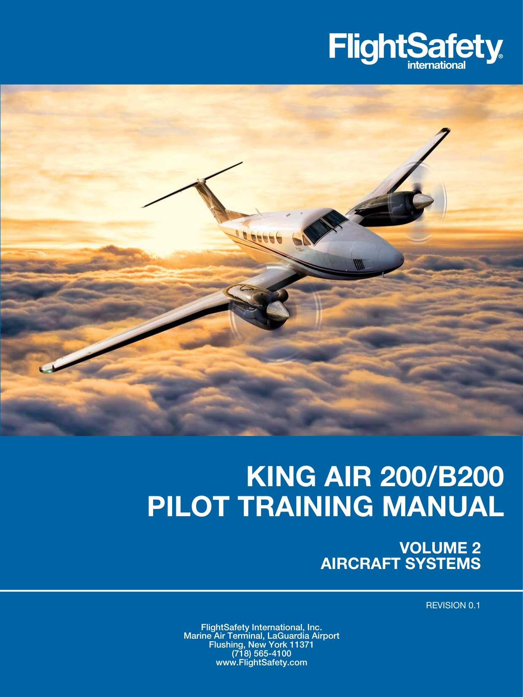

<!-- PTM:PAGE:001 END -->

<!-- PTM:PAGE:002 START -->
<!-- PTM:STATUS:revisada -->
## Página física 2 — Notice

**Página física:** 2 · **Página impressa:** Notice · **Seção:** Abertura · [PDF](KA-200-B200-PTM.pdf#page=2)

**FOR TRAINING PURPOSES ONLY**

## NOTICE

The material contained in this training manual is based on information obtained from the aircraft manufacturer’s Pilot Manuals and Maintenance Manuals (Field CD). It is to be used for familiarization and training purposes only.

At the time of printing, it contained then-current information. In the event of conflict between data provided herein and that in publications issued by the manufacturer or the JAA/FAA, that of the manufacturer or the JAA/FAA shall take precedence.

We at FlightSafety want you to have the best training possible. We welcome any suggestions you might have for improving this manual or any other aspect of our training program.

**FOR TRAINING PURPOSES ONLY**

Fac-símile da página física 2

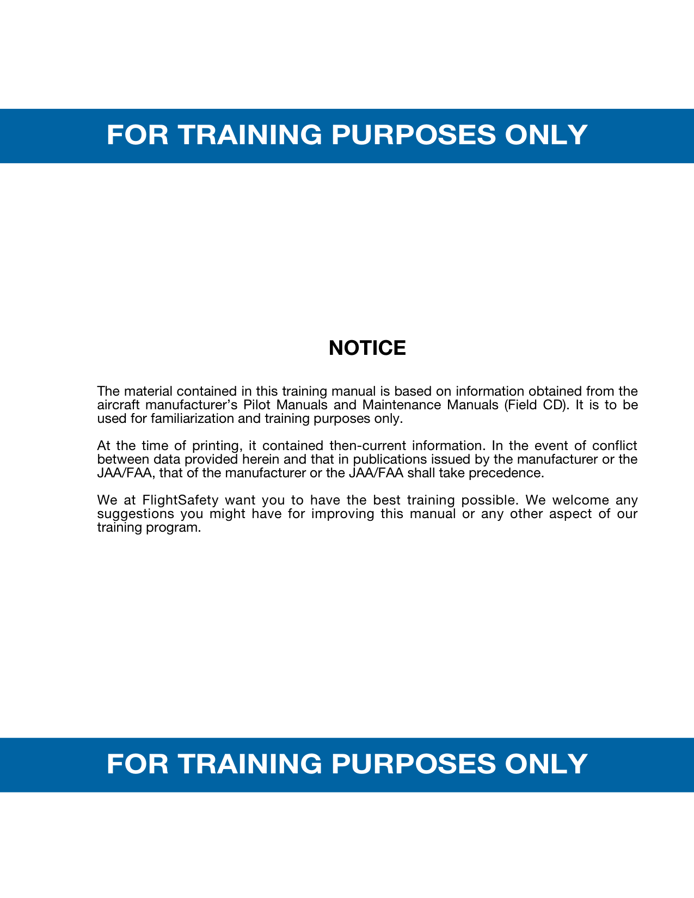

<!-- PTM:PAGE:002 END -->

<!-- PTM:PAGE:003 START -->
<!-- PTM:STATUS:revisada -->
## Página física 3 — Copyright

**Página física:** 3 · **Página impressa:** Copyright · **Seção:** Abertura · [PDF](KA-200-B200-PTM.pdf#page=3)

Courses for the Super King Air 200 and other King Air products are taught at the following FlightSafety Learning Centers:

FlightSafety International  
Hawker Beechcraft Learning Center  
9720 East Central Avenue  
Wichita, KS 67206  
(316) 612-5300  
(800) 488-3747  
FAX: (316) 612-5399

FlightSafety International  
Long Beach Learning Center  
Long Beach Municipal Airport  
4330 Donald Douglas Drive  
Long Beach, CA 90808  
(562) 938- 0100  
(800) 487-7670  
FAX: (562) 938-0110

FlightSafety International  
Atlanta Learning Center  
1010 Toffie Terrace  
Atlanta, GA 30354  
(678) 365-2700  
(800) 889-7916  
FAX: (678) 365-2699

FlightSafety International  
Lakeland Learning Center  
Lakeland Airport  
2949 Airside Center Drive  
Lakeland, FL 33811  
(863) 646-5037  
(800) 726-5037  
FAX: (863) 644-6211

FlightSafety International  
Houston Learning Center  
William P. Hobby Airport  
7525 Fauna at Airport Boulevard  
Houston, TX 77061  
(713) 393-8100  
(800) 927-1521  
FAX: (713) 393-8111

FlightSafety International  
Paris Learning Center  
BP 25, Zone d’Aviation d’Affaires  
1300 Avenue de l’Europe  
Aeroport du Bourget  
93352 Le Bourget, Cedex, France  
+33 (1) 49-92-1919  
FAX: +33 (1) 49-92-1892

FlightSafety International  
Famborough Learning Center  
Famborough Airport  
Famborough, Hampshire  
GU146XA United Kingdom  
+44 1252 554-500  
FAX: +44 1252 554-599

Copyright © 2013 by FlightSafety International, Inc.  
Unauthorized reproduction or distribution is prohibited.  
All rights reserved.  
Printed in the United States of America.

> **Nota do transcritor:** Grafia “Famborough” mantida como impressa.

Fac-símile da página física 3

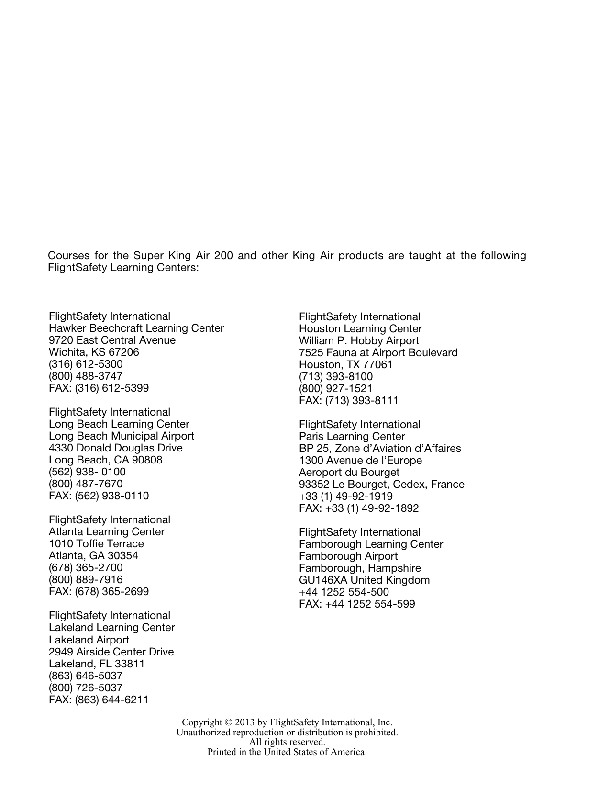

<!-- PTM:PAGE:003 END -->

<!-- PTM:PAGE:004 START -->
<!-- PTM:STATUS:revisada -->
## Página física 4 — Lista de páginas efetivas

**Página física:** 4 · **Página impressa:** Lista de páginas efetivas · **Seção:** Abertura · [PDF](KA-200-B200-PTM.pdf#page=4)

INSERT LATEST REVISED PAGES, DESTROY SUPERSEDED PAGES

Dates of issue for original and changed pages are:

Original .................. 0 .............. January 2003  
Revision .............. .01 ........... February 2007  
Revision .............. .02 ................... July 2007  
Revision ............... .1 .......... November 2013

> **NOTE**
> For printing purposes, revision numbers in footers occur at the bottom of every page that has changed in any way (grammatical or typographical revisions, reflow of pages, and other changes that do not necessarily affect the meaning of the manual).

**LIST OF EFFECTIVE PAGES**

| Page No. | *Revision No. | Page No. | *Revision No. |
|---|---|---|---|
| Cover | .1 | 11-i—11-iv | .1 |
| Copyright | .1 | 11-1—11-14 | .1 |
| iii—vi | .1 | 12-i—12-iv | .1 |
| 1-i—1-iv | .1 | 12-1—12-10 | .1 |
| 1-1—1-24 | .1 | 13-i—13-ii | .1 |
| 2-i—2-vi | .1 | 14-i—14-iv | .1 |
| 2-1—2-30 | .1 | 14-1—14-26 | .1 |
| 3-i—3-iv | .1 | 15-i—15-iv | .1 |
| 3-1—3-10 | .1 | 15-1—15-14 | .1 |
| 4-i—4-iv | .1 | 16-i—16-iv | .1 |
| 4-1—4-12 | .1 | 16-1—16-28 | .1 |
| 5-i—5-iv | .1 | 17-i—17-iv | .1 |
| 5-1—5-16 | .1 | 17-1—17-10 | .1 |
| 6-i—6-ii | .1 | 18-i—18-iv | .1 |
| 7-i—7-vi | .1 | 18-1—18-18 | .1 |
| 7-1—7-40 | .1 | GEN-i—GEN-iv | .1 |
| 8-i—8-iv | .1 | GEN-1—GEN-24 | .1 |
| 8-1—8-8 | .1 | WA-1—WA-16 | .1 |
| 9-i—9-iv | .1 | APP-1—APP-2 | .1 |
| 9-1—9-8 | .1 | ANN-1—ANN-6 | .1 |
| 10-i—10-iv | .1 |  |  |
| 10-1—22 | .1 |  |  |

\*Zero in this column indicates an original page.

> **Nota do transcritor:** Lista de páginas efetivas reconstruída; entrada “10-1—22” mantida como impressa.

Fac-símile da página física 4

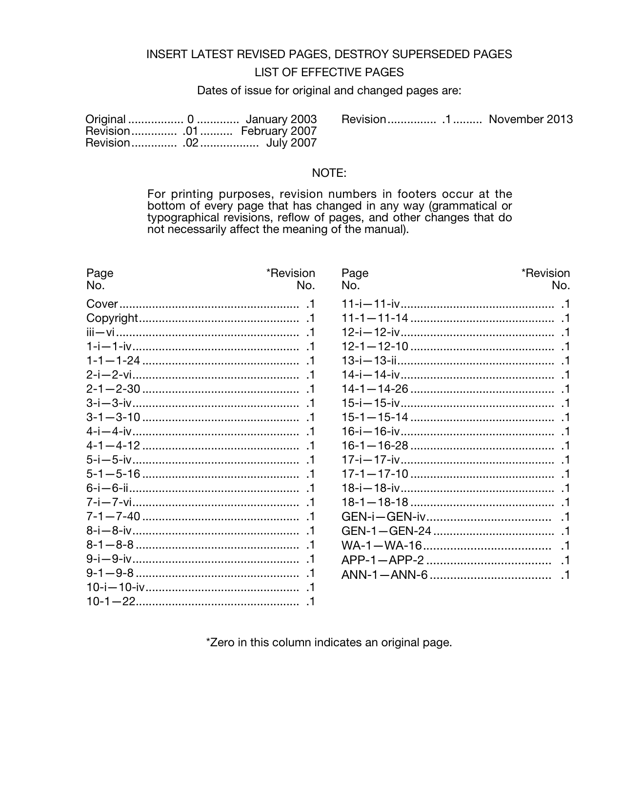

<!-- PTM:PAGE:004 END -->

<!-- PTM:PAGE:005 START -->
<!-- PTM:STATUS:revisada -->
## Página física 5 — Contents

**Página física:** 5 · **Página impressa:** Contents · **Seção:** Abertura · [PDF](KA-200-B200-PTM.pdf#page=5)

Chapter 1 AIRCRAFT GENERAL

Chapter 2 ELECTRICAL POWER SYSTEMS

Chapter 3 LIGHTING

Chapter 4 MASTER WARNING SYSTEM

Chapter 5 FUEL SYSTEM

Chapter 6 AUXILIARY POWER UNIT

Chapter 7 POWERPLANT

Chapter 8 FIRE PROTECTION

Chapter 9 PNEUMATICS

Chapter 10 ICE AND RAIN PROTECTION

Chapter 11 AIR CONDITIONING

Chapter 12 PRESSURIZATION

Chapter 13 HYDRAULIC POWER SYSTEMS

Chapter 14 LANDING GEAR AND BRAKES

Chapter 15 FLIGHT CONTROLS

Chapter 16 AVIONICS

Chapter 17 MISCELLANEOUS SYSTEMS

Chapter 18 WEIGHT AND BALANCE

GENERAL PILOT INFORMATION

WALKAROUND

APPENDIX

ANNUNCIATOR PANEL

| Chapter | Title |
|---|---|
| Chapter 1 | AIRCRAFT GENERAL |
| Chapter 2 | ELECTRICAL POWER SYSTEMS |
| Chapter 3 | LIGHTING |
| Chapter 4 | MASTER WARNING SYSTEM |
| Chapter 5 | FUEL SYSTEM |
| Chapter 6 | AUXILIARY POWER UNIT |
| Chapter 7 | POWERPLANT |
| Chapter 8 | FIRE PROTECTION |
| Chapter 9 | PNEUMATICS |
| Chapter 10 | ICE AND RAIN PROTECTION |
| Chapter 11 | AIR CONDITIONING |
| Chapter 12 | PRESSURIZATION |
| Chapter 13 | HYDRAULIC POWER SYSTEMS |
| Chapter 14 | LANDING GEAR AND BRAKES |
| Chapter 15 | FLIGHT CONTROLS |
| Chapter 16 | AVIONICS |
| Chapter 17 | MISCELLANEOUS SYSTEMS |
| Chapter 18 | WEIGHT AND BALANCE |
|  | GENERAL PILOT INFORMATION |
|  | WALKAROUND |
|  | APPENDIX |
|  | ANNUNCIATOR PANEL |

Fac-símile da página física 5

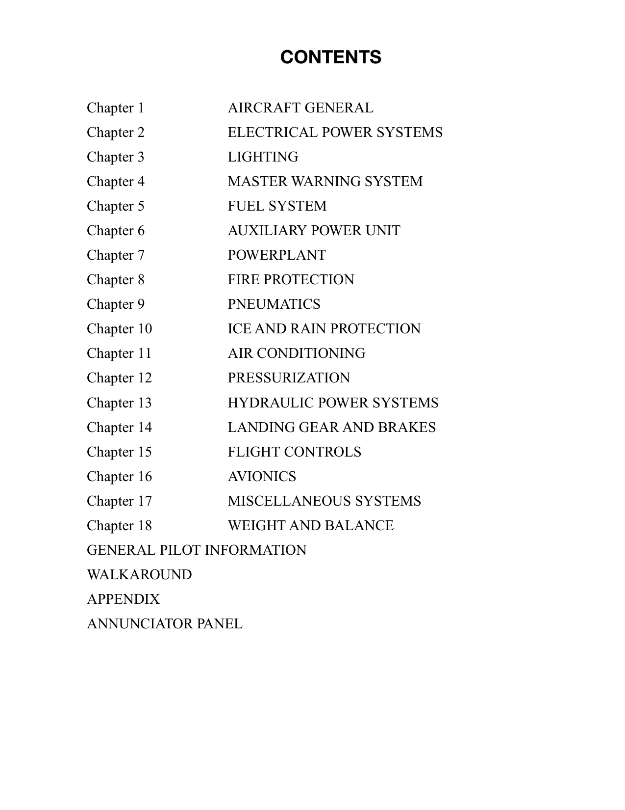

<!-- PTM:PAGE:005 END -->

<!-- PTM:PAGE:006 START -->
<!-- PTM:STATUS:revisada -->
## Página física 6 — 1-i

**Página física:** 6 · **Página impressa:** 1-i · **Seção:** 1 Aircraft General · [PDF](KA-200-B200-PTM.pdf#page=6)

#### CHAPTER 1 AIRCRAFT GENERAL

##### CONTENTS

| Subject | Page |
|---|---|
| INTRODUCTION | 1-1 |
| GENERAL | 1-1 |
| AIRPLANE SYSTEMS | 1-2 |
| Electrical Power System | 1-2 |
| Lighting | 1-4 |
| Master Warning System | 1-5 |
| Fuel System | 1-5 |
| Powerplants | 1-6 |
| Fire Protection | 1-8 |
| Bleed-Air System | 1-8 |
| Ice and Rain Protection | 1-8 |
| Air Conditioning and Heating | 1-9 |
| Pressurization | 1-10 |
| Landing Gear and Brakes | 1-11 |
| Flight Controls | 1-13 |
| Pitot and Static Systems | 1-14 |
| Oxygen System | 1-15 |

Fac-símile da página física 6

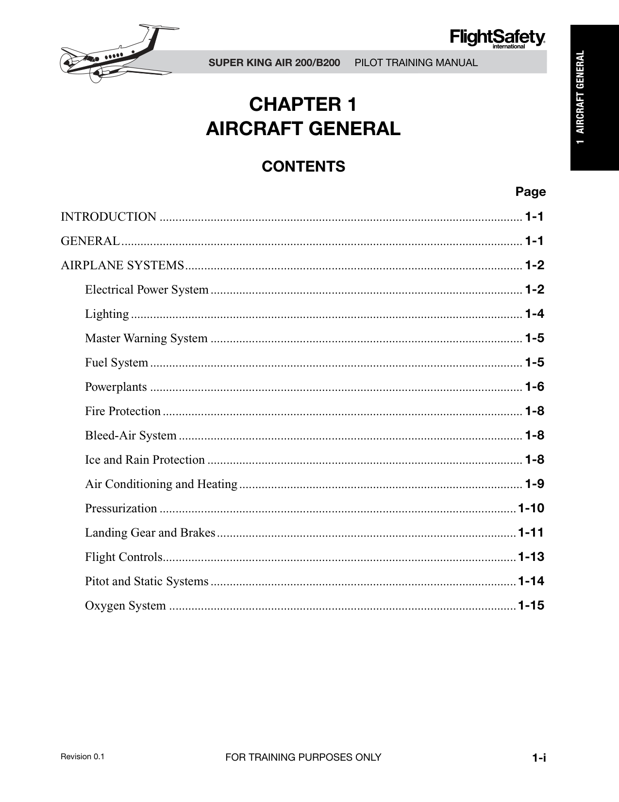

<!-- PTM:PAGE:006 END -->

<!-- PTM:PAGE:007 START -->
<!-- PTM:STATUS:revisada -->
## Página física 7 — 1-ii

**Página física:** 7 · **Página impressa:** 1-ii · **Seção:** 1 Aircraft General · [PDF](KA-200-B200-PTM.pdf#page=7)

| Subject | Page |
|---|---|
| AIRPLANE STRUCTURES | 1-16 |
| General | 1-16 |
| Fuselage | 1-19 |
| Doors | 1-20 |
| Cabin Windows | 1-23 |
| Control Locks | 1-24 |

Fac-símile da página física 7

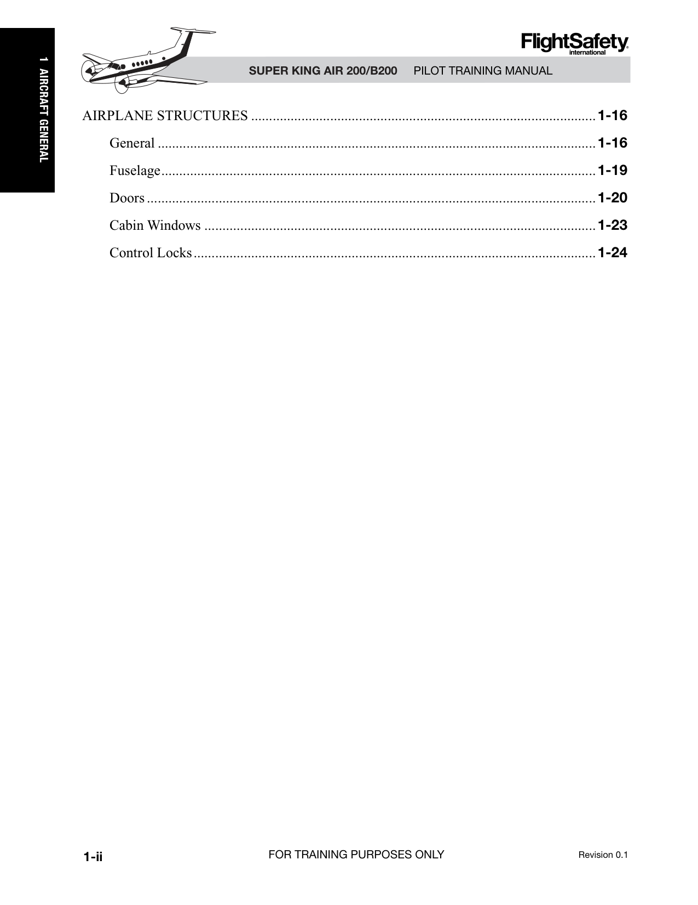

<!-- PTM:PAGE:007 END -->

<!-- PTM:PAGE:008 START -->
<!-- PTM:STATUS:revisada -->
## Página física 8 — 1-iii

**Página física:** 8 · **Página impressa:** 1-iii · **Seção:** 1 Aircraft General · [PDF](KA-200-B200-PTM.pdf#page=8)

##### ILLUSTRATIONS

| Figure | Title | Page |
|---|---|---|
| 1-1 | Simplified Electrical System | 1-2 |
| 1-2 | Electrical Panel | 1-3 |
| 1-3 | External Power Socket | 1-3 |
| 1-4 | Overhead Light Control Panel (BB-1632 and After) | 1-4 |
| 1-5 | Cabin Lights Control Switch (BB-1439, 1444 and After) | 1-4 |
| 1-6 | Exterior Lights Control Switches | 1-5 |
| 1-7 | Fuel Control Panels | 1-6 |
| 1-8 | Engine Control Levers | 1-7 |
| 1-9 | Bleed-Air Valve Control | 1-8 |
| 1-10 | Ice Protection Switches—Pilot’s Subpanel | 1-8 |
| 1-11 | Windshield Wiper Control Switch | 1-9 |
| 1-12 | Cabin Pressurization Controller | 1-11 |
| 1-13 | Landing Gear Control Panel | 1-11 |
| 1-14 | Manual Extension Controls | 1-12 |
| 1-15 | Parking Brake Handle | 1-12 |
| 1-16 | Flight Control Surfaces | 1-13 |
| 1-17 | Trim Tab Controls and Indicators | 1-14 |
| 1-18 | Flap Control Lever | 1-14 |
| 1-19 | Pitot Tubes | 1-14 |
| 1-20 | Static Ports | 1-15 |
| 1-21 | Pilot’s Static Air Source Valve Handle | 1-15 |
| 1-22 | Cockpit Oxygen Handles | 1-16 |
| 1-23 | Airplane Dimensions (BB-1439, 1444 and After) | 1-17 |
| 1-24 | Airplane Dimensions (Prior to BB-1444, Except 1439) | 1-18 |

Fac-símile da página física 8

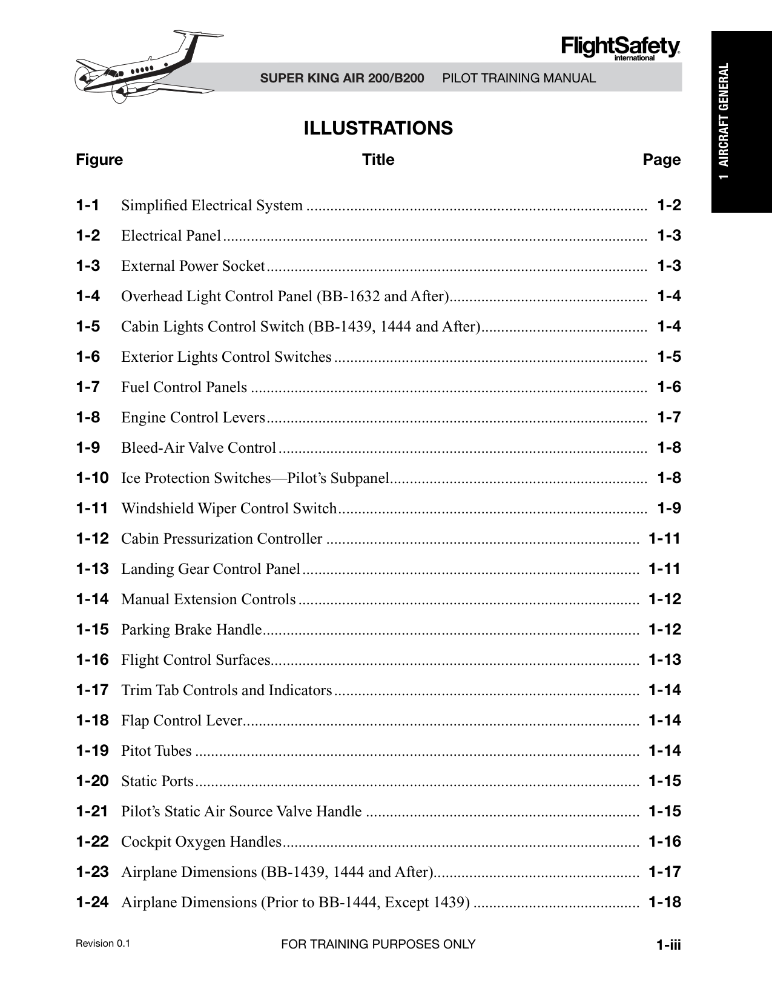

<!-- PTM:PAGE:008 END -->

<!-- PTM:PAGE:009 START -->
<!-- PTM:STATUS:revisada -->
## Página física 9 — 1-iv

**Página física:** 9 · **Página impressa:** 1-iv · **Seção:** 1 Aircraft General · [PDF](KA-200-B200-PTM.pdf#page=9)

##### TABLES

**ILLUSTRATIONS**

| Figure | Title | Page |
|---|---|---|
| 1-25 | Airplane Dimensions (BB-1439, 1444 and After) | 1-19 |
| 1-26 | Cockpit Layout (Typical) | 1-20 |
| 1-27 | Cabin Door | 1-20 |
| 1-28 | Door Handles | 1-21 |
| 1-29 | Placard and Inspection Port | 1-21 |
| 1-30 | Latch Bolt | 1-22 |
| 1-31 | Emergency Exit Release Handles | 1-23 |
| 1-32 | Control Locks | 1-24 |

**TABLES**

| Table | Title | Page |
|---|---|---|
| 1-1 | Cabin Altitudes | 1-10 |

Fac-símile da página física 9

<!-- PTM:PAGE:009 END -->

<!-- PTM:PAGE:010 START -->
<!-- PTM:STATUS:revisada -->
## Página física 10 — 1-1

**Página física:** 10 · **Página impressa:** 1-1 · **Seção:** 1 Aircraft General · [PDF](KA-200-B200-PTM.pdf#page=10)

### CHAPTER 1 AIRCRAFT GENERAL

#### INTRODUCTION

This pilot training manual covers all systems on the Super King Air 200 and B200. Chapter 1 provides a general overview of the systems and the structural makeup of the airplane. Through-out this manual there are boxed warnings, cautions, and notes. As indicated in the *Aircraft Flight* *Manual,* they are defined as follows: **Warnings—**Operating procedures, techniques, etc., which could result in personal injury or loss of life if not carefully followed; **Cautions—**Operating pro-cedures, techniques, etc., which could result in damage to equipment if not carefully followed; **Note—**An operating procedure, technique, etc., which is considered essential to emphasize.

#### GENERAL

The Super King Air 200 and B200 are all metal airplanes employing a fully cantilevered, low-wing design. There are twin Pratt and Whitney turboprop engines, and a T-tail empennage.

Both airplanes are certified for flight as Normal Category Aircraft. By carrying required operational equipment, they may be used during VFR, IFR, and in known icing conditions.

**Ilustração de abertura do capítulo**

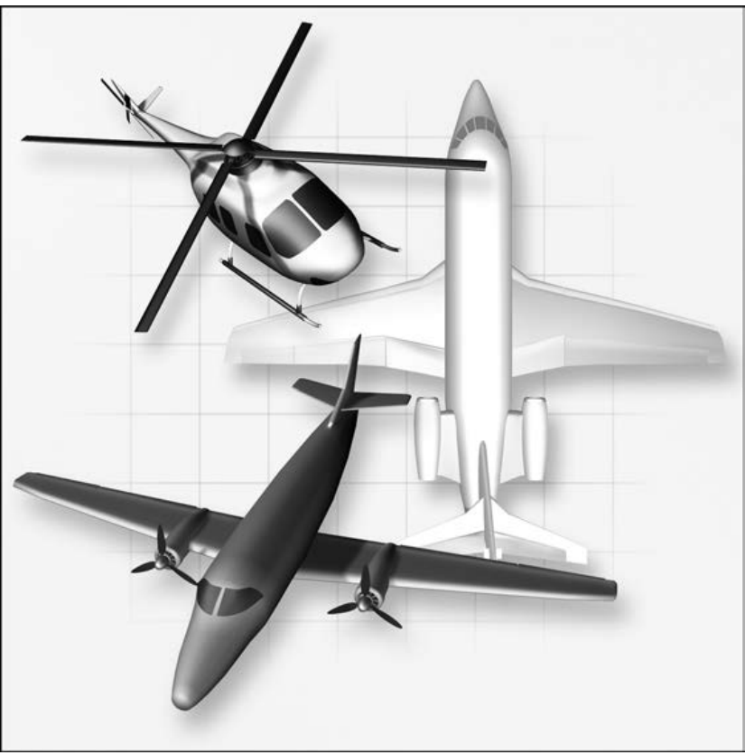

Fac-símile da página física 10

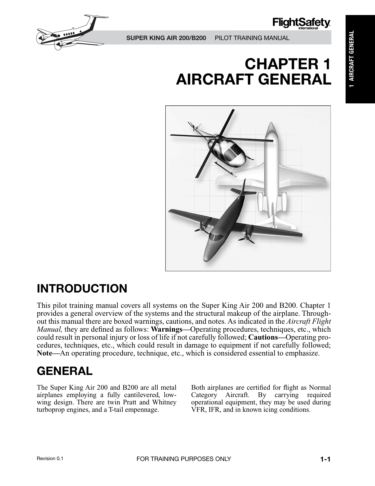

<!-- PTM:PAGE:010 END -->

<!-- PTM:PAGE:011 START -->
<!-- PTM:STATUS:revisada -->
## Página física 11 — 1-2

**Página física:** 11 · **Página impressa:** 1-2 · **Seção:** 1 Aircraft General · [PDF](KA-200-B200-PTM.pdf#page=11)

#### AIRPLANE SYSTEMS

##### ELECTRICAL POWER SYSTEM

##### General

The airplane electrical system is a 28-VDC system, which receives power from a 24-volt. 42-ampere hour lead acid gel cell battery (34/36-ampere hour nickel-cadmium battery prior to BB-1 632). two 250-ampere startergenerators, or through an external power socket.

DC power is supplied to one of the two operating inverters, which provide 400-hertz, 115-volt and 26-volt AC power for various avionics equipment. (For BB-2 through BB-1483 the 26-volt AC also powers the torquemeters. Prior to BB-225 the fuel flow meters are also 26-volt AC powered.)

##### Distribution

Some major DC buses are as follows (Figure 1-1):

1. Hot Battery Bus

2. Main Battery Bus

3. Left Generator Bus

4. Right Generator Bus

5. Isolation Bus

6. No. 1 Dual Fed Bus

7. No. 2 Dual Fed Bus

8. No. 3 Dual Fed Bus

9. No.4 Dual Fed Bus

10. The avionics buses

**Figure 1-1. Simplified Electrical System**

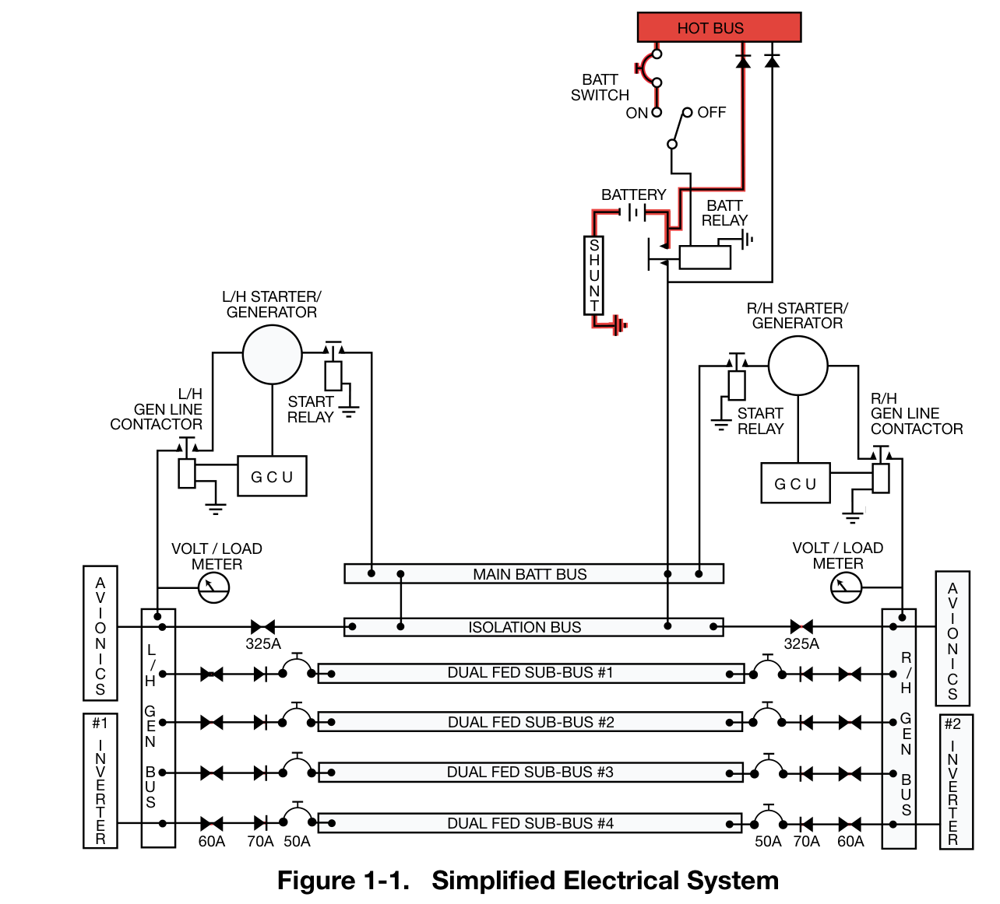

> **Nota do transcritor:** Mantidos “24-volt. 42-ampere”, “BB-1 632” e “startergenerators”; parênteses em itálico na fonte.

Fac-símile da página física 11

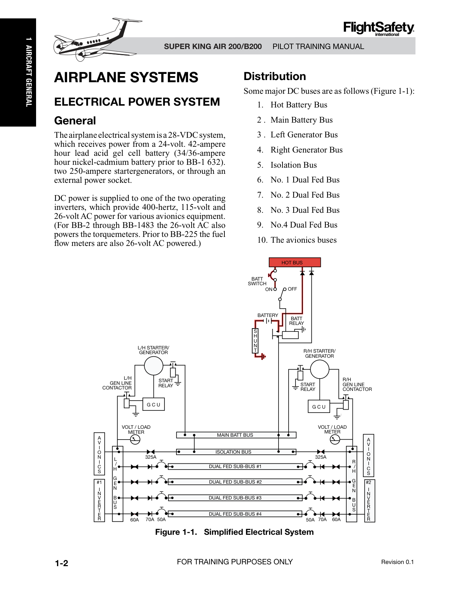

<!-- PTM:PAGE:011 END -->

<!-- PTM:PAGE:012 START -->
<!-- PTM:STATUS:revisada -->
## Página física 12 — 1-3

**Página física:** 12 · **Página impressa:** 1-3 · **Seção:** 1 Aircraft General · [PDF](KA-200-B200-PTM.pdf#page=12)

A hot baltery bus is powered by the battery, regardless of the position of the BAT switch. This bus supplies the engine fire extinguishers, firewall shutoff valves, entry and cargo lights, clocks, modifications, ground COMMunications, RNAV memory to older avionics, and standby boost pumps prior to BB-1096. It also powers the battery relay which, in turn, allows power through to the main battery bus, provided that the battery switch is ON (Figure 1-2).

The generators are controlled by GEN 1 and GEN 2 switches, located under the same gang bar as the BAT switch. Early King Air airplanes do not have the GEN RESET position. Some airplanes have the reset function, but they are not placarded. When reset is incorporated (BB-88 and after), the switch must be held in GEN RESET for a minimum of one second, and then switched to ON.

The generator buses are interconnecled by two 325-ampere current limiters on either side of the isolation bus. As long as the two isolation limiters are intact the entire bus system is supplied by the buttery and the two generators.

The four dual-fed buses are powered by either generator bus through a 60-amp limiter, a 70-amp diode, and a SO-amp circuit breaker. Those four buses supply most of the DC-powered equipment.

The inverters are powered directly from the gen-erator buses and are controlled by the INVERTER selector switch (Figure 1-2).

##### External Power

An external power socket is located on the underside of the right wing, outboard of the engine nacelle (Figure 1-3). The airplane will accept DC power from a ground power unit (GPU) provided the polarity is correct, and the GPU voltage is below 32 volts. The BAT switch must be positioned to ON in airplanes BB-364 and subsequent. Prior to BB-364, the GPU can energize the airplane without the battery switch on and there is no overvoltage protection ( i.e., more than 32 volts).

**Figure 1-2. Electrical Panel**

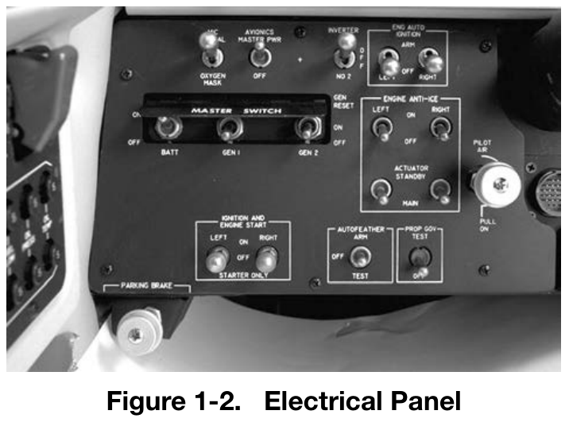

**Figure 1-3. External Power Socket**

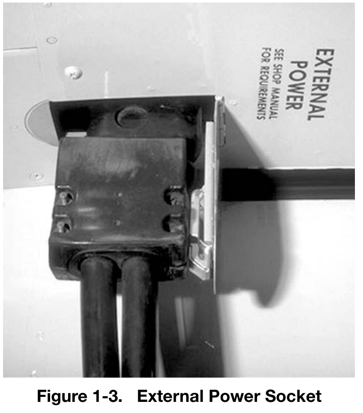

> **Nota do transcritor:** Confirmadas visualmente e mantidas as grafias “baltery”, “interconnecled”, “buttery” e “SO-amp”.

Fac-símile da página física 12

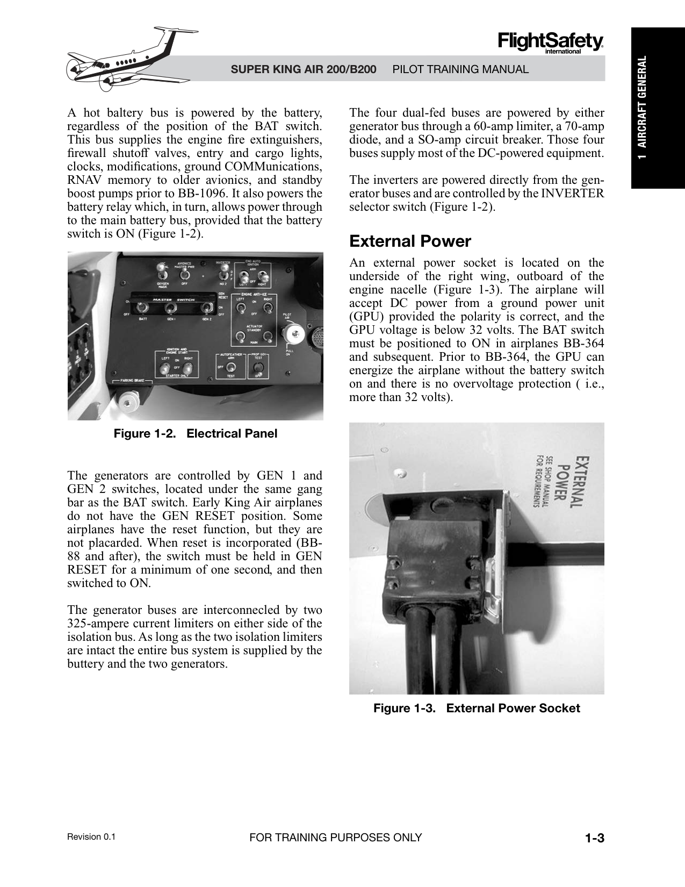

<!-- PTM:PAGE:012 END -->

<!-- PTM:PAGE:013 START -->
<!-- PTM:STATUS:revisada -->
## Página física 13 — 1-4

**Página física:** 13 · **Página impressa:** 1-4 · **Seção:** 1 Aircraft General · [PDF](KA-200-B200-PTM.pdf#page=13)

##### LIGHTING

##### Interior

An overhead light control panel (Figure 1-4) controls all the cockpit and instrument lights.

Cabin lighting is controlled by an interior light switch on the copilot 's subpanel, labeled BRIGHT-DIM-OFF. (Prior·to BB-1444, except 1439, it is labeled START/BRIGHT-DIM-OFF) (Figure 1-5). This switch control the cabin overhead fluorescent lights. Also, individual reading lights at each passenger station can be turned on or off by individual switches adjacent to the lights.

The CABIN SIGN switch is adjacent to the interior light switch.

A baggage area light switch is located just inside the airstair door.

A single switch located just forward of the airstair door at floor level, controls the threshold

**Figure 1-5. Cabin Lights Control Switch (BB-1439, 1444 and After)**

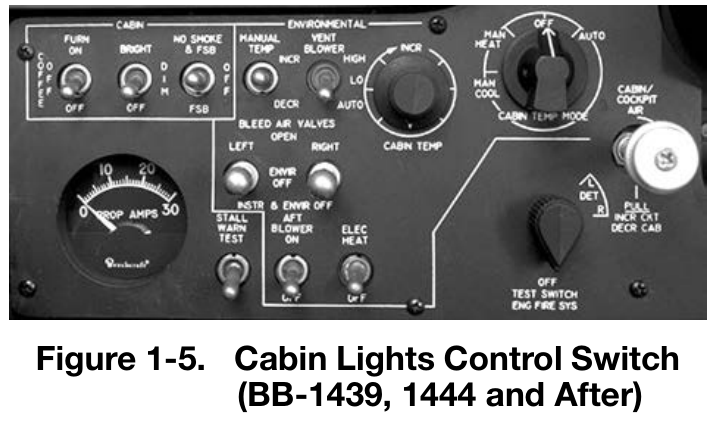

**Figure 1-4. Overhead Light Control Panel (BB-1632 and After)**

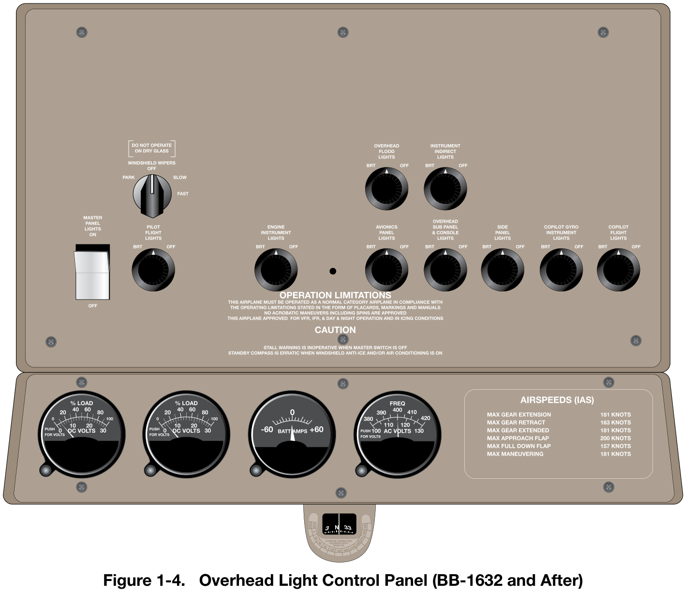

> **Nota do transcritor:** Mantidos “This switch control” e “Prior·to”. Continua na página física 14.

Fac-símile da página física 13

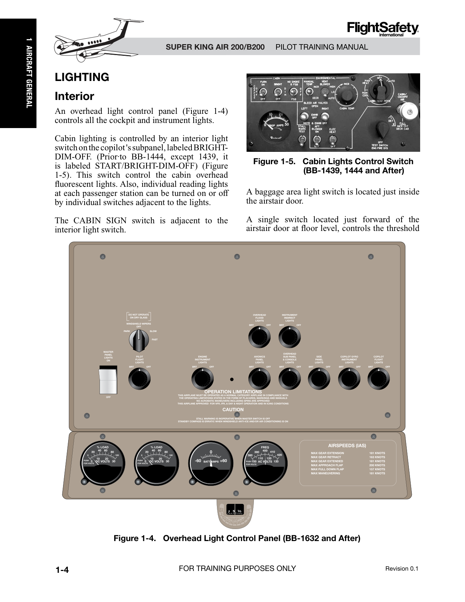

<!-- PTM:PAGE:013 END -->

<!-- PTM:PAGE:014 START -->
<!-- PTM:STATUS:revisada -->
## Página física 14 — 1-5

**Página física:** 14 · **Página impressa:** 1-5 · **Seção:** 1 Aircraft General · [PDF](KA-200-B200-PTM.pdf#page=14)

light, an aisle light, understep lighting, and the exterior entry light. These three lights turn off automatically when the airstair door is closed and the handle is in the LOCK position.

The control switches for exterior lights are located on the pilot’s right subpanel, as seen in Figure 1-6.

##### MASTER WARNING SYSTEM

##### General

The flight crew receives automatic indication of system operation through the annunciator sys-tem. There are two annunciator panels located on the instrument panel. There are also two master warning and two master caution flashers.

##### Annunciator System

The warning annunciator panel is located in the center glareshield. It contains red indicators, each of which represents a fault requiring the pilot’s immediate attention and action. At the same time, red MASTER WARNING flashers on the glareshield directly in front of each pilot begin flashing. The MASTER WARNING flashers can be extinguished by depressing either of the lights. The red lights on the warning annunciator panel remain illuminated until action is taken to correct the fault.

A caution/advisory annunciator panel is located on the center subpanel (amber indicators for cautions and green for advisory). An amber caution illumination requires the pilot’s immediate attention to a fault but does not require immediate reaction. There are also two amber MASTER CAUTION flashers on the glareshield, just inboard of the red MASTER WARNING flashers. These operate the same way as the MASTER WARNING flasher.

Two additional caution lights are on the fuel panel which do not illuminate the MASTER CAUTION flasher.

The green advisory lights indicate functional conditions, not faults; no master advisory flash-ers are associated with the advisory lights.

##### FUEL SYSTEM

##### General

The airplane fuel system consists of two separate tank systems, one for each engine, connected by a common crossfeed line. Each of the tank systems is further divided into a main and an auxiliary system.

Each main system consists of a nacelle tank, two wing leading-edge tanks, two box section bladder tanks, and an integral wing tank, all of which gravity feed into the nacelle tanks. The filler for this family of tanks is located on top of the wing, near the wingtip.

The auxiliary fuel system consists of an auxiliary tank, located in the wing inboard of the engine nacelle. It is filled separately through an overwing filler, and employs an automatic fuel transfer system to supply the fuel to the main system.

When the auxiliary tanks contain fuel, this fuel is used first and is automatically transferred into the nacelle tank.

**Figure 1-6. Exterior Lights Control Switches**

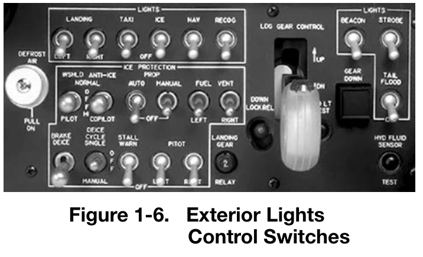

> **Nota do transcritor:** Continuação da página física 13.

Fac-símile da página física 14

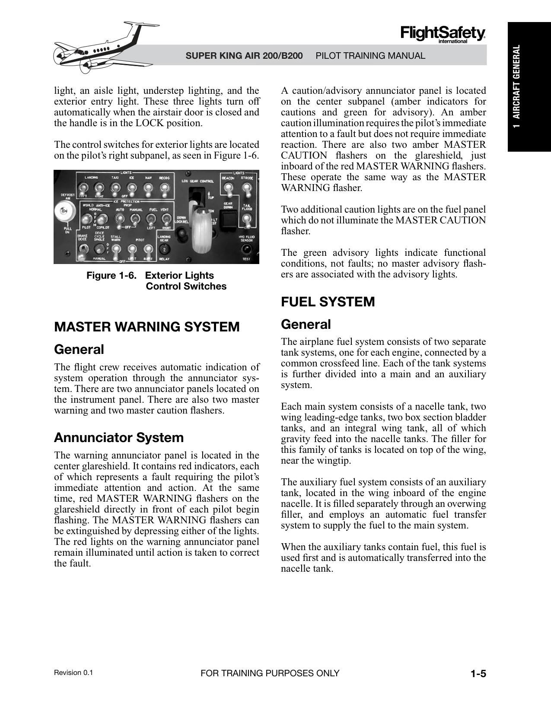

<!-- PTM:PAGE:014 END -->

<!-- PTM:PAGE:015 START -->
<!-- PTM:STATUS:revisada -->
## Página física 15 — 1-6

**Página física:** 15 · **Página impressa:** 1-6 · **Seção:** 1 Aircraft General · [PDF](KA-200-B200-PTM.pdf#page=15)

Each engine drives a high-pressure fuel pump and a low-pressure boost pump. In addition, an elec-trically-driven low-pressure standby boost pump is in the bottom of each nacelle tank. The standby boost pump serves three functions:

1. To serve as backup for the engine-driven fuel boost pump.

2. To pump aviation gasoline when flying above 20,000 feet.

3. To pump fuel during crossfeed operation.

If the electric standby boost pump fails, crossfeed will not be possible from that side.

If aviation gasoline is used, a limitation of 150 hours of operation per engine before overhauls must be observed.

There are two firewall shutoff valves, each controlled by a red switch guarded to the OPEN position on the fuel control panel (Figure 1-7).

The fuel quantity is measured by a capacitance system, which reads out in pounds on the left and right fuel gages (Figure 1-7). A switch between the gages allows the pilot to monitor MAIN or AUXILIARY fuel levels.

##### POWERPLANTS

##### General

The Super King Air is powered by two Pratt and Whitney turbopropeller PT6A engines, each rated at 850 SHP. They each have a threestage, axial-flow, single-stage centrifugal flow compressor (rpm indicated as N1) which is driven by a single-stage reaction turbine. The power turbine is a two-stage reaction turbine counter rotating with the compressor turbine. A pneumatic fuel control schedules fuel flow. Propeller speed remains constant within the governing range for any given propeller control lever position.

An accessory gearbox, mounted at the rear of the engine, drives the fuel pumps, fuel control, oil pump, refrigerant compressor (right engine), starter-generator, and the N1 tachometer transmitter.

Engine instruments are grouped at the left center of the instrument panel.

**Figure 1-7. Fuel Control Panels**

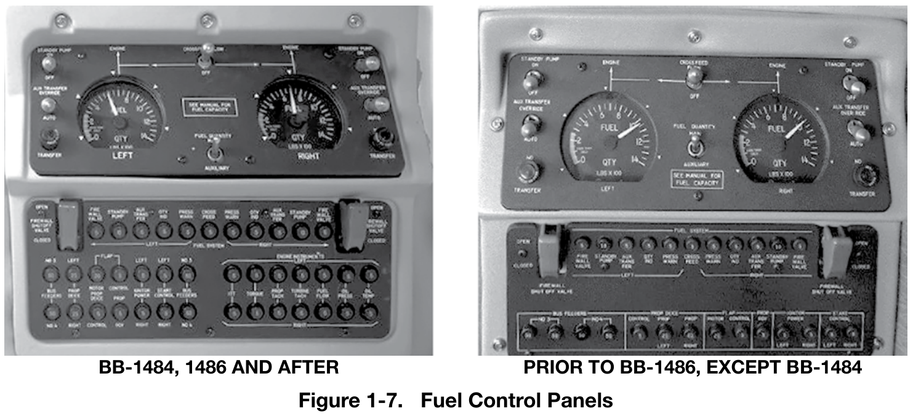

> **Nota do transcritor:** Mantido “threestage”; N1 representado com subscrito.

Fac-símile da página física 15

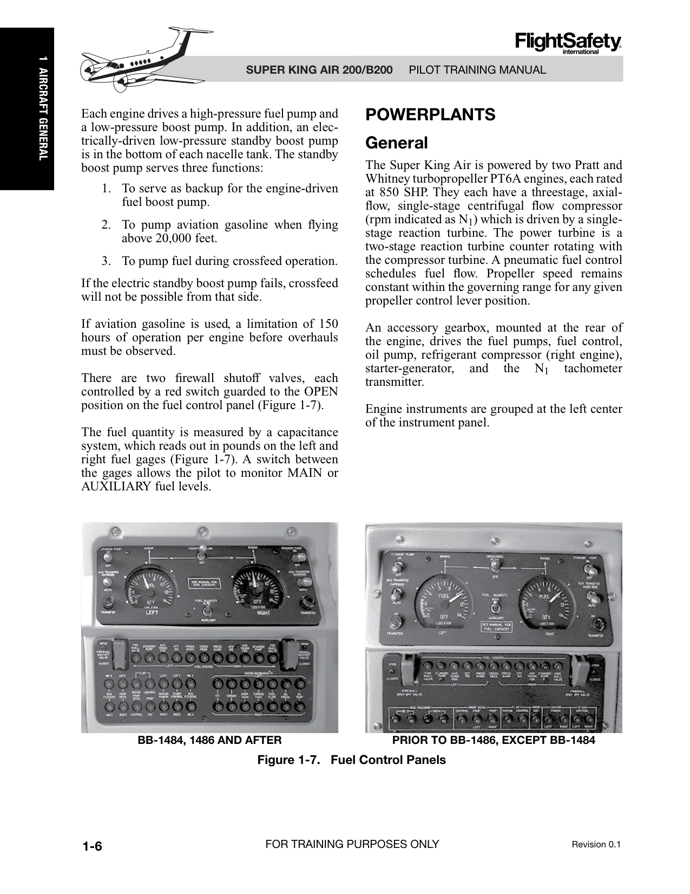

<!-- PTM:PAGE:015 END -->

<!-- PTM:PAGE:016 START -->
<!-- PTM:STATUS:revisada -->
## Página física 16 — 1-7

**Página física:** 16 · **Página impressa:** 1-7 · **Seção:** 1 Aircraft General · [PDF](KA-200-B200-PTM.pdf#page=16)

##### Engine Controls

There are three sets of controls on the pedestal (Figure 1-8):

1. Power levers provide control of engine power from FULL REVERSE through TAKEOFF power. Increasing N1 rpm results in increased engine power.

2. Propeller levers operate springs to repo-sition the primary governor pilot valve, effecting an increase or decrease in pro-peller rpm.

3. Condition levers have three positions:

- FUEL CUTOFF

- LOW IDLE

- HIGH IDLE

##### Ground Fine (Beta)/Reversing

When the power levers are lifted aft over the IDLE detent, they control the blade angle of the propellers in Ground Fine (Beta) mode. This provides a near zero thrust setting. For BB-1439, 1444 and subsequent, to select reverse the power levers need to be lifted over a second gate. Prior to BB-1444 except 1439, reverse can be selected by continuing to move the power levers aft of the beta position into a red- and white-labeled zone on the power quadrant.

> **CAUTION**

> Propeller reversing on unimproved surfaces should be accomplished care-fully to prevent propeller erosion from reversed airflow and in dusty or snowy conditions to prevent obscured vision.

Condition levers, when set to HIGH IDLE, keep the engine operating at a minimum of 70% N1 for quicker reversing response due to less spool up time.

> **CAUTION**

> Power levers should not be moved over either gate when the engines are not running, or with engines running and the propeller feathered, because the reversing system will be damaged.

**Figure 1-8. Engine Control Levers**

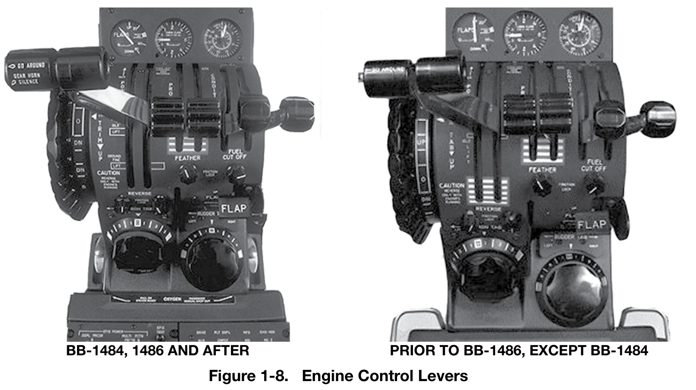

> **Nota do transcritor:** Continua na página física 17.

Fac-símile da página física 16

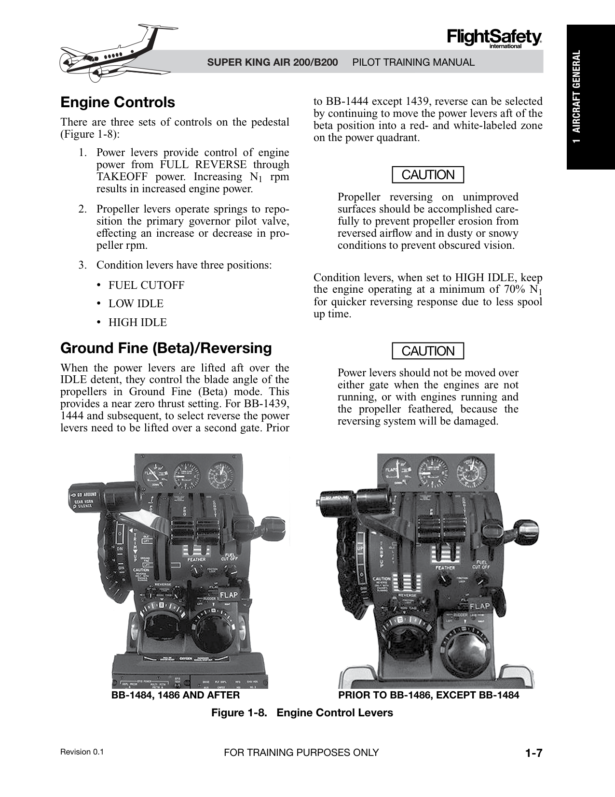

<!-- PTM:PAGE:016 END -->

<!-- PTM:PAGE:017 START -->
<!-- PTM:STATUS:revisada -->
## Página física 17 — 1-8

**Página física:** 17 · **Página impressa:** 1-8 · **Seção:** 1 Aircraft General · [PDF](KA-200-B200-PTM.pdf#page=17)

##### FIRE PROTECTION

There are two fire-detection systems. On BB-1439, 1444 and subsequent the system consists of a temperature sensing cable for each engine. Prior to BB-1444, except 1439, the system uses three detectors incorporated into each engine nacelle. Each system has red warning annunciator readouts and a test function. The optional engine fire-extinguisher system adds an extinguisher cylinder within each engine nacelle. When the system is installed, glareshield control switches and additional positions on the test switch are added (one for each extinguisher cartridge). There are two portable fire extinguishers installed: one under the copilot’s seat, and the other near the entrance door.

##### BLEED-AIR SYSTEM

##### General

Each engine compressor supplies bleed air for the pressurization and pneumatic systems. The bleed air used for pressurization is routed from the engine to a flow control unit then into the pressure vessel. This same air is conditioned for environmental use.

The bleed air used for the pneumatic system is tapped off prior to the flow control unit and is routed through a shutoff valve to a regulator. This pneumatic air is then used for surface deice, rud-der boost, door seal, bleed-air warning system, the flight hour meter, brake deice (if installed) and the landing gear hydraulic reservoir ( if installed). Through the use of a venturi, vacuum suction is developed for flight instruments, pressurization controller operation and deice boots. One engine can supply sufficient bleed air for all associated systems.

##### Bleed-Air Warning

The pressurization and pneumatic bleed-air lines have follower plastic tubing containing “regulated (18 psi)” bleed-air. If a bleed-air line ruptures, the released heat will melt the accompanying plas-tic tube and the loss of pressure will cause the respective red L or R BLEED AIR FAIL light on the warning annunciator panel to illuminate.

When bleed-air failure is indicated, the appropri-ate BLEED AIR VALVE switch, on the copilot’s subpanel should be placed to the INSTRument and ENVIRonment OFF position (Figure 1-9).

##### ICE AND RAIN PROTECTION

##### Ice Protection

Ice protection is accomplished either pneumatically or electrically. Pneumatic ice protection uses engine bleed air for surface deicing of wing and horizontal stabilizer leading edges, and hot brakes, if installed. Electrical heating elements are used for windshield heating, fuel vent heat, propeller deicing, pitot mast heat, and stall warning vane heat (Figure 1-9).

The engine uses two types of anti-ice protection. To protect the air inlet, some of the hot engine exhaust gases are scooped up and directed into the air inlet lip. To protect the engine, ice vanes are used which are moved into the airstream.

**Figure 1-9. Bleed-Air Valve Control**

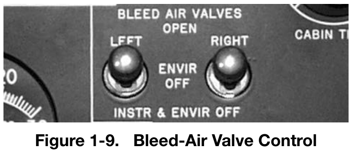

**Figure 1-10. Ice Protection Switches—Pilot’s Subpanel**

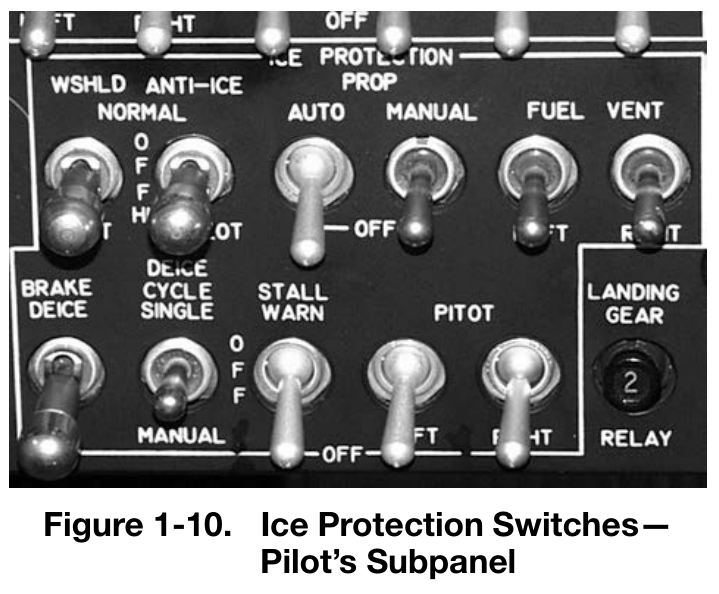

> **Nota do transcritor:** Texto de proteção contra gelo remete à Figure 1-9; mantido como impresso. Continua na página física 18. Continuação da página física 16.

Fac-símile da página física 17

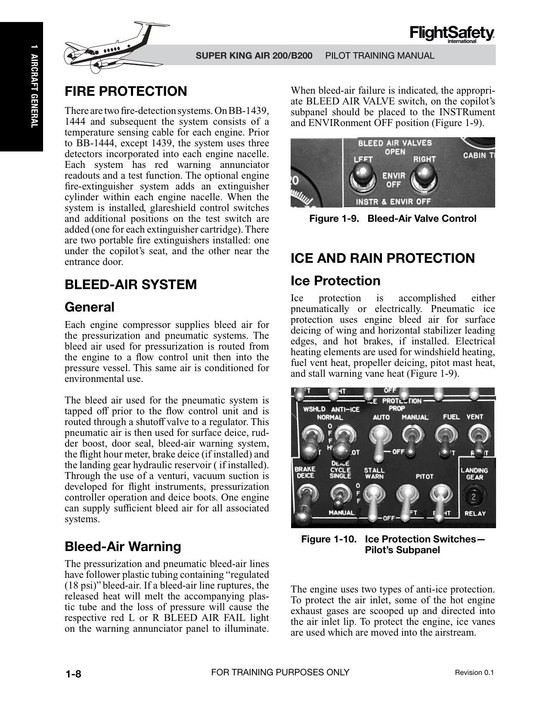

<!-- PTM:PAGE:017 END -->

<!-- PTM:PAGE:018 START -->
<!-- PTM:STATUS:revisada -->
## Página física 18 — 1-9

**Página física:** 18 · **Página impressa:** 1-9 · **Seção:** 1 Aircraft General · [PDF](KA-200-B200-PTM.pdf#page=18)

These cause a slight deflection in the entering airflow, introducing a turn in the airstream. The accelerated moisture particles continue on to the discharge port, rather than entering the engine. On BB-1439, 1444 and subsequent a second electric actuator is employed as a backup. Prior to BB-1444 except 1439, if the electric ice vane controls do not work, mechanical extension handles may be used. Operation of the vanes are displayed either by green L or R ENG ANTIICE advisory lights (normal operation) or by amber L or R ENG ICE FAIL caution lights, indicating a possible malfunction. (Prior to BB-1444 except 1439, these annunciators are labeled L or R ICE VANE EXT and L or R ICE VANE, respectively.)

An optional brake deice system allows a flow of hot bleed air to the brakes. If installed, operation is controlled by a switch on the ICE panel (Figure 1-10) and indicated by a green BRAKE DEICE ON advisory annunciator light.

##### Rain Protection

There are dual, two-speed, electric windshield wipers, controlled by a switch on the overhead light control panel. The PARK position on the control switch sets the wipers to the inboard posi-tion (Figure 1-11).

##### AIR CONDITIONING AND HEATING

##### General

Cabin air conditioning is provided by a refrigerant-gas-vapor cycle refrigeration system. The compressor is mounted on the right engine accessory pad. The refrigerant is routed to the airplane nose where the condenser coil, receiver-dryer, expansion and bypass valves, and evaporator are located.

The compressor is deenergized any time the engine speed is below 62% N1. An attempt to use air conditioning when N1 is below the above values, will result in illumination of the green AIR COND N1 LOW advisory light on the annunciator panel. High or low refrigerant pressure switches will also trip the system and illuminate the reset switch light in the nose gear wheel well. (Prior to BB 729, it opens a fuse or a circuit breaker in the right wing area next to the hot battery bus).

The forward vent blower sends recirculated cabin air through the evaporator for air-conditioning output. The output from the ceiling outlets will always be cool. Cool air also enters the floor-level duct, but is mixed with warm environmental bleed air if either BLEED AIR valve is open. Therefore, the lower duct, discharging pressurized air, will always be warmer than the overhead “eyeball” ducts.

An optional aft evaporator and blower may be installed. Refrigerant will flow through both evaporators as long as the system is operating, but additional cooling for the aft outlets will occur only when the aft blower is operating.

The cabin is heated by engine compressed bleed air. After the airplane is airborne, ambient air valves open and allow ambient air to mix with the bleed air for increased density. Pilot and copi-lot volume of air is controllable by respective air knobs on each subpanel. A CABIN AIR knob varies the volume of air directed into the cockpit or into the cabin flow ducting. A DEFROST AIR control knob directs warm air to the windshield.

**Figure 1-11. Windshield Wiper Control Switch**

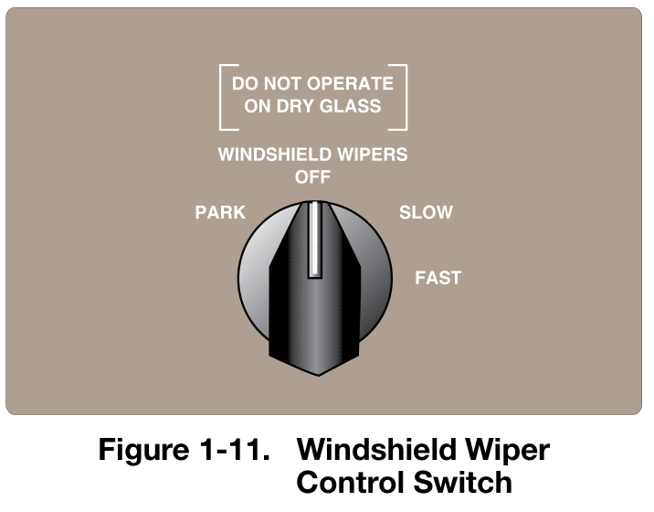

> **Nota do transcritor:** Continuação da página física 17.

Fac-símile da página física 18

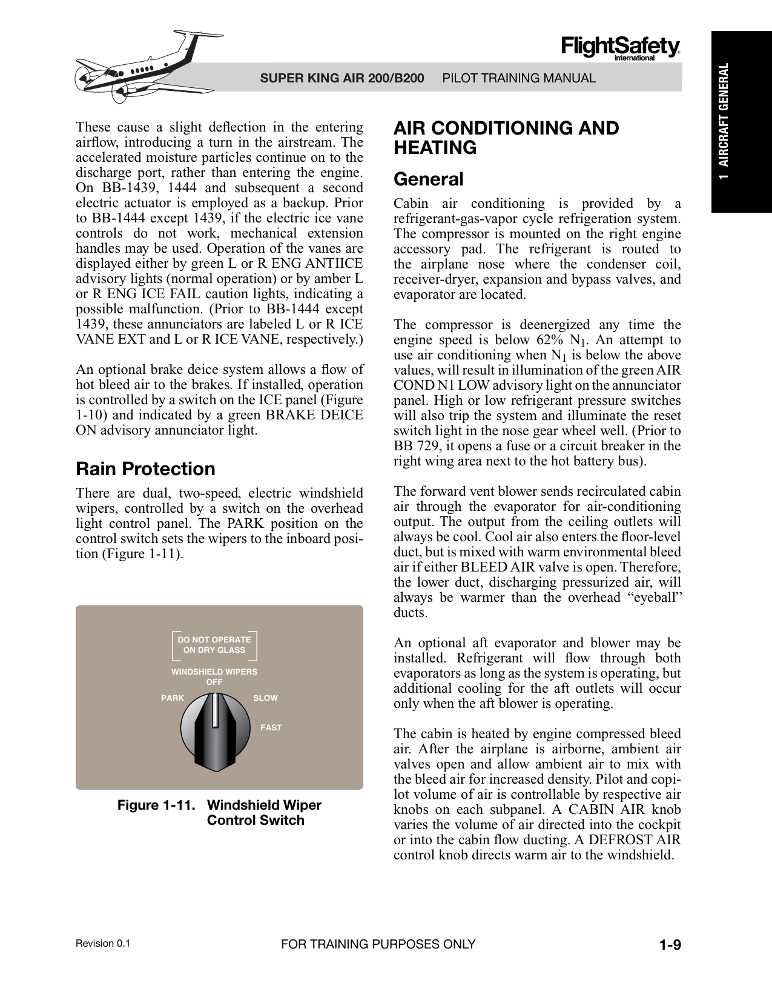

<!-- PTM:PAGE:018 END -->

<!-- PTM:PAGE:019 START -->
<!-- PTM:STATUS:revisada -->
## Página física 19 — 1-10

**Página física:** 19 · **Página impressa:** 1-10 · **Seção:** 1 Aircraft General · [PDF](KA-200-B200-PTM.pdf#page=19)

##### Unpressurized Ventilation

Ventilation is provided through the bleed-air sys-tem during either pressurized or unpressurized flight. Fresh air can also be provided by ram air but only during unpressurized flight.

##### Electric Heating (BB-1439, 1444 and Subsequent)

An optional electric heating system is available for ground operation only. A ground power unit must be used prior to engine starting or generator power after engine starting in order to use electric heating system. It is for ground operation only and is used in conjunction with either manual heat or automatic temperature control mode. A green advisory light on the annunciator panel is provided to indicate power is being supplied to the unit. Both the vent blower and aft blower must be operating when using the electric heater.

##### Radiant Heating (Prior to BB-1444, Except 1439)

An optional radiant heating system is an over-head heated panel system, which can be powered by a ground power unit for cabin heating prior to engine start, or it can use airplane power to supplement the heating system in flight. It should be used only in conjunction with the manual tem-perature control mode.

##### PRESSURIZATION

##### General

The pressurization system is designed to provide a normal working pressure differential (psid) when flying at altitude. Table 1-1 presents the pressure differentials on the 200 and B200.

Bleed air from the engine compressor section is used to supply airplane pressurization. Engine bleed is mixed with ambient air to form a suitable mixture. The flow control unit and BLEED AIR VALVE switches, as seen in Figure 1-9, control the mixture. If this switch is positioned to ENVIRonmental OFF or INSTrument and ENVIRonmental OFF, the bleed-air valve will be closed. When positioned to OPEN, air is routed through a heat exchanger and then into a mixing plenum. It mixes with recirculated air, is routed to the outlet ducts, and is introduced into the cabin.

The outflow valve, located on the aft pressure bulkhead, controls the amount of pressurized air in the airplane. The pressure and rate of cabin pressure changes are controlled by vacuum-operated modulation of the outflow valve.

Also, a vacuum-operated safety valve is mounted adjacent to the outflow valve. It serves four purposes:

1. To provide positive pressure relief if the outflow valve malfunctions.

2. To allow depressurization when the pressure switch is moved to the DUMP position.

3. To maintain an unpressurized state while on the ground with the left landing gear safety switch compressed.

4. To prevent negative differential.

When the BLEED AIR switches are OPEN, air used for pressurization enters the airplane, with or without ambient air, depending on the position of the landing gear safety switch (on the ground, no ambient flow), and temperature. For pneumatic flow packs (prior to BB-1180), the use of ambient air is also dependent on ambient pressure.

An adjustable cabin pressurization controller is located on the pedestal (Figure 1-12).

The CABIN ALT selector knob can be used to select a desired cabin pressure altitude between -1,000 feet and 15,000 feet. The selected pressure altitude will be reflected on the outer scale of the indicator. The inner scale shows the highest ambient pressure altitude that the airplane can fly in order to maintain the selected CABIN ALT.

**Table 1-1. CABIN ALTITUDES**

| FLIGHT ALTITUDE | CABIN ALTITUDE 200 (6.0 ± 0.1 psid) | CABIN ALTITUDE B200 (6.5 ± 0.1 psid) |
|---|---|---|
| 20,000 | 3,900 | 2,800 |
| 31,000 | 9,900 | 8,600 |
| 35,000 | 11,700 | 10,400 |

ALTITUDES ARE IN FEET

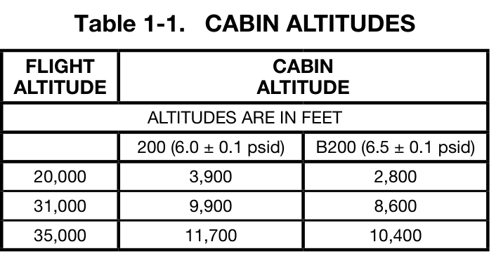

> **Nota do transcritor:** Tabela 1-1 reconstruída; valores e tolerâncias ± conferidos.

Fac-símile da página física 19

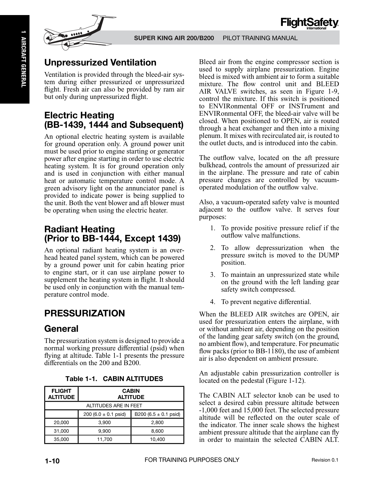

<!-- PTM:PAGE:019 END -->

<!-- PTM:PAGE:020 START -->
<!-- PTM:STATUS:revisada -->
## Página física 20 — 1-11

**Página física:** 20 · **Página impressa:** 1-11 · **Seção:** 1 Aircraft General · [PDF](KA-200-B200-PTM.pdf#page=20)

A rate control selector knob, placarded RATE– MIN–MAX can select between 200 and 2,000 feet per minute of change of cabin altitude. These controls direct the action of the outflow valve.

The CABIN PRESS–DUMP–TEST switch is located next to the cabin pressurization control-ler. When selected to DUMP, the safety valve opens, relieving all accumulated cabin pressure. In TEST, the valve is closed, bypassing the left landing gear safety switch for a ground pressur-ization test.

##### LANDING GEAR AND BRAKES

##### General

The retractable tricycle landing gear is extended or retracted by a 28-volt motor and gearbox or by an electrically-driven hydraulic pump (airplane Serial Nos. BB-1193 and subsequent).

The LDG GEAR CONTROL HANDLE on the pilot’s right subpanel controls the system. A solenoid-operated lock prevents the handle from being raised when the airplane is on the ground. This can be bypassed by the red DOWN LOCK REL button just to the left of the control handle.

Individual gear position is indicated by three green lights adjacent to the handle. The gear handle contains two red lights, which illuminate when the gear is in transit or not properly locked. Two versions of the control panel are found in Figure 1-13. On airplanes with the hydraulically-actuated gear, the square light assembly has green NOSE, L, and R indicator segments.

##### Manual Extension (Hydraulic Gear)

Manual extension of the gear on these airplanes requires pulling the LANDING GEAR RELAY circuit breaker and placing the landing gear switch handle in the DN position. A hydrau-lic hand pump, located on the floor between the pilot’s right foot and pedestal (Figure 1-14), is then operated until three green gear position indi-cator lights are observed.

##### Manual Extension (Electric Gear)

The landing gear can be manually extended by pulling the LANDING GEAR RELAY circuit breaker and placing the landing gear switch han-dle in the DN position. Pulling up and turning the emergency engage handle (Figure 1-14) positions an emergency drive gear to the gearbox. A con-tinuous-action ratchet is then pumped to lower the gear. The system may be reverted to electri-cal operation by repositioning both handles on the floor and resetting the circuit breaker.

**Figure 1-12. Cabin Pressurization Controller**

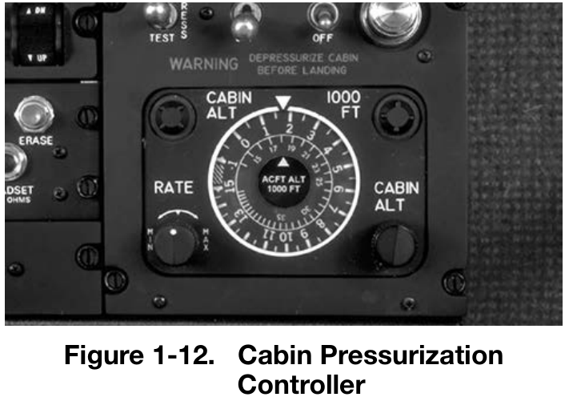

**Figure 1-13. Landing Gear Control Panel**

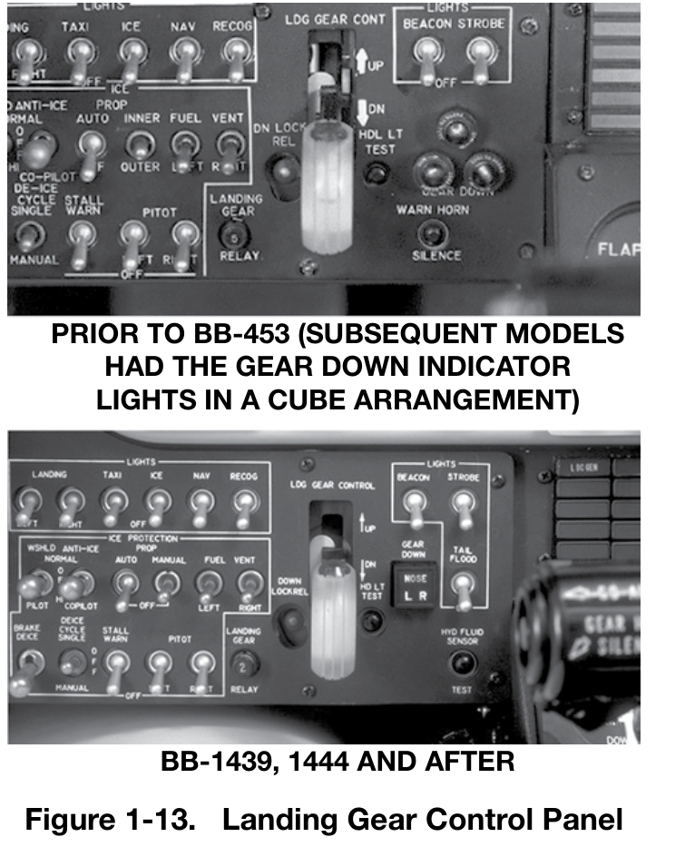

> **Nota do transcritor:** Mantida a quebra “control-ler”. Continua na página física 21.

Fac-símile da página física 20

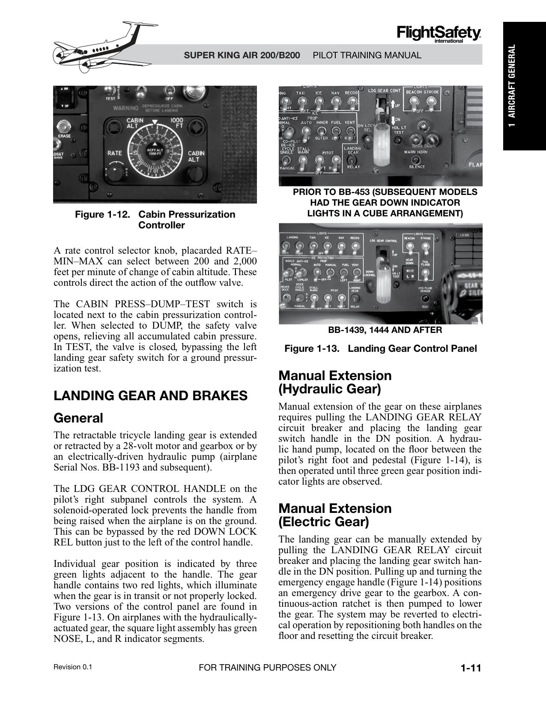

<!-- PTM:PAGE:020 END -->

<!-- PTM:PAGE:021 START -->
<!-- PTM:STATUS:revisada -->
## Página física 21 — 1-12

**Página física:** 21 · **Página impressa:** 1-12 · **Seção:** 1 Aircraft General · [PDF](KA-200-B200-PTM.pdf#page=21)

##### Warning System

During flight, a warning horn and red lights in the landing gear handle warn the crew of improper landing gear position relative to flap and/or power lever position. They also activate when the gear handle is up while on the ground.

##### Nosewheel Steering

The rudder pedals control nosewheel steering while the gear is down. Both the nosewheel steer-ing and rudder deflection receive inputs from rudder pedal motion, but in varying proportions depending on the speed that the wheels are roll-ing. When the wheel brakes are applied during rudder pedal deflection, there is even greater steering effect. During nose gear retraction, it is mechanically selfcentered and receives no further rudder pedal steering force.

##### Brake System

Dual hydraulic brakes are operated by depressing either the pilot’s or copilot’s toe portion of the rudder pedals. Both sets of pedals operate the brakes. Prior to BB-666, the initial pressure from a set of pedals will position a shuttle valve in the braking system. Brake operation from the opposite side can then only be accomplished by moving the shuttle valve.

A parking brake (Figure 1-15) can be actuated to lock the pressure within the brake lines. The air-plane may be designed to permit parking brake operation either in conjunction with pilot brake pressure only, or with pressure from either set of brakes.

**Figure 1-14. Manual Extension Controls**

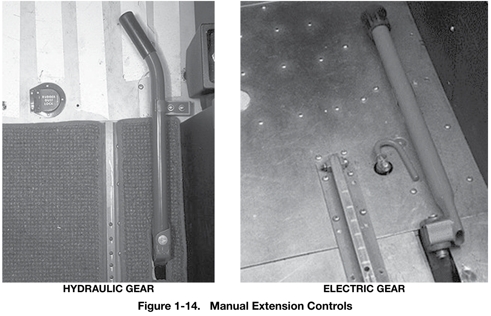

**Figure 1-15. Parking Brake Handle**

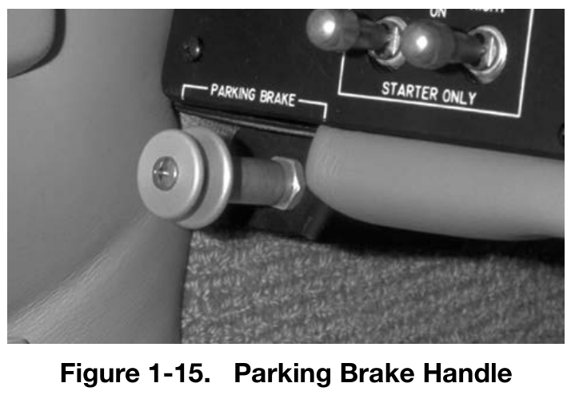

> **Nota do transcritor:** Mantido “selfcentered”. Continuação da página física 20.

Fac-símile da página física 21

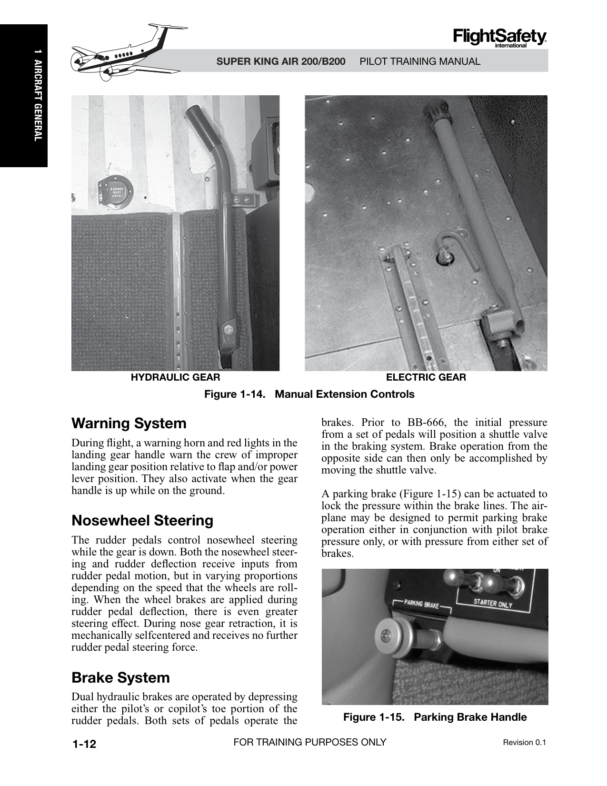

<!-- PTM:PAGE:021 END -->

<!-- PTM:PAGE:022 START -->
<!-- PTM:STATUS:revisada -->
## Página física 22 — 1-13

**Página física:** 22 · **Página impressa:** 1-13 · **Seção:** 1 Aircraft General · [PDF](KA-200-B200-PTM.pdf#page=22)

##### FLIGHT CONTROLS

##### General

The airplane uses conventional ailerons and rudders. There is a T-tail horizontal stabilizer and elevator mounted at the top of the vertical stabilizer. Interconnected conventional control columns within the cockpit control the ailerons and elevators. Rudder pedals are also connected so that either the pilot or copilot can operate the rudder. There are dual flaps on each wing. Rudder, elevator, and aileron trim are adjustable with con-trols mounted on the center pedestal. The flight control surfaces are illustrated in Figure 1-16.

**Figure 1-16. Flight Control Surfaces**

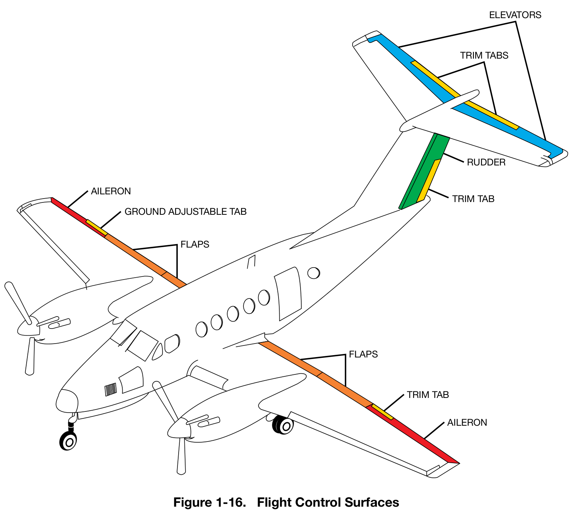

Fac-símile da página física 22

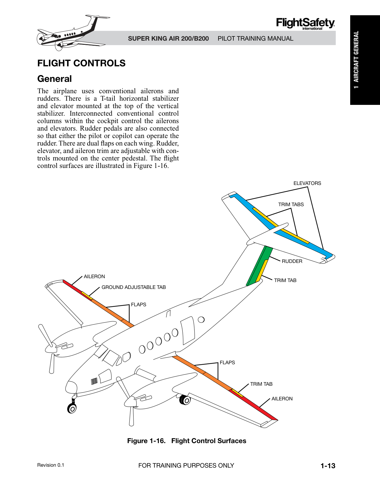

<!-- PTM:PAGE:022 END -->

<!-- PTM:PAGE:023 START -->
<!-- PTM:STATUS:revisada -->
## Página física 23 — 1-14

**Página física:** 23 · **Página impressa:** 1-14 · **Seção:** 1 Aircraft General · [PDF](KA-200-B200-PTM.pdf#page=23)

##### Operation

The flight controls are cable operated and require no power assistance. Flaps and optional electric elevator trim are electrically driven. A pneumatic rudder boost system assists in directional control when one engine has failed.

Rudder, elevator, and aileron trims are adjustable with controls on the center pedestal. Elevator trim is manual or optionally electrical. There is a posi-tion indicator on each pedestal tab control (Figure 1-17).

A lever on the control pedestal (Figure 1-18) con-trols the two flaps installed on each wing. A wing flap percentage indicator is located on the pedes-tal next to the cabin climb rate indicator.

##### PITOT AND STATIC SYSTEMS

##### General

Certain flight instruments operate from impact (pitot) and static pressures.

##### Pitot System

**Figure 1-18. Flap Control Lever**

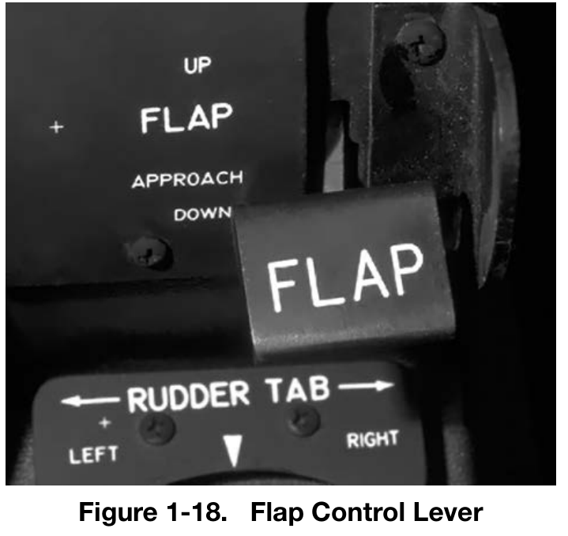

**Figure 1-17. Trim Tab Controls and Indicators**

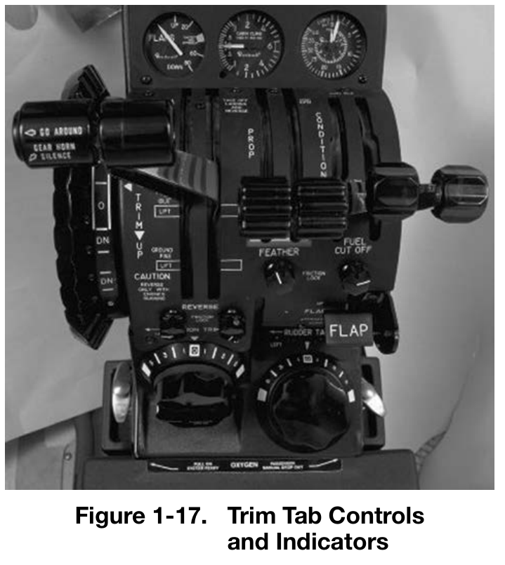

**Figure 1-19. Pitot Tubes**

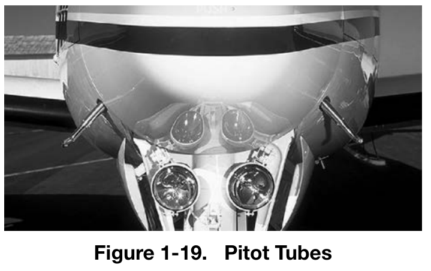

Fac-símile da página física 23

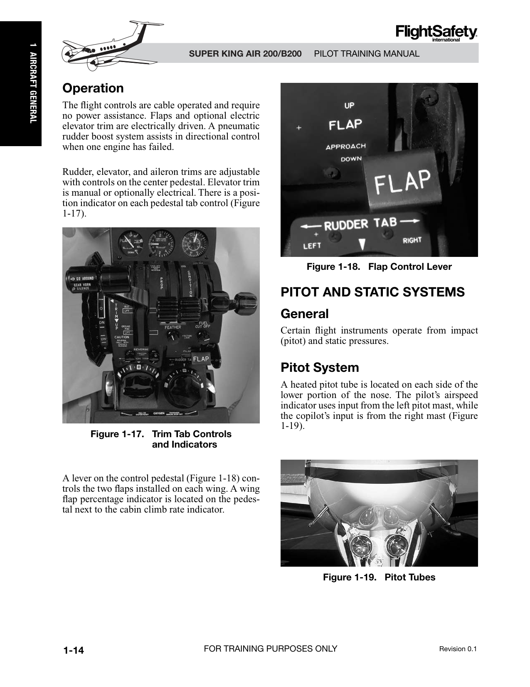

<!-- PTM:PAGE:023 END -->

<!-- PTM:PAGE:024 START -->
<!-- PTM:STATUS:revisada -->
## Página física 24 — 1-15

**Página física:** 24 · **Página impressa:** 1-15 · **Seção:** 1 Aircraft General · [PDF](KA-200-B200-PTM.pdf#page=24)

##### Static System

The normal static system provides separate input for pilot and copilot instruments. Each has a port on each side of the aft fuselage, which is not heated (Figure 1-20).

If the pilot’s static system is plugged, an alternate air tube obtains static air from inside the unpres-surized rear fuselage. This system is selected by moving the PILOT’S STATIC AIR SOURCE valve handle, located on the right side panel, to the ALTERNATE position (Figure 1-21).

> **WARNING**

> The pilot’s airspeed, vertical speed, and altimeter indications change when the alternate static air source is in use.

##### OXYGEN SYSTEM

##### General

The airplane’s oxygen system is based on an ade-quate flow for the altitude to which the airplane is certificated: 31,000 feet or 35,000 feet.

##### Super King Air B200

The masks and oxygen duration chart are based on a flow rate of 3.9 liters per minute (LPM-NTPD) per mask. When using the diluter-demand crew mask in the 100% mode, each mask counts as two masks at 3.9 LPM-NTPD.

##### Super King Air 200

The masks and oxygen duration charts are based upon 3.7 standard liters per minute (SLPM) per mask. The only exception is the diluter-demand crew mask when used in the 100% mode. When computing oxygen duration, each diluter-demand mask used in the 100% mode, is counted as two masks at 3.7 SLPM.

##### Manual Plug-in System

Early Super King Air 200s employ a constantflow, plug-in system. All masks for crew and passen-gers are stored in the seat area and are removed and plugged into available receptacles as needed.

##### Autodeployment System

When the autodeployment system is installed for the passengers, the crew normally has diluter-demand masks, which are one-hand, quick-donning masks.

Oxygen supply is controlled by a push-pull handle, placarded PULL ON-SYStem READY and is located on the left side of the pedestal (Figure 1-22). (Prior to BB-1444, except 1439 they are overhead in the cockpit — Figure 1-22). When

**Figure 1-20. Static Ports**

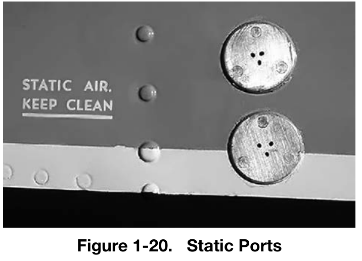

**Figure 1-21. Pilot’s Static Air Source Valve Handle**

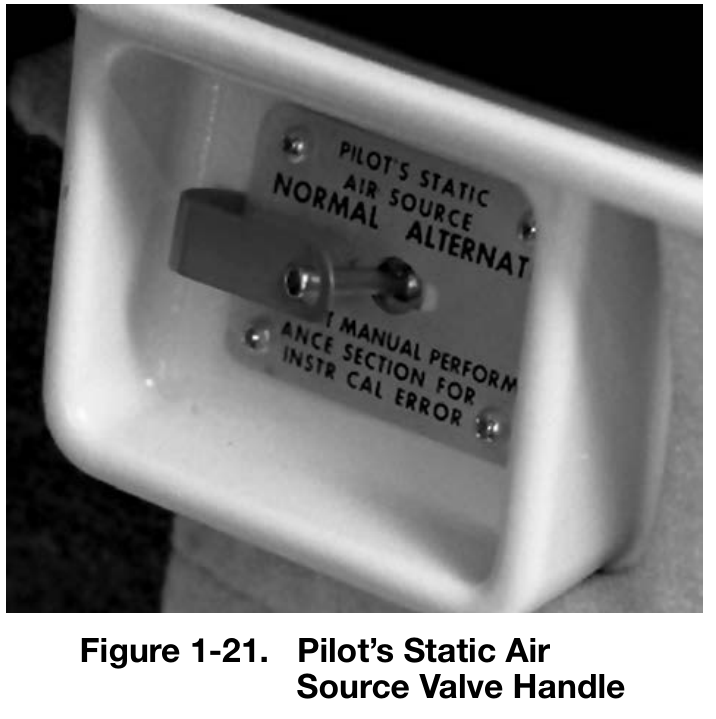

> **Nota do transcritor:** Mantidos “certificated”, “constantflow” e capitalização “SYStem”. Continua na página física 25.

Fac-símile da página física 24

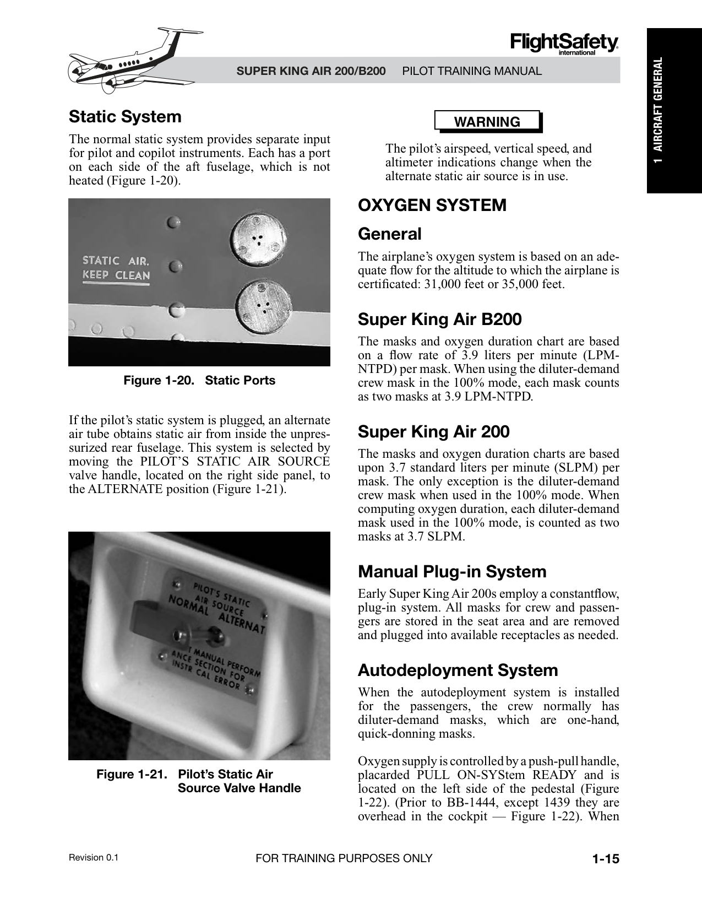

<!-- PTM:PAGE:024 END -->

<!-- PTM:PAGE:025 START -->
<!-- PTM:STATUS:revisada -->
## Página física 25 — 1-16

**Página física:** 25 · **Página impressa:** 1-16 · **Seção:** 1 Aircraft General · [PDF](KA-200-B200-PTM.pdf#page=25)

pushed in, no oxygen is available anywhere in the airplane. It should be pulled out prior to engine start to ensure available oxygen when needed. The primary oxygen system delivers oxygen to the two crew masks, to the first-aid outlet in the toilet area, and to the passenger oxygen system shutoff valve.

The passenger system is the constant-flow type. If the oxygen system line has been charged (oxygen in the supply bottle and SYStem READY handle pulled) when the cabin altitude exceeds approximately 12,500 feet, the oxygen pressure will automatically open the mask storage doors and allow the passenger masks to drop out. Oxygen will flow to the mask when a further pull on the lanyard by the passenger pulls the pin out of the valve. A green PASS OXYGEN ON light on the advisory annunciator panel will indicate that the passenger masks have dropped out of the overhead.

If the oxygen supply line is charged, oxygen is available at the first-aid station. The cover must be opened and the valve turned on.

In the event that oxygen pressure fails to open the passenger oxygen shutoff valve automatically, the pilot has a PASSENGER MANUAL OVERRIDE handle on the right side of the pedestal (prior to BB-1444, except 1439, it is next to the SYStem READY handle on the overhead panel). It will open the valve manually, and all other operations will be the same as in the automatic mode.

#### AIRPLANE STRUCTURES

##### GENERAL

The Super King Air is 43 feet 9 inches long from the nose to the aft most point of the horizontal stabilizer (Figure 1-23 and Figure 1-24). The air-plane sections consist of the:

- Fuselage

- Wings

- Empennage

The fuselage is composed of the:

- Nose section

- Cockpit

- Cabin

- Foyer and aft cabin

- Aft fuselage

The wing is built as a center section and two out-board wing assemblies.

The empennage is composed of a vertical stabi-lizer with a high T-tail horizontal stabilizer.

**Figure 1-22. Cockpit Oxygen Handles**

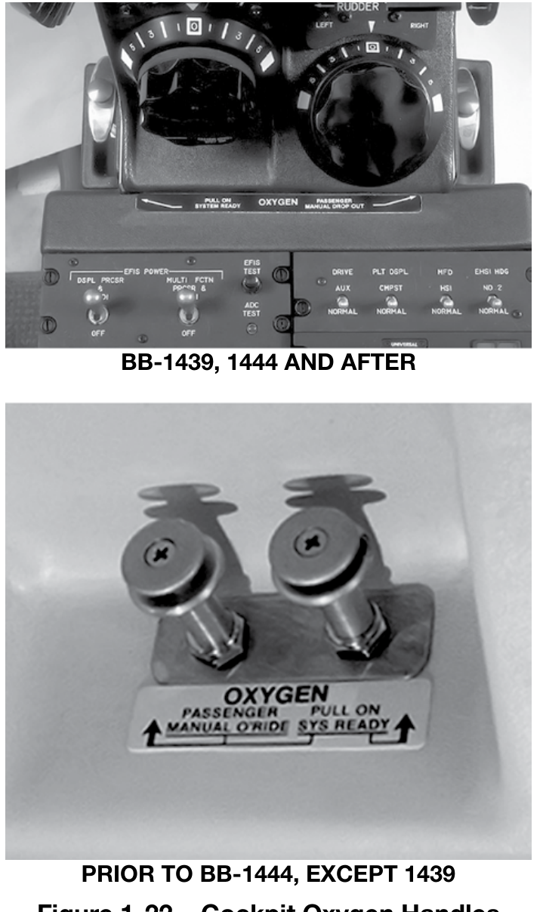

> **Nota do transcritor:** Texto informa 43 ft 9 in; figuras 1-23/1-24 distinguem configurações (1) e (2). Não harmonizado. Continuação da página física 24.

Fac-símile da página física 25

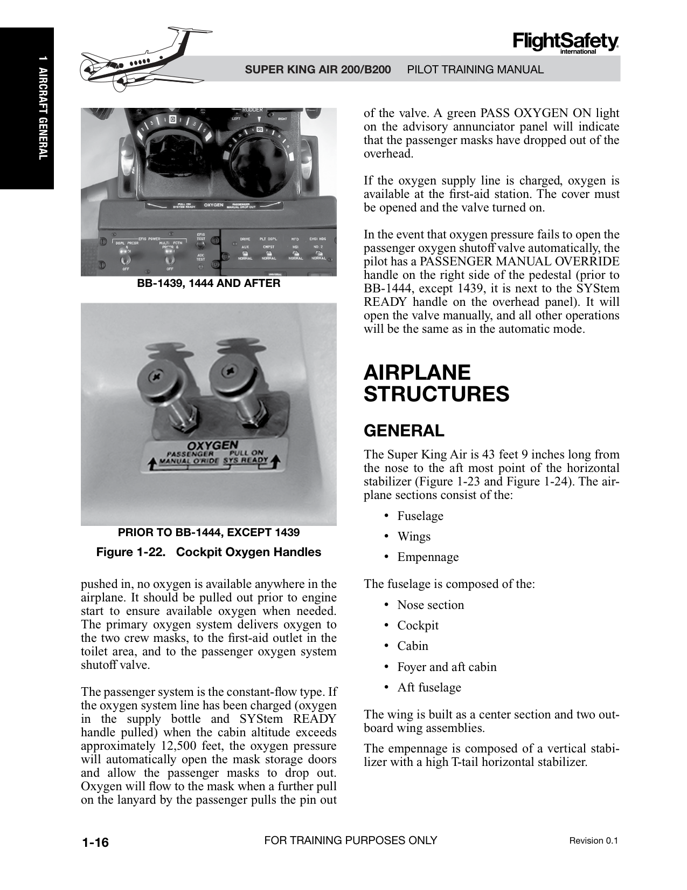

<!-- PTM:PAGE:025 END -->

<!-- PTM:PAGE:026 START -->
<!-- PTM:STATUS:revisada -->
## Página física 26 — 1-17

**Página física:** 26 · **Página impressa:** 1-17 · **Seção:** 1 Aircraft General · [PDF](KA-200-B200-PTM.pdf#page=26)

**Figure 1-23. Airplane Dimensions (BB-1439, 1444 and After)**

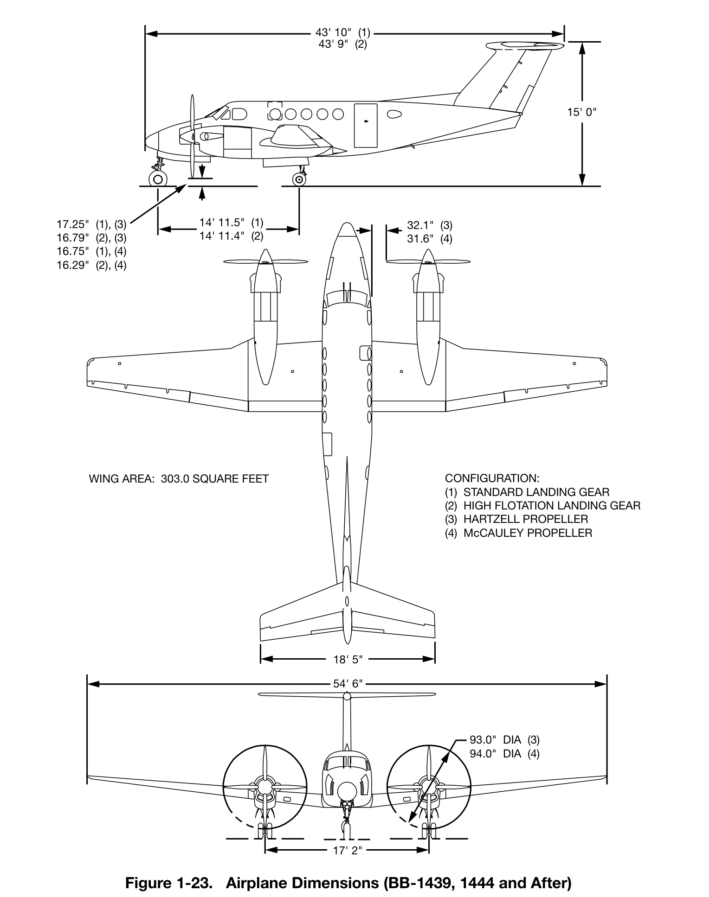

> **Nota do transcritor:** Cotas e configurações preservadas no desenho; não convertidas em tabela para não perder a associação das setas.

Fac-símile da página física 26

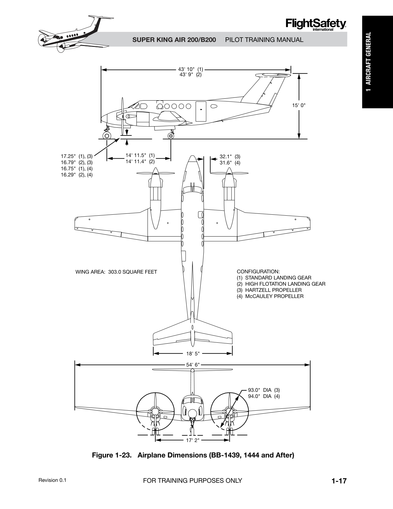

<!-- PTM:PAGE:026 END -->

<!-- PTM:PAGE:027 START -->
<!-- PTM:STATUS:revisada -->
## Página física 27 — 1-18

**Página física:** 27 · **Página impressa:** 1-18 · **Seção:** 1 Aircraft General · [PDF](KA-200-B200-PTM.pdf#page=27)

**Figure 1-24. Airplane Dimensions (Prior to BB-1444, Except 1439)**

> **Nota do transcritor:** Cotas diferem da figura 1-23 conforme configuração; preservadas sem correção.

Fac-símile da página física 27

<!-- PTM:PAGE:027 END -->

<!-- PTM:PAGE:028 START -->
<!-- PTM:STATUS:revisada -->
## Página física 28 — 1-19

**Página física:** 28 · **Página impressa:** 1-19 · **Seção:** 1 Aircraft General · [PDF](KA-200-B200-PTM.pdf#page=28)

##### FUSELAGE

The nose section is an unpressurized equipment storage area, separated from the cockpit area by the forward pressure bulkhead (Figure 1-25).

The cockpit is separated from the cabin by a slid-ing door for privacy and to prevent light spilling between compartments. A typical instrument panel is shown in Figure 1-26.

Various configurations of passenger chairs and couches may be installed. All passenger chairs are placarded FRONT FACING ONLY or FRONT OR AFT FACING. Only chairs so marked may be installed facing aft. All aft-facing chairs and all forward-facing chairs equipped with shoulder harnesses have adjustable headrests.

> **CAUTION**

> Before takeoff and landing, the head-rest should be adjusted as required to provide support for the head and neck when the passenger leans against the seatback.

Couches, if installed, are not adjustable.

The cabin is separated from the foyer by another sliding door to provide privacy for the toilet, which is located in the foyer. When the toilet is not in use, seat cushions convert the position to another passenger seat.

The aft cabin area may have one or two optional folding seats installed. When these seats are not needed, they may be folded against the cabin sidewall, and the entire aft cabin area may be utilized for baggage storage.

> **CAUTION**

> Webs should secure baggage and other objects in order to prevent shifting in turbulent air.

Items stowed in this area are easily accessible in flight. An optional curtain can be closed to separate the aft cabin from the foyer. A latching compartment door may be installed in place of the curtain.

**Figure 1-25. Airplane Dimensions (BB-1439, 1444 and After)**

> **Nota do transcritor:** Legenda da Figure 1-25 diz “Airplane Dimensions”, embora o desenho seja de disposição de cabine; mantida.

Fac-símile da página física 28

<!-- PTM:PAGE:028 END -->

<!-- PTM:PAGE:029 START -->
<!-- PTM:STATUS:revisada -->
## Página física 29 — 1-20

**Página física:** 29 · **Página impressa:** 1-20 · **Seção:** 1 Aircraft General · [PDF](KA-200-B200-PTM.pdf#page=29)

##### DOORS

##### Cabin Door

The cabin door is located on the left side of the fuselage, in the foyer area. The cabin door is hinged at the bottom, and swings out and down when opened (Figure 1-27). A hydraulic damper ensures a slow opening.

A stairway is built onto the inboard side for entry and egress. Two of the steps fold flat against the door when it is closed. When the door is fully extended, it is supported by a plastic-encased cable, which also serves as a handrail. A second handrail (optional prior to BB-1444, except 1439) may be installed along the other side of the steps, giving support to both sides of the door.

> **CAUTION**

> Only one person at a time should be on the door stairway.

**Figure 1-26. Cockpit Layout (Typical)**

**Figure 1-27. Cabin Door**

Fac-símile da página física 29

<!-- PTM:PAGE:029 END -->

<!-- PTM:PAGE:030 START -->
<!-- PTM:STATUS:revisada -->
## Página física 30 — 1-21

**Página física:** 30 · **Página impressa:** 1-21 · **Seção:** 1 Aircraft General · [PDF](KA-200-B200-PTM.pdf#page=30)

The plastic handrail is utilized when closing the door from the inside. The door is closed against an inflatable rubber seal around the opening. When the weight of the airplane is off the landing gear, pneumatic air is used to inflate the door seal through a 4-psi regulator.

The door-locking mechanism can be operated by either the outside or inside door handle, which rotates simultaneously. A release button (Figure 1-28) is adjacent to each handle and must be held depressed before the handle can be rotated. The handle system necessitates a two-hand operation, thereby ensuring a deliberate action. The release button also incorporates a pressure-sensing diaphragm, so that if there is a pressure differential between the inside and outside, the pressure on the release button must be proportionally increased to prevent inadvertently opening the door while pressurized.

Never attempt to check or unlock the door in flight. If the CABIN DOOR light is on (amber in the 200, red in the B200), or if the pilot suspects door security, direct all occupants to remain seated with seatbelts secured, descend as necessary, and depressurize the airplane. After the airplane has landed and stopped, and the cabin has been depressurized, a crewmember can then check the door security.

When closing the door from inside the airplane, pull up on the handrail until the airstair door reaches the door frame. Rotate the door handle up as far as possible, pulling inward on the door. The door should seal; then rotate the handle down to lock the door (Figure 1-28).

Positive locking may be checked by attempting to rotate the handle without depressing the release button. It should not move. A placard is located beneath the folded step just below the door han-dle. The placard shows how to check the locks in the inspection port windows near each corner of the door (Figure 1-29). A green stripe painted on each of the four latch bolts should be aligned with its respective black pointer (Figure 1-30).

**Figure 1-28. Door Handles**

**Figure 1-29. Placard and Inspection Port**

> **Nota do transcritor:** Continua na página física 31.

Fac-símile da página física 30

<!-- PTM:PAGE:030 END -->

<!-- PTM:PAGE:031 START -->
<!-- PTM:STATUS:revisada -->
## Página física 31 — 1-22

**Página física:** 31 · **Página impressa:** 1-22 · **Seção:** 1 Aircraft General · [PDF](KA-200-B200-PTM.pdf#page=31)

##### Cargo Door (200C and B200C)

A large, swing-up cargo door, hinged at the top, provides access for loading and unloading large cargo. The airstair door is an integral part of the cargo door and should be closed and latched when the cargo door is opened.

The cargo door latches can be operated only by the use of two handles, both located inside the airplane. The handle in the upper part of the door controls the rotating latches in the forward and aft sides, while the handle in the lower, forward part of the door actuates four pin-lug latches along the bottom of the door.

Once the latches are retracted, initial pressure must be exerted outward to start the opening action. After the sequence begins, gas springs will open the door the rest of the way. The door is counterbalanced, and will stay open. The gas springs will resist the effort to close the door, and that pressure must be overcome manually, until the door is almost closed. When the door is almost closed, the gas spring overcenter mechanism will redirect spring pressure toward the closed position, assisting the latching cycle.

The door closes against a rubber seal, to main-tain the pressure vessel integrity. The seal is not inflated by pneumatic bleed air, but rather allows cabin-pressurized air to seep into holes on the inside. This allows for greater sealing when there is a high pressure differential.

##### Emergency Exit

The emergency exit window, placarded EXITPULL (Figure 1-31) is located at the forward right side of the passenger compartment. It can be released from the inside by using a pull-down handle, or from the exterior (if it is unlocked) by a flush-mounted, pull-out handle (Figure 1-31). It is a plug-type exit, which is removed completely from the frame and taken into the cabin. The exit can be locked from the inside, but can be opened from the inside even when it is locked. For BB-415 and after, the locking mechanism is activated by pulling out a handle below the door release handle (Figure 1-31). Prior aircraft and BL-1 and after have a key next to the door release handle that can lock/unlock the door. This key cannot be removed when the door is locked.

This door must be unlocked prior to takeoff for exterior opening in case of emergency.

**Figure 1-30. Latch Bolt**

> **Nota do transcritor:** Mantido “EXITPULL” sem espaço. Continuação da página física 30.

Fac-símile da página física 31

<!-- PTM:PAGE:031 END -->

<!-- PTM:PAGE:032 START -->
<!-- PTM:STATUS:revisada -->
## Página física 32 — 1-23

**Página física:** 32 · **Página impressa:** 1-23 · **Seção:** 1 Aircraft General · [PDF](KA-200-B200-PTM.pdf#page=32)

##### CABIN WINDOWS

Each cabin windowpane is composed of a sheet of polyvinyl butyral between two transparent sheets of acrylic plastic. It is stressed to withstand the cabin pressure differential. There are two types of windowpanes available: polarized and shade type.

##### Polarized Type

Two dust panes are inboard of the cabin window each composed of polarized film. The inboard pane may be rotated to permit light regulation.

> **WARNING**

> Do not look directly at the sun, even through polarized windows, because eye damage could result.

> **CAUTION**

> When the airplane is to be parked in areas exposed to intensive sunlight, the polarized windows should be rotated to the clear position to prevent deteriora-tion of the polarized material. Sufficient ultraviolet protection is provided to prevent fading of the upholstery.

##### Shade Type

A single sheet of tinted acrylic plastic serves as a dust pane. The shade is mounted in the window frame, inboard of the cabin window dust pane. It can be moved along detents in a track.

**Figure 1-31. Emergency Exit Release Handles**

Fac-símile da página física 32

<!-- PTM:PAGE:032 END -->

<!-- PTM:PAGE:033 START -->
<!-- PTM:STATUS:revisada -->
## Página física 33 — 1-24

**Página física:** 33 · **Página impressa:** 1-24 · **Seção:** 1 Aircraft General · [PDF](KA-200-B200-PTM.pdf#page=33)

##### CONTROL LOCKS

The flight and engine controls are mechanically locked by a U-shaped clamp and two pins within the cockpit, as seen in Figure 1-32. The pins lock the primary flight controls and the Ushaped clamp fits around the engine control levers. A pin is inserted through the control column to lock the ailerons and elevator. A second pin is inserted through a hole in the floor, which locks the rudder bellcrank. All locks must be installed and removed together to preclude taxiing or flying with the engine control levers released but the flight controls locked.

> **WARNING**

> Before starting engines, remove the locks.

> **CAUTION**

> Remove the control locks before tow-ing the airplane. If towed with a tug while the rudder lock is installed, seri-ous damage to the steering linkage can result.

**Figure 1-32. Control Locks**

> **Nota do transcritor:** Mantido “Ushaped”.

Fac-símile da página física 33

<!-- PTM:PAGE:033 END -->

<!-- PTM:PAGE:034 START -->
<!-- PTM:STATUS:revisada -->
## Página física 34 — 2-i

**Página física:** 34 · **Página impressa:** 2-i · **Seção:** 2 Electrical Power Systems · [PDF](KA-200-B200-PTM.pdf#page=34)

#### CHAPTER 2 ELECTRICAL POWER SYSTEMS

##### CONTENTS

| Subject | Page |
|---|---|
| INTRODUCTION | 2-1 |
| GENERAL | 2-1 |
| DC POWER | 2-2 |
| Battery | 2-2 |
| Generators | 2-4 |
| Ground Power | 2-5 |
| Distribution | 2-8 |
| Operation | 2-10 |
| Avionics Master Switch | 2-12 |
| AC Power Inverters | 2-12 |
| Controls and Indications | 2-12 |
| Distribution | 2-15 |
| Operation | 2-15 |
| LIMITATIONS | 2-22 |
| Generator Limits (250 Amperes) | 2-22 |
| Starters | 2-22 |
| Inverters | 2-22 |
| Circuit Breakers | 2-22 |
| QUESTIONS | 2-28 |

Fac-símile da página física 34

<!-- PTM:PAGE:034 END -->

<!-- PTM:PAGE:035 START -->
<!-- PTM:STATUS:revisada -->
## Página física 35 — 2-iii

**Página física:** 35 · **Página impressa:** 2-iii · **Seção:** 2 Electrical Power Systems · [PDF](KA-200-B200-PTM.pdf#page=35)

##### ILLUSTRATIONS

| Figure | Title | Page |
|---|---|---|
| 2-1 | Electrical Component Location | 2-2 |
| 2-2 | Battery Cooling (Nickel Cadium) | 2-3 |
| 2-3 | Battery Control Circuit | 2-3 |
| 2-4 | Volt-Loadmeters-Battery Ammeter | 2-3 |
| 2-5 | BATTERY CHG Annunciator | 2-4 |
| 2-6 | Generator | 2-4 |
| 2-7 | Generator Switches | 2-5 |
| 2-8 | Generator Control Circuit | 2-6 |
| 2-9 | Ground Power Connector | 2-7 |
| 2-10 | External Power Circuit | 2-7 |
| 2-11 | MASTER SWITCHES | 2-8 |
| 2-12 | Lights and Meters | 2-8 |
| 2-13 | Electrical Distribution | 2-9 |
| 2-14 | Circuit-Breaker Panels—Pilot’s | 2-10 |
| 2-15 | Circuit-Breaker Panels—Copilot’s | 2-11 |
| 2-16 | Avionic Power Distribution | 2-13 |
| 2-17 | Typical Avionics Bus Distribution (EFIS Equipped Aircraft) | 2-14 |
| 2-18 | Inverters | 2-15 |
| 2-19 | Volt-Frequency Meter | 2-15 |
| 2-20 | Inverters Control Circuit | 2-16 |
| 2-21 | Electrical System—Super King Air B200 (BB-1484, 1486 and Subsequent; BW-1 and Subsequent) | 2-17 |
| 2-22 | Electrical System—Super King Air B200 (BB-1449, 1458-1462, 1464-1485, Except 1484; BL-139, 140) | 2-18 |

> **Nota do transcritor:** Mantida a grafia “Nickel Cadium” na lista de ilustrações.

Fac-símile da página física 35

<!-- PTM:PAGE:035 END -->

<!-- PTM:PAGE:036 START -->
<!-- PTM:STATUS:revisada -->
## Página física 36 — 2-iv

**Página física:** 36 · **Página impressa:** 2-iv · **Seção:** 2 Electrical Power Systems · [PDF](KA-200-B200-PTM.pdf#page=36)

##### TABLES

**ILLUSTRATIONS**

| Figure | Title | Page |
|---|---|---|
| 2-23 | Electrical System—Super King Air B200 (BB-1439, 1444-1448, 1450-1457) | 2-19 |
| 2-24 | Electrical System—Super King Air B200 (BB-734, 793, 829, 854-870, 874-891, 894, 896-911, 913-1438, 1440-1443, BL 37-138) | 2-20 |
| 2-25 | Electrical System—Super King Air 200 (BB-2, 6-733, 735-792, 794-828, 830-853, 871-873, 892, 893, 895, 912, BL-1-36) | 2-21 |

**TABLES**

| Table | Title | Page |
|---|---|---|
| 2-1 | Limitations—Ground Operations | 2-22 |
| 2-2 | Fuel Control Circuit–Breaker Panel | 2-23 |
| 2-3 | Right Side Circuit-Breaker Panel | 2-24 |
| 2-4 | Pilot’s Right Subpanel Circuit-Breaker Switches | 2-27 |

Fac-símile da página física 36

<!-- PTM:PAGE:036 END -->

<!-- PTM:PAGE:037 START -->
<!-- PTM:STATUS:revisada -->
## Página física 37 — 2-1

**Página física:** 37 · **Página impressa:** 2-1 · **Seção:** 2 Electrical Power Systems · [PDF](KA-200-B200-PTM.pdf#page=37)

### CHAPTER 2 ELECTRICAL POWER SYSTEMS

#### INTRODUCTION

The primary electrical system on the airplane is a 28-VDC generator system. It is used for inverter input and, through the distribution system, for powering the electronic equipment and landing gear. The DC system consists of generation, distribution, storage, control, and moni-toring of DC power. The AC system consists of the inverters, power distribution, control, and monitoring of AC power.

A section on specific limitations, a circuit-breaker table, and a series of questions conclude this chapter.

#### GENERAL

The DC power is supplied by a 24-volt battery and by two 30-volt, regulated to 28.25 ± .25 volts, 250-ampere starter-generators. Either one of two inverters supplies AC power for engine instruments and for avionics (Figure 2-1). Each component of the electrical power system is capable of supplying power to all systems that are necessary for normal operation of the airplane; however, the battery, if it is the only source of power, does have a limited life.

**Ilustração de abertura do capítulo**

> **Nota do transcritor:** Camada nativa extrai “SYSTEMES”; a imagem mostra “SYSTEMS”. Transcrito conforme a imagem.

Fac-símile da página física 37

<!-- PTM:PAGE:037 END -->

<!-- PTM:PAGE:038 START -->
<!-- PTM:STATUS:revisada -->
## Página física 38 — 2-2

**Página física:** 38 · **Página impressa:** 2-2 · **Seção:** 2 Electrical Power Systems · [PDF](KA-200-B200-PTM.pdf#page=38)

#### DC POWER

##### BATTERY

For BB-1632 and subsequent, a single, 24-volt, 42 ampere-hour sealed lead acid gel cell battery is located in the right wing center section forward of the main spar. Prior to BB-1632, a single 24-volt, 34/36 ampere-hour nickel-cadmium (NiCad) battery is installed. This NiCad battery requires air cooling through a thermostatically controlled valve installed in the ram air tube adjacent to the battery drain (Figure 2-2).

A hot battery bus (Figure 2-3) is provided for operation of essential equipment and the cabin threshold light circuit when the battery and generators are not on. Power to the main bus from the battery is routed via the battery relay, which is controlled by the BAT ON–OFF switch on the pilot’s left subpanel.

For aircraft BB-1632 and subsequent, the battery ammeter (Figure 2-4) provides a direct reading of the charge or discharge rate of the battery (–60 amps to +60 amps). The charge rate should be 0 to +10 amperes for take-off.

On aircraft prior to BB-1632 with a NiCad bat-tery, a battery charge current detector is installed. This senses an increase in normal current flow and causes an amber BATTERY CHG caution

**Figure 2-1. Electrical Component Location**

> **Nota do transcritor:** Continua na página física 39.

Fac-símile da página física 38

<!-- PTM:PAGE:038 END -->

<!-- PTM:PAGE:039 START -->
<!-- PTM:STATUS:revisada -->
## Página física 39 — 2-3

**Página física:** 39 · **Página impressa:** 2-3 · **Seção:** 2 Electrical Power Systems · [PDF](KA-200-B200-PTM.pdf#page=39)

**Figure 2-2. Battery Cooling (Nickel Cadium)**

**Figure 2-3. Battery Control Circuit**

**Figure 2-4. Volt-Loadmeters-Battery Ammeter**

> **Nota do transcritor:** Continuação da página física 38.

Fac-símile da página física 39

<!-- PTM:PAGE:039 END -->

<!-- PTM:PAGE:040 START -->
<!-- PTM:STATUS:revisada -->
## Página física 40 — 2-4

**Página física:** 40 · **Página impressa:** 2-4 · **Seção:** 2 Electrical Power Systems · [PDF](KA-200-B200-PTM.pdf#page=40)

annunciator to illuminate (Figure 2-5), alerting the flight crew that the battery charge current is above normal. Following a battery-powered engine start, the battery recharge current is very high and causes illumination of the BATTERY CHG annunciator, thus providing an automatic self test of the detector and the battery. As the battery approaches a full charge and the charge current decreases to a satisfactory level, the annunciator will extinguish. This will normally occur within a few minutes after an engine start, but it may require a longer time if the battery has a low state of charge initially before engine start, or if it is exposed to low or high temperatures. In flight this alerts the pilot that conditions may exist that could eventually damage the battery. If the BATTERY CHG annunciator illuminates, the pilot should turn the battery switch to OFF. If the annunciator remains on after the BAT switch is moved to the OFF position during the check, a malfunction is indicated in either the battery sys-tem or charge current detector, in which case the airplane should be landed as soon as practicable. This system is designed for continuous monitor-ing of the battery condition.

##### GENERATORS

Two 30-volt, regulated to 28.25 ± .25 volts, 250-ampere starter-generators connected in par-allel provide normal DC power (Figure 2-6). Either one of the generators can supply the entire electrical load.

###### NOTE Optional 300-ampere starter-genera- tors are available and installed on some airplanes.

Starter power to each starter-generator is provided from the main battery bus through a starter relay. The start cycle is controlled by a three-position switch for each engine labeled IGNITION AND ENGINE START. When placed to the ON (up) position, the switch becomes mechanically locked and must be pulled out to reposition. When held to the down position, labeled STARTER ONLY, the associated engine will motor, but ignition will not occur. When released, the spring-loaded switch will move to the center position, which is labeled OFF.

During an engine start, the starter-generator, drives the compressor section of the engine through the accessory gearing. The starter- generator, in the start mode, could initially draw approximately 1,100 amperes, and then drop rapidly to about 300 amperes as the engine reaches 20% N1. When the engine reaches approximately 35%, it drives the starter. After the condition lever is set to high idle (approximately 70%), the generator can be turned on.

The generator operation is controlled by individual generator switches located on the pilot’s left subpanel under the MASTER SWITCH gang bar with the BAT switch. As shown in Figure 2-7, the switches are labeled GEN 1 and GEN 2. In order to turn the generator on, the control switch must be held upward in the GEN RESET position (Figure 2-7) for a minimum of one second, then released to the ON position. (Prior to BB-88, the generator switches do not have the reset position.)

**Figure 2-6. Generator**

**Figure 2-5. BATTERY CHG Annunciator**

> **Nota do transcritor:** Legenda da Figure 2-5 diz “BATTERY CHG”; a lente fotografada diz “BATTERY CHARGE”. Ambas preservadas. Continua na página física 41.

Fac-símile da página física 40

<!-- PTM:PAGE:040 END -->

<!-- PTM:PAGE:041 START -->
<!-- PTM:STATUS:revisada -->
## Página física 41 — 2-5

**Página física:** 41 · **Página impressa:** 2-5 · **Seção:** 2 Electrical Power Systems · [PDF](KA-200-B200-PTM.pdf#page=41)

Figure 2-8 shows that power to the bus system from the generators is protected by Generator Control Units (GCU). For BB-88 and after, the GCU operates a line contactor relay to protect the generator. Prior to BB-88, reverse-current protection is provided by a unit in line with the generator output.

The generators are controlled by individual generator control units, which maintain a constant voltage during variations in engine speed and electrical load requirements. The voltage regulating circuit will automatically connect or disconnect a generator’s output to the bus. The load on each generator is indicated by the respective left and right volt-loadmeter (Figure 2-8) on the overhead panel which reads in percent of the generator’s maximum continuous capacity. Normally, this value is 250 amps; therefore, a loadmeter reading of .5, or 50%, is equal to 125 amps of generator output.

###### NOTE The generators will drop off the line if underexcitation, overexcitation, over- voltage, or undervoltage conditions exist.

##### GROUND POWER

For ground operation, a ground power recep-tacle, located under the right wing outboard of the nacelle, is provided for connecting a ground power unit (Figure 2-9). A relay in the external power circuit will close only if:

1. The ground power source polarity is correct.

2. The BAT SWITCH is on.

3. The GPU voltage is not greater than 32 volts (BB-364 and subsequent).

###### NOTE Prior to BB-364, the battery switch does not have to be on to apply ground power (Figure 2-10).

For starting, an external power source capable of supplying up to 1,000 amperes (300 amperes maximum continuous) should be used. A caution light on the caution advisory annunciator panel labeled EXT PWR is provided to alert the operator when a ground power plug is connected to the airplane. Some earlier airplanes used a switch to sense power plug connection, and later airplanes incorporated an electronic circuit utilizing the small pin of the plug (Figure 2-10).

**Figure 2-7. Generator Switches**

> **Nota do transcritor:** Continuação da página física 40.

Fac-símile da página física 41

<!-- PTM:PAGE:041 END -->

<!-- PTM:PAGE:042 START -->
<!-- PTM:STATUS:revisada -->
## Página física 42 — 2-6

**Página física:** 42 · **Página impressa:** 2-6 · **Seção:** 2 Electrical Power Systems · [PDF](KA-200-B200-PTM.pdf#page=42)

**Figure 2-8. Generator Control Circuit**

Fac-símile da página física 42

<!-- PTM:PAGE:042 END -->

<!-- PTM:PAGE:043 START -->
<!-- PTM:STATUS:revisada -->
## Página física 43 — 2-7

**Página física:** 43 · **Página impressa:** 2-7 · **Seção:** 2 Electrical Power Systems · [PDF](KA-200-B200-PTM.pdf#page=43)

> **CAUTION**

> Never connect an external power source to the airplane unless a battery indicating a charge of at least 20 volts is in the airplane. If the battery voltage is less than 20 volts, the battery must be recharged, or replaced with a battery indicating at least 20 volts, before con-necting ground power.

Observe the following precautions when using a ground power source:

1. Use only a ground power source that is negatively grounded. If polarity of the power source is unknown, determine the polarity with a voltmeter before connect-ing the unit to the airplane.

2. Before connecting a ground power unit, turn off the avionics master power switch and the generator switches, and turn the battery switch on.

**Figure 2-9. Ground Power Connector**

**Figure 2-10. External Power Circuit**

> **Nota do transcritor:** Continua na página física 44.

Fac-símile da página física 43

<!-- PTM:PAGE:043 END -->

<!-- PTM:PAGE:044 START -->
<!-- PTM:STATUS:revisada -->
## Página física 44 — 2-8

**Página física:** 44 · **Página impressa:** 2-8 · **Seção:** 2 Electrical Power Systems · [PDF](KA-200-B200-PTM.pdf#page=44)

> **CAUTION**

> Voltage is required to energize the avi-onics master power relays to remove the power from the avionics equip-ment. Therefore, never apply ground power to the airplane without first applying battery voltage. If the bat-tery is removed from the airplane or if the battery switch is to be placed in the OFF position, turn each individual radio and other avionics equipment off.

3. After the external power plug is con-nected and power is applied, leave the battery on during the entire ground power operation to protect transistorized equip-ment against transient voltage spikes.

> **CAUTION**

> The battery may be damaged if exposed to voltages higher than 30 volts for more than two minutes.

Only use a ground power source fitted with an AN2552-type plug. If uncertain of the polarity, check it with a voltmeter to ensure that it is a neg-ative-ground plug. Connect the positive lead to the larger center post of the receptacle, and con-nect the negative-ground lead to the remaining large post. The small post is the polarizing pin; it must have a positive voltage applied to it in order for the external power relay to close.

###### Controls and Indicators

Electrical control switches are conveniently located on the pilot’s left subpanel (Figure 2-11). The battery switch and the two generator switches are positioned under a hinged flap labeled MASTER SWITCH, commonly referred to as the gang bar. When this flap is depressed, the battery and both generators are switched off.

Electrical component indication is through lights on the annunciator panel or meters on the overhead panel (Figure 2-12).

When a generator is off the line, the respective amber L or R DC GEN caution annunciator illuminates. There are also optional red GEN OVHT warning lights to warn of a generator overheat condition on B200 airplanes.

For NiCad batteries, in the event of an excessive battery charge rate, the amber BATTERY CHG light comes on.

The generator loadmeters indicate generator amperage in percent of 250 amps per generator and the associated meter button must be pressed to indicate bus voltage.

##### DISTRIBUTION

The battery is connected to a hot battery bus (Figure 2-13) which powers threshold lights, the fire extinguishing system, firewall shutoff valves, the battery relay, ground communications, auxiliary DC bus (if installed), external power light (BB-88 and after), RNAV memory, stereo, and prior to BB-1098 (excluding BB-1096), standby boost pumps. With the battery switch on, power is fed to the main battery bus, which is connected through the start relays to both

**Figure 2-11. MASTER SWITCHES**

**Figure 2-12. Lights and Meters**

> **Nota do transcritor:** Texto cita BB-1098 (excluding BB-1096); página 12 cita prior to BB-1096. Divergência mantida. Continua na página física 45. Continuação da página física 43.

Fac-símile da página física 44

<!-- PTM:PAGE:044 END -->

<!-- PTM:PAGE:045 START -->
<!-- PTM:STATUS:revisada -->
## Página física 45 — 2-9

**Página física:** 45 · **Página impressa:** 2-9 · **Seção:** 2 Electrical Power Systems · [PDF](KA-200-B200-PTM.pdf#page=45)

starter-generators. The main battery bus feeds the isolation bus and, through two 325-ampere isolation limiters (current limiters), connects the left and right generator buses together.

When the battery, generators, or GPU are providing power, the isolation bus, L generator bus, and R generator bus function as one unit, as long as both current limiters are not open. There are four subbuses fed by both the left and right generator buses. They are labeled No. 1 through No. 4 DUAL FED BUS. Each subbus is fed from either side through a 60-ampere current limiter, a 70-ampere reverse current diode, and a 50-ampere circuit breaker which is accessible to the crew. There are eight of these 50-amp feeder breakers. Four are located on the copilot’s side panel for the No. 1 and No. 2 subbuses, and on the fuel panel circuit breaker bus for the No. 3 and No. 4 subbuses. Of those items with paired circuits such as the left and right landing lights, the distribution will be such that the left circuit is on the No. 1 or No. 3 dual fed bus and the right is on the No. 2 or No. 4.

Generally, dual fed bus No. 1 and No. 2 run in alternating rows on the copilot’s circuit breaker panel (excluding the avionics section). Dual fed bus No. 3 and No. 4 are on the pilot’s circuit-breaker panel.

**Figure 2-13. Electrical Distribution**

> **Nota do transcritor:** Continuação da página física 44.

Fac-símile da página física 45

<!-- PTM:PAGE:045 END -->

<!-- PTM:PAGE:046 START -->
<!-- PTM:STATUS:revisada -->
## Página física 46 — 2-10

**Página física:** 46 · **Página impressa:** 2-10 · **Seção:** 2 Electrical Power Systems · [PDF](KA-200-B200-PTM.pdf#page=46)

With BB-1484, 1486 and subsequent, dual-powered engine instruments are also on the pilot’s circuit breaker panel and they are powered by No. 1 dual fed bus (left engine instruments), No. 2 dual fed bus (right engine instruments), or by the isolation bus (should either of the subbuses fail).

See Figure 2-14 for the pilot’s circuit-breaker panel distribution. See Figure 2-15 for the copi-lot’s circuit-breaker panel distribution.

##### OPERATION

The DC electrical system is activated by turning the battery switch on, then after the engines are stabilized, turning the generators on. Monitor the generator loadmeters and all electrical indicating lights throughout the flight.

If the pilot suspects a NiCad battery malfunction, he should refer to the Battery Condition Check procedures, in the Normal Procedures section of the *Aircraft Flight Manual*.

**Figure 2-14. Circuit-Breaker Panels—Pilot’s**

Fac-símile da página física 46

<!-- PTM:PAGE:046 END -->

<!-- PTM:PAGE:047 START -->
<!-- PTM:STATUS:revisada -->
## Página física 47 — 2-11

**Página física:** 47 · **Página impressa:** 2-11 · **Seção:** 2 Electrical Power Systems · [PDF](KA-200-B200-PTM.pdf#page=47)

**Figure 2-15. Circuit-Breaker Panels—Copilot’s (1 of 2)**

> **Nota do transcritor:** Continua na página física 48.

Fac-símile da página física 47

<!-- PTM:PAGE:047 END -->

<!-- PTM:PAGE:048 START -->
<!-- PTM:STATUS:revisada -->
## Página física 48 — 2-12

**Página física:** 48 · **Página impressa:** 2-12 · **Seção:** 2 Electrical Power Systems · [PDF](KA-200-B200-PTM.pdf#page=48)

##### AVIONICS MASTER SWITCH

The avionics power relays are normally closed and supply power to the buses. Note that the relays require DC power to open and disconnect the avionics buses (Figure 2-16).

Typical avionics bus distribution for an EFIS equipped aircraft is shown in Figure 2-17.

##### AC POWER INVERTERS

Either one of two inverters (Figure 2-18) provides the AC power. The inverters are installed in the wing center section outboard of each nacelle. Each inverter provides both 115-volt and 26-volt, 400-Hertz power to be used for avionics equip-ment and engine instruments.

##### CONTROLS AND INDICATIONS

If the airplane has an AC VOLT-FREQ meter, inverter output can be monitored. The meter normally reads frequency (Figure 2-19) but will display volts when the button is depressed.

**Figure 2-15. Circuit-Breaker Panels—Copilot’s (2 of 2)**

> **Nota do transcritor:** Legenda “B-2 THROUGH BB-1443, EXCEPT 1439” mantida como impressa. Continuação da página física 47.

Fac-símile da página física 48

<!-- PTM:PAGE:048 END -->

<!-- PTM:PAGE:049 START -->
<!-- PTM:STATUS:revisada -->
## Página física 49 — 2-13

**Página física:** 49 · **Página impressa:** 2-13 · **Seção:** 2 Electrical Power Systems · [PDF](KA-200-B200-PTM.pdf#page=49)

**Figure 2-16. Avionic Power Distribution**

Fac-símile da página física 49

<!-- PTM:PAGE:049 END -->

<!-- PTM:PAGE:050 START -->
<!-- PTM:STATUS:revisada -->
## Página física 50 — 2-14

**Página física:** 50 · **Página impressa:** 2-14 · **Seção:** 2 Electrical Power Systems · [PDF](KA-200-B200-PTM.pdf#page=50)

**Figure 2-17. Typical Avionics Bus Distribution (EFIS Equipped Aircraft)**

> **Nota do transcritor:** Rótulo “AVONICS” no diagrama preservado na imagem.

Fac-símile da página física 50

<!-- PTM:PAGE:050 END -->

<!-- PTM:PAGE:051 START -->
<!-- PTM:STATUS:revisada -->
## Página física 51 — 2-15

**Página física:** 51 · **Página impressa:** 2-15 · **Seção:** 2 Electrical Power Systems · [PDF](KA-200-B200-PTM.pdf#page=51)

Inverter operation is controlled by an INVERTER select switch (Figure 2-20) on the pilot’s left subpanel. Selection of either inverter activates the inverter power relay and supplies inverter input power. Only one inverter operates at a time.

In the event the inverter fails, a red INVERTER (INST INV on 200 models) light on the warning annunciator panel will illuminate.

##### DISTRIBUTION

The inverter system described here is the standard installation. The circuit diagram in ATA chapter format 24-20 of the Wiring Diagram Manual pro-vides a circuit routing of the DC and AC power for the standard airplane instrumentation. Due to the wide variety of customer-requested avion-ics options installed in the airplane, the avionics diagrams are supplied with each airplane to pro-vide the avionics portion of the AC power system. These wiring diagrams will show any modifica-tions, which have been made to the standard installation (Figure 2-21 through Figure 2-25).

##### OPERATION

Turn the INVERTER select switch to either inverter position, note that the INVERTER (INST INV on 200 models) warning light extinguishes, and then monitor the VOLT-FREQ meter.

**Figure 2-18. Inverters**

**Figure 2-19. Volt-Frequency Meter**

Fac-símile da página física 51

<!-- PTM:PAGE:051 END -->

<!-- PTM:PAGE:052 START -->
<!-- PTM:STATUS:revisada -->
## Página física 52 — 2-16

**Página física:** 52 · **Página impressa:** 2-16 · **Seção:** 2 Electrical Power Systems · [PDF](KA-200-B200-PTM.pdf#page=52)

**Figure 2-20. Inverters Control Circuit**

*Detalhe girado 90° no sentido horário apenas para leitura; o fac-símile abaixo mantém a orientação original.*

> **Nota do transcritor:** Diagrama girado para leitura; nota de serialidade preservada no detalhe.

Fac-símile da página física 52

<!-- PTM:PAGE:052 END -->

<!-- PTM:PAGE:053 START -->
<!-- PTM:STATUS:revisada -->
## Página física 53 — 2-17

**Página física:** 53 · **Página impressa:** 2-17 · **Seção:** 2 Electrical Power Systems · [PDF](KA-200-B200-PTM.pdf#page=53)

**Figure 2-21. Electrical System—Super King Air B200 (BB-1484, 1486 and Subsequent; BW-1 and Subsequent)**

*Detalhe girado 90° no sentido horário apenas para leitura; o fac-símile abaixo mantém a orientação original.*

> **Nota do transcritor:** Diagrama girado para leitura; notas de serialidade preservadas no detalhe.

Fac-símile da página física 53

<!-- PTM:PAGE:053 END -->

<!-- PTM:PAGE:054 START -->
<!-- PTM:STATUS:revisada -->
## Página física 54 — 2-18

**Página física:** 54 · **Página impressa:** 2-18 · **Seção:** 2 Electrical Power Systems · [PDF](KA-200-B200-PTM.pdf#page=54)

**Figure 2-22. Electrical System—Super King Air B200 (BB-1449, 1458-1462, 1464-1485, Except 1484; BL-139, 140)**

> **Nota do transcritor:** Faixa de seriais da legenda mantida, inclusive “BB-1449”.

Fac-símile da página física 54

<!-- PTM:PAGE:054 END -->

<!-- PTM:PAGE:055 START -->
<!-- PTM:STATUS:revisada -->
## Página física 55 — 2-19

**Página física:** 55 · **Página impressa:** 2-19 · **Seção:** 2 Electrical Power Systems · [PDF](KA-200-B200-PTM.pdf#page=55)

**Figure 2-23. Electrical System—Super King Air B200 (BB-1439, 1444-1448, 1450-1457)**

Fac-símile da página física 55

<!-- PTM:PAGE:055 END -->

<!-- PTM:PAGE:056 START -->
<!-- PTM:STATUS:revisada -->
## Página física 56 — 2-20

**Página física:** 56 · **Página impressa:** 2-20 · **Seção:** 2 Electrical Power Systems · [PDF](KA-200-B200-PTM.pdf#page=56)

**Figure 2-24. Electrical System—Super King Air B200 (BB-734, 793, 829, 854-870, 874-891, 894, 896-911, 913-1438, 1440-1443, BL 37-138)**

Fac-símile da página física 56

<!-- PTM:PAGE:056 END -->

<!-- PTM:PAGE:057 START -->
<!-- PTM:STATUS:revisada -->
## Página física 57 — 2-21

**Página física:** 57 · **Página impressa:** 2-21 · **Seção:** 2 Electrical Power Systems · [PDF](KA-200-B200-PTM.pdf#page=57)

**Figure 2-25. Electrical System—Super King Air 200 (BB-2, 6-733, 735-792, 794-828, 830-853, 871-873, 892, 893, 895, 912, BL-1-36)**

Fac-símile da página física 57

<!-- PTM:PAGE:057 END -->

<!-- PTM:PAGE:058 START -->
<!-- PTM:STATUS:revisada -->
## Página física 58 — 2-22

**Página física:** 58 · **Página impressa:** 2-22 · **Seção:** 2 Electrical Power Systems · [PDF](KA-200-B200-PTM.pdf#page=58)

#### LIMITATIONS

##### GENERATOR LIMITS (250 AMPERES)

Maximum sustained generator load (Table 2-1) is limited as follows:

##### In Flight:

Sea Level to 31,000 feet altitude........................ 1.00 (100%)

Above 31,000 feet altitude ............... 0.88 (88%)

Ground Operation ............................ 0.85 (85%)

During ground operation, also observe the limitations in Table 2-1.

##### STARTERS

Use of the starter is limited to 40 seconds ON, 60 seconds OFF, 40 seconds ON, 60 seconds OFF, 40 seconds ON, then 30 minutes OFF.

##### INVERTERS

Due to avionics equipment requirements, the 115-volt inverter output must be 105-120 VAC, 380-420 Hz.

##### CIRCUIT BREAKERS

Table 2-2 to Table 2-4 give circuit breaker titles, values, and the circuits that they control. They are grouped by panel location.

**Table 2-1. LIMITATIONS—GROUND OPERATIONS**

| GENERATOR LOAD | MINIMUM GAS GENERATOR RPM—N1 WITHOUT AIR CONDITIONING | MINIMUM GAS GENERATOR RPM—N1 WITH AIR CONDITIONING |
|---|---|---|
| 0 to 70% | 52% | 60% |
| 70 to 75% | 55% | 60% |
| 75 to 80% | 60% | 60% |
| 80 to 85% | 65% | 65% |
| **BB – 1439, 1444 AND SUBSEQUENT** |  |  |
| 0 to 70% | 61% | 62% |
| 75 to 80% | 61% | 62% |
| 80 to 85% | 65% | 62% |

> **Nota do transcritor:** Tabela 2-1: o segundo grupo não traz a linha “70 to 75%”; ausência mantida, sem interpolação.

Fac-símile da página física 58

<!-- PTM:PAGE:058 END -->

<!-- PTM:PAGE:059 START -->
<!-- PTM:STATUS:revisada -->
## Página física 59 — 2-23

**Página física:** 59 · **Página impressa:** 2-23 · **Seção:** 2 Electrical Power Systems · [PDF](KA-200-B200-PTM.pdf#page=59)

**Table 2-2. FUEL CONTROL CIRCUIT–BREAKER PANEL**

| CIRCUIT BREAKER NAME  | CAPACITY  | PROVIDES POWER TO  |
|---|---|---|
| **1. FUEL SYSTEM ** |  |  |
| A. AUX TRANSFER (L & R)  | 5 AMP  | TRANSFER SELECT SWITCH NO TRANSFER LIGHT AUX TANK FLOAT SWITCH MOTIVE FLOW VALVE  |
| B. CROSSFEED  | 5 AMP  | CROSSFEED SWITCH CROSSFEED VALVE AUX FUEL TRANSFER MODULE  |
| C. FIREWALL VALVE (L & R)  | 5 AMP  | FIREWALL VALVE SWITCH FIREWALL VALVE  |
| D. FUEL PRESSURE WARNING (L & R)  | 5 AMP  | FUEL PRESS SWITCH FUEL PRESS WARNING LIGHT AUX FUEL TRANSFER MODULE  |
| E. FUEL QUANTITY INDICATOR (L & R)  | 5 AMP  | INDICATOR POWER  |
| F. STANDBY PUMP (L & R)  | 10 AMP  | STANDBY PUMP SWITCH AUX TRANSFER PCB  |
| G. BUS FEEDERS NO. 3 (L & R) NO. 4 (L & R)  | 50 AMP 50 AMP  | NO. 3 DUAL-FED BUS NO. 4 DUAL-FED BUS  |
| **2. FLAP ** |  |  |
| A. MOTOR  | 20 AMP  | MOTOR RELAY AND MOTOR POWER  |
| B. CONTROL  | 5 AMP  | FLAP POTENTIOMETER (POSITION XMTR) SPLIT FLAP HOBBS METER FLAP POSITION INDICATOR  |
| **3. PROP ** |  |  |
| A. GOVERNOR  | 5 AMP  | OVERSPEED GOVERNOR TEST SWITCH  |
| B. PROP DEICE (1) CONTROL (2) PROP (L & R)  | 5 AMP 20 AMP 25 AMP  | SPLIT FLAP DEICE POWER DEICE POWER (BB-1439, 1444 AND SUBSEQUENT)  |
| **4. START CONTROL ** |  |  |
| A. CONTROL (L & R)  | 5 AMP  | ENGINE START SWITCH STARTER RELAY IGNITER AND PURGE VALVE CONTROL AUTOIGNITION CONTROL SWITCH  |
| B. CONTROL (L & R)  | 5 AMP  | IGNITER POWER IGNITER PURGE VALVE HOBBS METER FLAP POSITION INDICATOR  |
| **5. ENGINE INSTRUMENTS (BB-1484, 1486 AND SUBSEQUENT) ** |  |  |
| A. ITT (L & R)  | 5 AMP  | GAGE POWER  |
| B. TORQUE (L & R)  | 5 AMP  | GAGE POWER  |
| C. PROP TACH (L & R)  | 5 AMP  | GAGE POWER  |
| D. TURBINE TACH (L & R)  | 5 AMP  | GAGE POWER  |
| E. FUEL FLOW (L & R)  | 5 AMP  | GAGE POWER  |
| F. OIL PRESS (L & R)  | 5 AMP  | GAGE POWER  |
| G. OIL TEMP (L & R)  | 5 AMP  | GAGE POWER  |

Fac-símile da página física 59

<!-- PTM:PAGE:059 END -->

<!-- PTM:PAGE:060 START -->
<!-- PTM:STATUS:revisada -->
## Página física 60 — 2-24

**Página física:** 60 · **Página impressa:** 2-24 · **Seção:** 2 Electrical Power Systems · [PDF](KA-200-B200-PTM.pdf#page=60)

**Table 2-3. RIGHT SIDE CIRCUIT-BREAKER PANEL**

| CIRCUIT BREAKER NAME  | CAPACITY  | PROVIDES POWER TO  |
|---|---|---|
| **1. ELECTRICAL DISTRIBUTION ** |  |  |
| A. NO. 1 BUS FEEDERS (L & R)  | 50 AMP  | NO. 1 DUAL FED BUS  |
| B. NO. 2 BUS FEEDERS (L & R)  | 50 AMP  | NO. 2 DUAL FED BUS  |
| C. GEN CONTROL (L & R)  | 10 AMP  | GENERATOR CONTROL SWITCH GENERATOR CONTROL PANEL  |
| **2. INVERTER CONTROL (BB-1439, 1444-1448, 1450-1457 AND PRIOR) ** |  |  |
| A. NO. 1  | 5 AMP  | NO. 1 INVERTER CONTROL SWITCH AND CONTROL RELAY  |
| B. NO. 2  | 5 AMP  | NO. 2 INVERTER CONTROL SWITCH AND CONTROL RELAY  |
| **3. ENGINE ** |  |  |
| A. AUTOFEATHER  | 5 AMP  | POWER LEVER ARM SWITCHES AUTOFEATHER ARM SWITCHES (400 & 200 FT-LB)  |
| B. CHIP DETECTOR  | 5 AMP  | BB 1-162, CHIP DETECTOR AND LIGHT  |
| C. CHIP DETECTOR (L & R)  | 5 AMP  | BB 163 AND SUBSEQUENT L & R CHIP DETECTOR AND L & R CHIP DETECTOR LIGHTS  |
| D. FIRE DETECT  | 5 AMP  | TERMINAL BOARD AMPLIFIER (PRIOR TO BB-1444, EXCEPT 1439) DETECTOR AND TEST SWITCH  |
| E. FUEL CONTROL HEAT  | 7.5 AMP  | L & R FUEL CONTROL HEAT SWITCH (THROTTLE QUADRANT) L & R FUEL CONTROL PNEUMATIC LINE HEAT (PRIOR TO BB-1444, EXCEPT 1439)  |
| F. FUEL DRAIN COLLECTOR PUMP  | 5 AMP  | L & R COLLECTOR FLOAT SWITCH AND COLLECTOR PUMP (BB 2-665)  |
| G. FUEL FLOW (L & R)  | 2 AMP 5 AMP  | BB 2-224 FUEL FLOW INDICATOR  AND TRANSMITTER (AC) BB 225-1483, 1485 FUEL FLOW INDICATOR AND TRANSMITTER (DC)  |
| H. ENGINE INSTRUMENT POWER  | 7.5 AMP  | BB-1484, 1486 AND SUBSEQUENT  |
| I. ICE VANE CONTROL (L & R) (PRIOR TO BB-1444, EXCEPT 1439)  | 5 AMP  | L & R ICE VANE CONTROL SWITCH ICE VANE SENSE MODULE ICE VANE ACTUATOR  |
| J. MN ENG ANTI-ICE (L & R) (BB-1439, 1444 AND SUBSEQUENT)  | 5 AMP  | L & R MN ENG ANTI-ICE CONTROL SWITCH MN ENG ANTI-ICE SENSE MODULE MN ENG ANTI-ICE ACTUATOR  |
| K. STBY ENG ANTI-ICE (L & R) (BB-1439, 1444 AND SUBSEQUENT)  | 5 AMP  | L & R STBY ENG ANTI-ICE CONTROL SWITCH STBY ENG ANTI-ICE SENSE MODULE STBY ENG ANTI-ICE ACTUATOR  |
| L. OIL PRESS (L & R) (PRIOR TO BB-1486, EXCEPT 1484)  | 5 AMP  | OIL PRESSURE INDICATOR AND TRANSMITTER  |
| M. OIL TEMP (L & R) (PRIOR TO BB-1486, EXCEPT 1484)  | 5 AMP  | OIL TEMP INDICATOR AND TRANSMITTER  |
| N. TORQUEMETER (L & R) (PRIOR TO BB-1486, EXCEPT 1484)  | 2 AMP  | TORQUE INDICATOR AND TRANSMITTER AC  |
| O. PROP SYNC  | 5 AMP  | PROP SYNCHROPHASER CONTROL BOX SYNCH CONTROL SWITCH  |

> **Nota do transcritor:** Mantidas as formas “BB 1-162” e “BB 163” como impressas. Continua na página física 61.

Fac-símile da página física 60

<!-- PTM:PAGE:060 END -->

<!-- PTM:PAGE:061 START -->
<!-- PTM:STATUS:revisada -->
## Página física 61 — 2-25

**Página física:** 61 · **Página impressa:** 2-25 · **Seção:** 2 Electrical Power Systems · [PDF](KA-200-B200-PTM.pdf#page=61)

**Table 2-3. RIGHT SIDE CIRCUIT-BREAKER PANEL (Cont)**

| CIRCUIT BREAKER NAME  | CAPACITY  | PROVIDES POWER TO  |
|---|---|---|
| **4. ENVIRONMENTAL ** |  |  |
| A. BLEED-AIR CONT (L & R)  | 5 AMP  | BLEED AIR CONTROL SWITCH ANNUN BLEED AIR OFF LIGHT FLOW CONTROL PACKAGE PNEUMATIC SHUTOFF VALVE RUDDER BOOST  |
| B. OXYGEN  | 5 AMP  | BB 54 AND SUBSEQUENT – PASSENGER O2 MASKS 12,500 FT PRESSURE SWITCH  |
| C. PRESS CONT  | 5 AMP  | LEFT SQUAT SWITCH PEDESTAL PRESS CONTROL SWITCH SAFETY VALVE DUMP SOLENOID EVAPORATOR DOOR SOLENOID CABIN DOOR SOLENOID  |
| D. TEMP CONTROL  | 5 AMP  | VENT BLOWER CONTROL SWITCH LEFT SQUAT SWITCH AMBIENT AIR VALVES AND PCB BB 1-450 RADIANT HEAT CONTROL SWITCH BB 450 AND SUBSEQUENT RADIANT HEAT POWER CIRCUIT BREAKER CABIN TEMP MODE SELECTOR SWITCH  |
| **5. FLIGHT ** |  |  |
| A. PITCH TRIM  | 5 AMP  | PEDESTAL ELECTRIC ELEVATOR TRIM SWITCH TRIM MOTOR  |
| B. RUDDER BOOST  | 5 AMP  | PEDESTAL ON/OFF SWITCH DIFFERENTIAL PRESSURE SWITCH RUDDER BOOST SOLENOIDS  |
| C. TURN AND SLIP  | 5 AMP  | TURN AND SLIP INDICATOR  |
| D. ENCODING ALTIMETER  | 1 AMP  | ALTIMETER (ENCODING)  |
| **6. LIGHTS ** |  |  |
| A. AVIONICS AND ENG INST  | 5 AMP  | RADIO AND ENGINE INSTRUMENT LIGHTS PILOT AND COPILOT CLOCK AND MAP LIGHTS  |
| B. FLIGHT INST  | 7.5 AMP  | OVERHEAD PANEL AND TERMINAL BOARD PILOT & COPILOT FLIGHT INST LIGHTS  |
| C. FSB & NO SMOKE CABIN  | 5 AMP  | FASTEN SEAT BELT/CABIN NO SMOKING LIGHTS CABIN FLUORESCENT LIGHTS CABIN WARNING CHIME  |
| D. INST INDIRECT  | 5 AMP  | GLARESHIELD LIGHTS OVERHEAD PANEL APPROACH PLATE LIGHTS  |
| E. SIDE PANEL  | 5 AMP  | RIGHT SIDE CIRCUIT BREAKER PANEL LIGHTS FUEL PANEL LIGHTS AVIONICS PANEL LIGHTS OVERHEAD PANEL OR PILOT’S RIGHT SUBPANEL  |

> **Nota do transcritor:** Mantidas as faixas “BB 1-450” e “BB 450 AND SUBSEQUENT” como impressas. Continua na página física 62. Continuação da página física 60.

Fac-símile da página física 61

<!-- PTM:PAGE:061 END -->

<!-- PTM:PAGE:062 START -->
<!-- PTM:STATUS:revisada -->
## Página física 62 — 2-26

**Página física:** 62 · **Página impressa:** 2-26 · **Seção:** 2 Electrical Power Systems · [PDF](KA-200-B200-PTM.pdf#page=62)

**Table 2-3. RIGHT SIDE CIRCUIT-BREAKER PANEL (Cont)**

| CIRCUIT BREAKER NAME  | CAPACITY  | PROVIDES POWER TO  |
|---|---|---|
| **7. WARNING ** |  |  |
| A. ANNUN INDICATOR  | 5 AMP  | ANNUN N1 LOW LIGHT ANNUN INVERTER OUT LIGHT ICE VANE PCB O2 PRESS SWITCH CABIN ALT WARN PRESS SWITCH (12,500) BATTERY CHARGE MODULE DUCT OVERTEMP SWITCH ALTITUDE WARNING LIGHT  |
| B. ANNUN POWER  | 5 AMP  | 28V ANNUNCIATOR CONTROL CARD MASTER WARNING LIGHTS MASTER CAUTION LIGHTS CAUTION LEGEND SWITCH  |
| C. BLEED AIR WARNING (L & R)  | 5 AMP  | BLEED AIR WARN LIGHTS BLEED AIR WARN PRESS SWITCH  |
| D. LANDING GEAR INDICATOR  | 5 AMP  | GREEN GEAR DN LIGHTS RED GEAR HANDLE LIGHTS  |
| E. LANDING GEAR WARNING  | 5 AMP  | GEAR WARNING HORN & FLASHER GEAR WARNING HORN SILENCE BUTTON & RELAY  |
| F. STALL WARNING  | 5 AMP  | POWER TO STALL WARNING LIFT COMPUTER  |
| **8. WEATHER ** |  |  |
| A. BRAKE DEICE  | 5 AMP  | LEFT UPLOCK SWITCH BATTERY CHARGE/ DEICE MODULE BRAKE DEICE SWITCH DEICE BLEED AIR VALVES  |
| B. FUEL VENT HEATERS (L & R)  | 5 AMP  | HEATER SWITCH HEATER ELEMENTS  |
| C. SURFACE DEICE  | 5 AMP  | SURFACE DEICE SWITCH DEICE DISTRIBUTOR VALVE TIME DELAY PCB  |
| D. WINDSHIELD WIPERS  | 10 AMP  | OVERHEAD PANEL SWITCH WIPER MOTOR POWER  |
| **9. AVIONICS ** |  |  |
| A. AVIONICS MASTER  | 5 AMP  | AVIONICS MASTER SWITCH TO KEEP AVIONICS OFF  |
| B. AVIONICS NO. 1  | 30 AMP  | AVIONICS BUS NO. 1 FEEDER  |
| C. AVIONICS NO. 2  | 30 AMP  | AVIONICS BUS NO. 2 FEEDER  |

> **Nota do transcritor:** Continuação da página física 61.

Fac-símile da página física 62

<!-- PTM:PAGE:062 END -->

<!-- PTM:PAGE:063 START -->
<!-- PTM:STATUS:revisada -->
## Página física 63 — 2-27

**Página física:** 63 · **Página impressa:** 2-27 · **Seção:** 2 Electrical Power Systems · [PDF](KA-200-B200-PTM.pdf#page=63)

**Table 2-4. PILOT’S RIGHT SUBPANEL CIRCUIT-BREAKER SWITCHES**

| CIRCUIT BREAKER NAME  | CAPACITY  | PROVIDES POWER TO  |
|---|---|---|
| **1. ICE PANEL ** |  |  |
| A. PITOT (L & R)  | 7.5 AMP  | POWER TO PITOT ELEMENTS  |
| B. PROP (AUTO/OFF)  | 20 AMP 25 AMP  | POWER TO PROP DEICE AMMETER AND DEICE TIMER BB-1439, 1444 AND SUBSEQUENT  |
| C. STALL WARN  | 5 AMP  | FIREWALL VALVE SWITCH  |
| **2. LANDING GEAR ** |  |  |
| A. LANDING GEAR RELAY  | 5 AMP  | LANDING GEAR CONTROL SWITCH RVS NOT READY ANNUNCIATOR POWER  |
| B. LANDING GEAR RELAY (HYDRAULIC GEAR)  | 2 AMP  | LANDING GEAR CONTROL SWITCH HYD FLUID LOW LIGHT RVS NOT READY ANNUNCIATOR POWER  |
| **3. LIGHTS ** |  |  |
| A. ICE  | 5 AMP  | ICE LIGHTS  |
| B. LANDING LIGHTS (L & R)  | 10 AMP  | LANDING LIGHTS  |
| C. NAV LIGHT  | 5 AMP  | NAV LIGHTS  |
| D. TAIL FLOODLIGHT  | 15 AMP  | TAIL FLOODLIGHTS OVERHEAD PANEL LIGHTS  |
| E. RECOG LIGHTS  | 15 AMP OR 7.5 AMP  | BB 50-177 RECOG LIGHT RELAY AND LIGHTS (2 BULB) BB 178 AND SUBSEQUENT RECOG LIGHT (1 BULB)  |
| F. TAXI LIGHT  | 15 AMP  | TAXI LIGHT  |
| G. BEACON  | 10 AMP  | BEACONS  |
| H. STROBE  | 5 AMP  | STROBE POWER SUPPLY & STROBE TUBE  |

> **Nota do transcritor:** Tabela 2-4: “STALL WARN” associado a “FIREWALL VALVE SWITCH” como impresso; não corrigido.

Fac-símile da página física 63

<!-- PTM:PAGE:063 END -->

<!-- PTM:PAGE:064 START -->
<!-- PTM:STATUS:revisada -->
## Página física 64 — 2-28

**Página física:** 64 · **Página impressa:** 2-28 · **Seção:** 2 Electrical Power Systems · [PDF](KA-200-B200-PTM.pdf#page=64)

**1. What is the rating for the battery?**

A. 28-volt, 24 ampere-hour  
B. 24-volt, 34/36 ampere-hour  
C. 28-volt, 34/36 ampere-hour  
D. 24-volt, 42 ampere-hour

**2. Where is the battery located?**

A. In the left wing center section  
B. In the aft compartment  
C. In the right wing center section  
D. In the nose compartment

**3. If the amber BATTERY CHG annunciator illuminates in flight, what initial action does the checklist say to do?**

A. Turn the battery switch OFF  
B. Reduce the electrical load  
C. Isolate the battery bus  
D. Reset the annunciator

**4. What is the individual generator rating?**

A. 30-volt, 200-ampere  
B. 24-volt, 300-ampere  
C. 28-volt, 250-ampere  
D. 32-volt, 250-ampere

**5. Where are the generator switches located?**

A. Under a gang bar on the overhead panel  
B. On the center instrument panel  
C. Under a gang bar on the pilot’s left subpanel  
D. On the copilot’s subpanel

**6. On airplanes with Serial Nos. BB-88 and subsequent, how is a generator turned on?**

A. Move the switch to OFF, then to ON  
B. Hold the switch to RESET for one second and release to ON  
C. Move the switch to ON  
D. Hold the switch to ON for one second

**7. When an engine is being started, in what position should its GEN switch be?**

A. RESET  
B. ON  
C. OFF

**8. When a generator is off line, what indication is present?**

A. An amber DC GEN light is on  
B. No indications are present  
C. A green DC GEN light is on  
D. A red DC GEN light is on

**9. Where is the external power connector located?**

A. Under the left wing  
B. On the left aft fuselage  
C. Under the right wing, outboard of the engine nacelle  
D. On the right forward fuselage

**10. How much continuous current should the external power unit be capable of supplying?**

A. 100 amperes  
B. 300 amperes  
C. 800 amperes  
D. 1,000 amperes

> **Nota do transcritor:** Questões preservadas sem indicar respostas.

Fac-símile da página física 64

<!-- PTM:PAGE:064 END -->

<!-- PTM:PAGE:065 START -->
<!-- PTM:STATUS:revisada -->
## Página física 65 — 2-29

**Página física:** 65 · **Página impressa:** 2-29 · **Seção:** 2 Electrical Power Systems · [PDF](KA-200-B200-PTM.pdf#page=65)

**11. What indication is provided to alert the operator that an external power plug is con-nected to the airplane?**

A. An audible tone  
B. An EXT PWR light  
C. A master warning light  
D. Fluctuating generator meters

**12. What is the minimum required battery volt-age before using an external power unit?**

A. 28 volts  
B. 24 volts  
C. 22 volts  
D. 20 volts

**13. Why should the BATtery switch be left on during use of external power?**

A. To charge the battery  
B. To energize the generator control units (GCU)  
C. To power the volt-loadmeters  
D. To protect against voltage spikes

**14. To protect the battery from damage, the external power voltage must not go over what value for more than two minutes?**

A. 35 volts  
B. 30 volts  
C. 25 volts  
D. 24 volts

**15. Prior to BB-1632, if the BATTERY CHG light does not extinguish in flight when the battery control switch is placed to OFF, what action should be taken?**

A. Pull the battery circuit breaker  
B. Reset the BATtery switch  
C. Turn one generator off  
D. Land at nearest suitable airport

**16. How many inverters are there?**

A. 1  
B. 2  
C. 3  
D. 4

**17. What is the rating of each inverter?**

A. 28-volt and 26-volt, 400 Hz  
B. 24-volt and 130-volt, 60 Hz  
C. 115-volt and 26-volt, 400 Hz  
D. 30-volt and 115-volt, 120 Hz

**18. Where is the INVERTER switch located?**

A. On the copilot’s right subpanel  
B. On the overhead panel  
C. On the copilot’s right sidepanel  
D. On the pilot’s left subpanel

**19. After starting the right engine and turning the right generator on, what should the load-meter reading decrease to before starting the left engine?**

A. 25% (.25 )  
B. 50% (.50 )  
C. 75% (.75 )  
D. 100% (1.00)

**20. What are the starter limits?**

A. 40 seconds ON, 60 seconds OFF, 40 seconds ON, 60 seconds OFF, 40 seconds ON, 30 minutes OFF  
B. 10 seconds ON, 30 seconds OFF, 40 seconds ON, 60 seconds OFF, 60 seconds ON, 90 seconds OFF  
C. 20 seconds ON, 60 seconds OFF, 20 seconds ON, 60 seconds OFF, 20 seconds ON, 90 minutes OFF  
D. 15 seconds ON, 50 seconds OFF, 15 seconds ON, 60 seconds OFF, 10 seconds ON, 5 minutes OFF

> **Nota do transcritor:** Questões preservadas sem indicar respostas.

Fac-símile da página física 65

<!-- PTM:PAGE:065 END -->

<!-- PTM:PAGE:066 START -->
<!-- PTM:STATUS:revisada -->
## Página física 66 — 3-i

**Página física:** 66 · **Página impressa:** 3-i · **Seção:** 3 Lighting · [PDF](KA-200-B200-PTM.pdf#page=66)

#### CHAPTER 3

#### LIGHTING

##### CONTENTS

| Subject | Page |
|---|---|
| INTRODUCTION | 3-1 |
| GENERAL | 3-1 |
| INTERIOR LIGHTING | 3-3 |
| Cockpit | 3-3 |
| Cabin | 3-5 |
| EXTERIOR LIGHTS | 3-7 |
| Landing Lights | 3-7 |
| Taxi Light | 3-7 |
| Wing Ice Lights | 3-7 |
| Navigation Lights | 3-7 |
| Recognition Lights | 3-7 |
| Beacon Lights | 3-7 |
| Strobe Lights | 3-7 |
| Tail Floodlights | 3-7 |
| Airstair Floodlight | 3-8 |
| Under Step Lighting | 3-8 |
| QUESTIONS | 3-9 |

Fac-símile da página física 66

<!-- PTM:PAGE:066 END -->

<!-- PTM:PAGE:067 START -->
<!-- PTM:STATUS:revisada -->
## Página física 67 — 3-iii

**Página física:** 67 · **Página impressa:** 3-iii · **Seção:** 3 Lighting · [PDF](KA-200-B200-PTM.pdf#page=67)

##### ILLUSTRATIONS

| Figure | Title | Page |
|---|---|---|
| 3-1 | Overhead Lighting Controls | 3-2 |
| 3-2 | Copilot’s Left Subpanel | 3-2 |
| 3-3 | Pilot’s Right Subpanel | 3-3 |
| 3-4 | Instrument and Panel Lights | 3-3 |
| 3-5 | Console Lights | 3-4 |
| 3-6 | Overhead Subpanel Lights | 3-4 |
| 3-7 | Copilot’s Instrument Lights | 3-4 |
| 3-8 | OAT Gage | 3-5 |
| 3-9 | Free Air Temperature Switch | 3-5 |
| 3-10 | Fluorescent Light Switch | 3-5 |
| 3-11 | Passenger Warning Sign | 3-5 |
| 3-12 | Reading Lights | 3-6 |
| 3-13 | Threshold, Aisle, and Baggage Lights | 3-6 |
| 3-14 | Landing and Taxi Lights | 3-7 |
| 3-15 | Exterior Lights | 3-8 |
| 3-16 | Airstair Floodlight | 3-8 |
| 3-17 | Under Step Lighting | 3-8 |

Fac-símile da página física 67

<!-- PTM:PAGE:067 END -->

<!-- PTM:PAGE:068 START -->
<!-- PTM:STATUS:revisada -->
## Página física 68 — 3-1

**Página física:** 68 · **Página impressa:** 3-1 · **Seção:** 3 Lighting · [PDF](KA-200-B200-PTM.pdf#page=68)

### CHAPTER 3

### LIGHTING

#### INTRODUCTION

The instruments are illuminated either internally or with post-type lights. General cabin lighting consists of overhead fluorescent lights and individual passenger reading lights. A passenger Fasten Seat Belt–No Smoking sign is provided. Both the airstair and baggage area are illuminated. Exterior lights consist of landing, taxi, ice inspection, navigation, recognition, beacon, strobe, and lights for the area around the airstair door. Optional lighting is available to illuminate the vertical tail fin.

#### GENERAL

An overhead light control panel in the cockpit contains controls for instrument panel and cockpit lighting (Figure 3-1). Each light group has an individual rheostat switch labeled BRT–OFF. The MASTER PANEL LIGHTS switch controls power to the overhead light control panel lights, fuel control panel lights, engine instrument lights, radio panel lights, both subpanels and the console lights, pilot and copilot instrument lights, and gyro instrument lights. Separate rheostat switches individually control the instrument indirect lighting and the overhead floodlights.

**Ilustração de abertura do capítulo**

Fac-símile da página física 68

<!-- PTM:PAGE:068 END -->

<!-- PTM:PAGE:069 START -->
<!-- PTM:STATUS:revisada -->
## Página física 69 — 3-2

**Página física:** 69 · **Página impressa:** 3-2 · **Seção:** 3 Lighting · [PDF](KA-200-B200-PTM.pdf#page=69)

A Free–Air–Temperature gage is located on the left sidewall aft of the fuel panel. For BB-1439, 1444 and subsequent, a digital display indicates the free air temperature in Celsius. Prior to BB-1444, excluding 1439, an analog temperature display also indicates the temperature in Celsius.

A switch on the copilot’s left subpanel labeled BRIGHT–DIM–OFF (prior to BB-1444, excluding 1439, it is labeled START/BRIGHT– DIM–OFF) (Figure 3-2) controls the fluorescent overhead cabin lights. To the right of the interior light switch is a switch labeled NO SMOKE & FSB–FSB–OFF. It controls the NO SMOKING– FASTEN SEAT BELT sign and the accompanying chimes.

A pushbutton switch next to each light controls the individual passenger reading lights along the top of the cabin.

A switch just inside the airstair door aft of the doorframe controls a baggage-area light.

**Figure 3-1. Overhead Lighting Controls**

**Figure 3-2. Copilot’s Left Subpanel**

Fac-símile da página física 69

<!-- PTM:PAGE:069 END -->

<!-- PTM:PAGE:070 START -->
<!-- PTM:STATUS:revisada -->
## Página física 70 — 3-3

**Página física:** 70 · **Página impressa:** 3-3 · **Seção:** 3 Lighting · [PDF](KA-200-B200-PTM.pdf#page=70)

A threshold light located forward of the airstair door at floor level, and an aisle light located at floor level aft of the spar cover, are controlled by a switch next to the threshold light. When the airstair is open, these lights come on; when it is closed and locked, they automatically extinguish. A flush-mounted floodlight forward of the flaps in the bottom of the left wing and under the stair lights are also controlled by the threshold light switch. They illuminate the area around the airstair when it is open and the switch is turned on.

Switches for the landing lights, taxi light, ice lights, navigation lights, recognition lights, beacons, and strobe lights are located on the pilot’s right subpanel (Figure 3-3). They are appropriately labeled as to the specific function.

Tail floodlights, if installed, are controlled by a switch located either on the overhead panel or the pilot’s right subpanel.

#### INTERIOR LIGHTING

##### COCKPIT

##### Overhead Floodlights

These lights are designed to give general illumi-nation for the cockpit area and are controlled by a rheostat on the overhead panel labeled OVER-HEAD FLOODLIGHTS.

##### Instrument Indirect Lights

These lights are located under the glareshield and illuminate the instrument panel.

##### Pilot Flight Lights

The PILOT FLIGHT LIGHTS rheostat for the pilot’s flight instrument area controls the internal or eyebrow post lights. The flight lights are shown in Figure 3-4.

##### Pilot Gyro Instrument Lights

For EFIS equipped aircraft, the EADI and EHSI intensity are controlled by the EFIS dimming rheostats.

For non-EFIS equipped aircraft, the PILOT GYRO INSTRUMENT LIGHTS rheostat con-trols the pilot’s gyro horizon and horizontal situation indicator on the pilot’s flight panel.

##### Avionics Panel Lights

The AVIONICS PANEL LIGHTS rheostat con-trols the illumination of the internal avionics panel lights.

##### Overhead Subpanel and Console Lights

The rheostat labeled OVERHEAD SUBPANEL & CONSOLE LIGHTS controls the lighting for the overhead subpanel and the throttle console (Figure 3-5 and Figure 3-6).

##### Side Panel Lights

A rheostat labeled SIDE PANEL LIGHTS con-trols the lights on the left and right side panels.

**Figure 3-3. Pilot’s Right Subpanel**

**Figure 3-4. Instrument and Panel Lights**

Fac-símile da página física 70

<!-- PTM:PAGE:070 END -->

<!-- PTM:PAGE:071 START -->
<!-- PTM:STATUS:revisada -->
## Página física 71 — 3-4

**Página física:** 71 · **Página impressa:** 3-4 · **Seção:** 3 Lighting · [PDF](KA-200-B200-PTM.pdf#page=71)

##### Copilot’s Gyro Instrument Lights

The COPILOT GYRO INSTRUMENT LIGHTS rheostat controls any gyro instruments on the copilot’s flight panel.

##### Copilot’s Flight Lights

The COPILOT FLIGHT LIGHTS rheostat for the copilot’s flight instrument area controls the exter-nal eyebrow or post lights (Figure 3-7).

##### Master Panel Lights Switch

The switch labeled MASTER PANEL LIGHTS controls power to the overhead light control panel, fuel control panel, engine instruments, radio panel, both subpanels, the console, and the pilot’s and copilot’s instrument lights. These lights can be adjusted individually with the individual rheo-stats, but are conveniently shut off or turned on with this MASTER PANEL light switch (Figure 3-1).

##### Free Air Temperature Switch

On BB-1439, 1444 and subsequent aircraft, a seven segment digital display, located on the sidewall, indicates the free air temperature in Celsius. When the adjacent button is depressed, Fahrenheit is displayed (Figure 3-8).

**Figure 3-5. Console Lights**

**Figure 3-7. Copilot’s Instrument Lights**

**Figure 3-6. Overhead Subpanel Lights**

Fac-símile da página física 71

<!-- PTM:PAGE:071 END -->

<!-- PTM:PAGE:072 START -->
<!-- PTM:STATUS:revisada -->
## Página física 72 — 3-5

**Página física:** 72 · **Página impressa:** 3-5 · **Seção:** 3 Lighting · [PDF](KA-200-B200-PTM.pdf#page=72)

Prior to BB-1444, excluding 1439, the switch labeled FREE AIR TEMP controls the post lights in the immediate area of the outside air temper-ature gage. The switch is located either next to the gage on the sidewall panel or on the overhead lighting control panel (Figure 3-9).

##### CABIN

##### Fluorescent Lights

The fluorescent cabin lights are controlled by a switch (Figure 3-10) on the copilot’s subpanel. The switch positions are BRIGHT– DIM–OFF. (Prior to BB-1444, except 1439, this switch is labeled START/BRIGHT– DIM–OFF. The switch must be positioned to START/BRIGHT until the lights illuminate before being moved to DIM.)

##### Passenger Warning Sign

A sign to warn passengers not to smoke and/or to fasten their seat belts (Figure 3-11) is con-trolled by a switch on the copilot’s subpanel. The switch has three positions which are NO SMOKE & FSB–FSB–OFF. In FSB, the FASTEN SEAT BELT portion of the sign illuminates. The NO SMOKING and FASTEN SEAT BELT positions are illuminated in the NO SMOKE & FSB posi-tion, with accompanying chimes.

##### Reading Lights

Switches next to each light control individual overhead reading lights (Figure 3-12). These lights are powered from the No. 2 dual-fed bus.

**Figure 3-8. OAT Gage**

**Figure 3-10. Fluorescent Light Switch**

**Figure 3-9. Free Air Temperature Switch**

**Figure 3-11. Passenger Warning Sign**

Fac-símile da página física 72

<!-- PTM:PAGE:072 END -->

<!-- PTM:PAGE:073 START -->
<!-- PTM:STATUS:revisada -->
## Página física 73 — 3-6

**Página física:** 73 · **Página impressa:** 3-6 · **Seção:** 3 Lighting · [PDF](KA-200-B200-PTM.pdf#page=73)

##### Threshold and Aisle Lights

A light at floor level, forward of the airstair door (Figure 3-13) is designed to illuminate the thresh-old. Another light, located at floor level aft of the spar cover, illuminates the aisle. Both lights are automatically turned on by a switch when the door is opened and turned off when the door is closed and locked if the adjacent rocker switch is placed to the ON position.

##### Baggage Area Light

A switch just inside and aft of the airstair door-frame controls a baggage area light. This switch is wired to the hot battery bus and does not auto-matically shut off when the airstair is closed.

**Figure 3-12. Reading Lights**

**Figure 3-13. Threshold, Aisle, and Baggage Lights**

Fac-símile da página física 73

<!-- PTM:PAGE:073 END -->

<!-- PTM:PAGE:074 START -->
<!-- PTM:STATUS:revisada -->
## Página física 74 — 3-7

**Página física:** 74 · **Página impressa:** 3-7 · **Seção:** 3 Lighting · [PDF](KA-200-B200-PTM.pdf#page=74)

##### Passenger Oxygen Switch

When oxygen flows into the passenger oxygen system supply line, a pressure-sensitive switch in the line closes a circuit to illuminate the green PASS OXYGEN ON annunciator on the caution-advisory annunciator panel. On series beginning with 1979 models, this switch will also cause the cabin lights, the vestibule light, and the baggage compartment light to illuminate in the full-bright mode, regardless of the position of the cabin lights switch.

#### EXTERIOR LIGHTS

##### LANDING LIGHTS

Two sealed-beam landing lights are mounted on the nose gear (Figure 3-14). An individual circuit-breaker switch in the lighting group on the pilot’s right subpanel controls each light. The switches are labeled LANDING and either LEFT or RIGHT.

##### TAXI LIGHT

The single, sealed-beam taxi light is mounted on the nose gear just below the landing lights. The control circuit-breaker switch is on the pilot’s right subpanel and is labeled TAXI.

The following described lights are shown in Fig-ure 3-15.

##### WING ICE LIGHTS

The ice inspection lights are mounted on the outside of each nacelle and illuminate the wing leading edge. A control circuit-breaker switch labeled ICE is located on the pilot’s right subpanel.

##### NAVIGATION LIGHTS

Navigation lights are located on each wingtip and in the horizontal stabilizer tail cone. Control is accomplished with a circuit-breaker switch on the pilot’s right subpanel labeled NAV.

##### RECOGNITION LIGHTS

Lights to be used for recognition purposes are installed in each wingtip. These lights are con-trolled with the RECOG switch on the pilot’s right subpanel.

##### BEACON LIGHTS

A beacon is installed on the top of the vertical sta-bilizer and another on the bottom of the fuselage just forward of the main gear doors. Control for these lights is incorporated into a circuit-breaker switch labeled BEACON on the right of the pilot’s right subpanel.

##### STROBE LIGHTS

A strobe light is installed in each wingtip and also in the tip of the tail cone. Control for these lights is incorporated into a switch on the right of the pilot’s right subpanel and is labeled STROBE.

##### TAIL FLOODLIGHTS

Floodlights, which may be installed on the underside of the horizontal stabilizer, light the identification on the vertical stabilizer. Control is with a switch labeled TAIL FLOODLIGHT located on the overhead panel, or on the pilot’s right subpanel.

**Figure 3-14. Landing and Taxi Lights**

Fac-símile da página física 74

<!-- PTM:PAGE:074 END -->

<!-- PTM:PAGE:075 START -->
<!-- PTM:STATUS:revisada -->
## Página física 75 — 3-8

**Página física:** 75 · **Página impressa:** 3-8 · **Seção:** 3 Lighting · [PDF](KA-200-B200-PTM.pdf#page=75)

##### AIRSTAIR FLOODLIGHT

A flush-mounted floodlight (Figure 3-16) is installed forward of the flaps in the bottom of the left wing to provide illumination of the area around the bottom of the airstair door. It is con-nected to the hot battery bus and is controlled by the threshold light switch and will extinguish automatically whenever the cabin door is closed.

##### UNDER STEP LIGHTING

Under each step there is a light to illuminate the airstair door (Figure 3-17). These lights are also controlled by the threshold light switch and will extinguish automatically whenever the airstair door is closed.

**Figure 3-15. Exterior Lights**

**Figure 3-16. Airstair Floodlight**

**Figure 3-17. Under Step Lighting**

Fac-símile da página física 75

<!-- PTM:PAGE:075 END -->

<!-- PTM:PAGE:076 START -->
<!-- PTM:STATUS:revisada -->
## Página física 76 — 3-9

**Página física:** 76 · **Página impressa:** 3-9 · **Seção:** 3 Lighting · [PDF](KA-200-B200-PTM.pdf#page=76)

**1. Where are the majority of cockpit lighting controls?**

A. Pilot’s right subpanel  
B. Overhead panel  
C. Copilot’s left subpanel  
D. Pilot’s side panel

**2. Where is the baggage-area light switch located?**

A. Just inside and aft of the airstair door-frame  
B. Within the baggage compartment  
C. On the overhead panel  
D. On the pilot’s left subpanel

**3. How are the threshold and aisle lights turned on?**

A. With a switch just aft of the doorframe  
B. Automatically, when the battery switch is turned off  
C. With a switch on the pilot’s right sub-panel  
D. Automatically, when the airstair door is opened and the threshold switch turned on

**4. Where is the switch for the strobe lights located?**

A. On the overhead panel  
B. On the copilot’s side panel  
C. On the pilot’s right subpanel  
D. On the pilot’s side panel

**5. Where are the recognition lights mounted?**

A. In each wingtip  
B. In the nose fuselage area  
C. In each wingroot  
D. On the vertical stabilizer

**6. What bus powers the airstair floodlight?**

A. No. 1 dual-fed bus  
B. Hot battery bus  
C. No. 2 dual-fed bus  
D. Isolation bus

**7. After takeoff how are the landing lights extinguished?**

A. Automatically as the gear doors close  
B. Automatically as the airplane lifts off  
C. By turning off the LANDING light switches  
D. By turning off the TAXI light switch

**8. Where are the ice lights mounted?**

A. On the outside of the engine nacelles  
B. On the wingroot  
C. On the nose  
D. On either side of the fuselage

**9. What is the switch labeled MASTER PANEL LIGHTS used for?**

A. To control power for all cockpit panel lights  
B. To shut off all cockpit lights  
C. To intensify all cockpit panel lights  
D. To shut off all lights

> **Nota do transcritor:** Questões preservadas sem indicar respostas.

Fac-símile da página física 76

<!-- PTM:PAGE:076 END -->

<!-- PTM:PAGE:077 START -->
<!-- PTM:STATUS:revisada -->
## Página física 77 — 4-i

**Página física:** 77 · **Página impressa:** 4-i · **Seção:** 4 Master Warning Systems · [PDF](KA-200-B200-PTM.pdf#page=77)

#### CHAPTER 4 MASTER WARNING SYSTEMS

##### CONTENTS

| Subject | Page |
|---|---|
| INTRODUCTION | 4-1 |
| GENERAL | 4-1 |
| DIM | 4-3 |
| TEST | 4-3 |
| GLARESHIELD FLASHERS | 4-3 |
| MASTER WARNING Flashers | 4-3 |
| MASTER CAUTION Flashers | 4-3 |
| WARNING ANNUNCIATOR PANEL (RED) | 4-4 |
| General | 4-4 |
| Illumination Causes—200 | 4-5 |
| Illumination Causes—B200 | 4-6 |
| CAUTION-ADVISORY ANNUNCIATOR PANEL (AMBER/GREEN) | 4-7 |
| General | 4-7 |
| CAUTION Switch (200 models only) | 4-7 |
| Illumination Causes—200 | 4-9 |
| Illumination Causes—B200 | 4-10 |
| QUESTIONS | 4-12 |

Fac-símile da página física 77

<!-- PTM:PAGE:077 END -->

<!-- PTM:PAGE:078 START -->
<!-- PTM:STATUS:revisada -->
## Página física 78 — 4-iii

**Página física:** 78 · **Página impressa:** 4-iii · **Seção:** 4 Master Warning Systems · [PDF](KA-200-B200-PTM.pdf#page=78)

##### ILLUSTRATIONS

##### TABLES

**ILLUSTRATIONS**

| Figure | Title | Page |
|---|---|---|
| 4-1 | Component Locations | 4-2 |
| 4-2 | MASTER WARNING Flasher and MASTER CAUTION Flasher | 4-3 |
| 4-3 | Warning Annunciator Panel—200 Aircraft | 4-4 |
| 4-4 | Warning Annunciator Panel—B200 Aircraft (Prior to BB-1444, Except BB-1439) | 4-4 |
| 4-5 | Warning Annunciator Panel—B200 Aircraft (BB-1439, 1444 and Subsequent) | 4-5 |
| 4-6 | Caution-Advisory Annunciator Panel—200 Aircraft (Prior to BB-453) | 4-7 |
| 4-7 | Caution-Advisory Annunciator Panel—200 Aircraft (BB-453 and After) | 4-8 |
| 4-9 | Caution-Advisory Annunciator Panel—B200 (BB-1439, 1444 and Subsequent) | 4-8 |
| 4-8 | Caution-Advisory Annunciator Panel—B200 Aircraft (Prior to BB-1444, Except 1439) | 4-8 |

**TABLES**

| Table | Title | Page |
|---|---|---|
| 4-1 | Warning Annunciator—200 Aircraft | 4-5 |
| 4-2 | Illumination Causes—B200 Aircraft (Prior to BB-1444, Except 1439) | 4-6 |
| 4-3 | Illumination Causes—B200 Aircraft (BB-1439, 1444 and Subsequent) | 4-6 |
| 4-4 | Caution Advisory Annunciator—200 Aircraft | 4-9 |
| 4-5 | Caution Advisory Annunciator—B200 Aircraft (Prior to BB-1444, Except 1439) | 4-10 |
| 4-6 | Caution Advisory Annunciator—B200 Aircraft (BB-1439, 1444 and Subsequent) | 4-11 |

> **Nota do transcritor:** Lista de ilustrações mantém a ordem impressa 4-9 antes de 4-8.

Fac-símile da página física 78

<!-- PTM:PAGE:078 END -->

<!-- PTM:PAGE:079 START -->
<!-- PTM:STATUS:revisada -->
## Página física 79 — 4-1

**Página física:** 79 · **Página impressa:** 4-1 · **Seção:** 4 Master Warning Systems · [PDF](KA-200-B200-PTM.pdf#page=79)

### CHAPTER 4 MASTER WARNING SYSTEMS

#### INTRODUCTION

The master warning system consists of a warning annunciator panel with red readouts centrally located in the glareshield, a caution-advisory annunciator panel with amber and green readouts located on the center subpanel, and two flasher lights in front of each pilot on the glareshield (one labeled MASTER WARNING (red) and the other MASTER CAUTION (amber). Adjacent to the warning annunciator panel on the glareshield is a PRESS TO TEST switch, which is used to illuminate the annunciator lights and flashers (Figure 4-1).

#### GENERAL

The annunciators are word-readout types. When a fault condition covered by the annunciator system occurs, a signal is generated and the appropriate annunciator is illuminated. This action, in turn, illuminates either the WARNING or CAUTION flasher. Super King Air 200 airplanes built before 1979 have 12 legends on the warning panel and

30 legends on the caution-advisory panel. Super King Air 200 models built in 1979 and after have 16 warning legends and 36 caution-advisory legends. The B200 airplanes have 20 legends on the warning panel and 36 legends on the caution-advisory panel.

**Ilustração de abertura do capítulo**

Fac-símile da página física 79

<!-- PTM:PAGE:079 END -->

<!-- PTM:PAGE:080 START -->
<!-- PTM:STATUS:revisada -->
## Página física 80 — 4-2

**Página física:** 80 · **Página impressa:** 4-2 · **Seção:** 4 Master Warning Systems · [PDF](KA-200-B200-PTM.pdf#page=80)

**Figure 4-1. Component Locations**

Fac-símile da página física 80

<!-- PTM:PAGE:080 END -->

<!-- PTM:PAGE:081 START -->
<!-- PTM:STATUS:revisada -->
## Página física 81 — 4-3

**Página física:** 81 · **Página impressa:** 4-3 · **Seção:** 4 Master Warning Systems · [PDF](KA-200-B200-PTM.pdf#page=81)

##### DIM

The warning annunciators (red), caution annun-ciators (amber), advisory annunciators (green), amber MASTER CAUTION flashers and red MASTER WARNING flashers feature both a bright and a dim mode of illumination inten-sity. (Prior to BB-1444, except 1439, the MASTER WARNING flasher does not have a dim mode.) The dim mode will be selected automati-cally when all the following conditions are met: a generator is on the line; the MASTER PANEL switch is on; the OVERHEAD FLOODLIGHTS are off; the PILOT FLIGHT LIGHTS are on; and the ambient light level in the cockpit (as sensed by a photoelectric cell located in the overhead light control panel) is below a preset value. Unless all these conditions are met, the bright mode will be selected automatically.

##### TEST

The lamps in the annunciator system should be tested before every flight, and at any other time the integrity of a lamp is in question. Depress-ing the PRESS TO TEST button, located to the right of the warning annunciator panel in the glareshield, illuminates the annunciator lights, both MASTER  WARNING flashers, and both MASTER  CAUTION flashers. (The yellow NO TRANSFER lights on the fuel panel are not included in this test, since they do not affect flash-ers when a NO TRANSFER condition exists.) Any lamp that fails to illuminate when tested should be replaced.

#### GLARESHIELD FLASHERS

##### MASTER WARNING FLASHERS

If a fault requires the immediate attention and reaction of the pilot, the appropriate red warning annunciator in the warning annunciator panel illuminates and both MASTER  WARNING flashers begin flashing (Figure 4-2). Illuminated lenses in the warning annunciator panel will remain on until the fault is corrected. However, the MASTER WARNING flashers can be extinguished by depressing the face of either MASTER WARNING flasher, even if the fault is not corrected. In such a case, the MASTER  WARNING flashers will again be activated if an additional warning annunciator illuminates. When a warning fault is corrected, the affected warning annunciator will extinguish, but the MASTER WARNING flashers will continue flashing until one of the flashers is depressed to reset the circuit.

##### MASTER CAUTION FLASHERS

When an annunciator-covered fault occurs that requires the pilot’s attention, the appropriate amber caution annunciator in the caution-advisory panel illuminates, and both MASTER CAUTION flashers begin flashing (Figure 4-2). The flashing MASTER CAUTION lights can be extinguished by pressing the face of either of the flashing lights to reset the circuit. Subsequently, when any other caution annunciator illuminates, the MASTER  CAUTION flashers will be activated again. Most illuminated caution annunciators on the caution-advisory annunciator panel will remain on until the fault condition is corrected, at which time they will extinguish. The MASTER CAUTION flashers will continue flashing until one of the flashers is depressed.

**Figure 4-2. MASTER WARNING Flasher and MASTER CAUTION Flasher**

> **Nota do transcritor:** Continua na página física 82.

Fac-símile da página física 81

<!-- PTM:PAGE:081 END -->

<!-- PTM:PAGE:082 START -->
<!-- PTM:STATUS:revisada -->
## Página física 82 — 4-4

**Página física:** 82 · **Página impressa:** 4-4 · **Seção:** 4 Master Warning Systems · [PDF](KA-200-B200-PTM.pdf#page=82)

#### WARNING ANNUNCIATOR PANEL (RED)

##### GENERAL

If a fault indicated by an illuminated warning annunciator is cleared, the annunciator will automatically extinguish. Figure 4-3 shows typical 200 airplane warning panels, and Figure

4-4 shows a typical B200 airplane warning panel. Figure 4-5 shows a typical B200, BB-1439, 1444 and subsequent warning panel.

**Figure 4-3. Warning Annunciator Panel—200 Aircraft**

**Figure 4-4. Warning Annunciator Panel—B200 Aircraft (Prior to BB-1444, Except BB-1439)**

> **Nota do transcritor:** Continuação da página física 81.

Fac-símile da página física 82

<!-- PTM:PAGE:082 END -->

<!-- PTM:PAGE:083 START -->
<!-- PTM:STATUS:revisada -->
## Página física 83 — 4-5

**Página física:** 83 · **Página impressa:** 4-5 · **Seção:** 4 Master Warning Systems · [PDF](KA-200-B200-PTM.pdf#page=83)

##### ILLUMINATION CAUSES—200

Table 4-1 lists annunciators and causes for illumi-nation in 200 aircraft.

**Table 4-1. WARNING ANNUNCIATOR—200 AIRCRAFT**

| ANNUNCIATOR | CAUSE FOR ILLUMINATION | ANNUNCIATOR | CAUSE FOR ILLUMINATION |
|---|---|---|---|
| **FIRE L ENG** | Fire in left engine compartment | **L BL AIR FAIL** | Melted or failed plastic left bleed air failure warning line |
| **ALT WARN** | Cabin altitude exceeds 12,500 feet | **A/P TRIM FAIL** | Improper trim or no trim from autopilot trim command \* |
| **FIRE R ENG** | Fire in right engine compartment | **R BL AIR FAIL** | Melted or failed plastic right bleed air failure warning line |
| **L FUEL PRESS** | Fuel pressure failure on left side | **L CHIP DETECT** | Contamination is detected in left engine oil |
| **INST INV** | The inverter selected is inoperative | **A/P DISC** | Autopilot is disconnected \* |
| **R FUEL PRESS** | Fuel pressure failure on right side | **R CHIP DETECT** | Contamination is detected in right engine oil |

\* Optional equipment

**Figure 4-5. Warning Annunciator Panel—B200 Aircraft (BB-1439, 1444 and Subsequent)**

> **Nota do transcritor:** Tabela 4-1 reconstruída; lentes vermelhas preservadas em imagem de apoio.

Fac-símile da página física 83

<!-- PTM:PAGE:083 END -->

<!-- PTM:PAGE:084 START -->
<!-- PTM:STATUS:revisada -->
## Página física 84 — 4-6

**Página física:** 84 · **Página impressa:** 4-6 · **Seção:** 4 Master Warning Systems · [PDF](KA-200-B200-PTM.pdf#page=84)

##### ILLUMINATION CAUSES—B200

Table 4-2 and Table 4-3 list annunciators and causes for illumination in B200 aircraft.

**Table 4-2. ILLUMINATION CAUSES—B200 AIRCRAFT (PRIOR TO BB-1444, EXCEPT 1439)**

| ANNUNCIATOR | CAUSE FOR ILLUMINATION | ANNUNCIATOR | CAUSE FOR ILLUMINATION |
|---|---|---|---|
| **L ENG FIRE** | Fire in left engine compartment | **A/P TRIM FAIL** | Improper trim or no trim from autopilot trim command \* |
| **INVERTER** | The inverter selected is inoperative | **R GEN OVHT** | Right generator temperature too high \* |
| **CABIN/DOOR** | Cabin/cargo door open or not secure | **R OIL PRESS** | Low oil pressure right engine \* |
| **ALT WARN** | Cabin altitude exceeds 12,500 feet | **L CHIP DETECT** | Contamination is detected in left engine oil |
| **R ENG FIRE** | Fire in right engine compartment | **L BL AIR FAIL** | Melted or failed plastic left bleed air failure warning line |
| **L FUEL PRESS** | Fuel pressure failure on left side | **A/P FAIL** | Autopilot is disconnected \* |
| **R FUEL PRESS** | Fuel pressure failure on right side | **R BL AIR FAIL** | Melted or failed plastic right bleed air failure warning line |
| **L OIL PRESS** | Low oil pressure left engine \* | **R CHIP DETECT** | Contamination is detected in right engine oil |
| **L GEN OVHT** | Left generator temperature too high \* |  |  |

\* Optional equipment

**Table 4-3. ILLUMINATION CAUSES—B200 AIRCRAFT (BB-1439, 1444 AND SUBSEQUENT)**

| ANNUNCIATOR | CAUSE FOR ILLUMINATION | ANNUNCIATOR | CAUSE FOR ILLUMINATION |
|---|---|---|---|
| **L ENG FIRE** | Fire in left engine compartment | **L GEN OVHT** | Left generator temperature too high \* |
| **INVERTER** | The inverter selected is inoperative | **A/P TRIM FAIL** | Improper trim or no trim from autopilot trim command \* |
| **DOOR UNLOCKED** | Cabin altitude exceeds 12,500 feet | **R GEN OVHT** | Right generator temperature too high \* |
| **ALT WARN** | Fire in right engine compartment | **R OIL PRESS** | Low oil pressure right engine \* |
| **R ENG FIRE** | Fire in right engine compartment | **L BL AIR FAIL** | Melted or failed plastic left bleed air failure warning line |
| **L FUEL PRESS** | Fuel pressure failure on left side | **A/P FAIL** | Autopilot is disconnected \* |
| **R FUEL PRESS** | Fuel pressure failure on right side | **R BL AIR FAIL** | Melted or failed plastic right bleed air failure warning line |
| **L OIL PRESS** | Low oil pressure left engine \* |  |  |

\* Optional equipment

> **Nota do transcritor:** Tabela 4-3 mantém pares impressos incomuns: DOOR UNLOCKED→altitude de cabine; ALT WARN→fogo motor direito. Não corrigido.

Fac-símile da página física 84

<!-- PTM:PAGE:084 END -->

<!-- PTM:PAGE:085 START -->
<!-- PTM:STATUS:revisada -->
## Página física 85 — 4-7

**Página física:** 85 · **Página impressa:** 4-7 · **Seção:** 4 Master Warning Systems · [PDF](KA-200-B200-PTM.pdf#page=85)

#### CAUTION-ADVISORY ANNUNCIATOR PANEL (AMBER/GREEN)

##### GENERAL

If a cautionary fault exists, the appropriate amber light will illuminate. If the fault indicated by an illuminated caution annunciator is cleared, the annunciator will automatically extinguish.

The caution-advisory annunciator panel also con-tains green advisory annunciators. There are no master flashers associated with these annunciators since they are only advisory in nature, indicating functional situations which do not demand the immediate attention or reaction of the pilot. An advisory annunciator can be extinguished only by correcting the condition indicated on the illumi-nated lens.

##### CAUTION SWITCH (200 MODELS ONLY)

If the fault indicated by an illuminated caution annunciator is not corrected, and provided the

MASTER CAUTION flasher is not flashing, the pilot can still extinguish the annunciator by momentarily moving the spring-loaded CAUTION toggle switch (if installed) down to the OFF position, then releasing it to the center position. This action will extinguish all illuminated caution annunciators, and will illuminate the green CAUT LGND OFF advisory annunciator in the caution advisory panel; this reminds the pilot that an uncorrected fault condition exists, but that the caution legends have all been extinguished. The annunciator(s) previously extinguished with the CAUTION switch can again be illuminated anytime by momentarily moving the switch up to the ON position. This action will also extinguish the green CAUT LGND OFF annunciator. If an additional fault covered by the caution annunciators occurs after the caution legends have been extinguished with the CAUTION switch, the appropriate caution annunciator for the new fault will illuminate, and all previously extinguished annunciators will again illuminate. This switch is not installed in B200 airplanes.

Figure 4-6, Figure 4-7, Figure 4-8 and Figure 4-9 show typical caution advisory annunciator pan-els in 200/B200 aircraft.

**Figure 4-6. Caution-Advisory Annunciator Panel—200 Aircraft (Prior to BB-453)**

> **Nota do transcritor:** Continua na página física 86.

Fac-símile da página física 85

<!-- PTM:PAGE:085 END -->

<!-- PTM:PAGE:086 START -->
<!-- PTM:STATUS:revisada -->
## Página física 86 — 4-8

**Página física:** 86 · **Página impressa:** 4-8 · **Seção:** 4 Master Warning Systems · [PDF](KA-200-B200-PTM.pdf#page=86)

**Figure 4-7. Caution-Advisory Annunciator Panel—200 Aircraft (BB-453 and After)**

**Figure 4-8. Caution-Advisory Annunciator Panel—B200 Aircraft (Prior to BB-1444, Except 1439)**

**Figure 4-9. Caution-Advisory Annunciator Panel—B200 (BB-1439, 1444 and Subsequent)**

> **Nota do transcritor:** Continuação da página física 85.

Fac-símile da página física 86

<!-- PTM:PAGE:086 END -->

<!-- PTM:PAGE:087 START -->
<!-- PTM:STATUS:revisada -->
## Página física 87 — 4-9

**Página física:** 87 · **Página impressa:** 4-9 · **Seção:** 4 Master Warning Systems · [PDF](KA-200-B200-PTM.pdf#page=87)

##### ILLUMINATION CAUSES—200

Table 4-4 is a listing of the warning annunciators and causes for illumination (starting on the top left and moving to the right) for the 200 aircraft.

**Table 4-4. CAUTION ADVISORY ANNUNCIATOR—200 AIRCRAFT**

| ANNUNCIATOR | CAUSE FOR ILLUMINATION | ANNUNCIATOR | CAUSE FOR ILLUMINATION |
|---|---|---|---|
| **L DC GEN** | Left generator off line | **AIR COND N1 LOW** | Right engine rpm is too low for air-conditioning load |
| **L ICE VANE** | Left ice vane malfunction. Ice vane has not attained proper position | **R AUTOFEATHER** | Autofeather armed with power levers advanced above approximately 90% N1 power lever position \* |
| **RVS NOT READY** | Propeller levers are not in the high-rpm, low-pitch position with landing gear extended | **L ICE VANE EXT** | Ice vane extended |
| **R ICE VANE** | Right ice vane malfunction. Ice vane has not attained proper position | **BRAKE DEICE ON** | Brake deice has been selected \* |
| **R DC GEN** | Right generator off line | **LANDING LIGHT** | Landing lights on with landing gear up |
| **CABIN DOOR** | Cabin door open or not secure | **PASS OXYGEN ON** | Oxygen is available to the passengers |
| **PROP SYNC ON** | Synchrophaser is turned on with the landing gear extended | **R ICE VANE EXT** | Ice vane extended |
| **EXT PWR** | External power connector is plugged in | **L IGNITION ON** | Left starter/ignition switch is in the engine/ignition mode or left autoignition system is armed and left engine torque is below 400 ft-lbs |
| **BATTERY CHG** | Excessive charge rate on the battery | **L BL AIR OFF** | Left environmental bleed-air valve is closed |
| **DUCT OVERTEMP** | Duct air too hot | **CAUT LGND OFF** | Caution annunciator is turned off |
| **L AUTOFEATHER** | Autofeather armed with power levers advanced above approximately 90% N1 power lever position \* | **R BL AIR OFF** | Right environmental bleed-air valve is closed |
| **ELEC TRIM OFF** | Electric trim deengergized by a trim disconnect switch on the control wheel with the system power switch on the pedestal turned on \* | **R IGNITION ON** | Right starter/ignition switch is in the engine/ignition mode or right autoignition system is armed and right engine torque is below 400 ft-lbs |
| **FUEL CROSSFEED** | Crossfeed has been selected |  |  |

\* Optional equipment

> **Nota do transcritor:** Mantido “deengergized”; introdução fala em warning annunciators, mas a tabela é caution advisory.

Fac-símile da página física 87

<!-- PTM:PAGE:087 END -->

<!-- PTM:PAGE:088 START -->
<!-- PTM:STATUS:revisada -->
## Página física 88 — 4-10

**Página física:** 88 · **Página impressa:** 4-10 · **Seção:** 4 Master Warning Systems · [PDF](KA-200-B200-PTM.pdf#page=88)

##### ILLUMINATION CAUSES—B200

Table 4-5 and Table 4-6 list the warning annunciators and causes for illumination (starting on the top left and moving to the right) for the B-200 aircraft.

**Table 4-5. CAUTION ADVISORY ANNUNCIATOR—B200 AIRCRAFT (PRIOR TO BB-1444, EXCEPT 1439)**

| ANNUNCIATOR | CAUSE FOR ILLUMINATION | ANNUNCIATOR | CAUSE FOR ILLUMINATION |
|---|---|---|---|
| **L DC GEN** | Left generator off line | **R AUTOFEATHER** | Autofeather armed with power levers advanced above approximately 90% N1 power lever position \* |
| **HYD FLUID LOW** | Hydraulic fluid in the landing gear system is low | **L ICE VANE EXT** | Ice vane extended |
| **PROP SYNC ON** | Synchrophaser is turned on with the landing gear extended \* † | **BRAKE DEICE ON** | Brake deice has been selected |
| **RVS NOT READY** | Propeller levers are not in the high-rpm, low-pitch position with landing gear extended | **LDG/TAXI LIGHT** | Landing lights on with landing gear up |
| **R DC GEN** | Right generator off line | **PASS OXY ON** | Oxygen is available to the passengers |
| **DUCT OVERTEMP** | Duct air too hot | **R ICE VANE EXT** | Ice vane extended |
| **L ICE VANE** | Left ice vane malfunction. Ice vane has not attained proper position | **L IGNITION ON** | Left starter/ignition switch is in the engine/ignition mode or left autoignition system is armed and left engine torque is below 400 ft-lbs |
| **BATTERY CHG** | Excessive charge rate on the battery | **L BL AIR OFF** | Left environmental bleed-air valve is closed |
| **EXT PWR** | External power connector is plugged in | **FUEL CROSSFEED** | Crossfeed has been selected |
| **R ICE VANE** | Right ice vane malfunction. Ice vane has not attained proper position | **R BL AIR OFF** | Right environmental bleed-air valve is closed |
| **L AUTOFEATHER** | Autofeather armed with power levers advanced above approximately 90% N1 power lever position \* | **R IGNITION ON** | Right starter/ignition switch is in the engine/ignition mode or right autoignition system is armed and right engine torque is below 400 ft-lbs |
| **ELEC TRIM OFF** | Electric trim deengergized by a trim disconnect switch on the control wheel with the system power switch on the pedestal turned on \* |  |  |
| **AIR COND N1 LOW** | Right engine rpm is too low for air-conditioning load |  |  |

\* Optional equipment

† Not required when Type II synchrophaser is used

> **Nota do transcritor:** Mantidos “deengergized” e “B-200”.

Fac-símile da página física 88

<!-- PTM:PAGE:088 END -->

<!-- PTM:PAGE:089 START -->
<!-- PTM:STATUS:revisada -->
## Página física 89 — 4-11

**Página física:** 89 · **Página impressa:** 4-11 · **Seção:** 4 Master Warning Systems · [PDF](KA-200-B200-PTM.pdf#page=89)

**Table 4-6. CAUTION ADVISORY ANNUNCIATOR—B200 AIRCRAFT (BB-1439, 1444 AND SUBSEQUENT)**

| ANNUNCIATOR | CAUSE FOR ILLUMINATION | ANNUNCIATOR | CAUSE FOR ILLUMINATION |
|---|---|---|---|
| **L DC GEN** | Left generator off line | **AIR COND N1 LOW** | Right engine rpm is too low for air-conditioning load |
| **HYD FLUID LOW** | Hydraulic fluid in the landing gear system is low | **R AUTOFEATHER** | Autofeather armed with power levers advanced above approximately 90% N1 power lever position |
| **RVS NOT READY** | Propeller levers are not in the high-rpm, low-pitch position with landing gear extended | **L ENG ANTI-ICE** | Left engine anti-ice vane extended |
| **R DC GEN** | Right generator off line | **BRAKE DEICE ON** | Brake deice has been selected \* |
| **L CHIP DETECT** | Metal contamination in the left engine oil is detected | **LDG/TAXI LIGHT** | Landing lights on with landing gear up |
| **DUCT OVERTEMP** | Duct air too hot | **PASS OXY ON** | Oxygen is available to the passengers |
| **R CHIP DETECT** | Metal contamination in the right engine oil is detected | **ELEC HEAT ON** | Cabin electric heat is on |
| **L ENG ICE FAIL** | Left engine anti-ice malfunction. Ice vane has not attained proper position | **R ENG ANTI-ICE** | Right engine anti-ice vane extended |
| **BATTERY CHG** | Excessive charge rate on the battery | **L IGNITION ON** | Left starter/ignition switch is in the engine/ignition mode or left autoignition system is armed and left engine torque is below 400 ft-lbs |
| **EXT PWR** | External power connector is plugged in | **L BL AIR OFF** | Left environmental bleed-air valve is closed |
| **R ENG ICE FAIL** | Right engine anti-ice malfunction. Ice vane has not attained proper position | **FUEL CROSSFEED** | Crossfeed has been selected |
| **L AUTOFEATHER** | Autofeather armed with power levers advanced above approximately 90% N1 power lever position \* | **R BL AIR OFF** | Right environmental bleed-air valve is closed |
| **ELEC TRIM OFF** | Electric trim deengergized by a trim disconnect switch on the control wheel with the system power switch on the pedestal turned on \* | **R IGNITION ON** | Right starter/ignition switch is in the engine/ignition mode or right autoignition system is armed and right engine torque is below 400 ft-lbs |

\* Optional equipment

> **Nota do transcritor:** Mantido “deengergized”.

Fac-símile da página física 89

<!-- PTM:PAGE:089 END -->

<!-- PTM:PAGE:090 START -->
<!-- PTM:STATUS:revisada -->
## Página física 90 — 4-12

**Página física:** 90 · **Página impressa:** 4-12 · **Seção:** 4 Master Warning Systems · [PDF](KA-200-B200-PTM.pdf#page=90)

**1. How are the MASTER CAUTION flashers dimmed?**

A. By using the BRT DIM switch  
B. With the overhead control rheostats  
C. Automatically relative to cockpit light intensity  
D. With the CAUTION switch on the copi-lot’s subpanel

**2. How can the annunciator lights be tested?**

A. By depressing each light legend  
B. By moving the CAUTION switch to ON  
C. With the APPROACH PLATE rheostat  
D. With the PRESS TO TEST switch

**3. To extinguish a MASTER WARNING flasher, what action must be taken?**

A. Move the CAUTION switch to OFF  
B. Depress either MASTER WARNING flasher  
C. Depress the PRESS TO TEST button  
D. Clear the illuminating fault

**4. When will a red annunciator light extinguish?**

A. When the indicated fault is cleared  
B. When the MASTER WARNING flasher is pressed  
C. When the RESET button is depressed  
D. When the TEST button is depressed

**5. To illuminate the CAUT LGND OFF light on 200 models, what action must be taken?**

A. Move the CAUTION switch to ON  
B. Depress the PRESS TO TEST button  
C. Move the CAUTION switch to OFF  
D. Depress a MASTER CAUTION flasher

> **Nota do transcritor:** Questões preservadas sem indicar respostas.

Fac-símile da página física 90

<!-- PTM:PAGE:090 END -->

<!-- PTM:PAGE:091 START -->
<!-- PTM:STATUS:revisada -->
## Página física 91 — 5-i

**Página física:** 91 · **Página impressa:** 5-i · **Seção:** 5 Fuel System · [PDF](KA-200-B200-PTM.pdf#page=91)

#### CHAPTER 5 FUEL SYSTEM

##### CONTENTS

| Subject | Page |
|---|---|
| INTRODUCTION | 5-1 |
| GENERAL | 5-1 |
| Fuel Routing Into the Engine | 5-2 |
| MAJOR COMPONENT LOCATIONS AND FUNCTIONS | 5-2 |
| Main and Auxiliary Fuel Systems | 5-2 |
| Auxiliary Fuel Transfer System | 5-5 |
| Firewall Shutoff Valve | 5-6 |
| Engine-Driven Boost Pump | 5-8 |
| Standby Boost Pump | 5-8 |
| Firewall Fuel Filter | 5-9 |
| Low Fuel Pressure Switch | 5-9 |
| Fuel Flow Transmitter and Gages | 5-9 |
| Fuel Heater | 5-9 |
| High-Pressure Engine Fuel Pump | 5-10 |
| FUEL MANIFOLD CLEARING | 5-10 |
| Fuel Purge System (BB-666 and Subsequent) | 5-10 |
| Fuel Drain Collector System (BB-2 through BB-665) | 5-11 |
| Fuel Crossfeed System | 5-11 |
| Fuel Gaging System | 5-12 |
| Fueling | 5-13 |
| Antisiphon Valve | 5-13 |

Fac-símile da página física 91

<!-- PTM:PAGE:091 END -->

<!-- PTM:PAGE:092 START -->
<!-- PTM:STATUS:revisada -->
## Página física 92 — 5-ii

**Página física:** 92 · **Página impressa:** 5-ii · **Seção:** 5 Fuel System · [PDF](KA-200-B200-PTM.pdf#page=92)

| Subject | Page |
|---|---|
| Vent System | 5-13 |
| Fuel Drains | 5-13 |
| LIMITATIONS | 5-13 |
| Approved Fuel Grades and Operating Limitations | 5-13 |
| Approved Fuel Additive | 5-14 |
| Fueling Considerations | 5-15 |
| Zero-Fuel Weight | 5-15 |
| QUESTIONS | 5-16 |

Fac-símile da página física 92

<!-- PTM:PAGE:092 END -->

<!-- PTM:PAGE:093 START -->
<!-- PTM:STATUS:revisada -->
## Página física 93 — 5-iii

**Página física:** 93 · **Página impressa:** 5-iii · **Seção:** 5 Fuel System · [PDF](KA-200-B200-PTM.pdf#page=93)

##### ILLUSTRATIONS

##### TABLES

**ILLUSTRATIONS**

| Figure | Title | Page |
|---|---|---|
| 5-1 | Fuel System Schematic for the Super King Air 200 and B200 (BB-666 and Subsequent) | 5-3 |
| 5-2 | Fuel System Schematic for the Super King Air 200 (Prior to BB-666) | 5-4 |
| 5-3 | Fuel Tank/Cell Capacities (Super King Air 200 and B200) | 5-5 |
| 5-4 | Fuel Pressure Warning Lights | 5-6 |
| 5-5 | Fuel Control Panel | 5-7 |
| 5-6 | Auxiliary Fuel Transfer System | 5-8 |
| 5-7 | Fuel Flow Gages | 5-9 |
| 5-8 | Fuel Purge System | 5-10 |
| 5-9 | Fuel Crossfeed System | 5-11 |
| 5-10 | Fuel Crossfeed Advisory Light | 5-12 |
| 5-11 | Fuel Temperature (OAT) Versus Minimum Oil Temperature Graph | 5-14 |

**TABLES**

| Table | Title | Page |
|---|---|---|
| 5-1 | Drain Locations | 5-13 |

Fac-símile da página física 93

<!-- PTM:PAGE:093 END -->

<!-- PTM:PAGE:094 START -->
<!-- PTM:STATUS:revisada -->
## Página física 94 — 5-1

**Página física:** 94 · **Página impressa:** 5-1 · **Seção:** 5 Fuel System · [PDF](KA-200-B200-PTM.pdf#page=94)

### CHAPTER 5 FUEL SYSTEM

#### INTRODUCTION

The airplane fuel system consists of two separate wing fuel systems connected with a common crossfeed line and solenoid-operated crossfeed valve. Each wing system is further divided into a main and an auxiliary system. The main system employs a total of 386 gallons of usable fuel; the auxiliary system, 158 gallons. At 6.7 pounds per gallon, these totals convert to 2,586 pounds in the main system and 1,058 pounds in the auxiliary system. Total usable fuel is 544 gallons, or 3,644 pounds.

#### GENERAL

Each main fuel system is fueled through a filler opening on top of each wing at the outer wingtip. Fuel flows by gravity to the nacelle tank. Each auxiliary fuel system is fueled through its own filler port. An antisiphon valve at each filler point prevents fuel loss should the filler cap be improperly secured or lost in flight. The auxiliary fuel system in each wing consists of a rubber bladder-type tank mounted in each wing center section from which auxiliary fuel is transferred by a jet pump to the nacelle tank in the main fuel system. Although the main fuel system is fueled first, the fuel in the auxiliary tank is normally exhausted before the fuel in the main fuel system is automatically selected.

**Ilustração de abertura do capítulo**

> **Nota do transcritor:** Totais de combustível mantidos como impressos (386/158/544 gal; 2.586/1.058/3.644 lb).

Fac-símile da página física 94

<!-- PTM:PAGE:094 END -->

<!-- PTM:PAGE:095 START -->
<!-- PTM:STATUS:revisada -->
## Página física 95 — 5-2

**Página física:** 95 · **Página impressa:** 5-2 · **Seção:** 5 Fuel System · [PDF](KA-200-B200-PTM.pdf#page=95)

Additionally, the fuel system incorporates a fully automatic vent system; a capacitance fuel gaging system on each side which provides separate quantity readings for each main and auxiliary fuel system; and a fuel filter system incorporating a filter bypass to enable fuel feed to the engine in the event of filter icing or clogging.

A high-pressure fuel pump and a low-pressure boost pump are engine-driven through the accessory drive section. The high-pressure fuel pump delivers fuel to the engine. The engine-driven boost pump delivers low-pressure fuel to the high-pressure fuel pump to prevent cavitation and ensure continuous flow of fuel. In the event that the engine-driven boost pump fails, the electric standby boost pump should be actuated. The low-pressure standby boost pump is electrically powered and is submerged in the bottom of the nacelle tank.

On SN BB-666 and subsequent, a pneumatic pressure fuel purge system delivers fuel remaining in the engine fuel nozzle manifolds at engine shutdown to the combustion chamber for burning. On airplanes prior to BB-666, excess fuel remaining in the engine fuel nozzle manifolds at engine shutdown is returned to the gravity-feed line from the fuel drain collector system.

A fuel crossfeed system is available for (and limited to) single-engine operation to crossfeed from the main fuel system. However, if needed, all published usable fuel in either wing system is available for crossfeed to either engine.

Approved fuel grades, operating limitations and fueling considerations are covered in the LIMITATIONS section of this chapter.

The fuel system is covered in this chapter up to the high-pressure, engine-driven fuel pump, at which point fuel system operation becomes a function of the engine. Refer to Chapter 7, POWERPLANT, for additional information.

##### FUEL ROUTING INTO THE ENGINE

After exiting the main fuel system, fuel passes through the normally open firewall shutoff valve. Just downstream of this valve is the low-pressure, engine-driven boost pump. From this pump, fuel is subsequently routed to the firewall fuel filter and pressure switch, through a fuel heater which utilizes heat from engine oil, to the engine fuel pump, on to the fuel control unit (FCU), and then through the fuel flow transmitter (prior to BB-1401, the fuel flow transmitter is upstream of the fuel heater). Fuel is then directed through the dual fuel manifold to the fuel sprayer nozzles and into the annular combustion chamber. Fuel is also taken from just downstream of the firewall fuel filter to supply the auxiliary tank transfer system with motive fuel flow.

#### MAJOR COMPONENT LOCATIONS AND FUNCTIONS

##### MAIN AND AUXILIARY FUEL SYSTEMS

Each fuel system is divided into a main and an auxiliary fuel system, with a total usable fuel capacity of 544 gallons. See Figure 5-1 for Models 200 and B200, SN BB-666 and subsequent. See Figure 5-2 for Model 200 prior to SN BB-666.

The total usable fuel capacity of the main fuel system is 386 gallons (Figure 5-3).

The filler cap for the main fuel system is located on top of the leading edge of the wing, near the tip; the cap has an antisiphon valve.

The auxiliary fuel system consists of a fuel tank located in each wing center section, with a total usable capacity of 79 gallons per side.

> **Nota do transcritor:** Continua na página física 96.

Fac-símile da página física 95

<!-- PTM:PAGE:095 END -->

<!-- PTM:PAGE:096 START -->
<!-- PTM:STATUS:revisada -->
## Página física 96 — 5-3

**Página física:** 96 · **Página impressa:** 5-3 · **Seção:** 5 Fuel System · [PDF](KA-200-B200-PTM.pdf#page=96)

**Figure 5-1. Fuel System Schematic for the Super King Air 200 and B200 (BB-666 and Subsequent)**

*Detalhe girado 90° no sentido horário apenas para leitura; o fac-símile abaixo mantém a orientação original.*

> **Nota do transcritor:** Esquema colorido girado para leitura; legenda, símbolos e notas preservados no detalhe. Continuação da página física 95.

Fac-símile da página física 96

<!-- PTM:PAGE:096 END -->

<!-- PTM:PAGE:097 START -->
<!-- PTM:STATUS:revisada -->
## Página física 97 — 5-4

**Página física:** 97 · **Página impressa:** 5-4 · **Seção:** 5 Fuel System · [PDF](KA-200-B200-PTM.pdf#page=97)

**Figure 5-2. Fuel System Schematic for the Super King Air 200 (Prior to BB-666)**

*Detalhe girado 90° no sentido horário apenas para leitura; o fac-símile abaixo mantém a orientação original.*

> **Nota do transcritor:** Esquema colorido girado para leitura; legenda, símbolos e notas preservados no detalhe.

Fac-símile da página física 97

<!-- PTM:PAGE:097 END -->

<!-- PTM:PAGE:098 START -->
<!-- PTM:STATUS:revisada -->
## Página física 98 — 5-5

**Página física:** 98 · **Página impressa:** 5-5 · **Seção:** 5 Fuel System · [PDF](KA-200-B200-PTM.pdf#page=98)

Each auxiliary fuel system is equipped with its own filler port and antisiphon valve.

While the auxiliary fuel system is being used, fuel is transferred from the auxiliary tank to the nacelle tank by a jet transfer pump, which is mounted adjacent to the outlet strainer and drain in the auxiliary fuel cell.

A swing check valve in the gravity feed line pre-vents reverse flow into the outboard tanks when the auxiliary transfer system is in use. When aux-iliary fuel is exhausted, normal gravity flow from the outboard tanks to the nacelle tanks begins.

##### AUXILIARY FUEL TRANSFER SYSTEM

When auxiliary fuel is available, this system automatically transfers fuel from the auxiliary tank to the nacelle tank. No pilot action is involved. The jet transfer pump in the auxiliary tank operates on the venturi principle using the fuel and boost pump for motive flow. The engine-driven or electric low-pressure boost pump routes fuel through the normally-closed motive flow valve, the jet pump, and into the nacelle tank. Fuel moving through the jet pump venturi creates suction in the jet pump which draws fuel from the auxiliary tank.

During engine start, a 30- to 50-second time delay is built into the automatic transfer system to allow all the fuel pressure to be used for engine starting.

At the end of this time, the motive flow valve opens automatically and fuel transfer begins. The pilot should monitor the NO TRANSFER lights on the fuel panel to ensure that they are extinguished 30 to 50 seconds after engine start. The pilot should also monitor the auxiliary fuel level during the beginning of the flight to ensure that the transfer of fuel is taking place.

Fuel pressure supplied by either the engine-driven boost pump or the electric standby boost pump (normally 25 to 30 psi) will open a fuel pressure-sensing switch and extinguish the red FUEL  PRESS warning light (Figure 5-4). A minimum pressure of 10 ± 1 psi is required to extinguish the light. This same FUEL PRESS switch will also send a signal to the auxiliary fuel transfer printed circuit board indicating that motive flow is available for fuel transfer. If there is fuel in the auxiliary tank, this circuit board will open the motive flow valve within 30 to 50 seconds. With the motive flow valve now open, fuel is permitted to flow through the auxiliary transfer line. If the fuel pressure in this auxiliary transfer line is at least 4 to 6 psi, a normally-closed pressure switch will open and extinguish the amber NO TRANSFER light on the fuel panel. When the auxiliary tank empties, a float switch in the auxiliary tank transmits a signal to close the motive flow valve. This normally occurs after a 30- to 60-second time delay, to prevent cycling of the motive flow valve due to sloshing fuel. This will not illuminate the NO TRANSFER light because there is no more fuel left to transfer.

**Figure 5-3. Fuel Tank/Cell Capacities (Super King Air 200 and B200)**

> **Nota do transcritor:** Capacidades por célula preservadas no desenho; totais do texto não foram redistribuídos. Continua na página física 99.

Fac-símile da página física 98

<!-- PTM:PAGE:098 END -->

<!-- PTM:PAGE:099 START -->
<!-- PTM:STATUS:revisada -->
## Página física 99 — 5-6

**Página física:** 99 · **Página impressa:** 5-6 · **Seção:** 5 Fuel System · [PDF](KA-200-B200-PTM.pdf#page=99)

If the motive flow valve or its associated circuitry should fail, it will go to the normally-closed position. Loss of motive flow pressure with fuel remaining in the auxiliary tank will illuminate the amber NO TRANSFER light on the applicable side of the fuel control panel. The motive flow valve may be manually energized to the open position by placing the AUXILIARY TRANSFER switch, normally in the AUTO position, to the OVERRIDE position (Figure 5-5). This procedure will bypass the automatic feature in the auxiliary transfer system and send DC power directly to the motive flow valve.

On BB-32 and subsequent airplanes and on earlier models complying with Service Bulletin 0703-286, power bypasses the AUXILIARY  TRANSFER switch and the amber NO TRANSFER light will not extinguish unless the motive flow valve has opened (Figure 5-6).

On SN BB-2 through BB-31, selecting the OVERRIDE position of the switch takes power from the NO TRANSFER light, causing it to extinguish. Even though the light is extinguished, the valve may or may not open. The auxiliary fuel level must be monitored to ensure that it is decreasing.

The amber NO TRANSFER lights installed on airplanes prior to SN BB-516 illuminate and stay bright. On SN BB-516 and subsequent, they are dimmed through the airplane’s automatic dim-ming system.

##### FIREWALL SHUTOFF VALVE

The fuel system incorporates two in-line motor-driven firewall shutoff valves, one on each side. Each is controlled by a corresponding (guarded) switch near the circuit breakers on the fuel control panel (Figure 5-5). The switches are placarded LEFT and RIGHT FIREWALL  SHUTOFF  VALVE, OPEN, and CLOSED. A red guard (guarded open) over each switch prevents inadvertent activation to the closed position.

The firewall shutoff valves, like the standby boost pumps, are powered by the No. 3 (left) and No. 4 (right) dual-fed buses. The firewall shut-off valves are also powered from the hot battery bus. Therefore, they can be operated regardless of battery-switch position. When these valves are closed, fuel is cut off from the engine.

**Figure 5-4. Fuel Pressure Warning Lights**

> **Nota do transcritor:** Mantida a referência “Service Bulletin 0703-286”. Continuação da página física 98.

Fac-símile da página física 99

<!-- PTM:PAGE:099 END -->

<!-- PTM:PAGE:100 START -->
<!-- PTM:STATUS:revisada -->
## Página física 100 — 5-7

**Página física:** 100 · **Página impressa:** 5-7 · **Seção:** 5 Fuel System · [PDF](KA-200-B200-PTM.pdf#page=100)

**Figure 5-5. Fuel Control Panel**

Fac-símile da página física 100

<!-- PTM:PAGE:100 END -->

<!-- PTM:PAGE:101 START -->
<!-- PTM:STATUS:pendente -->
## Página física 101

**Pendente de revisão.** Nenhum conteúdo automático foi inserido neste trecho.
<!-- PTM:PAGE:101 END -->

<!-- PTM:PAGE:102 START -->
<!-- PTM:STATUS:pendente -->
## Página física 102

**Pendente de revisão.** Nenhum conteúdo automático foi inserido neste trecho.
<!-- PTM:PAGE:102 END -->

<!-- PTM:PAGE:103 START -->
<!-- PTM:STATUS:pendente -->
## Página física 103

**Pendente de revisão.** Nenhum conteúdo automático foi inserido neste trecho.
<!-- PTM:PAGE:103 END -->

<!-- PTM:PAGE:104 START -->
<!-- PTM:STATUS:pendente -->
## Página física 104

**Pendente de revisão.** Nenhum conteúdo automático foi inserido neste trecho.
<!-- PTM:PAGE:104 END -->

<!-- PTM:PAGE:105 START -->
<!-- PTM:STATUS:pendente -->
## Página física 105

**Pendente de revisão.** Nenhum conteúdo automático foi inserido neste trecho.
<!-- PTM:PAGE:105 END -->

<!-- PTM:PAGE:106 START -->
<!-- PTM:STATUS:pendente -->
## Página física 106

**Pendente de revisão.** Nenhum conteúdo automático foi inserido neste trecho.
<!-- PTM:PAGE:106 END -->

<!-- PTM:PAGE:107 START -->
<!-- PTM:STATUS:pendente -->
## Página física 107

**Pendente de revisão.** Nenhum conteúdo automático foi inserido neste trecho.
<!-- PTM:PAGE:107 END -->

<!-- PTM:PAGE:108 START -->
<!-- PTM:STATUS:pendente -->
## Página física 108

**Pendente de revisão.** Nenhum conteúdo automático foi inserido neste trecho.
<!-- PTM:PAGE:108 END -->

<!-- PTM:PAGE:109 START -->
<!-- PTM:STATUS:pendente -->
## Página física 109

**Pendente de revisão.** Nenhum conteúdo automático foi inserido neste trecho.
<!-- PTM:PAGE:109 END -->

<!-- PTM:PAGE:110 START -->
<!-- PTM:STATUS:pendente -->
## Página física 110

**Pendente de revisão.** Nenhum conteúdo automático foi inserido neste trecho.
<!-- PTM:PAGE:110 END -->

<!-- PTM:PAGE:111 START -->
<!-- PTM:STATUS:pendente -->
## Página física 111

**Pendente de revisão.** Nenhum conteúdo automático foi inserido neste trecho.
<!-- PTM:PAGE:111 END -->

<!-- PTM:PAGE:112 START -->
<!-- PTM:STATUS:pendente -->
## Página física 112

**Pendente de revisão.** Nenhum conteúdo automático foi inserido neste trecho.
<!-- PTM:PAGE:112 END -->

<!-- PTM:PAGE:113 START -->
<!-- PTM:STATUS:pendente -->
## Página física 113

**Pendente de revisão.** Nenhum conteúdo automático foi inserido neste trecho.
<!-- PTM:PAGE:113 END -->

<!-- PTM:PAGE:114 START -->
<!-- PTM:STATUS:pendente -->
## Página física 114

**Pendente de revisão.** Nenhum conteúdo automático foi inserido neste trecho.
<!-- PTM:PAGE:114 END -->

<!-- PTM:PAGE:115 START -->
<!-- PTM:STATUS:pendente -->
## Página física 115

**Pendente de revisão.** Nenhum conteúdo automático foi inserido neste trecho.
<!-- PTM:PAGE:115 END -->

<!-- PTM:PAGE:116 START -->
<!-- PTM:STATUS:pendente -->
## Página física 116

**Pendente de revisão.** Nenhum conteúdo automático foi inserido neste trecho.
<!-- PTM:PAGE:116 END -->

<!-- PTM:PAGE:117 START -->
<!-- PTM:STATUS:pendente -->
## Página física 117

**Pendente de revisão.** Nenhum conteúdo automático foi inserido neste trecho.
<!-- PTM:PAGE:117 END -->

<!-- PTM:PAGE:118 START -->
<!-- PTM:STATUS:pendente -->
## Página física 118

**Pendente de revisão.** Nenhum conteúdo automático foi inserido neste trecho.
<!-- PTM:PAGE:118 END -->

<!-- PTM:PAGE:119 START -->
<!-- PTM:STATUS:pendente -->
## Página física 119

**Pendente de revisão.** Nenhum conteúdo automático foi inserido neste trecho.
<!-- PTM:PAGE:119 END -->

<!-- PTM:PAGE:120 START -->
<!-- PTM:STATUS:pendente -->
## Página física 120

**Pendente de revisão.** Nenhum conteúdo automático foi inserido neste trecho.
<!-- PTM:PAGE:120 END -->

<!-- PTM:PAGE:121 START -->
<!-- PTM:STATUS:pendente -->
## Página física 121

**Pendente de revisão.** Nenhum conteúdo automático foi inserido neste trecho.
<!-- PTM:PAGE:121 END -->

<!-- PTM:PAGE:122 START -->
<!-- PTM:STATUS:pendente -->
## Página física 122

**Pendente de revisão.** Nenhum conteúdo automático foi inserido neste trecho.
<!-- PTM:PAGE:122 END -->

<!-- PTM:PAGE:123 START -->
<!-- PTM:STATUS:pendente -->
## Página física 123

**Pendente de revisão.** Nenhum conteúdo automático foi inserido neste trecho.
<!-- PTM:PAGE:123 END -->

<!-- PTM:PAGE:124 START -->
<!-- PTM:STATUS:pendente -->
## Página física 124

**Pendente de revisão.** Nenhum conteúdo automático foi inserido neste trecho.
<!-- PTM:PAGE:124 END -->

<!-- PTM:PAGE:125 START -->
<!-- PTM:STATUS:pendente -->
## Página física 125

**Pendente de revisão.** Nenhum conteúdo automático foi inserido neste trecho.
<!-- PTM:PAGE:125 END -->

<!-- PTM:PAGE:126 START -->
<!-- PTM:STATUS:pendente -->
## Página física 126

**Pendente de revisão.** Nenhum conteúdo automático foi inserido neste trecho.
<!-- PTM:PAGE:126 END -->

<!-- PTM:PAGE:127 START -->
<!-- PTM:STATUS:pendente -->
## Página física 127

**Pendente de revisão.** Nenhum conteúdo automático foi inserido neste trecho.
<!-- PTM:PAGE:127 END -->

<!-- PTM:PAGE:128 START -->
<!-- PTM:STATUS:pendente -->
## Página física 128

**Pendente de revisão.** Nenhum conteúdo automático foi inserido neste trecho.
<!-- PTM:PAGE:128 END -->

<!-- PTM:PAGE:129 START -->
<!-- PTM:STATUS:pendente -->
## Página física 129

**Pendente de revisão.** Nenhum conteúdo automático foi inserido neste trecho.
<!-- PTM:PAGE:129 END -->

<!-- PTM:PAGE:130 START -->
<!-- PTM:STATUS:pendente -->
## Página física 130

**Pendente de revisão.** Nenhum conteúdo automático foi inserido neste trecho.
<!-- PTM:PAGE:130 END -->

<!-- PTM:PAGE:131 START -->
<!-- PTM:STATUS:pendente -->
## Página física 131

**Pendente de revisão.** Nenhum conteúdo automático foi inserido neste trecho.
<!-- PTM:PAGE:131 END -->

<!-- PTM:PAGE:132 START -->
<!-- PTM:STATUS:pendente -->
## Página física 132

**Pendente de revisão.** Nenhum conteúdo automático foi inserido neste trecho.
<!-- PTM:PAGE:132 END -->

<!-- PTM:PAGE:133 START -->
<!-- PTM:STATUS:pendente -->
## Página física 133

**Pendente de revisão.** Nenhum conteúdo automático foi inserido neste trecho.
<!-- PTM:PAGE:133 END -->

<!-- PTM:PAGE:134 START -->
<!-- PTM:STATUS:pendente -->
## Página física 134

**Pendente de revisão.** Nenhum conteúdo automático foi inserido neste trecho.
<!-- PTM:PAGE:134 END -->

<!-- PTM:PAGE:135 START -->
<!-- PTM:STATUS:pendente -->
## Página física 135

**Pendente de revisão.** Nenhum conteúdo automático foi inserido neste trecho.
<!-- PTM:PAGE:135 END -->

<!-- PTM:PAGE:136 START -->
<!-- PTM:STATUS:pendente -->
## Página física 136

**Pendente de revisão.** Nenhum conteúdo automático foi inserido neste trecho.
<!-- PTM:PAGE:136 END -->

<!-- PTM:PAGE:137 START -->
<!-- PTM:STATUS:pendente -->
## Página física 137

**Pendente de revisão.** Nenhum conteúdo automático foi inserido neste trecho.
<!-- PTM:PAGE:137 END -->

<!-- PTM:PAGE:138 START -->
<!-- PTM:STATUS:pendente -->
## Página física 138

**Pendente de revisão.** Nenhum conteúdo automático foi inserido neste trecho.
<!-- PTM:PAGE:138 END -->

<!-- PTM:PAGE:139 START -->
<!-- PTM:STATUS:pendente -->
## Página física 139

**Pendente de revisão.** Nenhum conteúdo automático foi inserido neste trecho.
<!-- PTM:PAGE:139 END -->

<!-- PTM:PAGE:140 START -->
<!-- PTM:STATUS:pendente -->
## Página física 140

**Pendente de revisão.** Nenhum conteúdo automático foi inserido neste trecho.
<!-- PTM:PAGE:140 END -->

<!-- PTM:PAGE:141 START -->
<!-- PTM:STATUS:pendente -->
## Página física 141

**Pendente de revisão.** Nenhum conteúdo automático foi inserido neste trecho.
<!-- PTM:PAGE:141 END -->

<!-- PTM:PAGE:142 START -->
<!-- PTM:STATUS:pendente -->
## Página física 142

**Pendente de revisão.** Nenhum conteúdo automático foi inserido neste trecho.
<!-- PTM:PAGE:142 END -->

<!-- PTM:PAGE:143 START -->
<!-- PTM:STATUS:pendente -->
## Página física 143

**Pendente de revisão.** Nenhum conteúdo automático foi inserido neste trecho.
<!-- PTM:PAGE:143 END -->

<!-- PTM:PAGE:144 START -->
<!-- PTM:STATUS:pendente -->
## Página física 144

**Pendente de revisão.** Nenhum conteúdo automático foi inserido neste trecho.
<!-- PTM:PAGE:144 END -->

<!-- PTM:PAGE:145 START -->
<!-- PTM:STATUS:pendente -->
## Página física 145

**Pendente de revisão.** Nenhum conteúdo automático foi inserido neste trecho.
<!-- PTM:PAGE:145 END -->

<!-- PTM:PAGE:146 START -->
<!-- PTM:STATUS:pendente -->
## Página física 146

**Pendente de revisão.** Nenhum conteúdo automático foi inserido neste trecho.
<!-- PTM:PAGE:146 END -->

<!-- PTM:PAGE:147 START -->
<!-- PTM:STATUS:pendente -->
## Página física 147

**Pendente de revisão.** Nenhum conteúdo automático foi inserido neste trecho.
<!-- PTM:PAGE:147 END -->

<!-- PTM:PAGE:148 START -->
<!-- PTM:STATUS:pendente -->
## Página física 148

**Pendente de revisão.** Nenhum conteúdo automático foi inserido neste trecho.
<!-- PTM:PAGE:148 END -->

<!-- PTM:PAGE:149 START -->
<!-- PTM:STATUS:pendente -->
## Página física 149

**Pendente de revisão.** Nenhum conteúdo automático foi inserido neste trecho.
<!-- PTM:PAGE:149 END -->

<!-- PTM:PAGE:150 START -->
<!-- PTM:STATUS:pendente -->
## Página física 150

**Pendente de revisão.** Nenhum conteúdo automático foi inserido neste trecho.
<!-- PTM:PAGE:150 END -->

<!-- PTM:PAGE:151 START -->
<!-- PTM:STATUS:pendente -->
## Página física 151

**Pendente de revisão.** Nenhum conteúdo automático foi inserido neste trecho.
<!-- PTM:PAGE:151 END -->

<!-- PTM:PAGE:152 START -->
<!-- PTM:STATUS:pendente -->
## Página física 152

**Pendente de revisão.** Nenhum conteúdo automático foi inserido neste trecho.
<!-- PTM:PAGE:152 END -->

<!-- PTM:PAGE:153 START -->
<!-- PTM:STATUS:pendente -->
## Página física 153

**Pendente de revisão.** Nenhum conteúdo automático foi inserido neste trecho.
<!-- PTM:PAGE:153 END -->

<!-- PTM:PAGE:154 START -->
<!-- PTM:STATUS:pendente -->
## Página física 154

**Pendente de revisão.** Nenhum conteúdo automático foi inserido neste trecho.
<!-- PTM:PAGE:154 END -->

<!-- PTM:PAGE:155 START -->
<!-- PTM:STATUS:pendente -->
## Página física 155

**Pendente de revisão.** Nenhum conteúdo automático foi inserido neste trecho.
<!-- PTM:PAGE:155 END -->

<!-- PTM:PAGE:156 START -->
<!-- PTM:STATUS:pendente -->
## Página física 156

**Pendente de revisão.** Nenhum conteúdo automático foi inserido neste trecho.
<!-- PTM:PAGE:156 END -->

<!-- PTM:PAGE:157 START -->
<!-- PTM:STATUS:pendente -->
## Página física 157

**Pendente de revisão.** Nenhum conteúdo automático foi inserido neste trecho.
<!-- PTM:PAGE:157 END -->

<!-- PTM:PAGE:158 START -->
<!-- PTM:STATUS:pendente -->
## Página física 158

**Pendente de revisão.** Nenhum conteúdo automático foi inserido neste trecho.
<!-- PTM:PAGE:158 END -->

<!-- PTM:PAGE:159 START -->
<!-- PTM:STATUS:pendente -->
## Página física 159

**Pendente de revisão.** Nenhum conteúdo automático foi inserido neste trecho.
<!-- PTM:PAGE:159 END -->

<!-- PTM:PAGE:160 START -->
<!-- PTM:STATUS:pendente -->
## Página física 160

**Pendente de revisão.** Nenhum conteúdo automático foi inserido neste trecho.
<!-- PTM:PAGE:160 END -->

<!-- PTM:PAGE:161 START -->
<!-- PTM:STATUS:pendente -->
## Página física 161

**Pendente de revisão.** Nenhum conteúdo automático foi inserido neste trecho.
<!-- PTM:PAGE:161 END -->

<!-- PTM:PAGE:162 START -->
<!-- PTM:STATUS:pendente -->
## Página física 162

**Pendente de revisão.** Nenhum conteúdo automático foi inserido neste trecho.
<!-- PTM:PAGE:162 END -->

<!-- PTM:PAGE:163 START -->
<!-- PTM:STATUS:pendente -->
## Página física 163

**Pendente de revisão.** Nenhum conteúdo automático foi inserido neste trecho.
<!-- PTM:PAGE:163 END -->

<!-- PTM:PAGE:164 START -->
<!-- PTM:STATUS:pendente -->
## Página física 164

**Pendente de revisão.** Nenhum conteúdo automático foi inserido neste trecho.
<!-- PTM:PAGE:164 END -->

<!-- PTM:PAGE:165 START -->
<!-- PTM:STATUS:pendente -->
## Página física 165

**Pendente de revisão.** Nenhum conteúdo automático foi inserido neste trecho.
<!-- PTM:PAGE:165 END -->

<!-- PTM:PAGE:166 START -->
<!-- PTM:STATUS:pendente -->
## Página física 166

**Pendente de revisão.** Nenhum conteúdo automático foi inserido neste trecho.
<!-- PTM:PAGE:166 END -->

<!-- PTM:PAGE:167 START -->
<!-- PTM:STATUS:pendente -->
## Página física 167

**Pendente de revisão.** Nenhum conteúdo automático foi inserido neste trecho.
<!-- PTM:PAGE:167 END -->

<!-- PTM:PAGE:168 START -->
<!-- PTM:STATUS:pendente -->
## Página física 168

**Pendente de revisão.** Nenhum conteúdo automático foi inserido neste trecho.
<!-- PTM:PAGE:168 END -->

<!-- PTM:PAGE:169 START -->
<!-- PTM:STATUS:pendente -->
## Página física 169

**Pendente de revisão.** Nenhum conteúdo automático foi inserido neste trecho.
<!-- PTM:PAGE:169 END -->

<!-- PTM:PAGE:170 START -->
<!-- PTM:STATUS:pendente -->
## Página física 170

**Pendente de revisão.** Nenhum conteúdo automático foi inserido neste trecho.
<!-- PTM:PAGE:170 END -->

<!-- PTM:PAGE:171 START -->
<!-- PTM:STATUS:pendente -->
## Página física 171

**Pendente de revisão.** Nenhum conteúdo automático foi inserido neste trecho.
<!-- PTM:PAGE:171 END -->

<!-- PTM:PAGE:172 START -->
<!-- PTM:STATUS:pendente -->
## Página física 172

**Pendente de revisão.** Nenhum conteúdo automático foi inserido neste trecho.
<!-- PTM:PAGE:172 END -->

<!-- PTM:PAGE:173 START -->
<!-- PTM:STATUS:pendente -->
## Página física 173

**Pendente de revisão.** Nenhum conteúdo automático foi inserido neste trecho.
<!-- PTM:PAGE:173 END -->

<!-- PTM:PAGE:174 START -->
<!-- PTM:STATUS:pendente -->
## Página física 174

**Pendente de revisão.** Nenhum conteúdo automático foi inserido neste trecho.
<!-- PTM:PAGE:174 END -->

<!-- PTM:PAGE:175 START -->
<!-- PTM:STATUS:pendente -->
## Página física 175

**Pendente de revisão.** Nenhum conteúdo automático foi inserido neste trecho.
<!-- PTM:PAGE:175 END -->

<!-- PTM:PAGE:176 START -->
<!-- PTM:STATUS:pendente -->
## Página física 176

**Pendente de revisão.** Nenhum conteúdo automático foi inserido neste trecho.
<!-- PTM:PAGE:176 END -->

<!-- PTM:PAGE:177 START -->
<!-- PTM:STATUS:pendente -->
## Página física 177

**Pendente de revisão.** Nenhum conteúdo automático foi inserido neste trecho.
<!-- PTM:PAGE:177 END -->

<!-- PTM:PAGE:178 START -->
<!-- PTM:STATUS:pendente -->
## Página física 178

**Pendente de revisão.** Nenhum conteúdo automático foi inserido neste trecho.
<!-- PTM:PAGE:178 END -->

<!-- PTM:PAGE:179 START -->
<!-- PTM:STATUS:pendente -->
## Página física 179

**Pendente de revisão.** Nenhum conteúdo automático foi inserido neste trecho.
<!-- PTM:PAGE:179 END -->

<!-- PTM:PAGE:180 START -->
<!-- PTM:STATUS:pendente -->
## Página física 180

**Pendente de revisão.** Nenhum conteúdo automático foi inserido neste trecho.
<!-- PTM:PAGE:180 END -->

<!-- PTM:PAGE:181 START -->
<!-- PTM:STATUS:pendente -->
## Página física 181

**Pendente de revisão.** Nenhum conteúdo automático foi inserido neste trecho.
<!-- PTM:PAGE:181 END -->

<!-- PTM:PAGE:182 START -->
<!-- PTM:STATUS:pendente -->
## Página física 182

**Pendente de revisão.** Nenhum conteúdo automático foi inserido neste trecho.
<!-- PTM:PAGE:182 END -->

<!-- PTM:PAGE:183 START -->
<!-- PTM:STATUS:pendente -->
## Página física 183

**Pendente de revisão.** Nenhum conteúdo automático foi inserido neste trecho.
<!-- PTM:PAGE:183 END -->

<!-- PTM:PAGE:184 START -->
<!-- PTM:STATUS:pendente -->
## Página física 184

**Pendente de revisão.** Nenhum conteúdo automático foi inserido neste trecho.
<!-- PTM:PAGE:184 END -->

<!-- PTM:PAGE:185 START -->
<!-- PTM:STATUS:pendente -->
## Página física 185

**Pendente de revisão.** Nenhum conteúdo automático foi inserido neste trecho.
<!-- PTM:PAGE:185 END -->

<!-- PTM:PAGE:186 START -->
<!-- PTM:STATUS:pendente -->
## Página física 186

**Pendente de revisão.** Nenhum conteúdo automático foi inserido neste trecho.
<!-- PTM:PAGE:186 END -->

<!-- PTM:PAGE:187 START -->
<!-- PTM:STATUS:pendente -->
## Página física 187

**Pendente de revisão.** Nenhum conteúdo automático foi inserido neste trecho.
<!-- PTM:PAGE:187 END -->

<!-- PTM:PAGE:188 START -->
<!-- PTM:STATUS:pendente -->
## Página física 188

**Pendente de revisão.** Nenhum conteúdo automático foi inserido neste trecho.
<!-- PTM:PAGE:188 END -->

<!-- PTM:PAGE:189 START -->
<!-- PTM:STATUS:pendente -->
## Página física 189

**Pendente de revisão.** Nenhum conteúdo automático foi inserido neste trecho.
<!-- PTM:PAGE:189 END -->

<!-- PTM:PAGE:190 START -->
<!-- PTM:STATUS:pendente -->
## Página física 190

**Pendente de revisão.** Nenhum conteúdo automático foi inserido neste trecho.
<!-- PTM:PAGE:190 END -->

<!-- PTM:PAGE:191 START -->
<!-- PTM:STATUS:pendente -->
## Página física 191

**Pendente de revisão.** Nenhum conteúdo automático foi inserido neste trecho.
<!-- PTM:PAGE:191 END -->

<!-- PTM:PAGE:192 START -->
<!-- PTM:STATUS:pendente -->
## Página física 192

**Pendente de revisão.** Nenhum conteúdo automático foi inserido neste trecho.
<!-- PTM:PAGE:192 END -->

<!-- PTM:PAGE:193 START -->
<!-- PTM:STATUS:pendente -->
## Página física 193

**Pendente de revisão.** Nenhum conteúdo automático foi inserido neste trecho.
<!-- PTM:PAGE:193 END -->

<!-- PTM:PAGE:194 START -->
<!-- PTM:STATUS:pendente -->
## Página física 194

**Pendente de revisão.** Nenhum conteúdo automático foi inserido neste trecho.
<!-- PTM:PAGE:194 END -->

<!-- PTM:PAGE:195 START -->
<!-- PTM:STATUS:pendente -->
## Página física 195

**Pendente de revisão.** Nenhum conteúdo automático foi inserido neste trecho.
<!-- PTM:PAGE:195 END -->

<!-- PTM:PAGE:196 START -->
<!-- PTM:STATUS:pendente -->
## Página física 196

**Pendente de revisão.** Nenhum conteúdo automático foi inserido neste trecho.
<!-- PTM:PAGE:196 END -->

<!-- PTM:PAGE:197 START -->
<!-- PTM:STATUS:pendente -->
## Página física 197

**Pendente de revisão.** Nenhum conteúdo automático foi inserido neste trecho.
<!-- PTM:PAGE:197 END -->

<!-- PTM:PAGE:198 START -->
<!-- PTM:STATUS:pendente -->
## Página física 198

**Pendente de revisão.** Nenhum conteúdo automático foi inserido neste trecho.
<!-- PTM:PAGE:198 END -->

<!-- PTM:PAGE:199 START -->
<!-- PTM:STATUS:pendente -->
## Página física 199

**Pendente de revisão.** Nenhum conteúdo automático foi inserido neste trecho.
<!-- PTM:PAGE:199 END -->

<!-- PTM:PAGE:200 START -->
<!-- PTM:STATUS:pendente -->
## Página física 200

**Pendente de revisão.** Nenhum conteúdo automático foi inserido neste trecho.
<!-- PTM:PAGE:200 END -->

<!-- PTM:PAGE:201 START -->
<!-- PTM:STATUS:pendente -->
## Página física 201

**Pendente de revisão.** Nenhum conteúdo automático foi inserido neste trecho.
<!-- PTM:PAGE:201 END -->

<!-- PTM:PAGE:202 START -->
<!-- PTM:STATUS:pendente -->
## Página física 202

**Pendente de revisão.** Nenhum conteúdo automático foi inserido neste trecho.
<!-- PTM:PAGE:202 END -->

<!-- PTM:PAGE:203 START -->
<!-- PTM:STATUS:pendente -->
## Página física 203

**Pendente de revisão.** Nenhum conteúdo automático foi inserido neste trecho.
<!-- PTM:PAGE:203 END -->

<!-- PTM:PAGE:204 START -->
<!-- PTM:STATUS:pendente -->
## Página física 204

**Pendente de revisão.** Nenhum conteúdo automático foi inserido neste trecho.
<!-- PTM:PAGE:204 END -->

<!-- PTM:PAGE:205 START -->
<!-- PTM:STATUS:pendente -->
## Página física 205

**Pendente de revisão.** Nenhum conteúdo automático foi inserido neste trecho.
<!-- PTM:PAGE:205 END -->

<!-- PTM:PAGE:206 START -->
<!-- PTM:STATUS:pendente -->
## Página física 206

**Pendente de revisão.** Nenhum conteúdo automático foi inserido neste trecho.
<!-- PTM:PAGE:206 END -->

<!-- PTM:PAGE:207 START -->
<!-- PTM:STATUS:pendente -->
## Página física 207

**Pendente de revisão.** Nenhum conteúdo automático foi inserido neste trecho.
<!-- PTM:PAGE:207 END -->

<!-- PTM:PAGE:208 START -->
<!-- PTM:STATUS:pendente -->
## Página física 208

**Pendente de revisão.** Nenhum conteúdo automático foi inserido neste trecho.
<!-- PTM:PAGE:208 END -->

<!-- PTM:PAGE:209 START -->
<!-- PTM:STATUS:pendente -->
## Página física 209

**Pendente de revisão.** Nenhum conteúdo automático foi inserido neste trecho.
<!-- PTM:PAGE:209 END -->

<!-- PTM:PAGE:210 START -->
<!-- PTM:STATUS:pendente -->
## Página física 210

**Pendente de revisão.** Nenhum conteúdo automático foi inserido neste trecho.
<!-- PTM:PAGE:210 END -->

<!-- PTM:PAGE:211 START -->
<!-- PTM:STATUS:pendente -->
## Página física 211

**Pendente de revisão.** Nenhum conteúdo automático foi inserido neste trecho.
<!-- PTM:PAGE:211 END -->

<!-- PTM:PAGE:212 START -->
<!-- PTM:STATUS:pendente -->
## Página física 212

**Pendente de revisão.** Nenhum conteúdo automático foi inserido neste trecho.
<!-- PTM:PAGE:212 END -->

<!-- PTM:PAGE:213 START -->
<!-- PTM:STATUS:pendente -->
## Página física 213

**Pendente de revisão.** Nenhum conteúdo automático foi inserido neste trecho.
<!-- PTM:PAGE:213 END -->

<!-- PTM:PAGE:214 START -->
<!-- PTM:STATUS:pendente -->
## Página física 214

**Pendente de revisão.** Nenhum conteúdo automático foi inserido neste trecho.
<!-- PTM:PAGE:214 END -->

<!-- PTM:PAGE:215 START -->
<!-- PTM:STATUS:pendente -->
## Página física 215

**Pendente de revisão.** Nenhum conteúdo automático foi inserido neste trecho.
<!-- PTM:PAGE:215 END -->

<!-- PTM:PAGE:216 START -->
<!-- PTM:STATUS:pendente -->
## Página física 216

**Pendente de revisão.** Nenhum conteúdo automático foi inserido neste trecho.
<!-- PTM:PAGE:216 END -->

<!-- PTM:PAGE:217 START -->
<!-- PTM:STATUS:pendente -->
## Página física 217

**Pendente de revisão.** Nenhum conteúdo automático foi inserido neste trecho.
<!-- PTM:PAGE:217 END -->

<!-- PTM:PAGE:218 START -->
<!-- PTM:STATUS:pendente -->
## Página física 218

**Pendente de revisão.** Nenhum conteúdo automático foi inserido neste trecho.
<!-- PTM:PAGE:218 END -->

<!-- PTM:PAGE:219 START -->
<!-- PTM:STATUS:pendente -->
## Página física 219

**Pendente de revisão.** Nenhum conteúdo automático foi inserido neste trecho.
<!-- PTM:PAGE:219 END -->

<!-- PTM:PAGE:220 START -->
<!-- PTM:STATUS:pendente -->
## Página física 220

**Pendente de revisão.** Nenhum conteúdo automático foi inserido neste trecho.
<!-- PTM:PAGE:220 END -->

<!-- PTM:PAGE:221 START -->
<!-- PTM:STATUS:pendente -->
## Página física 221

**Pendente de revisão.** Nenhum conteúdo automático foi inserido neste trecho.
<!-- PTM:PAGE:221 END -->

<!-- PTM:PAGE:222 START -->
<!-- PTM:STATUS:pendente -->
## Página física 222

**Pendente de revisão.** Nenhum conteúdo automático foi inserido neste trecho.
<!-- PTM:PAGE:222 END -->

<!-- PTM:PAGE:223 START -->
<!-- PTM:STATUS:pendente -->
## Página física 223

**Pendente de revisão.** Nenhum conteúdo automático foi inserido neste trecho.
<!-- PTM:PAGE:223 END -->

<!-- PTM:PAGE:224 START -->
<!-- PTM:STATUS:pendente -->
## Página física 224

**Pendente de revisão.** Nenhum conteúdo automático foi inserido neste trecho.
<!-- PTM:PAGE:224 END -->

<!-- PTM:PAGE:225 START -->
<!-- PTM:STATUS:pendente -->
## Página física 225

**Pendente de revisão.** Nenhum conteúdo automático foi inserido neste trecho.
<!-- PTM:PAGE:225 END -->

<!-- PTM:PAGE:226 START -->
<!-- PTM:STATUS:pendente -->
## Página física 226

**Pendente de revisão.** Nenhum conteúdo automático foi inserido neste trecho.
<!-- PTM:PAGE:226 END -->

<!-- PTM:PAGE:227 START -->
<!-- PTM:STATUS:pendente -->
## Página física 227

**Pendente de revisão.** Nenhum conteúdo automático foi inserido neste trecho.
<!-- PTM:PAGE:227 END -->

<!-- PTM:PAGE:228 START -->
<!-- PTM:STATUS:pendente -->
## Página física 228

**Pendente de revisão.** Nenhum conteúdo automático foi inserido neste trecho.
<!-- PTM:PAGE:228 END -->

<!-- PTM:PAGE:229 START -->
<!-- PTM:STATUS:pendente -->
## Página física 229

**Pendente de revisão.** Nenhum conteúdo automático foi inserido neste trecho.
<!-- PTM:PAGE:229 END -->

<!-- PTM:PAGE:230 START -->
<!-- PTM:STATUS:pendente -->
## Página física 230

**Pendente de revisão.** Nenhum conteúdo automático foi inserido neste trecho.
<!-- PTM:PAGE:230 END -->

<!-- PTM:PAGE:231 START -->
<!-- PTM:STATUS:pendente -->
## Página física 231

**Pendente de revisão.** Nenhum conteúdo automático foi inserido neste trecho.
<!-- PTM:PAGE:231 END -->

<!-- PTM:PAGE:232 START -->
<!-- PTM:STATUS:pendente -->
## Página física 232

**Pendente de revisão.** Nenhum conteúdo automático foi inserido neste trecho.
<!-- PTM:PAGE:232 END -->

<!-- PTM:PAGE:233 START -->
<!-- PTM:STATUS:pendente -->
## Página física 233

**Pendente de revisão.** Nenhum conteúdo automático foi inserido neste trecho.
<!-- PTM:PAGE:233 END -->

<!-- PTM:PAGE:234 START -->
<!-- PTM:STATUS:pendente -->
## Página física 234

**Pendente de revisão.** Nenhum conteúdo automático foi inserido neste trecho.
<!-- PTM:PAGE:234 END -->

<!-- PTM:PAGE:235 START -->
<!-- PTM:STATUS:pendente -->
## Página física 235

**Pendente de revisão.** Nenhum conteúdo automático foi inserido neste trecho.
<!-- PTM:PAGE:235 END -->

<!-- PTM:PAGE:236 START -->
<!-- PTM:STATUS:pendente -->
## Página física 236

**Pendente de revisão.** Nenhum conteúdo automático foi inserido neste trecho.
<!-- PTM:PAGE:236 END -->

<!-- PTM:PAGE:237 START -->
<!-- PTM:STATUS:pendente -->
## Página física 237

**Pendente de revisão.** Nenhum conteúdo automático foi inserido neste trecho.
<!-- PTM:PAGE:237 END -->

<!-- PTM:PAGE:238 START -->
<!-- PTM:STATUS:pendente -->
## Página física 238

**Pendente de revisão.** Nenhum conteúdo automático foi inserido neste trecho.
<!-- PTM:PAGE:238 END -->

<!-- PTM:PAGE:239 START -->
<!-- PTM:STATUS:pendente -->
## Página física 239

**Pendente de revisão.** Nenhum conteúdo automático foi inserido neste trecho.
<!-- PTM:PAGE:239 END -->

<!-- PTM:PAGE:240 START -->
<!-- PTM:STATUS:pendente -->
## Página física 240

**Pendente de revisão.** Nenhum conteúdo automático foi inserido neste trecho.
<!-- PTM:PAGE:240 END -->

<!-- PTM:PAGE:241 START -->
<!-- PTM:STATUS:pendente -->
## Página física 241

**Pendente de revisão.** Nenhum conteúdo automático foi inserido neste trecho.
<!-- PTM:PAGE:241 END -->

<!-- PTM:PAGE:242 START -->
<!-- PTM:STATUS:pendente -->
## Página física 242

**Pendente de revisão.** Nenhum conteúdo automático foi inserido neste trecho.
<!-- PTM:PAGE:242 END -->

<!-- PTM:PAGE:243 START -->
<!-- PTM:STATUS:pendente -->
## Página física 243

**Pendente de revisão.** Nenhum conteúdo automático foi inserido neste trecho.
<!-- PTM:PAGE:243 END -->

<!-- PTM:PAGE:244 START -->
<!-- PTM:STATUS:pendente -->
## Página física 244

**Pendente de revisão.** Nenhum conteúdo automático foi inserido neste trecho.
<!-- PTM:PAGE:244 END -->

<!-- PTM:PAGE:245 START -->
<!-- PTM:STATUS:pendente -->
## Página física 245

**Pendente de revisão.** Nenhum conteúdo automático foi inserido neste trecho.
<!-- PTM:PAGE:245 END -->

<!-- PTM:PAGE:246 START -->
<!-- PTM:STATUS:pendente -->
## Página física 246

**Pendente de revisão.** Nenhum conteúdo automático foi inserido neste trecho.
<!-- PTM:PAGE:246 END -->

<!-- PTM:PAGE:247 START -->
<!-- PTM:STATUS:pendente -->
## Página física 247

**Pendente de revisão.** Nenhum conteúdo automático foi inserido neste trecho.
<!-- PTM:PAGE:247 END -->

<!-- PTM:PAGE:248 START -->
<!-- PTM:STATUS:pendente -->
## Página física 248

**Pendente de revisão.** Nenhum conteúdo automático foi inserido neste trecho.
<!-- PTM:PAGE:248 END -->

<!-- PTM:PAGE:249 START -->
<!-- PTM:STATUS:pendente -->
## Página física 249

**Pendente de revisão.** Nenhum conteúdo automático foi inserido neste trecho.
<!-- PTM:PAGE:249 END -->

<!-- PTM:PAGE:250 START -->
<!-- PTM:STATUS:pendente -->
## Página física 250

**Pendente de revisão.** Nenhum conteúdo automático foi inserido neste trecho.
<!-- PTM:PAGE:250 END -->

<!-- PTM:PAGE:251 START -->
<!-- PTM:STATUS:pendente -->
## Página física 251

**Pendente de revisão.** Nenhum conteúdo automático foi inserido neste trecho.
<!-- PTM:PAGE:251 END -->

<!-- PTM:PAGE:252 START -->
<!-- PTM:STATUS:pendente -->
## Página física 252

**Pendente de revisão.** Nenhum conteúdo automático foi inserido neste trecho.
<!-- PTM:PAGE:252 END -->

<!-- PTM:PAGE:253 START -->
<!-- PTM:STATUS:pendente -->
## Página física 253

**Pendente de revisão.** Nenhum conteúdo automático foi inserido neste trecho.
<!-- PTM:PAGE:253 END -->

<!-- PTM:PAGE:254 START -->
<!-- PTM:STATUS:pendente -->
## Página física 254

**Pendente de revisão.** Nenhum conteúdo automático foi inserido neste trecho.
<!-- PTM:PAGE:254 END -->

<!-- PTM:PAGE:255 START -->
<!-- PTM:STATUS:pendente -->
## Página física 255

**Pendente de revisão.** Nenhum conteúdo automático foi inserido neste trecho.
<!-- PTM:PAGE:255 END -->

<!-- PTM:PAGE:256 START -->
<!-- PTM:STATUS:pendente -->
## Página física 256

**Pendente de revisão.** Nenhum conteúdo automático foi inserido neste trecho.
<!-- PTM:PAGE:256 END -->

<!-- PTM:PAGE:257 START -->
<!-- PTM:STATUS:pendente -->
## Página física 257

**Pendente de revisão.** Nenhum conteúdo automático foi inserido neste trecho.
<!-- PTM:PAGE:257 END -->

<!-- PTM:PAGE:258 START -->
<!-- PTM:STATUS:pendente -->
## Página física 258

**Pendente de revisão.** Nenhum conteúdo automático foi inserido neste trecho.
<!-- PTM:PAGE:258 END -->

<!-- PTM:PAGE:259 START -->
<!-- PTM:STATUS:pendente -->
## Página física 259

**Pendente de revisão.** Nenhum conteúdo automático foi inserido neste trecho.
<!-- PTM:PAGE:259 END -->

<!-- PTM:PAGE:260 START -->
<!-- PTM:STATUS:pendente -->
## Página física 260

**Pendente de revisão.** Nenhum conteúdo automático foi inserido neste trecho.
<!-- PTM:PAGE:260 END -->

<!-- PTM:PAGE:261 START -->
<!-- PTM:STATUS:pendente -->
## Página física 261

**Pendente de revisão.** Nenhum conteúdo automático foi inserido neste trecho.
<!-- PTM:PAGE:261 END -->

<!-- PTM:PAGE:262 START -->
<!-- PTM:STATUS:pendente -->
## Página física 262

**Pendente de revisão.** Nenhum conteúdo automático foi inserido neste trecho.
<!-- PTM:PAGE:262 END -->

<!-- PTM:PAGE:263 START -->
<!-- PTM:STATUS:pendente -->
## Página física 263

**Pendente de revisão.** Nenhum conteúdo automático foi inserido neste trecho.
<!-- PTM:PAGE:263 END -->

<!-- PTM:PAGE:264 START -->
<!-- PTM:STATUS:pendente -->
## Página física 264

**Pendente de revisão.** Nenhum conteúdo automático foi inserido neste trecho.
<!-- PTM:PAGE:264 END -->

<!-- PTM:PAGE:265 START -->
<!-- PTM:STATUS:pendente -->
## Página física 265

**Pendente de revisão.** Nenhum conteúdo automático foi inserido neste trecho.
<!-- PTM:PAGE:265 END -->

<!-- PTM:PAGE:266 START -->
<!-- PTM:STATUS:pendente -->
## Página física 266

**Pendente de revisão.** Nenhum conteúdo automático foi inserido neste trecho.
<!-- PTM:PAGE:266 END -->

<!-- PTM:PAGE:267 START -->
<!-- PTM:STATUS:pendente -->
## Página física 267

**Pendente de revisão.** Nenhum conteúdo automático foi inserido neste trecho.
<!-- PTM:PAGE:267 END -->

<!-- PTM:PAGE:268 START -->
<!-- PTM:STATUS:pendente -->
## Página física 268

**Pendente de revisão.** Nenhum conteúdo automático foi inserido neste trecho.
<!-- PTM:PAGE:268 END -->

<!-- PTM:PAGE:269 START -->
<!-- PTM:STATUS:pendente -->
## Página física 269

**Pendente de revisão.** Nenhum conteúdo automático foi inserido neste trecho.
<!-- PTM:PAGE:269 END -->

<!-- PTM:PAGE:270 START -->
<!-- PTM:STATUS:pendente -->
## Página física 270

**Pendente de revisão.** Nenhum conteúdo automático foi inserido neste trecho.
<!-- PTM:PAGE:270 END -->

<!-- PTM:PAGE:271 START -->
<!-- PTM:STATUS:pendente -->
## Página física 271

**Pendente de revisão.** Nenhum conteúdo automático foi inserido neste trecho.
<!-- PTM:PAGE:271 END -->

<!-- PTM:PAGE:272 START -->
<!-- PTM:STATUS:pendente -->
## Página física 272

**Pendente de revisão.** Nenhum conteúdo automático foi inserido neste trecho.
<!-- PTM:PAGE:272 END -->

<!-- PTM:PAGE:273 START -->
<!-- PTM:STATUS:pendente -->
## Página física 273

**Pendente de revisão.** Nenhum conteúdo automático foi inserido neste trecho.
<!-- PTM:PAGE:273 END -->

<!-- PTM:PAGE:274 START -->
<!-- PTM:STATUS:pendente -->
## Página física 274

**Pendente de revisão.** Nenhum conteúdo automático foi inserido neste trecho.
<!-- PTM:PAGE:274 END -->

<!-- PTM:PAGE:275 START -->
<!-- PTM:STATUS:pendente -->
## Página física 275

**Pendente de revisão.** Nenhum conteúdo automático foi inserido neste trecho.
<!-- PTM:PAGE:275 END -->

<!-- PTM:PAGE:276 START -->
<!-- PTM:STATUS:pendente -->
## Página física 276

**Pendente de revisão.** Nenhum conteúdo automático foi inserido neste trecho.
<!-- PTM:PAGE:276 END -->

<!-- PTM:PAGE:277 START -->
<!-- PTM:STATUS:pendente -->
## Página física 277

**Pendente de revisão.** Nenhum conteúdo automático foi inserido neste trecho.
<!-- PTM:PAGE:277 END -->

<!-- PTM:PAGE:278 START -->
<!-- PTM:STATUS:pendente -->
## Página física 278

**Pendente de revisão.** Nenhum conteúdo automático foi inserido neste trecho.
<!-- PTM:PAGE:278 END -->

<!-- PTM:PAGE:279 START -->
<!-- PTM:STATUS:pendente -->
## Página física 279

**Pendente de revisão.** Nenhum conteúdo automático foi inserido neste trecho.
<!-- PTM:PAGE:279 END -->

<!-- PTM:PAGE:280 START -->
<!-- PTM:STATUS:pendente -->
## Página física 280

**Pendente de revisão.** Nenhum conteúdo automático foi inserido neste trecho.
<!-- PTM:PAGE:280 END -->

<!-- PTM:PAGE:281 START -->
<!-- PTM:STATUS:pendente -->
## Página física 281

**Pendente de revisão.** Nenhum conteúdo automático foi inserido neste trecho.
<!-- PTM:PAGE:281 END -->

<!-- PTM:PAGE:282 START -->
<!-- PTM:STATUS:pendente -->
## Página física 282

**Pendente de revisão.** Nenhum conteúdo automático foi inserido neste trecho.
<!-- PTM:PAGE:282 END -->

<!-- PTM:PAGE:283 START -->
<!-- PTM:STATUS:pendente -->
## Página física 283

**Pendente de revisão.** Nenhum conteúdo automático foi inserido neste trecho.
<!-- PTM:PAGE:283 END -->

<!-- PTM:PAGE:284 START -->
<!-- PTM:STATUS:pendente -->
## Página física 284

**Pendente de revisão.** Nenhum conteúdo automático foi inserido neste trecho.
<!-- PTM:PAGE:284 END -->

<!-- PTM:PAGE:285 START -->
<!-- PTM:STATUS:pendente -->
## Página física 285

**Pendente de revisão.** Nenhum conteúdo automático foi inserido neste trecho.
<!-- PTM:PAGE:285 END -->

<!-- PTM:PAGE:286 START -->
<!-- PTM:STATUS:pendente -->
## Página física 286

**Pendente de revisão.** Nenhum conteúdo automático foi inserido neste trecho.
<!-- PTM:PAGE:286 END -->

<!-- PTM:PAGE:287 START -->
<!-- PTM:STATUS:pendente -->
## Página física 287

**Pendente de revisão.** Nenhum conteúdo automático foi inserido neste trecho.
<!-- PTM:PAGE:287 END -->

<!-- PTM:PAGE:288 START -->
<!-- PTM:STATUS:pendente -->
## Página física 288

**Pendente de revisão.** Nenhum conteúdo automático foi inserido neste trecho.
<!-- PTM:PAGE:288 END -->

<!-- PTM:PAGE:289 START -->
<!-- PTM:STATUS:pendente -->
## Página física 289

**Pendente de revisão.** Nenhum conteúdo automático foi inserido neste trecho.
<!-- PTM:PAGE:289 END -->

<!-- PTM:PAGE:290 START -->
<!-- PTM:STATUS:pendente -->
## Página física 290

**Pendente de revisão.** Nenhum conteúdo automático foi inserido neste trecho.
<!-- PTM:PAGE:290 END -->

<!-- PTM:PAGE:291 START -->
<!-- PTM:STATUS:pendente -->
## Página física 291

**Pendente de revisão.** Nenhum conteúdo automático foi inserido neste trecho.
<!-- PTM:PAGE:291 END -->

<!-- PTM:PAGE:292 START -->
<!-- PTM:STATUS:pendente -->
## Página física 292

**Pendente de revisão.** Nenhum conteúdo automático foi inserido neste trecho.
<!-- PTM:PAGE:292 END -->

<!-- PTM:PAGE:293 START -->
<!-- PTM:STATUS:pendente -->
## Página física 293

**Pendente de revisão.** Nenhum conteúdo automático foi inserido neste trecho.
<!-- PTM:PAGE:293 END -->

<!-- PTM:PAGE:294 START -->
<!-- PTM:STATUS:pendente -->
## Página física 294

**Pendente de revisão.** Nenhum conteúdo automático foi inserido neste trecho.
<!-- PTM:PAGE:294 END -->

<!-- PTM:PAGE:295 START -->
<!-- PTM:STATUS:pendente -->
## Página física 295

**Pendente de revisão.** Nenhum conteúdo automático foi inserido neste trecho.
<!-- PTM:PAGE:295 END -->

<!-- PTM:PAGE:296 START -->
<!-- PTM:STATUS:pendente -->
## Página física 296

**Pendente de revisão.** Nenhum conteúdo automático foi inserido neste trecho.
<!-- PTM:PAGE:296 END -->

<!-- PTM:PAGE:297 START -->
<!-- PTM:STATUS:pendente -->
## Página física 297

**Pendente de revisão.** Nenhum conteúdo automático foi inserido neste trecho.
<!-- PTM:PAGE:297 END -->

<!-- PTM:PAGE:298 START -->
<!-- PTM:STATUS:pendente -->
## Página física 298

**Pendente de revisão.** Nenhum conteúdo automático foi inserido neste trecho.
<!-- PTM:PAGE:298 END -->

<!-- PTM:PAGE:299 START -->
<!-- PTM:STATUS:pendente -->
## Página física 299

**Pendente de revisão.** Nenhum conteúdo automático foi inserido neste trecho.
<!-- PTM:PAGE:299 END -->

<!-- PTM:PAGE:300 START -->
<!-- PTM:STATUS:pendente -->
## Página física 300

**Pendente de revisão.** Nenhum conteúdo automático foi inserido neste trecho.
<!-- PTM:PAGE:300 END -->

<!-- PTM:PAGE:301 START -->
<!-- PTM:STATUS:pendente -->
## Página física 301

**Pendente de revisão.** Nenhum conteúdo automático foi inserido neste trecho.
<!-- PTM:PAGE:301 END -->

<!-- PTM:PAGE:302 START -->
<!-- PTM:STATUS:pendente -->
## Página física 302

**Pendente de revisão.** Nenhum conteúdo automático foi inserido neste trecho.
<!-- PTM:PAGE:302 END -->

<!-- PTM:PAGE:303 START -->
<!-- PTM:STATUS:pendente -->
## Página física 303

**Pendente de revisão.** Nenhum conteúdo automático foi inserido neste trecho.
<!-- PTM:PAGE:303 END -->

<!-- PTM:PAGE:304 START -->
<!-- PTM:STATUS:pendente -->
## Página física 304

**Pendente de revisão.** Nenhum conteúdo automático foi inserido neste trecho.
<!-- PTM:PAGE:304 END -->

<!-- PTM:PAGE:305 START -->
<!-- PTM:STATUS:pendente -->
## Página física 305

**Pendente de revisão.** Nenhum conteúdo automático foi inserido neste trecho.
<!-- PTM:PAGE:305 END -->

<!-- PTM:PAGE:306 START -->
<!-- PTM:STATUS:pendente -->
## Página física 306

**Pendente de revisão.** Nenhum conteúdo automático foi inserido neste trecho.
<!-- PTM:PAGE:306 END -->

<!-- PTM:PAGE:307 START -->
<!-- PTM:STATUS:pendente -->
## Página física 307

**Pendente de revisão.** Nenhum conteúdo automático foi inserido neste trecho.
<!-- PTM:PAGE:307 END -->

<!-- PTM:PAGE:308 START -->
<!-- PTM:STATUS:pendente -->
## Página física 308

**Pendente de revisão.** Nenhum conteúdo automático foi inserido neste trecho.
<!-- PTM:PAGE:308 END -->

<!-- PTM:PAGE:309 START -->
<!-- PTM:STATUS:pendente -->
## Página física 309

**Pendente de revisão.** Nenhum conteúdo automático foi inserido neste trecho.
<!-- PTM:PAGE:309 END -->

<!-- PTM:PAGE:310 START -->
<!-- PTM:STATUS:pendente -->
## Página física 310

**Pendente de revisão.** Nenhum conteúdo automático foi inserido neste trecho.
<!-- PTM:PAGE:310 END -->

<!-- PTM:PAGE:311 START -->
<!-- PTM:STATUS:pendente -->
## Página física 311

**Pendente de revisão.** Nenhum conteúdo automático foi inserido neste trecho.
<!-- PTM:PAGE:311 END -->

<!-- PTM:PAGE:312 START -->
<!-- PTM:STATUS:pendente -->
## Página física 312

**Pendente de revisão.** Nenhum conteúdo automático foi inserido neste trecho.
<!-- PTM:PAGE:312 END -->

<!-- PTM:PAGE:313 START -->
<!-- PTM:STATUS:pendente -->
## Página física 313

**Pendente de revisão.** Nenhum conteúdo automático foi inserido neste trecho.
<!-- PTM:PAGE:313 END -->

<!-- PTM:PAGE:314 START -->
<!-- PTM:STATUS:pendente -->
## Página física 314

**Pendente de revisão.** Nenhum conteúdo automático foi inserido neste trecho.
<!-- PTM:PAGE:314 END -->

<!-- PTM:PAGE:315 START -->
<!-- PTM:STATUS:pendente -->
## Página física 315

**Pendente de revisão.** Nenhum conteúdo automático foi inserido neste trecho.
<!-- PTM:PAGE:315 END -->

<!-- PTM:PAGE:316 START -->
<!-- PTM:STATUS:pendente -->
## Página física 316

**Pendente de revisão.** Nenhum conteúdo automático foi inserido neste trecho.
<!-- PTM:PAGE:316 END -->

<!-- PTM:PAGE:317 START -->
<!-- PTM:STATUS:pendente -->
## Página física 317

**Pendente de revisão.** Nenhum conteúdo automático foi inserido neste trecho.
<!-- PTM:PAGE:317 END -->

<!-- PTM:PAGE:318 START -->
<!-- PTM:STATUS:pendente -->
## Página física 318

**Pendente de revisão.** Nenhum conteúdo automático foi inserido neste trecho.
<!-- PTM:PAGE:318 END -->

<!-- PTM:PAGE:319 START -->
<!-- PTM:STATUS:pendente -->
## Página física 319

**Pendente de revisão.** Nenhum conteúdo automático foi inserido neste trecho.
<!-- PTM:PAGE:319 END -->

<!-- PTM:PAGE:320 START -->
<!-- PTM:STATUS:pendente -->
## Página física 320

**Pendente de revisão.** Nenhum conteúdo automático foi inserido neste trecho.
<!-- PTM:PAGE:320 END -->

<!-- PTM:PAGE:321 START -->
<!-- PTM:STATUS:pendente -->
## Página física 321

**Pendente de revisão.** Nenhum conteúdo automático foi inserido neste trecho.
<!-- PTM:PAGE:321 END -->

<!-- PTM:PAGE:322 START -->
<!-- PTM:STATUS:pendente -->
## Página física 322

**Pendente de revisão.** Nenhum conteúdo automático foi inserido neste trecho.
<!-- PTM:PAGE:322 END -->

<!-- PTM:PAGE:323 START -->
<!-- PTM:STATUS:pendente -->
## Página física 323

**Pendente de revisão.** Nenhum conteúdo automático foi inserido neste trecho.
<!-- PTM:PAGE:323 END -->

<!-- PTM:PAGE:324 START -->
<!-- PTM:STATUS:pendente -->
## Página física 324

**Pendente de revisão.** Nenhum conteúdo automático foi inserido neste trecho.
<!-- PTM:PAGE:324 END -->

<!-- PTM:PAGE:325 START -->
<!-- PTM:STATUS:pendente -->
## Página física 325

**Pendente de revisão.** Nenhum conteúdo automático foi inserido neste trecho.
<!-- PTM:PAGE:325 END -->

<!-- PTM:PAGE:326 START -->
<!-- PTM:STATUS:pendente -->
## Página física 326

**Pendente de revisão.** Nenhum conteúdo automático foi inserido neste trecho.
<!-- PTM:PAGE:326 END -->

<!-- PTM:PAGE:327 START -->
<!-- PTM:STATUS:pendente -->
## Página física 327

**Pendente de revisão.** Nenhum conteúdo automático foi inserido neste trecho.
<!-- PTM:PAGE:327 END -->

<!-- PTM:PAGE:328 START -->
<!-- PTM:STATUS:pendente -->
## Página física 328

**Pendente de revisão.** Nenhum conteúdo automático foi inserido neste trecho.
<!-- PTM:PAGE:328 END -->

<!-- PTM:PAGE:329 START -->
<!-- PTM:STATUS:pendente -->
## Página física 329

**Pendente de revisão.** Nenhum conteúdo automático foi inserido neste trecho.
<!-- PTM:PAGE:329 END -->

<!-- PTM:PAGE:330 START -->
<!-- PTM:STATUS:pendente -->
## Página física 330

**Pendente de revisão.** Nenhum conteúdo automático foi inserido neste trecho.
<!-- PTM:PAGE:330 END -->

<!-- PTM:PAGE:331 START -->
<!-- PTM:STATUS:pendente -->
## Página física 331

**Pendente de revisão.** Nenhum conteúdo automático foi inserido neste trecho.
<!-- PTM:PAGE:331 END -->

<!-- PTM:PAGE:332 START -->
<!-- PTM:STATUS:pendente -->
## Página física 332

**Pendente de revisão.** Nenhum conteúdo automático foi inserido neste trecho.
<!-- PTM:PAGE:332 END -->

<!-- PTM:PAGE:333 START -->
<!-- PTM:STATUS:pendente -->
## Página física 333

**Pendente de revisão.** Nenhum conteúdo automático foi inserido neste trecho.
<!-- PTM:PAGE:333 END -->

<!-- PTM:PAGE:334 START -->
<!-- PTM:STATUS:pendente -->
## Página física 334

**Pendente de revisão.** Nenhum conteúdo automático foi inserido neste trecho.
<!-- PTM:PAGE:334 END -->

<!-- PTM:PAGE:335 START -->
<!-- PTM:STATUS:pendente -->
## Página física 335

**Pendente de revisão.** Nenhum conteúdo automático foi inserido neste trecho.
<!-- PTM:PAGE:335 END -->

<!-- PTM:PAGE:336 START -->
<!-- PTM:STATUS:pendente -->
## Página física 336

**Pendente de revisão.** Nenhum conteúdo automático foi inserido neste trecho.
<!-- PTM:PAGE:336 END -->

<!-- PTM:PAGE:337 START -->
<!-- PTM:STATUS:pendente -->
## Página física 337

**Pendente de revisão.** Nenhum conteúdo automático foi inserido neste trecho.
<!-- PTM:PAGE:337 END -->

<!-- PTM:PAGE:338 START -->
<!-- PTM:STATUS:pendente -->
## Página física 338

**Pendente de revisão.** Nenhum conteúdo automático foi inserido neste trecho.
<!-- PTM:PAGE:338 END -->

<!-- PTM:PAGE:339 START -->
<!-- PTM:STATUS:pendente -->
## Página física 339

**Pendente de revisão.** Nenhum conteúdo automático foi inserido neste trecho.
<!-- PTM:PAGE:339 END -->

<!-- PTM:PAGE:340 START -->
<!-- PTM:STATUS:pendente -->
## Página física 340

**Pendente de revisão.** Nenhum conteúdo automático foi inserido neste trecho.
<!-- PTM:PAGE:340 END -->

<!-- PTM:PAGE:341 START -->
<!-- PTM:STATUS:pendente -->
## Página física 341

**Pendente de revisão.** Nenhum conteúdo automático foi inserido neste trecho.
<!-- PTM:PAGE:341 END -->

<!-- PTM:PAGE:342 START -->
<!-- PTM:STATUS:pendente -->
## Página física 342

**Pendente de revisão.** Nenhum conteúdo automático foi inserido neste trecho.
<!-- PTM:PAGE:342 END -->

<!-- PTM:PAGE:343 START -->
<!-- PTM:STATUS:pendente -->
## Página física 343

**Pendente de revisão.** Nenhum conteúdo automático foi inserido neste trecho.
<!-- PTM:PAGE:343 END -->

<!-- PTM:PAGE:344 START -->
<!-- PTM:STATUS:pendente -->
## Página física 344

**Pendente de revisão.** Nenhum conteúdo automático foi inserido neste trecho.
<!-- PTM:PAGE:344 END -->

<!-- PTM:PAGE:345 START -->
<!-- PTM:STATUS:pendente -->
## Página física 345

**Pendente de revisão.** Nenhum conteúdo automático foi inserido neste trecho.
<!-- PTM:PAGE:345 END -->

<!-- PTM:PAGE:346 START -->
<!-- PTM:STATUS:pendente -->
## Página física 346

**Pendente de revisão.** Nenhum conteúdo automático foi inserido neste trecho.
<!-- PTM:PAGE:346 END -->

<!-- PTM:PAGE:347 START -->
<!-- PTM:STATUS:pendente -->
## Página física 347

**Pendente de revisão.** Nenhum conteúdo automático foi inserido neste trecho.
<!-- PTM:PAGE:347 END -->

<!-- PTM:PAGE:348 START -->
<!-- PTM:STATUS:pendente -->
## Página física 348

**Pendente de revisão.** Nenhum conteúdo automático foi inserido neste trecho.
<!-- PTM:PAGE:348 END -->

<!-- PTM:PAGE:349 START -->
<!-- PTM:STATUS:pendente -->
## Página física 349

**Pendente de revisão.** Nenhum conteúdo automático foi inserido neste trecho.
<!-- PTM:PAGE:349 END -->

<!-- PTM:PAGE:350 START -->
<!-- PTM:STATUS:pendente -->
## Página física 350

**Pendente de revisão.** Nenhum conteúdo automático foi inserido neste trecho.
<!-- PTM:PAGE:350 END -->

<!-- PTM:PAGE:351 START -->
<!-- PTM:STATUS:pendente -->
## Página física 351

**Pendente de revisão.** Nenhum conteúdo automático foi inserido neste trecho.
<!-- PTM:PAGE:351 END -->

<!-- PTM:PAGE:352 START -->
<!-- PTM:STATUS:pendente -->
## Página física 352

**Pendente de revisão.** Nenhum conteúdo automático foi inserido neste trecho.
<!-- PTM:PAGE:352 END -->

<!-- PTM:PAGE:353 START -->
<!-- PTM:STATUS:pendente -->
## Página física 353

**Pendente de revisão.** Nenhum conteúdo automático foi inserido neste trecho.
<!-- PTM:PAGE:353 END -->

<!-- PTM:PAGE:354 START -->
<!-- PTM:STATUS:pendente -->
## Página física 354

**Pendente de revisão.** Nenhum conteúdo automático foi inserido neste trecho.
<!-- PTM:PAGE:354 END -->

<!-- PTM:PAGE:355 START -->
<!-- PTM:STATUS:pendente -->
## Página física 355

**Pendente de revisão.** Nenhum conteúdo automático foi inserido neste trecho.
<!-- PTM:PAGE:355 END -->

<!-- PTM:PAGE:356 START -->
<!-- PTM:STATUS:pendente -->
## Página física 356

**Pendente de revisão.** Nenhum conteúdo automático foi inserido neste trecho.
<!-- PTM:PAGE:356 END -->

<!-- PTM:PAGE:357 START -->
<!-- PTM:STATUS:pendente -->
## Página física 357

**Pendente de revisão.** Nenhum conteúdo automático foi inserido neste trecho.
<!-- PTM:PAGE:357 END -->

<!-- PTM:PAGE:358 START -->
<!-- PTM:STATUS:pendente -->
## Página física 358

**Pendente de revisão.** Nenhum conteúdo automático foi inserido neste trecho.
<!-- PTM:PAGE:358 END -->

<!-- PTM:PAGE:359 START -->
<!-- PTM:STATUS:pendente -->
## Página física 359

**Pendente de revisão.** Nenhum conteúdo automático foi inserido neste trecho.
<!-- PTM:PAGE:359 END -->

<!-- PTM:PAGE:360 START -->
<!-- PTM:STATUS:pendente -->
## Página física 360

**Pendente de revisão.** Nenhum conteúdo automático foi inserido neste trecho.
<!-- PTM:PAGE:360 END -->

<!-- PTM:PAGE:361 START -->
<!-- PTM:STATUS:pendente -->
## Página física 361

**Pendente de revisão.** Nenhum conteúdo automático foi inserido neste trecho.
<!-- PTM:PAGE:361 END -->

<!-- PTM:PAGE:362 START -->
<!-- PTM:STATUS:pendente -->
## Página física 362

**Pendente de revisão.** Nenhum conteúdo automático foi inserido neste trecho.
<!-- PTM:PAGE:362 END -->

<!-- PTM:PAGE:363 START -->
<!-- PTM:STATUS:pendente -->
## Página física 363

**Pendente de revisão.** Nenhum conteúdo automático foi inserido neste trecho.
<!-- PTM:PAGE:363 END -->

<!-- PTM:PAGE:364 START -->
<!-- PTM:STATUS:pendente -->
## Página física 364

**Pendente de revisão.** Nenhum conteúdo automático foi inserido neste trecho.
<!-- PTM:PAGE:364 END -->

<!-- PTM:PAGE:365 START -->
<!-- PTM:STATUS:pendente -->
## Página física 365

**Pendente de revisão.** Nenhum conteúdo automático foi inserido neste trecho.
<!-- PTM:PAGE:365 END -->

<!-- PTM:PAGE:366 START -->
<!-- PTM:STATUS:pendente -->
## Página física 366

**Pendente de revisão.** Nenhum conteúdo automático foi inserido neste trecho.
<!-- PTM:PAGE:366 END -->

<!-- PTM:PAGE:367 START -->
<!-- PTM:STATUS:pendente -->
## Página física 367

**Pendente de revisão.** Nenhum conteúdo automático foi inserido neste trecho.
<!-- PTM:PAGE:367 END -->

<!-- PTM:PAGE:368 START -->
<!-- PTM:STATUS:pendente -->
## Página física 368

**Pendente de revisão.** Nenhum conteúdo automático foi inserido neste trecho.
<!-- PTM:PAGE:368 END -->

<!-- PTM:PAGE:369 START -->
<!-- PTM:STATUS:pendente -->
## Página física 369

**Pendente de revisão.** Nenhum conteúdo automático foi inserido neste trecho.
<!-- PTM:PAGE:369 END -->

<!-- PTM:PAGE:370 START -->
<!-- PTM:STATUS:pendente -->
## Página física 370

**Pendente de revisão.** Nenhum conteúdo automático foi inserido neste trecho.
<!-- PTM:PAGE:370 END -->

<!-- PTM:PAGE:371 START -->
<!-- PTM:STATUS:pendente -->
## Página física 371

**Pendente de revisão.** Nenhum conteúdo automático foi inserido neste trecho.
<!-- PTM:PAGE:371 END -->

<!-- PTM:PAGE:372 START -->
<!-- PTM:STATUS:pendente -->
## Página física 372

**Pendente de revisão.** Nenhum conteúdo automático foi inserido neste trecho.
<!-- PTM:PAGE:372 END -->

<!-- PTM:PAGE:373 START -->
<!-- PTM:STATUS:pendente -->
## Página física 373

**Pendente de revisão.** Nenhum conteúdo automático foi inserido neste trecho.
<!-- PTM:PAGE:373 END -->

<!-- PTM:PAGE:374 START -->
<!-- PTM:STATUS:pendente -->
## Página física 374

**Pendente de revisão.** Nenhum conteúdo automático foi inserido neste trecho.
<!-- PTM:PAGE:374 END -->

<!-- PTM:PAGE:375 START -->
<!-- PTM:STATUS:pendente -->
## Página física 375

**Pendente de revisão.** Nenhum conteúdo automático foi inserido neste trecho.
<!-- PTM:PAGE:375 END -->

<!-- PTM:PAGE:376 START -->
<!-- PTM:STATUS:pendente -->
## Página física 376

**Pendente de revisão.** Nenhum conteúdo automático foi inserido neste trecho.
<!-- PTM:PAGE:376 END -->

<!-- PTM:PAGE:377 START -->
<!-- PTM:STATUS:pendente -->
## Página física 377

**Pendente de revisão.** Nenhum conteúdo automático foi inserido neste trecho.
<!-- PTM:PAGE:377 END -->

<!-- PTM:PAGE:378 START -->
<!-- PTM:STATUS:pendente -->
## Página física 378

**Pendente de revisão.** Nenhum conteúdo automático foi inserido neste trecho.
<!-- PTM:PAGE:378 END -->

<!-- PTM:PAGE:379 START -->
<!-- PTM:STATUS:pendente -->
## Página física 379

**Pendente de revisão.** Nenhum conteúdo automático foi inserido neste trecho.
<!-- PTM:PAGE:379 END -->

<!-- PTM:PAGE:380 START -->
<!-- PTM:STATUS:pendente -->
## Página física 380

**Pendente de revisão.** Nenhum conteúdo automático foi inserido neste trecho.
<!-- PTM:PAGE:380 END -->

<!-- PTM:PAGE:381 START -->
<!-- PTM:STATUS:pendente -->
## Página física 381

**Pendente de revisão.** Nenhum conteúdo automático foi inserido neste trecho.
<!-- PTM:PAGE:381 END -->

<!-- PTM:PAGE:382 START -->
<!-- PTM:STATUS:pendente -->
## Página física 382

**Pendente de revisão.** Nenhum conteúdo automático foi inserido neste trecho.
<!-- PTM:PAGE:382 END -->
