# King Air 200/B200 — Pilot Training Manual
## Volume 2 — Aircraft Systems

**Transcrição documental revisada por lotes — não é uma publicação aprovada para voo.**

Fonte: [KA-200-B200-PTM.pdf](KA-200-B200-PTM.pdf), 382 páginas físicas, SHA-256 `6835a8102c8f600c3b39aa34d2b53f9a848790321447136ec2cd821af245986d`.

Acompanhamento: [controle de revisão](KA-200-B200-PTM_controle.md). As conversões automáticas anteriores (`_completo.md`, `_corrigido.md`, Docling e imagens do conversor) foram preservadas separadamente e **não** são tratadas como revisão concluída.

**Estado:** lotes 1–2 (páginas físicas 1–200) revisados; páginas 201–382 pendentes. Cada trecho revisado está entre marcadores físicos e tem hash registrado no controle e no manifesto.

> **FOR TRAINING PURPOSES ONLY.** Esta revisão compara a transcrição com o PDF fornecido. Não valida procedimentos, não verifica atualidade operacional e não autoriza operações de voo.

**Convenções:** cabeçalhos/rodapés repetidos e logotipos são preservados no fac-símile; o texto corrido é reflowado; tabelas são reconstruídas em Markdown; figuras, diagramas e esquemas coloridos são mantidos em imagens de apoio. Notas do transcritor são editoriais e não fazem parte do manual.

<!-- PTM:PAGE:001 START -->
<!-- PTM:STATUS:revisada -->
## Página física 1 — Cover

**Página física:** 1 · **Página impressa:** Cover · **Seção:** Abertura · [PDF](KA-200-B200-PTM.pdf#page=1)

FlightSafety International

# KING AIR 200/B200 PILOT TRAINING MANUAL

**VOLUME 2 — AIRCRAFT SYSTEMS**

REVISION 0.1

FlightSafety International, Inc.  
Marine Air Terminal, LaGuardia Airport  
Flushing, New York 11371  
(718) 565-4100  
www.FlightSafety.com

Fac-símile da página física 1

<!-- PTM:PAGE:001 END -->

<!-- PTM:PAGE:002 START -->
<!-- PTM:STATUS:revisada -->
## Página física 2 — Notice

**Página física:** 2 · **Página impressa:** Notice · **Seção:** Abertura · [PDF](KA-200-B200-PTM.pdf#page=2)

**FOR TRAINING PURPOSES ONLY**

## NOTICE

The material contained in this training manual is based on information obtained from the aircraft manufacturer’s Pilot Manuals and Maintenance Manuals (Field CD). It is to be used for familiarization and training purposes only.

At the time of printing, it contained then-current information. In the event of conflict between data provided herein and that in publications issued by the manufacturer or the JAA/FAA, that of the manufacturer or the JAA/FAA shall take precedence.

We at FlightSafety want you to have the best training possible. We welcome any suggestions you might have for improving this manual or any other aspect of our training program.

**FOR TRAINING PURPOSES ONLY**

Fac-símile da página física 2

<!-- PTM:PAGE:002 END -->

<!-- PTM:PAGE:003 START -->
<!-- PTM:STATUS:revisada -->
## Página física 3 — Copyright

**Página física:** 3 · **Página impressa:** Copyright · **Seção:** Abertura · [PDF](KA-200-B200-PTM.pdf#page=3)

Courses for the Super King Air 200 and other King Air products are taught at the following FlightSafety Learning Centers:

FlightSafety International  
Hawker Beechcraft Learning Center  
9720 East Central Avenue  
Wichita, KS 67206  
(316) 612-5300  
(800) 488-3747  
FAX: (316) 612-5399

FlightSafety International  
Long Beach Learning Center  
Long Beach Municipal Airport  
4330 Donald Douglas Drive  
Long Beach, CA 90808  
(562) 938- 0100  
(800) 487-7670  
FAX: (562) 938-0110

FlightSafety International  
Atlanta Learning Center  
1010 Toffie Terrace  
Atlanta, GA 30354  
(678) 365-2700  
(800) 889-7916  
FAX: (678) 365-2699

FlightSafety International  
Lakeland Learning Center  
Lakeland Airport  
2949 Airside Center Drive  
Lakeland, FL 33811  
(863) 646-5037  
(800) 726-5037  
FAX: (863) 644-6211

FlightSafety International  
Houston Learning Center  
William P. Hobby Airport  
7525 Fauna at Airport Boulevard  
Houston, TX 77061  
(713) 393-8100  
(800) 927-1521  
FAX: (713) 393-8111

FlightSafety International  
Paris Learning Center  
BP 25, Zone d’Aviation d’Affaires  
1300 Avenue de l’Europe  
Aeroport du Bourget  
93352 Le Bourget, Cedex, France  
+33 (1) 49-92-1919  
FAX: +33 (1) 49-92-1892

FlightSafety International  
Famborough Learning Center  
Famborough Airport  
Famborough, Hampshire  
GU146XA United Kingdom  
+44 1252 554-500  
FAX: +44 1252 554-599

Copyright © 2013 by FlightSafety International, Inc.  
Unauthorized reproduction or distribution is prohibited.  
All rights reserved.  
Printed in the United States of America.

> **Nota do transcritor:** Grafia “Famborough” mantida como impressa.

Fac-símile da página física 3

<!-- PTM:PAGE:003 END -->

<!-- PTM:PAGE:004 START -->
<!-- PTM:STATUS:revisada -->
## Página física 4 — Lista de páginas efetivas

**Página física:** 4 · **Página impressa:** Lista de páginas efetivas · **Seção:** Abertura · [PDF](KA-200-B200-PTM.pdf#page=4)

INSERT LATEST REVISED PAGES, DESTROY SUPERSEDED PAGES

Dates of issue for original and changed pages are:

Original .................. 0 .............. January 2003  
Revision .............. .01 ........... February 2007  
Revision .............. .02 ................... July 2007  
Revision ............... .1 .......... November 2013

> **NOTE**
> For printing purposes, revision numbers in footers occur at the bottom of every page that has changed in any way (grammatical or typographical revisions, reflow of pages, and other changes that do not necessarily affect the meaning of the manual).

**LIST OF EFFECTIVE PAGES**

| Page No. | *Revision No. | Page No. | *Revision No. |
|---|---|---|---|
| Cover | .1 | 11-i—11-iv | .1 |
| Copyright | .1 | 11-1—11-14 | .1 |
| iii—vi | .1 | 12-i—12-iv | .1 |
| 1-i—1-iv | .1 | 12-1—12-10 | .1 |
| 1-1—1-24 | .1 | 13-i—13-ii | .1 |
| 2-i—2-vi | .1 | 14-i—14-iv | .1 |
| 2-1—2-30 | .1 | 14-1—14-26 | .1 |
| 3-i—3-iv | .1 | 15-i—15-iv | .1 |
| 3-1—3-10 | .1 | 15-1—15-14 | .1 |
| 4-i—4-iv | .1 | 16-i—16-iv | .1 |
| 4-1—4-12 | .1 | 16-1—16-28 | .1 |
| 5-i—5-iv | .1 | 17-i—17-iv | .1 |
| 5-1—5-16 | .1 | 17-1—17-10 | .1 |
| 6-i—6-ii | .1 | 18-i—18-iv | .1 |
| 7-i—7-vi | .1 | 18-1—18-18 | .1 |
| 7-1—7-40 | .1 | GEN-i—GEN-iv | .1 |
| 8-i—8-iv | .1 | GEN-1—GEN-24 | .1 |
| 8-1—8-8 | .1 | WA-1—WA-16 | .1 |
| 9-i—9-iv | .1 | APP-1—APP-2 | .1 |
| 9-1—9-8 | .1 | ANN-1—ANN-6 | .1 |
| 10-i—10-iv | .1 |  |  |
| 10-1—22 | .1 |  |  |

\*Zero in this column indicates an original page.

> **Nota do transcritor:** Lista de páginas efetivas reconstruída; entrada “10-1—22” mantida como impressa.

Fac-símile da página física 4

<!-- PTM:PAGE:004 END -->

<!-- PTM:PAGE:005 START -->
<!-- PTM:STATUS:revisada -->
## Página física 5 — Contents

**Página física:** 5 · **Página impressa:** Contents · **Seção:** Abertura · [PDF](KA-200-B200-PTM.pdf#page=5)

Chapter 1 AIRCRAFT GENERAL

Chapter 2 ELECTRICAL POWER SYSTEMS

Chapter 3 LIGHTING

Chapter 4 MASTER WARNING SYSTEM

Chapter 5 FUEL SYSTEM

Chapter 6 AUXILIARY POWER UNIT

Chapter 7 POWERPLANT

Chapter 8 FIRE PROTECTION

Chapter 9 PNEUMATICS

Chapter 10 ICE AND RAIN PROTECTION

Chapter 11 AIR CONDITIONING

Chapter 12 PRESSURIZATION

Chapter 13 HYDRAULIC POWER SYSTEMS

Chapter 14 LANDING GEAR AND BRAKES

Chapter 15 FLIGHT CONTROLS

Chapter 16 AVIONICS

Chapter 17 MISCELLANEOUS SYSTEMS

Chapter 18 WEIGHT AND BALANCE

GENERAL PILOT INFORMATION

WALKAROUND

APPENDIX

ANNUNCIATOR PANEL

| Chapter | Title |
|---|---|
| Chapter 1 | AIRCRAFT GENERAL |
| Chapter 2 | ELECTRICAL POWER SYSTEMS |
| Chapter 3 | LIGHTING |
| Chapter 4 | MASTER WARNING SYSTEM |
| Chapter 5 | FUEL SYSTEM |
| Chapter 6 | AUXILIARY POWER UNIT |
| Chapter 7 | POWERPLANT |
| Chapter 8 | FIRE PROTECTION |
| Chapter 9 | PNEUMATICS |
| Chapter 10 | ICE AND RAIN PROTECTION |
| Chapter 11 | AIR CONDITIONING |
| Chapter 12 | PRESSURIZATION |
| Chapter 13 | HYDRAULIC POWER SYSTEMS |
| Chapter 14 | LANDING GEAR AND BRAKES |
| Chapter 15 | FLIGHT CONTROLS |
| Chapter 16 | AVIONICS |
| Chapter 17 | MISCELLANEOUS SYSTEMS |
| Chapter 18 | WEIGHT AND BALANCE |
|  | GENERAL PILOT INFORMATION |
|  | WALKAROUND |
|  | APPENDIX |
|  | ANNUNCIATOR PANEL |

Fac-símile da página física 5

<!-- PTM:PAGE:005 END -->

<!-- PTM:PAGE:006 START -->
<!-- PTM:STATUS:revisada -->
## Página física 6 — 1-i

**Página física:** 6 · **Página impressa:** 1-i · **Seção:** 1 Aircraft General · [PDF](KA-200-B200-PTM.pdf#page=6)

#### CHAPTER 1 AIRCRAFT GENERAL

##### CONTENTS

| Subject | Page |
|---|---|
| INTRODUCTION | 1-1 |
| GENERAL | 1-1 |
| AIRPLANE SYSTEMS | 1-2 |
| Electrical Power System | 1-2 |
| Lighting | 1-4 |
| Master Warning System | 1-5 |
| Fuel System | 1-5 |
| Powerplants | 1-6 |
| Fire Protection | 1-8 |
| Bleed-Air System | 1-8 |
| Ice and Rain Protection | 1-8 |
| Air Conditioning and Heating | 1-9 |
| Pressurization | 1-10 |
| Landing Gear and Brakes | 1-11 |
| Flight Controls | 1-13 |
| Pitot and Static Systems | 1-14 |
| Oxygen System | 1-15 |

Fac-símile da página física 6

<!-- PTM:PAGE:006 END -->

<!-- PTM:PAGE:007 START -->
<!-- PTM:STATUS:revisada -->
## Página física 7 — 1-ii

**Página física:** 7 · **Página impressa:** 1-ii · **Seção:** 1 Aircraft General · [PDF](KA-200-B200-PTM.pdf#page=7)

| Subject | Page |
|---|---|
| AIRPLANE STRUCTURES | 1-16 |
| General | 1-16 |
| Fuselage | 1-19 |
| Doors | 1-20 |
| Cabin Windows | 1-23 |
| Control Locks | 1-24 |

Fac-símile da página física 7

<!-- PTM:PAGE:007 END -->

<!-- PTM:PAGE:008 START -->
<!-- PTM:STATUS:revisada -->
## Página física 8 — 1-iii

**Página física:** 8 · **Página impressa:** 1-iii · **Seção:** 1 Aircraft General · [PDF](KA-200-B200-PTM.pdf#page=8)

##### ILLUSTRATIONS

| Figure | Title | Page |
|---|---|---|
| 1-1 | Simplified Electrical System | 1-2 |
| 1-2 | Electrical Panel | 1-3 |
| 1-3 | External Power Socket | 1-3 |
| 1-4 | Overhead Light Control Panel (BB-1632 and After) | 1-4 |
| 1-5 | Cabin Lights Control Switch (BB-1439, 1444 and After) | 1-4 |
| 1-6 | Exterior Lights Control Switches | 1-5 |
| 1-7 | Fuel Control Panels | 1-6 |
| 1-8 | Engine Control Levers | 1-7 |
| 1-9 | Bleed-Air Valve Control | 1-8 |
| 1-10 | Ice Protection Switches—Pilot’s Subpanel | 1-8 |
| 1-11 | Windshield Wiper Control Switch | 1-9 |
| 1-12 | Cabin Pressurization Controller | 1-11 |
| 1-13 | Landing Gear Control Panel | 1-11 |
| 1-14 | Manual Extension Controls | 1-12 |
| 1-15 | Parking Brake Handle | 1-12 |
| 1-16 | Flight Control Surfaces | 1-13 |
| 1-17 | Trim Tab Controls and Indicators | 1-14 |
| 1-18 | Flap Control Lever | 1-14 |
| 1-19 | Pitot Tubes | 1-14 |
| 1-20 | Static Ports | 1-15 |
| 1-21 | Pilot’s Static Air Source Valve Handle | 1-15 |
| 1-22 | Cockpit Oxygen Handles | 1-16 |
| 1-23 | Airplane Dimensions (BB-1439, 1444 and After) | 1-17 |
| 1-24 | Airplane Dimensions (Prior to BB-1444, Except 1439) | 1-18 |

Fac-símile da página física 8

<!-- PTM:PAGE:008 END -->

<!-- PTM:PAGE:009 START -->
<!-- PTM:STATUS:revisada -->
## Página física 9 — 1-iv

**Página física:** 9 · **Página impressa:** 1-iv · **Seção:** 1 Aircraft General · [PDF](KA-200-B200-PTM.pdf#page=9)

##### TABLES

**ILLUSTRATIONS**

| Figure | Title | Page |
|---|---|---|
| 1-25 | Airplane Dimensions (BB-1439, 1444 and After) | 1-19 |
| 1-26 | Cockpit Layout (Typical) | 1-20 |
| 1-27 | Cabin Door | 1-20 |
| 1-28 | Door Handles | 1-21 |
| 1-29 | Placard and Inspection Port | 1-21 |
| 1-30 | Latch Bolt | 1-22 |
| 1-31 | Emergency Exit Release Handles | 1-23 |
| 1-32 | Control Locks | 1-24 |

**TABLES**

| Table | Title | Page |
|---|---|---|
| 1-1 | Cabin Altitudes | 1-10 |

Fac-símile da página física 9

<!-- PTM:PAGE:009 END -->

<!-- PTM:PAGE:010 START -->
<!-- PTM:STATUS:revisada -->
## Página física 10 — 1-1

**Página física:** 10 · **Página impressa:** 1-1 · **Seção:** 1 Aircraft General · [PDF](KA-200-B200-PTM.pdf#page=10)

### CHAPTER 1 AIRCRAFT GENERAL

#### INTRODUCTION

This pilot training manual covers all systems on the Super King Air 200 and B200. Chapter 1 provides a general overview of the systems and the structural makeup of the airplane. Through-out this manual there are boxed warnings, cautions, and notes. As indicated in the *Aircraft Flight* *Manual,* they are defined as follows: **Warnings—**Operating procedures, techniques, etc., which could result in personal injury or loss of life if not carefully followed; **Cautions—**Operating pro-cedures, techniques, etc., which could result in damage to equipment if not carefully followed; **Note—**An operating procedure, technique, etc., which is considered essential to emphasize.

#### GENERAL

The Super King Air 200 and B200 are all metal airplanes employing a fully cantilevered, low-wing design. There are twin Pratt and Whitney turboprop engines, and a T-tail empennage.

Both airplanes are certified for flight as Normal Category Aircraft. By carrying required operational equipment, they may be used during VFR, IFR, and in known icing conditions.

**Ilustração de abertura do capítulo**

Fac-símile da página física 10

<!-- PTM:PAGE:010 END -->

<!-- PTM:PAGE:011 START -->
<!-- PTM:STATUS:revisada -->
## Página física 11 — 1-2

**Página física:** 11 · **Página impressa:** 1-2 · **Seção:** 1 Aircraft General · [PDF](KA-200-B200-PTM.pdf#page=11)

#### AIRPLANE SYSTEMS

##### ELECTRICAL POWER SYSTEM

##### General

The airplane electrical system is a 28-VDC system, which receives power from a 24-volt. 42-ampere hour lead acid gel cell battery (34/36-ampere hour nickel-cadmium battery prior to BB-1 632). two 250-ampere startergenerators, or through an external power socket.

DC power is supplied to one of the two operating inverters, which provide 400-hertz, 115-volt and 26-volt AC power for various avionics equipment. (For BB-2 through BB-1483 the 26-volt AC also powers the torquemeters. Prior to BB-225 the fuel flow meters are also 26-volt AC powered.)

##### Distribution

Some major DC buses are as follows (Figure 1-1):

1. Hot Battery Bus

2. Main Battery Bus

3. Left Generator Bus

4. Right Generator Bus

5. Isolation Bus

6. No. 1 Dual Fed Bus

7. No. 2 Dual Fed Bus

8. No. 3 Dual Fed Bus

9. No.4 Dual Fed Bus

10. The avionics buses

**Figure 1-1. Simplified Electrical System**

> **Nota do transcritor:** Mantidos “24-volt. 42-ampere”, “BB-1 632” e “startergenerators”; parênteses em itálico na fonte.

Fac-símile da página física 11

<!-- PTM:PAGE:011 END -->

<!-- PTM:PAGE:012 START -->
<!-- PTM:STATUS:revisada -->
## Página física 12 — 1-3

**Página física:** 12 · **Página impressa:** 1-3 · **Seção:** 1 Aircraft General · [PDF](KA-200-B200-PTM.pdf#page=12)

A hot baltery bus is powered by the battery, regardless of the position of the BAT switch. This bus supplies the engine fire extinguishers, firewall shutoff valves, entry and cargo lights, clocks, modifications, ground COMMunications, RNAV memory to older avionics, and standby boost pumps prior to BB-1096. It also powers the battery relay which, in turn, allows power through to the main battery bus, provided that the battery switch is ON (Figure 1-2).

The generators are controlled by GEN 1 and GEN 2 switches, located under the same gang bar as the BAT switch. Early King Air airplanes do not have the GEN RESET position. Some airplanes have the reset function, but they are not placarded. When reset is incorporated (BB-88 and after), the switch must be held in GEN RESET for a minimum of one second, and then switched to ON.

The generator buses are interconnecled by two 325-ampere current limiters on either side of the isolation bus. As long as the two isolation limiters are intact the entire bus system is supplied by the buttery and the two generators.

The four dual-fed buses are powered by either generator bus through a 60-amp limiter, a 70-amp diode, and a SO-amp circuit breaker. Those four buses supply most of the DC-powered equipment.

The inverters are powered directly from the gen-erator buses and are controlled by the INVERTER selector switch (Figure 1-2).

##### External Power

An external power socket is located on the underside of the right wing, outboard of the engine nacelle (Figure 1-3). The airplane will accept DC power from a ground power unit (GPU) provided the polarity is correct, and the GPU voltage is below 32 volts. The BAT switch must be positioned to ON in airplanes BB-364 and subsequent. Prior to BB-364, the GPU can energize the airplane without the battery switch on and there is no overvoltage protection ( i.e., more than 32 volts).

**Figure 1-2. Electrical Panel**

**Figure 1-3. External Power Socket**

> **Nota do transcritor:** Confirmadas visualmente e mantidas as grafias “baltery”, “interconnecled”, “buttery” e “SO-amp”.

Fac-símile da página física 12

<!-- PTM:PAGE:012 END -->

<!-- PTM:PAGE:013 START -->
<!-- PTM:STATUS:revisada -->
## Página física 13 — 1-4

**Página física:** 13 · **Página impressa:** 1-4 · **Seção:** 1 Aircraft General · [PDF](KA-200-B200-PTM.pdf#page=13)

##### LIGHTING

##### Interior

An overhead light control panel (Figure 1-4) controls all the cockpit and instrument lights.

Cabin lighting is controlled by an interior light switch on the copilot 's subpanel, labeled BRIGHT-DIM-OFF. (Prior·to BB-1444, except 1439, it is labeled START/BRIGHT-DIM-OFF) (Figure 1-5). This switch control the cabin overhead fluorescent lights. Also, individual reading lights at each passenger station can be turned on or off by individual switches adjacent to the lights.

The CABIN SIGN switch is adjacent to the interior light switch.

A baggage area light switch is located just inside the airstair door.

A single switch located just forward of the airstair door at floor level, controls the threshold

**Figure 1-5. Cabin Lights Control Switch (BB-1439, 1444 and After)**

**Figure 1-4. Overhead Light Control Panel (BB-1632 and After)**

> **Nota do transcritor:** Mantidos “This switch control” e “Prior·to”. Continua na página física 14.

Fac-símile da página física 13

<!-- PTM:PAGE:013 END -->

<!-- PTM:PAGE:014 START -->
<!-- PTM:STATUS:revisada -->
## Página física 14 — 1-5

**Página física:** 14 · **Página impressa:** 1-5 · **Seção:** 1 Aircraft General · [PDF](KA-200-B200-PTM.pdf#page=14)

light, an aisle light, understep lighting, and the exterior entry light. These three lights turn off automatically when the airstair door is closed and the handle is in the LOCK position.

The control switches for exterior lights are located on the pilot’s right subpanel, as seen in Figure 1-6.

##### MASTER WARNING SYSTEM

##### General

The flight crew receives automatic indication of system operation through the annunciator sys-tem. There are two annunciator panels located on the instrument panel. There are also two master warning and two master caution flashers.

##### Annunciator System

The warning annunciator panel is located in the center glareshield. It contains red indicators, each of which represents a fault requiring the pilot’s immediate attention and action. At the same time, red MASTER WARNING flashers on the glareshield directly in front of each pilot begin flashing. The MASTER WARNING flashers can be extinguished by depressing either of the lights. The red lights on the warning annunciator panel remain illuminated until action is taken to correct the fault.

A caution/advisory annunciator panel is located on the center subpanel (amber indicators for cautions and green for advisory). An amber caution illumination requires the pilot’s immediate attention to a fault but does not require immediate reaction. There are also two amber MASTER CAUTION flashers on the glareshield, just inboard of the red MASTER WARNING flashers. These operate the same way as the MASTER WARNING flasher.

Two additional caution lights are on the fuel panel which do not illuminate the MASTER CAUTION flasher.

The green advisory lights indicate functional conditions, not faults; no master advisory flash-ers are associated with the advisory lights.

##### FUEL SYSTEM

##### General

The airplane fuel system consists of two separate tank systems, one for each engine, connected by a common crossfeed line. Each of the tank systems is further divided into a main and an auxiliary system.

Each main system consists of a nacelle tank, two wing leading-edge tanks, two box section bladder tanks, and an integral wing tank, all of which gravity feed into the nacelle tanks. The filler for this family of tanks is located on top of the wing, near the wingtip.

The auxiliary fuel system consists of an auxiliary tank, located in the wing inboard of the engine nacelle. It is filled separately through an overwing filler, and employs an automatic fuel transfer system to supply the fuel to the main system.

When the auxiliary tanks contain fuel, this fuel is used first and is automatically transferred into the nacelle tank.

**Figure 1-6. Exterior Lights Control Switches**

> **Nota do transcritor:** Continuação da página física 13.

Fac-símile da página física 14

<!-- PTM:PAGE:014 END -->

<!-- PTM:PAGE:015 START -->
<!-- PTM:STATUS:revisada -->
## Página física 15 — 1-6

**Página física:** 15 · **Página impressa:** 1-6 · **Seção:** 1 Aircraft General · [PDF](KA-200-B200-PTM.pdf#page=15)

Each engine drives a high-pressure fuel pump and a low-pressure boost pump. In addition, an elec-trically-driven low-pressure standby boost pump is in the bottom of each nacelle tank. The standby boost pump serves three functions:

1. To serve as backup for the engine-driven fuel boost pump.

2. To pump aviation gasoline when flying above 20,000 feet.

3. To pump fuel during crossfeed operation.

If the electric standby boost pump fails, crossfeed will not be possible from that side.

If aviation gasoline is used, a limitation of 150 hours of operation per engine before overhauls must be observed.

There are two firewall shutoff valves, each controlled by a red switch guarded to the OPEN position on the fuel control panel (Figure 1-7).

The fuel quantity is measured by a capacitance system, which reads out in pounds on the left and right fuel gages (Figure 1-7). A switch between the gages allows the pilot to monitor MAIN or AUXILIARY fuel levels.

##### POWERPLANTS

##### General

The Super King Air is powered by two Pratt and Whitney turbopropeller PT6A engines, each rated at 850 SHP. They each have a threestage, axial-flow, single-stage centrifugal flow compressor (rpm indicated as N1) which is driven by a single-stage reaction turbine. The power turbine is a two-stage reaction turbine counter rotating with the compressor turbine. A pneumatic fuel control schedules fuel flow. Propeller speed remains constant within the governing range for any given propeller control lever position.

An accessory gearbox, mounted at the rear of the engine, drives the fuel pumps, fuel control, oil pump, refrigerant compressor (right engine), starter-generator, and the N1 tachometer transmitter.

Engine instruments are grouped at the left center of the instrument panel.

**Figure 1-7. Fuel Control Panels**

> **Nota do transcritor:** Mantido “threestage”; N1 representado com subscrito.

Fac-símile da página física 15

<!-- PTM:PAGE:015 END -->

<!-- PTM:PAGE:016 START -->
<!-- PTM:STATUS:revisada -->
## Página física 16 — 1-7

**Página física:** 16 · **Página impressa:** 1-7 · **Seção:** 1 Aircraft General · [PDF](KA-200-B200-PTM.pdf#page=16)

##### Engine Controls

There are three sets of controls on the pedestal (Figure 1-8):

1. Power levers provide control of engine power from FULL REVERSE through TAKEOFF power. Increasing N1 rpm results in increased engine power.

2. Propeller levers operate springs to repo-sition the primary governor pilot valve, effecting an increase or decrease in pro-peller rpm.

3. Condition levers have three positions:

- FUEL CUTOFF

- LOW IDLE

- HIGH IDLE

##### Ground Fine (Beta)/Reversing

When the power levers are lifted aft over the IDLE detent, they control the blade angle of the propellers in Ground Fine (Beta) mode. This provides a near zero thrust setting. For BB-1439, 1444 and subsequent, to select reverse the power levers need to be lifted over a second gate. Prior to BB-1444 except 1439, reverse can be selected by continuing to move the power levers aft of the beta position into a red- and white-labeled zone on the power quadrant.

> **CAUTION**

> Propeller reversing on unimproved surfaces should be accomplished care-fully to prevent propeller erosion from reversed airflow and in dusty or snowy conditions to prevent obscured vision.

Condition levers, when set to HIGH IDLE, keep the engine operating at a minimum of 70% N1 for quicker reversing response due to less spool up time.

> **CAUTION**

> Power levers should not be moved over either gate when the engines are not running, or with engines running and the propeller feathered, because the reversing system will be damaged.

**Figure 1-8. Engine Control Levers**

> **Nota do transcritor:** Continua na página física 17.

Fac-símile da página física 16

<!-- PTM:PAGE:016 END -->

<!-- PTM:PAGE:017 START -->
<!-- PTM:STATUS:revisada -->
## Página física 17 — 1-8

**Página física:** 17 · **Página impressa:** 1-8 · **Seção:** 1 Aircraft General · [PDF](KA-200-B200-PTM.pdf#page=17)

##### FIRE PROTECTION

There are two fire-detection systems. On BB-1439, 1444 and subsequent the system consists of a temperature sensing cable for each engine. Prior to BB-1444, except 1439, the system uses three detectors incorporated into each engine nacelle. Each system has red warning annunciator readouts and a test function. The optional engine fire-extinguisher system adds an extinguisher cylinder within each engine nacelle. When the system is installed, glareshield control switches and additional positions on the test switch are added (one for each extinguisher cartridge). There are two portable fire extinguishers installed: one under the copilot’s seat, and the other near the entrance door.

##### BLEED-AIR SYSTEM

##### General

Each engine compressor supplies bleed air for the pressurization and pneumatic systems. The bleed air used for pressurization is routed from the engine to a flow control unit then into the pressure vessel. This same air is conditioned for environmental use.

The bleed air used for the pneumatic system is tapped off prior to the flow control unit and is routed through a shutoff valve to a regulator. This pneumatic air is then used for surface deice, rud-der boost, door seal, bleed-air warning system, the flight hour meter, brake deice (if installed) and the landing gear hydraulic reservoir ( if installed). Through the use of a venturi, vacuum suction is developed for flight instruments, pressurization controller operation and deice boots. One engine can supply sufficient bleed air for all associated systems.

##### Bleed-Air Warning

The pressurization and pneumatic bleed-air lines have follower plastic tubing containing “regulated (18 psi)” bleed-air. If a bleed-air line ruptures, the released heat will melt the accompanying plas-tic tube and the loss of pressure will cause the respective red L or R BLEED AIR FAIL light on the warning annunciator panel to illuminate.

When bleed-air failure is indicated, the appropri-ate BLEED AIR VALVE switch, on the copilot’s subpanel should be placed to the INSTRument and ENVIRonment OFF position (Figure 1-9).

##### ICE AND RAIN PROTECTION

##### Ice Protection

Ice protection is accomplished either pneumatically or electrically. Pneumatic ice protection uses engine bleed air for surface deicing of wing and horizontal stabilizer leading edges, and hot brakes, if installed. Electrical heating elements are used for windshield heating, fuel vent heat, propeller deicing, pitot mast heat, and stall warning vane heat (Figure 1-9).

The engine uses two types of anti-ice protection. To protect the air inlet, some of the hot engine exhaust gases are scooped up and directed into the air inlet lip. To protect the engine, ice vanes are used which are moved into the airstream.

**Figure 1-9. Bleed-Air Valve Control**

**Figure 1-10. Ice Protection Switches—Pilot’s Subpanel**

> **Nota do transcritor:** Texto de proteção contra gelo remete à Figure 1-9; mantido como impresso. Continua na página física 18. Continuação da página física 16.

Fac-símile da página física 17

<!-- PTM:PAGE:017 END -->

<!-- PTM:PAGE:018 START -->
<!-- PTM:STATUS:revisada -->
## Página física 18 — 1-9

**Página física:** 18 · **Página impressa:** 1-9 · **Seção:** 1 Aircraft General · [PDF](KA-200-B200-PTM.pdf#page=18)

These cause a slight deflection in the entering airflow, introducing a turn in the airstream. The accelerated moisture particles continue on to the discharge port, rather than entering the engine. On BB-1439, 1444 and subsequent a second electric actuator is employed as a backup. Prior to BB-1444 except 1439, if the electric ice vane controls do not work, mechanical extension handles may be used. Operation of the vanes are displayed either by green L or R ENG ANTIICE advisory lights (normal operation) or by amber L or R ENG ICE FAIL caution lights, indicating a possible malfunction. (Prior to BB-1444 except 1439, these annunciators are labeled L or R ICE VANE EXT and L or R ICE VANE, respectively.)

An optional brake deice system allows a flow of hot bleed air to the brakes. If installed, operation is controlled by a switch on the ICE panel (Figure 1-10) and indicated by a green BRAKE DEICE ON advisory annunciator light.

##### Rain Protection

There are dual, two-speed, electric windshield wipers, controlled by a switch on the overhead light control panel. The PARK position on the control switch sets the wipers to the inboard posi-tion (Figure 1-11).

##### AIR CONDITIONING AND HEATING

##### General

Cabin air conditioning is provided by a refrigerant-gas-vapor cycle refrigeration system. The compressor is mounted on the right engine accessory pad. The refrigerant is routed to the airplane nose where the condenser coil, receiver-dryer, expansion and bypass valves, and evaporator are located.

The compressor is deenergized any time the engine speed is below 62% N1. An attempt to use air conditioning when N1 is below the above values, will result in illumination of the green AIR COND N1 LOW advisory light on the annunciator panel. High or low refrigerant pressure switches will also trip the system and illuminate the reset switch light in the nose gear wheel well. (Prior to BB 729, it opens a fuse or a circuit breaker in the right wing area next to the hot battery bus).

The forward vent blower sends recirculated cabin air through the evaporator for air-conditioning output. The output from the ceiling outlets will always be cool. Cool air also enters the floor-level duct, but is mixed with warm environmental bleed air if either BLEED AIR valve is open. Therefore, the lower duct, discharging pressurized air, will always be warmer than the overhead “eyeball” ducts.

An optional aft evaporator and blower may be installed. Refrigerant will flow through both evaporators as long as the system is operating, but additional cooling for the aft outlets will occur only when the aft blower is operating.

The cabin is heated by engine compressed bleed air. After the airplane is airborne, ambient air valves open and allow ambient air to mix with the bleed air for increased density. Pilot and copi-lot volume of air is controllable by respective air knobs on each subpanel. A CABIN AIR knob varies the volume of air directed into the cockpit or into the cabin flow ducting. A DEFROST AIR control knob directs warm air to the windshield.

**Figure 1-11. Windshield Wiper Control Switch**

> **Nota do transcritor:** Continuação da página física 17.

Fac-símile da página física 18

<!-- PTM:PAGE:018 END -->

<!-- PTM:PAGE:019 START -->
<!-- PTM:STATUS:revisada -->
## Página física 19 — 1-10

**Página física:** 19 · **Página impressa:** 1-10 · **Seção:** 1 Aircraft General · [PDF](KA-200-B200-PTM.pdf#page=19)

##### Unpressurized Ventilation

Ventilation is provided through the bleed-air sys-tem during either pressurized or unpressurized flight. Fresh air can also be provided by ram air but only during unpressurized flight.

##### Electric Heating (BB-1439, 1444 and Subsequent)

An optional electric heating system is available for ground operation only. A ground power unit must be used prior to engine starting or generator power after engine starting in order to use electric heating system. It is for ground operation only and is used in conjunction with either manual heat or automatic temperature control mode. A green advisory light on the annunciator panel is provided to indicate power is being supplied to the unit. Both the vent blower and aft blower must be operating when using the electric heater.

##### Radiant Heating (Prior to BB-1444, Except 1439)

An optional radiant heating system is an over-head heated panel system, which can be powered by a ground power unit for cabin heating prior to engine start, or it can use airplane power to supplement the heating system in flight. It should be used only in conjunction with the manual tem-perature control mode.

##### PRESSURIZATION

##### General

The pressurization system is designed to provide a normal working pressure differential (psid) when flying at altitude. Table 1-1 presents the pressure differentials on the 200 and B200.

Bleed air from the engine compressor section is used to supply airplane pressurization. Engine bleed is mixed with ambient air to form a suitable mixture. The flow control unit and BLEED AIR VALVE switches, as seen in Figure 1-9, control the mixture. If this switch is positioned to ENVIRonmental OFF or INSTrument and ENVIRonmental OFF, the bleed-air valve will be closed. When positioned to OPEN, air is routed through a heat exchanger and then into a mixing plenum. It mixes with recirculated air, is routed to the outlet ducts, and is introduced into the cabin.

The outflow valve, located on the aft pressure bulkhead, controls the amount of pressurized air in the airplane. The pressure and rate of cabin pressure changes are controlled by vacuum-operated modulation of the outflow valve.

Also, a vacuum-operated safety valve is mounted adjacent to the outflow valve. It serves four purposes:

1. To provide positive pressure relief if the outflow valve malfunctions.

2. To allow depressurization when the pressure switch is moved to the DUMP position.

3. To maintain an unpressurized state while on the ground with the left landing gear safety switch compressed.

4. To prevent negative differential.

When the BLEED AIR switches are OPEN, air used for pressurization enters the airplane, with or without ambient air, depending on the position of the landing gear safety switch (on the ground, no ambient flow), and temperature. For pneumatic flow packs (prior to BB-1180), the use of ambient air is also dependent on ambient pressure.

An adjustable cabin pressurization controller is located on the pedestal (Figure 1-12).

The CABIN ALT selector knob can be used to select a desired cabin pressure altitude between -1,000 feet and 15,000 feet. The selected pressure altitude will be reflected on the outer scale of the indicator. The inner scale shows the highest ambient pressure altitude that the airplane can fly in order to maintain the selected CABIN ALT.

**Table 1-1. CABIN ALTITUDES**

| FLIGHT ALTITUDE | CABIN ALTITUDE 200 (6.0 ± 0.1 psid) | CABIN ALTITUDE B200 (6.5 ± 0.1 psid) |
|---|---|---|
| 20,000 | 3,900 | 2,800 |
| 31,000 | 9,900 | 8,600 |
| 35,000 | 11,700 | 10,400 |

ALTITUDES ARE IN FEET

> **Nota do transcritor:** Tabela 1-1 reconstruída; valores e tolerâncias ± conferidos.

Fac-símile da página física 19

<!-- PTM:PAGE:019 END -->

<!-- PTM:PAGE:020 START -->
<!-- PTM:STATUS:revisada -->
## Página física 20 — 1-11

**Página física:** 20 · **Página impressa:** 1-11 · **Seção:** 1 Aircraft General · [PDF](KA-200-B200-PTM.pdf#page=20)

A rate control selector knob, placarded RATE– MIN–MAX can select between 200 and 2,000 feet per minute of change of cabin altitude. These controls direct the action of the outflow valve.

The CABIN PRESS–DUMP–TEST switch is located next to the cabin pressurization control-ler. When selected to DUMP, the safety valve opens, relieving all accumulated cabin pressure. In TEST, the valve is closed, bypassing the left landing gear safety switch for a ground pressur-ization test.

##### LANDING GEAR AND BRAKES

##### General

The retractable tricycle landing gear is extended or retracted by a 28-volt motor and gearbox or by an electrically-driven hydraulic pump (airplane Serial Nos. BB-1193 and subsequent).

The LDG GEAR CONTROL HANDLE on the pilot’s right subpanel controls the system. A solenoid-operated lock prevents the handle from being raised when the airplane is on the ground. This can be bypassed by the red DOWN LOCK REL button just to the left of the control handle.

Individual gear position is indicated by three green lights adjacent to the handle. The gear handle contains two red lights, which illuminate when the gear is in transit or not properly locked. Two versions of the control panel are found in Figure 1-13. On airplanes with the hydraulically-actuated gear, the square light assembly has green NOSE, L, and R indicator segments.

##### Manual Extension (Hydraulic Gear)

Manual extension of the gear on these airplanes requires pulling the LANDING GEAR RELAY circuit breaker and placing the landing gear switch handle in the DN position. A hydrau-lic hand pump, located on the floor between the pilot’s right foot and pedestal (Figure 1-14), is then operated until three green gear position indi-cator lights are observed.

##### Manual Extension (Electric Gear)

The landing gear can be manually extended by pulling the LANDING GEAR RELAY circuit breaker and placing the landing gear switch han-dle in the DN position. Pulling up and turning the emergency engage handle (Figure 1-14) positions an emergency drive gear to the gearbox. A con-tinuous-action ratchet is then pumped to lower the gear. The system may be reverted to electri-cal operation by repositioning both handles on the floor and resetting the circuit breaker.

**Figure 1-12. Cabin Pressurization Controller**

**Figure 1-13. Landing Gear Control Panel**

> **Nota do transcritor:** Mantida a quebra “control-ler”. Continua na página física 21.

Fac-símile da página física 20

<!-- PTM:PAGE:020 END -->

<!-- PTM:PAGE:021 START -->
<!-- PTM:STATUS:revisada -->
## Página física 21 — 1-12

**Página física:** 21 · **Página impressa:** 1-12 · **Seção:** 1 Aircraft General · [PDF](KA-200-B200-PTM.pdf#page=21)

##### Warning System

During flight, a warning horn and red lights in the landing gear handle warn the crew of improper landing gear position relative to flap and/or power lever position. They also activate when the gear handle is up while on the ground.

##### Nosewheel Steering

The rudder pedals control nosewheel steering while the gear is down. Both the nosewheel steer-ing and rudder deflection receive inputs from rudder pedal motion, but in varying proportions depending on the speed that the wheels are roll-ing. When the wheel brakes are applied during rudder pedal deflection, there is even greater steering effect. During nose gear retraction, it is mechanically selfcentered and receives no further rudder pedal steering force.

##### Brake System

Dual hydraulic brakes are operated by depressing either the pilot’s or copilot’s toe portion of the rudder pedals. Both sets of pedals operate the brakes. Prior to BB-666, the initial pressure from a set of pedals will position a shuttle valve in the braking system. Brake operation from the opposite side can then only be accomplished by moving the shuttle valve.

A parking brake (Figure 1-15) can be actuated to lock the pressure within the brake lines. The air-plane may be designed to permit parking brake operation either in conjunction with pilot brake pressure only, or with pressure from either set of brakes.

**Figure 1-14. Manual Extension Controls**

**Figure 1-15. Parking Brake Handle**

> **Nota do transcritor:** Mantido “selfcentered”. Continuação da página física 20.

Fac-símile da página física 21

<!-- PTM:PAGE:021 END -->

<!-- PTM:PAGE:022 START -->
<!-- PTM:STATUS:revisada -->
## Página física 22 — 1-13

**Página física:** 22 · **Página impressa:** 1-13 · **Seção:** 1 Aircraft General · [PDF](KA-200-B200-PTM.pdf#page=22)

##### FLIGHT CONTROLS

##### General

The airplane uses conventional ailerons and rudders. There is a T-tail horizontal stabilizer and elevator mounted at the top of the vertical stabilizer. Interconnected conventional control columns within the cockpit control the ailerons and elevators. Rudder pedals are also connected so that either the pilot or copilot can operate the rudder. There are dual flaps on each wing. Rudder, elevator, and aileron trim are adjustable with con-trols mounted on the center pedestal. The flight control surfaces are illustrated in Figure 1-16.

**Figure 1-16. Flight Control Surfaces**

Fac-símile da página física 22

<!-- PTM:PAGE:022 END -->

<!-- PTM:PAGE:023 START -->
<!-- PTM:STATUS:revisada -->
## Página física 23 — 1-14

**Página física:** 23 · **Página impressa:** 1-14 · **Seção:** 1 Aircraft General · [PDF](KA-200-B200-PTM.pdf#page=23)

##### Operation

The flight controls are cable operated and require no power assistance. Flaps and optional electric elevator trim are electrically driven. A pneumatic rudder boost system assists in directional control when one engine has failed.

Rudder, elevator, and aileron trims are adjustable with controls on the center pedestal. Elevator trim is manual or optionally electrical. There is a posi-tion indicator on each pedestal tab control (Figure 1-17).

A lever on the control pedestal (Figure 1-18) con-trols the two flaps installed on each wing. A wing flap percentage indicator is located on the pedes-tal next to the cabin climb rate indicator.

##### PITOT AND STATIC SYSTEMS

##### General

Certain flight instruments operate from impact (pitot) and static pressures.

##### Pitot System

**Figure 1-18. Flap Control Lever**

**Figure 1-17. Trim Tab Controls and Indicators**

**Figure 1-19. Pitot Tubes**

Fac-símile da página física 23

<!-- PTM:PAGE:023 END -->

<!-- PTM:PAGE:024 START -->
<!-- PTM:STATUS:revisada -->
## Página física 24 — 1-15

**Página física:** 24 · **Página impressa:** 1-15 · **Seção:** 1 Aircraft General · [PDF](KA-200-B200-PTM.pdf#page=24)

##### Static System

The normal static system provides separate input for pilot and copilot instruments. Each has a port on each side of the aft fuselage, which is not heated (Figure 1-20).

If the pilot’s static system is plugged, an alternate air tube obtains static air from inside the unpres-surized rear fuselage. This system is selected by moving the PILOT’S STATIC AIR SOURCE valve handle, located on the right side panel, to the ALTERNATE position (Figure 1-21).

> **WARNING**

> The pilot’s airspeed, vertical speed, and altimeter indications change when the alternate static air source is in use.

##### OXYGEN SYSTEM

##### General

The airplane’s oxygen system is based on an ade-quate flow for the altitude to which the airplane is certificated: 31,000 feet or 35,000 feet.

##### Super King Air B200

The masks and oxygen duration chart are based on a flow rate of 3.9 liters per minute (LPM-NTPD) per mask. When using the diluter-demand crew mask in the 100% mode, each mask counts as two masks at 3.9 LPM-NTPD.

##### Super King Air 200

The masks and oxygen duration charts are based upon 3.7 standard liters per minute (SLPM) per mask. The only exception is the diluter-demand crew mask when used in the 100% mode. When computing oxygen duration, each diluter-demand mask used in the 100% mode, is counted as two masks at 3.7 SLPM.

##### Manual Plug-in System

Early Super King Air 200s employ a constantflow, plug-in system. All masks for crew and passen-gers are stored in the seat area and are removed and plugged into available receptacles as needed.

##### Autodeployment System

When the autodeployment system is installed for the passengers, the crew normally has diluter-demand masks, which are one-hand, quick-donning masks.

Oxygen supply is controlled by a push-pull handle, placarded PULL ON-SYStem READY and is located on the left side of the pedestal (Figure 1-22). (Prior to BB-1444, except 1439 they are overhead in the cockpit — Figure 1-22). When

**Figure 1-20. Static Ports**

**Figure 1-21. Pilot’s Static Air Source Valve Handle**

> **Nota do transcritor:** Mantidos “certificated”, “constantflow” e capitalização “SYStem”. Continua na página física 25.

Fac-símile da página física 24

<!-- PTM:PAGE:024 END -->

<!-- PTM:PAGE:025 START -->
<!-- PTM:STATUS:revisada -->
## Página física 25 — 1-16

**Página física:** 25 · **Página impressa:** 1-16 · **Seção:** 1 Aircraft General · [PDF](KA-200-B200-PTM.pdf#page=25)

pushed in, no oxygen is available anywhere in the airplane. It should be pulled out prior to engine start to ensure available oxygen when needed. The primary oxygen system delivers oxygen to the two crew masks, to the first-aid outlet in the toilet area, and to the passenger oxygen system shutoff valve.

The passenger system is the constant-flow type. If the oxygen system line has been charged (oxygen in the supply bottle and SYStem READY handle pulled) when the cabin altitude exceeds approximately 12,500 feet, the oxygen pressure will automatically open the mask storage doors and allow the passenger masks to drop out. Oxygen will flow to the mask when a further pull on the lanyard by the passenger pulls the pin out of the valve. A green PASS OXYGEN ON light on the advisory annunciator panel will indicate that the passenger masks have dropped out of the overhead.

If the oxygen supply line is charged, oxygen is available at the first-aid station. The cover must be opened and the valve turned on.

In the event that oxygen pressure fails to open the passenger oxygen shutoff valve automatically, the pilot has a PASSENGER MANUAL OVERRIDE handle on the right side of the pedestal (prior to BB-1444, except 1439, it is next to the SYStem READY handle on the overhead panel). It will open the valve manually, and all other operations will be the same as in the automatic mode.

#### AIRPLANE STRUCTURES

##### GENERAL

The Super King Air is 43 feet 9 inches long from the nose to the aft most point of the horizontal stabilizer (Figure 1-23 and Figure 1-24). The air-plane sections consist of the:

- Fuselage

- Wings

- Empennage

The fuselage is composed of the:

- Nose section

- Cockpit

- Cabin

- Foyer and aft cabin

- Aft fuselage

The wing is built as a center section and two out-board wing assemblies.

The empennage is composed of a vertical stabi-lizer with a high T-tail horizontal stabilizer.

**Figure 1-22. Cockpit Oxygen Handles**

> **Nota do transcritor:** Texto informa 43 ft 9 in; figuras 1-23/1-24 distinguem configurações (1) e (2). Não harmonizado. Continuação da página física 24.

Fac-símile da página física 25

<!-- PTM:PAGE:025 END -->

<!-- PTM:PAGE:026 START -->
<!-- PTM:STATUS:revisada -->
## Página física 26 — 1-17

**Página física:** 26 · **Página impressa:** 1-17 · **Seção:** 1 Aircraft General · [PDF](KA-200-B200-PTM.pdf#page=26)

**Figure 1-23. Airplane Dimensions (BB-1439, 1444 and After)**

> **Nota do transcritor:** Cotas e configurações preservadas no desenho; não convertidas em tabela para não perder a associação das setas.

Fac-símile da página física 26

<!-- PTM:PAGE:026 END -->

<!-- PTM:PAGE:027 START -->
<!-- PTM:STATUS:revisada -->
## Página física 27 — 1-18

**Página física:** 27 · **Página impressa:** 1-18 · **Seção:** 1 Aircraft General · [PDF](KA-200-B200-PTM.pdf#page=27)

**Figure 1-24. Airplane Dimensions (Prior to BB-1444, Except 1439)**

> **Nota do transcritor:** Cotas diferem da figura 1-23 conforme configuração; preservadas sem correção.

Fac-símile da página física 27

<!-- PTM:PAGE:027 END -->

<!-- PTM:PAGE:028 START -->
<!-- PTM:STATUS:revisada -->
## Página física 28 — 1-19

**Página física:** 28 · **Página impressa:** 1-19 · **Seção:** 1 Aircraft General · [PDF](KA-200-B200-PTM.pdf#page=28)

##### FUSELAGE

The nose section is an unpressurized equipment storage area, separated from the cockpit area by the forward pressure bulkhead (Figure 1-25).

The cockpit is separated from the cabin by a slid-ing door for privacy and to prevent light spilling between compartments. A typical instrument panel is shown in Figure 1-26.

Various configurations of passenger chairs and couches may be installed. All passenger chairs are placarded FRONT FACING ONLY or FRONT OR AFT FACING. Only chairs so marked may be installed facing aft. All aft-facing chairs and all forward-facing chairs equipped with shoulder harnesses have adjustable headrests.

> **CAUTION**

> Before takeoff and landing, the head-rest should be adjusted as required to provide support for the head and neck when the passenger leans against the seatback.

Couches, if installed, are not adjustable.

The cabin is separated from the foyer by another sliding door to provide privacy for the toilet, which is located in the foyer. When the toilet is not in use, seat cushions convert the position to another passenger seat.

The aft cabin area may have one or two optional folding seats installed. When these seats are not needed, they may be folded against the cabin sidewall, and the entire aft cabin area may be utilized for baggage storage.

> **CAUTION**

> Webs should secure baggage and other objects in order to prevent shifting in turbulent air.

Items stowed in this area are easily accessible in flight. An optional curtain can be closed to separate the aft cabin from the foyer. A latching compartment door may be installed in place of the curtain.

**Figure 1-25. Airplane Dimensions (BB-1439, 1444 and After)**

> **Nota do transcritor:** Legenda da Figure 1-25 diz “Airplane Dimensions”, embora o desenho seja de disposição de cabine; mantida.

Fac-símile da página física 28

<!-- PTM:PAGE:028 END -->

<!-- PTM:PAGE:029 START -->
<!-- PTM:STATUS:revisada -->
## Página física 29 — 1-20

**Página física:** 29 · **Página impressa:** 1-20 · **Seção:** 1 Aircraft General · [PDF](KA-200-B200-PTM.pdf#page=29)

##### DOORS

##### Cabin Door

The cabin door is located on the left side of the fuselage, in the foyer area. The cabin door is hinged at the bottom, and swings out and down when opened (Figure 1-27). A hydraulic damper ensures a slow opening.

A stairway is built onto the inboard side for entry and egress. Two of the steps fold flat against the door when it is closed. When the door is fully extended, it is supported by a plastic-encased cable, which also serves as a handrail. A second handrail (optional prior to BB-1444, except 1439) may be installed along the other side of the steps, giving support to both sides of the door.

> **CAUTION**

> Only one person at a time should be on the door stairway.

**Figure 1-26. Cockpit Layout (Typical)**

**Figure 1-27. Cabin Door**

Fac-símile da página física 29

<!-- PTM:PAGE:029 END -->

<!-- PTM:PAGE:030 START -->
<!-- PTM:STATUS:revisada -->
## Página física 30 — 1-21

**Página física:** 30 · **Página impressa:** 1-21 · **Seção:** 1 Aircraft General · [PDF](KA-200-B200-PTM.pdf#page=30)

The plastic handrail is utilized when closing the door from the inside. The door is closed against an inflatable rubber seal around the opening. When the weight of the airplane is off the landing gear, pneumatic air is used to inflate the door seal through a 4-psi regulator.

The door-locking mechanism can be operated by either the outside or inside door handle, which rotates simultaneously. A release button (Figure 1-28) is adjacent to each handle and must be held depressed before the handle can be rotated. The handle system necessitates a two-hand operation, thereby ensuring a deliberate action. The release button also incorporates a pressure-sensing diaphragm, so that if there is a pressure differential between the inside and outside, the pressure on the release button must be proportionally increased to prevent inadvertently opening the door while pressurized.

Never attempt to check or unlock the door in flight. If the CABIN DOOR light is on (amber in the 200, red in the B200), or if the pilot suspects door security, direct all occupants to remain seated with seatbelts secured, descend as necessary, and depressurize the airplane. After the airplane has landed and stopped, and the cabin has been depressurized, a crewmember can then check the door security.

When closing the door from inside the airplane, pull up on the handrail until the airstair door reaches the door frame. Rotate the door handle up as far as possible, pulling inward on the door. The door should seal; then rotate the handle down to lock the door (Figure 1-28).

Positive locking may be checked by attempting to rotate the handle without depressing the release button. It should not move. A placard is located beneath the folded step just below the door han-dle. The placard shows how to check the locks in the inspection port windows near each corner of the door (Figure 1-29). A green stripe painted on each of the four latch bolts should be aligned with its respective black pointer (Figure 1-30).

**Figure 1-28. Door Handles**

**Figure 1-29. Placard and Inspection Port**

> **Nota do transcritor:** Continua na página física 31.

Fac-símile da página física 30

<!-- PTM:PAGE:030 END -->

<!-- PTM:PAGE:031 START -->
<!-- PTM:STATUS:revisada -->
## Página física 31 — 1-22

**Página física:** 31 · **Página impressa:** 1-22 · **Seção:** 1 Aircraft General · [PDF](KA-200-B200-PTM.pdf#page=31)

##### Cargo Door (200C and B200C)

A large, swing-up cargo door, hinged at the top, provides access for loading and unloading large cargo. The airstair door is an integral part of the cargo door and should be closed and latched when the cargo door is opened.

The cargo door latches can be operated only by the use of two handles, both located inside the airplane. The handle in the upper part of the door controls the rotating latches in the forward and aft sides, while the handle in the lower, forward part of the door actuates four pin-lug latches along the bottom of the door.

Once the latches are retracted, initial pressure must be exerted outward to start the opening action. After the sequence begins, gas springs will open the door the rest of the way. The door is counterbalanced, and will stay open. The gas springs will resist the effort to close the door, and that pressure must be overcome manually, until the door is almost closed. When the door is almost closed, the gas spring overcenter mechanism will redirect spring pressure toward the closed position, assisting the latching cycle.

The door closes against a rubber seal, to main-tain the pressure vessel integrity. The seal is not inflated by pneumatic bleed air, but rather allows cabin-pressurized air to seep into holes on the inside. This allows for greater sealing when there is a high pressure differential.

##### Emergency Exit

The emergency exit window, placarded EXITPULL (Figure 1-31) is located at the forward right side of the passenger compartment. It can be released from the inside by using a pull-down handle, or from the exterior (if it is unlocked) by a flush-mounted, pull-out handle (Figure 1-31). It is a plug-type exit, which is removed completely from the frame and taken into the cabin. The exit can be locked from the inside, but can be opened from the inside even when it is locked. For BB-415 and after, the locking mechanism is activated by pulling out a handle below the door release handle (Figure 1-31). Prior aircraft and BL-1 and after have a key next to the door release handle that can lock/unlock the door. This key cannot be removed when the door is locked.

This door must be unlocked prior to takeoff for exterior opening in case of emergency.

**Figure 1-30. Latch Bolt**

> **Nota do transcritor:** Mantido “EXITPULL” sem espaço. Continuação da página física 30.

Fac-símile da página física 31

<!-- PTM:PAGE:031 END -->

<!-- PTM:PAGE:032 START -->
<!-- PTM:STATUS:revisada -->
## Página física 32 — 1-23

**Página física:** 32 · **Página impressa:** 1-23 · **Seção:** 1 Aircraft General · [PDF](KA-200-B200-PTM.pdf#page=32)

##### CABIN WINDOWS

Each cabin windowpane is composed of a sheet of polyvinyl butyral between two transparent sheets of acrylic plastic. It is stressed to withstand the cabin pressure differential. There are two types of windowpanes available: polarized and shade type.

##### Polarized Type

Two dust panes are inboard of the cabin window each composed of polarized film. The inboard pane may be rotated to permit light regulation.

> **WARNING**

> Do not look directly at the sun, even through polarized windows, because eye damage could result.

> **CAUTION**

> When the airplane is to be parked in areas exposed to intensive sunlight, the polarized windows should be rotated to the clear position to prevent deteriora-tion of the polarized material. Sufficient ultraviolet protection is provided to prevent fading of the upholstery.

##### Shade Type

A single sheet of tinted acrylic plastic serves as a dust pane. The shade is mounted in the window frame, inboard of the cabin window dust pane. It can be moved along detents in a track.

**Figure 1-31. Emergency Exit Release Handles**

Fac-símile da página física 32

<!-- PTM:PAGE:032 END -->

<!-- PTM:PAGE:033 START -->
<!-- PTM:STATUS:revisada -->
## Página física 33 — 1-24

**Página física:** 33 · **Página impressa:** 1-24 · **Seção:** 1 Aircraft General · [PDF](KA-200-B200-PTM.pdf#page=33)

##### CONTROL LOCKS

The flight and engine controls are mechanically locked by a U-shaped clamp and two pins within the cockpit, as seen in Figure 1-32. The pins lock the primary flight controls and the Ushaped clamp fits around the engine control levers. A pin is inserted through the control column to lock the ailerons and elevator. A second pin is inserted through a hole in the floor, which locks the rudder bellcrank. All locks must be installed and removed together to preclude taxiing or flying with the engine control levers released but the flight controls locked.

> **WARNING**

> Before starting engines, remove the locks.

> **CAUTION**

> Remove the control locks before tow-ing the airplane. If towed with a tug while the rudder lock is installed, seri-ous damage to the steering linkage can result.

**Figure 1-32. Control Locks**

> **Nota do transcritor:** Mantido “Ushaped”.

Fac-símile da página física 33

<!-- PTM:PAGE:033 END -->

<!-- PTM:PAGE:034 START -->
<!-- PTM:STATUS:revisada -->
## Página física 34 — 2-i

**Página física:** 34 · **Página impressa:** 2-i · **Seção:** 2 Electrical Power Systems · [PDF](KA-200-B200-PTM.pdf#page=34)

#### CHAPTER 2 ELECTRICAL POWER SYSTEMS

##### CONTENTS

| Subject | Page |
|---|---|
| INTRODUCTION | 2-1 |
| GENERAL | 2-1 |
| DC POWER | 2-2 |
| Battery | 2-2 |
| Generators | 2-4 |
| Ground Power | 2-5 |
| Distribution | 2-8 |
| Operation | 2-10 |
| Avionics Master Switch | 2-12 |
| AC Power Inverters | 2-12 |
| Controls and Indications | 2-12 |
| Distribution | 2-15 |
| Operation | 2-15 |
| LIMITATIONS | 2-22 |
| Generator Limits (250 Amperes) | 2-22 |
| Starters | 2-22 |
| Inverters | 2-22 |
| Circuit Breakers | 2-22 |
| QUESTIONS | 2-28 |

Fac-símile da página física 34

<!-- PTM:PAGE:034 END -->

<!-- PTM:PAGE:035 START -->
<!-- PTM:STATUS:revisada -->
## Página física 35 — 2-iii

**Página física:** 35 · **Página impressa:** 2-iii · **Seção:** 2 Electrical Power Systems · [PDF](KA-200-B200-PTM.pdf#page=35)

##### ILLUSTRATIONS

| Figure | Title | Page |
|---|---|---|
| 2-1 | Electrical Component Location | 2-2 |
| 2-2 | Battery Cooling (Nickel Cadium) | 2-3 |
| 2-3 | Battery Control Circuit | 2-3 |
| 2-4 | Volt-Loadmeters-Battery Ammeter | 2-3 |
| 2-5 | BATTERY CHG Annunciator | 2-4 |
| 2-6 | Generator | 2-4 |
| 2-7 | Generator Switches | 2-5 |
| 2-8 | Generator Control Circuit | 2-6 |
| 2-9 | Ground Power Connector | 2-7 |
| 2-10 | External Power Circuit | 2-7 |
| 2-11 | MASTER SWITCHES | 2-8 |
| 2-12 | Lights and Meters | 2-8 |
| 2-13 | Electrical Distribution | 2-9 |
| 2-14 | Circuit-Breaker Panels—Pilot’s | 2-10 |
| 2-15 | Circuit-Breaker Panels—Copilot’s | 2-11 |
| 2-16 | Avionic Power Distribution | 2-13 |
| 2-17 | Typical Avionics Bus Distribution (EFIS Equipped Aircraft) | 2-14 |
| 2-18 | Inverters | 2-15 |
| 2-19 | Volt-Frequency Meter | 2-15 |
| 2-20 | Inverters Control Circuit | 2-16 |
| 2-21 | Electrical System—Super King Air B200 (BB-1484, 1486 and Subsequent; BW-1 and Subsequent) | 2-17 |
| 2-22 | Electrical System—Super King Air B200 (BB-1449, 1458-1462, 1464-1485, Except 1484; BL-139, 140) | 2-18 |

> **Nota do transcritor:** Mantida a grafia “Nickel Cadium” na lista de ilustrações.

Fac-símile da página física 35

<!-- PTM:PAGE:035 END -->

<!-- PTM:PAGE:036 START -->
<!-- PTM:STATUS:revisada -->
## Página física 36 — 2-iv

**Página física:** 36 · **Página impressa:** 2-iv · **Seção:** 2 Electrical Power Systems · [PDF](KA-200-B200-PTM.pdf#page=36)

##### TABLES

**ILLUSTRATIONS**

| Figure | Title | Page |
|---|---|---|
| 2-23 | Electrical System—Super King Air B200 (BB-1439, 1444-1448, 1450-1457) | 2-19 |
| 2-24 | Electrical System—Super King Air B200 (BB-734, 793, 829, 854-870, 874-891, 894, 896-911, 913-1438, 1440-1443, BL 37-138) | 2-20 |
| 2-25 | Electrical System—Super King Air 200 (BB-2, 6-733, 735-792, 794-828, 830-853, 871-873, 892, 893, 895, 912, BL-1-36) | 2-21 |

**TABLES**

| Table | Title | Page |
|---|---|---|
| 2-1 | Limitations—Ground Operations | 2-22 |
| 2-2 | Fuel Control Circuit–Breaker Panel | 2-23 |
| 2-3 | Right Side Circuit-Breaker Panel | 2-24 |
| 2-4 | Pilot’s Right Subpanel Circuit-Breaker Switches | 2-27 |

Fac-símile da página física 36

<!-- PTM:PAGE:036 END -->

<!-- PTM:PAGE:037 START -->
<!-- PTM:STATUS:revisada -->
## Página física 37 — 2-1

**Página física:** 37 · **Página impressa:** 2-1 · **Seção:** 2 Electrical Power Systems · [PDF](KA-200-B200-PTM.pdf#page=37)

### CHAPTER 2 ELECTRICAL POWER SYSTEMS

#### INTRODUCTION

The primary electrical system on the airplane is a 28-VDC generator system. It is used for inverter input and, through the distribution system, for powering the electronic equipment and landing gear. The DC system consists of generation, distribution, storage, control, and moni-toring of DC power. The AC system consists of the inverters, power distribution, control, and monitoring of AC power.

A section on specific limitations, a circuit-breaker table, and a series of questions conclude this chapter.

#### GENERAL

The DC power is supplied by a 24-volt battery and by two 30-volt, regulated to 28.25 ± .25 volts, 250-ampere starter-generators. Either one of two inverters supplies AC power for engine instruments and for avionics (Figure 2-1). Each component of the electrical power system is capable of supplying power to all systems that are necessary for normal operation of the airplane; however, the battery, if it is the only source of power, does have a limited life.

**Ilustração de abertura do capítulo**

> **Nota do transcritor:** Camada nativa extrai “SYSTEMES”; a imagem mostra “SYSTEMS”. Transcrito conforme a imagem.

Fac-símile da página física 37

<!-- PTM:PAGE:037 END -->

<!-- PTM:PAGE:038 START -->
<!-- PTM:STATUS:revisada -->
## Página física 38 — 2-2

**Página física:** 38 · **Página impressa:** 2-2 · **Seção:** 2 Electrical Power Systems · [PDF](KA-200-B200-PTM.pdf#page=38)

#### DC POWER

##### BATTERY

For BB-1632 and subsequent, a single, 24-volt, 42 ampere-hour sealed lead acid gel cell battery is located in the right wing center section forward of the main spar. Prior to BB-1632, a single 24-volt, 34/36 ampere-hour nickel-cadmium (NiCad) battery is installed. This NiCad battery requires air cooling through a thermostatically controlled valve installed in the ram air tube adjacent to the battery drain (Figure 2-2).

A hot battery bus (Figure 2-3) is provided for operation of essential equipment and the cabin threshold light circuit when the battery and generators are not on. Power to the main bus from the battery is routed via the battery relay, which is controlled by the BAT ON–OFF switch on the pilot’s left subpanel.

For aircraft BB-1632 and subsequent, the battery ammeter (Figure 2-4) provides a direct reading of the charge or discharge rate of the battery (–60 amps to +60 amps). The charge rate should be 0 to +10 amperes for take-off.

On aircraft prior to BB-1632 with a NiCad bat-tery, a battery charge current detector is installed. This senses an increase in normal current flow and causes an amber BATTERY CHG caution

**Figure 2-1. Electrical Component Location**

> **Nota do transcritor:** Continua na página física 39.

Fac-símile da página física 38

<!-- PTM:PAGE:038 END -->

<!-- PTM:PAGE:039 START -->
<!-- PTM:STATUS:revisada -->
## Página física 39 — 2-3

**Página física:** 39 · **Página impressa:** 2-3 · **Seção:** 2 Electrical Power Systems · [PDF](KA-200-B200-PTM.pdf#page=39)

**Figure 2-2. Battery Cooling (Nickel Cadium)**

**Figure 2-3. Battery Control Circuit**

**Figure 2-4. Volt-Loadmeters-Battery Ammeter**

> **Nota do transcritor:** Continuação da página física 38.

Fac-símile da página física 39

<!-- PTM:PAGE:039 END -->

<!-- PTM:PAGE:040 START -->
<!-- PTM:STATUS:revisada -->
## Página física 40 — 2-4

**Página física:** 40 · **Página impressa:** 2-4 · **Seção:** 2 Electrical Power Systems · [PDF](KA-200-B200-PTM.pdf#page=40)

annunciator to illuminate (Figure 2-5), alerting the flight crew that the battery charge current is above normal. Following a battery-powered engine start, the battery recharge current is very high and causes illumination of the BATTERY CHG annunciator, thus providing an automatic self test of the detector and the battery. As the battery approaches a full charge and the charge current decreases to a satisfactory level, the annunciator will extinguish. This will normally occur within a few minutes after an engine start, but it may require a longer time if the battery has a low state of charge initially before engine start, or if it is exposed to low or high temperatures. In flight this alerts the pilot that conditions may exist that could eventually damage the battery. If the BATTERY CHG annunciator illuminates, the pilot should turn the battery switch to OFF. If the annunciator remains on after the BAT switch is moved to the OFF position during the check, a malfunction is indicated in either the battery sys-tem or charge current detector, in which case the airplane should be landed as soon as practicable. This system is designed for continuous monitor-ing of the battery condition.

##### GENERATORS

Two 30-volt, regulated to 28.25 ± .25 volts, 250-ampere starter-generators connected in par-allel provide normal DC power (Figure 2-6). Either one of the generators can supply the entire electrical load.

###### NOTE Optional 300-ampere starter-genera- tors are available and installed on some airplanes.

Starter power to each starter-generator is provided from the main battery bus through a starter relay. The start cycle is controlled by a three-position switch for each engine labeled IGNITION AND ENGINE START. When placed to the ON (up) position, the switch becomes mechanically locked and must be pulled out to reposition. When held to the down position, labeled STARTER ONLY, the associated engine will motor, but ignition will not occur. When released, the spring-loaded switch will move to the center position, which is labeled OFF.

During an engine start, the starter-generator, drives the compressor section of the engine through the accessory gearing. The starter- generator, in the start mode, could initially draw approximately 1,100 amperes, and then drop rapidly to about 300 amperes as the engine reaches 20% N1. When the engine reaches approximately 35%, it drives the starter. After the condition lever is set to high idle (approximately 70%), the generator can be turned on.

The generator operation is controlled by individual generator switches located on the pilot’s left subpanel under the MASTER SWITCH gang bar with the BAT switch. As shown in Figure 2-7, the switches are labeled GEN 1 and GEN 2. In order to turn the generator on, the control switch must be held upward in the GEN RESET position (Figure 2-7) for a minimum of one second, then released to the ON position. (Prior to BB-88, the generator switches do not have the reset position.)

**Figure 2-6. Generator**

**Figure 2-5. BATTERY CHG Annunciator**

> **Nota do transcritor:** Legenda da Figure 2-5 diz “BATTERY CHG”; a lente fotografada diz “BATTERY CHARGE”. Ambas preservadas. Continua na página física 41.

Fac-símile da página física 40

<!-- PTM:PAGE:040 END -->

<!-- PTM:PAGE:041 START -->
<!-- PTM:STATUS:revisada -->
## Página física 41 — 2-5

**Página física:** 41 · **Página impressa:** 2-5 · **Seção:** 2 Electrical Power Systems · [PDF](KA-200-B200-PTM.pdf#page=41)

Figure 2-8 shows that power to the bus system from the generators is protected by Generator Control Units (GCU). For BB-88 and after, the GCU operates a line contactor relay to protect the generator. Prior to BB-88, reverse-current protection is provided by a unit in line with the generator output.

The generators are controlled by individual generator control units, which maintain a constant voltage during variations in engine speed and electrical load requirements. The voltage regulating circuit will automatically connect or disconnect a generator’s output to the bus. The load on each generator is indicated by the respective left and right volt-loadmeter (Figure 2-8) on the overhead panel which reads in percent of the generator’s maximum continuous capacity. Normally, this value is 250 amps; therefore, a loadmeter reading of .5, or 50%, is equal to 125 amps of generator output.

###### NOTE The generators will drop off the line if underexcitation, overexcitation, over- voltage, or undervoltage conditions exist.

##### GROUND POWER

For ground operation, a ground power recep-tacle, located under the right wing outboard of the nacelle, is provided for connecting a ground power unit (Figure 2-9). A relay in the external power circuit will close only if:

1. The ground power source polarity is correct.

2. The BAT SWITCH is on.

3. The GPU voltage is not greater than 32 volts (BB-364 and subsequent).

###### NOTE Prior to BB-364, the battery switch does not have to be on to apply ground power (Figure 2-10).

For starting, an external power source capable of supplying up to 1,000 amperes (300 amperes maximum continuous) should be used. A caution light on the caution advisory annunciator panel labeled EXT PWR is provided to alert the operator when a ground power plug is connected to the airplane. Some earlier airplanes used a switch to sense power plug connection, and later airplanes incorporated an electronic circuit utilizing the small pin of the plug (Figure 2-10).

**Figure 2-7. Generator Switches**

> **Nota do transcritor:** Continuação da página física 40.

Fac-símile da página física 41

<!-- PTM:PAGE:041 END -->

<!-- PTM:PAGE:042 START -->
<!-- PTM:STATUS:revisada -->
## Página física 42 — 2-6

**Página física:** 42 · **Página impressa:** 2-6 · **Seção:** 2 Electrical Power Systems · [PDF](KA-200-B200-PTM.pdf#page=42)

**Figure 2-8. Generator Control Circuit**

Fac-símile da página física 42

<!-- PTM:PAGE:042 END -->

<!-- PTM:PAGE:043 START -->
<!-- PTM:STATUS:revisada -->
## Página física 43 — 2-7

**Página física:** 43 · **Página impressa:** 2-7 · **Seção:** 2 Electrical Power Systems · [PDF](KA-200-B200-PTM.pdf#page=43)

> **CAUTION**

> Never connect an external power source to the airplane unless a battery indicating a charge of at least 20 volts is in the airplane. If the battery voltage is less than 20 volts, the battery must be recharged, or replaced with a battery indicating at least 20 volts, before con-necting ground power.

Observe the following precautions when using a ground power source:

1. Use only a ground power source that is negatively grounded. If polarity of the power source is unknown, determine the polarity with a voltmeter before connect-ing the unit to the airplane.

2. Before connecting a ground power unit, turn off the avionics master power switch and the generator switches, and turn the battery switch on.

**Figure 2-9. Ground Power Connector**

**Figure 2-10. External Power Circuit**

> **Nota do transcritor:** Continua na página física 44.

Fac-símile da página física 43

<!-- PTM:PAGE:043 END -->

<!-- PTM:PAGE:044 START -->
<!-- PTM:STATUS:revisada -->
## Página física 44 — 2-8

**Página física:** 44 · **Página impressa:** 2-8 · **Seção:** 2 Electrical Power Systems · [PDF](KA-200-B200-PTM.pdf#page=44)

> **CAUTION**

> Voltage is required to energize the avi-onics master power relays to remove the power from the avionics equip-ment. Therefore, never apply ground power to the airplane without first applying battery voltage. If the bat-tery is removed from the airplane or if the battery switch is to be placed in the OFF position, turn each individual radio and other avionics equipment off.

3. After the external power plug is con-nected and power is applied, leave the battery on during the entire ground power operation to protect transistorized equip-ment against transient voltage spikes.

> **CAUTION**

> The battery may be damaged if exposed to voltages higher than 30 volts for more than two minutes.

Only use a ground power source fitted with an AN2552-type plug. If uncertain of the polarity, check it with a voltmeter to ensure that it is a neg-ative-ground plug. Connect the positive lead to the larger center post of the receptacle, and con-nect the negative-ground lead to the remaining large post. The small post is the polarizing pin; it must have a positive voltage applied to it in order for the external power relay to close.

###### Controls and Indicators

Electrical control switches are conveniently located on the pilot’s left subpanel (Figure 2-11). The battery switch and the two generator switches are positioned under a hinged flap labeled MASTER SWITCH, commonly referred to as the gang bar. When this flap is depressed, the battery and both generators are switched off.

Electrical component indication is through lights on the annunciator panel or meters on the overhead panel (Figure 2-12).

When a generator is off the line, the respective amber L or R DC GEN caution annunciator illuminates. There are also optional red GEN OVHT warning lights to warn of a generator overheat condition on B200 airplanes.

For NiCad batteries, in the event of an excessive battery charge rate, the amber BATTERY CHG light comes on.

The generator loadmeters indicate generator amperage in percent of 250 amps per generator and the associated meter button must be pressed to indicate bus voltage.

##### DISTRIBUTION

The battery is connected to a hot battery bus (Figure 2-13) which powers threshold lights, the fire extinguishing system, firewall shutoff valves, the battery relay, ground communications, auxiliary DC bus (if installed), external power light (BB-88 and after), RNAV memory, stereo, and prior to BB-1098 (excluding BB-1096), standby boost pumps. With the battery switch on, power is fed to the main battery bus, which is connected through the start relays to both

**Figure 2-11. MASTER SWITCHES**

**Figure 2-12. Lights and Meters**

> **Nota do transcritor:** Texto cita BB-1098 (excluding BB-1096); página 12 cita prior to BB-1096. Divergência mantida. Continua na página física 45. Continuação da página física 43.

Fac-símile da página física 44

<!-- PTM:PAGE:044 END -->

<!-- PTM:PAGE:045 START -->
<!-- PTM:STATUS:revisada -->
## Página física 45 — 2-9

**Página física:** 45 · **Página impressa:** 2-9 · **Seção:** 2 Electrical Power Systems · [PDF](KA-200-B200-PTM.pdf#page=45)

starter-generators. The main battery bus feeds the isolation bus and, through two 325-ampere isolation limiters (current limiters), connects the left and right generator buses together.

When the battery, generators, or GPU are providing power, the isolation bus, L generator bus, and R generator bus function as one unit, as long as both current limiters are not open. There are four subbuses fed by both the left and right generator buses. They are labeled No. 1 through No. 4 DUAL FED BUS. Each subbus is fed from either side through a 60-ampere current limiter, a 70-ampere reverse current diode, and a 50-ampere circuit breaker which is accessible to the crew. There are eight of these 50-amp feeder breakers. Four are located on the copilot’s side panel for the No. 1 and No. 2 subbuses, and on the fuel panel circuit breaker bus for the No. 3 and No. 4 subbuses. Of those items with paired circuits such as the left and right landing lights, the distribution will be such that the left circuit is on the No. 1 or No. 3 dual fed bus and the right is on the No. 2 or No. 4.

Generally, dual fed bus No. 1 and No. 2 run in alternating rows on the copilot’s circuit breaker panel (excluding the avionics section). Dual fed bus No. 3 and No. 4 are on the pilot’s circuit-breaker panel.

**Figure 2-13. Electrical Distribution**

> **Nota do transcritor:** Continuação da página física 44.

Fac-símile da página física 45

<!-- PTM:PAGE:045 END -->

<!-- PTM:PAGE:046 START -->
<!-- PTM:STATUS:revisada -->
## Página física 46 — 2-10

**Página física:** 46 · **Página impressa:** 2-10 · **Seção:** 2 Electrical Power Systems · [PDF](KA-200-B200-PTM.pdf#page=46)

With BB-1484, 1486 and subsequent, dual-powered engine instruments are also on the pilot’s circuit breaker panel and they are powered by No. 1 dual fed bus (left engine instruments), No. 2 dual fed bus (right engine instruments), or by the isolation bus (should either of the subbuses fail).

See Figure 2-14 for the pilot’s circuit-breaker panel distribution. See Figure 2-15 for the copi-lot’s circuit-breaker panel distribution.

##### OPERATION

The DC electrical system is activated by turning the battery switch on, then after the engines are stabilized, turning the generators on. Monitor the generator loadmeters and all electrical indicating lights throughout the flight.

If the pilot suspects a NiCad battery malfunction, he should refer to the Battery Condition Check procedures, in the Normal Procedures section of the *Aircraft Flight Manual*.

**Figure 2-14. Circuit-Breaker Panels—Pilot’s**

Fac-símile da página física 46

<!-- PTM:PAGE:046 END -->

<!-- PTM:PAGE:047 START -->
<!-- PTM:STATUS:revisada -->
## Página física 47 — 2-11

**Página física:** 47 · **Página impressa:** 2-11 · **Seção:** 2 Electrical Power Systems · [PDF](KA-200-B200-PTM.pdf#page=47)

**Figure 2-15. Circuit-Breaker Panels—Copilot’s (1 of 2)**

> **Nota do transcritor:** Continua na página física 48.

Fac-símile da página física 47

<!-- PTM:PAGE:047 END -->

<!-- PTM:PAGE:048 START -->
<!-- PTM:STATUS:revisada -->
## Página física 48 — 2-12

**Página física:** 48 · **Página impressa:** 2-12 · **Seção:** 2 Electrical Power Systems · [PDF](KA-200-B200-PTM.pdf#page=48)

##### AVIONICS MASTER SWITCH

The avionics power relays are normally closed and supply power to the buses. Note that the relays require DC power to open and disconnect the avionics buses (Figure 2-16).

Typical avionics bus distribution for an EFIS equipped aircraft is shown in Figure 2-17.

##### AC POWER INVERTERS

Either one of two inverters (Figure 2-18) provides the AC power. The inverters are installed in the wing center section outboard of each nacelle. Each inverter provides both 115-volt and 26-volt, 400-Hertz power to be used for avionics equip-ment and engine instruments.

##### CONTROLS AND INDICATIONS

If the airplane has an AC VOLT-FREQ meter, inverter output can be monitored. The meter normally reads frequency (Figure 2-19) but will display volts when the button is depressed.

**Figure 2-15. Circuit-Breaker Panels—Copilot’s (2 of 2)**

> **Nota do transcritor:** Legenda “B-2 THROUGH BB-1443, EXCEPT 1439” mantida como impressa. Continuação da página física 47.

Fac-símile da página física 48

<!-- PTM:PAGE:048 END -->

<!-- PTM:PAGE:049 START -->
<!-- PTM:STATUS:revisada -->
## Página física 49 — 2-13

**Página física:** 49 · **Página impressa:** 2-13 · **Seção:** 2 Electrical Power Systems · [PDF](KA-200-B200-PTM.pdf#page=49)

**Figure 2-16. Avionic Power Distribution**

Fac-símile da página física 49

<!-- PTM:PAGE:049 END -->

<!-- PTM:PAGE:050 START -->
<!-- PTM:STATUS:revisada -->
## Página física 50 — 2-14

**Página física:** 50 · **Página impressa:** 2-14 · **Seção:** 2 Electrical Power Systems · [PDF](KA-200-B200-PTM.pdf#page=50)

**Figure 2-17. Typical Avionics Bus Distribution (EFIS Equipped Aircraft)**

> **Nota do transcritor:** Rótulo “AVONICS” no diagrama preservado na imagem.

Fac-símile da página física 50

<!-- PTM:PAGE:050 END -->

<!-- PTM:PAGE:051 START -->
<!-- PTM:STATUS:revisada -->
## Página física 51 — 2-15

**Página física:** 51 · **Página impressa:** 2-15 · **Seção:** 2 Electrical Power Systems · [PDF](KA-200-B200-PTM.pdf#page=51)

Inverter operation is controlled by an INVERTER select switch (Figure 2-20) on the pilot’s left subpanel. Selection of either inverter activates the inverter power relay and supplies inverter input power. Only one inverter operates at a time.

In the event the inverter fails, a red INVERTER (INST INV on 200 models) light on the warning annunciator panel will illuminate.

##### DISTRIBUTION

The inverter system described here is the standard installation. The circuit diagram in ATA chapter format 24-20 of the Wiring Diagram Manual pro-vides a circuit routing of the DC and AC power for the standard airplane instrumentation. Due to the wide variety of customer-requested avion-ics options installed in the airplane, the avionics diagrams are supplied with each airplane to pro-vide the avionics portion of the AC power system. These wiring diagrams will show any modifica-tions, which have been made to the standard installation (Figure 2-21 through Figure 2-25).

##### OPERATION

Turn the INVERTER select switch to either inverter position, note that the INVERTER (INST INV on 200 models) warning light extinguishes, and then monitor the VOLT-FREQ meter.

**Figure 2-18. Inverters**

**Figure 2-19. Volt-Frequency Meter**

Fac-símile da página física 51

<!-- PTM:PAGE:051 END -->

<!-- PTM:PAGE:052 START -->
<!-- PTM:STATUS:revisada -->
## Página física 52 — 2-16

**Página física:** 52 · **Página impressa:** 2-16 · **Seção:** 2 Electrical Power Systems · [PDF](KA-200-B200-PTM.pdf#page=52)

**Figure 2-20. Inverters Control Circuit**

*Detalhe girado 90° no sentido horário apenas para leitura; o fac-símile abaixo mantém a orientação original.*

> **Nota do transcritor:** Diagrama girado para leitura; nota de serialidade preservada no detalhe.

Fac-símile da página física 52

<!-- PTM:PAGE:052 END -->

<!-- PTM:PAGE:053 START -->
<!-- PTM:STATUS:revisada -->
## Página física 53 — 2-17

**Página física:** 53 · **Página impressa:** 2-17 · **Seção:** 2 Electrical Power Systems · [PDF](KA-200-B200-PTM.pdf#page=53)

**Figure 2-21. Electrical System—Super King Air B200 (BB-1484, 1486 and Subsequent; BW-1 and Subsequent)**

*Detalhe girado 90° no sentido horário apenas para leitura; o fac-símile abaixo mantém a orientação original.*

> **Nota do transcritor:** Diagrama girado para leitura; notas de serialidade preservadas no detalhe.

Fac-símile da página física 53

<!-- PTM:PAGE:053 END -->

<!-- PTM:PAGE:054 START -->
<!-- PTM:STATUS:revisada -->
## Página física 54 — 2-18

**Página física:** 54 · **Página impressa:** 2-18 · **Seção:** 2 Electrical Power Systems · [PDF](KA-200-B200-PTM.pdf#page=54)

**Figure 2-22. Electrical System—Super King Air B200 (BB-1449, 1458-1462, 1464-1485, Except 1484; BL-139, 140)**

> **Nota do transcritor:** Faixa de seriais da legenda mantida, inclusive “BB-1449”.

Fac-símile da página física 54

<!-- PTM:PAGE:054 END -->

<!-- PTM:PAGE:055 START -->
<!-- PTM:STATUS:revisada -->
## Página física 55 — 2-19

**Página física:** 55 · **Página impressa:** 2-19 · **Seção:** 2 Electrical Power Systems · [PDF](KA-200-B200-PTM.pdf#page=55)

**Figure 2-23. Electrical System—Super King Air B200 (BB-1439, 1444-1448, 1450-1457)**

Fac-símile da página física 55

<!-- PTM:PAGE:055 END -->

<!-- PTM:PAGE:056 START -->
<!-- PTM:STATUS:revisada -->
## Página física 56 — 2-20

**Página física:** 56 · **Página impressa:** 2-20 · **Seção:** 2 Electrical Power Systems · [PDF](KA-200-B200-PTM.pdf#page=56)

**Figure 2-24. Electrical System—Super King Air B200 (BB-734, 793, 829, 854-870, 874-891, 894, 896-911, 913-1438, 1440-1443, BL 37-138)**

Fac-símile da página física 56

<!-- PTM:PAGE:056 END -->

<!-- PTM:PAGE:057 START -->
<!-- PTM:STATUS:revisada -->
## Página física 57 — 2-21

**Página física:** 57 · **Página impressa:** 2-21 · **Seção:** 2 Electrical Power Systems · [PDF](KA-200-B200-PTM.pdf#page=57)

**Figure 2-25. Electrical System—Super King Air 200 (BB-2, 6-733, 735-792, 794-828, 830-853, 871-873, 892, 893, 895, 912, BL-1-36)**

Fac-símile da página física 57

<!-- PTM:PAGE:057 END -->

<!-- PTM:PAGE:058 START -->
<!-- PTM:STATUS:revisada -->
## Página física 58 — 2-22

**Página física:** 58 · **Página impressa:** 2-22 · **Seção:** 2 Electrical Power Systems · [PDF](KA-200-B200-PTM.pdf#page=58)

#### LIMITATIONS

##### GENERATOR LIMITS (250 AMPERES)

Maximum sustained generator load (Table 2-1) is limited as follows:

##### In Flight:

Sea Level to 31,000 feet altitude........................ 1.00 (100%)

Above 31,000 feet altitude ............... 0.88 (88%)

Ground Operation ............................ 0.85 (85%)

During ground operation, also observe the limitations in Table 2-1.

##### STARTERS

Use of the starter is limited to 40 seconds ON, 60 seconds OFF, 40 seconds ON, 60 seconds OFF, 40 seconds ON, then 30 minutes OFF.

##### INVERTERS

Due to avionics equipment requirements, the 115-volt inverter output must be 105-120 VAC, 380-420 Hz.

##### CIRCUIT BREAKERS

Table 2-2 to Table 2-4 give circuit breaker titles, values, and the circuits that they control. They are grouped by panel location.

**Table 2-1. LIMITATIONS—GROUND OPERATIONS**

| GENERATOR LOAD | MINIMUM GAS GENERATOR RPM—N1 WITHOUT AIR CONDITIONING | MINIMUM GAS GENERATOR RPM—N1 WITH AIR CONDITIONING |
|---|---|---|
| 0 to 70% | 52% | 60% |
| 70 to 75% | 55% | 60% |
| 75 to 80% | 60% | 60% |
| 80 to 85% | 65% | 65% |
| **BB – 1439, 1444 AND SUBSEQUENT** |  |  |
| 0 to 70% | 61% | 62% |
| 75 to 80% | 61% | 62% |
| 80 to 85% | 65% | 62% |

> **Nota do transcritor:** Tabela 2-1: o segundo grupo não traz a linha “70 to 75%”; ausência mantida, sem interpolação.

Fac-símile da página física 58

<!-- PTM:PAGE:058 END -->

<!-- PTM:PAGE:059 START -->
<!-- PTM:STATUS:revisada -->
## Página física 59 — 2-23

**Página física:** 59 · **Página impressa:** 2-23 · **Seção:** 2 Electrical Power Systems · [PDF](KA-200-B200-PTM.pdf#page=59)

**Table 2-2. FUEL CONTROL CIRCUIT–BREAKER PANEL**

| CIRCUIT BREAKER NAME  | CAPACITY  | PROVIDES POWER TO  |
|---|---|---|
| **1. FUEL SYSTEM ** |  |  |
| A. AUX TRANSFER (L & R)  | 5 AMP  | TRANSFER SELECT SWITCH NO TRANSFER LIGHT AUX TANK FLOAT SWITCH MOTIVE FLOW VALVE  |
| B. CROSSFEED  | 5 AMP  | CROSSFEED SWITCH CROSSFEED VALVE AUX FUEL TRANSFER MODULE  |
| C. FIREWALL VALVE (L & R)  | 5 AMP  | FIREWALL VALVE SWITCH FIREWALL VALVE  |
| D. FUEL PRESSURE WARNING (L & R)  | 5 AMP  | FUEL PRESS SWITCH FUEL PRESS WARNING LIGHT AUX FUEL TRANSFER MODULE  |
| E. FUEL QUANTITY INDICATOR (L & R)  | 5 AMP  | INDICATOR POWER  |
| F. STANDBY PUMP (L & R)  | 10 AMP  | STANDBY PUMP SWITCH AUX TRANSFER PCB  |
| G. BUS FEEDERS NO. 3 (L & R) NO. 4 (L & R)  | 50 AMP 50 AMP  | NO. 3 DUAL-FED BUS NO. 4 DUAL-FED BUS  |
| **2. FLAP ** |  |  |
| A. MOTOR  | 20 AMP  | MOTOR RELAY AND MOTOR POWER  |
| B. CONTROL  | 5 AMP  | FLAP POTENTIOMETER (POSITION XMTR) SPLIT FLAP HOBBS METER FLAP POSITION INDICATOR  |
| **3. PROP ** |  |  |
| A. GOVERNOR  | 5 AMP  | OVERSPEED GOVERNOR TEST SWITCH  |
| B. PROP DEICE (1) CONTROL (2) PROP (L & R)  | 5 AMP 20 AMP 25 AMP  | SPLIT FLAP DEICE POWER DEICE POWER (BB-1439, 1444 AND SUBSEQUENT)  |
| **4. START CONTROL ** |  |  |
| A. CONTROL (L & R)  | 5 AMP  | ENGINE START SWITCH STARTER RELAY IGNITER AND PURGE VALVE CONTROL AUTOIGNITION CONTROL SWITCH  |
| B. CONTROL (L & R)  | 5 AMP  | IGNITER POWER IGNITER PURGE VALVE HOBBS METER FLAP POSITION INDICATOR  |
| **5. ENGINE INSTRUMENTS (BB-1484, 1486 AND SUBSEQUENT) ** |  |  |
| A. ITT (L & R)  | 5 AMP  | GAGE POWER  |
| B. TORQUE (L & R)  | 5 AMP  | GAGE POWER  |
| C. PROP TACH (L & R)  | 5 AMP  | GAGE POWER  |
| D. TURBINE TACH (L & R)  | 5 AMP  | GAGE POWER  |
| E. FUEL FLOW (L & R)  | 5 AMP  | GAGE POWER  |
| F. OIL PRESS (L & R)  | 5 AMP  | GAGE POWER  |
| G. OIL TEMP (L & R)  | 5 AMP  | GAGE POWER  |

Fac-símile da página física 59

<!-- PTM:PAGE:059 END -->

<!-- PTM:PAGE:060 START -->
<!-- PTM:STATUS:revisada -->
## Página física 60 — 2-24

**Página física:** 60 · **Página impressa:** 2-24 · **Seção:** 2 Electrical Power Systems · [PDF](KA-200-B200-PTM.pdf#page=60)

**Table 2-3. RIGHT SIDE CIRCUIT-BREAKER PANEL**

| CIRCUIT BREAKER NAME  | CAPACITY  | PROVIDES POWER TO  |
|---|---|---|
| **1. ELECTRICAL DISTRIBUTION ** |  |  |
| A. NO. 1 BUS FEEDERS (L & R)  | 50 AMP  | NO. 1 DUAL FED BUS  |
| B. NO. 2 BUS FEEDERS (L & R)  | 50 AMP  | NO. 2 DUAL FED BUS  |
| C. GEN CONTROL (L & R)  | 10 AMP  | GENERATOR CONTROL SWITCH GENERATOR CONTROL PANEL  |
| **2. INVERTER CONTROL (BB-1439, 1444-1448, 1450-1457 AND PRIOR) ** |  |  |
| A. NO. 1  | 5 AMP  | NO. 1 INVERTER CONTROL SWITCH AND CONTROL RELAY  |
| B. NO. 2  | 5 AMP  | NO. 2 INVERTER CONTROL SWITCH AND CONTROL RELAY  |
| **3. ENGINE ** |  |  |
| A. AUTOFEATHER  | 5 AMP  | POWER LEVER ARM SWITCHES AUTOFEATHER ARM SWITCHES (400 & 200 FT-LB)  |
| B. CHIP DETECTOR  | 5 AMP  | BB 1-162, CHIP DETECTOR AND LIGHT  |
| C. CHIP DETECTOR (L & R)  | 5 AMP  | BB 163 AND SUBSEQUENT L & R CHIP DETECTOR AND L & R CHIP DETECTOR LIGHTS  |
| D. FIRE DETECT  | 5 AMP  | TERMINAL BOARD AMPLIFIER (PRIOR TO BB-1444, EXCEPT 1439) DETECTOR AND TEST SWITCH  |
| E. FUEL CONTROL HEAT  | 7.5 AMP  | L & R FUEL CONTROL HEAT SWITCH (THROTTLE QUADRANT) L & R FUEL CONTROL PNEUMATIC LINE HEAT (PRIOR TO BB-1444, EXCEPT 1439)  |
| F. FUEL DRAIN COLLECTOR PUMP  | 5 AMP  | L & R COLLECTOR FLOAT SWITCH AND COLLECTOR PUMP (BB 2-665)  |
| G. FUEL FLOW (L & R)  | 2 AMP 5 AMP  | BB 2-224 FUEL FLOW INDICATOR  AND TRANSMITTER (AC) BB 225-1483, 1485 FUEL FLOW INDICATOR AND TRANSMITTER (DC)  |
| H. ENGINE INSTRUMENT POWER  | 7.5 AMP  | BB-1484, 1486 AND SUBSEQUENT  |
| I. ICE VANE CONTROL (L & R) (PRIOR TO BB-1444, EXCEPT 1439)  | 5 AMP  | L & R ICE VANE CONTROL SWITCH ICE VANE SENSE MODULE ICE VANE ACTUATOR  |
| J. MN ENG ANTI-ICE (L & R) (BB-1439, 1444 AND SUBSEQUENT)  | 5 AMP  | L & R MN ENG ANTI-ICE CONTROL SWITCH MN ENG ANTI-ICE SENSE MODULE MN ENG ANTI-ICE ACTUATOR  |
| K. STBY ENG ANTI-ICE (L & R) (BB-1439, 1444 AND SUBSEQUENT)  | 5 AMP  | L & R STBY ENG ANTI-ICE CONTROL SWITCH STBY ENG ANTI-ICE SENSE MODULE STBY ENG ANTI-ICE ACTUATOR  |
| L. OIL PRESS (L & R) (PRIOR TO BB-1486, EXCEPT 1484)  | 5 AMP  | OIL PRESSURE INDICATOR AND TRANSMITTER  |
| M. OIL TEMP (L & R) (PRIOR TO BB-1486, EXCEPT 1484)  | 5 AMP  | OIL TEMP INDICATOR AND TRANSMITTER  |
| N. TORQUEMETER (L & R) (PRIOR TO BB-1486, EXCEPT 1484)  | 2 AMP  | TORQUE INDICATOR AND TRANSMITTER AC  |
| O. PROP SYNC  | 5 AMP  | PROP SYNCHROPHASER CONTROL BOX SYNCH CONTROL SWITCH  |

> **Nota do transcritor:** Mantidas as formas “BB 1-162” e “BB 163” como impressas. Continua na página física 61.

Fac-símile da página física 60

<!-- PTM:PAGE:060 END -->

<!-- PTM:PAGE:061 START -->
<!-- PTM:STATUS:revisada -->
## Página física 61 — 2-25

**Página física:** 61 · **Página impressa:** 2-25 · **Seção:** 2 Electrical Power Systems · [PDF](KA-200-B200-PTM.pdf#page=61)

**Table 2-3. RIGHT SIDE CIRCUIT-BREAKER PANEL (Cont)**

| CIRCUIT BREAKER NAME  | CAPACITY  | PROVIDES POWER TO  |
|---|---|---|
| **4. ENVIRONMENTAL ** |  |  |
| A. BLEED-AIR CONT (L & R)  | 5 AMP  | BLEED AIR CONTROL SWITCH ANNUN BLEED AIR OFF LIGHT FLOW CONTROL PACKAGE PNEUMATIC SHUTOFF VALVE RUDDER BOOST  |
| B. OXYGEN  | 5 AMP  | BB 54 AND SUBSEQUENT – PASSENGER O2 MASKS 12,500 FT PRESSURE SWITCH  |
| C. PRESS CONT  | 5 AMP  | LEFT SQUAT SWITCH PEDESTAL PRESS CONTROL SWITCH SAFETY VALVE DUMP SOLENOID EVAPORATOR DOOR SOLENOID CABIN DOOR SOLENOID  |
| D. TEMP CONTROL  | 5 AMP  | VENT BLOWER CONTROL SWITCH LEFT SQUAT SWITCH AMBIENT AIR VALVES AND PCB BB 1-450 RADIANT HEAT CONTROL SWITCH BB 450 AND SUBSEQUENT RADIANT HEAT POWER CIRCUIT BREAKER CABIN TEMP MODE SELECTOR SWITCH  |
| **5. FLIGHT ** |  |  |
| A. PITCH TRIM  | 5 AMP  | PEDESTAL ELECTRIC ELEVATOR TRIM SWITCH TRIM MOTOR  |
| B. RUDDER BOOST  | 5 AMP  | PEDESTAL ON/OFF SWITCH DIFFERENTIAL PRESSURE SWITCH RUDDER BOOST SOLENOIDS  |
| C. TURN AND SLIP  | 5 AMP  | TURN AND SLIP INDICATOR  |
| D. ENCODING ALTIMETER  | 1 AMP  | ALTIMETER (ENCODING)  |
| **6. LIGHTS ** |  |  |
| A. AVIONICS AND ENG INST  | 5 AMP  | RADIO AND ENGINE INSTRUMENT LIGHTS PILOT AND COPILOT CLOCK AND MAP LIGHTS  |
| B. FLIGHT INST  | 7.5 AMP  | OVERHEAD PANEL AND TERMINAL BOARD PILOT & COPILOT FLIGHT INST LIGHTS  |
| C. FSB & NO SMOKE CABIN  | 5 AMP  | FASTEN SEAT BELT/CABIN NO SMOKING LIGHTS CABIN FLUORESCENT LIGHTS CABIN WARNING CHIME  |
| D. INST INDIRECT  | 5 AMP  | GLARESHIELD LIGHTS OVERHEAD PANEL APPROACH PLATE LIGHTS  |
| E. SIDE PANEL  | 5 AMP  | RIGHT SIDE CIRCUIT BREAKER PANEL LIGHTS FUEL PANEL LIGHTS AVIONICS PANEL LIGHTS OVERHEAD PANEL OR PILOT’S RIGHT SUBPANEL  |

> **Nota do transcritor:** Mantidas as faixas “BB 1-450” e “BB 450 AND SUBSEQUENT” como impressas. Continua na página física 62. Continuação da página física 60.

Fac-símile da página física 61

<!-- PTM:PAGE:061 END -->

<!-- PTM:PAGE:062 START -->
<!-- PTM:STATUS:revisada -->
## Página física 62 — 2-26

**Página física:** 62 · **Página impressa:** 2-26 · **Seção:** 2 Electrical Power Systems · [PDF](KA-200-B200-PTM.pdf#page=62)

**Table 2-3. RIGHT SIDE CIRCUIT-BREAKER PANEL (Cont)**

| CIRCUIT BREAKER NAME  | CAPACITY  | PROVIDES POWER TO  |
|---|---|---|
| **7. WARNING ** |  |  |
| A. ANNUN INDICATOR  | 5 AMP  | ANNUN N1 LOW LIGHT ANNUN INVERTER OUT LIGHT ICE VANE PCB O2 PRESS SWITCH CABIN ALT WARN PRESS SWITCH (12,500) BATTERY CHARGE MODULE DUCT OVERTEMP SWITCH ALTITUDE WARNING LIGHT  |
| B. ANNUN POWER  | 5 AMP  | 28V ANNUNCIATOR CONTROL CARD MASTER WARNING LIGHTS MASTER CAUTION LIGHTS CAUTION LEGEND SWITCH  |
| C. BLEED AIR WARNING (L & R)  | 5 AMP  | BLEED AIR WARN LIGHTS BLEED AIR WARN PRESS SWITCH  |
| D. LANDING GEAR INDICATOR  | 5 AMP  | GREEN GEAR DN LIGHTS RED GEAR HANDLE LIGHTS  |
| E. LANDING GEAR WARNING  | 5 AMP  | GEAR WARNING HORN & FLASHER GEAR WARNING HORN SILENCE BUTTON & RELAY  |
| F. STALL WARNING  | 5 AMP  | POWER TO STALL WARNING LIFT COMPUTER  |
| **8. WEATHER ** |  |  |
| A. BRAKE DEICE  | 5 AMP  | LEFT UPLOCK SWITCH BATTERY CHARGE/ DEICE MODULE BRAKE DEICE SWITCH DEICE BLEED AIR VALVES  |
| B. FUEL VENT HEATERS (L & R)  | 5 AMP  | HEATER SWITCH HEATER ELEMENTS  |
| C. SURFACE DEICE  | 5 AMP  | SURFACE DEICE SWITCH DEICE DISTRIBUTOR VALVE TIME DELAY PCB  |
| D. WINDSHIELD WIPERS  | 10 AMP  | OVERHEAD PANEL SWITCH WIPER MOTOR POWER  |
| **9. AVIONICS ** |  |  |
| A. AVIONICS MASTER  | 5 AMP  | AVIONICS MASTER SWITCH TO KEEP AVIONICS OFF  |
| B. AVIONICS NO. 1  | 30 AMP  | AVIONICS BUS NO. 1 FEEDER  |
| C. AVIONICS NO. 2  | 30 AMP  | AVIONICS BUS NO. 2 FEEDER  |

> **Nota do transcritor:** Continuação da página física 61.

Fac-símile da página física 62

<!-- PTM:PAGE:062 END -->

<!-- PTM:PAGE:063 START -->
<!-- PTM:STATUS:revisada -->
## Página física 63 — 2-27

**Página física:** 63 · **Página impressa:** 2-27 · **Seção:** 2 Electrical Power Systems · [PDF](KA-200-B200-PTM.pdf#page=63)

**Table 2-4. PILOT’S RIGHT SUBPANEL CIRCUIT-BREAKER SWITCHES**

| CIRCUIT BREAKER NAME  | CAPACITY  | PROVIDES POWER TO  |
|---|---|---|
| **1. ICE PANEL ** |  |  |
| A. PITOT (L & R)  | 7.5 AMP  | POWER TO PITOT ELEMENTS  |
| B. PROP (AUTO/OFF)  | 20 AMP 25 AMP  | POWER TO PROP DEICE AMMETER AND DEICE TIMER BB-1439, 1444 AND SUBSEQUENT  |
| C. STALL WARN  | 5 AMP  | FIREWALL VALVE SWITCH  |
| **2. LANDING GEAR ** |  |  |
| A. LANDING GEAR RELAY  | 5 AMP  | LANDING GEAR CONTROL SWITCH RVS NOT READY ANNUNCIATOR POWER  |
| B. LANDING GEAR RELAY (HYDRAULIC GEAR)  | 2 AMP  | LANDING GEAR CONTROL SWITCH HYD FLUID LOW LIGHT RVS NOT READY ANNUNCIATOR POWER  |
| **3. LIGHTS ** |  |  |
| A. ICE  | 5 AMP  | ICE LIGHTS  |
| B. LANDING LIGHTS (L & R)  | 10 AMP  | LANDING LIGHTS  |
| C. NAV LIGHT  | 5 AMP  | NAV LIGHTS  |
| D. TAIL FLOODLIGHT  | 15 AMP  | TAIL FLOODLIGHTS OVERHEAD PANEL LIGHTS  |
| E. RECOG LIGHTS  | 15 AMP OR 7.5 AMP  | BB 50-177 RECOG LIGHT RELAY AND LIGHTS (2 BULB) BB 178 AND SUBSEQUENT RECOG LIGHT (1 BULB)  |
| F. TAXI LIGHT  | 15 AMP  | TAXI LIGHT  |
| G. BEACON  | 10 AMP  | BEACONS  |
| H. STROBE  | 5 AMP  | STROBE POWER SUPPLY & STROBE TUBE  |

> **Nota do transcritor:** Tabela 2-4: “STALL WARN” associado a “FIREWALL VALVE SWITCH” como impresso; não corrigido.

Fac-símile da página física 63

<!-- PTM:PAGE:063 END -->

<!-- PTM:PAGE:064 START -->
<!-- PTM:STATUS:revisada -->
## Página física 64 — 2-28

**Página física:** 64 · **Página impressa:** 2-28 · **Seção:** 2 Electrical Power Systems · [PDF](KA-200-B200-PTM.pdf#page=64)

**1. What is the rating for the battery?**

A. 28-volt, 24 ampere-hour  
B. 24-volt, 34/36 ampere-hour  
C. 28-volt, 34/36 ampere-hour  
D. 24-volt, 42 ampere-hour

**2. Where is the battery located?**

A. In the left wing center section  
B. In the aft compartment  
C. In the right wing center section  
D. In the nose compartment

**3. If the amber BATTERY CHG annunciator illuminates in flight, what initial action does the checklist say to do?**

A. Turn the battery switch OFF  
B. Reduce the electrical load  
C. Isolate the battery bus  
D. Reset the annunciator

**4. What is the individual generator rating?**

A. 30-volt, 200-ampere  
B. 24-volt, 300-ampere  
C. 28-volt, 250-ampere  
D. 32-volt, 250-ampere

**5. Where are the generator switches located?**

A. Under a gang bar on the overhead panel  
B. On the center instrument panel  
C. Under a gang bar on the pilot’s left subpanel  
D. On the copilot’s subpanel

**6. On airplanes with Serial Nos. BB-88 and subsequent, how is a generator turned on?**

A. Move the switch to OFF, then to ON  
B. Hold the switch to RESET for one second and release to ON  
C. Move the switch to ON  
D. Hold the switch to ON for one second

**7. When an engine is being started, in what position should its GEN switch be?**

A. RESET  
B. ON  
C. OFF

**8. When a generator is off line, what indication is present?**

A. An amber DC GEN light is on  
B. No indications are present  
C. A green DC GEN light is on  
D. A red DC GEN light is on

**9. Where is the external power connector located?**

A. Under the left wing  
B. On the left aft fuselage  
C. Under the right wing, outboard of the engine nacelle  
D. On the right forward fuselage

**10. How much continuous current should the external power unit be capable of supplying?**

A. 100 amperes  
B. 300 amperes  
C. 800 amperes  
D. 1,000 amperes

> **Nota do transcritor:** Questões preservadas sem indicar respostas.

Fac-símile da página física 64

<!-- PTM:PAGE:064 END -->

<!-- PTM:PAGE:065 START -->
<!-- PTM:STATUS:revisada -->
## Página física 65 — 2-29

**Página física:** 65 · **Página impressa:** 2-29 · **Seção:** 2 Electrical Power Systems · [PDF](KA-200-B200-PTM.pdf#page=65)

**11. What indication is provided to alert the operator that an external power plug is con-nected to the airplane?**

A. An audible tone  
B. An EXT PWR light  
C. A master warning light  
D. Fluctuating generator meters

**12. What is the minimum required battery volt-age before using an external power unit?**

A. 28 volts  
B. 24 volts  
C. 22 volts  
D. 20 volts

**13. Why should the BATtery switch be left on during use of external power?**

A. To charge the battery  
B. To energize the generator control units (GCU)  
C. To power the volt-loadmeters  
D. To protect against voltage spikes

**14. To protect the battery from damage, the external power voltage must not go over what value for more than two minutes?**

A. 35 volts  
B. 30 volts  
C. 25 volts  
D. 24 volts

**15. Prior to BB-1632, if the BATTERY CHG light does not extinguish in flight when the battery control switch is placed to OFF, what action should be taken?**

A. Pull the battery circuit breaker  
B. Reset the BATtery switch  
C. Turn one generator off  
D. Land at nearest suitable airport

**16. How many inverters are there?**

A. 1  
B. 2  
C. 3  
D. 4

**17. What is the rating of each inverter?**

A. 28-volt and 26-volt, 400 Hz  
B. 24-volt and 130-volt, 60 Hz  
C. 115-volt and 26-volt, 400 Hz  
D. 30-volt and 115-volt, 120 Hz

**18. Where is the INVERTER switch located?**

A. On the copilot’s right subpanel  
B. On the overhead panel  
C. On the copilot’s right sidepanel  
D. On the pilot’s left subpanel

**19. After starting the right engine and turning the right generator on, what should the load-meter reading decrease to before starting the left engine?**

A. 25% (.25 )  
B. 50% (.50 )  
C. 75% (.75 )  
D. 100% (1.00)

**20. What are the starter limits?**

A. 40 seconds ON, 60 seconds OFF, 40 seconds ON, 60 seconds OFF, 40 seconds ON, 30 minutes OFF  
B. 10 seconds ON, 30 seconds OFF, 40 seconds ON, 60 seconds OFF, 60 seconds ON, 90 seconds OFF  
C. 20 seconds ON, 60 seconds OFF, 20 seconds ON, 60 seconds OFF, 20 seconds ON, 90 minutes OFF  
D. 15 seconds ON, 50 seconds OFF, 15 seconds ON, 60 seconds OFF, 10 seconds ON, 5 minutes OFF

> **Nota do transcritor:** Questões preservadas sem indicar respostas.

Fac-símile da página física 65

<!-- PTM:PAGE:065 END -->

<!-- PTM:PAGE:066 START -->
<!-- PTM:STATUS:revisada -->
## Página física 66 — 3-i

**Página física:** 66 · **Página impressa:** 3-i · **Seção:** 3 Lighting · [PDF](KA-200-B200-PTM.pdf#page=66)

#### CHAPTER 3

#### LIGHTING

##### CONTENTS

| Subject | Page |
|---|---|
| INTRODUCTION | 3-1 |
| GENERAL | 3-1 |
| INTERIOR LIGHTING | 3-3 |
| Cockpit | 3-3 |
| Cabin | 3-5 |
| EXTERIOR LIGHTS | 3-7 |
| Landing Lights | 3-7 |
| Taxi Light | 3-7 |
| Wing Ice Lights | 3-7 |
| Navigation Lights | 3-7 |
| Recognition Lights | 3-7 |
| Beacon Lights | 3-7 |
| Strobe Lights | 3-7 |
| Tail Floodlights | 3-7 |
| Airstair Floodlight | 3-8 |
| Under Step Lighting | 3-8 |
| QUESTIONS | 3-9 |

Fac-símile da página física 66

<!-- PTM:PAGE:066 END -->

<!-- PTM:PAGE:067 START -->
<!-- PTM:STATUS:revisada -->
## Página física 67 — 3-iii

**Página física:** 67 · **Página impressa:** 3-iii · **Seção:** 3 Lighting · [PDF](KA-200-B200-PTM.pdf#page=67)

##### ILLUSTRATIONS

| Figure | Title | Page |
|---|---|---|
| 3-1 | Overhead Lighting Controls | 3-2 |
| 3-2 | Copilot’s Left Subpanel | 3-2 |
| 3-3 | Pilot’s Right Subpanel | 3-3 |
| 3-4 | Instrument and Panel Lights | 3-3 |
| 3-5 | Console Lights | 3-4 |
| 3-6 | Overhead Subpanel Lights | 3-4 |
| 3-7 | Copilot’s Instrument Lights | 3-4 |
| 3-8 | OAT Gage | 3-5 |
| 3-9 | Free Air Temperature Switch | 3-5 |
| 3-10 | Fluorescent Light Switch | 3-5 |
| 3-11 | Passenger Warning Sign | 3-5 |
| 3-12 | Reading Lights | 3-6 |
| 3-13 | Threshold, Aisle, and Baggage Lights | 3-6 |
| 3-14 | Landing and Taxi Lights | 3-7 |
| 3-15 | Exterior Lights | 3-8 |
| 3-16 | Airstair Floodlight | 3-8 |
| 3-17 | Under Step Lighting | 3-8 |

Fac-símile da página física 67

<!-- PTM:PAGE:067 END -->

<!-- PTM:PAGE:068 START -->
<!-- PTM:STATUS:revisada -->
## Página física 68 — 3-1

**Página física:** 68 · **Página impressa:** 3-1 · **Seção:** 3 Lighting · [PDF](KA-200-B200-PTM.pdf#page=68)

### CHAPTER 3

### LIGHTING

#### INTRODUCTION

The instruments are illuminated either internally or with post-type lights. General cabin lighting consists of overhead fluorescent lights and individual passenger reading lights. A passenger Fasten Seat Belt–No Smoking sign is provided. Both the airstair and baggage area are illuminated. Exterior lights consist of landing, taxi, ice inspection, navigation, recognition, beacon, strobe, and lights for the area around the airstair door. Optional lighting is available to illuminate the vertical tail fin.

#### GENERAL

An overhead light control panel in the cockpit contains controls for instrument panel and cockpit lighting (Figure 3-1). Each light group has an individual rheostat switch labeled BRT–OFF. The MASTER PANEL LIGHTS switch controls power to the overhead light control panel lights, fuel control panel lights, engine instrument lights, radio panel lights, both subpanels and the console lights, pilot and copilot instrument lights, and gyro instrument lights. Separate rheostat switches individually control the instrument indirect lighting and the overhead floodlights.

**Ilustração de abertura do capítulo**

Fac-símile da página física 68

<!-- PTM:PAGE:068 END -->

<!-- PTM:PAGE:069 START -->
<!-- PTM:STATUS:revisada -->
## Página física 69 — 3-2

**Página física:** 69 · **Página impressa:** 3-2 · **Seção:** 3 Lighting · [PDF](KA-200-B200-PTM.pdf#page=69)

A Free–Air–Temperature gage is located on the left sidewall aft of the fuel panel. For BB-1439, 1444 and subsequent, a digital display indicates the free air temperature in Celsius. Prior to BB-1444, excluding 1439, an analog temperature display also indicates the temperature in Celsius.

A switch on the copilot’s left subpanel labeled BRIGHT–DIM–OFF (prior to BB-1444, excluding 1439, it is labeled START/BRIGHT– DIM–OFF) (Figure 3-2) controls the fluorescent overhead cabin lights. To the right of the interior light switch is a switch labeled NO SMOKE & FSB–FSB–OFF. It controls the NO SMOKING– FASTEN SEAT BELT sign and the accompanying chimes.

A pushbutton switch next to each light controls the individual passenger reading lights along the top of the cabin.

A switch just inside the airstair door aft of the doorframe controls a baggage-area light.

**Figure 3-1. Overhead Lighting Controls**

**Figure 3-2. Copilot’s Left Subpanel**

Fac-símile da página física 69

<!-- PTM:PAGE:069 END -->

<!-- PTM:PAGE:070 START -->
<!-- PTM:STATUS:revisada -->
## Página física 70 — 3-3

**Página física:** 70 · **Página impressa:** 3-3 · **Seção:** 3 Lighting · [PDF](KA-200-B200-PTM.pdf#page=70)

A threshold light located forward of the airstair door at floor level, and an aisle light located at floor level aft of the spar cover, are controlled by a switch next to the threshold light. When the airstair is open, these lights come on; when it is closed and locked, they automatically extinguish. A flush-mounted floodlight forward of the flaps in the bottom of the left wing and under the stair lights are also controlled by the threshold light switch. They illuminate the area around the airstair when it is open and the switch is turned on.

Switches for the landing lights, taxi light, ice lights, navigation lights, recognition lights, beacons, and strobe lights are located on the pilot’s right subpanel (Figure 3-3). They are appropriately labeled as to the specific function.

Tail floodlights, if installed, are controlled by a switch located either on the overhead panel or the pilot’s right subpanel.

#### INTERIOR LIGHTING

##### COCKPIT

##### Overhead Floodlights

These lights are designed to give general illumi-nation for the cockpit area and are controlled by a rheostat on the overhead panel labeled OVER-HEAD FLOODLIGHTS.

##### Instrument Indirect Lights

These lights are located under the glareshield and illuminate the instrument panel.

##### Pilot Flight Lights

The PILOT FLIGHT LIGHTS rheostat for the pilot’s flight instrument area controls the internal or eyebrow post lights. The flight lights are shown in Figure 3-4.

##### Pilot Gyro Instrument Lights

For EFIS equipped aircraft, the EADI and EHSI intensity are controlled by the EFIS dimming rheostats.

For non-EFIS equipped aircraft, the PILOT GYRO INSTRUMENT LIGHTS rheostat con-trols the pilot’s gyro horizon and horizontal situation indicator on the pilot’s flight panel.

##### Avionics Panel Lights

The AVIONICS PANEL LIGHTS rheostat con-trols the illumination of the internal avionics panel lights.

##### Overhead Subpanel and Console Lights

The rheostat labeled OVERHEAD SUBPANEL & CONSOLE LIGHTS controls the lighting for the overhead subpanel and the throttle console (Figure 3-5 and Figure 3-6).

##### Side Panel Lights

A rheostat labeled SIDE PANEL LIGHTS con-trols the lights on the left and right side panels.

**Figure 3-3. Pilot’s Right Subpanel**

**Figure 3-4. Instrument and Panel Lights**

Fac-símile da página física 70

<!-- PTM:PAGE:070 END -->

<!-- PTM:PAGE:071 START -->
<!-- PTM:STATUS:revisada -->
## Página física 71 — 3-4

**Página física:** 71 · **Página impressa:** 3-4 · **Seção:** 3 Lighting · [PDF](KA-200-B200-PTM.pdf#page=71)

##### Copilot’s Gyro Instrument Lights

The COPILOT GYRO INSTRUMENT LIGHTS rheostat controls any gyro instruments on the copilot’s flight panel.

##### Copilot’s Flight Lights

The COPILOT FLIGHT LIGHTS rheostat for the copilot’s flight instrument area controls the exter-nal eyebrow or post lights (Figure 3-7).

##### Master Panel Lights Switch

The switch labeled MASTER PANEL LIGHTS controls power to the overhead light control panel, fuel control panel, engine instruments, radio panel, both subpanels, the console, and the pilot’s and copilot’s instrument lights. These lights can be adjusted individually with the individual rheo-stats, but are conveniently shut off or turned on with this MASTER PANEL light switch (Figure 3-1).

##### Free Air Temperature Switch

On BB-1439, 1444 and subsequent aircraft, a seven segment digital display, located on the sidewall, indicates the free air temperature in Celsius. When the adjacent button is depressed, Fahrenheit is displayed (Figure 3-8).

**Figure 3-5. Console Lights**

**Figure 3-7. Copilot’s Instrument Lights**

**Figure 3-6. Overhead Subpanel Lights**

Fac-símile da página física 71

<!-- PTM:PAGE:071 END -->

<!-- PTM:PAGE:072 START -->
<!-- PTM:STATUS:revisada -->
## Página física 72 — 3-5

**Página física:** 72 · **Página impressa:** 3-5 · **Seção:** 3 Lighting · [PDF](KA-200-B200-PTM.pdf#page=72)

Prior to BB-1444, excluding 1439, the switch labeled FREE AIR TEMP controls the post lights in the immediate area of the outside air temper-ature gage. The switch is located either next to the gage on the sidewall panel or on the overhead lighting control panel (Figure 3-9).

##### CABIN

##### Fluorescent Lights

The fluorescent cabin lights are controlled by a switch (Figure 3-10) on the copilot’s subpanel. The switch positions are BRIGHT– DIM–OFF. (Prior to BB-1444, except 1439, this switch is labeled START/BRIGHT– DIM–OFF. The switch must be positioned to START/BRIGHT until the lights illuminate before being moved to DIM.)

##### Passenger Warning Sign

A sign to warn passengers not to smoke and/or to fasten their seat belts (Figure 3-11) is con-trolled by a switch on the copilot’s subpanel. The switch has three positions which are NO SMOKE & FSB–FSB–OFF. In FSB, the FASTEN SEAT BELT portion of the sign illuminates. The NO SMOKING and FASTEN SEAT BELT positions are illuminated in the NO SMOKE & FSB posi-tion, with accompanying chimes.

##### Reading Lights

Switches next to each light control individual overhead reading lights (Figure 3-12). These lights are powered from the No. 2 dual-fed bus.

**Figure 3-8. OAT Gage**

**Figure 3-10. Fluorescent Light Switch**

**Figure 3-9. Free Air Temperature Switch**

**Figure 3-11. Passenger Warning Sign**

Fac-símile da página física 72

<!-- PTM:PAGE:072 END -->

<!-- PTM:PAGE:073 START -->
<!-- PTM:STATUS:revisada -->
## Página física 73 — 3-6

**Página física:** 73 · **Página impressa:** 3-6 · **Seção:** 3 Lighting · [PDF](KA-200-B200-PTM.pdf#page=73)

##### Threshold and Aisle Lights

A light at floor level, forward of the airstair door (Figure 3-13) is designed to illuminate the thresh-old. Another light, located at floor level aft of the spar cover, illuminates the aisle. Both lights are automatically turned on by a switch when the door is opened and turned off when the door is closed and locked if the adjacent rocker switch is placed to the ON position.

##### Baggage Area Light

A switch just inside and aft of the airstair door-frame controls a baggage area light. This switch is wired to the hot battery bus and does not auto-matically shut off when the airstair is closed.

**Figure 3-12. Reading Lights**

**Figure 3-13. Threshold, Aisle, and Baggage Lights**

Fac-símile da página física 73

<!-- PTM:PAGE:073 END -->

<!-- PTM:PAGE:074 START -->
<!-- PTM:STATUS:revisada -->
## Página física 74 — 3-7

**Página física:** 74 · **Página impressa:** 3-7 · **Seção:** 3 Lighting · [PDF](KA-200-B200-PTM.pdf#page=74)

##### Passenger Oxygen Switch

When oxygen flows into the passenger oxygen system supply line, a pressure-sensitive switch in the line closes a circuit to illuminate the green PASS OXYGEN ON annunciator on the caution-advisory annunciator panel. On series beginning with 1979 models, this switch will also cause the cabin lights, the vestibule light, and the baggage compartment light to illuminate in the full-bright mode, regardless of the position of the cabin lights switch.

#### EXTERIOR LIGHTS

##### LANDING LIGHTS

Two sealed-beam landing lights are mounted on the nose gear (Figure 3-14). An individual circuit-breaker switch in the lighting group on the pilot’s right subpanel controls each light. The switches are labeled LANDING and either LEFT or RIGHT.

##### TAXI LIGHT

The single, sealed-beam taxi light is mounted on the nose gear just below the landing lights. The control circuit-breaker switch is on the pilot’s right subpanel and is labeled TAXI.

The following described lights are shown in Fig-ure 3-15.

##### WING ICE LIGHTS

The ice inspection lights are mounted on the outside of each nacelle and illuminate the wing leading edge. A control circuit-breaker switch labeled ICE is located on the pilot’s right subpanel.

##### NAVIGATION LIGHTS

Navigation lights are located on each wingtip and in the horizontal stabilizer tail cone. Control is accomplished with a circuit-breaker switch on the pilot’s right subpanel labeled NAV.

##### RECOGNITION LIGHTS

Lights to be used for recognition purposes are installed in each wingtip. These lights are con-trolled with the RECOG switch on the pilot’s right subpanel.

##### BEACON LIGHTS

A beacon is installed on the top of the vertical sta-bilizer and another on the bottom of the fuselage just forward of the main gear doors. Control for these lights is incorporated into a circuit-breaker switch labeled BEACON on the right of the pilot’s right subpanel.

##### STROBE LIGHTS

A strobe light is installed in each wingtip and also in the tip of the tail cone. Control for these lights is incorporated into a switch on the right of the pilot’s right subpanel and is labeled STROBE.

##### TAIL FLOODLIGHTS

Floodlights, which may be installed on the underside of the horizontal stabilizer, light the identification on the vertical stabilizer. Control is with a switch labeled TAIL FLOODLIGHT located on the overhead panel, or on the pilot’s right subpanel.

**Figure 3-14. Landing and Taxi Lights**

Fac-símile da página física 74

<!-- PTM:PAGE:074 END -->

<!-- PTM:PAGE:075 START -->
<!-- PTM:STATUS:revisada -->
## Página física 75 — 3-8

**Página física:** 75 · **Página impressa:** 3-8 · **Seção:** 3 Lighting · [PDF](KA-200-B200-PTM.pdf#page=75)

##### AIRSTAIR FLOODLIGHT

A flush-mounted floodlight (Figure 3-16) is installed forward of the flaps in the bottom of the left wing to provide illumination of the area around the bottom of the airstair door. It is con-nected to the hot battery bus and is controlled by the threshold light switch and will extinguish automatically whenever the cabin door is closed.

##### UNDER STEP LIGHTING

Under each step there is a light to illuminate the airstair door (Figure 3-17). These lights are also controlled by the threshold light switch and will extinguish automatically whenever the airstair door is closed.

**Figure 3-15. Exterior Lights**

**Figure 3-16. Airstair Floodlight**

**Figure 3-17. Under Step Lighting**

Fac-símile da página física 75

<!-- PTM:PAGE:075 END -->

<!-- PTM:PAGE:076 START -->
<!-- PTM:STATUS:revisada -->
## Página física 76 — 3-9

**Página física:** 76 · **Página impressa:** 3-9 · **Seção:** 3 Lighting · [PDF](KA-200-B200-PTM.pdf#page=76)

**1. Where are the majority of cockpit lighting controls?**

A. Pilot’s right subpanel  
B. Overhead panel  
C. Copilot’s left subpanel  
D. Pilot’s side panel

**2. Where is the baggage-area light switch located?**

A. Just inside and aft of the airstair door-frame  
B. Within the baggage compartment  
C. On the overhead panel  
D. On the pilot’s left subpanel

**3. How are the threshold and aisle lights turned on?**

A. With a switch just aft of the doorframe  
B. Automatically, when the battery switch is turned off  
C. With a switch on the pilot’s right sub-panel  
D. Automatically, when the airstair door is opened and the threshold switch turned on

**4. Where is the switch for the strobe lights located?**

A. On the overhead panel  
B. On the copilot’s side panel  
C. On the pilot’s right subpanel  
D. On the pilot’s side panel

**5. Where are the recognition lights mounted?**

A. In each wingtip  
B. In the nose fuselage area  
C. In each wingroot  
D. On the vertical stabilizer

**6. What bus powers the airstair floodlight?**

A. No. 1 dual-fed bus  
B. Hot battery bus  
C. No. 2 dual-fed bus  
D. Isolation bus

**7. After takeoff how are the landing lights extinguished?**

A. Automatically as the gear doors close  
B. Automatically as the airplane lifts off  
C. By turning off the LANDING light switches  
D. By turning off the TAXI light switch

**8. Where are the ice lights mounted?**

A. On the outside of the engine nacelles  
B. On the wingroot  
C. On the nose  
D. On either side of the fuselage

**9. What is the switch labeled MASTER PANEL LIGHTS used for?**

A. To control power for all cockpit panel lights  
B. To shut off all cockpit lights  
C. To intensify all cockpit panel lights  
D. To shut off all lights

> **Nota do transcritor:** Questões preservadas sem indicar respostas.

Fac-símile da página física 76

<!-- PTM:PAGE:076 END -->

<!-- PTM:PAGE:077 START -->
<!-- PTM:STATUS:revisada -->
## Página física 77 — 4-i

**Página física:** 77 · **Página impressa:** 4-i · **Seção:** 4 Master Warning Systems · [PDF](KA-200-B200-PTM.pdf#page=77)

#### CHAPTER 4 MASTER WARNING SYSTEMS

##### CONTENTS

| Subject | Page |
|---|---|
| INTRODUCTION | 4-1 |
| GENERAL | 4-1 |
| DIM | 4-3 |
| TEST | 4-3 |
| GLARESHIELD FLASHERS | 4-3 |
| MASTER WARNING Flashers | 4-3 |
| MASTER CAUTION Flashers | 4-3 |
| WARNING ANNUNCIATOR PANEL (RED) | 4-4 |
| General | 4-4 |
| Illumination Causes—200 | 4-5 |
| Illumination Causes—B200 | 4-6 |
| CAUTION-ADVISORY ANNUNCIATOR PANEL (AMBER/GREEN) | 4-7 |
| General | 4-7 |
| CAUTION Switch (200 models only) | 4-7 |
| Illumination Causes—200 | 4-9 |
| Illumination Causes—B200 | 4-10 |
| QUESTIONS | 4-12 |

Fac-símile da página física 77

<!-- PTM:PAGE:077 END -->

<!-- PTM:PAGE:078 START -->
<!-- PTM:STATUS:revisada -->
## Página física 78 — 4-iii

**Página física:** 78 · **Página impressa:** 4-iii · **Seção:** 4 Master Warning Systems · [PDF](KA-200-B200-PTM.pdf#page=78)

##### ILLUSTRATIONS

##### TABLES

**ILLUSTRATIONS**

| Figure | Title | Page |
|---|---|---|
| 4-1 | Component Locations | 4-2 |
| 4-2 | MASTER WARNING Flasher and MASTER CAUTION Flasher | 4-3 |
| 4-3 | Warning Annunciator Panel—200 Aircraft | 4-4 |
| 4-4 | Warning Annunciator Panel—B200 Aircraft (Prior to BB-1444, Except BB-1439) | 4-4 |
| 4-5 | Warning Annunciator Panel—B200 Aircraft (BB-1439, 1444 and Subsequent) | 4-5 |
| 4-6 | Caution-Advisory Annunciator Panel—200 Aircraft (Prior to BB-453) | 4-7 |
| 4-7 | Caution-Advisory Annunciator Panel—200 Aircraft (BB-453 and After) | 4-8 |
| 4-9 | Caution-Advisory Annunciator Panel—B200 (BB-1439, 1444 and Subsequent) | 4-8 |
| 4-8 | Caution-Advisory Annunciator Panel—B200 Aircraft (Prior to BB-1444, Except 1439) | 4-8 |

**TABLES**

| Table | Title | Page |
|---|---|---|
| 4-1 | Warning Annunciator—200 Aircraft | 4-5 |
| 4-2 | Illumination Causes—B200 Aircraft (Prior to BB-1444, Except 1439) | 4-6 |
| 4-3 | Illumination Causes—B200 Aircraft (BB-1439, 1444 and Subsequent) | 4-6 |
| 4-4 | Caution Advisory Annunciator—200 Aircraft | 4-9 |
| 4-5 | Caution Advisory Annunciator—B200 Aircraft (Prior to BB-1444, Except 1439) | 4-10 |
| 4-6 | Caution Advisory Annunciator—B200 Aircraft (BB-1439, 1444 and Subsequent) | 4-11 |

> **Nota do transcritor:** Lista de ilustrações mantém a ordem impressa 4-9 antes de 4-8.

Fac-símile da página física 78

<!-- PTM:PAGE:078 END -->

<!-- PTM:PAGE:079 START -->
<!-- PTM:STATUS:revisada -->
## Página física 79 — 4-1

**Página física:** 79 · **Página impressa:** 4-1 · **Seção:** 4 Master Warning Systems · [PDF](KA-200-B200-PTM.pdf#page=79)

### CHAPTER 4 MASTER WARNING SYSTEMS

#### INTRODUCTION

The master warning system consists of a warning annunciator panel with red readouts centrally located in the glareshield, a caution-advisory annunciator panel with amber and green readouts located on the center subpanel, and two flasher lights in front of each pilot on the glareshield (one labeled MASTER WARNING (red) and the other MASTER CAUTION (amber). Adjacent to the warning annunciator panel on the glareshield is a PRESS TO TEST switch, which is used to illuminate the annunciator lights and flashers (Figure 4-1).

#### GENERAL

The annunciators are word-readout types. When a fault condition covered by the annunciator system occurs, a signal is generated and the appropriate annunciator is illuminated. This action, in turn, illuminates either the WARNING or CAUTION flasher. Super King Air 200 airplanes built before 1979 have 12 legends on the warning panel and

30 legends on the caution-advisory panel. Super King Air 200 models built in 1979 and after have 16 warning legends and 36 caution-advisory legends. The B200 airplanes have 20 legends on the warning panel and 36 legends on the caution-advisory panel.

**Ilustração de abertura do capítulo**

Fac-símile da página física 79

<!-- PTM:PAGE:079 END -->

<!-- PTM:PAGE:080 START -->
<!-- PTM:STATUS:revisada -->
## Página física 80 — 4-2

**Página física:** 80 · **Página impressa:** 4-2 · **Seção:** 4 Master Warning Systems · [PDF](KA-200-B200-PTM.pdf#page=80)

**Figure 4-1. Component Locations**

Fac-símile da página física 80

<!-- PTM:PAGE:080 END -->

<!-- PTM:PAGE:081 START -->
<!-- PTM:STATUS:revisada -->
## Página física 81 — 4-3

**Página física:** 81 · **Página impressa:** 4-3 · **Seção:** 4 Master Warning Systems · [PDF](KA-200-B200-PTM.pdf#page=81)

##### DIM

The warning annunciators (red), caution annun-ciators (amber), advisory annunciators (green), amber MASTER CAUTION flashers and red MASTER WARNING flashers feature both a bright and a dim mode of illumination inten-sity. (Prior to BB-1444, except 1439, the MASTER WARNING flasher does not have a dim mode.) The dim mode will be selected automati-cally when all the following conditions are met: a generator is on the line; the MASTER PANEL switch is on; the OVERHEAD FLOODLIGHTS are off; the PILOT FLIGHT LIGHTS are on; and the ambient light level in the cockpit (as sensed by a photoelectric cell located in the overhead light control panel) is below a preset value. Unless all these conditions are met, the bright mode will be selected automatically.

##### TEST

The lamps in the annunciator system should be tested before every flight, and at any other time the integrity of a lamp is in question. Depress-ing the PRESS TO TEST button, located to the right of the warning annunciator panel in the glareshield, illuminates the annunciator lights, both MASTER  WARNING flashers, and both MASTER  CAUTION flashers. (The yellow NO TRANSFER lights on the fuel panel are not included in this test, since they do not affect flash-ers when a NO TRANSFER condition exists.) Any lamp that fails to illuminate when tested should be replaced.

#### GLARESHIELD FLASHERS

##### MASTER WARNING FLASHERS

If a fault requires the immediate attention and reaction of the pilot, the appropriate red warning annunciator in the warning annunciator panel illuminates and both MASTER  WARNING flashers begin flashing (Figure 4-2). Illuminated lenses in the warning annunciator panel will remain on until the fault is corrected. However, the MASTER WARNING flashers can be extinguished by depressing the face of either MASTER WARNING flasher, even if the fault is not corrected. In such a case, the MASTER  WARNING flashers will again be activated if an additional warning annunciator illuminates. When a warning fault is corrected, the affected warning annunciator will extinguish, but the MASTER WARNING flashers will continue flashing until one of the flashers is depressed to reset the circuit.

##### MASTER CAUTION FLASHERS

When an annunciator-covered fault occurs that requires the pilot’s attention, the appropriate amber caution annunciator in the caution-advisory panel illuminates, and both MASTER CAUTION flashers begin flashing (Figure 4-2). The flashing MASTER CAUTION lights can be extinguished by pressing the face of either of the flashing lights to reset the circuit. Subsequently, when any other caution annunciator illuminates, the MASTER  CAUTION flashers will be activated again. Most illuminated caution annunciators on the caution-advisory annunciator panel will remain on until the fault condition is corrected, at which time they will extinguish. The MASTER CAUTION flashers will continue flashing until one of the flashers is depressed.

**Figure 4-2. MASTER WARNING Flasher and MASTER CAUTION Flasher**

> **Nota do transcritor:** Continua na página física 82.

Fac-símile da página física 81

<!-- PTM:PAGE:081 END -->

<!-- PTM:PAGE:082 START -->
<!-- PTM:STATUS:revisada -->
## Página física 82 — 4-4

**Página física:** 82 · **Página impressa:** 4-4 · **Seção:** 4 Master Warning Systems · [PDF](KA-200-B200-PTM.pdf#page=82)

#### WARNING ANNUNCIATOR PANEL (RED)

##### GENERAL

If a fault indicated by an illuminated warning annunciator is cleared, the annunciator will automatically extinguish. Figure 4-3 shows typical 200 airplane warning panels, and Figure

4-4 shows a typical B200 airplane warning panel. Figure 4-5 shows a typical B200, BB-1439, 1444 and subsequent warning panel.

**Figure 4-3. Warning Annunciator Panel—200 Aircraft**

**Figure 4-4. Warning Annunciator Panel—B200 Aircraft (Prior to BB-1444, Except BB-1439)**

> **Nota do transcritor:** Continuação da página física 81.

Fac-símile da página física 82

<!-- PTM:PAGE:082 END -->

<!-- PTM:PAGE:083 START -->
<!-- PTM:STATUS:revisada -->
## Página física 83 — 4-5

**Página física:** 83 · **Página impressa:** 4-5 · **Seção:** 4 Master Warning Systems · [PDF](KA-200-B200-PTM.pdf#page=83)

##### ILLUMINATION CAUSES—200

Table 4-1 lists annunciators and causes for illumi-nation in 200 aircraft.

**Table 4-1. WARNING ANNUNCIATOR—200 AIRCRAFT**

| ANNUNCIATOR | CAUSE FOR ILLUMINATION | ANNUNCIATOR | CAUSE FOR ILLUMINATION |
|---|---|---|---|
| **FIRE L ENG** | Fire in left engine compartment | **L BL AIR FAIL** | Melted or failed plastic left bleed air failure warning line |
| **ALT WARN** | Cabin altitude exceeds 12,500 feet | **A/P TRIM FAIL** | Improper trim or no trim from autopilot trim command \* |
| **FIRE R ENG** | Fire in right engine compartment | **R BL AIR FAIL** | Melted or failed plastic right bleed air failure warning line |
| **L FUEL PRESS** | Fuel pressure failure on left side | **L CHIP DETECT** | Contamination is detected in left engine oil |
| **INST INV** | The inverter selected is inoperative | **A/P DISC** | Autopilot is disconnected \* |
| **R FUEL PRESS** | Fuel pressure failure on right side | **R CHIP DETECT** | Contamination is detected in right engine oil |

\* Optional equipment

**Figure 4-5. Warning Annunciator Panel—B200 Aircraft (BB-1439, 1444 and Subsequent)**

> **Nota do transcritor:** Tabela 4-1 reconstruída; lentes vermelhas preservadas em imagem de apoio.

Fac-símile da página física 83

<!-- PTM:PAGE:083 END -->

<!-- PTM:PAGE:084 START -->
<!-- PTM:STATUS:revisada -->
## Página física 84 — 4-6

**Página física:** 84 · **Página impressa:** 4-6 · **Seção:** 4 Master Warning Systems · [PDF](KA-200-B200-PTM.pdf#page=84)

##### ILLUMINATION CAUSES—B200

Table 4-2 and Table 4-3 list annunciators and causes for illumination in B200 aircraft.

**Table 4-2. ILLUMINATION CAUSES—B200 AIRCRAFT (PRIOR TO BB-1444, EXCEPT 1439)**

| ANNUNCIATOR | CAUSE FOR ILLUMINATION | ANNUNCIATOR | CAUSE FOR ILLUMINATION |
|---|---|---|---|
| **L ENG FIRE** | Fire in left engine compartment | **A/P TRIM FAIL** | Improper trim or no trim from autopilot trim command \* |
| **INVERTER** | The inverter selected is inoperative | **R GEN OVHT** | Right generator temperature too high \* |
| **CABIN/DOOR** | Cabin/cargo door open or not secure | **R OIL PRESS** | Low oil pressure right engine \* |
| **ALT WARN** | Cabin altitude exceeds 12,500 feet | **L CHIP DETECT** | Contamination is detected in left engine oil |
| **R ENG FIRE** | Fire in right engine compartment | **L BL AIR FAIL** | Melted or failed plastic left bleed air failure warning line |
| **L FUEL PRESS** | Fuel pressure failure on left side | **A/P FAIL** | Autopilot is disconnected \* |
| **R FUEL PRESS** | Fuel pressure failure on right side | **R BL AIR FAIL** | Melted or failed plastic right bleed air failure warning line |
| **L OIL PRESS** | Low oil pressure left engine \* | **R CHIP DETECT** | Contamination is detected in right engine oil |
| **L GEN OVHT** | Left generator temperature too high \* |  |  |

\* Optional equipment

**Table 4-3. ILLUMINATION CAUSES—B200 AIRCRAFT (BB-1439, 1444 AND SUBSEQUENT)**

| ANNUNCIATOR | CAUSE FOR ILLUMINATION | ANNUNCIATOR | CAUSE FOR ILLUMINATION |
|---|---|---|---|
| **L ENG FIRE** | Fire in left engine compartment | **L GEN OVHT** | Left generator temperature too high \* |
| **INVERTER** | The inverter selected is inoperative | **A/P TRIM FAIL** | Improper trim or no trim from autopilot trim command \* |
| **DOOR UNLOCKED** | Cabin altitude exceeds 12,500 feet | **R GEN OVHT** | Right generator temperature too high \* |
| **ALT WARN** | Fire in right engine compartment | **R OIL PRESS** | Low oil pressure right engine \* |
| **R ENG FIRE** | Fire in right engine compartment | **L BL AIR FAIL** | Melted or failed plastic left bleed air failure warning line |
| **L FUEL PRESS** | Fuel pressure failure on left side | **A/P FAIL** | Autopilot is disconnected \* |
| **R FUEL PRESS** | Fuel pressure failure on right side | **R BL AIR FAIL** | Melted or failed plastic right bleed air failure warning line |
| **L OIL PRESS** | Low oil pressure left engine \* |  |  |

\* Optional equipment

> **Nota do transcritor:** Tabela 4-3 mantém pares impressos incomuns: DOOR UNLOCKED→altitude de cabine; ALT WARN→fogo motor direito. Não corrigido.

Fac-símile da página física 84

<!-- PTM:PAGE:084 END -->

<!-- PTM:PAGE:085 START -->
<!-- PTM:STATUS:revisada -->
## Página física 85 — 4-7

**Página física:** 85 · **Página impressa:** 4-7 · **Seção:** 4 Master Warning Systems · [PDF](KA-200-B200-PTM.pdf#page=85)

#### CAUTION-ADVISORY ANNUNCIATOR PANEL (AMBER/GREEN)

##### GENERAL

If a cautionary fault exists, the appropriate amber light will illuminate. If the fault indicated by an illuminated caution annunciator is cleared, the annunciator will automatically extinguish.

The caution-advisory annunciator panel also con-tains green advisory annunciators. There are no master flashers associated with these annunciators since they are only advisory in nature, indicating functional situations which do not demand the immediate attention or reaction of the pilot. An advisory annunciator can be extinguished only by correcting the condition indicated on the illumi-nated lens.

##### CAUTION SWITCH (200 MODELS ONLY)

If the fault indicated by an illuminated caution annunciator is not corrected, and provided the

MASTER CAUTION flasher is not flashing, the pilot can still extinguish the annunciator by momentarily moving the spring-loaded CAUTION toggle switch (if installed) down to the OFF position, then releasing it to the center position. This action will extinguish all illuminated caution annunciators, and will illuminate the green CAUT LGND OFF advisory annunciator in the caution advisory panel; this reminds the pilot that an uncorrected fault condition exists, but that the caution legends have all been extinguished. The annunciator(s) previously extinguished with the CAUTION switch can again be illuminated anytime by momentarily moving the switch up to the ON position. This action will also extinguish the green CAUT LGND OFF annunciator. If an additional fault covered by the caution annunciators occurs after the caution legends have been extinguished with the CAUTION switch, the appropriate caution annunciator for the new fault will illuminate, and all previously extinguished annunciators will again illuminate. This switch is not installed in B200 airplanes.

Figure 4-6, Figure 4-7, Figure 4-8 and Figure 4-9 show typical caution advisory annunciator pan-els in 200/B200 aircraft.

**Figure 4-6. Caution-Advisory Annunciator Panel—200 Aircraft (Prior to BB-453)**

> **Nota do transcritor:** Continua na página física 86.

Fac-símile da página física 85

<!-- PTM:PAGE:085 END -->

<!-- PTM:PAGE:086 START -->
<!-- PTM:STATUS:revisada -->
## Página física 86 — 4-8

**Página física:** 86 · **Página impressa:** 4-8 · **Seção:** 4 Master Warning Systems · [PDF](KA-200-B200-PTM.pdf#page=86)

**Figure 4-7. Caution-Advisory Annunciator Panel—200 Aircraft (BB-453 and After)**

**Figure 4-8. Caution-Advisory Annunciator Panel—B200 Aircraft (Prior to BB-1444, Except 1439)**

**Figure 4-9. Caution-Advisory Annunciator Panel—B200 (BB-1439, 1444 and Subsequent)**

> **Nota do transcritor:** Continuação da página física 85.

Fac-símile da página física 86

<!-- PTM:PAGE:086 END -->

<!-- PTM:PAGE:087 START -->
<!-- PTM:STATUS:revisada -->
## Página física 87 — 4-9

**Página física:** 87 · **Página impressa:** 4-9 · **Seção:** 4 Master Warning Systems · [PDF](KA-200-B200-PTM.pdf#page=87)

##### ILLUMINATION CAUSES—200

Table 4-4 is a listing of the warning annunciators and causes for illumination (starting on the top left and moving to the right) for the 200 aircraft.

**Table 4-4. CAUTION ADVISORY ANNUNCIATOR—200 AIRCRAFT**

| ANNUNCIATOR | CAUSE FOR ILLUMINATION | ANNUNCIATOR | CAUSE FOR ILLUMINATION |
|---|---|---|---|
| **L DC GEN** | Left generator off line | **AIR COND N1 LOW** | Right engine rpm is too low for air-conditioning load |
| **L ICE VANE** | Left ice vane malfunction. Ice vane has not attained proper position | **R AUTOFEATHER** | Autofeather armed with power levers advanced above approximately 90% N1 power lever position \* |
| **RVS NOT READY** | Propeller levers are not in the high-rpm, low-pitch position with landing gear extended | **L ICE VANE EXT** | Ice vane extended |
| **R ICE VANE** | Right ice vane malfunction. Ice vane has not attained proper position | **BRAKE DEICE ON** | Brake deice has been selected \* |
| **R DC GEN** | Right generator off line | **LANDING LIGHT** | Landing lights on with landing gear up |
| **CABIN DOOR** | Cabin door open or not secure | **PASS OXYGEN ON** | Oxygen is available to the passengers |
| **PROP SYNC ON** | Synchrophaser is turned on with the landing gear extended | **R ICE VANE EXT** | Ice vane extended |
| **EXT PWR** | External power connector is plugged in | **L IGNITION ON** | Left starter/ignition switch is in the engine/ignition mode or left autoignition system is armed and left engine torque is below 400 ft-lbs |
| **BATTERY CHG** | Excessive charge rate on the battery | **L BL AIR OFF** | Left environmental bleed-air valve is closed |
| **DUCT OVERTEMP** | Duct air too hot | **CAUT LGND OFF** | Caution annunciator is turned off |
| **L AUTOFEATHER** | Autofeather armed with power levers advanced above approximately 90% N1 power lever position \* | **R BL AIR OFF** | Right environmental bleed-air valve is closed |
| **ELEC TRIM OFF** | Electric trim deengergized by a trim disconnect switch on the control wheel with the system power switch on the pedestal turned on \* | **R IGNITION ON** | Right starter/ignition switch is in the engine/ignition mode or right autoignition system is armed and right engine torque is below 400 ft-lbs |
| **FUEL CROSSFEED** | Crossfeed has been selected |  |  |

\* Optional equipment

> **Nota do transcritor:** Mantido “deengergized”; introdução fala em warning annunciators, mas a tabela é caution advisory.

Fac-símile da página física 87

<!-- PTM:PAGE:087 END -->

<!-- PTM:PAGE:088 START -->
<!-- PTM:STATUS:revisada -->
## Página física 88 — 4-10

**Página física:** 88 · **Página impressa:** 4-10 · **Seção:** 4 Master Warning Systems · [PDF](KA-200-B200-PTM.pdf#page=88)

##### ILLUMINATION CAUSES—B200

Table 4-5 and Table 4-6 list the warning annunciators and causes for illumination (starting on the top left and moving to the right) for the B-200 aircraft.

**Table 4-5. CAUTION ADVISORY ANNUNCIATOR—B200 AIRCRAFT (PRIOR TO BB-1444, EXCEPT 1439)**

| ANNUNCIATOR | CAUSE FOR ILLUMINATION | ANNUNCIATOR | CAUSE FOR ILLUMINATION |
|---|---|---|---|
| **L DC GEN** | Left generator off line | **R AUTOFEATHER** | Autofeather armed with power levers advanced above approximately 90% N1 power lever position \* |
| **HYD FLUID LOW** | Hydraulic fluid in the landing gear system is low | **L ICE VANE EXT** | Ice vane extended |
| **PROP SYNC ON** | Synchrophaser is turned on with the landing gear extended \* † | **BRAKE DEICE ON** | Brake deice has been selected |
| **RVS NOT READY** | Propeller levers are not in the high-rpm, low-pitch position with landing gear extended | **LDG/TAXI LIGHT** | Landing lights on with landing gear up |
| **R DC GEN** | Right generator off line | **PASS OXY ON** | Oxygen is available to the passengers |
| **DUCT OVERTEMP** | Duct air too hot | **R ICE VANE EXT** | Ice vane extended |
| **L ICE VANE** | Left ice vane malfunction. Ice vane has not attained proper position | **L IGNITION ON** | Left starter/ignition switch is in the engine/ignition mode or left autoignition system is armed and left engine torque is below 400 ft-lbs |
| **BATTERY CHG** | Excessive charge rate on the battery | **L BL AIR OFF** | Left environmental bleed-air valve is closed |
| **EXT PWR** | External power connector is plugged in | **FUEL CROSSFEED** | Crossfeed has been selected |
| **R ICE VANE** | Right ice vane malfunction. Ice vane has not attained proper position | **R BL AIR OFF** | Right environmental bleed-air valve is closed |
| **L AUTOFEATHER** | Autofeather armed with power levers advanced above approximately 90% N1 power lever position \* | **R IGNITION ON** | Right starter/ignition switch is in the engine/ignition mode or right autoignition system is armed and right engine torque is below 400 ft-lbs |
| **ELEC TRIM OFF** | Electric trim deengergized by a trim disconnect switch on the control wheel with the system power switch on the pedestal turned on \* |  |  |
| **AIR COND N1 LOW** | Right engine rpm is too low for air-conditioning load |  |  |

\* Optional equipment

† Not required when Type II synchrophaser is used

> **Nota do transcritor:** Mantidos “deengergized” e “B-200”.

Fac-símile da página física 88

<!-- PTM:PAGE:088 END -->

<!-- PTM:PAGE:089 START -->
<!-- PTM:STATUS:revisada -->
## Página física 89 — 4-11

**Página física:** 89 · **Página impressa:** 4-11 · **Seção:** 4 Master Warning Systems · [PDF](KA-200-B200-PTM.pdf#page=89)

**Table 4-6. CAUTION ADVISORY ANNUNCIATOR—B200 AIRCRAFT (BB-1439, 1444 AND SUBSEQUENT)**

| ANNUNCIATOR | CAUSE FOR ILLUMINATION | ANNUNCIATOR | CAUSE FOR ILLUMINATION |
|---|---|---|---|
| **L DC GEN** | Left generator off line | **AIR COND N1 LOW** | Right engine rpm is too low for air-conditioning load |
| **HYD FLUID LOW** | Hydraulic fluid in the landing gear system is low | **R AUTOFEATHER** | Autofeather armed with power levers advanced above approximately 90% N1 power lever position |
| **RVS NOT READY** | Propeller levers are not in the high-rpm, low-pitch position with landing gear extended | **L ENG ANTI-ICE** | Left engine anti-ice vane extended |
| **R DC GEN** | Right generator off line | **BRAKE DEICE ON** | Brake deice has been selected \* |
| **L CHIP DETECT** | Metal contamination in the left engine oil is detected | **LDG/TAXI LIGHT** | Landing lights on with landing gear up |
| **DUCT OVERTEMP** | Duct air too hot | **PASS OXY ON** | Oxygen is available to the passengers |
| **R CHIP DETECT** | Metal contamination in the right engine oil is detected | **ELEC HEAT ON** | Cabin electric heat is on |
| **L ENG ICE FAIL** | Left engine anti-ice malfunction. Ice vane has not attained proper position | **R ENG ANTI-ICE** | Right engine anti-ice vane extended |
| **BATTERY CHG** | Excessive charge rate on the battery | **L IGNITION ON** | Left starter/ignition switch is in the engine/ignition mode or left autoignition system is armed and left engine torque is below 400 ft-lbs |
| **EXT PWR** | External power connector is plugged in | **L BL AIR OFF** | Left environmental bleed-air valve is closed |
| **R ENG ICE FAIL** | Right engine anti-ice malfunction. Ice vane has not attained proper position | **FUEL CROSSFEED** | Crossfeed has been selected |
| **L AUTOFEATHER** | Autofeather armed with power levers advanced above approximately 90% N1 power lever position \* | **R BL AIR OFF** | Right environmental bleed-air valve is closed |
| **ELEC TRIM OFF** | Electric trim deengergized by a trim disconnect switch on the control wheel with the system power switch on the pedestal turned on \* | **R IGNITION ON** | Right starter/ignition switch is in the engine/ignition mode or right autoignition system is armed and right engine torque is below 400 ft-lbs |

\* Optional equipment

> **Nota do transcritor:** Mantido “deengergized”.

Fac-símile da página física 89

<!-- PTM:PAGE:089 END -->

<!-- PTM:PAGE:090 START -->
<!-- PTM:STATUS:revisada -->
## Página física 90 — 4-12

**Página física:** 90 · **Página impressa:** 4-12 · **Seção:** 4 Master Warning Systems · [PDF](KA-200-B200-PTM.pdf#page=90)

**1. How are the MASTER CAUTION flashers dimmed?**

A. By using the BRT DIM switch  
B. With the overhead control rheostats  
C. Automatically relative to cockpit light intensity  
D. With the CAUTION switch on the copi-lot’s subpanel

**2. How can the annunciator lights be tested?**

A. By depressing each light legend  
B. By moving the CAUTION switch to ON  
C. With the APPROACH PLATE rheostat  
D. With the PRESS TO TEST switch

**3. To extinguish a MASTER WARNING flasher, what action must be taken?**

A. Move the CAUTION switch to OFF  
B. Depress either MASTER WARNING flasher  
C. Depress the PRESS TO TEST button  
D. Clear the illuminating fault

**4. When will a red annunciator light extinguish?**

A. When the indicated fault is cleared  
B. When the MASTER WARNING flasher is pressed  
C. When the RESET button is depressed  
D. When the TEST button is depressed

**5. To illuminate the CAUT LGND OFF light on 200 models, what action must be taken?**

A. Move the CAUTION switch to ON  
B. Depress the PRESS TO TEST button  
C. Move the CAUTION switch to OFF  
D. Depress a MASTER CAUTION flasher

> **Nota do transcritor:** Questões preservadas sem indicar respostas.

Fac-símile da página física 90

<!-- PTM:PAGE:090 END -->

<!-- PTM:PAGE:091 START -->
<!-- PTM:STATUS:revisada -->
## Página física 91 — 5-i

**Página física:** 91 · **Página impressa:** 5-i · **Seção:** 5 Fuel System · [PDF](KA-200-B200-PTM.pdf#page=91)

#### CHAPTER 5 FUEL SYSTEM

##### CONTENTS

| Subject | Page |
|---|---|
| INTRODUCTION | 5-1 |
| GENERAL | 5-1 |
| Fuel Routing Into the Engine | 5-2 |
| MAJOR COMPONENT LOCATIONS AND FUNCTIONS | 5-2 |
| Main and Auxiliary Fuel Systems | 5-2 |
| Auxiliary Fuel Transfer System | 5-5 |
| Firewall Shutoff Valve | 5-6 |
| Engine-Driven Boost Pump | 5-8 |
| Standby Boost Pump | 5-8 |
| Firewall Fuel Filter | 5-9 |
| Low Fuel Pressure Switch | 5-9 |
| Fuel Flow Transmitter and Gages | 5-9 |
| Fuel Heater | 5-9 |
| High-Pressure Engine Fuel Pump | 5-10 |
| FUEL MANIFOLD CLEARING | 5-10 |
| Fuel Purge System (BB-666 and Subsequent) | 5-10 |
| Fuel Drain Collector System (BB-2 through BB-665) | 5-11 |
| Fuel Crossfeed System | 5-11 |
| Fuel Gaging System | 5-12 |
| Fueling | 5-13 |
| Antisiphon Valve | 5-13 |

Fac-símile da página física 91

<!-- PTM:PAGE:091 END -->

<!-- PTM:PAGE:092 START -->
<!-- PTM:STATUS:revisada -->
## Página física 92 — 5-ii

**Página física:** 92 · **Página impressa:** 5-ii · **Seção:** 5 Fuel System · [PDF](KA-200-B200-PTM.pdf#page=92)

| Subject | Page |
|---|---|
| Vent System | 5-13 |
| Fuel Drains | 5-13 |
| LIMITATIONS | 5-13 |
| Approved Fuel Grades and Operating Limitations | 5-13 |
| Approved Fuel Additive | 5-14 |
| Fueling Considerations | 5-15 |
| Zero-Fuel Weight | 5-15 |
| QUESTIONS | 5-16 |

Fac-símile da página física 92

<!-- PTM:PAGE:092 END -->

<!-- PTM:PAGE:093 START -->
<!-- PTM:STATUS:revisada -->
## Página física 93 — 5-iii

**Página física:** 93 · **Página impressa:** 5-iii · **Seção:** 5 Fuel System · [PDF](KA-200-B200-PTM.pdf#page=93)

##### ILLUSTRATIONS

##### TABLES

**ILLUSTRATIONS**

| Figure | Title | Page |
|---|---|---|
| 5-1 | Fuel System Schematic for the Super King Air 200 and B200 (BB-666 and Subsequent) | 5-3 |
| 5-2 | Fuel System Schematic for the Super King Air 200 (Prior to BB-666) | 5-4 |
| 5-3 | Fuel Tank/Cell Capacities (Super King Air 200 and B200) | 5-5 |
| 5-4 | Fuel Pressure Warning Lights | 5-6 |
| 5-5 | Fuel Control Panel | 5-7 |
| 5-6 | Auxiliary Fuel Transfer System | 5-8 |
| 5-7 | Fuel Flow Gages | 5-9 |
| 5-8 | Fuel Purge System | 5-10 |
| 5-9 | Fuel Crossfeed System | 5-11 |
| 5-10 | Fuel Crossfeed Advisory Light | 5-12 |
| 5-11 | Fuel Temperature (OAT) Versus Minimum Oil Temperature Graph | 5-14 |

**TABLES**

| Table | Title | Page |
|---|---|---|
| 5-1 | Drain Locations | 5-13 |

Fac-símile da página física 93

<!-- PTM:PAGE:093 END -->

<!-- PTM:PAGE:094 START -->
<!-- PTM:STATUS:revisada -->
## Página física 94 — 5-1

**Página física:** 94 · **Página impressa:** 5-1 · **Seção:** 5 Fuel System · [PDF](KA-200-B200-PTM.pdf#page=94)

### CHAPTER 5 FUEL SYSTEM

#### INTRODUCTION

The airplane fuel system consists of two separate wing fuel systems connected with a common crossfeed line and solenoid-operated crossfeed valve. Each wing system is further divided into a main and an auxiliary system. The main system employs a total of 386 gallons of usable fuel; the auxiliary system, 158 gallons. At 6.7 pounds per gallon, these totals convert to 2,586 pounds in the main system and 1,058 pounds in the auxiliary system. Total usable fuel is 544 gallons, or 3,644 pounds.

#### GENERAL

Each main fuel system is fueled through a filler opening on top of each wing at the outer wingtip. Fuel flows by gravity to the nacelle tank. Each auxiliary fuel system is fueled through its own filler port. An antisiphon valve at each filler point prevents fuel loss should the filler cap be improperly secured or lost in flight. The auxiliary fuel system in each wing consists of a rubber bladder-type tank mounted in each wing center section from which auxiliary fuel is transferred by a jet pump to the nacelle tank in the main fuel system. Although the main fuel system is fueled first, the fuel in the auxiliary tank is normally exhausted before the fuel in the main fuel system is automatically selected.

**Ilustração de abertura do capítulo**

> **Nota do transcritor:** Totais de combustível mantidos como impressos (386/158/544 gal; 2.586/1.058/3.644 lb).

Fac-símile da página física 94

<!-- PTM:PAGE:094 END -->

<!-- PTM:PAGE:095 START -->
<!-- PTM:STATUS:revisada -->
## Página física 95 — 5-2

**Página física:** 95 · **Página impressa:** 5-2 · **Seção:** 5 Fuel System · [PDF](KA-200-B200-PTM.pdf#page=95)

Additionally, the fuel system incorporates a fully automatic vent system; a capacitance fuel gaging system on each side which provides separate quantity readings for each main and auxiliary fuel system; and a fuel filter system incorporating a filter bypass to enable fuel feed to the engine in the event of filter icing or clogging.

A high-pressure fuel pump and a low-pressure boost pump are engine-driven through the accessory drive section. The high-pressure fuel pump delivers fuel to the engine. The engine-driven boost pump delivers low-pressure fuel to the high-pressure fuel pump to prevent cavitation and ensure continuous flow of fuel. In the event that the engine-driven boost pump fails, the electric standby boost pump should be actuated. The low-pressure standby boost pump is electrically powered and is submerged in the bottom of the nacelle tank.

On SN BB-666 and subsequent, a pneumatic pressure fuel purge system delivers fuel remaining in the engine fuel nozzle manifolds at engine shutdown to the combustion chamber for burning. On airplanes prior to BB-666, excess fuel remaining in the engine fuel nozzle manifolds at engine shutdown is returned to the gravity-feed line from the fuel drain collector system.

A fuel crossfeed system is available for (and limited to) single-engine operation to crossfeed from the main fuel system. However, if needed, all published usable fuel in either wing system is available for crossfeed to either engine.

Approved fuel grades, operating limitations and fueling considerations are covered in the LIMITATIONS section of this chapter.

The fuel system is covered in this chapter up to the high-pressure, engine-driven fuel pump, at which point fuel system operation becomes a function of the engine. Refer to Chapter 7, POWERPLANT, for additional information.

##### FUEL ROUTING INTO THE ENGINE

After exiting the main fuel system, fuel passes through the normally open firewall shutoff valve. Just downstream of this valve is the low-pressure, engine-driven boost pump. From this pump, fuel is subsequently routed to the firewall fuel filter and pressure switch, through a fuel heater which utilizes heat from engine oil, to the engine fuel pump, on to the fuel control unit (FCU), and then through the fuel flow transmitter (prior to BB-1401, the fuel flow transmitter is upstream of the fuel heater). Fuel is then directed through the dual fuel manifold to the fuel sprayer nozzles and into the annular combustion chamber. Fuel is also taken from just downstream of the firewall fuel filter to supply the auxiliary tank transfer system with motive fuel flow.

#### MAJOR COMPONENT LOCATIONS AND FUNCTIONS

##### MAIN AND AUXILIARY FUEL SYSTEMS

Each fuel system is divided into a main and an auxiliary fuel system, with a total usable fuel capacity of 544 gallons. See Figure 5-1 for Models 200 and B200, SN BB-666 and subsequent. See Figure 5-2 for Model 200 prior to SN BB-666.

The total usable fuel capacity of the main fuel system is 386 gallons (Figure 5-3).

The filler cap for the main fuel system is located on top of the leading edge of the wing, near the tip; the cap has an antisiphon valve.

The auxiliary fuel system consists of a fuel tank located in each wing center section, with a total usable capacity of 79 gallons per side.

> **Nota do transcritor:** Continua na página física 96.

Fac-símile da página física 95

<!-- PTM:PAGE:095 END -->

<!-- PTM:PAGE:096 START -->
<!-- PTM:STATUS:revisada -->
## Página física 96 — 5-3

**Página física:** 96 · **Página impressa:** 5-3 · **Seção:** 5 Fuel System · [PDF](KA-200-B200-PTM.pdf#page=96)

**Figure 5-1. Fuel System Schematic for the Super King Air 200 and B200 (BB-666 and Subsequent)**

*Detalhe girado 90° no sentido horário apenas para leitura; o fac-símile abaixo mantém a orientação original.*

> **Nota do transcritor:** Esquema colorido girado para leitura; legenda, símbolos e notas preservados no detalhe. Continuação da página física 95.

Fac-símile da página física 96

<!-- PTM:PAGE:096 END -->

<!-- PTM:PAGE:097 START -->
<!-- PTM:STATUS:revisada -->
## Página física 97 — 5-4

**Página física:** 97 · **Página impressa:** 5-4 · **Seção:** 5 Fuel System · [PDF](KA-200-B200-PTM.pdf#page=97)

**Figure 5-2. Fuel System Schematic for the Super King Air 200 (Prior to BB-666)**

*Detalhe girado 90° no sentido horário apenas para leitura; o fac-símile abaixo mantém a orientação original.*

> **Nota do transcritor:** Esquema colorido girado para leitura; legenda, símbolos e notas preservados no detalhe.

Fac-símile da página física 97

<!-- PTM:PAGE:097 END -->

<!-- PTM:PAGE:098 START -->
<!-- PTM:STATUS:revisada -->
## Página física 98 — 5-5

**Página física:** 98 · **Página impressa:** 5-5 · **Seção:** 5 Fuel System · [PDF](KA-200-B200-PTM.pdf#page=98)

Each auxiliary fuel system is equipped with its own filler port and antisiphon valve.

While the auxiliary fuel system is being used, fuel is transferred from the auxiliary tank to the nacelle tank by a jet transfer pump, which is mounted adjacent to the outlet strainer and drain in the auxiliary fuel cell.

A swing check valve in the gravity feed line pre-vents reverse flow into the outboard tanks when the auxiliary transfer system is in use. When aux-iliary fuel is exhausted, normal gravity flow from the outboard tanks to the nacelle tanks begins.

##### AUXILIARY FUEL TRANSFER SYSTEM

When auxiliary fuel is available, this system automatically transfers fuel from the auxiliary tank to the nacelle tank. No pilot action is involved. The jet transfer pump in the auxiliary tank operates on the venturi principle using the fuel and boost pump for motive flow. The engine-driven or electric low-pressure boost pump routes fuel through the normally-closed motive flow valve, the jet pump, and into the nacelle tank. Fuel moving through the jet pump venturi creates suction in the jet pump which draws fuel from the auxiliary tank.

During engine start, a 30- to 50-second time delay is built into the automatic transfer system to allow all the fuel pressure to be used for engine starting.

At the end of this time, the motive flow valve opens automatically and fuel transfer begins. The pilot should monitor the NO TRANSFER lights on the fuel panel to ensure that they are extinguished 30 to 50 seconds after engine start. The pilot should also monitor the auxiliary fuel level during the beginning of the flight to ensure that the transfer of fuel is taking place.

Fuel pressure supplied by either the engine-driven boost pump or the electric standby boost pump (normally 25 to 30 psi) will open a fuel pressure-sensing switch and extinguish the red FUEL  PRESS warning light (Figure 5-4). A minimum pressure of 10 ± 1 psi is required to extinguish the light. This same FUEL PRESS switch will also send a signal to the auxiliary fuel transfer printed circuit board indicating that motive flow is available for fuel transfer. If there is fuel in the auxiliary tank, this circuit board will open the motive flow valve within 30 to 50 seconds. With the motive flow valve now open, fuel is permitted to flow through the auxiliary transfer line. If the fuel pressure in this auxiliary transfer line is at least 4 to 6 psi, a normally-closed pressure switch will open and extinguish the amber NO TRANSFER light on the fuel panel. When the auxiliary tank empties, a float switch in the auxiliary tank transmits a signal to close the motive flow valve. This normally occurs after a 30- to 60-second time delay, to prevent cycling of the motive flow valve due to sloshing fuel. This will not illuminate the NO TRANSFER light because there is no more fuel left to transfer.

**Figure 5-3. Fuel Tank/Cell Capacities (Super King Air 200 and B200)**

> **Nota do transcritor:** Capacidades por célula preservadas no desenho; totais do texto não foram redistribuídos. Continua na página física 99.

Fac-símile da página física 98

<!-- PTM:PAGE:098 END -->

<!-- PTM:PAGE:099 START -->
<!-- PTM:STATUS:revisada -->
## Página física 99 — 5-6

**Página física:** 99 · **Página impressa:** 5-6 · **Seção:** 5 Fuel System · [PDF](KA-200-B200-PTM.pdf#page=99)

If the motive flow valve or its associated circuitry should fail, it will go to the normally-closed position. Loss of motive flow pressure with fuel remaining in the auxiliary tank will illuminate the amber NO TRANSFER light on the applicable side of the fuel control panel. The motive flow valve may be manually energized to the open position by placing the AUXILIARY TRANSFER switch, normally in the AUTO position, to the OVERRIDE position (Figure 5-5). This procedure will bypass the automatic feature in the auxiliary transfer system and send DC power directly to the motive flow valve.

On BB-32 and subsequent airplanes and on earlier models complying with Service Bulletin 0703-286, power bypasses the AUXILIARY  TRANSFER switch and the amber NO TRANSFER light will not extinguish unless the motive flow valve has opened (Figure 5-6).

On SN BB-2 through BB-31, selecting the OVERRIDE position of the switch takes power from the NO TRANSFER light, causing it to extinguish. Even though the light is extinguished, the valve may or may not open. The auxiliary fuel level must be monitored to ensure that it is decreasing.

The amber NO TRANSFER lights installed on airplanes prior to SN BB-516 illuminate and stay bright. On SN BB-516 and subsequent, they are dimmed through the airplane’s automatic dim-ming system.

##### FIREWALL SHUTOFF VALVE

The fuel system incorporates two in-line motor-driven firewall shutoff valves, one on each side. Each is controlled by a corresponding (guarded) switch near the circuit breakers on the fuel control panel (Figure 5-5). The switches are placarded LEFT and RIGHT FIREWALL  SHUTOFF  VALVE, OPEN, and CLOSED. A red guard (guarded open) over each switch prevents inadvertent activation to the closed position.

The firewall shutoff valves, like the standby boost pumps, are powered by the No. 3 (left) and No. 4 (right) dual-fed buses. The firewall shut-off valves are also powered from the hot battery bus. Therefore, they can be operated regardless of battery-switch position. When these valves are closed, fuel is cut off from the engine.

**Figure 5-4. Fuel Pressure Warning Lights**

> **Nota do transcritor:** Mantida a referência “Service Bulletin 0703-286”. Continuação da página física 98.

Fac-símile da página física 99

<!-- PTM:PAGE:099 END -->

<!-- PTM:PAGE:100 START -->
<!-- PTM:STATUS:revisada -->
## Página física 100 — 5-7

**Página física:** 100 · **Página impressa:** 5-7 · **Seção:** 5 Fuel System · [PDF](KA-200-B200-PTM.pdf#page=100)

**Figure 5-5. Fuel Control Panel**

Fac-símile da página física 100

<!-- PTM:PAGE:100 END -->

<!-- PTM:PAGE:101 START -->
<!-- PTM:STATUS:revisada -->
## Página física 101 — 5-8

**Página física:** 101 · **Página impressa:** 5-8 · **Seção:** 5 Fuel System · [PDF](KA-200-B200-PTM.pdf#page=101)

##### ENGINE-DRIVEN BOOST PUMP

The low-pressure, engine-driven boost pump is mounted on a drive pad on the aft accessory section of the engine. The boost pump delivers low-pressure fuel to the engine high-pressure fuel pump, thus preventing cavitation. The boost pump is protected against contamination by a strainer, and has an operating capacity of 1,250 pph at a pressure of 25 to 30 psi. Since it is engine driven, the pump operates any time the gas generator (N1) is turning and provides sufficient fuel to the high-pressure pump for all flight conditions. An exception exists with aviation gasoline where flight above 20,000 feet altitude requires both standby boost pumps to be operational and crossfeed to be operational.

In case of a low-pressure engine-driven boost pump failure, the L or R red FUEL PRESS light illuminates on the warning annunciator panel (Figure 5-4). The light illuminates when pressure decreases below 10 ± 1 psi. Activation of the standby boost pump on the side of the failure will increase the pressure and extinguish the light.

> **CAUTION**

> Engine operation with the fuel pressure light on is limited to 10 hours before overhaul or replacement of the high-pressure main engine fuel pump.

When using aviation gas in climbs above 20,000 feet, the first indication of insufficient fuel pressure will be an intermittent flicker of the red FUEL PRESS lights. Fuel flow and torque may also indicate wide fluctuation. These conditions may be eliminated by activation of the standby pumps.

##### STANDBY BOOST PUMP

An electrically-driven, low-pressure standby boost pump located in the bottom of each nacelle tank performs three functions:

1. It is a backup pump for use in the event of an engine-driven fuel boost pump failure.

2. It is used with aviation gas above 20,000 feet.

3. It is used during crossfeed operation.

**Figure 5-6. Auxiliary Fuel Transfer System**

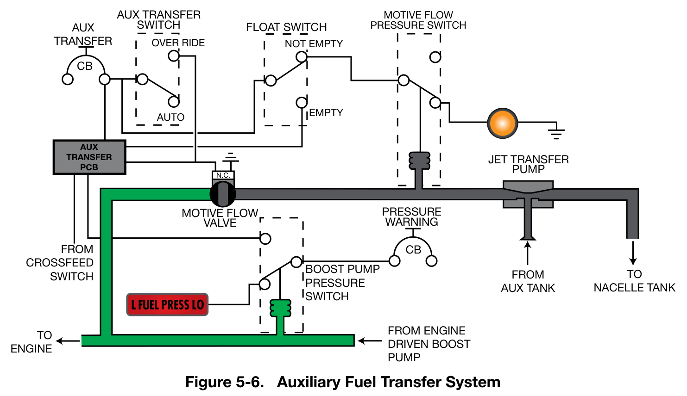

> **Nota do transcritor:** Figura 5-6 mostra lente “L FUEL PRESS LO”; texto usa FUEL PRESS. Mantido.

Fac-símile da página física 101

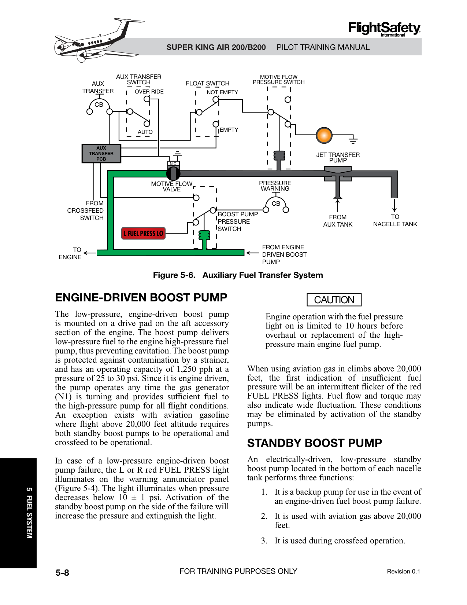

<!-- PTM:PAGE:101 END -->

<!-- PTM:PAGE:102 START -->
<!-- PTM:STATUS:revisada -->
## Página física 102 — 5-9

**Página física:** 102 · **Página impressa:** 5-9 · **Seção:** 5 Fuel System · [PDF](KA-200-B200-PTM.pdf#page=102)

If a standby pump becomes inoperative, crossfeed can be accomplished only from the side of the operative standby pump.

Electrical power for standby pump operation is controlled by lever-lock switches on the fuel control panel (Figure 5-5) and DC power is supplied from the dual fed buses (prior to BB-1098, except 1096 the standby boost pumps are also powered by the hot battery bus). The switches are labeled STANDBY PUMP ON– OFF. With the master switch on, power is supplied from the No. 3 (left) or No. 4 (right) bus feeders through the STANDBY PUMP circuit breakers on the fuel control panel to the pumps.

Prior to BB-1098, except 1096, battery power from the hot battery bus is also available for standby boost pump operation. Fuses located in the right wing center section adjacent to the bat-tery box protect this circuit. These circuits use diodes to prevent failure of one circuit from dis-abling the other circuit. During shutdown, both STANDBY PUMP switches and the CROSS-FEED FLOW switch must be positioned to OFF to prevent battery discharge.

##### FIREWALL FUEL FILTER

Fuel is filtered through a firewall-mounted 20-micron filter, which incorporates an internal bypass. The bypass opens to permit uninterrupted fuel supply to the engine in case of filter icing or blockage. In addition, a screen strainer is located at each tank outlet before fuel reaches the fuel boost and auxiliary transfer pumps.

##### LOW FUEL PRESSURE SWITCH

Mounted on top of the firewall fuel filter is a fuel pressure-sensing switch. In the event of an engine-driven boost pump failure or any other failure resulting in low pressure in the fuel line, the respective fuel pressure switch will close, causing the red FUEL PRESS light on the warning annunciator panel to illuminate (Figure 5-4). This light illuminates any time pressure decreases below 10 ± 1 psi. The light will normally be extinguished by switching on the standby boost pump on that side.

This switch also sends a signal to the auxiliary fuel transfer printed circuit board advising the system if fuel pressure is or is not available for auxiliary tank transfer.

##### FUEL FLOW TRANSMITTER AND GAGES

The fuel flow gages on the instrument panel indi-cate fuel flow in pounds per hour (Figure 5-7). The following list indicates how these gages are powered:

- Prior to BB-225 by 26-volt AC power

- BB-225 through 1483, including 1485, by DC power from the No. 1 and No. 2 dual- fed buses.

- BB-1484, 1486 and subsequent by DC power from the No. 1 and No. 2 dual-fed buses or from the isolation bus.

With BB-1401 and subsequent, the transmitters were moved downstream of the fuel control unit to only indicate fuel used for combustion. Prior to BB-1401, the fuel flow transmitters were installed in the fuel line upstream of the fuel heater and were affected by FCU fuel purge flow.

##### FUEL HEATER

Fuel is heated prior to entering the fuel control unit by an oil-to-fuel heat exchanger. An engine oil line is in proximity with the fuel line and, through conduction, a heat transfer occurs. The purpose of heating the fuel is to remove any ice formation which may have occurred or preclude any ice from forming, and which may result in

**Figure 5-7. Fuel Flow Gages**

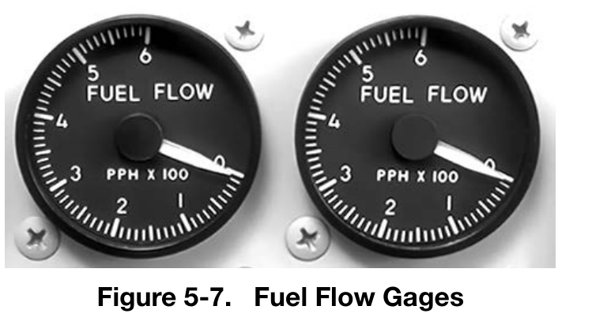

> **Nota do transcritor:** Faixas de seriais e alimentação dos medidores de fluxo mantidas; continua na p. 103.

Fac-símile da página física 102

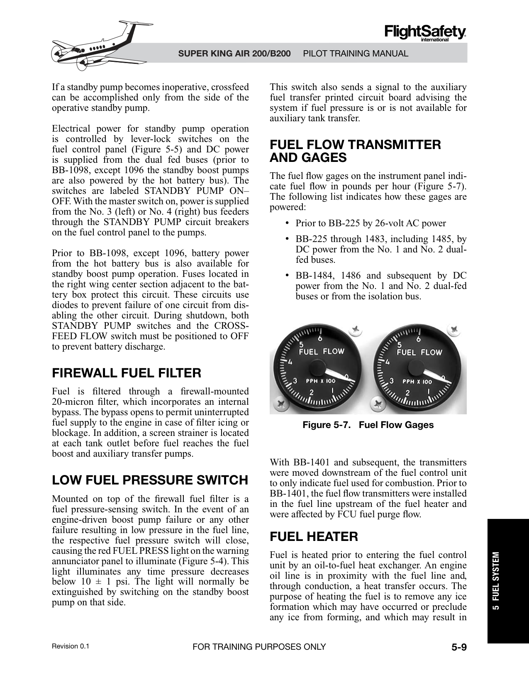

<!-- PTM:PAGE:102 END -->

<!-- PTM:PAGE:103 START -->
<!-- PTM:STATUS:revisada -->
## Página física 103 — 5-10

**Página física:** 103 · **Página impressa:** 5-10 · **Seção:** 5 Fuel System · [PDF](KA-200-B200-PTM.pdf#page=103)

fuel blockage at the fuel control unit (see LIMITA-TIONS at the end of this chapter). The fuel heater is thermostatically controlled to maintain a fuel temperature of 70° to 90°F under normal condi-tions. If the fuel temperature rises above 90°, the fuel will automatically bypass the fuel heater. If the fuel is extremely cold, and the oil temperature is too low, the unit may not be capable of prevent-ing icing in the FCU. The oil vs. fuel temperature graph in the LIMITATIONS section will specify under what conditions icing may occur. The fuel heater is automatic and requires no pilot action.

##### HIGH-PRESSURE ENGINE FUEL PUMP

The high-pressure engine fuel pump is engine driven and is mounted on the accessory drive in conjunction with the fuel control unit. This gear-type pump supplies the fuel pressure needed for a proper spray pattern in the combustion cham-ber. Failure of this pump results in an immediate flameout.

#### FUEL MANIFOLD CLEARING

##### FUEL PURGE SYSTEM (BB-666 and Subsequent)

The fuel purge system (Figure 5-8) uses P3 bleed air to purge the fuel manifolds of fuel when the condition lever is placed in the fuel cutoff position and the fuel pressure in the fuel manifold decreases.

Fuel enters the fuel manifolds in the normal manner via the flow divider. Incorporated in the flow divider is the dump valve which functions to prevent fuel from the fuel control from entering the purge line while the engine is in operation. P3 air is extracted from the engine compressor and sent to the airframe services (pressurization/ pneumatics) just aft of the fireseal. At the point where the airframe services distribution is separated, a small line is tapped off and P3 air is sent via a filter and check valve to the purge tank. The output end of the purge tank also has

**Figure 5-8. Fuel Purge System**

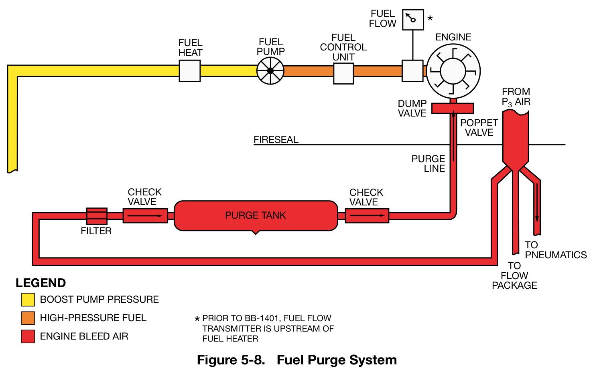

> **Nota do transcritor:** Aquecedor de combustível 70° a 90°F; nota da figura sobre BB-1401 preservada. Continua na página física 104. Continuação da página física 102.

Fac-símile da página física 103

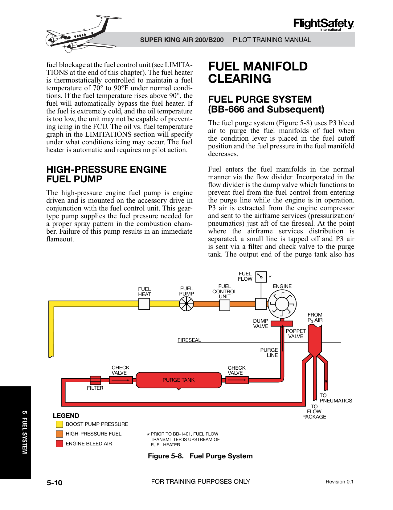

<!-- PTM:PAGE:103 END -->

<!-- PTM:PAGE:104 START -->
<!-- PTM:STATUS:revisada -->
## Página física 104 — 5-11

**Página física:** 104 · **Página impressa:** 5-11 · **Seção:** 5 Fuel System · [PDF](KA-200-B200-PTM.pdf#page=104)

a check valve, working in conjunction with the dump valve, which prevents the return of fuel or air from the fuel manifolds to the purge tank.

In normal operation, the P3 air generated by the engine is held within the purge tank by the input check valve and fuel pressure which holds the dump valve shuttle closed. When the engine is shut down, fuel pressure on the dump valve shut-tle decreases. The shuttle valve opens when P3 pressure is greater than fuel manifold pressure. This allows P3 air to enter the fuel manifolds, forcing the remaining fuel in the manifolds into the burner can. Since combustion has not ceased, this small amount of fuel from the manifolds is now burned, which may result in a small rise in ITT and N1. Refer to Chapter 7, POWERPLANT, for additional information on the purge system.

##### FUEL DRAIN COLLECTOR SYSTEM (BB-2 through BB-665)

Fuel from the engine flow divider drains into a collector tank mounted below the aft engine accessory section. An internal float switch actu-ates an electric pump, which delivers the fuel to the fuel purge line just aft of the fuel purge shut-off valve. A check valve in the line prevents the backflow of fuel during engine purging. A vent line plumbed from the top of the collector tank is routed through an in-line flame arrester and downward to a drain manifold on the underside of the nacelle (Figure 5-2). The system receives power from the No. 1 dual-fed bus. This fuel delivery is completely automatic.

##### FUEL CROSSFEED SYSTEM

Crossfeeding is conducted only during single-engine operation, when it may be necessary to supply fuel to the operative engine from the fuel system on the opposite side (Figure 5-9). The simplified crossfeed control positions are labeled CROSSFEED FLOW and OFF (Figure 5-5). The STANDBY PUMP switches must be positioned to OFF for crossfeeding.

**Figure 5-9. Fuel Crossfeed System**

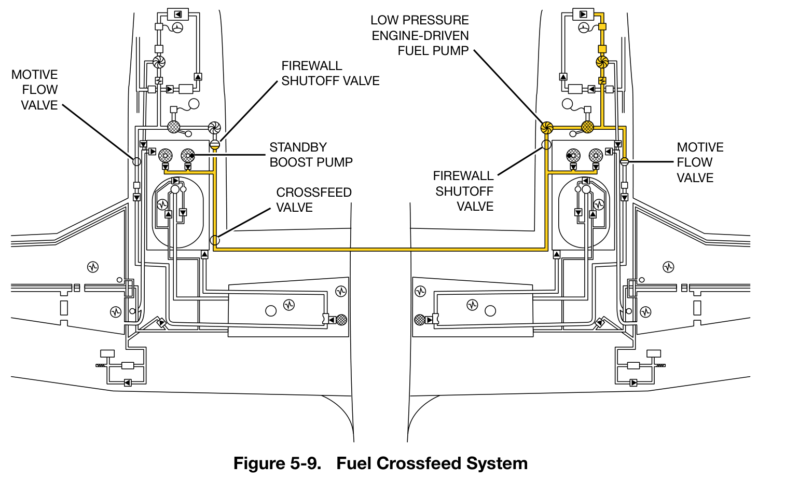

> **Nota do transcritor:** Crossfeed apenas com um motor inoperante conforme texto; continua na p. 105. Continuação da página física 103.

Fac-símile da página física 104

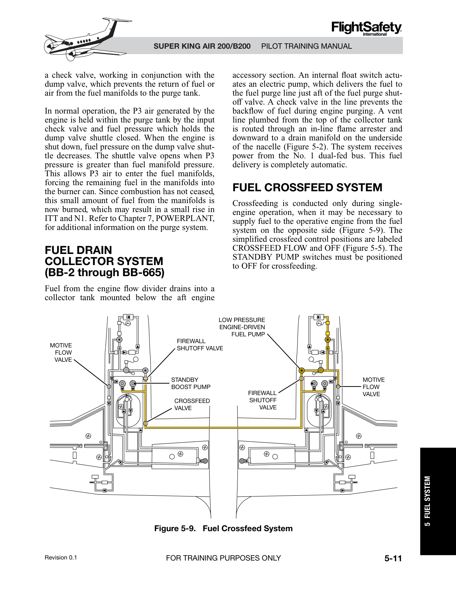

<!-- PTM:PAGE:104 END -->

<!-- PTM:PAGE:105 START -->
<!-- PTM:STATUS:revisada -->
## Página física 105 — 5-12

**Página física:** 105 · **Página impressa:** 5-12 · **Seção:** 5 Fuel System · [PDF](KA-200-B200-PTM.pdf#page=105)

> **CAUTION**

> The auxiliary transfer switch must be positioned to the AUTO position on the side being crossfed. If auxiliary fuel supply is required from the inoperative engine side, the firewall valve must be opened provided engine shutdown was not due to a fuel leak or fire.

Movement of the CROSSFEED switch LEFT or RIGHT, will directly affect four circuits and may indirectly cause a fifth indication:

1. The green FUEL CROSSFEED annun-ciator will illuminate (Figure 5-10).

2. The CROSSFEED valve will open.

3. The standby boost pump on the delivery side will be turned on.

4. The motive flow valve on the receiving side will close, stopping auxiliary tank fuel transfer.

If there is fuel in the receiving side’s auxiliary tank when crossfeed is selected:

5. The NO TRANSFER light on the receiv-ing side will illuminate. (Note that this will not occur if there is no auxiliary fuel available.)

Illumination of the green FUEL CROSSFEED light on the caution/advisory panel indicates crossfeed has been selected, not that the crossfeed valve has moved. The Before Engine Start-ing checklist contains a crossfeed test to ensure operation of this valve. During this test, the pilot should ensure that both red FUEL PRESSure lights extinguish once the CROSSFEED switch is moved LEFT or RIGHT, indicating the valve has opened.

##### FUEL GAGING SYSTEM

A capacitance-type fuel gaging system monitors fuel quantity in either the main or auxiliary fuel system for each side. Two fuel gages, one for each wing fuel system, are on the fuel control panel (Figure 5-5).

Quantity is read directly in pounds. An error of 3% maximum may be encountered in the system. The readings are compensated for density changes caused by temperature variations.

A FUEL QUANTITY selector switch on the fuel control panel placarded MAIN and AUXILIARY allows monitoring of the main or auxiliary system fuel quantity. This switch is spring loaded to the main system and must be held in the auxiliary position for reading.

**Figure 5-10. Fuel Crossfeed Advisory Light**

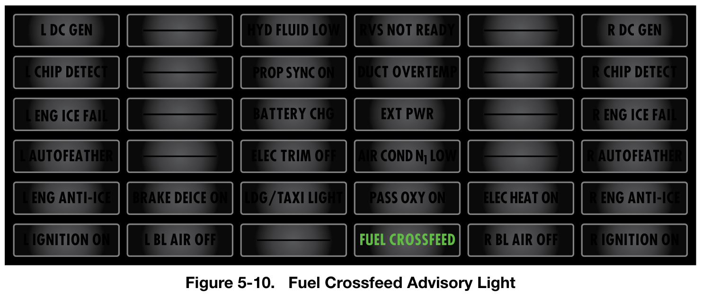

> **Nota do transcritor:** Capitalização “FUEL PRESSure” mantida. Continuação da página física 104.

Fac-símile da página física 105

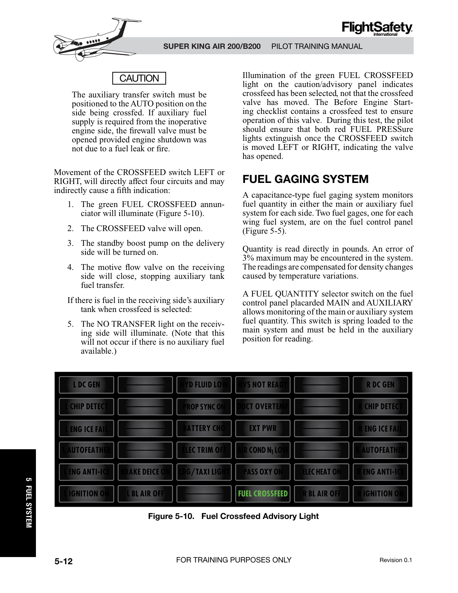

<!-- PTM:PAGE:105 END -->

<!-- PTM:PAGE:106 START -->
<!-- PTM:STATUS:revisada -->
## Página física 106 — 5-13

**Página física:** 106 · **Página impressa:** 5-13 · **Seção:** 5 Fuel System · [PDF](KA-200-B200-PTM.pdf#page=106)

The fully-independent indicating system on each side of the airplane incorporates eight probes: one in the inboard box fuel cell, one in the nacelle fuel cell, two in the integral wet-wing cell, two in the inboard leading edge cell, and two in the auxiliary tank.

Power is supplied through the capacitance probes to the quantity indicator.

##### FUELING

Fuels and fueling considerations are covered in LIMITATIONS.

The procedure for blending anti-icing additive with fuel is accomplished during fueling, and is covered in the NORMAL PROCEDURES sec-tion of the *Flight Manual*.

##### ANTISIPHON VALVE

An antisiphon valve installed at each filler port prevents loss of fuel in the event of improper securing or loss of the filler cap in flight.

##### VENT SYSTEM

The two wing fuel systems are vented through recessed ram vents coupled to protruding heated ram vents on the underside of the wing adjacent to the nacelle. One vent on each side is recessed and aerodynamically prevents ice from forming. The other vent is protruding and is heated to prevent icing. Refer to Chapter 10, ICE AND RAIN PROTECTION, for additional information.

An air inlet at the wingtip vents the integral (wet cell) tank, the auxiliary tank and for BB-479 and subsequent, the nacelle tank. Prior to BB-479 a dedicated nacelle air inlet was located at the trail-ing edge of the wing behind the nacelle.

##### FUEL DRAINS

There are five sump drains and a firewall filter drain in each wing. Drain locations are shown in Table 5-1.

#### LIMITATIONS

##### APPROVED FUEL GRADES AND OPERATING LIMITATIONS

Commercial Grades Jet A, Jet A-1, and Jet B, and Military Grades JP-4 and JP-5 are recommended fuels for use in the Super King Air 200 and B200. They may be mixed in any ratio.

Aviation gasoline Grades 80 Red (formerly 80/87), 91/98, 100LL Blue (same as 100L Green in some countries), 100 Green (formerly 100/130), and 115/145 Purple are emergency fuels. Emergency fuels may be mixed with recommended fuels in any ratio. However, when aviation gasoline is used, operation is limited to 150 hours between engine overhauls. The number of gallons taken aboard for each engine divided by the engine fuel consumption rate equals the number of hours to be charged against time between overhauls (TBO).

The pilot must be familiar with the consumption rate of his airplane and record the number of gallons taken aboard for each engine.

It is recommended that the pilot refer also to the Limitations chart in the *POH* concerning standby boost pumps and crossfeed operations when aviation gasoline is used.

**Table 5-1. DRAIN LOCATIONS**

| DRAINS | LOCATION |
|---|---|
| LEADING EDGE TANK | Outboard of nacelle underside of wing |
| INTEGRAL TANK | Underside of wing forward of aileron |
| FIREWALL FUEL FILTER | Underside of cowling forward of firewall |
| SUMP STRAINER | Bottom center of nacelle forward of the wheel well |
| GRAVITY FEED LINE | Outboard side of nacelle Aft of wheel well (Prior to BB-1193) |
| AUXILIARY TANK | At wingroot just forward of the flap |

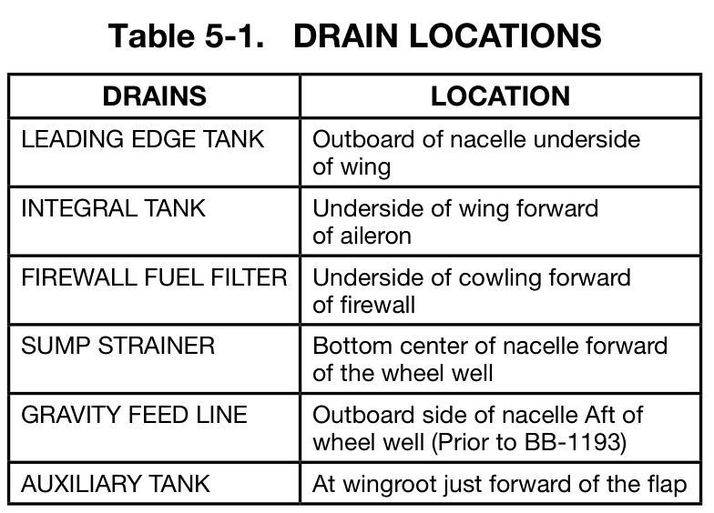

> **Nota do transcritor:** Tabela 5-1 reconstruída; “Aft” maiúsculo mantido. Continua na página física 107.

Fac-símile da página física 106

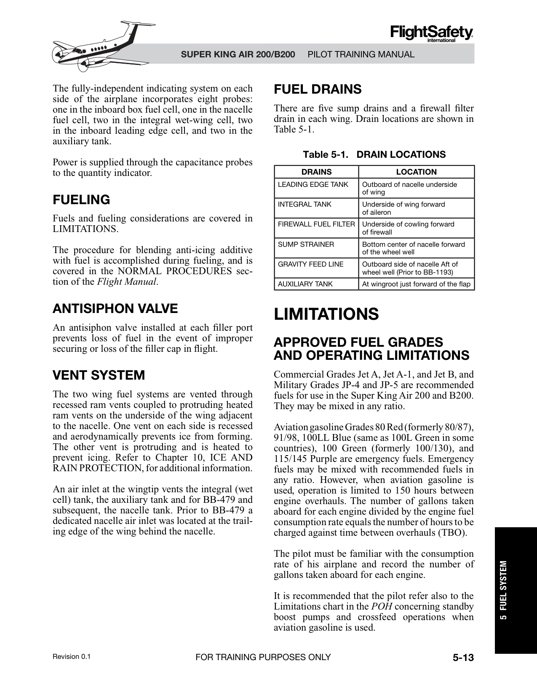

<!-- PTM:PAGE:106 END -->

<!-- PTM:PAGE:107 START -->
<!-- PTM:STATUS:revisada -->
## Página física 107 — 5-14

**Página física:** 107 · **Página impressa:** 5-14 · **Seção:** 5 Fuel System · [PDF](KA-200-B200-PTM.pdf#page=107)

Takeoff is prohibited if either fuel quantity gage indicates less than 265 pounds of fuel or is in the yellow arc.

Crossfeed is utilized for single-engine operation only.

Operation of either engine with its corresponding fuel pressure warning annunciator (L FUEL PRESS or R FUEL PRESS) illuminated is limited to 10 hours between overhaul or replacement of the high-pressure main engine fuel pump.

###### NOTE Windmilling time need not be charged against this time limit.

The maximum allowable fuel imbalance is 1,000 pounds. Check the *Aircraft Flight Manual Supple-* *ments* for maximum imbalance during autopilot operation.

##### APPROVED FUEL ADDITIVE

Anti-icing additive conforming to Specification MIL-I-27686 or MIL-I-85470 are the only approved fuel additives.

Engine oil is used to heat the fuel on entering the fuel control. Since no temperature measurement is available for the fuel at this point, it must be assumed to be the same as the OAT. Figure 5-11 is supplied for use as a guide in preflight planning, based on known or forecast operating conditions, to allow the operator to become aware of operating temperatures at which icing of the fuel control could occur. If oil temperature versus OAT indicates that ice formation could occur during takeoff or in flight, anti-icing additive per MIL-I-27686 or MIL-I-85470 must be mixed with the fuel at refueling to ensure safe operation.

> **CAUTION**

> Anti-icing additive must be properly blended with the fuel to avoid deteri-oration of the fuel cells. The additive concentration by volume shall be a minimum of 0.10% and a maximum of 0.15 %.

**Figure 5-11. Fuel Temperature (OAT) Versus Minimum Oil Temperature Graph**

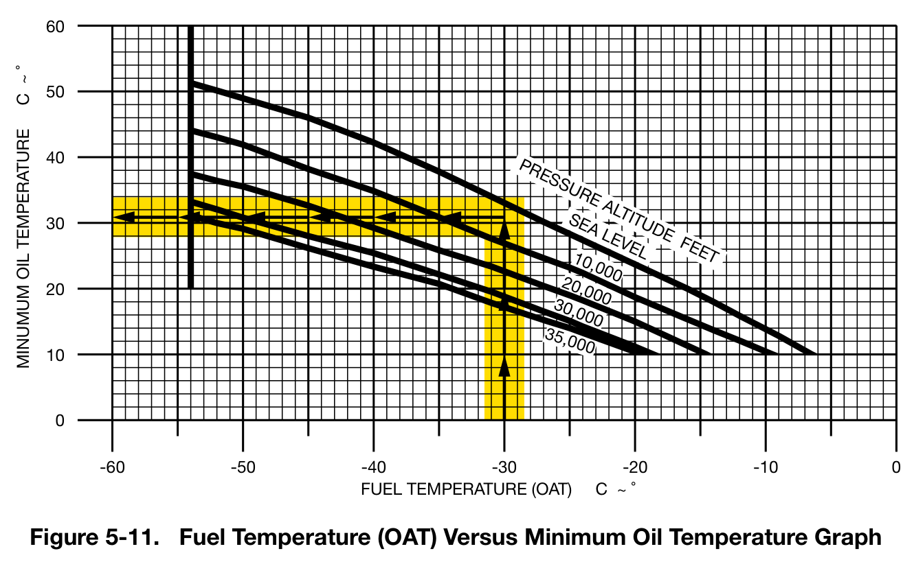

> **Nota do transcritor:** Gráfico preservado em imagem; nenhuma leitura foi interpolada. Concentração de aditivo 0.10%–0.15% mantida. Continua na página física 108. Continuação da página física 106.

Fac-símile da página física 107

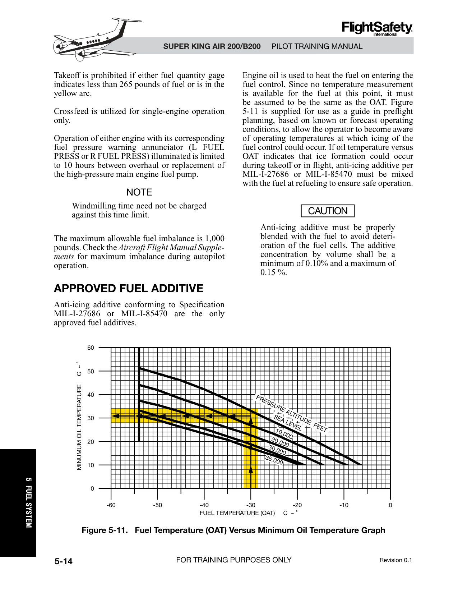

<!-- PTM:PAGE:107 END -->

<!-- PTM:PAGE:108 START -->
<!-- PTM:STATUS:revisada -->
## Página física 108 — 5-15

**Página física:** 108 · **Página impressa:** 5-15 · **Seção:** 5 Fuel System · [PDF](KA-200-B200-PTM.pdf#page=108)

> **CAUTION**

> Anti-icing additive per MIL-I-27686 is blended in JP-4 fuel per MEL-T-5624 at the refinery, and no further treatment is necessary. Some fuel suppliers blend anti-icing additive in their storage tanks. Prior to refueling, check with the fuel supplier to determine whether or not the fuel has been blended. To assure proper concentration by volume of fuel on board, only enough additive for the unblended fuel should be added.

##### FUELING CONSIDERATIONS

Do not put any fuel into the auxiliary tanks unless the main tanks are full.

The airplane must be statically grounded to the servicing unit, and the servicing unit must also be grounded.

The fuel filler nozzle must not be allowed to rest in the tank filler neck as the filler neck might be damaged.

It is recommended that a period of three hours be allowed to elapse after refueling so that water and other fuel contaminants have time to settle. A small amount of fuel should then be drained from each drain point and checked for contamination. In addition, fuel filters must be cleaned whenever fuel is suspected of being contaminated.

##### ZERO-FUEL WEIGHT

The maximum zero-fuel weight of the Super King Air 200 is 10,400 pounds. The maximum zero-fuel weight of the B200 is 11,000 pounds.

> **Nota do transcritor:** Referência “MEL-T-5624” mantida como impressa; pesos zero-fuel 10.400/11.000 lb. Continuação da página física 107.

Fac-símile da página física 108

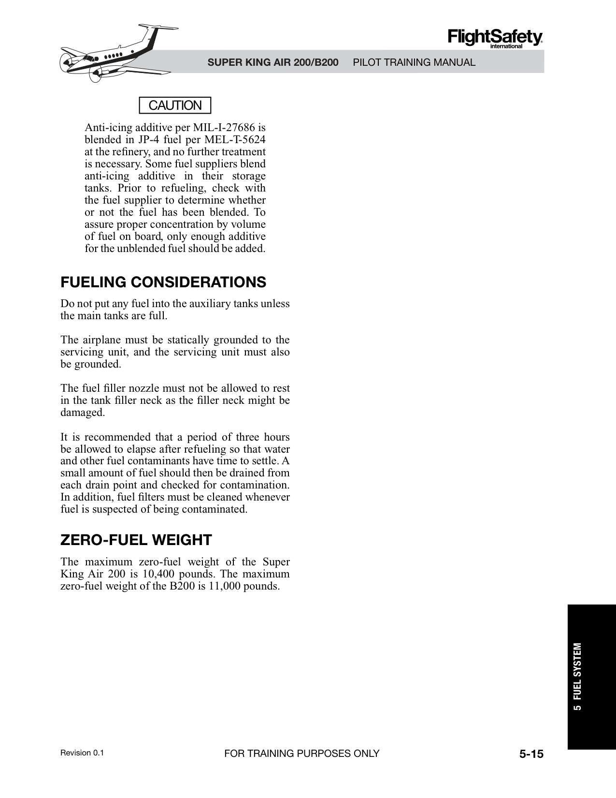

<!-- PTM:PAGE:108 END -->

<!-- PTM:PAGE:109 START -->
<!-- PTM:STATUS:revisada -->
## Página física 109 — 5-16

**Página física:** 109 · **Página impressa:** 5-16 · **Seção:** 5 Fuel System · [PDF](KA-200-B200-PTM.pdf#page=109)

**1. Fuel is heated prior to entering the fuel con-trol unit by:**

A. Bleed air from the engine’s compressor  
B. Engine oil, through an oil-to-fuel heat exchanger  
C. The friction heating caused by the boost pump  
D. An air-to-fuel heat exchanger prior to the fuel control unit

**2. Which of the following is not affected when the crossfeed switch is moved to the right or left?**

A. The override function for auxiliary fuel transfer  
B. The crossfeed valve  
C. The standby pump on the side supplying the fuel  
D. The motive flow valve on the side being fed

**3. Which of the following is electrically pow-ered?**

A. Engine-driven boost pump  
B. Standby boost pump  
C. Engine fuel pump  
D. Fuel manifold pump

**4. Which of the following is a function of the electric standby boost pump?**

A. It functions as a backup pump for use in the event of primary boost pump failure  
B. It is used with aviation gas in climbs above 20,000 feet  
C. It is used in crossfeed operation  
D. All of the above

**5. The fuel panel check tests electrical continu-ity to which items?**

A. Firewall valves only  
B. Firewall valves, standby boost pumps, and crossfeed valve  
C. Standby boost pumps only  
D. Firewall valves and standby boost pumps prior to BB-1096

**6. When is crossfeed use authorized?**

A. For single-engine operation  
B. For climbs above 20,000 feet when avia-tion gas is used  
C. When one standby pump is inoperative  
D. When fuel pressure decreases below 10 ± 1psi

**7. Which of the following limitations applies to operation with aviation gas?**

A. A maximum altitude of 20,000 feet with both standby boost pumps operative and 150 hours between overhauls  
B. A maximum altitude of 31,000 feet with standby boost pump inoperative and 150 hours between overhauls  
C. A maximum altitude of 20,000 feet with one standby pump inoperative and 150 hours between overhauls  
D. A maximum of 150 hours between over-hauls only

**8. Operation of the engine with the FUEL PRESS light illuminated is limited to which of the following?**

A. Ten hours of engine operation between main engine fuel pump overhauls or before replacement.  
B. Ten hours of operation above 20,000 feet.  
C. Unlimited operation below 20,000 feet.  
D. Respective engine shutdown.

> **Nota do transcritor:** Questões preservadas sem indicar respostas.

Fac-símile da página física 109

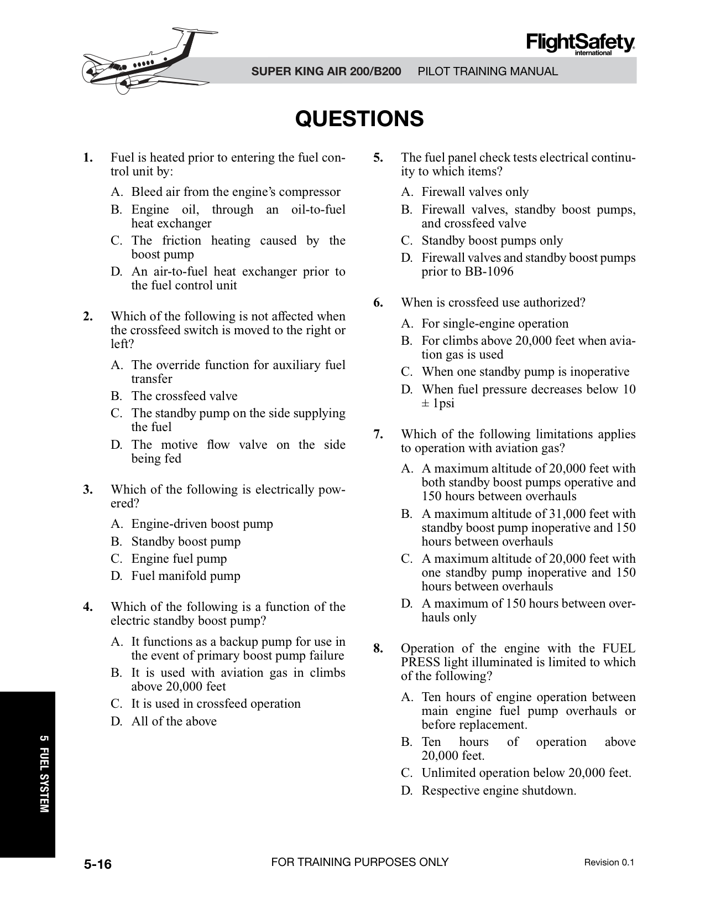

<!-- PTM:PAGE:109 END -->

<!-- PTM:PAGE:110 START -->
<!-- PTM:STATUS:revisada -->
## Página física 110 — 6-i

**Página física:** 110 · **Página impressa:** 6-i · **Seção:** 6 Auxiliary Power Systems · [PDF](KA-200-B200-PTM.pdf#page=110)

The information normally contained in this chapter is not applicable to this particular aircraft.

#### CHAPTER 6 AUXILIARY POWER SYSTEMS

> **Nota do transcritor:** Capítulo 6 declara informação não aplicável; apenas página 6-i presente, sem 6-ii no PDF.

Fac-símile da página física 110

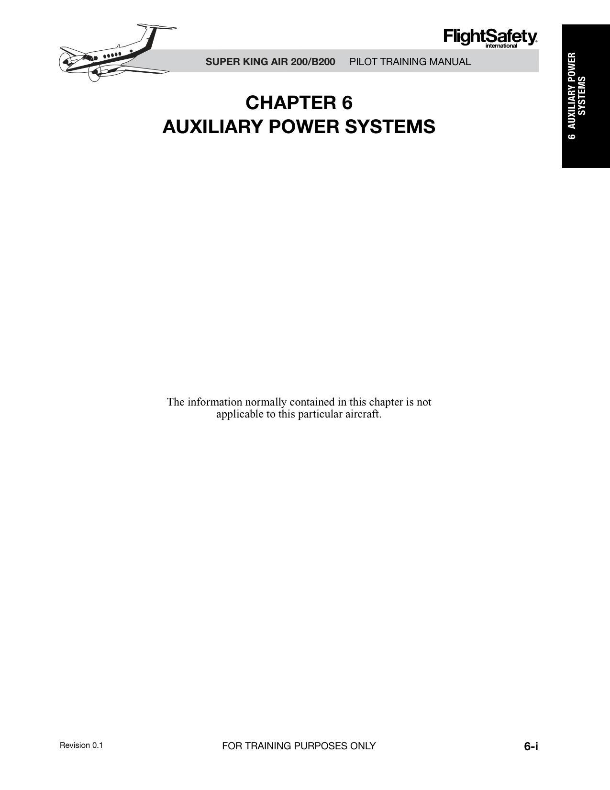

<!-- PTM:PAGE:110 END -->

<!-- PTM:PAGE:111 START -->
<!-- PTM:STATUS:revisada -->
## Página física 111 — 7-i

**Página física:** 111 · **Página impressa:** 7-i · **Seção:** 7 Powerplant · [PDF](KA-200-B200-PTM.pdf#page=111)

#### CHAPTER 7 POWERPLANT

##### CONTENTS

| Subject | Page |
|---|---|
| INTRODUCTION | 7-1 |
| OVERVIEW | 7-1 |
| ENGINE | 7-2 |
| General | 7-2 |
| Major Sections | 7-2 |
| Operating Principles | 7-6 |
| ENGINE LUBRICATION SYSTEM | 7-8 |
| General | 7-8 |
| Oil Tank | 7-8 |
| Pumps | 7-8 |
| Oil Cooler | 7-8 |
| Indication | 7-8 |
| Fuel Heater | 7-9 |
| Operation | 7-9 |
| ENGINE FUEL SYSTEM | 7-9 |
| General | 7-9 |
| Indication | 7-9 |
| Fuel System Operation | 7-11 |
| Fuel Control Unit (FCU) | 7-13 |

Fac-símile da página física 111

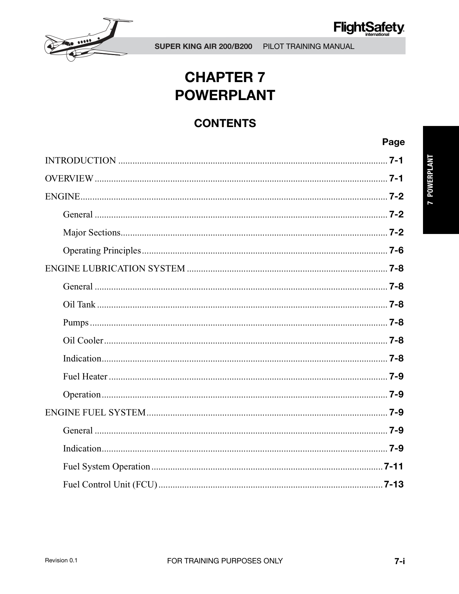

<!-- PTM:PAGE:111 END -->

<!-- PTM:PAGE:112 START -->
<!-- PTM:STATUS:revisada -->
## Página física 112 — 7-ii

**Página física:** 112 · **Página impressa:** 7-ii · **Seção:** 7 Powerplant · [PDF](KA-200-B200-PTM.pdf#page=112)

| Subject | Page |
|---|---|
| ENGINE IGNITION SYSTEM | 7-15 |
| General | 7-15 |
| Starting Ignition | 7-15 |
| Autoignition | 7-15 |
| Indication | 7-16 |
| Operation | 7-16 |
| PROPELLER | 7-16 |
| General | 7-16 |
| Feathering | 7-18 |
| Unfeathering and Reversing | 7-18 |
| Basic Principles | 7-18 |
| Control | 7-18 |
| Overspeed Control | 7-19 |
| Fuel Topping (Power Turbine) Governor | 7-19 |
| Reverse Operation | 7-20 |
| Beta Mode Control | 7-21 |
| Propeller Operating Principles | 7-21 |
| Powerplant Power Control | 7-23 |
| Engine Instrumentation | 7-26 |
| Synchroscope | 7-28 |
| Synchrophasing | 7-29 |
| PROPELLER FEATHERING | 7-31 |
| Autofeathering | 7-31 |
| Operating Principles | 7-32 |
| Autofeathering | 7-33 |
| Unfeathering | 7-34 |

Fac-símile da página física 112

<!-- PTM:PAGE:112 END -->

<!-- PTM:PAGE:113 START -->
<!-- PTM:STATUS:revisada -->
## Página física 113 — 7-iii

**Página física:** 113 · **Página impressa:** 7-iii · **Seção:** 7 Powerplant · [PDF](KA-200-B200-PTM.pdf#page=113)

| Subject | Page |
|---|---|
| LIMITATIONS (POWERPLANT) | 7-35 |
| General | 7-35 |
| Powerplant | 7-35 |
| Engine Operating Limits | 7-35 |
| Approved Fuels | 7-37 |
| Propeller | 7-37 |
| Powerplant Instrument Markings | 7-37 |
| Starter Limits | 7-37 |
| QUESTIONS | 7-39 |

Fac-símile da página física 113

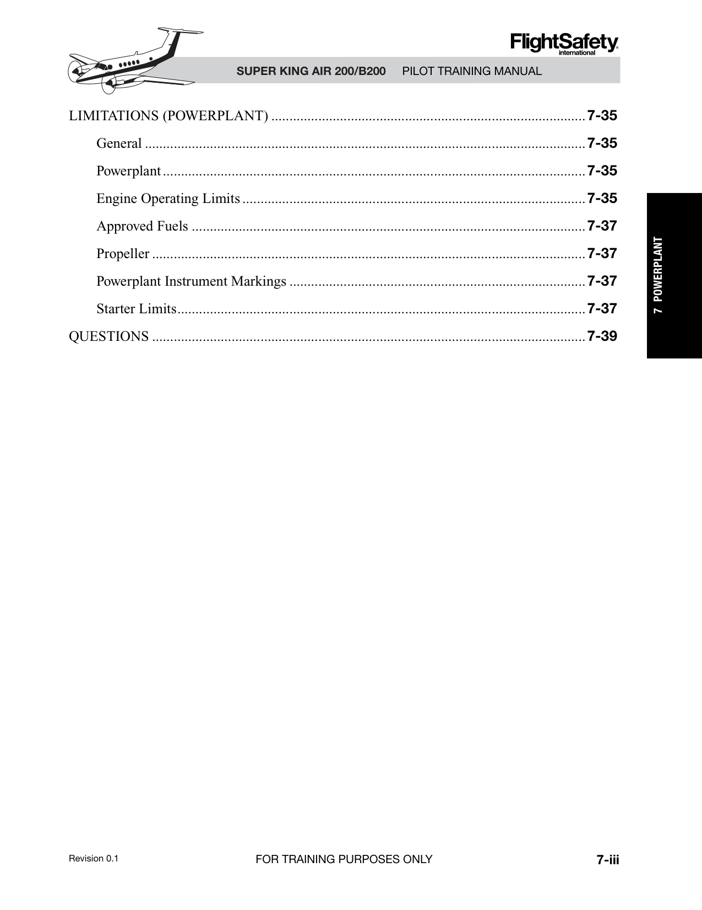

<!-- PTM:PAGE:113 END -->

<!-- PTM:PAGE:114 START -->
<!-- PTM:STATUS:revisada -->
## Página física 114 — 7-v

**Página física:** 114 · **Página impressa:** 7-v · **Seção:** 7 Powerplant · [PDF](KA-200-B200-PTM.pdf#page=114)

##### ILLUSTRATIONS

| Figure | Title | Page |
|---|---|---|
| 7-1 | Super King Air 200 | 7-2 |
| 7-2 | PT6A Engine | 7-3 |
| 7-3 | Engine Cutaway | 7-4 |
| 7-4 | Compressor Bleed Valves | 7-5 |
| 7-5 | Engine Gas Flow and Stations | 7-7 |
| 7-6 | Oil Pressure/Temperature Gages | 7-8 |
| 7-7 | Chip Detection Lights | 7-9 |
| 7-8 | Oil System Schematic | 7-10 |
| 7-9 | Fuel Low-Pressure Lights | 7-11 |
| 7-10 | Fuel Flow Gages | 7-11 |
| 7-11 | Fuel Schematic | 7-12 |
| 7-12 | Simplified Fuel Control Schematic | 7-14 |
| 7-14 | Engine Autoignition Switches | 7-15 |
| 7-13 | Engine Start and Ignition Switches | 7-15 |
| 7-15 | Ignition System Schematic | 7-16 |
| 7-16 | Propellers | 7-17 |
| 7-17 | PROP GOV TEST Switch | 7-19 |
| 7-18 | Propeller Governor Test Schematic | 7-20 |
| 7-19 | Propeller Onspeed Schematic | 7-22 |
| 7-20 | Propeller Overspeed Schematic | 7-22 |
| 7-21 | Propeller Underspeed Schematic | 7-23 |
| 7-22 | Powerplant Control Levers | 7-24 |
| 7-23 | Beta and Reverse Control | 7-25 |
| 7-24 | Propeller Control Lever | 7-26 |

> **Nota do transcritor:** Índice mantém 7-14 antes de 7-13; página impressa 7-v (7-iv não presente no PDF).

Fac-símile da página física 114

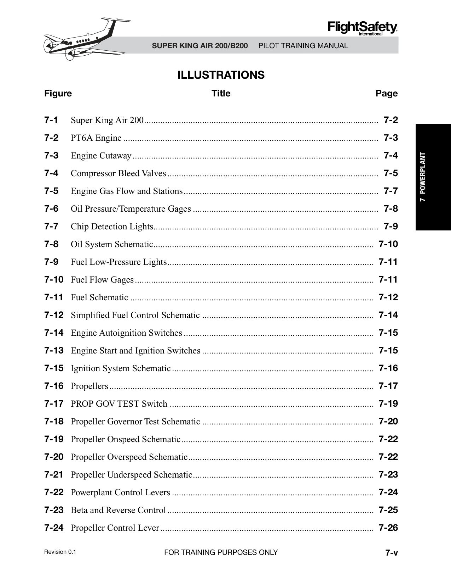

<!-- PTM:PAGE:114 END -->

<!-- PTM:PAGE:115 START -->
<!-- PTM:STATUS:revisada -->
## Página física 115 — 7-vi

**Página física:** 115 · **Página impressa:** 7-vi · **Seção:** 7 Powerplant · [PDF](KA-200-B200-PTM.pdf#page=115)

**ILLUSTRATIONS**

| Figure | Title | Page |
|---|---|---|
| 7-25 | Friction Control Knobs | 7-26 |
| 7-26 | ITT Gages | 7-27 |
| 7-27 | Torque Gages | 7-27 |
| 7-28 | Propeller RPM Gages | 7-28 |
| 7-29 | Engine RPM Gages | 7-28 |
| 7-30 | Propeller Synchroscope and Switches (Type II) | 7-28 |
| 7-31 | Type II System Schematic | 7-29 |
| 7-32 | Type I System Schematic | 7-30 |
| 7-34 | Sync Light | 7-31 |
| 7-33 | Propeller Synchroscope and Switch (Type I) | 7-31 |
| 7-35 | AUTOFEATHER Switch | 7-32 |
| 7-36 | Autofeather Lights | 7-32 |
| 7-37 | Autofeather System Schematic (Both Power Levers at Approximately 90% N1; Right Engine Has Failed) | 7-33 |
| 7-38 | Autofeather Test Schematic (Left Power Lever Below 200 ft-lb; Right Power Lever Above 400 ft-lb) | 7-34 |

**TABLES**

| Table | Title | Page |
|---|---|---|
| 7-2 | Engine Operating Limits (PT6A-42 Engine Prior to BB-1439, 1444 and Subsequent) | 7-35 |
| 7-1 | Engine Operating Limits (PT6A-42 Engine BB-1439, 1444 and Subsequent) | 7-35 |
| 7-3 | Engine Operating Limits (PT6A-41 Engine) | 7-36 |
| 7-4 | Powerplant Instrument Markings | 7-38 |

> **Nota do transcritor:** Índice mantém 7-34 antes de 7-33 e Table 7-2 antes de 7-1; títulos de aplicabilidade mantidos.

Fac-símile da página física 115

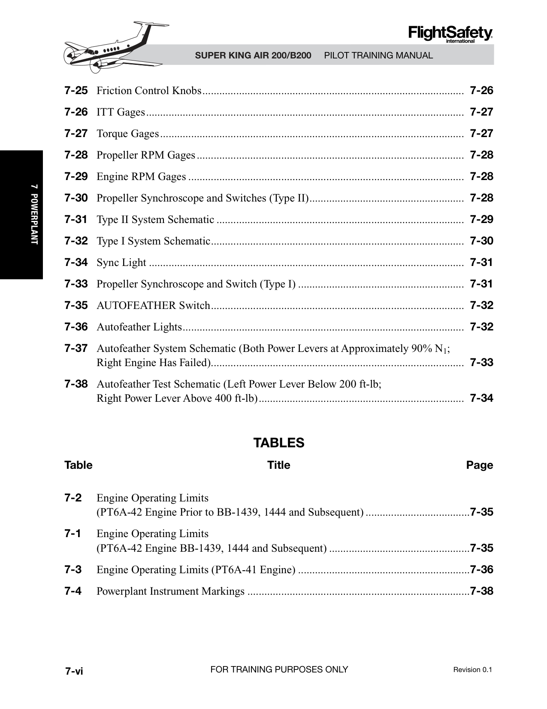

<!-- PTM:PAGE:115 END -->

<!-- PTM:PAGE:116 START -->
<!-- PTM:STATUS:revisada -->
## Página física 116 — 7-1

**Página física:** 116 · **Página impressa:** 7-1 · **Seção:** 7 Powerplant · [PDF](KA-200-B200-PTM.pdf#page=116)

### CHAPTER 7 POWERPLANT

#### INTRODUCTION

This chapter deals with the powerplant of the Super King Air 200. All values, such as for pres-sures, temperatures, rpm, and power are used for illustrative meanings only. Actual values must be determined from the appropriate sections of the approved flight manual.

Information in this chapter must not be construed as being equal to or superseding any information issued by or on behalf of the various manufacturers or the Federal Aviation Administration.

#### OVERVIEW

The Super King Air 200 (Figure 7-1) is powered by two wing-mounted, turboprop engines, manufactured by Pratt and Whitney Aircraft of Canada Limited, a Division of United Technologies. The engines drive three- or four-blade, constant-speed propellers which incorporate full feathering and full reversing capabilities in addition to ground fine/Beta mode control for ground operation. On the ground, the propeller is feathered when the engine is shut down and unfeathered when the engine is restarted.

**Ilustração de abertura do capítulo**

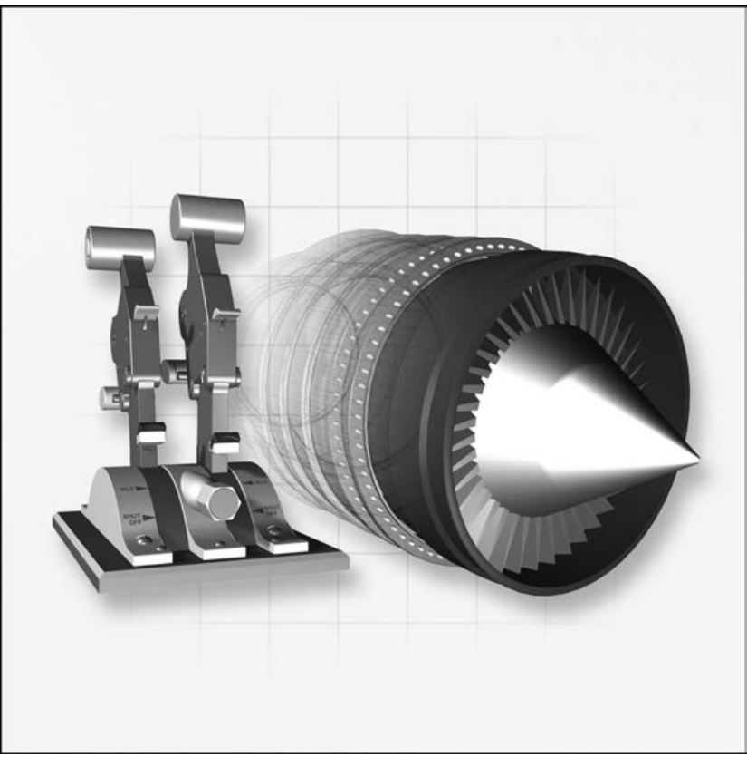

> **Nota do transcritor:** Valores declarados ilustrativos; não substituem o manual de voo aprovado.

Fac-símile da página física 116

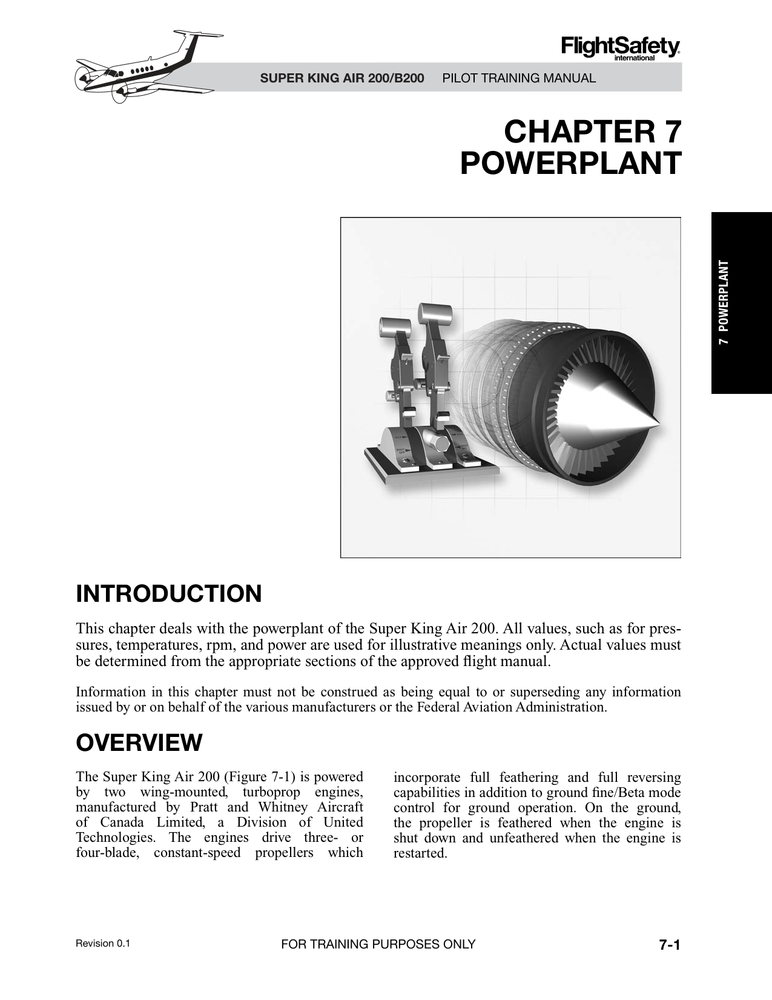

<!-- PTM:PAGE:116 END -->

<!-- PTM:PAGE:117 START -->
<!-- PTM:STATUS:revisada -->
## Página física 117 — 7-2

**Página física:** 117 · **Página impressa:** 7-2 · **Seção:** 7 Powerplant · [PDF](KA-200-B200-PTM.pdf#page=117)

#### ENGINE

##### GENERAL

The engines used on the Super King Air 200 are designated PT6A-41, while the B200 uses PT6A-42.

The PT6A (Figure 7-2) is a free-turbine, reverse-flow, lightweight turboprop engine, capable of developing 850-shaft horsepower (903 equivalent shaft horsepower [ESHP]).

PT6 engine development began about 1960. The first certificated engine, the PT6A-6, entered service in 1962, rated at 450-shaft horsepower. Since then, the output of the PT6A has almost tripled (with no apparent outward changes), to 1,300-shaft horsepower on the PT6A-68A.

##### MAJOR SECTIONS

For the purpose of this chapter, the engine (Figure 7-3) is divided into seven major sections.

1. Air Intake Section

2. Compressor Section

3. Combustion Section

4. Turbine Section

5. Exhaust Section

6. Reduction Gear Section

7. Accessory Drive Section

**Figure 7-1. Super King Air 200**

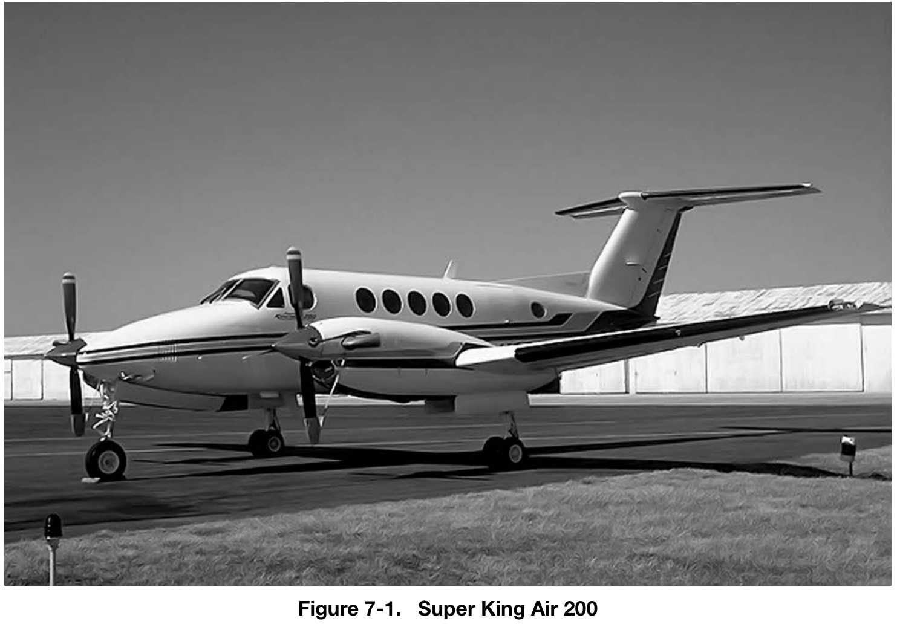

Fac-símile da página física 117

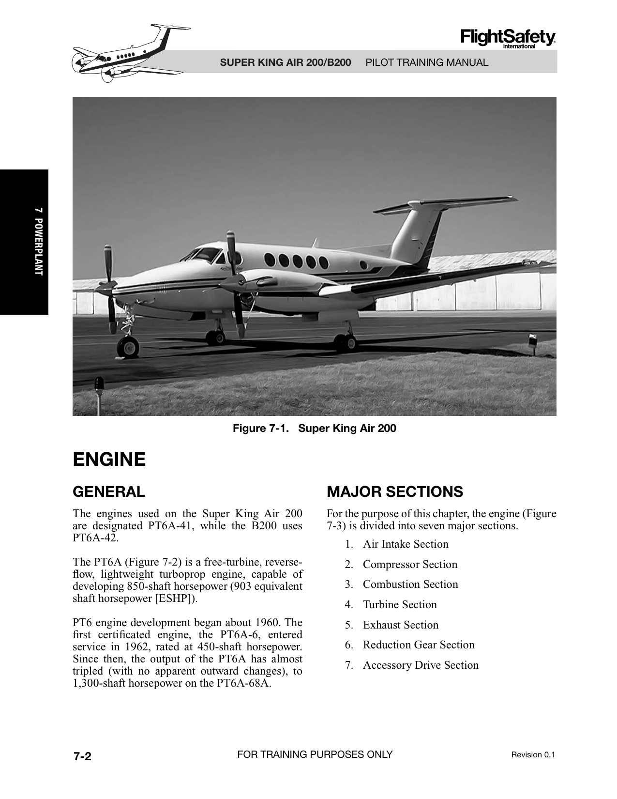

<!-- PTM:PAGE:117 END -->

<!-- PTM:PAGE:118 START -->
<!-- PTM:STATUS:revisada -->
## Página física 118 — 7-3

**Página física:** 118 · **Página impressa:** 7-3 · **Seção:** 7 Powerplant · [PDF](KA-200-B200-PTM.pdf#page=118)

**Figure 7-2. PT6A Engine**

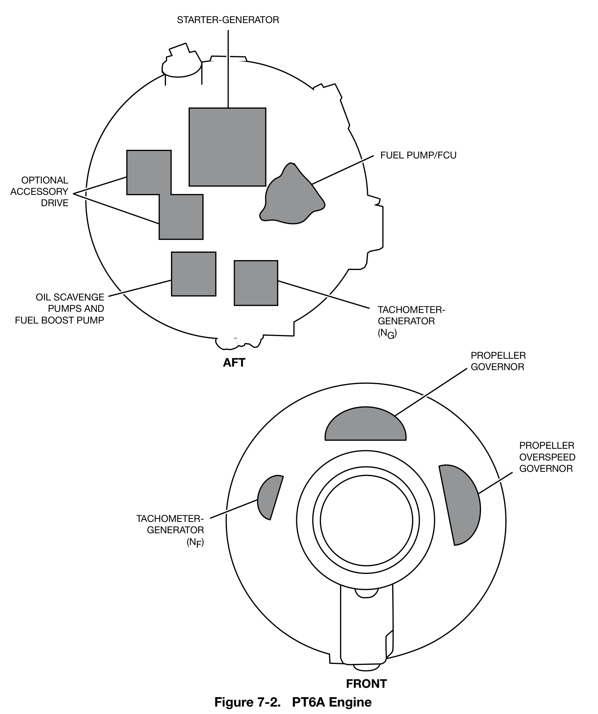

> **Nota do transcritor:** Figura 7-2 usa NG/NF; texto usa N1/NP. Ambas as notações preservadas.

Fac-símile da página física 118

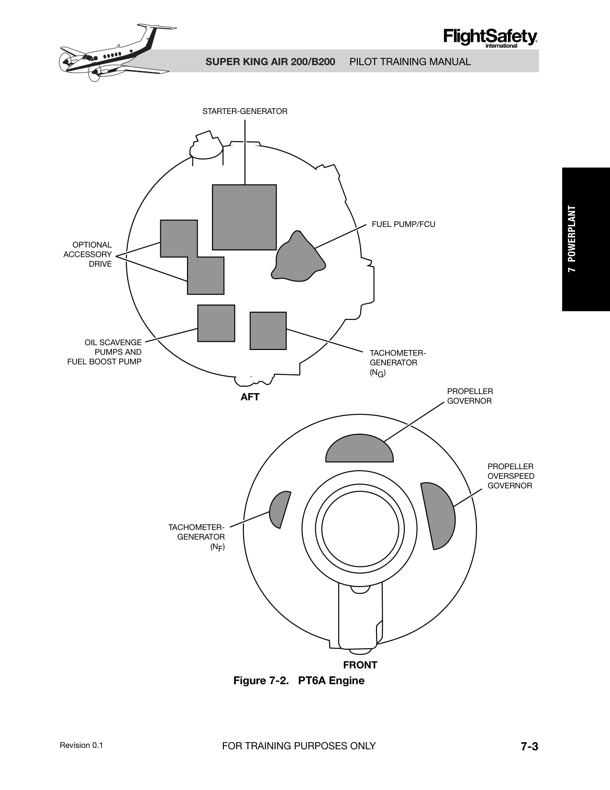

<!-- PTM:PAGE:118 END -->

<!-- PTM:PAGE:119 START -->
<!-- PTM:STATUS:revisada -->
## Página física 119 — 7-4

**Página física:** 119 · **Página impressa:** 7-4 · **Seção:** 7 Powerplant · [PDF](KA-200-B200-PTM.pdf#page=119)

**Figure 7-3. Engine Cutaway**

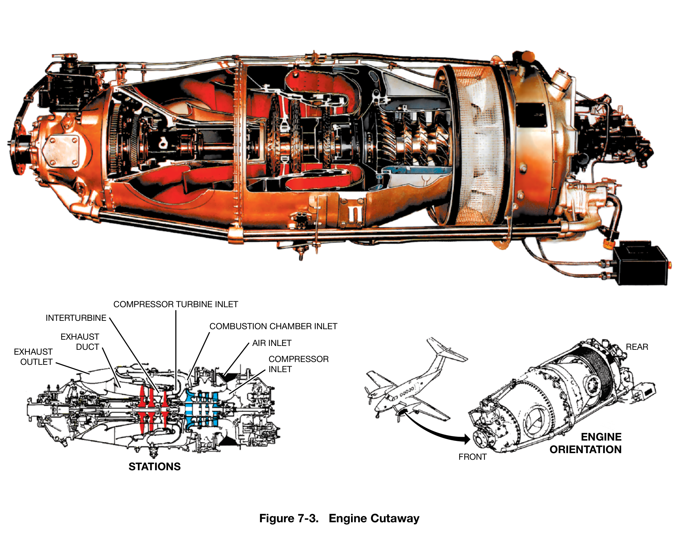

*Detalhe girado 90° no sentido horário apenas para leitura; o fac-símile abaixo mantém a orientação original.*

> **Nota do transcritor:** Figura girada para leitura; orientação original no fac-símile.

Fac-símile da página física 119

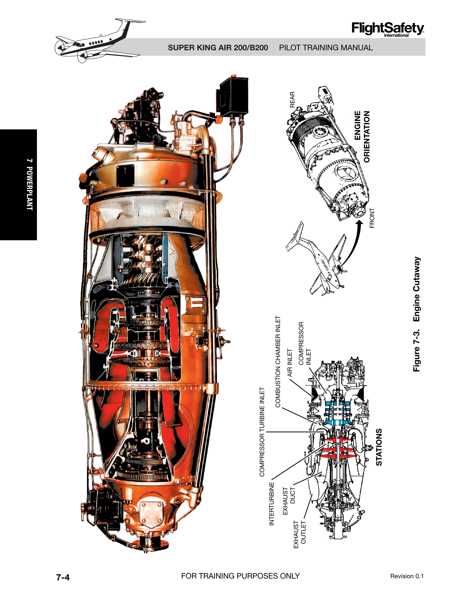

<!-- PTM:PAGE:119 END -->

<!-- PTM:PAGE:120 START -->
<!-- PTM:STATUS:revisada -->
## Página física 120 — 7-5

**Página física:** 120 · **Página impressa:** 7-5 · **Seção:** 7 Powerplant · [PDF](KA-200-B200-PTM.pdf#page=120)

##### Air Intake Section

The compressor air intake consists of a circular screen-covered, aluminum casting. Air is directed to the air intake by the nacelle air scoop on the lower side of the nacelle. The function of the air intake section is to direct airflow to the gas gen-erator compressor.

##### Compressor Section

This section consists of a four-stage compressor assembly, made up of three axial stages and one centrifugal stage. The function of the compres-sor is to compress and supply air for combustion, combustion cooling, pressurization and pneu-matic services, compressor bleed valve operation, and bearing sealing and cooling.

##### Compressor Bleed Valves

At low N1 rpm, the compressor axial stages produce more compressed air than the centrifugal stage can use. Compressor bleed valves compensate for this excess airflow at low rpm by overboarding, or bleeding axial stage air to reduce backpressure on the centrifugal stage (Figure 7-4). This pressure relief helps prevent compressor stall of the centrifugal stage.

The compressor bleed valves, one on each side of the compressor, are pneumatic pistons, which reference the pressure differential between the axial and centrifugal stages. Looking forward, the low-pressure valve is located at the 9 o’clock position and the high pressure at 3 o’clock. The function of these valves is to prevent compressor stalls and surges in the low N1 rpm range.

At low N1 rpm, both valves are in the open position. At takeoff and cruise N1 rpm, above approximately 90%, both bleed valves will be closed. If both compressor bleed valves were to stick closed below approximately 90% N1, a compressor stall would result.

If one or both valves were to stick open, the ITT would increase and torque decrease while N1 rpm remained constant.

**Figure 7-4. Compressor Bleed Valves**

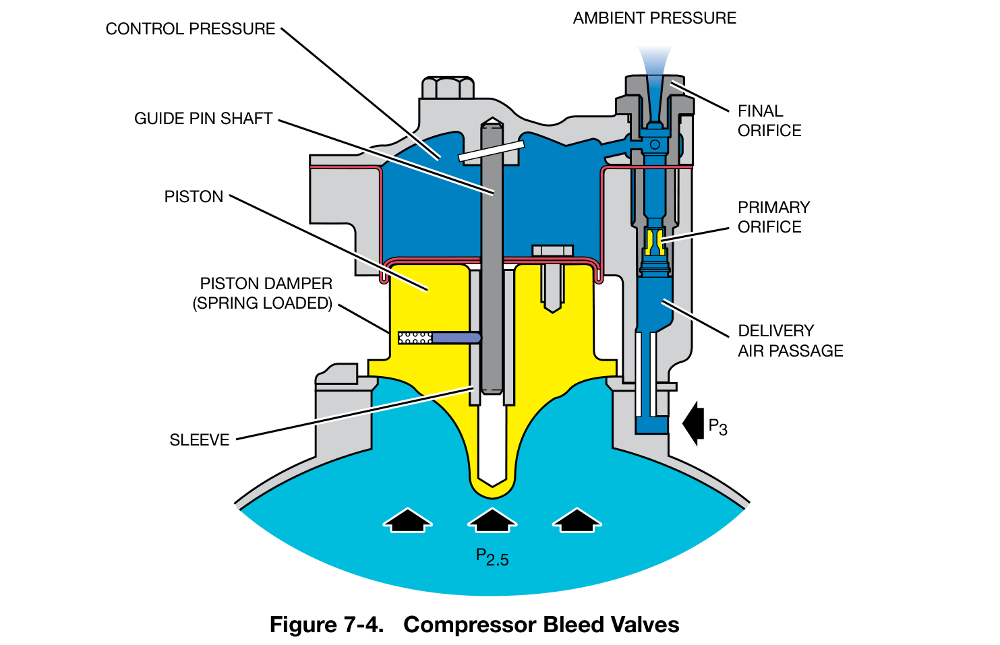

> **Nota do transcritor:** Válvulas de sangria fecham acima de aproximadamente 90% N1.

Fac-símile da página física 120

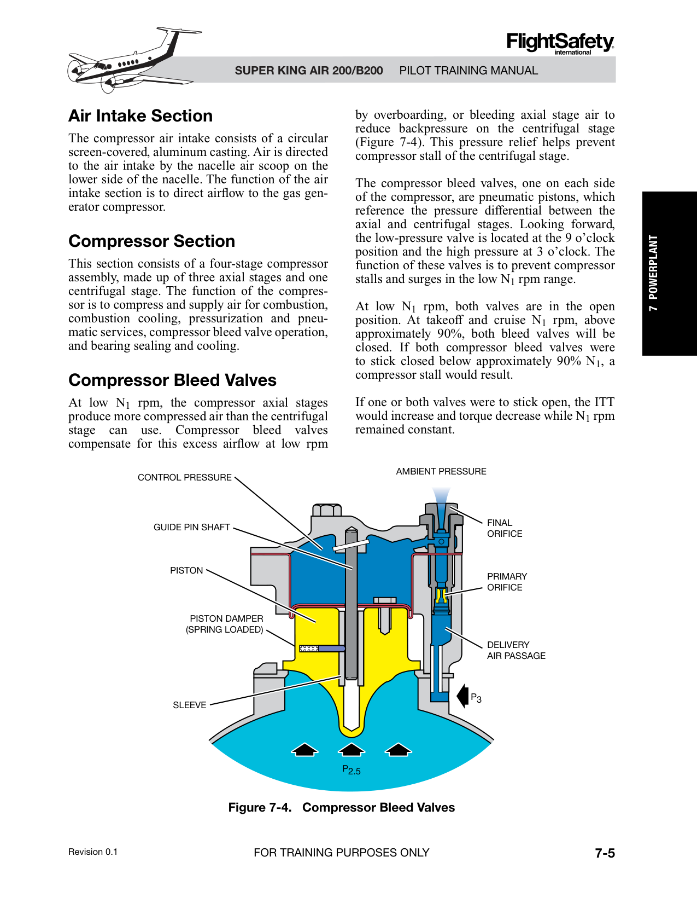

<!-- PTM:PAGE:120 END -->

<!-- PTM:PAGE:121 START -->
<!-- PTM:STATUS:revisada -->
## Página física 121 — 7-6

**Página física:** 121 · **Página impressa:** 7-6 · **Seção:** 7 Powerplant · [PDF](KA-200-B200-PTM.pdf#page=121)

##### Combustion Section

The PT6 engine utilizes an annular combustion chamber. Two, high-energy igniter plugs are installed in the combustion chamber, as well as 14 equally-spaced simplex fuel nozzles.

##### Turbine Section

The PT6A uses three reaction turbines: a free, two-stage axial propeller (power) turbine and a single-stage compressor turbine. The two-stage power turbine extracts energy from the combustion gases to drive the propeller and its accessories through the planetary reduction gears. This combination is defined as NP. The single-stage compressor turbine extracts energy from the combustion gases to drive the gas generator compressor and the accessory gear section. This combination is defined as N1.

##### Exhaust Section

This section is located immediately aft of the reduction gear section and it consists of an annu-lar exit plenum, a heat-resistant cone, and two exhaust outlets at the 9 o’clock and 3 o’clock positions.

##### Reduction Gear Section

The reduction gear section at the front of the engine is a two-stage, planetary type. The primary function of the reduction gear section is to reduce the high rpm of the free turbine to the value required for propeller operation.

The reduction gear section is also used for torquemeter operation and includes drive sections for the propeller governor (with fuel topping gov-ernor sensing), the propeller overspeed governor, and a propeller tachgenerator (Figure 7-2).

##### Accessory Section

The accessory drive section forms the aft portion of the engine. The accessory section is driven by the compressor turbine through a shaft that extends aft through the oil tank to the accessory gearbox.

The function of the accessory section is to drive the engine and airplane accessories, which include:

- Fuel control unit (FCU) and high-pressure fuel pump

- Lubricating pump/scavenge pumps

- N1 tachgenerator

- DC starter-generator

- Refrigerant compressor (right engine only)

- Low-pressure fuel boost pump

Other drive pads are provided for optional opera-tor equipment (Figure 7-2).

##### OPERATING PRINCIPLES

When the engine is rotating (Figure 7-5), air is inducted through the nacelle air scoop to the engine air intake. Airflow is turned 180° in a forward direction and is then progressively increased in pressure by a three-stage axial-flow and single-stage centrifugal-flow compressor. It is then directed forward through diffuser ducts towards the forward side of the combustion chamber. The airflow is again turned 180° and enters the combustion chamber, where metered fuel is added to the air by 14 fuel spray nozzles. Two high-energy igniter plugs ignite the gas mixture. The expanding gases move rearward through the combustion chamber and turn 180° forward to enter the turbine section. The compressor turbine extracts sufficient energy from the expanding gases to drive the four-stage compressor and the accessory gear section. The remaining two stages of the free power turbine extract the maximum amount of the remaining energy from the combustion gases to drive the propeller and the propeller accessories through the reduction gearbox. The two-stage power turbine is a free turbine and is only aerodynamically (not mechanically) connected to the gas generator. The gases from the turbine continue forward into an exhaust plenum where they are directed to the atmosphere by exhaust nozzles at the 9 o’clock and 3 o’clock positions on the exhaust section of the engine.

Fac-símile da página física 121

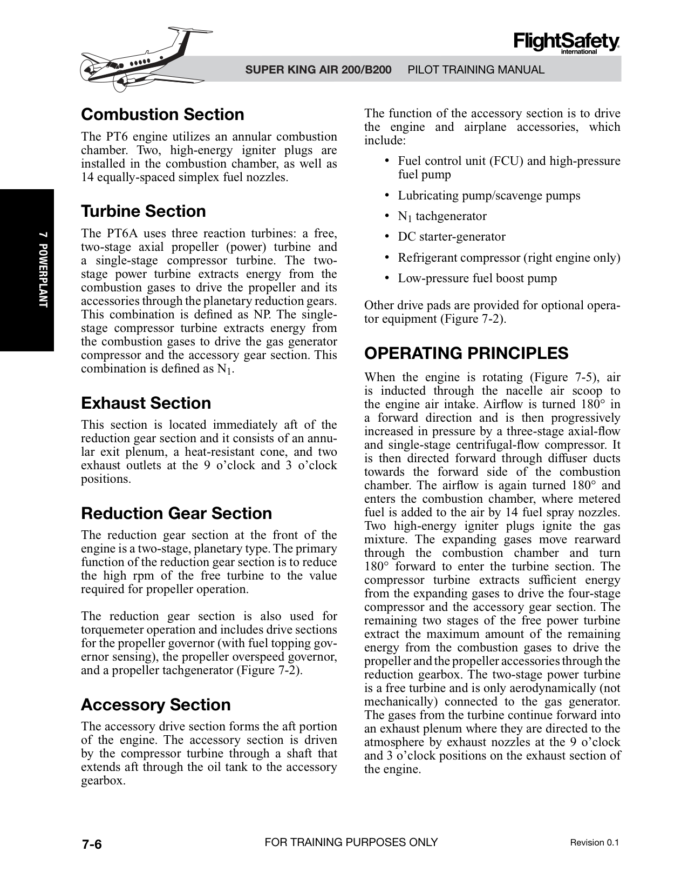

<!-- PTM:PAGE:121 END -->

<!-- PTM:PAGE:122 START -->
<!-- PTM:STATUS:revisada -->
## Página física 122 — 7-7

**Página física:** 122 · **Página impressa:** 7-7 · **Seção:** 7 Powerplant · [PDF](KA-200-B200-PTM.pdf#page=122)

**Figure 7-5. Engine Gas Flow and Stations**

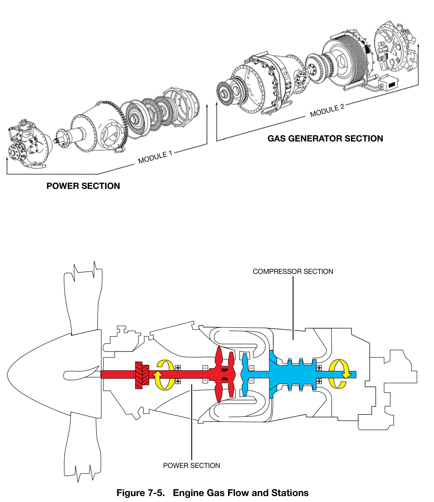

Fac-símile da página física 122

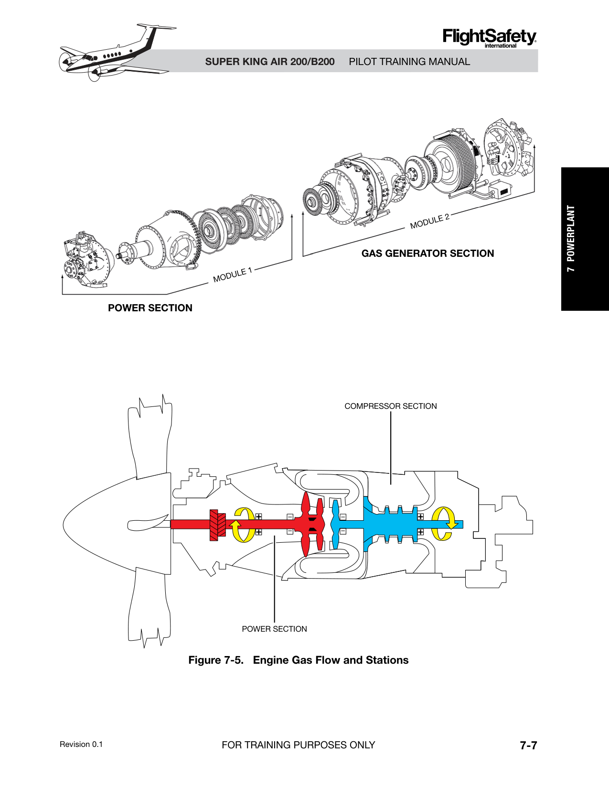

<!-- PTM:PAGE:122 END -->

<!-- PTM:PAGE:123 START -->
<!-- PTM:STATUS:revisada -->
## Página física 123 — 7-8

**Página física:** 123 · **Página impressa:** 7-8 · **Seção:** 7 Powerplant · [PDF](KA-200-B200-PTM.pdf#page=123)

#### ENGINE LUBRICATION SYSTEM

##### GENERAL

The engine lubrication system is a completely self-contained and fully automatic system. It provides for cooling and lubrication of the engine bearings and the reduction and accessory drive gears, and for operation of the propeller control system, the torquemeter system, the torque limiter, and the fuel heater system.

The engine oil system is a dry-sump system con-sisting of pressure, scavenge, and centrifugal air breather systems.

##### OIL TANK

The oil tank forms an integral part of the engine, located between the aft end of the compressor air inlet and the forward end of the accessory gearbox.

A filler and dipstick are located at the 11 o’clock position on the accessory case. The oil tank is vented to a centrifugal breather to provide for air-oil separation.

##### PUMPS

The oil pumps consist of one pressure element and four scavenge elements. The pressure pump supplies lubrication pressure to the bearings and the accessory system drive gears. In addition, the pressure pump supplies oil to the propeller con-trol system, the torquemeter system, reduction gears and the torque limiter.

##### OIL COOLER

An oil radiator is located inside the lower nacelle for oil cooling. The oil cooling system is fully automatic and uses a thermal sensor to control the position of a door that regulates the flow of air through the oil cooler.

##### INDICATION

##### Engine Oil Pressure

Engine oil pressure is sensed by a transmitter in the pressure pump outlet line and supplied to a combination, pressure-temperature gage (Figure 7-6) on the engine instrument panel. The oil pres-sure system requires DC power.

##### Engine Oil Temperature

Oil temperature is sensed by a resistance bulb and transmitted to the same combination pres-sure/temperature gage (Figure 7-6) on the engine instrument panel. The power supply for the gage is from the DC power system.

##### Chip Detection

For BB-1439, 1444 and subsequent, the caution annunciator panel contains two amber lights marked L CHIP DETECT and R CHIP DETECT (Figure 7-7). Prior to BB-1444, except 1439, these are red lights on the warning annunciator panel. They are operated by a magnetic chip detector located at the bottom of each reduction gearbox.

When either light illuminates, it indicates that ferrous metal particles in the oil have been attracted to the chip detector magnets.

**Figure 7-6. Oil Pressure/Temperature Gages**

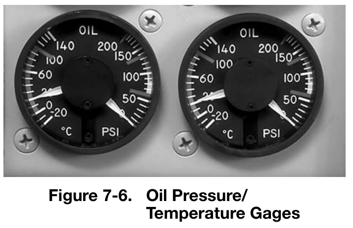

> **Nota do transcritor:** Sistema de óleo e detecção de partículas preservados.

Fac-símile da página física 123

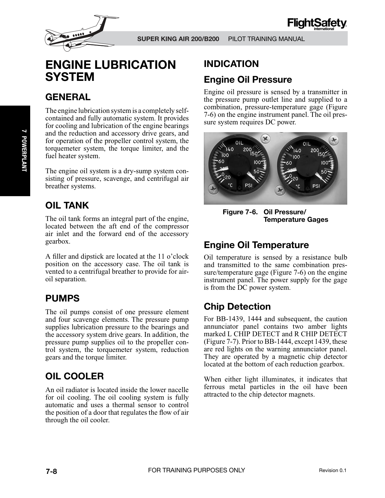

<!-- PTM:PAGE:123 END -->

<!-- PTM:PAGE:124 START -->
<!-- PTM:STATUS:revisada -->
## Página física 124 — 7-9

**Página física:** 124 · **Página impressa:** 7-9 · **Seção:** 7 Powerplant · [PDF](KA-200-B200-PTM.pdf#page=124)

##### FUEL HEATER

Oil scavenged from the accessory gearcase is directed through an oil-to-fuel heater prior to its return to the oil tank.

##### OPERATION

When the engine is running, the oil pressure pump (Figure 7-8) draws oil from the tank, devel-ops a higher pressure with the oil, and directs pressure oil through various filters to the engine bearings, the accessory and reduction drive gears, the propeller governor, and the engine torqueme-ter system. Oil pressure is regulated and limited by a relief valve. Oil pressure and temperature are sensed and transmitted to the cockpit gages. All oil is scavenged to the accessory gearcase except the reduction gearcase oil, which goes directly to the oil cooler. A screened scavenge pump returns the gearcase oil to the tank through the oil-fuel heater; another scavenge pump scavenges oil from the reduction gearcase and returns this oil to the tank through the oil cooler.

#### ENGINE FUEL SYSTEM

##### GENERAL

The engine fuel system consists of an oil-to-fuel heater, an engine-driven, high-pressure fuel pump, an engine-driven, low-pressure boost pump, a fuel control unit (FCU), a flow divider, and two fuel manifolds each with seven simplex fuel nozzles.

##### INDICATION

##### Fuel Pressure

The warning annunciator panel red lights marked L FUEL PRESS and R FUEL PRESS (Figure 7-9) are operated by pressure switches that sense outlet pressure at the engine-driven boost (LP) pump. The lights will come on to indicate abnor-mally low (10 ± 1 psi) fuel pressure to the (HP) engine pump.

##### Fuel Flow

Fuel flow information is sensed by a transmit-ter in the engine fuel supply line and supplied to the fuel flow gages (Figure 7-10) on the center instrument panel. For BB-225 airplanes and sub-sequent, they are DC powered. Prior to BB-225, these fuel flow gages are AC powered.

**Figure 7-7. Chip Detection Lights**

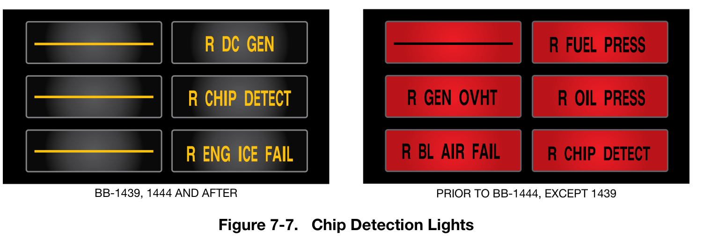

> **Nota do transcritor:** Figura 7-7 mostra CHIP DETECT em âmbar/vermelho conforme série.

Fac-símile da página física 124

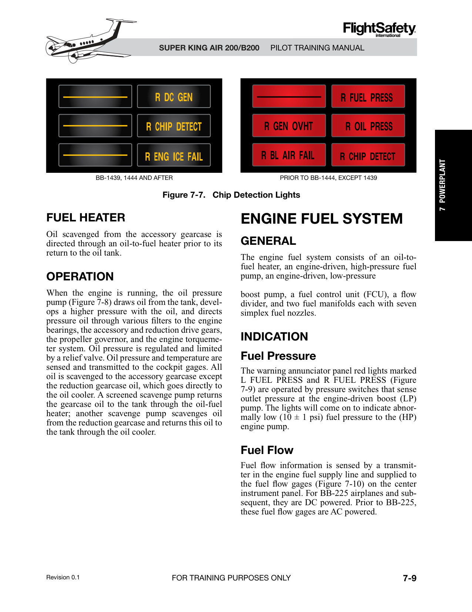

<!-- PTM:PAGE:124 END -->

<!-- PTM:PAGE:125 START -->
<!-- PTM:STATUS:revisada -->
## Página física 125 — 7-10

**Página física:** 125 · **Página impressa:** 7-10 · **Seção:** 7 Powerplant · [PDF](KA-200-B200-PTM.pdf#page=125)

**Figure 7-8. Oil System Schematic**

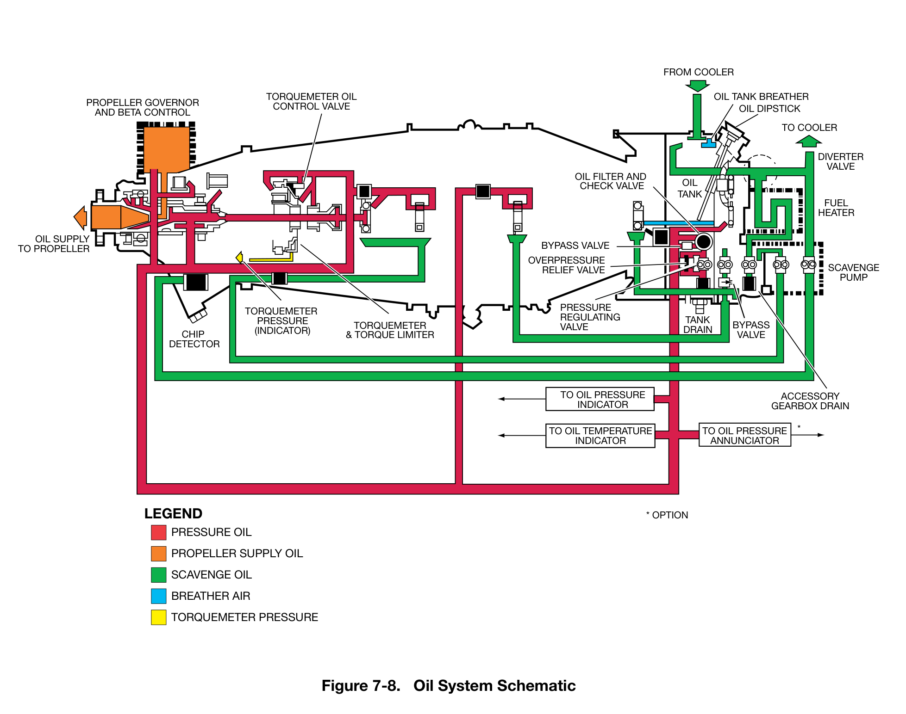

*Detalhe girado 90° no sentido horário apenas para leitura; o fac-símile abaixo mantém a orientação original.*

> **Nota do transcritor:** Esquema de óleo girado para leitura; legenda e cores preservadas.

Fac-símile da página física 125

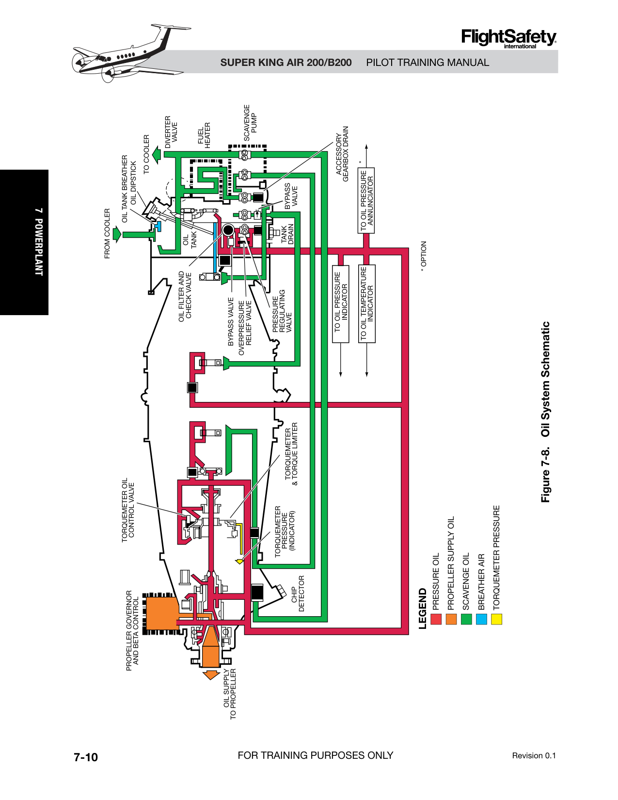

<!-- PTM:PAGE:125 END -->

<!-- PTM:PAGE:126 START -->
<!-- PTM:STATUS:revisada -->
## Página física 126 — 7-11

**Página física:** 126 · **Página impressa:** 7-11 · **Seção:** 7 Powerplant · [PDF](KA-200-B200-PTM.pdf#page=126)

##### FUEL SYSTEM OPERATION

The fuel control system for PT6A engines is essentially a fuel governor that increases or decreases fuel flow to the engine to maintain selected engine operating speeds. At first glance, the system may appear quite complicated. The engine fuel control system consists of the main components shown in Figure 7-11. They are the primary low-pressure boost pump, oil-to-fuel heat exchanger, high-pressure fuel pump, fuel control unit, fuel cutoff valve, fuel flow transmitter, flow divider, and dual fuel manifold with 14 simplex nozzles.

The low-pressure boost pump is engine-driven and operates when the gas generator shaft (N1) is turning, to provide sufficient fuel head pressure to the high-pressure pump to maintain proper cooling and lubrication. The oil-to-fuel heat exchanger uses warm engine oil to maintain a desired fuel temperature at the fuel pump inlet to prevent icing at the pump filter. This is done with automatic temperature sensors and requires no action by the pilot.

Fuel enters the engine fuel system through the oil-to-fuel heat exchanger, and then flows into the high-pressure engine-driven fuel pump, and on into the fuel control unit (FCU).

The high-pressure fuel pump is an engine-driven gear-type pump with an inlet and outlet filter. Flow rates and pressures will vary with gas generator (N1) rpm. Its primary purpose is to provide sufficient pressure at the fuel nozzles for a good spray pattern at all modes of engine operation. The high-pressure pump supplies fuel at approximately 800 psi to the fuel side of the FCU.

Two valves included in the FCU ensure consistent and cool engine starts. When the ignition or start system is energized, the purge valve is electrically opened to clear the FCU of vapors and bubbles. The excess fuel flows back to the nacelle fuel tank. The spill valve, referenced to atmospheric pressure, adjusts the fuel flow for cooler high-altitude starts.

Between the FCU fuel valve and the engine combustion chamber, and part of the FCU, a minimum pressurizing valve cuts off fuel flow during starts until fuel pressure builds sufficiently to maintain a proper spray pattern in the combustion chamber. About 70 psi is required to open the minimum-pressurizing valve. The engine-driven high-pressure fuel pump maintains this required pressure. If the pump should fail, the valve would close and the engine would flame out.

**Figure 7-9. Fuel Low-Pressure Lights**

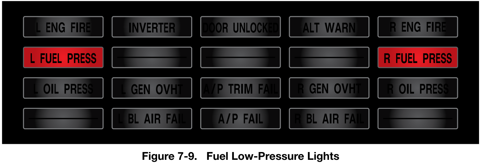

**Figure 7-10. Fuel Flow Gages**

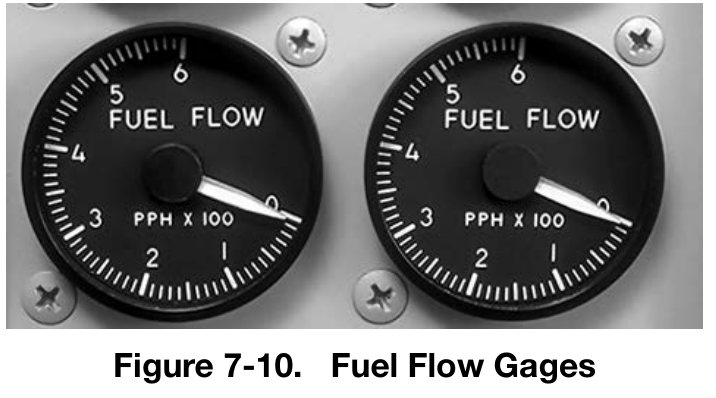

Fac-símile da página física 126

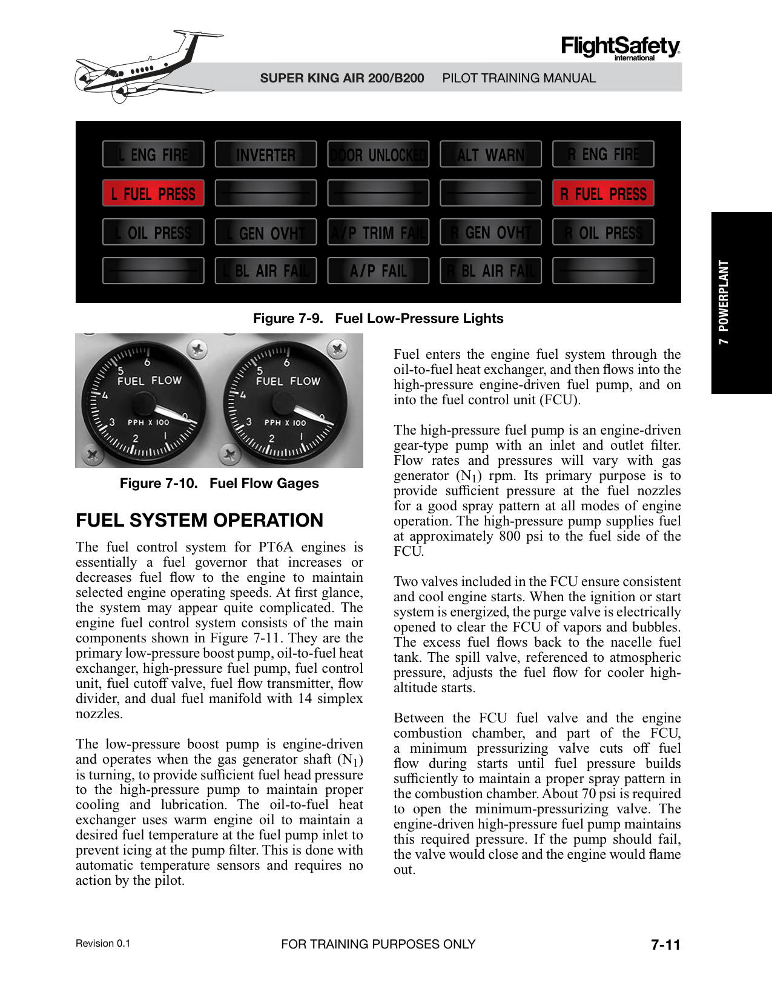

<!-- PTM:PAGE:126 END -->

<!-- PTM:PAGE:127 START -->
<!-- PTM:STATUS:revisada -->
## Página física 127 — 7-12

**Página física:** 127 · **Página impressa:** 7-12 · **Seção:** 7 Powerplant · [PDF](KA-200-B200-PTM.pdf#page=127)

**Figure 7-11. Fuel Schematic**

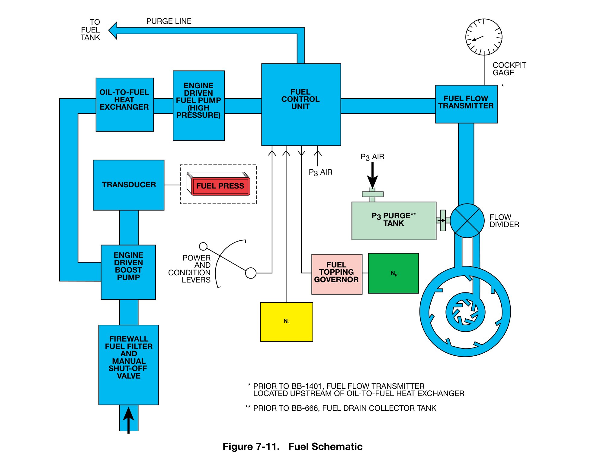

*Detalhe girado 90° no sentido horário apenas para leitura; o fac-símile abaixo mantém a orientação original.*

> **Nota do transcritor:** Esquema de combustível girado; notas BB-1401/BB-666 preservadas.

Fac-símile da página física 127

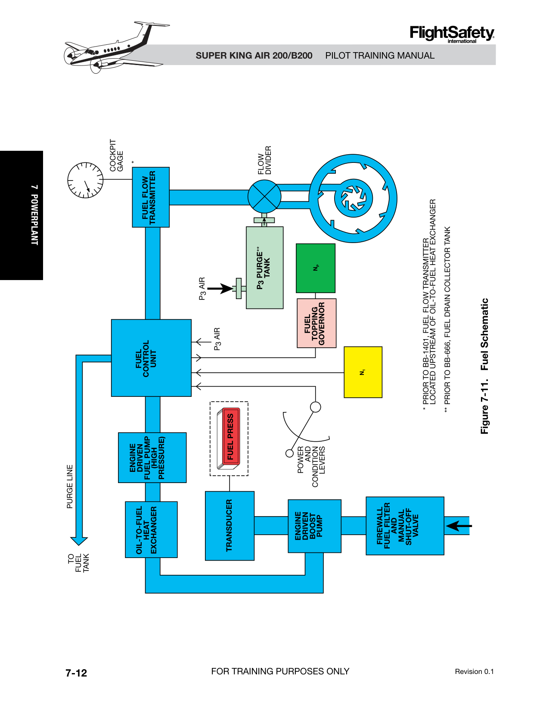

<!-- PTM:PAGE:127 END -->

<!-- PTM:PAGE:128 START -->
<!-- PTM:STATUS:revisada -->
## Página física 128 — 7-13

**Página física:** 128 · **Página impressa:** 7-13 · **Seção:** 7 Powerplant · [PDF](KA-200-B200-PTM.pdf#page=128)

aDownstream from the minimum pressurizing valve in the FCU is the fuel cutoff valve. The condition lever controls this valve, either open or closed. There is no intermediate position of this valve. For starting, fuel flows initially through the flow divider valve to the primary fuel spray nozzles in the combustion chamber. As the engine accelerates through approximately 40% N1, fuel pressure is sufficient to open the transfer valve to the secondary fuel nozzles. At this time all 14 nozzles are delivering atomized fuel to the combustion chamber. This progressive sequence of primary and secondary fuel nozzle operation provides cooler starts. On engine startups, there is a definite surge in N1 speed when the secondary fuel nozzles cut in.

In order to improve cold weather starting, SB-3214 changed seven primary and seven secondary nozzles to 10 primary and four secondary. At a later date, SB-3250 changed the nozzles back to seven and seven, but with a different arrangement and an improved burner can.

During engine shutdown on BB-666 and sub-sequent, any fuel left in the manifold is forced out through the nozzles and into the combustion chamber by purge tank pressure. As the fuel is burned, a momentary surge in N1 rpm should be observed. The entire operation is automatic and requires no input from the crew. On BB-2 through BB-665, an EPA collector tank is used instead of the purge tank system.

##### FUEL CONTROL UNIT (FCU)

##### General

The fuel control unit (Figure 7-12), which is normally referred to as the FCU, has multiple functions, but its main purpose is to meter the proper fuel amount to the nozzles in all modes of engine operation. It is calibrated for starting flow rates, acceleration, and maximum power. The FCU compares gas generator speed (N1) with the power lever setting and regulates fuel to the engine fuel nozzles. The FCU also senses compressor section discharge pressure, compares it to rpm, and establishes acceleration and deceleration fuel flow limits.

Fuel flow to the engine is dependent on the position of the fuel cutoff valve, which is manually operated by the condition lever in the cockpit. In addition, the minimum pressurizing valve prevents fuel flow to the engine until the fuel pressure has increased enough to ensure proper atomization of the fuel at the nozzles. Once the minimum pressure valve has opened, fuel will flow to the flow divider and the fuel nozzles.

Aside from opening and closing the fuel cut-off valve, the condition lever adjusts N1 speed from LOW IDLE to HIGH IDLE. The power lever, by adjusting the governor position in the FCU, adjusts the fuel-metering valve to allow more or less fuel to the spray nozzles. In sum-mary, the power lever controls fuel to the engine by adjusting the governor position, which in turn repositions the fuel-metering valve in the FCU.

##### FCU Operation

The pneumatic section of the FCU determines the flow rate of fuel to the engine for all operations. The power levers control engine power from idle through takeoff power by operation of the gas generator (N1) governor in the FCU. Increasing N1 rpm results in increased engine power.

For explanation purposes, consider the N1 governor bellows as a diaphragm. P3 air is introduced into the bellows in a manner that sets up a differential pressure on each side of the diaphragm. Therefore, any change in P3 pressure will move the diaphragm. When pressure is increased, the fuel-metering valve attached to the bellows will move in an opening direction to increase fuel flow and increase N1 rpm.

As P3 pressure decreases, fuel flow also decreases which reduces the N1 rpm. The N1 governor increases or decreases P3 pressure in the bellows by varying the opening of relief orifices in the bellows.

The FCU controls engine power by maintaining the requested N1 rpm through the N1 governor. If actual N1 rpm is lower than the desired setting, the N1 governor closes the P3 orifice, allowing pressure to increase. As the pressure increases,

> **Nota do transcritor:** Início “aDownstream” mantido como impresso; texto continua após a figura da p. 129, na p. 130.

Fac-símile da página física 128

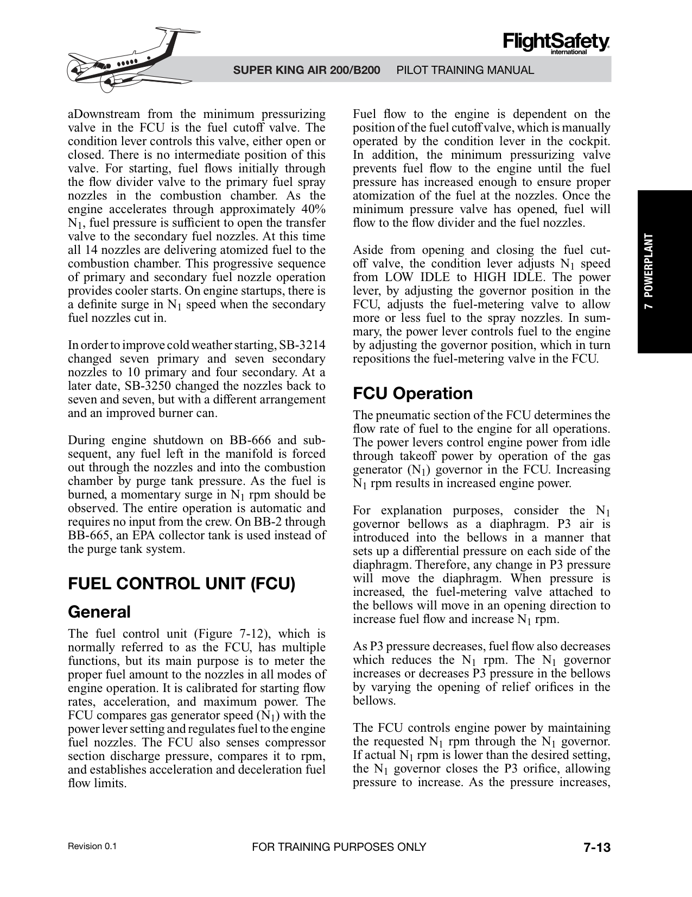

<!-- PTM:PAGE:128 END -->

<!-- PTM:PAGE:129 START -->
<!-- PTM:STATUS:revisada -->
## Página física 129 — 7-14

**Página física:** 129 · **Página impressa:** 7-14 · **Seção:** 7 Powerplant · [PDF](KA-200-B200-PTM.pdf#page=129)

**Figure 7-12. Simplified Fuel Control Schematic**

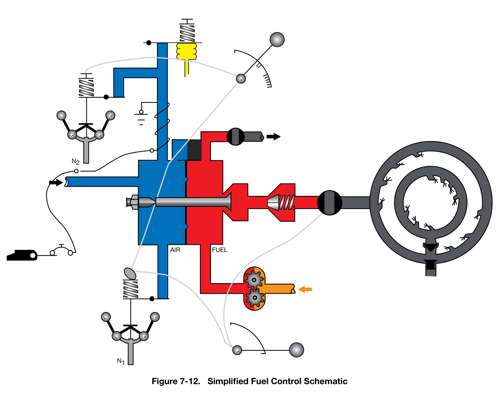

*Detalhe girado 90° no sentido horário apenas para leitura; o fac-símile abaixo mantém a orientação original.*

> **Nota do transcritor:** Esquema FCU girado para leitura.

Fac-símile da página física 129

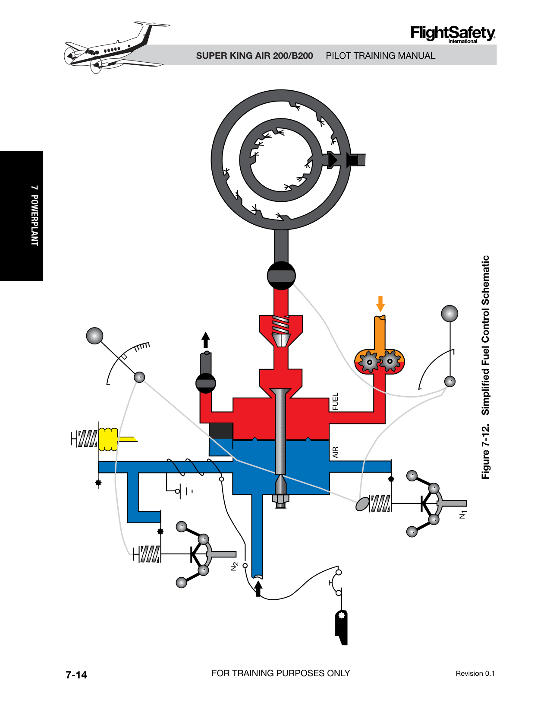

<!-- PTM:PAGE:129 END -->

<!-- PTM:PAGE:130 START -->
<!-- PTM:STATUS:revisada -->
## Página física 130 — 7-15

**Página física:** 130 · **Página impressa:** 7-15 · **Seção:** 7 Powerplant · [PDF](KA-200-B200-PTM.pdf#page=130)

the diaphragm moves to open the metering valve, increasing fuel flow, which in turn increases N1 rpm to the speed requested by the governor. When N1 rpm reaches the desired speed, the governor adjusts the P3 orifice to reduce pneumatic pressure to match the fuel pressure required to maintain the desired N1 rpm.

The fuel topping (power turbine) governor pro-tects against power turbine overspeed. If an overspeed occurs, and the propeller goes beyond 106% of the requested propeller rpm, the fuel topping governor vents air to reduce fuel flow. Reducing fuel flow decreases N1 speed and accordingly power turbine speed. With propellers in reverse, the fuel-topping governor restricts fuel flow to approximately 95% of the requested pro-peller rpm.

#### ENGINE IGNITION SYSTEM

##### GENERAL

The engine ignition system is a high-energy, capacitance type consisting of a dual-circuit igniter box and two igniter plugs in the combus-tion chamber. The ignition system is divided into starting ignition and autoignition.

##### STARTING IGNITION

A three-position lever lock switch for each engine (Figure 7-13) controls this system. The switch is located on the left switch panel. It has three marked positions: ON–OFF–STARTER ONLY. The ON position (UP) is lever locked and it pro-vides for engine cranking and ignition operation. The STARTER ONLY position is a momentary (spring loaded to center hold down) position and it only provides for engine motoring. In this posi-tion, the igniters do not function.

##### AUTOIGNITION

The autoignition system is controlled by a two-position switch for each engine marked ARM and OFF (Figure 7-14). Turning on an AUTO IGNI-TION switch arms the igniter circuit to an engine torque switch that is normally open when the engine is developing more than 400 foot-pounds of torque. The system must be armed prior to takeoff and for all phases of flight, and it should be turned off only after landing. If engine torque drops to 400 foot-pounds or less when the autoig-nition is armed, the ignition system will energize to prevent engine flameout if the loss of power was caused by a momentary fuel or air interruption.

**Figure 7-13. Engine Start and Ignition Switches**

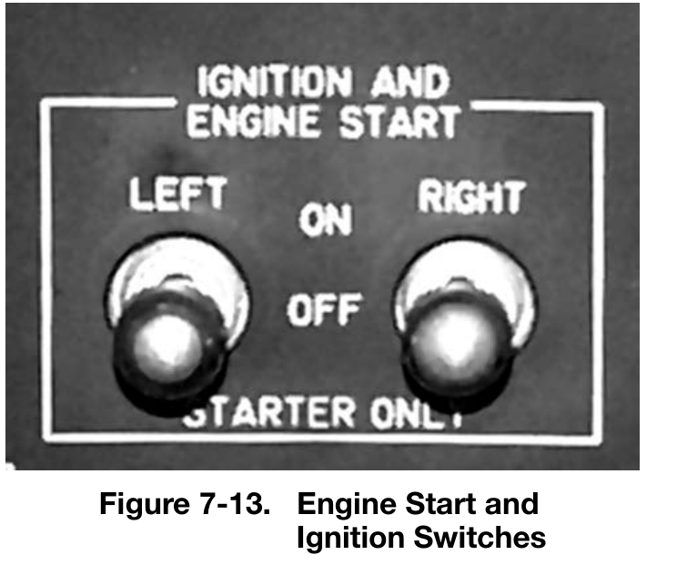

**Figure 7-14. Engine Autoignition Switches**

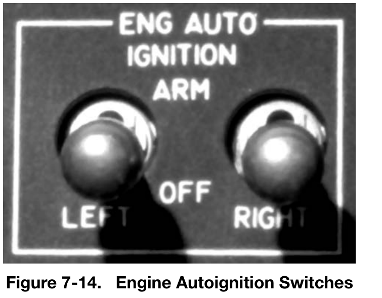

> **Nota do transcritor:** Continuação do texto da p. 128; fuel topping 106%/95% e autoignition 400 ft-lb mantidos.

Fac-símile da página física 130

<!-- PTM:PAGE:130 END -->

<!-- PTM:PAGE:131 START -->
<!-- PTM:STATUS:revisada -->
## Página física 131 — 7-16

**Página física:** 131 · **Página impressa:** 7-16 · **Seção:** 7 Powerplant · [PDF](KA-200-B200-PTM.pdf#page=131)

##### INDICATION

Green annunciator lights marked L and R IGNI-TION ON tells the pilot that the igniters are receiving power.

##### OPERATION

##### Starting Ignition

When DC power is available, turning on the igni-tion and engine start switch (Figure 7-15) will apply DC power to the ignition ON light, FCU purge valve, and to the ignition exciter. The exciter, which operates at three cycles per second, will apply high-energy power to the igniter plugs in the combustion chamber.

##### Autoignition

When the AUTO IGNITION switch (Figure 7-14) is at the ARM position, the ignition sys-tem is inactive as long as engine torque is above 400 foot-pounds. If torque decreases to 400 foot-pounds, the torque switch will close and apply DC power to the ignition ON light, the FCU purge valve, and to the ignition exciter. Ignition will be continuous until power increases above 400 foot-pounds.

#### PROPELLER

##### GENERAL

The PT6A engine drives a three- or four-blade, oil-operated propeller (Figure 7-16). A three

**Figure 7-15. Ignition System Schematic**

> **Nota do transcritor:** Texto continua após a figura da p. 132, na p. 133.

Fac-símile da página física 131

<!-- PTM:PAGE:131 END -->

<!-- PTM:PAGE:132 START -->
<!-- PTM:STATUS:revisada -->
## Página física 132 — 7-17

**Página física:** 132 · **Página impressa:** 7-17 · **Seção:** 7 Powerplant · [PDF](KA-200-B200-PTM.pdf#page=132)

**Figure 7-16. Propellers**

Fac-símile da página física 132

<!-- PTM:PAGE:132 END -->

<!-- PTM:PAGE:133 START -->
<!-- PTM:STATUS:revisada -->
## Página física 133 — 7-18

**Página física:** 133 · **Página impressa:** 7-18 · **Seção:** 7 Powerplant · [PDF](KA-200-B200-PTM.pdf#page=133)

blade Hartzell propeller is used on BB-2 through B-1192 and has a blade angle range of +90° to –9°. A three blade McCauley propeller is used on BB-1193 through 1438, and 1440 through 1443, and has a blade angle range of +86.8° to –10°. Airplanes BB-1439, 1444 through 1508 have a four-bladed McCauley propeller with a blade angle range of +87.5° to –10°. Airplanes BB-1509 and subsequent have a four-bladed Hartzell propeller with a blade angle range of +87.9° to –11°. The propeller control system provides for constant-speed operation, full feathering, reversing, and Beta mode control. Feathering is induced by counterweights and springs.

If an engine flames out in flight or if the pilot selects the condition lever to CUTOFF, the propeller will not feather because of the windmilling effect and governor action. Feathering in flight should be manually selected by using the propeller control lever.

A conventional oil-operated propeller governor achieves normal propeller operation in the con-stant speed range. A preset oil-operated overspeed governor is provided in case of failure of the nor-mal propeller governor. In addition to the normal and overspeed propeller governors, a fuel topping function, integral with the primary governor, pro-vides protection against propeller overspeed, as well as limiting rpm in the reverse ranges.

##### FEATHERING

Feathering is a function of counterweights attached to each blade root and spring forces in the propeller cylinder.

##### UNFEATHERING AND REVERSING

Unfeathering and reversing functions are done by hydraulic (engine oil) pressure developed by a high-pressure oil pump, which is an integral part of the propeller primary governor.

The Hartzell or McCauley propeller installed in the Super King Air operates in two modes: the propeller-governing constant-speed mode, and the ground fine/Beta-reverse propeller blade angle control mode.

##### BASIC PRINCIPLES

Constant-speed propellers operated in three con-ditions under the control of a propeller governor. These conditions are:

- Onspeed

- Overspeed

- Underspeed

##### Onspeed

Onspeed is defined as the condition of operation in which the selected rpm and actual rpm are the same.

##### Overspeed

Overspeed is the condition of operation in which the actual rpm is greater than the selected rpm.

##### Underspeed

Underspeed is the condition of operation in which the actual rpm is less than the selected rpm.

##### CONTROL

Speed (rpm) control is a function of the propeller governor. This unit is engine-driven and oper-ates on the principle of balancing two opposing forces, both of which are variables. These forces are speeder spring force and flyweight force.

##### Speeder Spring Force

Speeder spring force is a function of, and varied by, the position of the propeller control lever.

##### Flyweight Force

Flyweight force is a function of, and varied by, propeller rpm through a reduction gear section.

If the speeder spring force is greater than flyweight force, the propeller would be operating in an underspeed condition.

If the flyweight force is greater than speeder spring force, the propeller would be operating in an overspeed condition.

> **Nota do transcritor:** Grafia “B-1192” mantida; ângulos de pá por fabricante/série preservados. Continua na página física 134. Continuação da página física 131.

Fac-símile da página física 133

<!-- PTM:PAGE:133 END -->

<!-- PTM:PAGE:134 START -->
<!-- PTM:STATUS:revisada -->
## Página física 134 — 7-19

**Página física:** 134 · **Página impressa:** 7-19 · **Seção:** 7 Powerplant · [PDF](KA-200-B200-PTM.pdf#page=134)

When the speeder spring and flyweight forces are equal, the propeller is onspeed.

Unbalance of speeder spring and flyweight forces is used to position a pilot valve to accomplish the following:

- Direct governor boosted high oil pressure to the propeller servo piston to reduce the blade angle.

- Shut off governor-boosted high oil pressure to the propeller servo piston and connect the piston chamber to the oil sump, allow- ing the counterweights and propeller spring force to increase the blade angle, to include feather if desired. When the speeder spring and flyweight forces are equal, the pilot valve is positioned appropriately to main- tain a constant blade angle.

##### OVERSPEED CONTROL

The normal rpm control range of the primary governor is from 1,600 rpm to 2,000 rpm; the latter is 100% rpm.

If the primary governor fails to limit rpm to 2,000, a second (overspeed) governor, driven by the reduction gearbox, operates in parallel with the primary governor. This is called the over-speed governor. The overspeed governor has a preset speeder spring tension which limits pro-peller rpm to the preset limit of 2,120 rpm (prior to BB-1444, except 1439; 2,080 rpm), which is 106% (prior to BB-1444, except 1439; 104%) of the primary governor maximum setting. If the propeller blades stick or move too slowly failing to limit rpm, a fuel topping section of the primary governor will limit rpm to 106% of the propeller rpm selected by the propeller control lever (2,120 being the highest setting, propeller levers full forward).

##### Test System

The overspeed governor incorporates a test system controlled by a two-position switch (Figure 7-17) for both propellers. The switch is marked PROP GOV TEST. The switch is located on the pilot’s left subpanel (BB-2 through 162 had two switches).

A solenoid valve is associated with each over-speed governor. The valve is energized when the PROP GOV TEST switch is moved to the TEST position. When energized, the valve applies gov-ernor pump pressure to change the fixed value of the overspeed governor as listed above, to a range of from 1,830-1,910 rpm.

##### Operating Principles

With the engine running and the propeller con-trol lever full forward, moving the governor test switch to TEST will open a solenoid valve and admit primary governor pump pressure to a hydraulic reset valve on the overspeed gover-nor. Movement of the reset valve will raise the pilot valve, simulating an overspeed, and allow governor pump pressure to drain to the reduction gearcase through the pilot valve of the overspeed governor. If the power lever is advanced, the rpm should stabilize at the TEST reset value of the overspeed governor, which is between 1,830 and 1,910 rpm (Figure 7-18).

##### FUEL TOPPING (POWER TURBINE) GOVERNOR

If a mechanical failure causes the propeller to lock or stick, it will not respond to oil pressure changes. The primary and overspeed governors, although still operating normally, will be unable to control propeller rpm with oil pressure. The fuel topping governor (FTG), an integral part of the primary governor, acts to reduce fuel flow,

**Figure 7-17. PROP GOV TEST Switch**

> **Nota do transcritor:** Overspeed 2.120/2.080 rpm e teste 1.830–1.910 rpm mantidos. Continua na página física 135. Continuação da página física 133.

Fac-símile da página física 134

<!-- PTM:PAGE:134 END -->

<!-- PTM:PAGE:135 START -->
<!-- PTM:STATUS:revisada -->
## Página física 135 — 7-20

**Página física:** 135 · **Página impressa:** 7-20 · **Seção:** 7 Powerplant · [PDF](KA-200-B200-PTM.pdf#page=135)

which in turn reduces propeller rpm. With a locked propeller (fixed pitch propeller), a power reduction will control rpm as long as airspeed is not increased excessively.

The fuel-topping governor is designed to vent air pressure from the FCU, which results in a fuel flow reduction. The propeller rpm at which the FTG activates is determined by propeller control lever position. With the propeller locked, the FTG will reduce fuel flow when the overspeed reaches approximately 106% of the selected propeller rpm.

The FTG utilizes the same flyweights and pilot valve mechanism of the primary governor. If the primary governor fails, the fuel-topping governor will not be operational. The resultant overspeed will, however, be controlled by the backup over-speed governor.

##### REVERSE OPERATION

When full reverse is selected, the power levers send three commands:

1. Spool the compressor to 83% ± 5% N1 with a fuel flow increase.

2. Decrease the propeller blade angle to –9° or –10°.

3. Reset the FTG to 95% of the rpm selected by the propeller lever.

The maximum allowable propeller speed in reverse is 1,900 rpm; however, this is not an overspeed limitation for the propeller or power turbine. The 1,900-rpm limit, which is controlled by the FTG, assures that the propeller does not attain 2,000 rpm, which brings the propeller on speed and begins to interfere with the reverse operation.

**Figure 7-18. Propeller Governor Test Schematic**

> **Nota do transcritor:** Limite de reverso 1.900 rpm e comandos 83%±5%, –9°/–10°, 95% mantidos. Continuação da página física 134.

Fac-símile da página física 135

<!-- PTM:PAGE:135 END -->

<!-- PTM:PAGE:136 START -->
<!-- PTM:STATUS:revisada -->
## Página física 136 — 7-21

**Página física:** 136 · **Página impressa:** 7-21 · **Seção:** 7 Powerplant · [PDF](KA-200-B200-PTM.pdf#page=136)

##### BETA MODE CONTROL

Beta control defines a range of operation in which the pilot can reduce the residual idle thrust of the propeller by reducing blade angle. This reduction in blade angle and, therefore, propeller thrust, is accomplished by lifting the power levers aft into the ground fine range on BB-1439, 1444 and subsequent. For prior aircraft this is accomplished by lifting the power levers aft to a position just above the red and white lines (reverse range) on the throttle quadrant.

The propeller used in the King Air Series includes a Beta valve, which forms an integral part of the propeller governor. The pilot can mechanically position this valve, within a limited (ground) range, described above, to effect propeller blade angle changes. Propeller servo piston movement is fed back to the valve by a mechanical follow-up system to null the Beta valve when the blades reach the desired angle, and blade angle will remain constant until the pilot selects another angle.

##### PROPELLER OPERATING PRINCIPLES

##### Onspeed

When the upward force of the governor fly-weights (Figure 7-19) is equal to the downward force of the speeder spring, the governor pilot valve is positioned to shut off the governor pump pressure from the propeller piston and isolate the propeller cylinder from the gearcase drain. This, in effect, hydraulically locks the blades at a specific angle. This condition does not prevail for very long as changes in altitude, temperature, airspeed, and inherent leakage at the prop trans-fer sleeve require blade angle changes. In effect, in any constant-speed condition, the governor is hunting through a very narrow range to maintain the selected rpm.

##### Overspeed

When an overspeed occurs, the governor fly-weight force (Figure 7-20) exceeds the speeder spring force. This occurs when the propeller has accelerated above the selected rpm. The increased flyweight force will raise the governor pilot valve and reduce oil pressure at the propeller pis-ton, allowing the counterweights and spring to increase blade angle and decelerate the propeller until an onspeed condition occurs.

##### Underspeed

When an underspeed condition occurs, the pro-peller decelerates below the selected rpm and the speeder spring force overcomes the force of the flyweights (Figure 7-21). As a result, the pilot valve moves down and allows the governor pump to apply oil pressure to the propeller servo piston, resulting in a decrease in blade angle. This allows the propeller to accelerate until the flyweight force equals the speeder spring force and pressure is again restricted from the propeller servo piston.

Fac-símile da página física 136

<!-- PTM:PAGE:136 END -->

<!-- PTM:PAGE:137 START -->
<!-- PTM:STATUS:revisada -->
## Página física 137 — 7-22

**Página física:** 137 · **Página impressa:** 7-22 · **Seção:** 7 Powerplant · [PDF](KA-200-B200-PTM.pdf#page=137)

**Figure 7-19. Propeller Onspeed Schematic**

**Figure 7-20. Propeller Overspeed Schematic**

Fac-símile da página física 137

<!-- PTM:PAGE:137 END -->

<!-- PTM:PAGE:138 START -->
<!-- PTM:STATUS:revisada -->
## Página física 138 — 7-23

**Página física:** 138 · **Página impressa:** 7-23 · **Seção:** 7 Powerplant · [PDF](KA-200-B200-PTM.pdf#page=138)

##### POWERPLANT POWER CONTROL

The powerplant (engine-propeller combination) is controlled by the interaction of three levers (Figure 7-22): a condition lever, a power lever, and a propeller control lever.

##### Condition Lever

The condition lever (Figure 7-22) is mechanically connected to the FCU to operate a fuel cutoff valve that shuts off metered fuel to the fuel manifold.

The condition levers located on the power lever quadrant (last two levers on the right side) are in the center pedestal and have three designated positions: FUEL CUTOFF, LOW IDLE, and HIGH IDLE. The FUEL CUTOFF position will shut off fuel to the engine, and the LOW IDLE position will establish a fuel flow that will sus-tain 61% (56% in B200s prior to BB-1444, except 1439; or 52% in the PT6A-41) gas gen-erator, or N1 rpm. HIGH IDLE will establish a fuel flow that will sustain 70% N1 rpm. There is a progressive increase in fuel flow as the condition lever is moved from LOW IDLE to HIGH IDLE, and any rpm may be selected between LOW IDLE and HIGH IDLE.

##### Power Levers

Power levers (Figure 7-22) are located on the power lever quadrant (first two levers on the left side) on the center pedestal and they are mechanically interconnected through a cam box to the FCU, the Beta valve and follow-up mechanism, and the fuel topping (NP) governor. The power lever quadrant permits movement of the power lever in the forward thrust (Alpha) range from idle to maximum thrust and in the ground fine (Beta prior to BB-1444, except 1439) or reverse range from idle to maximum reverse. A detent in the power lever quadrant at the IDLE position prevents inadvertent movement of the lever into the ground fine (Beta prior to BB-1444, except 1439) or reverse range. The pilot must lift the power levers up and over this detent to select ground fine/Beta or reverse.

**Figure 7-21. Propeller Underspeed Schematic**

> **Nota do transcritor:** LOW IDLE 61%/56%/52% conforme série/motor; mantido. Continua na página física 140.

Fac-símile da página física 138

<!-- PTM:PAGE:138 END -->

<!-- PTM:PAGE:139 START -->
<!-- PTM:STATUS:revisada -->
## Página física 139 — 7-24

**Página física:** 139 · **Página impressa:** 7-24 · **Seção:** 7 Powerplant · [PDF](KA-200-B200-PTM.pdf#page=139)

**Figure 7-22. Powerplant Control Levers**

Fac-símile da página física 139

<!-- PTM:PAGE:139 END -->

<!-- PTM:PAGE:140 START -->
<!-- PTM:STATUS:revisada -->
## Página física 140 — 7-25

**Página física:** 140 · **Página impressa:** 7-25 · **Seção:** 7 Powerplant · [PDF](KA-200-B200-PTM.pdf#page=140)

The function of the power levers in the forward thrust (Alpha) range is to establish a gas genera-tor rpm through the gas generator governor (N1) and a fuel flow that will produce and maintain the selected N1 rpm. In the ground fine (Beta) range, the power levers are used to reduce the propeller blade angle, thus reducing residual prop thrust. In the reverse range, the power lever functions to:

1. Select a blade angle proportionate to the aft travel of the lever.

2. Select a fuel flow that will sustain the selected reverse power.

3. Reset the fuel topping governor (NP) from its normal 106% to a range of approxi-mately 95%.

##### Ground Fine (Beta) and Reverse Control

The geometry of the power lever linkage (Fig-ure 7-23) through the cam box is such that power lever increments from idle to full forward thrust have no effect on the position of the Beta valve. When the power lever is moved from idle into the reverse range, which requires the power levers to be lifted over a second gate in BB-1439, 1444 and subsequent, it positions the Beta valve to direct governor pressure to the propeller piston, decreas-ing blade angle through zero into a negative range (Figure 7-23). The travel of the propeller servo piston is fed back to the Beta valve to null its posi-tion and, in effect, provide many negative blade angles all the way to full reverse. The opposite will occur when the power lever is moved from full reverse to any forward position up to idle, therefore providing the pilot with manual blade angle control for ground handling.

**Figure 7-23. Beta and Reverse Control**

> **Nota do transcritor:** Figura 7-23 mostra 2.080 rpm normal e ~1.870 rpm em teste; não harmonizado com o texto. Continuação da página física 138.

Fac-símile da página física 140

<!-- PTM:PAGE:140 END -->

<!-- PTM:PAGE:141 START -->
<!-- PTM:STATUS:revisada -->
## Página física 141 — 7-26

**Página física:** 141 · **Página impressa:** 7-26 · **Seção:** 7 Powerplant · [PDF](KA-200-B200-PTM.pdf#page=141)

##### Propeller Control Lever

The propeller control lever (Figure 7-24) operates in the throttle quadrant (the two center levers) on the center pedestal and it is mechanically con-nected to the primary propeller governor. In the forward thrust, or constant-speed range, the pro-peller control lever selects rpm from low rpm to high rpm (1,600 to 2,000 rpm) by changing the setting of the primary propeller governor. The propeller control lever is also used to feather the propeller by moving the lever aft into the feather detent position. This action positions the primary propeller governor’s pilot valve to dump oil from the propeller servo piston chamber and allows the propeller counterweights and springs to move the propeller blades to the full feather position. A detent (requiring more force to overcome) at the low rpm position, prevents inadvertent movement of the propeller lever into the feather range.

##### Friction Control

Four friction locks (Figure 7-25) are located on the center pedestal. Turning the knobs counter-clockwise will reduce friction on the powerplant control levers. Clockwise rotation will increase friction or lock the levers in any desired position.

##### ENGINE INSTRUMENTATION

##### Engine Temperature (ITT) Gages

Engine operating temperature at station T5 is sensed by eight thermocouple probes located between the gas generator turbine and the first stage power turbine. The probes are connected in parallel to provide the best average reading.

Interstage turbine temperature (ITT) measurement is calibrated to provide a very accurate reading. This is done by a temperature trimmer located on top of the engine. This temperature trimmer is connected in parallel with the ITT harness, and it is factory preset.

The temperature sensed by the thermocouples is sent to gages (Figure 7-27) on the center instru-ment panel calibrated in degrees Celsius and designated ITT. On BB-1484, 1486 and subse-quent, the gages use DC power. Prior to BB-1486, excluding BB-1484, the gages are self-energizing and do not require DC power.

##### Engine Power (Torque)

Engine power is a measurement of that portion of the power developed by the engine that is transmitted to the propeller. This power is measured in foot-pounds and is designated as engine TORQUE.

**Figure 7-25. Friction Control Knobs**

**Figure 7-24. Propeller Control Lever**

> **Nota do transcritor:** Texto remete ITT a “Figure 7-27”, mas a figura dos gages ITT é 7-26; mantido.

Fac-símile da página física 141

<!-- PTM:PAGE:141 END -->

<!-- PTM:PAGE:142 START -->
<!-- PTM:STATUS:revisada -->
## Página física 142 — 7-27

**Página física:** 142 · **Página impressa:** 7-27 · **Seção:** 7 Powerplant · [PDF](KA-200-B200-PTM.pdf#page=142)

The ring gear of the first-stage planetary reduction gearbox is fixed in rotary direction, but it can move a limited amount in axial direction because of helical splines. Therefore, the first-stage ring gear is a reaction member that reacts to an increase or decrease of applied torque by moving aft as engine torque is increased and moving forward as engine torque is decreased. This axial motion of the ring gear is balanced by oil pressure in a metered chamber called a torquemeter chamber.

The pressure in the torquemeter chamber is sensed by a transmitter and sent to a gage (Figure 7-27) on the engine instrument panel that is calibrated in foot-pounds of torque times 100. The torquemeter chamber receives a supply of oil at a relatively constant pressure from the engine lubricating system. On BB- 1484, 1486 and subsequent, the gages use DC power. Prior to BB-1486, except 1484, it is powered by the 26-volt AC bus.

##### Torque Limiter

Engine torque is automatically limited to a preset value by a torque limiter that is supplied with a torque pressure signal from the torquemeter.

At a predetermined torque pressure of 2,368 to 2,447 foot-pounds, the torque limiter will bleed off and change the pneumatic servo pressures in the fuel control unit. This action reduces metered fuel flow and, consequently, gas generator power to the preset limit of the torque limiter. The sys-tem is designed only to protect the nose gearbox and reduction gearing from excessive torque. It will not prevent a pilot from exceeding the certi-fied maximum torque of 2,230 foot-pounds.

**Figure 7-26. ITT Gages**

**Figure 7-27. Torque Gages**

> **Nota do transcritor:** Torque limiter 2.368–2.447 ft-lb e máximo certificado 2.230 ft-lb mantidos.

Fac-símile da página física 142

<!-- PTM:PAGE:142 END -->

<!-- PTM:PAGE:143 START -->
<!-- PTM:STATUS:revisada -->
## Página física 143 — 7-28

**Página física:** 143 · **Página impressa:** 7-28 · **Seção:** 7 Powerplant · [PDF](KA-200-B200-PTM.pdf#page=143)

##### Propeller RPM

Propeller rpm output is sent to a gage (Figure 7-28) on the engine instrument panel calibrated directly in propeller revolutions per minute. On BB-1484, 1486 and subsequent, DC power is required. Prior to BB-1486, except BB-1484, these gages do not require aircraft DC electrical power, as they are operated by tachgenerators.

##### Engine RPM (N1)

Engine or gas generator (N1) rpm is also sent to a gage (Figure 7-29) on the engine instrument panel. The gage is calibrated in percentage of design 100% rpm. On BB-1484, 1486 and subsequent, DC power is required. It does not require air-craft electrical power prior to BB-1484 including BB-1485 as they are powered by tachgenerators.

##### SYNCHROSCOPE

A synchroscope (Figure 7-30) with black and white cross patterns is located on the lower right corner of the pilot’s instrument panel to aid in manual propeller synchronization. The disc will rotate in the direction of the higher rpm engine. The disc will stop rotating when the engines are synchronized. Input signals to the synchroscope are from the propeller tachgenerators.

**Figure 7-28. Propeller RPM Gages**

**Figure 7-29. Engine RPM Gages**

**Figure 7-30. Propeller Synchroscope and Switches (Type II)**

> **Nota do transcritor:** Redação sobre alimentação dos gages N1 “prior to BB-1484 including BB-1485” mantida.

Fac-símile da página física 143

<!-- PTM:PAGE:143 END -->

<!-- PTM:PAGE:144 START -->
<!-- PTM:STATUS:revisada -->
## Página física 144 — 7-29

**Página física:** 144 · **Página impressa:** 7-29 · **Seção:** 7 Powerplant · [PDF](KA-200-B200-PTM.pdf#page=144)

##### SYNCHROPHASING

##### General

Two synchrophasing systems are available. They are identified as Type I and Type II systems.

##### Type II System (BB-935 and Subsequent)

The Type II synchrophaser system is an electronic system, certified for takeoff and landing (Figure 7-31). It functions to match the rpm of both propellers and establish a blade phase relationship between the right and left propellers to reduce cabin noise to a minimum.

The system can not reduce rpm of either propeller below the datum selected by the propeller control lever. Therefore, there is no indicating light asso-ciated with the Type II system.

##### Control

The system is controlled by a two-position switch (Figure 7-30) located on the lower right side of the pilot’s instrument panel.

##### Operation Type II System

Turning the control switch on will supply DC power to the electronic control box. Input sig-nals representing propeller rpm are received from magnetic pickups on each propeller. The com-puted input signals are corrected to a command signal and sent to an rpm trimming coil located on the propeller governor of the slow engine and its (propeller) rpm is adjusted to that of the other propeller.

###### NOTE If the synchrophaser is on and fails to synchronize the propellers, turn it off, then manually synchronize the propel- lers and turn it back on.

**Figure 7-31. Type II System Schematic**

Fac-símile da página física 144

<!-- PTM:PAGE:144 END -->

<!-- PTM:PAGE:145 START -->
<!-- PTM:STATUS:revisada -->
## Página física 145 — 7-30

**Página física:** 145 · **Página impressa:** 7-30 · **Seção:** 7 Powerplant · [PDF](KA-200-B200-PTM.pdf#page=145)

##### Type I System BB-2 through BB-934

The Type I system uses the master-slave concept (Figure 7-32). The left propeller is the master propeller and the right propeller is the slave. The system functions to adjust the rpm of the right propeller to that of the left, within a limited rpm range and at the same time it provides a specific blade phase relationship between the left and right propellers. The overall effect of the synchro-phaser system is to reduce noise level in the cabin to a low value.

##### Control

System control is achieved by a two-position switch (Figure 7-33) on the lower right side of the pilot’s instrument panel. Being a master slave system, it should be off during ground operation, takeoff, and landing, because if the master engine fails, the rpm of the slave engine will decrease a limited amount. The propellers should be manually synchronized before turning the system on.

**Figure 7-32. Type I System Schematic**

Fac-símile da página física 145

<!-- PTM:PAGE:145 END -->

<!-- PTM:PAGE:146 START -->
<!-- PTM:STATUS:revisada -->
## Página física 146 — 7-31

**Página física:** 146 · **Página impressa:** 7-31 · **Seção:** 7 Powerplant · [PDF](KA-200-B200-PTM.pdf#page=146)

An amber light (Figure 7-34) on the caution/ advisory panel will come on if the synchronizer system is on and the landing gear is selected down.

##### Operation Type I System

When the synchrophaser switch is on (Figure 7-33), DC power is available to the control box. Input signals are received by the control box from monopoles on each propeller overspeed governor. These signals represent propeller rpm. The pulse rate difference of the signals is cor-rected to a command signal, which is transmitted to an actuator on the right engine primary gov-ernor housing. The actuator, in turn, trims the right propeller governor to match its rpm to the left (master) propeller. This adjustment does not affect the position of the propeller control lever. When turned off, the stepping motor or actuator will run to a neutral position.

#### PROPELLER FEATHERING

The Hartzell and McCauley propeller installations on the King Air are full-feathering propellers.

The propeller servo piston is spring-loaded to FEATHER. The counterweights attached to each blade near the root are supplemented by feathering springs. The centrifugal forces exerted by the counterweights and spring forces tend to induce high blade angles or toward feather.

Feathering is normally accomplished with the propeller control lever (Figure 7-22). Moving this lever aft to the FEATHER position will mechanically raise the governor pilot valve and dump oil from the propeller cylinder. The counterweights and springs will then rapidly feather the propeller.

Also, if the engine is shut down on the ground using the condition lever, the oil pressure decreases and the centrifugal force of the coun-terweights plus the springs will eventually feather the propeller. However, this is not a recommended procedure. The prop should be feathered with the prop control lever.

##### AUTOFEATHERING

An autofeather system is available in the event of engine failure. This system will rapidly feather the affected propeller by opening a solenoid valve on the overspeed governor and will dump propel-ler control oil. The counterweights and springs will rapidly feather the propeller.

##### Control

Autofeather is controlled by a single switch (Figure 7-35) for both propellers. The switch is marked ARM, OFF, and TEST.

**Figure 7-33. Propeller Synchroscope and Switch (Type I)**

**Figure 7-34. Sync Light**

Fac-símile da página física 146

<!-- PTM:PAGE:146 END -->

<!-- PTM:PAGE:147 START -->
<!-- PTM:STATUS:revisada -->
## Página física 147 — 7-32

**Página física:** 147 · **Página impressa:** 7-32 · **Seção:** 7 Powerplant · [PDF](KA-200-B200-PTM.pdf#page=147)

##### Arming

Turning the switch to the ARM position applies power to a microswitch in each power lever quadrant. The switches will close when the power levers are advanced to a position that should produce approximately 90% N1 rpm. When this occurs, electrical power is finally transmitted to torque switches.

Once engine torque is over 400 foot-pounds, the opposite engine’s autofeather annunciator will illuminate.

##### Indication

Two green lights (Figure 7-35) on the caution/ advisory panel marked L and R AUTO FEATHER will illuminate if the autofeather system is armed, the power levers are advanced to approximately 90% N1 rpm or greater, and the engines are developing power in excess of 400 foot-pounds of torque.

##### Testing

The TEST position of the autofeather system is used to bypass the power lever microswitches and induce arming at a much lower power set-ting to test the integrity of the torque switches, the arming relays, the dump solenoid valve, and the arming lights without high power settings. The autofeather system is designed for use only during critical power periods such as takeoff, approach, and landing, and it should be turned off under all other operating conditions.

##### OPERATING PRINCIPLES

Assume that the autofeather system is armed for takeoff. As the power levers are advanced, the microswitches will close at a position in the quadrant representing 90% N1 rpm. Electrical power will now be applied to engine torque-sensitive switches (two for each engine). One switch on each engine is set to open at approxi-mately 200 foot-pounds of torque and the second switch on each engine opens at 400 foot-pounds of torque. When passing through 90% N1, a green autofeather light for each engine should be on, indicating a fully armed condition for both engines.

**Figure 7-35. AUTOFEATHER Switch**

**Figure 7-36. Autofeather Lights**

> **Nota do transcritor:** Texto de indicação remete a “Figure 7-35”, mas as luzes aparecem na Figure 7-36; mantido.

Fac-símile da página física 147

<!-- PTM:PAGE:147 END -->

<!-- PTM:PAGE:148 START -->
<!-- PTM:STATUS:revisada -->
## Página física 148 — 7-33

**Página física:** 148 · **Página impressa:** 7-33 · **Seção:** 7 Powerplant · [PDF](KA-200-B200-PTM.pdf#page=148)

##### AUTOFEATHERING

If an engine fails (Figure 7-37) (for example, dur-ing takeoff), a torque switch will close when torque decays to 400 foot-pounds and the autofeather light of the operating engine will extinguish, indicating that its autofeather circuit is disarmed. Then as torque on the failing engine decays to 200 foot-pounds, a second torque switch closes. The arming relay will be energized, and the dump valve located on the overspeed governor will open to dump propeller servo oil and produce rapid feathering. In addition, the autofeather light for the failed engine will extinguish.

##### Autofeather Test

The TEST position (Figure 7-38) of the AUTOFEATHER switch bypasses the power lever 90% N1 switches. With both engines set to approximately 500 foot-pounds of torque, moving the switch to the TEST position and reducing power slowly on one engine, the oppo-site engine’s autofeather light should extinguish at approximately 400 foot-pounds of torque. Con-tinued power reduction should cause the other autofeather light to extinguish at 200 foot-pounds, then begin flashing as the feather/unfeather cycle begins. The propeller will not completely feather during the testing procedure, since the engine is still producing torque.

**Figure 7-37. Autofeather System Schematic (Both Power Levers at Approximately 90% N1; Right Engine Has Failed)**

> **Nota do transcritor:** Autofeather: limiares 400/200 ft-lb preservados.

Fac-símile da página física 148

<!-- PTM:PAGE:148 END -->

<!-- PTM:PAGE:149 START -->
<!-- PTM:STATUS:revisada -->
## Página física 149 — 7-34

**Página física:** 149 · **Página impressa:** 7-34 · **Seção:** 7 Powerplant · [PDF](KA-200-B200-PTM.pdf#page=149)

###### NOTE If the condition levers are not set at LOW IDLE, it may not be possible to reduce torque below 200 foot-pounds, which would result in the propeller not cycling during test.

When the autofeather system is activated, a dump valve on the overspeed governor is ener-gized open, connecting the propeller servo piston chamber directly to the drain line, dump-ing propeller oil into the reduction gearcase. The counterweights and springs will move the blades to the full-feathered position.

##### UNFEATHERING

With the prop levers set full forward, propeller unfeathering occurs automatically with oil pres-sure as the engine is started and the blade angle will decrease to the datum set by the Beta/reverse mechanism (approximately 18°). As there are no unfeathering pumps installed in the King Air 200, the engine must be operating to unfeather the propeller.

**Figure 7-38. Autofeather Test Schematic (Left Power Lever Below 200 ft-lb; Right Power Lever Above 400 ft-lb)**

> **Nota do transcritor:** Nota sobre LOW IDLE e teste; desbandeiramento ~18° preservado.

Fac-símile da página física 149

<!-- PTM:PAGE:149 END -->

<!-- PTM:PAGE:150 START -->
<!-- PTM:STATUS:revisada -->
## Página física 150 — 7-35

**Página física:** 150 · **Página impressa:** 7-35 · **Seção:** 7 Powerplant · [PDF](KA-200-B200-PTM.pdf#page=150)

#### LIMITATIONS (POWERPLANT)

##### GENERAL

The limitations contained in Section II of the *Pilot’s Operating Handbook* and FAA-approved *Flight Manual* must be observed in the operation of the Super King Air.

##### POWERPLANT

Manufacturer: Pratt & Whitney Aircraft of Can-ada LTD, Engine Model No. PT6A-41/42.

##### ENGINE OPERATING LIMITS

The following limitations in Table 7-1, Table 7-2 and Table 7-3 shall be observed. Each column presents limitations. The limits presented do not necessarily occur simultaneously. Refer to *Pratt* *& Whitney* Maintenance Manual for specific actions required if limits are exceeded.

**Table 7-1. ENGINE OPERATING LIMITS (PT6A-42 ENGINE BB-1439, 1444 AND SUBSEQUENT)**

| OPERATING CONDITION | SHP | TORQUE FT-LB (1) | MAXIMUM OBSERVED ITT °C | GAS GENERATOR RPM N1 — RPM | GAS GENERATOR RPM N1 — % | PROP RPM NP | OIL PRESS. PSI (2) | OIL TEMP °C (3) (4) |
|---|---|---|---|---|---|---|---|---|
| STARTING | --- | --- | 1,000 (5) | --- | --- | --- | --- | -40 (min) |
| LOW IDLE | --- | --- | 750 (6) | 22,875 | 61 (min) | (13) | 60 (min) | -40 to 99 |
| HIGH IDLE | --- | --- | --- | --- | (7) | --- | --- | -40 to 99 |
| TAKEOFF AND  MAX CONT | 850 | 2,230 | 800 | 38,100 | 101.5 | 2,000 | 100 to 135 | 0 to 99 |
| MAX CRUISE | 850 | 2,230 (8) | 800 | 38,100 | 101.5 | 2,000 | 100 to 135 | 0 to 99 |
| CRUISE CLIMB AND  REC (NORMAL) CRUISE | 850 | 2,230 (8) | 770 | 38,100 | 101.5 | 2,000 | 100 to 135 | 0 to 99 |
| MAX REVERSE (9) | 850 | --- | 750 | --- | 88 | 1,900 | 100 to 135 | 0 to 99 |
| TRANSIENT | --- | 2,750 (5) | 850 | 38,500 (10) | 102.6 (10) | 2,200 (5) | --- | 0 to 104 (11) |

**Table 7-2. ENGINE OPERATING LIMITS (PT6A-42 ENGINE PRIOR TO BB-1439, 1444 AND SUBSEQUENT)**

| OPERATING CONDITION | SHP | TORQUE FT-LB (1) | MAXIMUM OBSERVED ITT °C | GAS GENERATOR RPM N1 — RPM | GAS GENERATOR RPM N1 — % | PROP RPM NP | OIL PRESS. PSI (2) | OIL TEMP °C (3) (4) |
|---|---|---|---|---|---|---|---|---|
| STARTING | --- | --- | 1,000 (5) | --- | --- | --- | --- | -40 (min) |
| LOW IDLE | --- | --- | 750 (6) | 21,000 | 56 (min) | (13) | 60 (min) | -40 to 99 |
| HIGH IDLE | --- | --- | --- | --- | (7) | --- | --- | -40 to 99 |
| TAKEOFF AND  MAX CONT | 850 | 2,230 | 800 | 38,100 | 101.5 | 2,000 | 100 to 135 | 0 to 99 |
| MAX CRUISE | 850 | 2,230 (8) | 800 | 38,100 | 101.5 | 2,000 | 100 to 135 | 0 to 99 |
| CRUISE CLIMB AND  REC (NORMAL) CRUISE | 850 | 2,230 (8) | 770 | 38,100 | 101.5 | 2,000 | 100 to 135 | 0 to 99 |
| MAX REVERSE (9) | 850 | --- | 750 | --- | 88 | 1,900 | 100 to 135 | 0 to 99 |
| TRANSIENT | --- | 2,750 (5) | 850 | 38,500 (10) | 102.6 (10) | 2,200 (5) | --- | 0 to 104 (11) |

> **Nota do transcritor:** As notas de rodapé (1)–(13) estão na página física 151.

> **Nota do transcritor:** Tabelas 7-1/7-2 reconstruídas; título da 7-2 (“PRIOR TO BB-1439, 1444 AND SUBSEQUENT”) mantido como impresso.

Fac-símile da página física 150

<!-- PTM:PAGE:150 END -->

<!-- PTM:PAGE:151 START -->
<!-- PTM:STATUS:revisada -->
## Página física 151 — 7-36

**Página física:** 151 · **Página impressa:** 7-36 · **Seção:** 7 Powerplant · [PDF](KA-200-B200-PTM.pdf#page=151)

**Table 7-3. ENGINE OPERATING LIMITS (PT6A-41 ENGINE)**

| OPERATING CONDITION | SHP | TORQUE FT-LB (1) | MAXIMUM OBSERVED ITT °C | GAS GENERATOR RPM N1 — RPM | GAS GENERATOR RPM N1 — % | PROP RPM NP | OIL PRESS. PSI (2) | OIL TEMP °C (3) (4) |
|---|---|---|---|---|---|---|---|---|
| STARTING | --- | --- | 1,000 (5) | --- | --- | --- | --- | -40 (min) |
| LOW IDLE | --- | --- | 660 (6) | 19,500 | 52 (min) | --- | 60 (min) | -40 to 99 |
| HIGH IDLE | --- | --- | --- | --- | (7) | --- | --- | -40 to 99 |
| TAKEOFF AND  MAX CONT | 850 | 2,230 | 750 | 38,100 | 101.5 | 2,000 | 105 to 135 | 10 to 99 |
| MAX CRUISE | 850 | 2,230 (8) | 750 | 38,100 | 101.5 | 2,000 | 105 to 135 | 10 to 99 |
| CRUISE CLIMB AND  REC (NORMAL) CRUISE | 850 | 2,230 (8) | 725 | 38,100 | 101.5 | 2,000 | 105 to 135 | 0 to 99 |
| MAX REVERSE (9) | 850 | --- | 750 | --- | 88 | 1,900 | 105 to 135 | 0 to 99 |
| TRANSIENT | --- | 2,750 (5) | 850 | 38,500 (10) | 102.6 (10) | 2,200 (5) | --- | 0 to 104 (11) |

**FOOTNOTES:**

1. Torque limit applies within range of 1,600-2,000 propeller rpm (N2). Below 1,600 propeller rpm torque is limited to 1,100 ft-lbs.
2. When gas generator speeds are above 27,000 rpm (72% N1) and oil temperatures are between 60°C and 71°C, normal oil pressures are: 105 to 135 psi below 21,000 feet; 85 to 135 psi at 21,000 feet and above.

During extremely cold starts, oil pressure may reach 200 psi. Oil pressure between 60 and 85 psi is undesirable; it should be tolerated only for the completion of the flight, and then only at a reduced power setting not exceeding 1,100 ft-lbs torque. Oil pressure below 60 psi is unsafe; it requires that either the engine be shut down, or that a landing be made at the nearest suitable airport, using the minimum power required to sustain flight. Fluctuations of ± 10 psi are acceptable.

3. A minimum oil temperature of 55°C is recommended for fuel heater operation at takeoff power.
4. Oil temperature limits are -40°C and 99°C. However, temperatures of up to 104°C are permitted for a maximum time of 10 minutes.
5. These values are time limited to five seconds.
6. High ITT at ground idle may be corrected by reducing accessory load or increasing N1 rpm.
7. At approximately 70% N1.
8. Cruise torque values vary with altitude and temperature.
9. This operation is time limited to one minute.
10. These values are time limited to 10 seconds.
11. Values above 99°C are time limited to 10 minutes.
12. These values are time limited to five minutes.
13. 1,100 rpm for McCauley Propeller, 1,180 rpm for Hartzell Propeller.

> **Nota do transcritor:** Tabela 7-3 e 13 notas preservadas; nota 12 sem marcador visível nas tabelas; óleo 0–99°C em cruise climb mantido.

Fac-símile da página física 151

<!-- PTM:PAGE:151 END -->

<!-- PTM:PAGE:152 START -->
<!-- PTM:STATUS:revisada -->
## Página física 152 — 7-37

**Página física:** 152 · **Página impressa:** 7-37 · **Seção:** 7 Powerplant · [PDF](KA-200-B200-PTM.pdf#page=152)

##### APPROVED FUELS

See Chapter 5, Fuel System.

##### PROPELLER

**Manufacturer:**

- Prior to BB-1193 and BL-37  
  Hartzell Propeller, Inc.  
  Diameter 98.5 inches
- BB-1193 through 1438, BB-1440 through 1443, BL-37 through 138  
  McCauley Propeller  
  Diameter 98.0 inches
- BB-1439, 1444 through 1508,  
  McCauley Propeller  
  Diameter 94.0 inches
- BB-1509 and subsequent  
  Hartzell Propeller  
  Diameter 93.0 inches  
  Rotational Speed Limits

**Rotational Speed Limits:**

- 2,200 rpm (Transient)—Not exceeding five seconds  
  1,900 rpm—Reverse  
  2,000 rpm—All other conditions

##### Propeller Rotational Overspeed Limits

The maximum propeller overspeed limit is 2,200 rpm and is time-limited to five seconds. Sustained propeller overspeeds faster than 2,000 rpm indicate failure of the primary governor. Flight may be continued at propeller overspeeds up to 2,120 rpm (2,080 rpm prior to BB-1444, except 1439) provided torque is limited to 1,800 foot-pounds. Sustained propeller overspeeds faster than 2,120 rpm (or 2,080 as indicated above) indicate failure of both the primary governor and the secondary governor, and such overspeeds are unapproved.

##### POWERPLANT INSTRUMENT MARKINGS

The powerplant instrument markings are given in Table 7-4.

##### STARTER LIMITS

Use of the starter is limited to:

40 seconds ............................................... ON  
60 seconds .............................................. OFF

Then, if necessary:

40 seconds ............................................... ON  
60 seconds .............................................. OFF

Then, if necessary:

40 seconds ............................................... ON  
30 minutes .............................................. OFF

> **Nota do transcritor:** Diâmetros de hélice e limites de partida preservados; repetição “Rotational Speed Limits” mantida.

Fac-símile da página física 152

<!-- PTM:PAGE:152 END -->

<!-- PTM:PAGE:153 START -->
<!-- PTM:STATUS:revisada -->
## Página física 153 — 7-38

**Página física:** 153 · **Página impressa:** 7-38 · **Seção:** 7 Powerplant · [PDF](KA-200-B200-PTM.pdf#page=153)

**Table 7-4. POWERPLANT INSTRUMENT MARKINGS**

**BB-1484, 1486 AND SUBSEQUENT**

| INSTRUMENT | RED LINE MINIMUM LIMIT | YELLOW ARC CAUTION RANGE | GREEN ARC NORMAL OPERATING | RED LINE MAXIMUM LIMIT |
|---|---|---|---|---|
| INTERSTAGE TURBINE TEMPERATURE (ITT) \* | --- | --- | 400°C to 800°C | 800°C |
| TORQUEMETER | --- | --- | 0 to 2,230 ft-lb | 2,230 ft-lb |
| PROPELLER TACHOMETER (N2) | --- | --- | \*\*\* | 2,000 rpm |
| GAS GENERATOR TACHOMETER (N1) | --- | --- | 61 to 101.5% | 101.5% |
| OIL TEMPERATURE | --- | --- | 0°C to 99°C | 99°C |
| OIL PRESSURE \*\* | 60 psi | 60 to 100 psi | 85 psi to 135 psi | 135 psi |

**BB-2 THROUGH 1485, EXCEPT 1484**

| INSTRUMENT | RED LINE MINIMUM LIMIT | YELLOW ARC CAUTION RANGE | GREEN ARC NORMAL OPERATING | RED LINE MAXIMUM LIMIT |
|---|---|---|---|---|
| INTERSTAGE TURBINE TEMPERATURE (ITT) \* | --- | --- | 400°C to 800°C | 800°C |
| TORQUEMETER | --- | --- | 400 ft-lb to 2,230 ft-lb | 2,230 ft-lb |
| PROPELLER TACHOMETER (N2) | --- | --- | 1,600 rpm to 2,000 rpm | 2,000 rpm |
| GAS GENERATOR TACHOMETER (N1) | --- | --- | --- | 101.5% |
| OIL TEMPERATURE | --- | --- | 10°C to 99°C | 99°C |
| OIL PRESSURE \*\* | 60 psi | --- | 100 psi to 135 psi | 200 psi |

**PT6A-41 ENGINE**

| INSTRUMENT | RED LINE MINIMUM LIMIT | YELLOW ARC CAUTION RANGE | GREEN ARC NORMAL OPERATING | RED LINE MAXIMUM LIMIT |
|---|---|---|---|---|
| INTERSTAGE TURBINE TEMPERATURE (ITT) \* | --- | --- | 400°C to 750°C | 750°C |
| TORQUEMETER | --- | --- | 400 to 2,230 ft-lb | 2,230 ft-lb |

\* Starting Limit (Dashed Red Line) 1,000°C

\*\* A dual band, yellow-green arc extends form 85 to 100 psi, indicating the extended range of normal oil pressures for operation at 21,000 feet or above

\*\*\* 1,180 to 2,000 rpm (Hartzell Propeller), 1,100 to 2,000 rpm (McCauley Propeller)

> **Nota do transcritor:** Tabela 7-4: terceiro grupo tem apenas ITT e torquímetro; “extends form” mantido como impresso.

Fac-símile da página física 153

<!-- PTM:PAGE:153 END -->

<!-- PTM:PAGE:154 START -->
<!-- PTM:STATUS:revisada -->
## Página física 154 — 7-39

**Página física:** 154 · **Página impressa:** 7-39 · **Seção:** 7 Powerplant · [PDF](KA-200-B200-PTM.pdf#page=154)

**1. The PT6A engine power section consists of:**

A. One compression stage and four turbine stages.  
B. A two-stage reaction turbine.  
C. A two-stage turbine and a centrifugal compressor.  
D. Twin-spool, two-stage turbines.

**2. The function of the reduction gear system is to provide gear reduction:**

A. For the propeller  
B. Between the compressor and the power turbine  
C. For the airplane’s accessory drive sec-tion  
D. Between the compressor and the com-pressor turbine

**3. If a chip detector light illuminates, you must do one of the following:**

A. Continue normal flight operations and have the filter checked after landing.  
B. Reduce torque to 500 foot-pounds for the remainder of the flight.  
C. Check engine instruments and, if nor-mal, no action is required.  
D. Shut the engine down and land as soon as practical.

**4. During ground operation at LO IDLE, you note that ITT is exceeding 750°C. Which of the following actions would you consider best to reduce ITT?**

A. Move the propeller control lever to the low rpm position  
B. Reduce accessory load or increase N1 rpm  
C. Move the power lever into the ground fine (Beta)/reverse range  
D. Shut down and have the propeller LO IDLE stops checked

**5. When using maximum reverse power at HI IDLE and full increase rpm, you would expect a maximum propeller rpm of:**

A. 1,900  
B. 2,200  
C. 1,830  
D. 2,000

**6. During a ground start of the right engine, the IGNITION ON light should illuminate:**

A. At 10% N1 rpm.  
B. When the condition lever is moved to LO IDLE.  
C. At a stabilized 12% N1.  
D. When the start switch is moved to the IGNITION and ENGINE START position.

**7. When the AUTO-IGNITION switch is in the ARM position, ignition is:**

A. Continuous.  
B. Inactive but armed if torque is greater than 400 foot-pounds.  
C. Controlled by the stall warning system.  
D. Continuous when torque is greater than 400 foot-pounds.

**8. After lift-off, if an autofeather is initiated, the immediate requirement is to:**

A. Continue to fly the airplane and allow the propeller to feather and stop.  
B. Move the power lever to idle.  
C. Move the condition lever to cutoff.  
D. Reduce electrical loads.

> **Nota do transcritor:** Questões preservadas sem indicar respostas.

Fac-símile da página física 154

<!-- PTM:PAGE:154 END -->

<!-- PTM:PAGE:155 START -->
<!-- PTM:STATUS:revisada -->
## Página física 155 — 7-40

**Página física:** 155 · **Página impressa:** 7-40 · **Seção:** 7 Powerplant · [PDF](KA-200-B200-PTM.pdf#page=155)

**9. As you start taxiing, the OAT is +38°C. You notice that the right engine N1 rpm is decreasing and ITT is rising rather fast. Which of the following is the best action to take?**

A. Turn off the refrigerant compressor and adjust the condition lever to a higher N1  
B. Move the condition lever to LO IDLE  
C. Advance the power lever to increase N1 rpm  
D. Move the propeller lever to FULL DECREASE RPM

**10. Which of the following is the most accurate definition of Engine Torque Readout?**

A. Power developed by the gas generator  
B. Thrust supplied by the propeller  
C. Ratio of compressor inlet to exhaust outlet  
D. Power delivered to the propeller

> **Nota do transcritor:** Questões preservadas sem indicar respostas.

Fac-símile da página física 155

<!-- PTM:PAGE:155 END -->

<!-- PTM:PAGE:156 START -->
<!-- PTM:STATUS:revisada -->
## Página física 156 — 8-i

**Página física:** 156 · **Página impressa:** 8-i · **Seção:** 8 Fire Protection · [PDF](KA-200-B200-PTM.pdf#page=156)

#### CHAPTER 8 FIRE PROTECTION

##### CONTENTS

| Subject | Page |
|---|---|
| INTRODUCTION | 8-1 |
| FIRE DETECTION | 8-1 |
| General | 8-1 |
| Indicators | 8-4 |
| FIRE EXTINGUISHING | 8-4 |
| General | 8-4 |
| Controls, Indicators, and Operation | 8-4 |
| Limitations | 8-4 |
| TESTING OF THE SYSTEMS | 8-6 |
| PORTABLE FIRE EXTINGUISHERS | 8-7 |
| QUESTIONS | 8-8 |

Fac-símile da página física 156

<!-- PTM:PAGE:156 END -->

<!-- PTM:PAGE:157 START -->
<!-- PTM:STATUS:revisada -->
## Página física 157 — 8-iii

**Página física:** 157 · **Página impressa:** 8-iii · **Seção:** 8 Fire Protection · [PDF](KA-200-B200-PTM.pdf#page=157)

**ILLUSTRATIONS**

| Figure | Title | Page |
|---|---|---|
| 8-1 | Fire Detection System—BB-1439, 1444 and After | 8-2 |
| 8-2 | Fire Detection System—BB-2 through 1443, Except 1439 | 8-3 |
| 8-3 | Fire-Extinguishing System | 8-5 |
| 8-4 | Gage Location | 8-6 |
| 8-5 | Portable Fire Extinguisher | 8-7 |
| 8-1 | Temperature Vs. Pressure Data | 8-6 |

**TABLES**

| Table | Title | Page |
|---|---|---|

> **Nota do transcritor:** Índice do capítulo 8; página 8-ii não presente no PDF.

Fac-símile da página física 157

<!-- PTM:PAGE:157 END -->

<!-- PTM:PAGE:158 START -->
<!-- PTM:STATUS:revisada -->
## Página física 158 — 8-1

**Página física:** 158 · **Página impressa:** 8-1 · **Seção:** 8 Fire Protection · [PDF](KA-200-B200-PTM.pdf#page=158)

### CHAPTER 8 FIRE PROTECTION

#### INTRODUCTION

The two engines each have independently operating fire-detection systems. A temperature-sensing cable or three flame detectors per engine (operating through an amplifier) turn on the appropriate warning light. Separate fire-extinguishing systems are available as an option. Crew activation is required to release the extinguishing chemical agent into the nacelle with the fire.

#### FIRE DETECTION

##### GENERAL

On BB-1439, BB-1444 and after, the system consists of a temperature-sensing cable for each engine; two red warning annunciators, L ENG FIRE and R ENG FIRE; a test switch on the copilot’s left subpanel and a circuit breaker labeled FIRE DET on the right side panel (No. 1 dual fed bus) (Figure 8-1).

**Ilustração de abertura do capítulo**

Fac-símile da página física 158

<!-- PTM:PAGE:158 END -->

<!-- PTM:PAGE:159 START -->
<!-- PTM:STATUS:revisada -->
## Página física 159 — 8-2

**Página física:** 159 · **Página impressa:** 8-2 · **Seção:** 8 Fire Protection · [PDF](KA-200-B200-PTM.pdf#page=159)

**Figure 8-1. Fire Detection System—BB-1439, 1444 and After**

> **Nota do transcritor:** Rótulo “DETAL B” mantido na imagem.

Fac-símile da página física 159

<!-- PTM:PAGE:159 END -->

<!-- PTM:PAGE:160 START -->
<!-- PTM:STATUS:revisada -->
## Página física 160 — 8-3

**Página física:** 160 · **Página impressa:** 8-3 · **Seção:** 8 Fire Protection · [PDF](KA-200-B200-PTM.pdf#page=160)

**Figure 8-2. Fire Detection System—BB-2 through 1443, Except 1439**

> **Nota do transcritor:** Rótulo “DETAL B” mantido na imagem.

Fac-símile da página física 160

<!-- PTM:PAGE:160 END -->

<!-- PTM:PAGE:161 START -->
<!-- PTM:STATUS:revisada -->
## Página física 161 — 8-4

**Página física:** 161 · **Página impressa:** 8-4 · **Seção:** 8 Fire Protection · [PDF](KA-200-B200-PTM.pdf#page=161)

Prior to BB-1444 except BB-1439, three pho-toconductive detectors per engine each feed one control amplifier to activate the appropri-ate annunciator. The left amplifier controls a red warning light labeled FIRE L ENG; the right amplifier controls a red warning light labeled FIRE R ENG (Figure 8-2). The detector system operates at a high preset threshold level, but occa-sionally the system may be set off by sunlight if it enters nacelle openings at the appropriate angle to reach the detectors. Power is supplied from the No. 1 dual-fed bus through a circuit breaker on the right side panel.

##### INDICATORS

When the temperature-sensing cable is activated or the light threshold is reached (prior to BB-1444, except 1439) indicating a possible fire, the appropriate light on the warning annunciator panel comes on. Assuming the integrity of the wiring or sensor cable has not been compromised and the fire goes out, the light will extinguish. Both systems can again detect the outbreak of fire.

With the fire-extinguishing system installed, fire warning is indicated by the L or R ENG FIRE PUSH TO EXT switchlights located on the glareshield at each end of the warning annuncia-tor. Fire warning is also simultaneously indicated by the red warning annunciators.

#### FIRE EXTINGUISHING

##### GENERAL

Fire in either engine compartment is smothered by engulfing the nacelle compartment with bro-motrifluoromethane (CBrF3) pressurized with dry nitrogen. There are three spray bars per engine compartment (Figure 8-3), each one sup-plied by one common fire extinguisher supply cylinder per engine. One squib per bottle incor-porates a pyrotechnic cartridge which releases the entire contents. The squib is fired by depressing the switchlight on the glareshield. Each engine has its own independent system, but both circuit breakers (fuses prior to 1098, except 1096) are fed from the hot battery bus.

##### CONTROLS, INDICATORS, AND OPERATION

A three-lens control indicator is located on the glareshield when the optional extinguisher sys-tem is incorporated (Figure 8-3). The three lenses are:

- Red—L (or R) ENG FIRE PUSH TO EXT

- Amber—D

- Green—OK

The red L (or R) ENG FIRE PUSH TO EXT lens indicates a detected fire. The three-lens control indicator is pushed to activate the appropriate extinguisher.

The amber D lens indicates that the extinguisher has been discharged, and the supply cylinder is empty.

The green OK lens confirms circuit continuity during the test function.

When a red warning light indicates a fire and it is confirmed by the pilot, the appropriate (L or R) engine should be shut down and the fire-extinguishing switchlight depressed. This fires the appropriate squib, releasing the contents through the tubing. When the bottle is discharged, the amber D light illuminates.

The pressure gages, one located on each fire-extinguishing supply cylinder, reflect the contents of the bottle. They can be read only while on the ground because they are located in the wheel wells. See Figure 8-4 and Table 8-1 for temperatures vs. pressure data and for the gage location.

##### LIMITATIONS

The detection system is operable when electrical power is applied to the aircraft. But the extinguishing system can be discharged at any time since it is operated from the hot battery bus. Therefore, even though the airplane may be parked with the engines off, the fire-extinguishing system may be discharged.

Each engine has its own self-contained extinguishing system, which can be used only once between recharging. This system cannot be used to extinguish a fire in the opposite engine.

> **Nota do transcritor:** Agente CBrF3 e alimentação pelo hot battery bus preservados.

Fac-símile da página física 161

<!-- PTM:PAGE:161 END -->

<!-- PTM:PAGE:162 START -->
<!-- PTM:STATUS:revisada -->
## Página física 162 — 8-5

**Página física:** 162 · **Página impressa:** 8-5 · **Seção:** 8 Fire Protection · [PDF](KA-200-B200-PTM.pdf#page=162)

**Figure 8-3. Fire-Extinguishing System**

> **Nota do transcritor:** Rótulo “DETAL B” mantido na imagem.

Fac-símile da página física 162

<!-- PTM:PAGE:162 END -->

<!-- PTM:PAGE:163 START -->
<!-- PTM:STATUS:revisada -->
## Página física 163 — 8-6

**Página física:** 163 · **Página impressa:** 8-6 · **Seção:** 8 Fire Protection · [PDF](KA-200-B200-PTM.pdf#page=163)

#### TESTING OF THE SYSTEMS

The rotary test switch allows ground or inflight testing of the detection system (Figure 8-1 and Figure 8-2).

For BB-1439, 1444 and subsequent, when the switch is placed in the DET L or DET R position, the illumination of the corresponding ENG FIRE light assures the integrity of the cable and continuity of the electrical wiring.

Prior to BB-1444, except 1439, the four-position rotary test switch allows each of the detection sections to be individually tested. For testing the detection systems, an output voltage is supplied to the control amplifier, simulating a signal from the detectors. Each of the three detector circuits is tested individually, causing the appropriate panel lights to illuminate.

During testing, the pilot’s and copilot’s red MASTER WARNING light flashes, and, if the optional extinguisher system is installed, the red lenses placarded L ENG FIRE–PUSH TO EXT and R ENGINE FIRE–PUSH TO EXT illuminate. Failure of the fire detection annunciators in any of the test positions indicates a malfunction in that system. When the light fails to come on during testing, a no-go situation exists. Should there be no response in any position, check the circuit breaker.

For testing the extinguishing systems, the circuitry of the squibs is checked for continuity by rotating the TEST SWITCH FIRE DET and FIRE EXT through the two (LEFT and RIGHT) EXT posi-tions (Figure 8-3). The amber D light and the green OK light should illuminate, indicating that the bottle charge detector circuitry and squib-fir-ing circuitry are operational and that the squib is in place (Figure 8-3).

**Table 8-1. TEMPERATURE VS. PRESSURE DATA**

| TEMPERATURES °C/°F | -40°/-40° | -29°/-20° | -18°/0° | -6°/20° | 4°/40° | 16°/60° | 27°/80° | 38°/100° | 48°/120° |
|---|---|---|---|---|---|---|---|---|---|
| PSI MINIMUM | 190 | 220 | 250 | 290 | 340 | 390 | 455 | 525 | 605 |
|  | to | to | to | to | to | to | to | to | to |
| PSI MAXIMUM | 240 | 275 | 315 | 365 | 420 | 480 | 550 | 635 | 730 |

NOTE: PRESSURES ARE EXTRACTED FROM THE BEST AVAILABLE INFORMATION AND SHOULD ONLY BE USED AS A GUIDE.

**Figure 8-4. Gage Location**

> **Nota do transcritor:** Tabela 8-1 reconstruída; pares temperatura/pressão conferidos em detalhe.

Fac-símile da página física 163

<!-- PTM:PAGE:163 END -->

<!-- PTM:PAGE:164 START -->
<!-- PTM:STATUS:revisada -->
## Página física 164 — 8-7

**Página física:** 164 · **Página impressa:** 8-7 · **Seção:** 8 Fire Protection · [PDF](KA-200-B200-PTM.pdf#page=164)

#### PORTABLE FIRE EXTINGUISHERS

There are two portable fire extinguishers inside the airplane. One is in the cabin, the other is in the cockpit. One is normally installed on the floor on the left side of the airplane forward of the airstair entrance door, just aft of the rearmost seat; the other is underneath the copilot’s seat (Figure 8-5).

**Figure 8-5. Portable Fire Extinguisher**

Fac-símile da página física 164

<!-- PTM:PAGE:164 END -->

<!-- PTM:PAGE:165 START -->
<!-- PTM:STATUS:revisada -->
## Página física 165 — 8-8

**Página física:** 165 · **Página impressa:** 8-8 · **Seção:** 8 Fire Protection · [PDF](KA-200-B200-PTM.pdf#page=165)

**1. How many times can the fire-extinguishing system be fired between supply cylinder recharges, per engine?**

A. One  
B. Two  
C. Three  
D. Four

**2. The amber D light, when illuminated (other than for test purposes), indicates:**

A. The supply cylinder is full.  
B. The supply cylinder is empty.  
C. The supply cylinder is being discharged.  
D. The supply cylinder is available for discharge.

**3. The fire detection system is tested by the flight crew using the TEST SWITCH. The switch:**

A. Supplies an electrical signal similar to the one that the detectors send to the warning annunciating system.  
B. Heats up an infrared source by each detector.  
C. Merely checks the annunciator system operation.  
D. Directs a small amount of bleed air to heat the detectors.

**4. In the testing mode, if the TEST SWITCH is in either LEFT or RIGHT EXT position, the green OK light fails to illuminate, but the amber D does illuminate, what does this mean?**

A. The bottles are empty.  
B. The lights are definitely burned out.  
C. The generators are not powering the supply bus.  
D. The squib-firing circuitry may not work.

> **Nota do transcritor:** Questões preservadas sem indicar respostas.

Fac-símile da página física 165

<!-- PTM:PAGE:165 END -->

<!-- PTM:PAGE:166 START -->
<!-- PTM:STATUS:revisada -->
## Página física 166 — 9-i

**Página física:** 166 · **Página impressa:** 9-i · **Seção:** 9 Pneumatics · [PDF](KA-200-B200-PTM.pdf#page=166)

#### CHAPTER 9 PNEUMATICS

##### CONTENTS

| Subject | Page |
|---|---|
| INTRODUCTION | 9-1 |
| GENERAL | 9-1 |
| System Description and Location | 9-1 |
| Bleed-Air Warning System | 9-3 |
| Bleed-Air Control | 9-5 |
| Door Seal System | 9-7 |
| Flight Hourmeter | 9-7 |
| LIMITATIONS | 9-7 |
| QUESTIONS | 9-8 |

Fac-símile da página física 166

<!-- PTM:PAGE:166 END -->

<!-- PTM:PAGE:167 START -->
<!-- PTM:STATUS:revisada -->
## Página física 167 — 9-iii

**Página física:** 167 · **Página impressa:** 9-iii · **Seção:** 9 Pneumatics · [PDF](KA-200-B200-PTM.pdf#page=167)

##### ILLUSTRATIONS

| Figure | Title | Page |
|---|---|---|
| 9-1 | Pneumatic and Vacuum Systems Diagram | 9-2 |
| 9-2 | Bleed-Air Ejector | 9-3 |
| 9-3 | Suction Gage and Pressure Gage | 9-3 |
| 9-4 | Bleed-Air Warning System Diagram | 9-4 |
| 9-6 | BLEED AIR VALVE Switches | 9-5 |
| 9-5 | L and R BL AIR FAIL Warning Lights | 9-5 |
| 9-7 | Pneumatic Plastic Tubing | 9-5 |
| 9-8 | Bleed-Air Control Diagram | 9-6 |
| 9-9 | Cabin Door Air Seal | 9-7 |
| 9-10 | Hourmeter | 9-7 |

> **Nota do transcritor:** Índice mantém Figure 9-6 antes de 9-5; página 9-ii não presente no PDF.

Fac-símile da página física 167

<!-- PTM:PAGE:167 END -->

<!-- PTM:PAGE:168 START -->
<!-- PTM:STATUS:revisada -->
## Página física 168 — 9-1

**Página física:** 168 · **Página impressa:** 9-1 · **Seção:** 9 Pneumatics · [PDF](KA-200-B200-PTM.pdf#page=168)

### CHAPTER 9 PNEUMATICS

#### INTRODUCTION

The Super King Air utilizes an engine bleed-air pneumatic system to provide bleed air for the door system (door seal line), the ice protection systems (surface deice), the bleed-air warning system, the rudder boost, the hourmeter, and the brake deice system. Also, pneumatic air that is exhausted overboard via a venturi creates a negative pressure that is used by the vacuum system.

#### GENERAL

##### SYSTEM DESCRIPTION AND LOCATION

##### Pneumatic and Vacuum Systems

surface deice originates through a venturi (bleed air ejector) which is exhausted overboard (Figure 9-2). One engine can supply sufficient bleed air for all associated systems. In addition, the brake

High-pressure bleed air regulated to 18 psi, supplies pressure for the surface deice system and the vacuum source (Figure 9-1). Vacuum for the flight instruments, pressurization controller, and

**Ilustração de abertura do capítulo**

Fac-símile da página física 168

<!-- PTM:PAGE:168 END -->

<!-- PTM:PAGE:169 START -->
<!-- PTM:STATUS:revisada -->
## Página física 169 — 9-2

**Página física:** 169 · **Página impressa:** 9-2 · **Seção:** 9 Pneumatics · [PDF](KA-200-B200-PTM.pdf#page=169)

**Figure 9-1. Pneumatic and Vacuum Systems Diagram**

Fac-símile da página física 169

<!-- PTM:PAGE:169 END -->

<!-- PTM:PAGE:170 START -->
<!-- PTM:STATUS:revisada -->
## Página física 170 — 9-3

**Página física:** 170 · **Página impressa:** 9-3 · **Seção:** 9 Pneumatics · [PDF](KA-200-B200-PTM.pdf#page=170)

deice system receives bleed air that is tapped off downstream of each instrument air valve (Figure 9-1). Refer to Chapter 10, ICE AND RAIN PROTECTION, for more information on the brake deice system. Refer to Chapter 15, FLIGHT CONTROLS, for information on the rudder boost system.

Engine bleed air is ducted from each engine to its respective L or R flow control unit mounted on the firewall. A pressure supply line tees off the engine bleed-air line forward of the firewall and flow control unit. This supply line contains pneumatic pressure to operate the surface deicer, rudder boost, door seal, brake deice (hot brakes) system hydraulic reservoir (BB-1193 and after, including BB-1158 and 1167), and the flight hourmeter. An ejector changes pressure to a vacuum to operate gyro instruments, pressurization controller, and outflow and safety valves. The flow control unit regulates the mixture of engine bleed air for pressurization with ambient air. Pressurization air is routed through the wings and, finally, into the cabin where it is used for heating, cooling, and pressurization.

A suction gage (Figure 9-3), which is calibrated in inches of mercury and is located on the copi-lot’s right subpanel, indicates gyro suction. To the right of the suction gage is a pneumatic pressure gage (Figure 9-3) which indicates air pressure available to the deice distributor valve, vacuum system, bleed air warning, rudder boost, hourme-ter, and door seal. The pneumatic pressure gage is calibrated in pounds per square inch (psi).

##### BLEED-AIR WARNING SYSTEM

The bleed-air warning system is installed to alert the pilot when a pressurization line or pneumatic line ruptures, exhausting hot engine bleed air into the airframe.

Whenever the temperature from this rupture reaches approximately 204°F (Figure 9-4), the plastic tubing melts, which results in the illumination of either the L BL AIR FAIL or the R BL AIR FAIL warning lights (Figure 9-5). A severe bleed-air leak could result in a decrease in engine torque and an increase in ITT. Therefore, whenever the applicable BLEED AIR VALVE switch (Figure 9-6) is placed into INST and ENVIR OFF position, the pilot should monitor the engine instruments for an increase in torque and a decrease in ITT. This indicates that the leak has been isolated, if it was a severe leak.

**Figure 9-2. Bleed-Air Ejector**

**Figure 9-3. Suction Gage and Pressure Gage**

> **Nota do transcritor:** Efeitos de vazamento de sangria em torque/ITT mantidos como impressos.

Fac-símile da página física 170

<!-- PTM:PAGE:170 END -->

<!-- PTM:PAGE:171 START -->
<!-- PTM:STATUS:revisada -->
## Página física 171 — 9-4

**Página física:** 171 · **Página impressa:** 9-4 · **Seção:** 9 Pneumatics · [PDF](KA-200-B200-PTM.pdf#page=171)

**Figure 9-4. Bleed-Air Warning System Diagram**

Fac-símile da página física 171

<!-- PTM:PAGE:171 END -->

<!-- PTM:PAGE:172 START -->
<!-- PTM:STATUS:revisada -->
## Página física 172 — 9-5

**Página física:** 172 · **Página impressa:** 9-5 · **Seção:** 9 Pneumatics · [PDF](KA-200-B200-PTM.pdf#page=172)

However, regardless of engine instruments, any time the bleed-air warning light illuminates, the respective bleed-air valve must be positioned in the INSTrument and ENVIRonmental OFF position.

The plastic tubing (Figure 9-7) lies alongside the insulated pressurization air lines and the uninsulated pneumatic lines. Excessive heat from a ruptured bleed-air line causes the plastic tubing to fail and could damage surrounding systems, or weaken the structure. The pressure released in the plastic tubing closes a pressure switch located underneath the floor below the copilot’s feet. When this switch (one of two switches) closes, the applicable BL AIR FAIL light illuminates.

###### NOTE The bleed-air warning annunciator will not extinguish after closing the bleed-air valves. When the bleed-air control switch is in the OPEN position, it requires DC power to open the flow control unit shutoff valve. When the switch is in the INST & ENVIR OFF position, it requires DC power to close the pneumatic instrument air valve. Both positions receive their power from the bleed-air control CB.

##### BLEED-AIR CONTROL

Bleed air entering the cabin, used for pressurization and environmental functions, is controlled by the two BLEED AIR VALVES switches which are marked OPEN, ENVIR OFF, and INST & ENVIR OFF. When the switch is in the OPEN position, both the environmental flow control unit and the pneumatic instrument air valve open. When the switch is in the ENVIR OFF position, the environmental flow control unit closes and the pneumatic instrument air valve remains open. In the INST & ENVIR OFF position, both the environmental and pneumatic flow valves are closed (Figure 9-8).

**Figure 9-5. L and R BL AIR FAIL Warning Lights**

**Figure 9-7. Pneumatic Plastic Tubing**

**Figure 9-6. BLEED AIR VALVE Switches**

> **Nota do transcritor:** Nota: anunciador de sangria não apaga após fechar válvulas; mantida.

Fac-símile da página física 172

<!-- PTM:PAGE:172 END -->

<!-- PTM:PAGE:173 START -->
<!-- PTM:STATUS:revisada -->
## Página física 173 — 9-6

**Página física:** 173 · **Página impressa:** 9-6 · **Seção:** 9 Pneumatics · [PDF](KA-200-B200-PTM.pdf#page=173)

**Figure 9-8. Bleed-Air Control Diagram**

*Detalhe girado 90° no sentido horário apenas para leitura; o fac-símile abaixo mantém a orientação original.*

> **Nota do transcritor:** Diagrama girado para leitura; temporização 6–8 s preservada.

Fac-símile da página física 173

<!-- PTM:PAGE:173 END -->

<!-- PTM:PAGE:174 START -->
<!-- PTM:STATUS:revisada -->
## Página física 174 — 9-7

**Página física:** 174 · **Página impressa:** 9-7 · **Seção:** 9 Pneumatics · [PDF](KA-200-B200-PTM.pdf#page=174)

##### DOOR SEAL SYSTEM

The entrance door to the cabin utilizes air from the pneumatic system to inflate the door seal (Fig-ure 9-9) after the airplane lifts off. Bleed air is tapped off the manifold downstream of the 18-psi pressure regulator. After the tap, the regulated air passes through a 4-psi regulator and to the normally-open valve that is controlled by the left landing gear safety switch.

##### FLIGHT HOURMETER

The FLIGHT hourmeter (Figure 9-10) provides a readout of the airplane’s flight time. The meter is located on the copilot’s right subpanel. In order for it to operate, pneumatic bleed air must be sup-plied, and DC power must be available through the flap control circuit breaker. In addition, weight must be removed from the right landing gear strut to affect the squat switch.

#### LIMITATIONS

The pneumatic system limitations are as follows:

- Pneumatic gage indicates, within a green arc, the normal operating range of 12 to 20 psi, and the maximum operating limit (red line) of 20 psi.

- Vacuum (suction) gage indicates, within a narrow green arc, the normal suction from 15,000 to 30,000 feet MSL of 3.0 to 4.3 in. Hg, or from 15,000 to 35,000 feet MSL of 2.8 to 4.3 in. Hg. A wide green arc indi- cates the normal vacuum range from sea level to 15,000 feet MSL of 4.3 to 5.9 in. Hg.

**Figure 9-9. Cabin Door Air Seal**

**Figure 9-10. Hourmeter**

> **Nota do transcritor:** Limites pneumáticos 12–20 psi e faixas de vácuo preservados.

Fac-símile da página física 174

<!-- PTM:PAGE:174 END -->

<!-- PTM:PAGE:175 START -->
<!-- PTM:STATUS:revisada -->
## Página física 175 — 9-8

**Página física:** 175 · **Página impressa:** 9-8 · **Seção:** 9 Pneumatics · [PDF](KA-200-B200-PTM.pdf#page=175)

**1. To what systems does the pneumatic system supply bleed air?**

A. Electrical and hydraulics  
B. Air data computer  
C. Vacuum, hourmeter, hot brakes, door seal, surface deice, rudder boost, and hydraulic reservoir (if installed)  
D. Windshield, radiant heat, flight controls

**2. Where does the negative pressure for the vacuum system originate?**

A. 18 psi regulator  
B. Pneumatic bleed-air venturi  
C. Refrigerant compressor  
D. Safety/dump valve

**3. Approximately what temperature will cause the plastic pneumatic tubing of the bleed-air warning system to fail?**

A. 306°F  
B. 406°F  
C. 260°F  
D. 204°F

**4. A bleed-air leak could result in a decrease in “__________” and an increase in “__________”**

A. Engine torque, N1  
B. Engine rpm, ITT  
C. Engine temperature, N1  
D. Engine torque, ITT

**5. What are the engine instruments monitored for after a bleed-air warning light has illumi-nated when a BLEED AIR VALVE switch is placed in INST & ENVIR OFF?**

A. Increase in torque, decrease in ITT  
B. Increase in ITT, decrease in torque  
C. Steady N1 rpm, decrease in ITT  
D. Increase in N1 rpm, decrease in ITT

**6. What lights illuminate when there is a failure in the pneumatic system?**

A. Either L BL AIR FAIL or R BL AIR FAIL only  
B. Either L BL AIR FAIL or R BL AIR FAIL or both  
C. BLEED AIR FAIL  
D. R FAIL or L FAIL

**7. What is the maximum operating pressure limit of the pneumatic system?**

A. 12-20 psi  
B. 18 psi  
C. 6 psi  
D. 20 psi

**8. From sea level to 15,000 feet MSL, what is the normal vacuum range of the vacuum system?**

A. 3.0-4.3 in. Hg  
B. 3.0-4.3 psi  
C. 4.3-5.9 in. Hg  
D. 4.3-5.9 psi

> **Nota do transcritor:** Questões preservadas sem indicar respostas.

Fac-símile da página física 175

<!-- PTM:PAGE:175 END -->

<!-- PTM:PAGE:176 START -->
<!-- PTM:STATUS:revisada -->
## Página física 176 — 10-i

**Página física:** 176 · **Página impressa:** 10-i · **Seção:** 10 Ice and Rain Protection · [PDF](KA-200-B200-PTM.pdf#page=176)

#### CHAPTER 10 ICE AND RAIN PROTECTION

##### CONTENTS

| Subject | Page |
|---|---|
| INTRODUCTION | 10-1 |
| GENERAL | 10-1 |
| ICE PROTECTION—PNEUMATIC SOURCE | 10-2 |
| Wing and Horizontal Stabilizer Deice System | 10-2 |
| Controls, Indicators and Operation | 10-5 |
| Brake Deice System | 10-6 |
| Control and Indicator | 10-6 |
| Operation | 10-6 |
| ICE PROTECTION—ELECTRICAL SOURCE | 10-7 |
| Windshield Heat | 10-7 |
| Controls | 10-9 |
| Operation | 10-9 |
| Propeller Heat | 10-9 |
| Controls, Indicators and Operation | 10-9 |
| Pitot Heat | 10-11 |
| Controls and Operation | 10-11 |
| Stall Warning Vane Heat | 10-11 |
| Fuel Vent Heat | 10-12 |
| MISCELLANEOUS SYSTEMS POWERPLANT | 10-12 |
| Controls, Indicators and Operation | 10-13 |

Fac-símile da página física 176

<!-- PTM:PAGE:176 END -->

<!-- PTM:PAGE:177 START -->
<!-- PTM:STATUS:revisada -->
## Página física 177 — 10-ii

**Página física:** 177 · **Página impressa:** 10-ii · **Seção:** 10 Ice and Rain Protection · [PDF](KA-200-B200-PTM.pdf#page=177)

| Subject | Page |
|---|---|
| WINDSHIELD WIPERS | 10-17 |
| Controls and Operation | 10-17 |
| WING ICE LIGHTS | 10-17 |
| Location and Control | 10-17 |
| Limitations | 10-17 |
| QUESTIONS | 10-21 |

Fac-símile da página física 177

<!-- PTM:PAGE:177 END -->

<!-- PTM:PAGE:178 START -->
<!-- PTM:STATUS:revisada -->
## Página física 178 — 10-iii

**Página física:** 178 · **Página impressa:** 10-iii · **Seção:** 10 Ice and Rain Protection · [PDF](KA-200-B200-PTM.pdf#page=178)

##### ILLUSTRATIONS

| Figure | Title | Page |
|---|---|---|
| 10-1 | Weather-Protected Airplane Surfaces | 10-2 |
| 10-2 | Ice and Rain Protection Controls and Indicators (BB-1439, 1444 and Subsequent) | 10-3 |
| 10-3 | Ice and Rain Protection Controls and Indicators (Prior to BB-1444, Except BB-1439) | 10-4 |
| 10-4 | Wing and Horizontal Stabilizer Deice Boots System Control | 10-5 |
| 10-5 | Brake Deice System | 10-7 |
| 10-6 | Windshield Anti-Ice System | 10-8 |
| 10-7 | Propeller Boots Heat-Control and Indicator | 10-10 |
| 10-8 | Pitot Probes and Heat Controls | 10-11 |
| 10-9 | Stall Warning Vane and Heat Controls | 10-12 |
| 10-10 | Heated Fuel Vent and Control | 10-12 |
| 10-11 | Powerplant Intake Ice Protection (BB-1439, 1444 and Subsequent) | 10-14 |
| 10-12 | Powerplant Intake Ice Protection (Prior to BB-1444, Except BB-1439) | 10-15 |
| 10-13 | Engine Intake Inertial Vane Positions and Bypass Door | 10-16 |
| 10-14 | Windshield Wiper Control | 10-17 |
| 10-15 | Wing Ice Inspection Light and Control | 10-17 |

Fac-símile da página física 178

<!-- PTM:PAGE:178 END -->

<!-- PTM:PAGE:179 START -->
<!-- PTM:STATUS:revisada -->
## Página física 179 — 10-1

**Página física:** 179 · **Página impressa:** 10-1 · **Seção:** 10 Ice and Rain Protection · [PDF](KA-200-B200-PTM.pdf#page=179)

### CHAPTER 10 ICE AND RAIN PROTECTION

#### INTRODUCTION

Ice, rain, and fogging can adversely affect a flight. Several systems have been included on the Super King Air to protect those surfaces susceptible to the effects of weather.

Three sources of energy are used to prevent or to break up ice formations on the airplane’s sur-faces: engine bleed-air (pneumatics), electrical power, and engine exhaust.

#### GENERAL

Surfaces kept ice-free by engine bleed-air (pneu-matics) are:

Surfaces kept ice- and/or water-free by electrical energy are:

- Wing and horizontal stabilizer leading edge surfaces (inflatable boots)

- Brakes

- Propellers

- Both pitot tubes

- The stall warning vane

- Both windshield panes

- Fuel vents

**Ilustração de abertura do capítulo**

Fac-símile da página física 179

<!-- PTM:PAGE:179 END -->

<!-- PTM:PAGE:180 START -->
<!-- PTM:STATUS:revisada -->
## Página física 180 — 10-2

**Página física:** 180 · **Página impressa:** 10-2 · **Seção:** 10 Ice and Rain Protection · [PDF](KA-200-B200-PTM.pdf#page=180)

Surfaces kept ice-free by engine exhaust gases are:

- The air inlets for both engines

Figure 10-1 illustrates the location of the surfaces so protected.

Heated pitot tubes, stall warning vane, windshield panes, fuel vents, and the engine inlet lips prevent ice from forming and are components of the anti-ice systems.

The inflatable boots on the wings and horizontal stabilizer and the electrically-heated propeller deicers remove accumulated ice and are considered to be the deice system.

Also, to prevent ice from accumulating on the engine compressor intake screen, an inertial vane separating system is installed.

The ice and rain controls and indicators are located on the main instrument panel (Figure 10-2 and Figure 10-3).

#### ICE PROTECTION— PNEUMATIC SOURCE

##### WING AND HORIZONTAL STABILIZER DEICE SYSTEM

The leading edges of the wings and horizontal stabilizer are protected against an accumulation of ice buildup. Inflatable boots attached to these surfaces are inflated when necessary by pneumatic pressure to break away the ice accumulation and are deflated by pneumatic-derived vacuum. The vacuum is always supplied while the boots are not in use and are held tightly against the skin.

> **CAUTION**

> Never take off or land with the boots inflated. Do not operate deice boots when OAT is below –40°C (–40°F).

Each wing has an inboard and an outboard boot. The horizontal section of the tail has only one boot from the left and right segments of the hori-zontal stabilizer. The vertical stabilizer is not, nor does it have to be, deiced (Figure 10-1).

**Figure 10-1. Weather-Protected Airplane Surfaces**

> **Nota do transcritor:** Aviso sobre botas insufladas e OAT abaixo de –40°C preservado.

Fac-símile da página física 180

<!-- PTM:PAGE:180 END -->

<!-- PTM:PAGE:181 START -->
<!-- PTM:STATUS:revisada -->
## Página física 181 — 10-3

**Página física:** 181 · **Página impressa:** 10-3 · **Seção:** 10 Ice and Rain Protection · [PDF](KA-200-B200-PTM.pdf#page=181)

**Figure 10-2. Ice and Rain Protection Controls and Indicators (BB-1439, 1444 and Subsequent)**

Fac-símile da página física 181

<!-- PTM:PAGE:181 END -->

<!-- PTM:PAGE:182 START -->
<!-- PTM:STATUS:revisada -->
## Página física 182 — 10-4

**Página física:** 182 · **Página impressa:** 10-4 · **Seção:** 10 Ice and Rain Protection · [PDF](KA-200-B200-PTM.pdf#page=182)

**Figure 10-3. Ice and Rain Protection Controls and Indicators (Prior to BB-1444, Except BB-1439)**

Fac-símile da página física 182

<!-- PTM:PAGE:182 END -->

<!-- PTM:PAGE:183 START -->
<!-- PTM:STATUS:revisada -->
## Página física 183 — 10-5

**Página física:** 183 · **Página impressa:** 10-5 · **Seção:** 10 Ice and Rain Protection · [PDF](KA-200-B200-PTM.pdf#page=183)

##### CONTROLS, INDICATORS AND OPERATION

The three-position switch in the ice protection group labeled DEICE  CYCLE  SINGLE–OFF– MANUAL controls the operation of the boots.

This switch is spring-loaded to the center OFF position. When approximately one-half to one inch of ice has accumulated, the switch should be selected to the SINGLE cycle (up) position and released (Figure 10-4). Pressure-regulated bleed air from the engines’ compressors supply air through a distributor valve to inflate the wing boots. After an inflation period of six seconds, an electronic timer switches the distributor to deflate the wing boots with vacuum, and a four-second inflation begins in the horizontal stabilizer boots. After these boots have been inflated and deflated, the cycle is complete, and all boots are again held down tightly against the wings and horizontal stabilizer by vacuum. The spring-loaded switch must be selected up again for another cycle to occur.

Each engine supplies a common bleed-air manifold. To ensure the operation of the system if one engine is inoperative, a check valve is incorporated in the bleed-air line from each engine to prevent the loss of pressure through the compressor of the inoperative engine.

**Figure 10-4. Wing and Horizontal Stabilizer Deice Boots System Control**

> **Nota do transcritor:** Ciclo SINGLE: 6 s asas, 4 s estabilizador; preservado.

Fac-símile da página física 183

<!-- PTM:PAGE:183 END -->

<!-- PTM:PAGE:184 START -->
<!-- PTM:STATUS:revisada -->
## Página física 184 — 10-6

**Página física:** 184 · **Página impressa:** 10-6 · **Seção:** 10 Ice and Rain Protection · [PDF](KA-200-B200-PTM.pdf#page=184)

If the boots fail to function sequentially, they may be operated manually by selecting the down position of the same DEICE CYCLE switch. Depressing and holding it in the MANUAL (down) position inflates all the boots simultaneously. When the switch is released, it returns to the (spring-loaded) OFF position, and each boot is deflated and held by vacuum.

A single circuit breaker located on the copilot’s side panel, receiving power from the No. 1 dual-fed bus, supplies the electrical operation of both boot systems.

The boots operate most effectively when approximately one-half to one inch of ice has formed. Very thin ice will crack and could cling to the boots and/or move aft into unprotected areas.

When operated manually, the boots should not be left inflated longer than necessary to eliminate the ice, as a new layer of ice may begin to form on the expanded boots and become unremovable.

If one engine is inoperative, the loss of its pneumatic pressure does not affect boot operation.

Refer to LIMITATIONS in this chapter for additional information.

Electrical power to the boot system is required to inflate the boots in either single-cycle or manual operation, but with a loss of this power, the vac-uum will hold them tightly against the leading edge.

##### BRAKE DEICE SYSTEM

The disc brakes may freeze when they are exposed to water and snow because the carrier lining and the disc are always in contact.

An optional brake deice system provides engine P3 bleed air directed onto the brake assemblies by a distributor manifold on each main landing gear. If installed, this high-pressure and high-temperature air is routed through a solenoid control valve in each main wheel well, through a flexible hose on the main gear strut, and to the distribution manifold around the brake assembly (Figure 10-5).

The brake deice system can be used on the ground or in flight to prevent or melt away any ice accumulation.

##### CONTROL AND INDICATOR

The BRAKE DEICE switch in the anti-ice group on the pilot’s right subpanel (Figure 10-2 and Figure 10-3) activates the valves, allowing the pneumatic air to enter the brake manifolds. When this switch is activated, both solenoid valves are opened, and the green BRAKE DEICE ON light on the caution advisory annunciator panel illu-minates to advise that both solenoids are being activated to the open position (Figure 10-5). The light does not, however, ensure that the valves have actually opened. Conversely, if the BRAKE DEICE switch is turned off, the light should extinguish. However, it is possible that the valves are stuck in the open position. Confirmation that the valves are opening and closing can be made by observing a slight increase or decrease in ITT when BRAKE DEICE is cycled. The cir-cuit breaker for the brake deice system is located on the copilot’s side panel in the weather group labeled BRAKE DEICE.

##### OPERATION

With the landing gear extended, the brake deice system may be operated on a continuous basis, provided that the limitations listed in that section are observed.

During ground operation, the simultaneous use of the hot brake system and the wing deice boots system may cause the red BLEED AIR FAIL lights on the warning annunciator panel to flash momentarily because of the substantial drop in pneumatic pressure. This is normal, and the light should not remain on.

A minimum of 85% power on each engine is necessary to maintain proper boot inflation if the hot brake system is on.

A 10-minute timer is activated when the gear is retracted, which allows sufficient time for the brakes to dry.

> **Nota do transcritor:** Brake deice: 85% N1 e.timer 10 min preservados. Continua na página física 185.

Fac-símile da página física 184

<!-- PTM:PAGE:184 END -->

<!-- PTM:PAGE:185 START -->
<!-- PTM:STATUS:revisada -->
## Página física 185 — 10-7

**Página física:** 185 · **Página impressa:** 10-7 · **Seção:** 10 Ice and Rain Protection · [PDF](KA-200-B200-PTM.pdf#page=185)

Do not leave brake deice on longer than required to check function of annunciators at ambient temperatures above 15°C. Brake deice control valves may become inoperative if valves are not cycled periodically. One cycle of the valves is required daily regardless of the weather conditions.

The brake deice system is the single biggest user of engine bleed air. During an engine failure, the rudder boost system may be inoperative when the brake deice system is in use because there isn’t enough differential pressure to activate the system.

#### ICE PROTECTION— ELECTRICAL SOURCE

##### WINDSHIELD HEAT

Both windshields are heated by resistance wire embedded in the glass. A thermal sensor within the lamination monitors the glass temperature and feeds a control signal into a controller unit. The controller regulates the current flow to the embedded wire. Normally, a constant temperature of +95°F to +105°F is maintained (Figure 10-6). However, at cold temperatures and high airspeeds, the system may not be able to maintain an ice-free windshield.

**Figure 10-5. Brake Deice System**

> **Nota do transcritor:** Windshield heat +95°F a +105°F preservado. Continuação da página física 184.

Fac-símile da página física 185

<!-- PTM:PAGE:185 END -->

<!-- PTM:PAGE:186 START -->
<!-- PTM:STATUS:revisada -->
## Página física 186 — 10-8

**Página física:** 186 · **Página impressa:** 10-8 · **Seção:** 10 Ice and Rain Protection · [PDF](KA-200-B200-PTM.pdf#page=186)

**Figure 10-6. Windshield Anti-Ice System**

> **Nota do transcritor:** Figura 10-6 mostra sensor “95° TO 105°” sem unidade F; texto usa °F.

Fac-símile da página física 186

<!-- PTM:PAGE:186 END -->

<!-- PTM:PAGE:187 START -->
<!-- PTM:STATUS:revisada -->
## Página física 187 — 10-9

**Página física:** 187 · **Página impressa:** 10-9 · **Seção:** 10 Ice and Rain Protection · [PDF](KA-200-B200-PTM.pdf#page=187)

The windshields can be operated at two heat lev-els. Normal heating supplies heat to the broadest area. High heating supplies a higher intensity of heat to a smaller but more essential viewing area.

##### CONTROLS

Each windshield heat system is separately controlled by a toggle switch labeled WSHLD ANTI-ICE on the pilot’s right subpanel. Each switch has three positions: OFF (center position), NORMAL (upper position), and HI (down position). Each switch must be lifted over a detent before it can be moved to the HI (down) position, preventing inadvertent selection of the HI position when moving the switch from NORMAL to OFF.

The two control units receive power through two 5-amp control circuit breakers located on a panel on the forward pressure bulkhead, not accessible by the crew in flight. The window heaters are each supplied by 50-amp circuit breakers located in the power distribution panel under the floor forward of the main spar.

##### OPERATION

Either or both windshields may be heated at any time, as overheating is prevented by thermal sensors. Each window is fed from the left or right generator bus through a circuit breaker located in the power distribution panel under the floor forward of the main spar. The panel switch closes a relay, which supplies current to the windshields, subject to the control of the temperature controller and thermal sensors.

Windshield heat may be used at any time, but it causes erratic operation of the magnetic compass, and could result in distorted visual cues.

##### PROPELLER HEAT

An electrically-heated boot on each blade, deices the propellers (BB-2 through 815, 817-824, 991; BL 1-29, these boots were divided into an inner and outer segment). The boot, firmly cemented in place, receives current from a slip ring and brush assembly on the propeller shaft. The slip ring transmits current to the deice boot. The centrifugal force of the spinning propeller and airblast breaks the ice particles loose from the heated blades.

> **CAUTION**

> Propeller deice must not be operated when the propellers are static.

The boots are heated in a preset sequence, which is an automatic function controlled by a timer.

On models BB-816, 825-990, 992 and subse-quent; BL 30 and subsequent, the following sequence is followed:

- For 90 seconds—entire right propeller

- For 90 seconds—entire left propeller

On models prior to BB-2 through 815, 817-824, 991; BL 1-29, the most common timer is used and this sequence is followed:

- For 30 seconds—right outer elements

- For 30 seconds—right inner elements

- For 30 seconds—left outer elements

- For 30 seconds—left inner elements

Once the system is turned on for automatic operation, it cycles continuously.

For both versions, manual bypass of the timer is possible. Refer to LIMITATIONS in this chapter for additional information on propeller deicing.

Figure 10-7 shows the control and circuit break-ers for the two configurations.

##### CONTROLS, INDICATORS AND OPERATION

The propeller deice boots are controlled by a circuit-breaker type switch and a two-position PROP toggle switch. When the possibility of ice buildup exists, the PROP AUTO switch labeled AUTO–OFF should be set to the AUTO position, initiating the timer sequencing of the boots. An ammeter labeled PROP AMPS on the copilot’s left subpanel indicates the current flow to the propeller elements (Figure 10-7).

Normal current flow within the green arc is 18 to 24 amperes for all 4-bladed airplane versions (14 to 18 for 3-bladed versions). The ammeter

> **Nota do transcritor:** Sequências de aquecimento 90 s/30 s e redação “prior to BB-2 through...” mantidas. Continua na página física 188.

Fac-símile da página física 187

<!-- PTM:PAGE:187 END -->

<!-- PTM:PAGE:188 START -->
<!-- PTM:STATUS:revisada -->
## Página física 188 — 10-10

**Página física:** 188 · **Página impressa:** 10-10 · **Seção:** 10 Ice and Rain Protection · [PDF](KA-200-B200-PTM.pdf#page=188)

may flicker as the timer sequences to the next combination of boots, but this flicker is very difficult to see.

The ammeter should be monitored to make certain that current flow is approximately the same for all timer positions. Variations could indicate that uneven heating is occurring, resulting in possible propeller vibrations. However, loss of one heating element (when the prop ammeter indicates a less than green arc value) does not mean that the entire system must be turned off. (Refer to the appropriate section of the *Flight Manual*.)

A manual backup of the automatic sequencing is installed in case the timer fails to operate properly. The PROP MANUAL–OFF switch (or on earlier aircraft as listed above, the PROP INNER–OUTER switch), provides current to the boots (Figure 10-7). On airplanes with a single boot element per propeller, with the PROP AUTO switch in the OFF position, holding the PROP MANUAL switch in the MANUAL position for approximately 90 seconds deices both props at the same time, applying heat to all the boots. On airplanes with a two-segment boot per propeller, the spring-loaded switch must be held to the OUTER position until the ice has been dislodged from both propellers’ outer boots. Then it must be held to the INNER position to deice both propellers’ inner boots.

The PROP AMPS ammeter does not register current flow in the MANUAL mode of operation. The increased load, however, can be observed on the airplane loadmeters.

**Figure 10-7. Propeller Boots Heat-Control and Indicator**

> **Nota do transcritor:** PROP AMPS 18–24 A (4 pás) / 14–18 A (3 pás); modo manual não registra no amperímetro. Continuação da página física 187.

Fac-símile da página física 188

<!-- PTM:PAGE:188 END -->

<!-- PTM:PAGE:189 START -->
<!-- PTM:STATUS:revisada -->
## Página física 189 — 10-11

**Página física:** 189 · **Página impressa:** 10-11 · **Seção:** 10 Ice and Rain Protection · [PDF](KA-200-B200-PTM.pdf#page=189)

The automatic and manual deice circuits have separate circuit breakers. A single circuit-breaker switch is utilized for the automatic mode and is located on the pilot’s right subpanel in the ice group. The manual system’s circuit breakers are located on the fuel control circuit-breaker panel, located on the pilot’s left side panel in the PROP DEICE group. The control circuit breaker is for the INNER/ OUTER switch, depending on the model. The PROP LEFT and PROP RIGHT circuit breakers control power to the prop elements in the manual mode.

> **CAUTION**

> Although this system is called a prop deice system, pilot management of the system should be as an anti-ice system.

##### PITOT HEAT

A heating element in each pitot probe prevents ice and moisture buildup. There is no thermal protection for the heating system except its own circuit-breaker switch.

##### CONTROLS AND OPERATION

Each pitot heater has its own circuit-breaker switch that can be left in the ON position during flight (Figure 10-8).

The two circuit-breaker switches are fed off separate dual-fed buses. The left is on the No. 1 and the right is on the No. 2 dual-fed bus.

It is recommended that the pitot heat not be operated on the ground except for testing or for short intervals to remove ice or snow from the mast. However, it should be turned on for takeoff when icing conditions are suspected.

> **CAUTION**

> Prolonged use of pitot and stall warn-ing heat on the ground will damage the heating elements.

##### STALL WARNING VANE HEAT

Heat is applied to both the mounting plate and the vane. There is no thermal protection of the heat-ing element except its own control circuit-breaker switch.

##### Control and Operation

A circuit-breaker switch labeled STALL WARN in the ICE group controls the heating function. Due to the left landing gear squat switch, the current flow to the heater is minimal while the airplane is on the ground. In flight, full current is supplied (Figure 10-9).

> **CAUTION**

> The heating elements protect the left transducer vane and faceplate from ice. However, a buildup of ice on the wing may change or disrupt the airflow

**Figure 10-8. Pitot Probes and Heat Controls**

> **Nota do transcritor:** Avisos sobre pitot/stall warning heat no solo preservados; continua na p. 190.

Fac-símile da página física 189

<!-- PTM:PAGE:189 END -->

<!-- PTM:PAGE:190 START -->
<!-- PTM:STATUS:revisada -->
## Página física 190 — 10-12

**Página física:** 190 · **Página impressa:** 10-12 · **Seção:** 10 Ice and Rain Protection · [PDF](KA-200-B200-PTM.pdf#page=190)

and prevent the system from accurately indicating an imminent stall.

##### FUEL VENT HEAT

##### Controls and Operation

Electric heaters prevent ice formation in the fuel vent system. Each wing fuel system has its own anti-ice system, operated by the two switches in the ICE group labeled FUEL VENT (Figure 10-10). They should be used whenever icing conditions are anticipated or encountered.

A fuel heater prevents ice formation in the fuel control unit. An engine oil line within the fuel heater is in proximity to the fuel lines and, through conduction, a heat transfer occurs, melting any ice particles which may have formed in the fuel.

On earlier models prior to 1979, each P3 pneumatic fuel control line is protected against ice by an electrically-heated jacket which receives electric current if the engine condition levers are moved out of fuel cutoff range. On later models and all B200 airplanes, a heated jacket and a filter is installed for this purpose.

#### MISCELLANEOUS SYSTEMS POWERPLANT

The engine air inlet lips are heated by engine exhaust gases to prevent the formation of ice (Figure 10-11 and Figure 10-12). On airplanes BB-1266, BL-129 and subsequent, hot engine

**Figure 10-9. Stall Warning Vane and Heat Controls**

**Figure 10-10. Heated Fuel Vent and Control**

> **Nota do transcritor:** Aquecimento de vent e FCU preservados; continua na p. 191. Continuação da página física 189.

Fac-símile da página física 190

<!-- PTM:PAGE:190 END -->

<!-- PTM:PAGE:191 START -->
<!-- PTM:STATUS:revisada -->
## Página física 191 — 10-13

**Página física:** 191 · **Página impressa:** 10-13 · **Seção:** 10 Ice and Rain Protection · [PDF](KA-200-B200-PTM.pdf#page=191)

exhaust flows from the left stack, through the lip, and exits out the right stack. Prior to BB-1266, hot engine exhaust is routed downward and into each end of the inlet lip and eventually ducted out through the bottom of the lip.

The system is automatic and does not require pilot action.

To prevent the engine compressor inlet screen from accumulating ice, an inertial vane separating system is installed. When the ice vanes are lowered, they deflect the airstream slightly downward, creating a venturi effect. At the same time, an inertial vane bypass door under the cowling is also opened, allowing an exit.

As the ice particles or water droplets enter the engine inlet, the airstream with these particles is accelerated because of the venturi effect. These frozen moisture particles, due to the greater mass and, therefore, greater momentum, accelerate past the screen area and vent overboard through the bypass door. However, the airstream makes the sudden turn easier because the air is free of the ice particles which are being deflected rearward and overboard.

The inertial vane and the inertial vane bypass door are closed for normal flying conditions, thus directing the air into the powerplant intake and oil cooler.

##### CONTROLS, INDICATORS AND OPERATION

To extend or retract the ice vanes, the ENG  ANTI‑ICE toggle switches (prior to BB-1444, except 1439, ICE VANE toggle switches) are moved to the appropriate position. They are located on the pilot’s left subpanel (Figure 10-11 and Figure 10-12).

In the ice-protection mode, the extended position of the vane and the bypass door is indicated by the green annunciator lights, L ENG ANTI-ICE and R ENG ANTI-ICE (prior to BB-1444, 1439; L ICE VANE EXT and R ICE VANE EXT) on the caution-advisory panel. When retracted, the lights extinguish.

In addition, two amber lights labeled L and R  ENG  ANTI-ICE (prior to BB-1444, except 1439 L ICE VANE and R ICE VANE) are provided on the caution-advisory panel. If either engine’s inertial vane and inertial vane bypass door have not attained the selected position (either open or closed) within 15 seconds, the appropriate light illuminates.

For BB-1439, 1444 and subsequent a backup system consists of dual actuators and controls. Illumination of the L and R ENG ANTI-ICE (amber) annunciators indicates that the system did not operate to the desired position. Immediate illumination of the L or R ENG ANTI-ICE (yellow) annunciator indicates loss of electrical power, whereas delayed illumination indicates an inoperative actuator. In either event, the STANDBY actuator should be selected.

Prior to BB-1444, except 1439, a mechanical backup system is provided for manually lowering or raising the vanes. It is actuated by pulling the T-handles just below the pilot’s subpanel. Airspeed should be decreased to 160 knots or less to reduce the forces opposing manual operation. Normal airspeed may be resumed after the ice vanes have been positioned. During manual system use, the electric switch position should match the manual handle position for correct annunciator indication provided the appropriate circuit breaker has already been pulled via the checklist. When the vane is successfully positioned with the manual system, the amber annunciator light(s) will extinguish.

> **CAUTION**

> Prior to BB-1444, except 1439

> Once the manual override system has been engaged (i.e., any time the man-ual ice vane T-handle has been pulled out), do not attempt to retract or extend the ice vanes electrically, even if the T-handle has been pushed back in, until the override linkage in the engine compartment has been properly reset on the ground. However, the pilot can

> **Nota do transcritor:** Ice vanes: 15 s, 160 knots; aviso continua após figuras 10-11/10-12, na p. 194. Continuação da página física 190.

Fac-símile da página física 191

<!-- PTM:PAGE:191 END -->

<!-- PTM:PAGE:192 START -->
<!-- PTM:STATUS:revisada -->
## Página física 192 — 10-14

**Página física:** 192 · **Página impressa:** 10-14 · **Seção:** 10 Ice and Rain Protection · [PDF](KA-200-B200-PTM.pdf#page=192)

**Figure 10-11. Powerplant Intake Ice Protection (BB-1439, 1444 and Subsequent)**

Fac-símile da página física 192

<!-- PTM:PAGE:192 END -->

<!-- PTM:PAGE:193 START -->
<!-- PTM:STATUS:revisada -->
## Página física 193 — 10-15

**Página física:** 193 · **Página impressa:** 10-15 · **Seção:** 10 Ice and Rain Protection · [PDF](KA-200-B200-PTM.pdf#page=193)

**Figure 10-12. Powerplant Intake Ice Protection (Prior to BB-1444, Except BB-1439)**

Fac-símile da página física 193

<!-- PTM:PAGE:193 END -->

<!-- PTM:PAGE:194 START -->
<!-- PTM:STATUS:revisada -->
## Página física 194 — 10-16

**Página física:** 194 · **Página impressa:** 10-16 · **Seção:** 10 Ice and Rain Protection · [PDF](KA-200-B200-PTM.pdf#page=194)

> raise or lower the vanes repeatedly, any time, with the manual system engaged. (See the manufacturer’s *Maintenance* *Manual* for resetting procedure.)

###### NOTE Lowering the ice vanes will result in a slight ITT rise and a significant loss of torque at normal cruise power settings.

The circuit breakers for the ice vanes are located on the copilot’s right side panel in the engine group and are labeled MAIN ENG ANTI-ICE and STBY ENG ANTI-ICE (prior to BB-1444, except 1439 only one circuit breaker exists labeled ICE VANE CONTROL).

The movable vane and the bypass door must be lowered into the airstream when operating in visible moisture at +5°C or colder. Retraction should be accomplished at +15°C and above to ensure adequate engine oil cooling.

The vanes must be either retracted or extended. There are no intermediate positions (Figure 10-13).

**Figure 10-13. Engine Intake Inertial Vane Positions and Bypass Door**

> **Nota do transcritor:** Continuação do aviso da p. 191; +5°C/+15°C e perda de torque preservados.

Fac-símile da página física 194

<!-- PTM:PAGE:194 END -->

<!-- PTM:PAGE:195 START -->
<!-- PTM:STATUS:revisada -->
## Página física 195 — 10-17

**Página física:** 195 · **Página impressa:** 10-17 · **Seção:** 10 Ice and Rain Protection · [PDF](KA-200-B200-PTM.pdf#page=195)

#### WINDSHIELD WIPERS

##### CONTROLS AND OPERATION

The dual wipers are driven by a mechanism operated by a single electric motor, all located forward of the instrument panel.

The windshield wiper switch is located on the overhead light control panel (Figure 10-14). It provides the wiper mechanism with two speeds and a park position. The wipers may be used either on the ground or in flight, as required. The wipers must not be operated on a dry windshield.

> **CAUTION**

> Windshield wipers may be damaged if used on a cracked outer panel.

The circuit breaker is on the copilot’s right CB panel in the WEATHER group.

#### WING ICE LIGHTS

##### LOCATION AND CONTROL

The wing lights are located on the outboard side of each nacelle. The circuit-breaker switch is located on the pilot’s right subpanel in the LIGHTS group above the ICE group (Figure 10-15).

##### LIMITATIONS

Safe operation in icing conditions is dependent upon pilot knowledge regarding atmospheric conditions conducive to ice formation, familiarity with the operation and limitations of the installed equipment, and the exercise of good judgment when planning a flight into areas where possible icing conditions might exist.

When icing conditions are encountered, the performance characteristics of the airplane will deteriorate.

**Figure 10-14. Windshield Wiper Control**

**Figure 10-15. Wing Ice Inspection Light and Control**

> **Nota do transcritor:** Wipers não operar em vidro seco; limitações de gelo continuam na p. 196.

Fac-símile da página física 195

<!-- PTM:PAGE:195 END -->

<!-- PTM:PAGE:196 START -->
<!-- PTM:STATUS:revisada -->
## Página física 196 — 10-18

**Página física:** 196 · **Página impressa:** 10-18 · **Seção:** 10 Ice and Rain Protection · [PDF](KA-200-B200-PTM.pdf#page=196)

Decreased rate of climb must be anticipated, not only because of the decrease in wing and empennage efficiency, but also because of the possible reduced efficiency of the propellers and increase in gross weight. Also, the use of the inertial ice vanes may result in lost performance.

Abrupt maneuvering and steep turns at low speeds must be avoided because the airplane will stall at higher than published speeds with ice accumulation. On final approach for landing, increased airspeed must be maintained to compensate for this increased stall speed. After touchdown with heavy ice accumulation, landing distances may be as much as twice the normal distance due to the increased landing speed.

During descent, a minimum of 85% power on each engine is necessary to maintain proper boot inflation if the airplane is equipped with and using the hot brake system.

Use of the brake deice system in flight will result in an ITT rise of approximately 20°C. ITT limitations must be observed when setting climb and cruise power.

The brake deice system should not be operated continuously above +15°C OAT.

If the landing gear is retracted, the system may not be operated longer than 10 minutes, which is one timer cycle. The annunciator light should be monitored. If it does not automatically go out after approximately 10 minutes following gear retraction, the system should be manually turned off.

Both engine bleed-air sources must be in operation to use the brake deice system on both sides.

A minimum speed of 140 KIAS is necessary to prevent ice formation on the underside of the wing, which cannot be adequately deiced.

Windshield heat may be used at any time, but it causes erratic operation of the magnetic compass, and could result in distorted visual cues.

> **CAUTION**

> Windshield wipers may be damaged if used on a cracked outer panel. Heating elements may be inoperative in area of crack.

During sustained icing conditions, 226 KIAS is the maximum effective airspeed due to the limitations of the windshield heating system.

In flight, the boots should be cycled once every time the ice accumulation is approximately one-half to one inch thick.

Should either engine fail in flight, there is sufficient air for the entire deice operation (except for the hot brake operation). Should the automatic cycling of the boots fail, the MANUAL position should be used for inflation.

While in flight, the engine ice vanes must be extended and the appropriate annunciator lights monitored:

- Before visible moisture is encountered at OAT +5°C and below.

- At night when freedom from visible mois- ture is not assured and the OAT is +5°C or below.

If the amber ENG ANTI-ICE (prior to BB-1444, except 1439, ICE VANE) annunciators illuminate upon extension (Figure 10-11 and Figure 10-12), the ice vanes may not have positioned properly.

The STBY actuators (or prior to BB-1444, except 1439, manual control) should be used to retract or to extend them. A reliable backup check on the position is to closely monitor engine torque. Normal torque may be regained with the power levers, observing the ITT limits.

> **Nota do transcritor:** Limites 140 KIAS mínimo e 226 KIAS máximo efetivo preservados. Continua na página física 197. Continuação da página física 195.

Fac-símile da página física 196

<!-- PTM:PAGE:196 END -->

<!-- PTM:PAGE:197 START -->
<!-- PTM:STATUS:revisada -->
## Página física 197 — 10-19

**Página física:** 197 · **Página impressa:** 10-19 · **Seção:** 10 Ice and Rain Protection · [PDF](KA-200-B200-PTM.pdf#page=197)

> **CAUTION**

> If in doubt, extend the vanes. Engine icing can occur even though no surface icing is present. If freedom from vis-ible moisture cannot be assured, engine ice protection should be activated. Vis-ible moisture is moisture in any form: clouds, ice crystals, snow, rain, sleet, hail, or any combination of these. Ice vanes should be retracted at +15°C and above to assure adequate engine oil cooling. Operation of strobe lights will sometimes show ice crystals not nor-mally visible.

Prior to BB-1444, except 1439, once the ice vanes have been actuated manually, do not attempt to retract or extend them electrically until they have been reset, as this may cause damage to the system.

During flight in icing conditions, fuel vent heat, pitot heat, prop deice, windshield heat, and stall warning heat should all be on.

The wing ice lights should be used as required in night flight to check for wing ice accumulation.

> **CAUTION**

> Due to distortion of the wing airfoil, stalling airspeeds should be expected to increase as ice accumulates on the airplane. For the same reason, stall warning devices are not accurate and should not be relied upon. Maintain a comfortable margin of airspeed above the normal stall airspeed when ice is on the airplane. In order to prevent ice accumulation on unprotected surfaces of the wing, maintain a minimum of 140 knots during operations in sus-tained icing conditions. In the event of windshield icing, reduce airspeed to 226 KIAS or below to ensure maxi-mum windshield heat effectiveness.

###### NOTE The wing ice lights operate at a high temperature and therefore should not be used for prolonged periods while the airplane is on the ground.

If either BLEED AIR FAIL light illuminates in flight, the bleed-air switch on the affected engine must be closed to the INST & ENVIR OFF position. This will isolate the brake deice system on that side. Therefore, the brake deice system must be selected to OFF. BLEED AIR FAIL lights may momentarily illuminate during simultaneous wing boot and brake deice operation at low N1 speeds. If lights immediately extinguish, they may be disregarded.

The wipers must not be operated on a dry windshield.

> **CAUTION**

> Windshield wipers may be damaged if used on a cracked outer panel.

While in flight, the propeller deice system may be operated continuously in automatic mode without overheating.

> **CAUTION**

> Propeller deice must not be operated when the propellers are static.

The PROP AMPS should read 18 to 24 amperes for 4-bladed models and 14 to 18 amperes for 3-bladed models. Procedures differ for various abnormal readings on the PROP AMPS ammeter.

For a reading of zero amperes, the PROP AUTO switch should be checked to ensure that it is on. If it is off, it should be repositioned to ON after 30 seconds have elapsed. If turned on with no current flow, the PROP AUTO switch must be turned OFF and the manual backup system used to supply current to the propellers.

> **Nota do transcritor:** Avisos de gelo, wipers e hélice estática preservados. Continua na página física 198. Continuação da página física 196.

Fac-símile da página física 197

<!-- PTM:PAGE:197 END -->

<!-- PTM:PAGE:198 START -->
<!-- PTM:STATUS:revisada -->
## Página física 198 — 10-20

**Página física:** 198 · **Página impressa:** 10-20 · **Seção:** 10 Ice and Rain Protection · [PDF](KA-200-B200-PTM.pdf#page=198)

For a reading below the green arc, use of the PROP AUTO switch may be continued even though one or more boots is probably not heating. If propeller imbalance occurs, rpm must be increased briefly to aid in ice removal.

For a reading higher than the green arc, normal automatic operation may be continued unless the circuit-breaker switch trips. If the automatic circuit breaker does not trip, automatic deicing may be continued. If propeller imbalance occurs, rpm must be increased briefly to aid in ice removal. If the circuit breaker switch trips, the manual backup system must be used and the loadmeter monitored for excessive current flow. If the manual circuit breaker(s) trip, icing conditions should be avoided as soon as possible.

###### NOTES For manual backup on airplanes BB-816, 825-990, 992 and subsequent; BL-30 and subsequent, the switch is held to the ON position for approxi- mately 90 seconds. This backup system may be repeated as required and the loadmeter should be monitored for a deflection of approximately 5%.

For manual backup on airplanes prior to BB-2 through 815, 817-824, 991; BL-1 through 29, the PROP INNER/OUTER switch is positioned first to the OUTER, then to the INNER position for 30 seconds in each position and the loadmeter monitored for a deflection of approximately 5%.

> **Nota do transcritor:** NOTES de backup manual 90 s/30 s e deflexão ~5% preservadas. Continuação da página física 197.

Fac-símile da página física 198

<!-- PTM:PAGE:198 END -->

<!-- PTM:PAGE:199 START -->
<!-- PTM:STATUS:revisada -->
## Página física 199 — 10-21

**Página física:** 199 · **Página impressa:** 10-21 · **Seção:** 10 Ice and Rain Protection · [PDF](KA-200-B200-PTM.pdf#page=199)

**1. The wing and horizontal stabilizer leading edges are deiced by:**

A. Pneumatically-inflated boots.  
B. Pneumatically-heated boots.  
C. Pneumatically-inflated and heated boots.  
D. Pneumatically-inflated/electrically-heated boots.

**2. If wing and horizontal stabilizer boots were inflated with only a thin coating of ice on them:**

A. The system would work most efficiently.  
B. The ice would only crack and may not break loose.  
C. The ice would only begin to melt and then refreeze.  
D. The cracking ice might rupture the boot.

**3. When the deice boots are automatically cycled, the timer sequence is as follows:**

A. Wings and horizontal stabilizer simultaneously, 10 seconds.  
B. Inboard boots on wings, six seconds outboard and horizontal stabilizer, four seconds.  
C. Wings and tail, six seconds expanded, four seconds contracted.  
D. Wing, six seconds; horizontal stabilizers, four seconds.

**4. If the boots are held inflated too long they:**

A. May form the foundation for a new unremovable layer of ice.  
B. May overheat and deform.  
C. May develop a puncture.  
D. Add dangerous drag.

**5. If the airplane is flying through icing condi-tions, what is the minimum speed necessary to keep the bottom of the wings’ leading edges ice-free?**

A. 100 knots  
B. 120 knots  
C. 140 knots  
D. 160 knots

**6. If there is a loss of electrical power to the timer of wing and horizontal stabilizer boots while they are inflated:**

A. The boots will neither inflate nor deflate.  
B. The boots will stay inflated.  
C. The boots will collapse under vacuum.  
D. The boots deflate very slowly.

**7. If the BRAKE DEICE switch in the anti-ice group is selected to the ON position, and the lower annunciator panel light BRAKE DEICE ON is illuminated, the:**

A. Brake manifolds are most likely receiving hot bleed air.  
B. Brake manifolds are definitely receiving hot bleed air.  
C. Brake manifolds are at operating temperature.  
D. Brake manifolds are receiving an adequate supply of bleed air.

**8. After the wheels have retracted into the wheel wells:**

A. Brake deice cannot be running at all.  
B. Brake deice cannot run more than 10 minutes without extending gear again.  
C. Brake deice cannot run unless it was first turned on prior to retraction.  
D. Brake deice heat is inoperable because it may eventually cause a fire.

> **Nota do transcritor:** Questões preservadas sem indicar respostas.

Fac-símile da página física 199

<!-- PTM:PAGE:199 END -->

<!-- PTM:PAGE:200 START -->
<!-- PTM:STATUS:revisada -->
## Página física 200 — 10-22

**Página física:** 200 · **Página impressa:** 10-22 · **Seção:** 10 Ice and Rain Protection · [PDF](KA-200-B200-PTM.pdf#page=200)

**9. Brake deicing is the largest single load on the bleed-air system. If the brake deicing is used with other pneumatic systems, such as boot inflation, at what level must the engine N1 be maintained?**

A. 85%  
B. 75%  
C. 65%  
D. 55%

**10. The windshield temperature is regulated and affected by:**

A. Cockpit ambient temperature.  
B. Outside ambient temperature.  
C. Heat sensors which sense glass temperature.  
D. An accumulation of ice and snow.

**11. The current requirements of the propeller boots must be monitored because:**

A. A heavy current flow in one boot may or may not be sufficient to trip the breaker.  
B. Overheating propellers can seriously weaken the structural integrity.  
C. Defective boots can cause uneven deic-ing and serious vibration.  
D. Heavy current flow may burn up the brushes and slip rings.

**12. During icing conditions in flight, the stall warning:**

A. Is reliable as long as the stall warning vane heat is on.  
B. Is unreliable unless the wing boots and warning vane heat boots are both on.  
C. Is unreliable.  
D. Indication speeds

> **Nota do transcritor:** Questão 12 alternativa D termina em “Indication speeds” como impresso; nada acrescentado.

Fac-símile da página física 200

<!-- PTM:PAGE:200 END -->

<!-- PTM:PAGE:201 START -->
<!-- PTM:STATUS:pendente -->
## Página física 201

**Pendente de revisão.** Nenhum conteúdo automático foi inserido neste trecho.
<!-- PTM:PAGE:201 END -->

<!-- PTM:PAGE:202 START -->
<!-- PTM:STATUS:pendente -->
## Página física 202

**Pendente de revisão.** Nenhum conteúdo automático foi inserido neste trecho.
<!-- PTM:PAGE:202 END -->

<!-- PTM:PAGE:203 START -->
<!-- PTM:STATUS:pendente -->
## Página física 203

**Pendente de revisão.** Nenhum conteúdo automático foi inserido neste trecho.
<!-- PTM:PAGE:203 END -->

<!-- PTM:PAGE:204 START -->
<!-- PTM:STATUS:pendente -->
## Página física 204

**Pendente de revisão.** Nenhum conteúdo automático foi inserido neste trecho.
<!-- PTM:PAGE:204 END -->

<!-- PTM:PAGE:205 START -->
<!-- PTM:STATUS:pendente -->
## Página física 205

**Pendente de revisão.** Nenhum conteúdo automático foi inserido neste trecho.
<!-- PTM:PAGE:205 END -->

<!-- PTM:PAGE:206 START -->
<!-- PTM:STATUS:pendente -->
## Página física 206

**Pendente de revisão.** Nenhum conteúdo automático foi inserido neste trecho.
<!-- PTM:PAGE:206 END -->

<!-- PTM:PAGE:207 START -->
<!-- PTM:STATUS:pendente -->
## Página física 207

**Pendente de revisão.** Nenhum conteúdo automático foi inserido neste trecho.
<!-- PTM:PAGE:207 END -->

<!-- PTM:PAGE:208 START -->
<!-- PTM:STATUS:pendente -->
## Página física 208

**Pendente de revisão.** Nenhum conteúdo automático foi inserido neste trecho.
<!-- PTM:PAGE:208 END -->

<!-- PTM:PAGE:209 START -->
<!-- PTM:STATUS:pendente -->
## Página física 209

**Pendente de revisão.** Nenhum conteúdo automático foi inserido neste trecho.
<!-- PTM:PAGE:209 END -->

<!-- PTM:PAGE:210 START -->
<!-- PTM:STATUS:pendente -->
## Página física 210

**Pendente de revisão.** Nenhum conteúdo automático foi inserido neste trecho.
<!-- PTM:PAGE:210 END -->

<!-- PTM:PAGE:211 START -->
<!-- PTM:STATUS:pendente -->
## Página física 211

**Pendente de revisão.** Nenhum conteúdo automático foi inserido neste trecho.
<!-- PTM:PAGE:211 END -->

<!-- PTM:PAGE:212 START -->
<!-- PTM:STATUS:pendente -->
## Página física 212

**Pendente de revisão.** Nenhum conteúdo automático foi inserido neste trecho.
<!-- PTM:PAGE:212 END -->

<!-- PTM:PAGE:213 START -->
<!-- PTM:STATUS:pendente -->
## Página física 213

**Pendente de revisão.** Nenhum conteúdo automático foi inserido neste trecho.
<!-- PTM:PAGE:213 END -->

<!-- PTM:PAGE:214 START -->
<!-- PTM:STATUS:pendente -->
## Página física 214

**Pendente de revisão.** Nenhum conteúdo automático foi inserido neste trecho.
<!-- PTM:PAGE:214 END -->

<!-- PTM:PAGE:215 START -->
<!-- PTM:STATUS:pendente -->
## Página física 215

**Pendente de revisão.** Nenhum conteúdo automático foi inserido neste trecho.
<!-- PTM:PAGE:215 END -->

<!-- PTM:PAGE:216 START -->
<!-- PTM:STATUS:pendente -->
## Página física 216

**Pendente de revisão.** Nenhum conteúdo automático foi inserido neste trecho.
<!-- PTM:PAGE:216 END -->

<!-- PTM:PAGE:217 START -->
<!-- PTM:STATUS:pendente -->
## Página física 217

**Pendente de revisão.** Nenhum conteúdo automático foi inserido neste trecho.
<!-- PTM:PAGE:217 END -->

<!-- PTM:PAGE:218 START -->
<!-- PTM:STATUS:pendente -->
## Página física 218

**Pendente de revisão.** Nenhum conteúdo automático foi inserido neste trecho.
<!-- PTM:PAGE:218 END -->

<!-- PTM:PAGE:219 START -->
<!-- PTM:STATUS:pendente -->
## Página física 219

**Pendente de revisão.** Nenhum conteúdo automático foi inserido neste trecho.
<!-- PTM:PAGE:219 END -->

<!-- PTM:PAGE:220 START -->
<!-- PTM:STATUS:pendente -->
## Página física 220

**Pendente de revisão.** Nenhum conteúdo automático foi inserido neste trecho.
<!-- PTM:PAGE:220 END -->

<!-- PTM:PAGE:221 START -->
<!-- PTM:STATUS:pendente -->
## Página física 221

**Pendente de revisão.** Nenhum conteúdo automático foi inserido neste trecho.
<!-- PTM:PAGE:221 END -->

<!-- PTM:PAGE:222 START -->
<!-- PTM:STATUS:pendente -->
## Página física 222

**Pendente de revisão.** Nenhum conteúdo automático foi inserido neste trecho.
<!-- PTM:PAGE:222 END -->

<!-- PTM:PAGE:223 START -->
<!-- PTM:STATUS:pendente -->
## Página física 223

**Pendente de revisão.** Nenhum conteúdo automático foi inserido neste trecho.
<!-- PTM:PAGE:223 END -->

<!-- PTM:PAGE:224 START -->
<!-- PTM:STATUS:pendente -->
## Página física 224

**Pendente de revisão.** Nenhum conteúdo automático foi inserido neste trecho.
<!-- PTM:PAGE:224 END -->

<!-- PTM:PAGE:225 START -->
<!-- PTM:STATUS:pendente -->
## Página física 225

**Pendente de revisão.** Nenhum conteúdo automático foi inserido neste trecho.
<!-- PTM:PAGE:225 END -->

<!-- PTM:PAGE:226 START -->
<!-- PTM:STATUS:pendente -->
## Página física 226

**Pendente de revisão.** Nenhum conteúdo automático foi inserido neste trecho.
<!-- PTM:PAGE:226 END -->

<!-- PTM:PAGE:227 START -->
<!-- PTM:STATUS:pendente -->
## Página física 227

**Pendente de revisão.** Nenhum conteúdo automático foi inserido neste trecho.
<!-- PTM:PAGE:227 END -->

<!-- PTM:PAGE:228 START -->
<!-- PTM:STATUS:pendente -->
## Página física 228

**Pendente de revisão.** Nenhum conteúdo automático foi inserido neste trecho.
<!-- PTM:PAGE:228 END -->

<!-- PTM:PAGE:229 START -->
<!-- PTM:STATUS:pendente -->
## Página física 229

**Pendente de revisão.** Nenhum conteúdo automático foi inserido neste trecho.
<!-- PTM:PAGE:229 END -->

<!-- PTM:PAGE:230 START -->
<!-- PTM:STATUS:pendente -->
## Página física 230

**Pendente de revisão.** Nenhum conteúdo automático foi inserido neste trecho.
<!-- PTM:PAGE:230 END -->

<!-- PTM:PAGE:231 START -->
<!-- PTM:STATUS:pendente -->
## Página física 231

**Pendente de revisão.** Nenhum conteúdo automático foi inserido neste trecho.
<!-- PTM:PAGE:231 END -->

<!-- PTM:PAGE:232 START -->
<!-- PTM:STATUS:pendente -->
## Página física 232

**Pendente de revisão.** Nenhum conteúdo automático foi inserido neste trecho.
<!-- PTM:PAGE:232 END -->

<!-- PTM:PAGE:233 START -->
<!-- PTM:STATUS:pendente -->
## Página física 233

**Pendente de revisão.** Nenhum conteúdo automático foi inserido neste trecho.
<!-- PTM:PAGE:233 END -->

<!-- PTM:PAGE:234 START -->
<!-- PTM:STATUS:pendente -->
## Página física 234

**Pendente de revisão.** Nenhum conteúdo automático foi inserido neste trecho.
<!-- PTM:PAGE:234 END -->

<!-- PTM:PAGE:235 START -->
<!-- PTM:STATUS:pendente -->
## Página física 235

**Pendente de revisão.** Nenhum conteúdo automático foi inserido neste trecho.
<!-- PTM:PAGE:235 END -->

<!-- PTM:PAGE:236 START -->
<!-- PTM:STATUS:pendente -->
## Página física 236

**Pendente de revisão.** Nenhum conteúdo automático foi inserido neste trecho.
<!-- PTM:PAGE:236 END -->

<!-- PTM:PAGE:237 START -->
<!-- PTM:STATUS:pendente -->
## Página física 237

**Pendente de revisão.** Nenhum conteúdo automático foi inserido neste trecho.
<!-- PTM:PAGE:237 END -->

<!-- PTM:PAGE:238 START -->
<!-- PTM:STATUS:pendente -->
## Página física 238

**Pendente de revisão.** Nenhum conteúdo automático foi inserido neste trecho.
<!-- PTM:PAGE:238 END -->

<!-- PTM:PAGE:239 START -->
<!-- PTM:STATUS:pendente -->
## Página física 239

**Pendente de revisão.** Nenhum conteúdo automático foi inserido neste trecho.
<!-- PTM:PAGE:239 END -->

<!-- PTM:PAGE:240 START -->
<!-- PTM:STATUS:pendente -->
## Página física 240

**Pendente de revisão.** Nenhum conteúdo automático foi inserido neste trecho.
<!-- PTM:PAGE:240 END -->

<!-- PTM:PAGE:241 START -->
<!-- PTM:STATUS:pendente -->
## Página física 241

**Pendente de revisão.** Nenhum conteúdo automático foi inserido neste trecho.
<!-- PTM:PAGE:241 END -->

<!-- PTM:PAGE:242 START -->
<!-- PTM:STATUS:pendente -->
## Página física 242

**Pendente de revisão.** Nenhum conteúdo automático foi inserido neste trecho.
<!-- PTM:PAGE:242 END -->

<!-- PTM:PAGE:243 START -->
<!-- PTM:STATUS:pendente -->
## Página física 243

**Pendente de revisão.** Nenhum conteúdo automático foi inserido neste trecho.
<!-- PTM:PAGE:243 END -->

<!-- PTM:PAGE:244 START -->
<!-- PTM:STATUS:pendente -->
## Página física 244

**Pendente de revisão.** Nenhum conteúdo automático foi inserido neste trecho.
<!-- PTM:PAGE:244 END -->

<!-- PTM:PAGE:245 START -->
<!-- PTM:STATUS:pendente -->
## Página física 245

**Pendente de revisão.** Nenhum conteúdo automático foi inserido neste trecho.
<!-- PTM:PAGE:245 END -->

<!-- PTM:PAGE:246 START -->
<!-- PTM:STATUS:pendente -->
## Página física 246

**Pendente de revisão.** Nenhum conteúdo automático foi inserido neste trecho.
<!-- PTM:PAGE:246 END -->

<!-- PTM:PAGE:247 START -->
<!-- PTM:STATUS:pendente -->
## Página física 247

**Pendente de revisão.** Nenhum conteúdo automático foi inserido neste trecho.
<!-- PTM:PAGE:247 END -->

<!-- PTM:PAGE:248 START -->
<!-- PTM:STATUS:pendente -->
## Página física 248

**Pendente de revisão.** Nenhum conteúdo automático foi inserido neste trecho.
<!-- PTM:PAGE:248 END -->

<!-- PTM:PAGE:249 START -->
<!-- PTM:STATUS:pendente -->
## Página física 249

**Pendente de revisão.** Nenhum conteúdo automático foi inserido neste trecho.
<!-- PTM:PAGE:249 END -->

<!-- PTM:PAGE:250 START -->
<!-- PTM:STATUS:pendente -->
## Página física 250

**Pendente de revisão.** Nenhum conteúdo automático foi inserido neste trecho.
<!-- PTM:PAGE:250 END -->

<!-- PTM:PAGE:251 START -->
<!-- PTM:STATUS:pendente -->
## Página física 251

**Pendente de revisão.** Nenhum conteúdo automático foi inserido neste trecho.
<!-- PTM:PAGE:251 END -->

<!-- PTM:PAGE:252 START -->
<!-- PTM:STATUS:pendente -->
## Página física 252

**Pendente de revisão.** Nenhum conteúdo automático foi inserido neste trecho.
<!-- PTM:PAGE:252 END -->

<!-- PTM:PAGE:253 START -->
<!-- PTM:STATUS:pendente -->
## Página física 253

**Pendente de revisão.** Nenhum conteúdo automático foi inserido neste trecho.
<!-- PTM:PAGE:253 END -->

<!-- PTM:PAGE:254 START -->
<!-- PTM:STATUS:pendente -->
## Página física 254

**Pendente de revisão.** Nenhum conteúdo automático foi inserido neste trecho.
<!-- PTM:PAGE:254 END -->

<!-- PTM:PAGE:255 START -->
<!-- PTM:STATUS:pendente -->
## Página física 255

**Pendente de revisão.** Nenhum conteúdo automático foi inserido neste trecho.
<!-- PTM:PAGE:255 END -->

<!-- PTM:PAGE:256 START -->
<!-- PTM:STATUS:pendente -->
## Página física 256

**Pendente de revisão.** Nenhum conteúdo automático foi inserido neste trecho.
<!-- PTM:PAGE:256 END -->

<!-- PTM:PAGE:257 START -->
<!-- PTM:STATUS:pendente -->
## Página física 257

**Pendente de revisão.** Nenhum conteúdo automático foi inserido neste trecho.
<!-- PTM:PAGE:257 END -->

<!-- PTM:PAGE:258 START -->
<!-- PTM:STATUS:pendente -->
## Página física 258

**Pendente de revisão.** Nenhum conteúdo automático foi inserido neste trecho.
<!-- PTM:PAGE:258 END -->

<!-- PTM:PAGE:259 START -->
<!-- PTM:STATUS:pendente -->
## Página física 259

**Pendente de revisão.** Nenhum conteúdo automático foi inserido neste trecho.
<!-- PTM:PAGE:259 END -->

<!-- PTM:PAGE:260 START -->
<!-- PTM:STATUS:pendente -->
## Página física 260

**Pendente de revisão.** Nenhum conteúdo automático foi inserido neste trecho.
<!-- PTM:PAGE:260 END -->

<!-- PTM:PAGE:261 START -->
<!-- PTM:STATUS:pendente -->
## Página física 261

**Pendente de revisão.** Nenhum conteúdo automático foi inserido neste trecho.
<!-- PTM:PAGE:261 END -->

<!-- PTM:PAGE:262 START -->
<!-- PTM:STATUS:pendente -->
## Página física 262

**Pendente de revisão.** Nenhum conteúdo automático foi inserido neste trecho.
<!-- PTM:PAGE:262 END -->

<!-- PTM:PAGE:263 START -->
<!-- PTM:STATUS:pendente -->
## Página física 263

**Pendente de revisão.** Nenhum conteúdo automático foi inserido neste trecho.
<!-- PTM:PAGE:263 END -->

<!-- PTM:PAGE:264 START -->
<!-- PTM:STATUS:pendente -->
## Página física 264

**Pendente de revisão.** Nenhum conteúdo automático foi inserido neste trecho.
<!-- PTM:PAGE:264 END -->

<!-- PTM:PAGE:265 START -->
<!-- PTM:STATUS:pendente -->
## Página física 265

**Pendente de revisão.** Nenhum conteúdo automático foi inserido neste trecho.
<!-- PTM:PAGE:265 END -->

<!-- PTM:PAGE:266 START -->
<!-- PTM:STATUS:pendente -->
## Página física 266

**Pendente de revisão.** Nenhum conteúdo automático foi inserido neste trecho.
<!-- PTM:PAGE:266 END -->

<!-- PTM:PAGE:267 START -->
<!-- PTM:STATUS:pendente -->
## Página física 267

**Pendente de revisão.** Nenhum conteúdo automático foi inserido neste trecho.
<!-- PTM:PAGE:267 END -->

<!-- PTM:PAGE:268 START -->
<!-- PTM:STATUS:pendente -->
## Página física 268

**Pendente de revisão.** Nenhum conteúdo automático foi inserido neste trecho.
<!-- PTM:PAGE:268 END -->

<!-- PTM:PAGE:269 START -->
<!-- PTM:STATUS:pendente -->
## Página física 269

**Pendente de revisão.** Nenhum conteúdo automático foi inserido neste trecho.
<!-- PTM:PAGE:269 END -->

<!-- PTM:PAGE:270 START -->
<!-- PTM:STATUS:pendente -->
## Página física 270

**Pendente de revisão.** Nenhum conteúdo automático foi inserido neste trecho.
<!-- PTM:PAGE:270 END -->

<!-- PTM:PAGE:271 START -->
<!-- PTM:STATUS:pendente -->
## Página física 271

**Pendente de revisão.** Nenhum conteúdo automático foi inserido neste trecho.
<!-- PTM:PAGE:271 END -->

<!-- PTM:PAGE:272 START -->
<!-- PTM:STATUS:pendente -->
## Página física 272

**Pendente de revisão.** Nenhum conteúdo automático foi inserido neste trecho.
<!-- PTM:PAGE:272 END -->

<!-- PTM:PAGE:273 START -->
<!-- PTM:STATUS:pendente -->
## Página física 273

**Pendente de revisão.** Nenhum conteúdo automático foi inserido neste trecho.
<!-- PTM:PAGE:273 END -->

<!-- PTM:PAGE:274 START -->
<!-- PTM:STATUS:pendente -->
## Página física 274

**Pendente de revisão.** Nenhum conteúdo automático foi inserido neste trecho.
<!-- PTM:PAGE:274 END -->

<!-- PTM:PAGE:275 START -->
<!-- PTM:STATUS:pendente -->
## Página física 275

**Pendente de revisão.** Nenhum conteúdo automático foi inserido neste trecho.
<!-- PTM:PAGE:275 END -->

<!-- PTM:PAGE:276 START -->
<!-- PTM:STATUS:pendente -->
## Página física 276

**Pendente de revisão.** Nenhum conteúdo automático foi inserido neste trecho.
<!-- PTM:PAGE:276 END -->

<!-- PTM:PAGE:277 START -->
<!-- PTM:STATUS:pendente -->
## Página física 277

**Pendente de revisão.** Nenhum conteúdo automático foi inserido neste trecho.
<!-- PTM:PAGE:277 END -->

<!-- PTM:PAGE:278 START -->
<!-- PTM:STATUS:pendente -->
## Página física 278

**Pendente de revisão.** Nenhum conteúdo automático foi inserido neste trecho.
<!-- PTM:PAGE:278 END -->

<!-- PTM:PAGE:279 START -->
<!-- PTM:STATUS:pendente -->
## Página física 279

**Pendente de revisão.** Nenhum conteúdo automático foi inserido neste trecho.
<!-- PTM:PAGE:279 END -->

<!-- PTM:PAGE:280 START -->
<!-- PTM:STATUS:pendente -->
## Página física 280

**Pendente de revisão.** Nenhum conteúdo automático foi inserido neste trecho.
<!-- PTM:PAGE:280 END -->

<!-- PTM:PAGE:281 START -->
<!-- PTM:STATUS:pendente -->
## Página física 281

**Pendente de revisão.** Nenhum conteúdo automático foi inserido neste trecho.
<!-- PTM:PAGE:281 END -->

<!-- PTM:PAGE:282 START -->
<!-- PTM:STATUS:pendente -->
## Página física 282

**Pendente de revisão.** Nenhum conteúdo automático foi inserido neste trecho.
<!-- PTM:PAGE:282 END -->

<!-- PTM:PAGE:283 START -->
<!-- PTM:STATUS:pendente -->
## Página física 283

**Pendente de revisão.** Nenhum conteúdo automático foi inserido neste trecho.
<!-- PTM:PAGE:283 END -->

<!-- PTM:PAGE:284 START -->
<!-- PTM:STATUS:pendente -->
## Página física 284

**Pendente de revisão.** Nenhum conteúdo automático foi inserido neste trecho.
<!-- PTM:PAGE:284 END -->

<!-- PTM:PAGE:285 START -->
<!-- PTM:STATUS:pendente -->
## Página física 285

**Pendente de revisão.** Nenhum conteúdo automático foi inserido neste trecho.
<!-- PTM:PAGE:285 END -->

<!-- PTM:PAGE:286 START -->
<!-- PTM:STATUS:pendente -->
## Página física 286

**Pendente de revisão.** Nenhum conteúdo automático foi inserido neste trecho.
<!-- PTM:PAGE:286 END -->

<!-- PTM:PAGE:287 START -->
<!-- PTM:STATUS:pendente -->
## Página física 287

**Pendente de revisão.** Nenhum conteúdo automático foi inserido neste trecho.
<!-- PTM:PAGE:287 END -->

<!-- PTM:PAGE:288 START -->
<!-- PTM:STATUS:pendente -->
## Página física 288

**Pendente de revisão.** Nenhum conteúdo automático foi inserido neste trecho.
<!-- PTM:PAGE:288 END -->

<!-- PTM:PAGE:289 START -->
<!-- PTM:STATUS:pendente -->
## Página física 289

**Pendente de revisão.** Nenhum conteúdo automático foi inserido neste trecho.
<!-- PTM:PAGE:289 END -->

<!-- PTM:PAGE:290 START -->
<!-- PTM:STATUS:pendente -->
## Página física 290

**Pendente de revisão.** Nenhum conteúdo automático foi inserido neste trecho.
<!-- PTM:PAGE:290 END -->

<!-- PTM:PAGE:291 START -->
<!-- PTM:STATUS:pendente -->
## Página física 291

**Pendente de revisão.** Nenhum conteúdo automático foi inserido neste trecho.
<!-- PTM:PAGE:291 END -->

<!-- PTM:PAGE:292 START -->
<!-- PTM:STATUS:pendente -->
## Página física 292

**Pendente de revisão.** Nenhum conteúdo automático foi inserido neste trecho.
<!-- PTM:PAGE:292 END -->

<!-- PTM:PAGE:293 START -->
<!-- PTM:STATUS:pendente -->
## Página física 293

**Pendente de revisão.** Nenhum conteúdo automático foi inserido neste trecho.
<!-- PTM:PAGE:293 END -->

<!-- PTM:PAGE:294 START -->
<!-- PTM:STATUS:pendente -->
## Página física 294

**Pendente de revisão.** Nenhum conteúdo automático foi inserido neste trecho.
<!-- PTM:PAGE:294 END -->

<!-- PTM:PAGE:295 START -->
<!-- PTM:STATUS:pendente -->
## Página física 295

**Pendente de revisão.** Nenhum conteúdo automático foi inserido neste trecho.
<!-- PTM:PAGE:295 END -->

<!-- PTM:PAGE:296 START -->
<!-- PTM:STATUS:pendente -->
## Página física 296

**Pendente de revisão.** Nenhum conteúdo automático foi inserido neste trecho.
<!-- PTM:PAGE:296 END -->

<!-- PTM:PAGE:297 START -->
<!-- PTM:STATUS:pendente -->
## Página física 297

**Pendente de revisão.** Nenhum conteúdo automático foi inserido neste trecho.
<!-- PTM:PAGE:297 END -->

<!-- PTM:PAGE:298 START -->
<!-- PTM:STATUS:pendente -->
## Página física 298

**Pendente de revisão.** Nenhum conteúdo automático foi inserido neste trecho.
<!-- PTM:PAGE:298 END -->

<!-- PTM:PAGE:299 START -->
<!-- PTM:STATUS:pendente -->
## Página física 299

**Pendente de revisão.** Nenhum conteúdo automático foi inserido neste trecho.
<!-- PTM:PAGE:299 END -->

<!-- PTM:PAGE:300 START -->
<!-- PTM:STATUS:pendente -->
## Página física 300

**Pendente de revisão.** Nenhum conteúdo automático foi inserido neste trecho.
<!-- PTM:PAGE:300 END -->

<!-- PTM:PAGE:301 START -->
<!-- PTM:STATUS:pendente -->
## Página física 301

**Pendente de revisão.** Nenhum conteúdo automático foi inserido neste trecho.
<!-- PTM:PAGE:301 END -->

<!-- PTM:PAGE:302 START -->
<!-- PTM:STATUS:pendente -->
## Página física 302

**Pendente de revisão.** Nenhum conteúdo automático foi inserido neste trecho.
<!-- PTM:PAGE:302 END -->

<!-- PTM:PAGE:303 START -->
<!-- PTM:STATUS:pendente -->
## Página física 303

**Pendente de revisão.** Nenhum conteúdo automático foi inserido neste trecho.
<!-- PTM:PAGE:303 END -->

<!-- PTM:PAGE:304 START -->
<!-- PTM:STATUS:pendente -->
## Página física 304

**Pendente de revisão.** Nenhum conteúdo automático foi inserido neste trecho.
<!-- PTM:PAGE:304 END -->

<!-- PTM:PAGE:305 START -->
<!-- PTM:STATUS:pendente -->
## Página física 305

**Pendente de revisão.** Nenhum conteúdo automático foi inserido neste trecho.
<!-- PTM:PAGE:305 END -->

<!-- PTM:PAGE:306 START -->
<!-- PTM:STATUS:pendente -->
## Página física 306

**Pendente de revisão.** Nenhum conteúdo automático foi inserido neste trecho.
<!-- PTM:PAGE:306 END -->

<!-- PTM:PAGE:307 START -->
<!-- PTM:STATUS:pendente -->
## Página física 307

**Pendente de revisão.** Nenhum conteúdo automático foi inserido neste trecho.
<!-- PTM:PAGE:307 END -->

<!-- PTM:PAGE:308 START -->
<!-- PTM:STATUS:pendente -->
## Página física 308

**Pendente de revisão.** Nenhum conteúdo automático foi inserido neste trecho.
<!-- PTM:PAGE:308 END -->

<!-- PTM:PAGE:309 START -->
<!-- PTM:STATUS:pendente -->
## Página física 309

**Pendente de revisão.** Nenhum conteúdo automático foi inserido neste trecho.
<!-- PTM:PAGE:309 END -->

<!-- PTM:PAGE:310 START -->
<!-- PTM:STATUS:pendente -->
## Página física 310

**Pendente de revisão.** Nenhum conteúdo automático foi inserido neste trecho.
<!-- PTM:PAGE:310 END -->

<!-- PTM:PAGE:311 START -->
<!-- PTM:STATUS:pendente -->
## Página física 311

**Pendente de revisão.** Nenhum conteúdo automático foi inserido neste trecho.
<!-- PTM:PAGE:311 END -->

<!-- PTM:PAGE:312 START -->
<!-- PTM:STATUS:pendente -->
## Página física 312

**Pendente de revisão.** Nenhum conteúdo automático foi inserido neste trecho.
<!-- PTM:PAGE:312 END -->

<!-- PTM:PAGE:313 START -->
<!-- PTM:STATUS:pendente -->
## Página física 313

**Pendente de revisão.** Nenhum conteúdo automático foi inserido neste trecho.
<!-- PTM:PAGE:313 END -->

<!-- PTM:PAGE:314 START -->
<!-- PTM:STATUS:pendente -->
## Página física 314

**Pendente de revisão.** Nenhum conteúdo automático foi inserido neste trecho.
<!-- PTM:PAGE:314 END -->

<!-- PTM:PAGE:315 START -->
<!-- PTM:STATUS:pendente -->
## Página física 315

**Pendente de revisão.** Nenhum conteúdo automático foi inserido neste trecho.
<!-- PTM:PAGE:315 END -->

<!-- PTM:PAGE:316 START -->
<!-- PTM:STATUS:pendente -->
## Página física 316

**Pendente de revisão.** Nenhum conteúdo automático foi inserido neste trecho.
<!-- PTM:PAGE:316 END -->

<!-- PTM:PAGE:317 START -->
<!-- PTM:STATUS:pendente -->
## Página física 317

**Pendente de revisão.** Nenhum conteúdo automático foi inserido neste trecho.
<!-- PTM:PAGE:317 END -->

<!-- PTM:PAGE:318 START -->
<!-- PTM:STATUS:pendente -->
## Página física 318

**Pendente de revisão.** Nenhum conteúdo automático foi inserido neste trecho.
<!-- PTM:PAGE:318 END -->

<!-- PTM:PAGE:319 START -->
<!-- PTM:STATUS:pendente -->
## Página física 319

**Pendente de revisão.** Nenhum conteúdo automático foi inserido neste trecho.
<!-- PTM:PAGE:319 END -->

<!-- PTM:PAGE:320 START -->
<!-- PTM:STATUS:pendente -->
## Página física 320

**Pendente de revisão.** Nenhum conteúdo automático foi inserido neste trecho.
<!-- PTM:PAGE:320 END -->

<!-- PTM:PAGE:321 START -->
<!-- PTM:STATUS:pendente -->
## Página física 321

**Pendente de revisão.** Nenhum conteúdo automático foi inserido neste trecho.
<!-- PTM:PAGE:321 END -->

<!-- PTM:PAGE:322 START -->
<!-- PTM:STATUS:pendente -->
## Página física 322

**Pendente de revisão.** Nenhum conteúdo automático foi inserido neste trecho.
<!-- PTM:PAGE:322 END -->

<!-- PTM:PAGE:323 START -->
<!-- PTM:STATUS:pendente -->
## Página física 323

**Pendente de revisão.** Nenhum conteúdo automático foi inserido neste trecho.
<!-- PTM:PAGE:323 END -->

<!-- PTM:PAGE:324 START -->
<!-- PTM:STATUS:pendente -->
## Página física 324

**Pendente de revisão.** Nenhum conteúdo automático foi inserido neste trecho.
<!-- PTM:PAGE:324 END -->

<!-- PTM:PAGE:325 START -->
<!-- PTM:STATUS:pendente -->
## Página física 325

**Pendente de revisão.** Nenhum conteúdo automático foi inserido neste trecho.
<!-- PTM:PAGE:325 END -->

<!-- PTM:PAGE:326 START -->
<!-- PTM:STATUS:pendente -->
## Página física 326

**Pendente de revisão.** Nenhum conteúdo automático foi inserido neste trecho.
<!-- PTM:PAGE:326 END -->

<!-- PTM:PAGE:327 START -->
<!-- PTM:STATUS:pendente -->
## Página física 327

**Pendente de revisão.** Nenhum conteúdo automático foi inserido neste trecho.
<!-- PTM:PAGE:327 END -->

<!-- PTM:PAGE:328 START -->
<!-- PTM:STATUS:pendente -->
## Página física 328

**Pendente de revisão.** Nenhum conteúdo automático foi inserido neste trecho.
<!-- PTM:PAGE:328 END -->

<!-- PTM:PAGE:329 START -->
<!-- PTM:STATUS:pendente -->
## Página física 329

**Pendente de revisão.** Nenhum conteúdo automático foi inserido neste trecho.
<!-- PTM:PAGE:329 END -->

<!-- PTM:PAGE:330 START -->
<!-- PTM:STATUS:pendente -->
## Página física 330

**Pendente de revisão.** Nenhum conteúdo automático foi inserido neste trecho.
<!-- PTM:PAGE:330 END -->

<!-- PTM:PAGE:331 START -->
<!-- PTM:STATUS:pendente -->
## Página física 331

**Pendente de revisão.** Nenhum conteúdo automático foi inserido neste trecho.
<!-- PTM:PAGE:331 END -->

<!-- PTM:PAGE:332 START -->
<!-- PTM:STATUS:pendente -->
## Página física 332

**Pendente de revisão.** Nenhum conteúdo automático foi inserido neste trecho.
<!-- PTM:PAGE:332 END -->

<!-- PTM:PAGE:333 START -->
<!-- PTM:STATUS:pendente -->
## Página física 333

**Pendente de revisão.** Nenhum conteúdo automático foi inserido neste trecho.
<!-- PTM:PAGE:333 END -->

<!-- PTM:PAGE:334 START -->
<!-- PTM:STATUS:pendente -->
## Página física 334

**Pendente de revisão.** Nenhum conteúdo automático foi inserido neste trecho.
<!-- PTM:PAGE:334 END -->

<!-- PTM:PAGE:335 START -->
<!-- PTM:STATUS:pendente -->
## Página física 335

**Pendente de revisão.** Nenhum conteúdo automático foi inserido neste trecho.
<!-- PTM:PAGE:335 END -->

<!-- PTM:PAGE:336 START -->
<!-- PTM:STATUS:pendente -->
## Página física 336

**Pendente de revisão.** Nenhum conteúdo automático foi inserido neste trecho.
<!-- PTM:PAGE:336 END -->

<!-- PTM:PAGE:337 START -->
<!-- PTM:STATUS:pendente -->
## Página física 337

**Pendente de revisão.** Nenhum conteúdo automático foi inserido neste trecho.
<!-- PTM:PAGE:337 END -->

<!-- PTM:PAGE:338 START -->
<!-- PTM:STATUS:pendente -->
## Página física 338

**Pendente de revisão.** Nenhum conteúdo automático foi inserido neste trecho.
<!-- PTM:PAGE:338 END -->

<!-- PTM:PAGE:339 START -->
<!-- PTM:STATUS:pendente -->
## Página física 339

**Pendente de revisão.** Nenhum conteúdo automático foi inserido neste trecho.
<!-- PTM:PAGE:339 END -->

<!-- PTM:PAGE:340 START -->
<!-- PTM:STATUS:pendente -->
## Página física 340

**Pendente de revisão.** Nenhum conteúdo automático foi inserido neste trecho.
<!-- PTM:PAGE:340 END -->

<!-- PTM:PAGE:341 START -->
<!-- PTM:STATUS:pendente -->
## Página física 341

**Pendente de revisão.** Nenhum conteúdo automático foi inserido neste trecho.
<!-- PTM:PAGE:341 END -->

<!-- PTM:PAGE:342 START -->
<!-- PTM:STATUS:pendente -->
## Página física 342

**Pendente de revisão.** Nenhum conteúdo automático foi inserido neste trecho.
<!-- PTM:PAGE:342 END -->

<!-- PTM:PAGE:343 START -->
<!-- PTM:STATUS:pendente -->
## Página física 343

**Pendente de revisão.** Nenhum conteúdo automático foi inserido neste trecho.
<!-- PTM:PAGE:343 END -->

<!-- PTM:PAGE:344 START -->
<!-- PTM:STATUS:pendente -->
## Página física 344

**Pendente de revisão.** Nenhum conteúdo automático foi inserido neste trecho.
<!-- PTM:PAGE:344 END -->

<!-- PTM:PAGE:345 START -->
<!-- PTM:STATUS:pendente -->
## Página física 345

**Pendente de revisão.** Nenhum conteúdo automático foi inserido neste trecho.
<!-- PTM:PAGE:345 END -->

<!-- PTM:PAGE:346 START -->
<!-- PTM:STATUS:pendente -->
## Página física 346

**Pendente de revisão.** Nenhum conteúdo automático foi inserido neste trecho.
<!-- PTM:PAGE:346 END -->

<!-- PTM:PAGE:347 START -->
<!-- PTM:STATUS:pendente -->
## Página física 347

**Pendente de revisão.** Nenhum conteúdo automático foi inserido neste trecho.
<!-- PTM:PAGE:347 END -->

<!-- PTM:PAGE:348 START -->
<!-- PTM:STATUS:pendente -->
## Página física 348

**Pendente de revisão.** Nenhum conteúdo automático foi inserido neste trecho.
<!-- PTM:PAGE:348 END -->

<!-- PTM:PAGE:349 START -->
<!-- PTM:STATUS:pendente -->
## Página física 349

**Pendente de revisão.** Nenhum conteúdo automático foi inserido neste trecho.
<!-- PTM:PAGE:349 END -->

<!-- PTM:PAGE:350 START -->
<!-- PTM:STATUS:pendente -->
## Página física 350

**Pendente de revisão.** Nenhum conteúdo automático foi inserido neste trecho.
<!-- PTM:PAGE:350 END -->

<!-- PTM:PAGE:351 START -->
<!-- PTM:STATUS:pendente -->
## Página física 351

**Pendente de revisão.** Nenhum conteúdo automático foi inserido neste trecho.
<!-- PTM:PAGE:351 END -->

<!-- PTM:PAGE:352 START -->
<!-- PTM:STATUS:pendente -->
## Página física 352

**Pendente de revisão.** Nenhum conteúdo automático foi inserido neste trecho.
<!-- PTM:PAGE:352 END -->

<!-- PTM:PAGE:353 START -->
<!-- PTM:STATUS:pendente -->
## Página física 353

**Pendente de revisão.** Nenhum conteúdo automático foi inserido neste trecho.
<!-- PTM:PAGE:353 END -->

<!-- PTM:PAGE:354 START -->
<!-- PTM:STATUS:pendente -->
## Página física 354

**Pendente de revisão.** Nenhum conteúdo automático foi inserido neste trecho.
<!-- PTM:PAGE:354 END -->

<!-- PTM:PAGE:355 START -->
<!-- PTM:STATUS:pendente -->
## Página física 355

**Pendente de revisão.** Nenhum conteúdo automático foi inserido neste trecho.
<!-- PTM:PAGE:355 END -->

<!-- PTM:PAGE:356 START -->
<!-- PTM:STATUS:pendente -->
## Página física 356

**Pendente de revisão.** Nenhum conteúdo automático foi inserido neste trecho.
<!-- PTM:PAGE:356 END -->

<!-- PTM:PAGE:357 START -->
<!-- PTM:STATUS:pendente -->
## Página física 357

**Pendente de revisão.** Nenhum conteúdo automático foi inserido neste trecho.
<!-- PTM:PAGE:357 END -->

<!-- PTM:PAGE:358 START -->
<!-- PTM:STATUS:pendente -->
## Página física 358

**Pendente de revisão.** Nenhum conteúdo automático foi inserido neste trecho.
<!-- PTM:PAGE:358 END -->

<!-- PTM:PAGE:359 START -->
<!-- PTM:STATUS:pendente -->
## Página física 359

**Pendente de revisão.** Nenhum conteúdo automático foi inserido neste trecho.
<!-- PTM:PAGE:359 END -->

<!-- PTM:PAGE:360 START -->
<!-- PTM:STATUS:pendente -->
## Página física 360

**Pendente de revisão.** Nenhum conteúdo automático foi inserido neste trecho.
<!-- PTM:PAGE:360 END -->

<!-- PTM:PAGE:361 START -->
<!-- PTM:STATUS:pendente -->
## Página física 361

**Pendente de revisão.** Nenhum conteúdo automático foi inserido neste trecho.
<!-- PTM:PAGE:361 END -->

<!-- PTM:PAGE:362 START -->
<!-- PTM:STATUS:pendente -->
## Página física 362

**Pendente de revisão.** Nenhum conteúdo automático foi inserido neste trecho.
<!-- PTM:PAGE:362 END -->

<!-- PTM:PAGE:363 START -->
<!-- PTM:STATUS:pendente -->
## Página física 363

**Pendente de revisão.** Nenhum conteúdo automático foi inserido neste trecho.
<!-- PTM:PAGE:363 END -->

<!-- PTM:PAGE:364 START -->
<!-- PTM:STATUS:pendente -->
## Página física 364

**Pendente de revisão.** Nenhum conteúdo automático foi inserido neste trecho.
<!-- PTM:PAGE:364 END -->

<!-- PTM:PAGE:365 START -->
<!-- PTM:STATUS:pendente -->
## Página física 365

**Pendente de revisão.** Nenhum conteúdo automático foi inserido neste trecho.
<!-- PTM:PAGE:365 END -->

<!-- PTM:PAGE:366 START -->
<!-- PTM:STATUS:pendente -->
## Página física 366

**Pendente de revisão.** Nenhum conteúdo automático foi inserido neste trecho.
<!-- PTM:PAGE:366 END -->

<!-- PTM:PAGE:367 START -->
<!-- PTM:STATUS:pendente -->
## Página física 367

**Pendente de revisão.** Nenhum conteúdo automático foi inserido neste trecho.
<!-- PTM:PAGE:367 END -->

<!-- PTM:PAGE:368 START -->
<!-- PTM:STATUS:pendente -->
## Página física 368

**Pendente de revisão.** Nenhum conteúdo automático foi inserido neste trecho.
<!-- PTM:PAGE:368 END -->

<!-- PTM:PAGE:369 START -->
<!-- PTM:STATUS:pendente -->
## Página física 369

**Pendente de revisão.** Nenhum conteúdo automático foi inserido neste trecho.
<!-- PTM:PAGE:369 END -->

<!-- PTM:PAGE:370 START -->
<!-- PTM:STATUS:pendente -->
## Página física 370

**Pendente de revisão.** Nenhum conteúdo automático foi inserido neste trecho.
<!-- PTM:PAGE:370 END -->

<!-- PTM:PAGE:371 START -->
<!-- PTM:STATUS:pendente -->
## Página física 371

**Pendente de revisão.** Nenhum conteúdo automático foi inserido neste trecho.
<!-- PTM:PAGE:371 END -->

<!-- PTM:PAGE:372 START -->
<!-- PTM:STATUS:pendente -->
## Página física 372

**Pendente de revisão.** Nenhum conteúdo automático foi inserido neste trecho.
<!-- PTM:PAGE:372 END -->

<!-- PTM:PAGE:373 START -->
<!-- PTM:STATUS:pendente -->
## Página física 373

**Pendente de revisão.** Nenhum conteúdo automático foi inserido neste trecho.
<!-- PTM:PAGE:373 END -->

<!-- PTM:PAGE:374 START -->
<!-- PTM:STATUS:pendente -->
## Página física 374

**Pendente de revisão.** Nenhum conteúdo automático foi inserido neste trecho.
<!-- PTM:PAGE:374 END -->

<!-- PTM:PAGE:375 START -->
<!-- PTM:STATUS:pendente -->
## Página física 375

**Pendente de revisão.** Nenhum conteúdo automático foi inserido neste trecho.
<!-- PTM:PAGE:375 END -->

<!-- PTM:PAGE:376 START -->
<!-- PTM:STATUS:pendente -->
## Página física 376

**Pendente de revisão.** Nenhum conteúdo automático foi inserido neste trecho.
<!-- PTM:PAGE:376 END -->

<!-- PTM:PAGE:377 START -->
<!-- PTM:STATUS:pendente -->
## Página física 377

**Pendente de revisão.** Nenhum conteúdo automático foi inserido neste trecho.
<!-- PTM:PAGE:377 END -->

<!-- PTM:PAGE:378 START -->
<!-- PTM:STATUS:pendente -->
## Página física 378

**Pendente de revisão.** Nenhum conteúdo automático foi inserido neste trecho.
<!-- PTM:PAGE:378 END -->

<!-- PTM:PAGE:379 START -->
<!-- PTM:STATUS:pendente -->
## Página física 379

**Pendente de revisão.** Nenhum conteúdo automático foi inserido neste trecho.
<!-- PTM:PAGE:379 END -->

<!-- PTM:PAGE:380 START -->
<!-- PTM:STATUS:pendente -->
## Página física 380

**Pendente de revisão.** Nenhum conteúdo automático foi inserido neste trecho.
<!-- PTM:PAGE:380 END -->

<!-- PTM:PAGE:381 START -->
<!-- PTM:STATUS:pendente -->
## Página física 381

**Pendente de revisão.** Nenhum conteúdo automático foi inserido neste trecho.
<!-- PTM:PAGE:381 END -->

<!-- PTM:PAGE:382 START -->
<!-- PTM:STATUS:pendente -->
## Página física 382

**Pendente de revisão.** Nenhum conteúdo automático foi inserido neste trecho.
<!-- PTM:PAGE:382 END -->
