## KING AIR 200/B200 PILOT TRAINING MANUAL

VOLUME 2 AIRCRAFT SYSTEMS

FlightSafety International, Inc. Marine Air Terminal, LaGuardia Airport Flushing, New York 11371 (718) 565-4100 www.FlightSafety.com REVISION 0.1

## FOR TRAINING PURPOSES ONLY

## NOTICE

The material contained in this training manual is based on information obtained from the aircraft manufacturer's Pilot Manuals and Maintenance Manuals (Field CD). It is to be used for familiarization and training purposes only.

At the time of printing, it contained then-current information. In the event of conflict between data provided herein and that in publications issued by the manufacturer or the JAA/FAA, that of the manufacturer or the JAA/FAA shall take precedence.

We at FlightSafety want you to have the best training possible. We welcome any suggestions you might have for improving this manual or any other aspect of our training program.

## FOR TRAINING PURPOSES ONLY

Courses for the Super King Air 200 and other King Air products are taught at the following FlightSafety Learning Centers:

FlightSafety International Hawker Beechcraft Learning Center 9720 East Central Avenue Wichita, KS 67206 (316) 612-5300 (800) 488-3747 FAX: (316) 612-5399

FlightSafety International Long Beach Learning Center Long Beach Municipal Airport 4330 Donald Douglas Drive Long Beach, CA 90808 (562) 938- 0100 (800) 487-7670 FAX: (562) 938-0110

FlightSafety International Atlanta Learning Center 1010 Toffie Terrace Atlanta, GA 30354 (678) 365-2700 (800) 889-7916 FAX: (678) 365-2699

FlightSafety International Lakeland Learning Center Lakeland Airport 2949 Airside Center Drive Lakeland, FL 33811 (863) 646-5037 (800) 726-5037 FAX: (863) 644-6211

FlightSafety International Houston Learning Center William P. Hobby Airport 7525 Fauna at Airport Boulevard Houston, TX 77061 (713) 393-8100 (800) 927-1521 FAX: (713) 393-8111

FlightSafety International Paris Learning Center BP 25, Zone d'Aviation d'Affaires 1300 Avenue de l'Europe Aeroport du Bourget 93352 Le Bourget, Cedex, France +33 (1) 49-92-1919 FAX: +33 (1) 49-92-1892

FlightSafety International Famborough Learning Center Famborough Airport Famborough, Hampshire GU146XA United Kingdom +44 1252 554-500 FAX: +44 1252 554-599

Copyright © 2013 by FlightSafety International, Inc. Unauthorized reproduction or distribution is prohibited. All rights reserved.

## INSERT LATEST REVISED PAGES, DESTROY SUPERSEDED PAGES LIST OF EFFECTIVE PAGES

Dates of issue for original and changed pages are:

Original.................. 0.............. January 2003 Revision............... .01........... February 2007 Revision............... .02................... July 2007 Revision................ .1.......... November 2013

NOTE:

For printing purposes, revision numbers in footers occur at the bottom of every page that has changed in any way (grammatical or typographical revisions, reflow of pages, and other changes that do not necessarily affect the meaning of the manual).

| Page | *Revision No. | Page | *Revision No. |
|---|---|---|---|
| Cover | .1 | 11-i—11-iv | .1 |
| Copyright | .1 | 11-1—11-14 | .1 |
| iii—vi | .1 | 12-i—12-iv | .1 |
| 1-i—1-iv | .1 | 12-1—12-10 | .1 |
| 1-1—1-24 | .1 | 13-i—13-ii | .1 |
| 2-i—2-vi | .1 | 14-i—14-iv | .1 |
| 2-1—2-30 | .1 | 14-1—14-26 | .1 |
| 3-i—3-iv | .1 | 15-i—15-iv | .1 |
| 3-1—3-10 | .1 | 15-1—15-14 | .1 |
| 4-i—4-iv | .1 | 16-i—16-iv | .1 |
| 4-1—4-12 | .1 | 16-1—16-28 | .1 |
| 5-i—5-iv | .1 | 17-i—17-iv | .1 |
| 5-1—5-16 | .1 | 17-1—17-10 | .1 |
| 6-i—6-ii | .1 | 18-i—18-iv | .1 |
| 7-i—7-vi | .1 | 18-1—18-18 | .1 |
| 7-1—7-40 | .1 | GEN-i—GEN-iv | .1 |
| 8-i—8-iv | .1 | GEN-1—GEN-24 | .1 |
| 8-1—8-8 | .1 | WA-1—WA-16 | .1 |
| 9-i—9-iv | .1 | APP-1—APP-2 | .1 |
| 9-1—9-8 | .1 | ANN-1—ANN-6 | .1 |
| 10-i—10-iv | .1 |  |  |
| 10-1—22 | .1 |  |  |

*Zero in this column indicates an original page.

## CONTENTS

Chapter 1 AIRCRAFT GENERAL Chapter 2 ELECTRICAL POWER SYSTEMS Chapter 3 LIGHTING Chapter 4 MASTER WARNING SYSTEM Chapter 5 FUEL SYSTEM Chapter 6 AUXILIARY POWER UNIT Chapter 7 POWERPLANT Chapter 8 FIRE PROTECTION Chapter 9 PNEUMATICS Chapter 10 ICE AND RAIN PROTECTION Chapter 11 AIR CONDITIONING Chapter 12 PRESSURIZATION Chapter 13 HYDRAULIC POWER SYSTEMS Chapter 14 LANDING GEAR AND BRAKES Chapter 15 FLIGHT CONTROLS Chapter 16 AVIONICS Chapter 17 MISCELLANEOUS SYSTEMS Chapter 18 WEIGHT AND BALANCE GENERAL PILOT INFORMATION WALKAROUND APPENDIX ANNUNCIATOR PANEL

## CHAPTER 1 AIRCRAFT GENERAL

## CONTENTS

|                                                                                                                                        | Page   |
|----------------------------------------------------------------------------------------------------------------------------------------|--------|
| INTRODUCTION...................................................................................................................        | 1-1    |
| GENERAL............................................................................................................................... | 1-1    |
| AIRPLANE SYSTEMS...........................................................................................................            | 1-2    |
| Electrical Power System...................................................................................................             | 1-2    |
| Lighting............................................................................................................................   | 1-4    |
| Master Warning System...................................................................................................               | 1-5    |
| Fuel System......................................................................................................................      | 1-5    |
| Powerplants......................................................................................................................      | 1-6    |
| Fire Protection..................................................................................................................      | 1-8    |
| Bleed-Air System.............................................................................................................          | 1-8    |
| Ice and Rain Protection....................................................................................................            | 1-8    |
| Air Conditioning and Heating..........................................................................................                 | 1-9    |
| Pressurization.................................................................................................................        | 1-10   |
| Landing Gear and Brakes...............................................................................................1-11             |        |
| Flight Controls...............................................................................................................1-13     |        |
| Pitot and Static Systems.................................................................................................1-14          |        |
| Oxygen System..............................................................................................................1-15        |        |

internationa

FlightSafety AIRPLANE STRUCTURES.................................................................................................1-16

General........................................................................................................................... 1-16

Fuselage.......................................................................................................................... 1-19

Doors.............................................................................................................................. 1-20

Cabin Windows..............................................................................................................1-23

Control Locks.................................................................................................................1-24

internationa

## SUPER KING AIR 200/B200 PILOT TRAINING MANUAL

## ILLUSTRATIONS

| Figure   | Title                                                                                                                         | Page   |
|----------|-------------------------------------------------------------------------------------------------------------------------------|--------|
| 1-1      | Simplified Electrical System.......................................................................................           | 1-2    |
| 1-2      | Electrical Panel............................................................................................................  | 1-3    |
| 1-3      | External Power Socket.................................................................................................        | 1-3    |
| 1-4      | Overhead Light Control Panel (BB-1632 and After)..................................................                            | 1-4    |
| 1-5      | Cabin Lights Control Switch (BB-1439, 1444 and After)..........................................                               | 1-4    |
| 1-6      | Exterior Lights Control Switches................................................................................              | 1-5    |
| 1-7      | Fuel Control Panels.....................................................................................................      | 1-6    |
| 1-8      | Engine Control Levers.................................................................................................        | 1-7    |
| 1-9      | Bleed-Air Valve Control..............................................................................................         | 1-8    |
| 1-10     | Ice Protection Switches-Pilot's Subpanel.................................................................                     | 1-8    |
| 1-11     | Windshield Wiper Control Switch...............................................................................                | 1-9    |
| 1-12     | Cabin Pressurization Controller................................................................................               | 1-11   |
| 1-13     | Landing Gear Control Panel......................................................................................              | 1-11   |
| 1-14     | Manual Extension Controls.......................................................................................              | 1-12   |
| 1-15     | Parking Brake Handle...............................................................................................           | 1-12   |
| 1-16     | Flight Control Surfaces.............................................................................................          | 1-13   |
| 1-17     | Trim Tab Controls and Indicators..............................................................................                | 1-14   |
| 1-18     | Flap Control Lever....................................................................................................        | 1-14   |
| 1-19     | Pitot Tubes.................................................................................................................  | 1-14   |
| 1-20     | Static Ports................................................................................................................. | 1-15   |
| 1-21     | Pilot's Static Air Source Valve Handle......................................................................                  | 1-15   |
| 1-22     | Cockpit Oxygen Handles..........................................................................................              | 1-16   |
| 1-23     | Airplane Dimensions (BB-1439, 1444 and After)....................................................                             | 1-17   |
| 1-24     | Airplane Dimensions (Prior to BB-1444, Except 1439)...........................................                                | 1-18   |

internationa

## SUPER KING AIR 200/B200 PILOT TRAINING MANUAL

| 1-25            | Airplane Dimensions (BB-1439, 1444 and After)....................................................                               | 1-19   |
|-----------------|---------------------------------------------------------------------------------------------------------------------------------|--------|
| 1-26            | Cockpit Layout (Typical)...........................................................................................             | 1-20   |
| 1-27            | Cabin Door................................................................................................................      | 1-20   |
| 1-28            | Door Handles.............................................................................................................       | 1-21   |
| 1-29            | Placard and Inspection Port.......................................................................................              | 1-21   |
| 1-30            | Latch Bolt..................................................................................................................    | 1-22   |
| 1-31            | Emergency Exit Release Handles..............................................................................                    | 1-23   |
| 1-32            | Control Locks............................................................................................................       | 1-24   |
| TABLES          | TABLES                                                                                                                          | TABLES |
| Table Title 1-1 | Cabin Altitudes............................................................................................................1-10 | Page   |

## INTRODUCTION

This pilot training manual covers all systems on the Super King Air 200 and B200. Chapter 1 provides a general overview of the systems and the structural makeup of the airplane. Throughout this manual there are boxed warnings, cautions, and notes. As indicated in the Aircraft Flight Manual, they are defined as follows: Warnings-Operating procedures, techniques, etc., which could result in personal injury or loss of life if not carefully followed; Cautions-Operating procedures, techniques, etc., which could result in damage to equipment if not carefully followed; Note-An operating procedure, technique, etc., which is considered essential to emphasize.

## GENERAL

The Super King Air 200 and B200 are all metal airplanes employing a fully cantilevered, lowwing design. There are twin Pratt and Whitney turboprop engines, and a T-tail empennage.

Both airplanes are certified for flight as Normal Category Aircraft. By carrying required operational equipment, they may be used during VFR, IFR, and in known icing conditions.

## CHAPTER 1 AIRCRAFT GENERAL

## AIRPLANE SYSTEMS

## ELECTRICAL POWER SYSTEM

## General

The airplane electrical system is a 28-VDC system, which receives power from a 24-volt. 42-ampere hour lead acid gel cell battery (34/36-ampere hour nickel-cadmium battery prior to BB-1 632). two 250-ampere startergenerators, or through an external power socket.

DC power is supplied to one of the two operating inverters, which provide 400-hertz, 115-volt and 26-volt AC power for various avionics equipment. (For BB-2 through BB-1483 the 26-volt AC also powers the torquemeters. Prior to BB-225 the fuel flow meters are also 26-volt AC powered.)

## Distribution

Some major DC buses are as follows (Figure 1-1):

1. Hot Battery Bus
2. 2 . Main Battery Bus
3. 3 . Left Generator Bus
4. Right Generator Bus
5. Isolation Bus
6. No. 1 Dual Fed Bus
7. No. 2 Dual Fed Bus
8. No. 3 Dual Fed Bus
9. No.4 Dual Fed Bus
10. The avionics buses

Figure 1-1. Simplified Electrical System

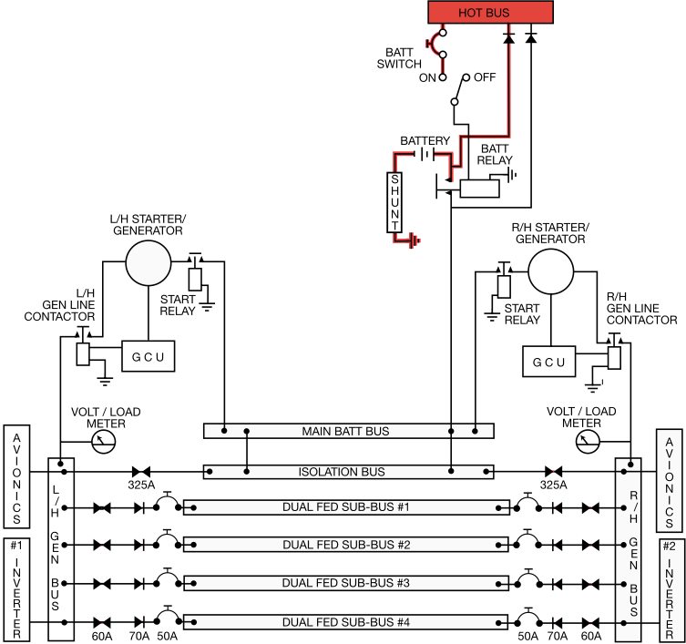

internationa

## SUPER KING AIR 200/B200 PILOT TRAINING MANUAL

A hot baltery bus is powered by the battery, regardless of the position of the BAT switch. This bus supplies the engine fire extinguishers, firewall shutoff valves, entry and cargo lights, clocks, modifications, ground COMMunications, RNAV memory to older avionics, and standby boost pumps prior to BB-1096. It also powers the battery relay which, in turn, allows power through to the main battery bus, provided that the battery switch is ON (Figure 1-2).

Figure 1-2. Electrical Panel

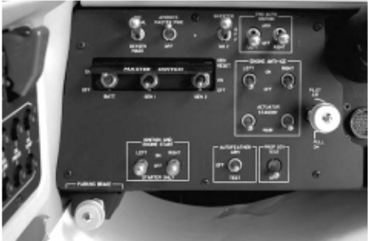

The generators are controlled by GEN 1 and GEN 2 switches, located under the same gang bar as the BAT switch. Early King Air airplanes do not have the GEN RESET position. Some airplanes have the reset function, but they are not placarded. When reset is incorporated (BB88 and after), the switch must be held in GEN RESET for a minimum of one second, and then switched to ON.

The generator buses are interconnecled by two 325-ampere current limiters on either side of the isolation bus. As long as the two isolation limiters are intact the entire bus system is supplied by the buttery and the two generators.

The four dual-fed buses are powered by either generator bus through a 60-amp limiter, a 70-amp diode, and a SO-amp circuit breaker. Those four buses supply most of the DC-powered equipment.

The inverters are powered directly from the generator buses and are controlled by the INVERTER selector switch (Figure 1-2).

## External Power

An external power socket is located on the underside of the right wing, outboard of the engine nacelle (Figure 1-3). The airplane will accept DC power from a ground power unit (GPU) provided the polarity is correct, and the GPU voltage is below 32 volts. The BAT switch must be positioned to ON in airplanes BB-364 and subsequent. Prior to BB-364, the GPU can energize the airplane without the battery switch on and there is no overvoltage protection ( i.e., more than 32 volts).

Figure 1-3. External Power Socket

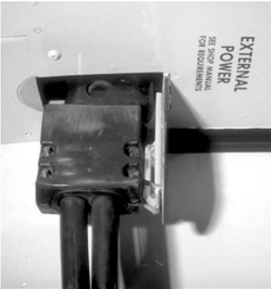

## LIGHTING

## Interior

An overhead light control panel (Figure 1-4) controls all the cockpit and instrument lights.

Cabin lighting is controlled by an interior light switch on the copilot 's subpanel, labeled BRIGHTDIM-OFF. (Prior·to BB-1444, except 1439, it is labeled START/BRIGHT-DIM-OFF) (Figure 1-5). This switch control the cabin overhead fluorescent lights. Also, individual reading lights at each passenger station can be turned on or off by individual switches adjacent to the lights.

The CABIN SIGN switch is adjacent to the interior light switch.

internationa

FlightSafety

## SUPER KING AIR 200/B200 PILOT TRAINING MANUAL

Figure 1-5. Cabin Lights Control Switch (BB-1439, 1444 and After)

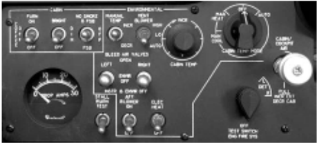

A baggage area light switch is located just inside the airstair door.

A single switch located just forward of the airstair door at floor level, controls the threshold FlightSafety

Figure 1-4. Overhead Light Control Panel (BB-1632 and After)

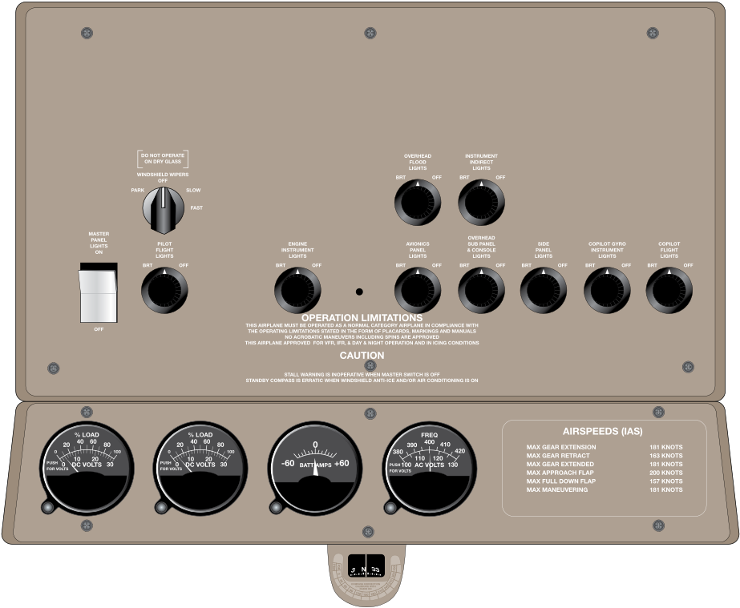

## SUPER KING AIR 200/B200 PILOT TRAINING MANUAL

light, an aisle light, understep lighting, and the exterior entry light. These three lights turn off automatically when the airstair door is closed and the handle is in the LOCK position.

The control switches for exterior lights are located on the pilot's right subpanel, as seen in Figure 1-6.

Figure 1-6. Exterior Lights Control Switches

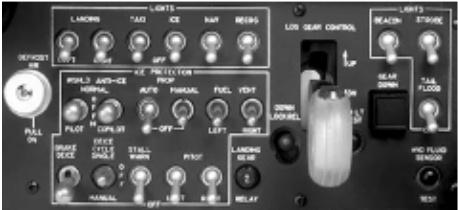

## MASTER WARNING SYSTEM

## General

The flight crew receives automatic indication of system operation through the annunciator system. There are two annunciator panels located on the instrument panel. There are also two master warning and two master caution flashers.

## Annunciator System

The warning annunciator panel is located in the center glareshield. It contains red indicators, each of which represents a fault requiring the pilot's immediate attention and action. At the same time, red MASTER WARNING flashers on the glareshield directly in front of each pilot begin flashing. The MASTER WARNING flashers can be extinguished by depressing either of the lights. The red lights on the warning annunciator panel remain illuminated until action is taken to correct the fault.

A caution/advisory annunciator panel is located on the center subpanel (amber indicators for cautions and green for advisory). An amber caution illumination requires the pilot's immediate attention to a fault but does not require immediate reaction. There are also two amber MASTER CAUTION flashers on the glareshield, just inboard of the red MASTER WARNING flashers. These operate the same way as the MASTER WARNING flasher.

Two additional caution lights are on the fuel panel which do not illuminate the MASTER CAUTION flasher.

The green advisory lights indicate functional conditions, not faults; no master advisory flashers are associated with the advisory lights.

## FUEL SYSTEM

## General

The airplane fuel system consists of two separate tank systems, one for each engine, connected by a common crossfeed line. Each of the tank systems is further divided into a main and an auxiliary system.

Each main system consists of a nacelle tank, two wing leading-edge tanks, two box section bladder tanks, and an integral wing tank, all of which gravity feed into the nacelle tanks. The filler for this family of tanks is located on top of the wing, near the wingtip.

The auxiliary fuel system consists of an auxiliary tank, located in the wing inboard of the engine nacelle. It is filled separately through an overwing filler, and employs an automatic fuel transfer system to supply the fuel to the main system.

When the auxiliary tanks contain fuel, this fuel is used first and is automatically transferred into the nacelle tank.

internationa Each engine drives a high-pressure fuel pump and a low-pressure boost pump. In addition, an electrically-driven low-pressure standby boost pump is in the bottom of each nacelle tank. The standby boost pump serves three functions:

1. To serve as backup for the engine-driven fuel boost pump.
2. To pump aviation gasoline when flying above 20,000 feet.
3. To pump fuel during crossfeed operation.

If the electric standby boost pump fails, crossfeed will not be possible from that side.

If aviation gasoline is used, a limitation of 150 hours of operation per engine before overhauls must be observed.

There are two firewall shutoff valves, each controlled by a red switch guarded to the OPEN position on the fuel control panel (Figure 1-7).

The fuel quantity is measured by a capacitance system, which reads out in pounds on the left and right fuel gages (Figure 1-7). A switch between the gages allows the pilot to monitor MAIN or AUXILIARY fuel levels.

BB-1484, 1486 AND AFTER

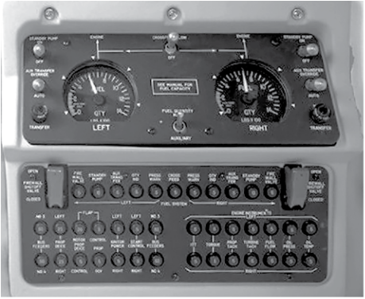

## POWERPLANTS

## General

The Super King Air is powered by two Pratt and Whitney turbopropeller PT6A engines, each rated at 850 SHP. They each have a threestage, axialflow, single-stage centrifugal flow compressor (rpm indicated as N1) which is driven by a singlestage reaction turbine. The power turbine is a two-stage reaction turbine counter rotating with the compressor turbine. A pneumatic fuel control schedules fuel flow. Propeller speed remains constant within the governing range for any given propeller control lever position.

An accessory gearbox, mounted at the rear of the engine, drives the fuel pumps, fuel control, oil pump, refrigerant compressor (right engine), starter-generator, and the N1 tachometer transmitter.

Engine instruments are grouped at the left center of the instrument panel.

PRIOR TO BB-1486, EXCEPT BB-1484

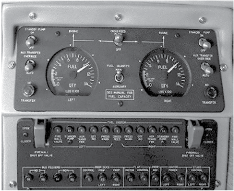

Figure 1-7. Fuel Control Panels

## Engine Controls

There are three sets of controls on the pedestal (Figure 1-8):

1. Power levers provide control of engine power from FULL REVERSE through TAKEOFF power. Increasing N1 rpm results in increased engine power.
2. Propeller levers operate springs to reposition the primary governor pilot valve, effecting an increase or decrease in propeller rpm.
3. Condition levers have three positions:
- FUEL CUTOFF
- LOW IDLE
- HIGH IDLE

## Ground Fine (Beta)/Reversing

When the power levers are lifted aft over the IDLE detent, they control the blade angle of the propellers in Ground Fine (Beta) mode. This provides a near zero thrust setting. For BB-1439, 1444 and subsequent, to select reverse the power levers need to be lifted over a second gate. Prior internationa FlightSafety

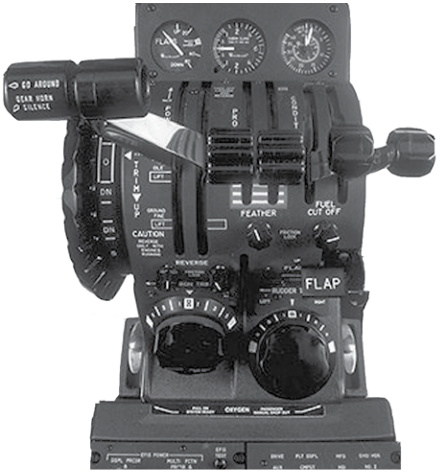

## SUPER KING AIR 200/B200 PILOT TRAINING MANUAL

to BB-1444 except 1439, reverse can be selected by continuing to move the power levers aft of the beta position into a red- and white-labeled zone on the power quadrant.

## CAUTION

Propeller reversing on unimproved surfaces should be accomplished carefully to prevent propeller erosion from reversed airflow and in dusty or snowy conditions to prevent obscured vision.

Condition levers, when set to HIGH IDLE, keep the engine operating at a minimum of 70% N1 for quicker reversing response due to less spool up time.

## CAUTION

Power levers should not be moved over either gate when the engines are not running, or with engines running and the propeller feathered, because the reversing system will be damaged.

BB-1484, 1486 AND AFTER

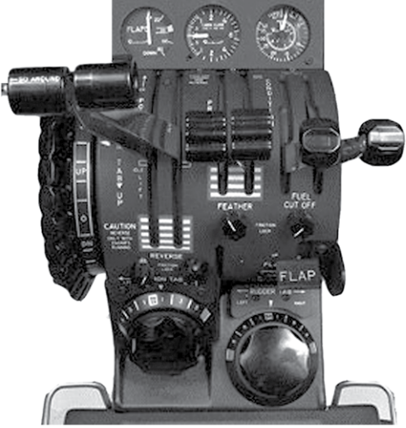

PRIOR TO BB-1486, EXCEPT BB-1484

Figure 1-8. Engine Control Levers

## SUPER KING AIR 200/B200 PILOT TRAINING MANUAL

## FIRE PROTECTION

There are two fire-detection systems. On BB-1439, 1444 and subsequent the system consists of a temperature sensing cable for each engine. Prior to BB-1444, except 1439, the system uses three detectors incorporated into each engine nacelle. Each system has red warning annunciator readouts and a test function. The optional engine fire-extinguisher system adds an extinguisher cylinder within each engine nacelle. When the system is installed, glareshield control switches and additional positions on the test switch are added (one for each extinguisher cartridge). There are two portable fire extinguishers installed: one under the copilot's seat, and the other near the entrance door.

## BLEED-AIR SYSTEM

## General

Each engine compressor supplies bleed air for the pressurization and pneumatic systems. The bleed air used for pressurization is routed from the engine to a flow control unit then into the pressure vessel. This same air is conditioned for environmental use.

The bleed air used for the pneumatic system is tapped off prior to the flow control unit and is routed through a shutoff valve to a regulator. This pneumatic air is then used for surface deice, rudder boost, door seal, bleed-air warning system, the flight hour meter, brake deice (if installed) and the landing gear hydraulic reservoir ( if installed). Through the use of a venturi, vacuum suction is developed for flight instruments, pressurization controller operation and deice boots. One engine can supply sufficient bleed air for all associated systems.

## Bleed-Air Warning

The pressurization and pneumatic bleed-air lines have follower plastic tubing containing "regulated (18 psi)" bleed-air. If a bleed-air line ruptures, the released heat will melt the accompanying plastic tube and the loss of pressure will cause the respective red L or R BLEED AIR FAIL light on the warning annunciator panel to illuminate.

When bleed-air failure is indicated, the appropriate BLEED AIR VALVE switch, on the copilot's subpanel should be placed to the INSTRument and ENVIRonment OFF position (Figure 1-9).

Figure 1-9. Bleed-Air Valve Control

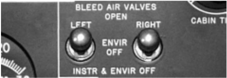

## ICE AND RAIN PROTECTION

## Ice Protection

Ice protection is accomplished either pneumatically or electrically. Pneumatic ice protection uses engine bleed air for surface deicing of wing and horizontal stabilizer leading edges, and hot brakes, if installed. Electrical heating elements are used for windshield heating, fuel vent heat, propeller deicing, pitot mast heat, and stall warning vane heat (Figure 1-9).

Figure 1-10. Ice Protection SwitchesPilot's Subpanel

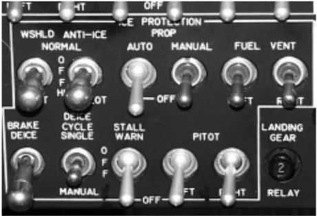

The engine uses two types of anti-ice protection. To protect the air inlet, some of the hot engine exhaust gases are scooped up and directed into the air inlet lip. To protect the engine, ice vanes are used which are moved into the airstream.

These cause a slight deflection in the entering airflow, introducing a turn in the airstream. The accelerated moisture particles continue on to the discharge port, rather than entering the engine. On BB-1439, 1444 and subsequent a second electric actuator is employed as a backup. Prior to BB-1444 except 1439, if the electric ice vane controls do not work, mechanical extension handles may be used. Operation of the vanes are displayed either by green L or R ENG ANTIICE advisory lights (normal operation) or by amber L or R ENG ICE FAIL caution lights, indicating a possible malfunction. (Prior to BB-1444 except 1439, these annunciators are labeled L or R ICE VANE EXT and L or R ICE VANE, respectively.)

An optional brake deice system allows a flow of hot bleed air to the brakes. If installed, operation is controlled by a switch on the ICE panel (Figure 1-10) and indicated by a green BRAKE DEICE ON advisory annunciator light.

## Rain Protection

There are dual, two-speed, electric windshield wipers, controlled by a switch on the overhead light control panel. The PARK position on the control switch sets the wipers to the inboard position (Figure 1-11).

Figure 1-11. Windshield Wiper Control Switch

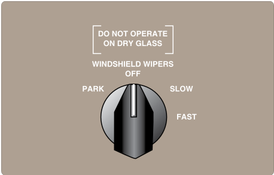

FlightSafety

## AIR CONDITIONING AND HEATING

## General

Cabin air conditioning is provided by a refrigerant-gas-vapor cycle refrigeration system. The compressor is mounted on the right engine accessory pad. The refrigerant is routed to the airplane nose where the condenser coil, receiver-dryer, expansion and bypass valves, and evaporator are located.

The compressor is deenergized any time the engine speed is below 62% N1. An attempt to use air conditioning when N1 is below the above values, will result in illumination of the green AIR COND N1 LOW advisory light on the annunciator panel. High or low refrigerant pressure switches will also trip the system and illuminate the reset switch light in the nose gear wheel well. (Prior to BB 729, it opens a fuse or a circuit breaker in the right wing area next to the hot battery bus).

The forward vent blower sends recirculated cabin air through the evaporator for air-conditioning output. The output from the ceiling outlets will always be cool. Cool air also enters the floor-level duct, but is mixed with warm environmental bleed air if either BLEED AIR valve is open. Therefore, the lower duct, discharging pressurized air, will always be warmer than the overhead "eyeball" ducts.

An optional aft evaporator and blower may be installed. Refrigerant will flow through both evaporators as long as the system is operating, but additional cooling for the aft outlets will occur only when the aft blower is operating.

The cabin is heated by engine compressed bleed air. After the airplane is airborne, ambient air valves open and allow ambient air to mix with the bleed air for increased density. Pilot and copilot volume of air is controllable by respective air knobs on each subpanel. A CABIN AIR knob varies the volume of air directed into the cockpit or into the cabin flow ducting. A DEFROST AIR control knob directs warm air to the windshield.

## Unpressurized Ventilation

Ventilation is provided through the bleed-air system during either pressurized or unpressurized flight. Fresh air can also be provided by ram air but only during unpressurized flight.

## Electric Heating (BB-1439, 1444 and Subsequent)

An optional electric heating system is available for ground operation only. A ground power unit must be used prior to engine starting or generator power after engine starting in order to use electric heating system. It is for ground operation only and is used in conjunction with either manual heat or automatic temperature control mode. A green advisory light on the annunciator panel is provided to indicate power is being supplied to the unit. Both the vent blower and aft blower must be operating when using the electric heater.

## Radiant Heating (Prior to BB-1444, Except 1439)

An optional radiant heating system is an overhead heated panel system, which can be powered by a ground power unit for cabin heating prior to engine start, or it can use airplane power to supplement the heating system in flight. It should be used only in conjunction with the manual temperature control mode.

## PRESSURIZATION

## General

The pressurization system is designed to provide a normal working pressure differential (psid) when flying at altitude. Table 1-1 presents the pressure differentials on the 200 and B200.

Table 1-1. CABIN ALTITUDES

|   FLIGHT ALTITUDE - ALTITUDES ARE IN FEET |   CABIN ALTITUDE - ALTITUDES ARE IN FEET - 200 (6.0 ± 0.1 psid) |   CABIN ALTITUDE - ALTITUDES ARE IN FEET - B200 (6.5 ± 0.1 psid) |
|-------------------------------------------|-----------------------------------------------------------------|------------------------------------------------------------------|
|                                    20,000 |                                                           3,900 |                                                            2,800 |
|                                    31,000 |                                                           9,900 |                                                            8,600 |
|                                    35,000 |                                                          11,700 |                                                           10,400 |

FlightSafety

internationa

Bleed air from the engine compressor section is used to supply airplane pressurization. Engine bleed is mixed with ambient air to form a suitable mixture. The flow control unit and BLEED AIR VALVE switches, as seen in Figure 1-9, control the mixture. If this switch is positioned to ENVIRonmental OFF or INSTrument and ENVIRonmental OFF, the bleed-air valve will be closed. When positioned to OPEN, air is routed through a heat exchanger and then into a mixing plenum. It mixes with recirculated air, is routed to the outlet ducts, and is introduced into the cabin.

The outflow valve, located on the aft pressure bulkhead, controls the amount of pressurized air in the airplane. The pressure and rate of cabin pressure changes are controlled by vacuumoperated modulation of the outflow valve.

Also, a vacuum-operated safety valve is mounted adjacent to the outflow valve. It serves four purposes:

1. To provide positive pressure relief if the outflow valve malfunctions.
2. To allow depressurization when the pressure switch is moved to the DUMP position.
3. To maintain an unpressurized state while on the ground with the left landing gear safety switch compressed.
4. To prevent negative differential.

When the BLEED AIR switches are OPEN, air used for pressurization enters the airplane, with or without ambient air, depending on the position of the landing gear safety switch (on the ground, no ambient flow), and temperature. For pneumatic flow packs (prior to BB-1180), the use of ambient air is also dependent on ambient pressure.

An adjustable cabin pressurization controller is located on the pedestal (Figure 1-12).

The CABIN ALT selector knob can be used to select a desired cabin pressure altitude between -1,000 feet and 15,000 feet. The selected pressure altitude will be reflected on the outer scale of the indicator. The inner scale shows the highest ambient pressure altitude that the airplane can fly in order to maintain the selected CABIN ALT.

FlightSafety

## SUPER KING AIR 200/B200 PILOT TRAINING MANUAL

Figure 1-12. Cabin Pressurization Controller

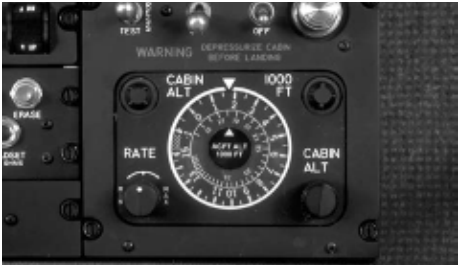

A rate control selector knob, placarded RATEMIN-MAX can select between 200 and 2,000 feet per minute of change of cabin altitude. These controls direct the action of the outflow valve.

The CABIN PRESS-DUMP-TEST switch is located next to the cabin pressurization controller. When selected to DUMP, the safety valve opens, relieving all accumulated cabin pressure. In TEST, the valve is closed, bypassing the left landing gear safety switch for a ground pressurization test.

## LANDING GEAR AND BRAKES

## General

The retractable tricycle landing gear is extended or retracted by a 28-volt motor and gearbox or by an electrically-driven hydraulic pump (airplane Serial Nos. BB-1193 and subsequent).

The LDG GEAR CONTROL HANDLE on the pilot's right subpanel controls the system. A solenoid-operated lock prevents the handle from being raised when the airplane is on the ground. This can be bypassed by the red DOWN LOCK REL button just to the left of the control handle.

Individual gear position is indicated by three green lights adjacent to the handle. The gear handle contains two red lights, which illuminate when the gear is in transit or not properly locked. Two versions of the control panel are found in Figure 1-13. On airplanes with the hydraulicallyactuated gear, the square light assembly has green NOSE, L, and R indicator segments.

PRIOR TO BB-453 (SUBSEQUENT MODELS HAD THE GEAR DOWN INDICATOR LIGHTS IN A CUBE ARRANGEMENT)

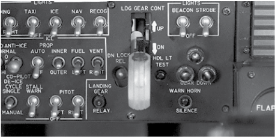

BB-1439, 1444 AND AFTER

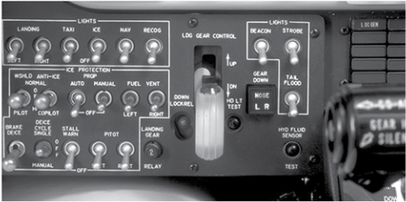

Figure 1-13. Landing Gear Control Panel

## Manual Extension (Hydraulic Gear)

Manual extension of the gear on these airplanes requires pulling the LANDING GEAR RELAY circuit breaker and placing the landing gear switch handle in the DN position. A hydraulic hand pump, located on the floor between the pilot's right foot and pedestal (Figure 1-14), is then operated until three green gear position indicator lights are observed.

## Manual Extension (Electric Gear)

The landing gear can be manually extended by pulling the LANDING GEAR RELAY circuit breaker and placing the landing gear switch handle in the DN position. Pulling up and turning the emergency engage handle (Figure 1-14) positions an emergency drive gear to the gearbox. A continuous-action ratchet is then pumped to lower the gear. The system may be reverted to electrical operation by repositioning both handles on the floor and resetting the circuit breaker.

internationa

## SUPER KING AIR 200/B200 PILOT TRAINING MANUAL

HYDRAULIC GEAR

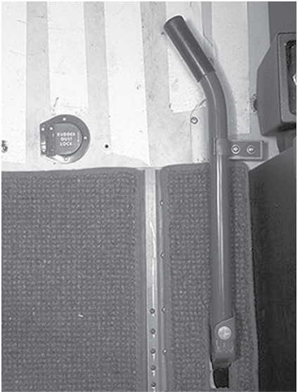

ELECTRIC GEAR

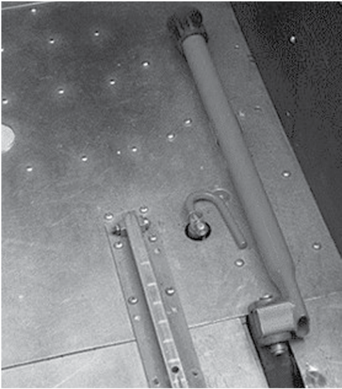

Figure 1-14. Manual Extension Controls

brakes. Prior to BB-666, the initial pressure from a set of pedals will position a shuttle valve in the braking system. Brake operation from the opposite side can then only be accomplished by moving the shuttle valve.

A parking brake (Figure 1-15) can be actuated to lock the pressure within the brake lines. The airplane may be designed to permit parking brake operation either in conjunction with pilot brake pressure only, or with pressure from either set of brakes.

Figure 1-15. Parking Brake Handle

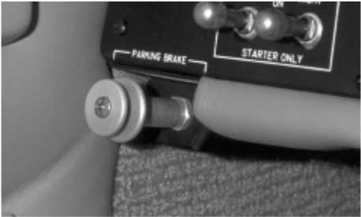

## Warning System

During flight, a warning horn and red lights in the landing gear handle warn the crew of improper landing gear position relative to flap and/or power lever position. They also activate when the gear handle is up while on the ground.

## Nosewheel Steering

The rudder pedals control nosewheel steering while the gear is down. Both the nosewheel steering and rudder deflection receive inputs from rudder pedal motion, but in varying proportions depending on the speed that the wheels are rolling. When the wheel brakes are applied during rudder pedal deflection, there is even greater steering effect. During nose gear retraction, it is mechanically selfcentered and receives no further rudder pedal steering force.

## Brake System

Dual hydraulic brakes are operated by depressing either the pilot's or copilot's toe portion of the rudder pedals. Both sets of pedals operate the

## FLIGHT CONTROLS

## General

The airplane uses conventional ailerons and rudders. There is a T-tail horizontal stabilizer and elevator mounted at the top of the vertical stabilizer. Interconnected conventional control columns within the cockpit control the ailerons and elevators. Rudder pedals are also connected so that either the pilot or copilot can operate the rudder. There are dual flaps on each wing. Rudder, elevator, and aileron trim are adjustable with controls mounted on the center pedestal. The flight control surfaces are illustrated in Figure 1-16.

Figure 1-16. Flight Control Surfaces

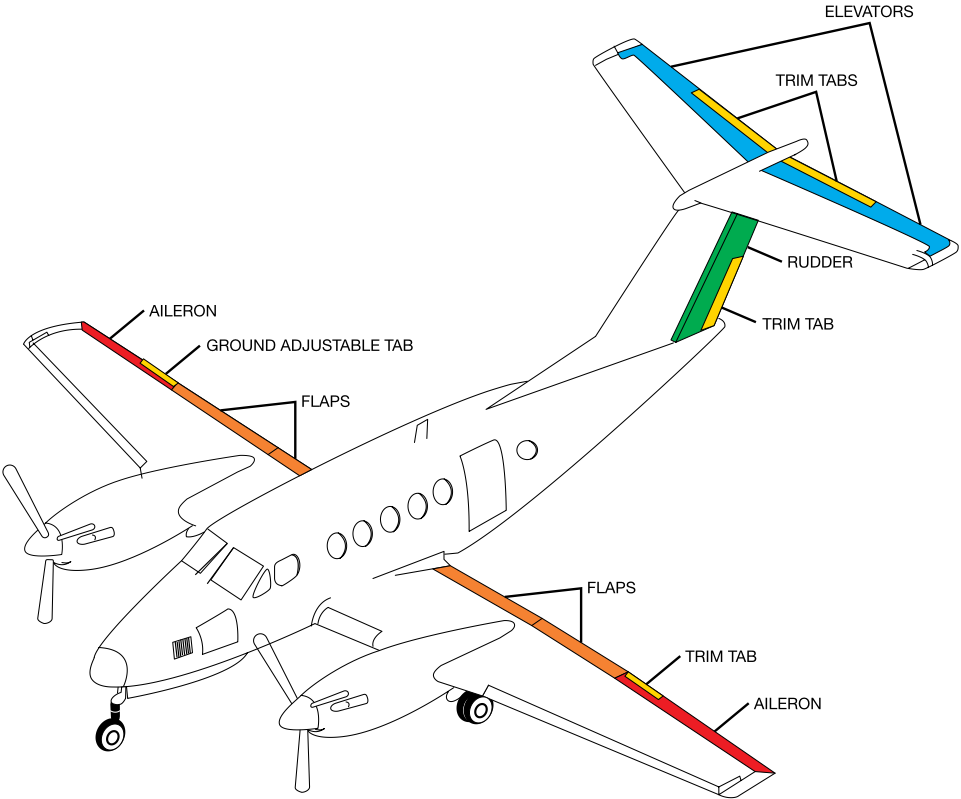

FlightSafety

## Operation

The flight controls are cable operated and require no power assistance. Flaps and optional electric elevator trim are electrically driven. A pneumatic rudder boost system assists in directional control when one engine has failed.

Rudder, elevator, and aileron trims are adjustable with controls on the center pedestal. Elevator trim is manual or optionally electrical. There is a position indicator on each pedestal tab control (Figure 1-17).

Figure 1-17. Trim Tab Controls and Indicators

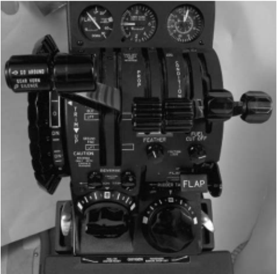

A lever on the control pedestal (Figure 1-18) controls the two flaps installed on each wing. A wing flap percentage indicator is located on the pedestal next to the cabin climb rate indicator.

internationa

FlightSafety

## SUPER KING AIR 200/B200 PILOT TRAINING MANUAL

Figure 1-18. Flap Control Lever

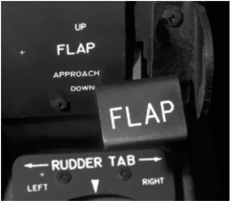

## PITOT AND STATIC SYSTEMS

## General

Certain flight instruments operate from impact (pitot) and static pressures.

## Pitot System

A heated pitot tube is located on each side of the lower portion of the nose. The pilot's airspeed indicator uses input from the left pitot mast, while the copilot's input is from the right mast (Figure 1-19).

Figure 1-19. Pitot Tubes

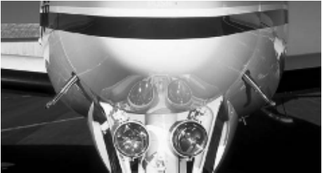

## Static System

The normal static system provides separate input for pilot and copilot instruments. Each has a port on each side of the aft fuselage, which is not heated (Figure 1-20).

Figure 1-20. Static Ports

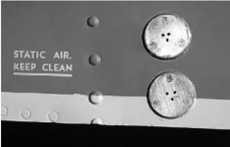

If the pilot's static system is plugged, an alternate air tube obtains static air from inside the unpressurized rear fuselage. This system is selected by moving the PILOT'S STATIC AIR SOURCE valve handle, located on the right side panel, to the ALTERNATE position (Figure 1-21).

Figure 1-21. Pilot's Static Air Source Valve Handle

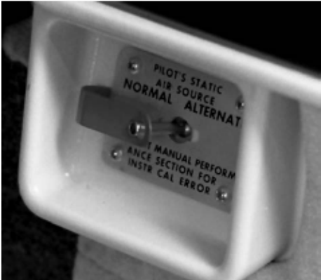

FlightSafety

## SUPER KING AIR 200/B200 PILOT TRAINING MANUAL

## WARNING

The pilot's airspeed, vertical speed, and altimeter indications change when the alternate static air source is in use.

## OXYGEN SYSTEM

## General

The airplane's oxygen system is based on an adequate flow for the altitude to which the airplane is certificated: 31,000 feet or 35,000 feet.

## Super King Air B200

The masks and oxygen duration chart are based on a flow rate of 3.9 liters per minute (LPMNTPD) per mask. When using the diluter-demand crew mask in the 100% mode, each mask counts as two masks at 3.9 LPM-NTPD.

## Super King Air 200

The masks and oxygen duration charts are based upon 3.7 standard liters per minute (SLPM) per mask. The only exception is the diluter-demand crew mask when used in the 100% mode. When computing oxygen duration, each diluter-demand mask used in the 100% mode, is counted as two masks at 3.7 SLPM.

## Manual Plug-in System

Early Super King Air 200s employ a constantflow, plug-in system. All masks for crew and passengers are stored in the seat area and are removed and plugged into available receptacles as needed.

## Autodeployment System

When the autodeployment system is installed for the passengers, the crew normally has diluter-demand masks, which are one-hand, quick-donning masks.

Oxygen supply is controlled by a push-pull handle, placarded PULL ON-SYStem READY and is located on the left side of the pedestal (Figure 1-22). (Prior to BB-1444, except 1439 they are overhead in the cockpit - Figure 1-22). When

internationa

## SUPER KING AIR 200/B200 PILOT TRAINING MANUAL

BB-1439, 1444 AND AFTER

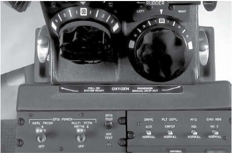

PRIOR TO BB-1444, EXCEPT 1439

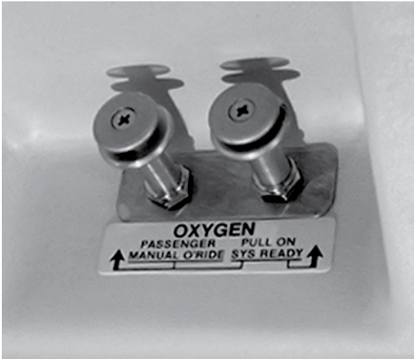

## Figure 1-22. Cockpit Oxygen Handles

pushed in, no oxygen is available anywhere in the airplane. It should be pulled out prior to engine start to ensure available oxygen when needed. The primary oxygen system delivers oxygen to the two crew masks, to the first-aid outlet in the toilet area, and to the passenger oxygen system shutoff valve.

The passenger system is the constant-flow type. If the oxygen system line has been charged (oxygen in the supply bottle and SYStem READY handle pulled) when the cabin altitude exceeds approximately 12,500 feet, the oxygen pressure will automatically open the mask storage doors and allow the passenger masks to drop out. Oxygen will flow to the mask when a further pull on the lanyard by the passenger pulls the pin out of the valve. A green PASS OXYGEN ON light on the advisory annunciator panel will indicate that the passenger masks have dropped out of the overhead.

If the oxygen supply line is charged, oxygen is available at the first-aid station. The cover must be opened and the valve turned on.

In the event that oxygen pressure fails to open the passenger oxygen shutoff valve automatically, the pilot has a PASSENGER MANUAL OVERRIDE handle on the right side of the pedestal (prior to BB-1444, except 1439, it is next to the SYStem READY handle on the overhead panel). It will open the valve manually, and all other operations will be the same as in the automatic mode.

## AIRPLANE STRUCTURES

## GENERAL

The Super King Air is 43 feet 9 inches long from the nose to the aft most point of the horizontal stabilizer (Figure 1-23 and Figure 1-24). The airplane sections consist of the:

- Fuselage
- Wings
- Empennage

The fuselage is composed of the:

- Nose section
- Cockpit
- Cabin
- Foyer and aft cabin
- Aft fuselage

The wing is built as a center section and two outboard wing assemblies.

The empennage is composed of a vertical stabilizer with a high T-tail horizontal stabilizer.

FlightSafe

FlightSafety

## SUPER KING AIR 200/B200 PILOT TRAINING MANUAL

Figure 1-23. Airplane Dimensions (BB-1439, 1444 and After)

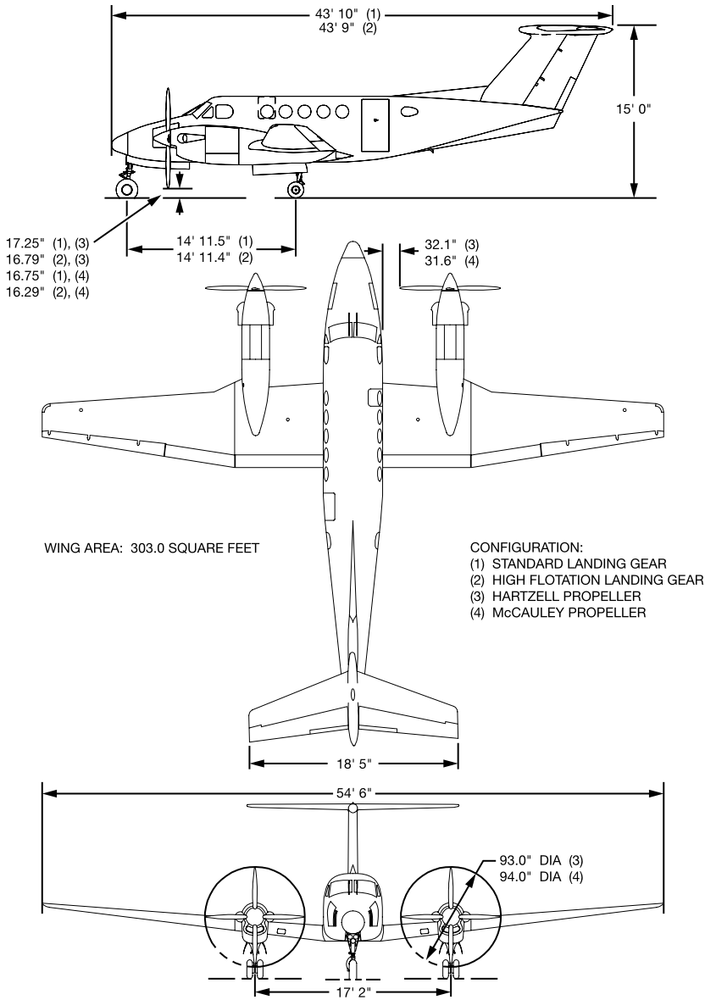

internationa

internationa FlightSafety

## SUPER KING AIR 200/B200 PILOT TRAINING MANUAL

Figure 1-24. Airplane Dimensions (Prior to BB-1444, Except 1439)

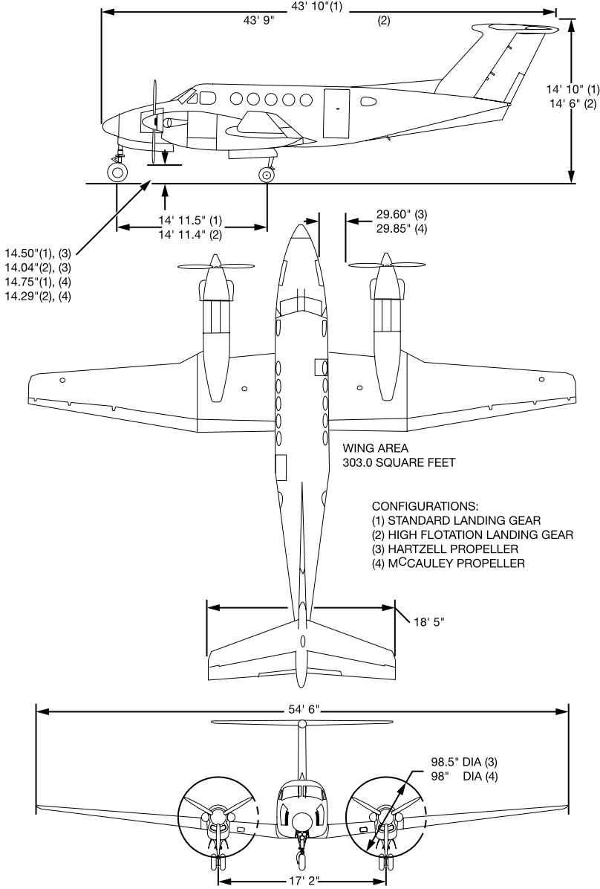

internatic

internationa

## FUSELAGE

The nose section is an unpressurized equipment storage area, separated from the cockpit area by the forward pressure bulkhead (Figure 1-25).

The cockpit is separated from the cabin by a sliding door for privacy and to prevent light spilling between compartments. A typical instrument panel is shown in Figure 1-26.

Various configurations of passenger chairs and couches may be installed. All passenger chairs are placarded FRONT FACING ONLY or FRONT OR AFT FACING. Only chairs so marked may be installed facing aft. All aft-facing chairs and all forward-facing chairs equipped with shoulder harnesses have adjustable headrests.

## CAUTION

Before takeoff and landing, the headrest should be adjusted as required to provide support for the head and neck when the passenger leans against the seatback.

Couches, if installed, are not adjustable.

Figure 1-25. Airplane Dimensions (BB-1439, 1444 and After)

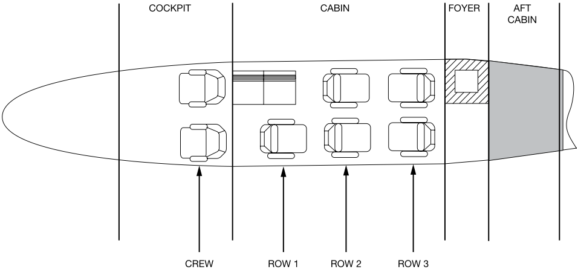

internationa

FlightSafety

## SUPER KING AIR 200/B200 PILOT TRAINING MANUAL

The cabin is separated from the foyer by another sliding door to provide privacy for the toilet, which is located in the foyer. When the toilet is not in use, seat cushions convert the position to another passenger seat.

The aft cabin area may have one or two optional folding seats installed. When these seats are not needed, they may be folded against the cabin sidewall, and the entire aft cabin area may be utilized for baggage storage.

## CAUTION

Webs should secure baggage and other objects in order to prevent shifting in turbulent air.

Items stowed in this area are easily accessible in flight. An optional curtain can be closed to separate the aft cabin from the foyer. A latching compartment door may be installed in place of the curtain.

## SUPER KING AIR 200/B200 PILOT TRAINING MANUAL

Figure 1-26. Cockpit Layout (Typical)

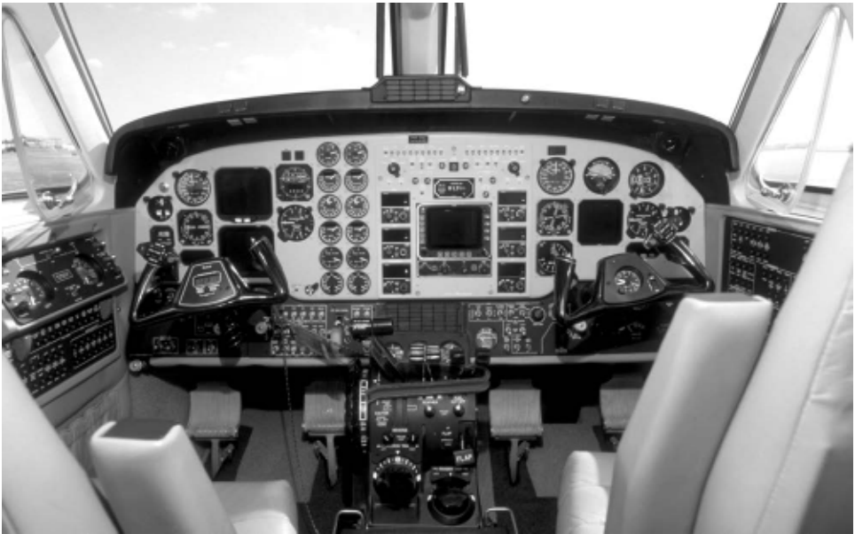

Figure 1-27. Cabin Door

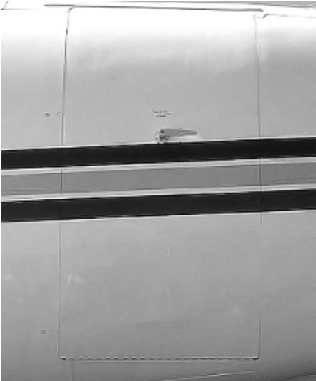

## DOORS

## Cabin Door

The cabin door is located on the left side of the fuselage, in the foyer area. The cabin door is hinged at the bottom, and swings out and down when opened (Figure 1-27). A hydraulic damper ensures a slow opening.

A stairway is built onto the inboard side for entry and egress. Two of the steps fold flat against the door when it is closed. When the door is fully extended, it is supported by a plastic-encased cable, which also serves as a handrail. A second handrail (optional prior to BB-1444, except 1439) may be installed along the other side of the steps, giving support to both sides of the door.

CAUTION

Only one person at a time should be on the door stairway.

FlightSafety

## SUPER KING AIR 200/B200 PILOT TRAINING MANUAL

The plastic handrail is utilized when closing the door from the inside. The door is closed against an inflatable rubber seal around the opening. When the weight of the airplane is off the landing gear, pneumatic air is used to inflate the door seal through a 4-psi regulator.

The door-locking mechanism can be operated by either the outside or inside door handle, which rotates simultaneously. A release button (Figure 1-28) is adjacent to each handle and must be held depressed before the handle can be rotated. The handle system necessitates a two-hand operation, thereby ensuring a deliberate action. The release button also incorporates a pressure-sensing diaphragm, so that if there is a pressure differential between the inside and outside, the pressure on the release button must be proportionally increased to prevent inadvertently opening the door while pressurized.

OUTSIDE DOOR HANDLE

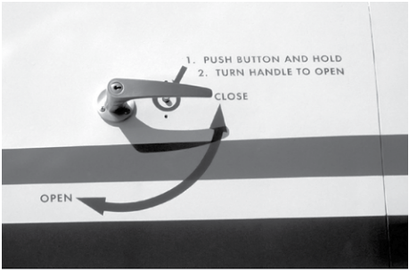

INSIDE DOOR HANDLE

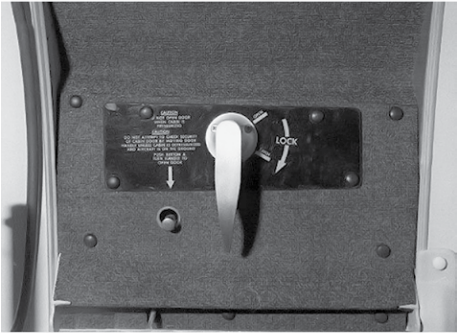

Figure 1-28. Door Handles

Never attempt to check or unlock the door in flight. If the CABIN DOOR light is on (amber in the 200, red in the B200), or if the pilot suspects door security, direct all occupants to remain seated with seatbelts secured, descend as necessary, and depressurize the airplane. After the airplane has landed and stopped, and the cabin has been depressurized, a crewmember can then check the door security.

When closing the door from inside the airplane, pull up on the handrail until the airstair door reaches the door frame. Rotate the door handle up as far as possible, pulling inward on the door. The door should seal; then rotate the handle down to lock the door (Figure 1-28).

Positive locking may be checked by attempting to rotate the handle without depressing the release button. It should not move. A placard is located beneath the folded step just below the door handle. The placard shows how to check the locks in the inspection port windows near each corner of the door (Figure 1-29). A green stripe painted on each of the four latch bolts should be aligned with its respective black pointer (Figure 1-30).

Figure 1-29. Placard and Inspection Port

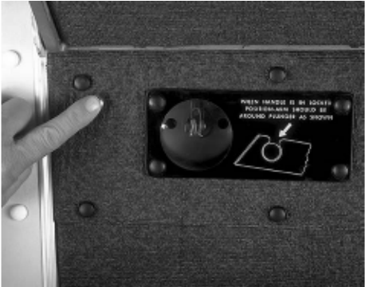

internationa

## SUPER KING AIR 200/B200 PILOT TRAINING MANUAL

Figure 1-30. Latch Bolt

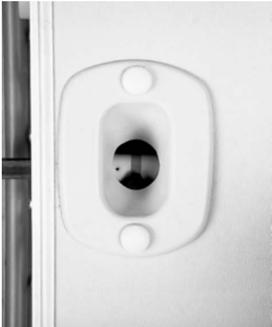

## Cargo Door (200C and B200C)

A large, swing-up cargo door, hinged at the top, provides access for loading and unloading large cargo. The airstair door is an integral part of the cargo door and should be closed and latched when the cargo door is opened.

The cargo door latches can be operated only by the use of two handles, both located inside the airplane. The handle in the upper part of the door controls the rotating latches in the forward and aft sides, while the handle in the lower, forward part of the door actuates four pin-lug latches along the bottom of the door.

Once the latches are retracted, initial pressure must be exerted outward to start the opening action. After the sequence begins, gas springs will open the door the rest of the way. The door is counterbalanced, and will stay open. The gas springs will resist the effort to close the door, and that pressure must be overcome manually, until the door is almost closed. When the door is almost closed, the gas spring overcenter mechanism will redirect spring pressure toward the closed position, assisting the latching cycle.

The door closes against a rubber seal, to maintain the pressure vessel integrity. The seal is not inflated by pneumatic bleed air, but rather allows cabin-pressurized air to seep into holes on the inside. This allows for greater sealing when there is a high pressure differential.

## Emergency Exit

The emergency exit window, placarded EXITPULL (Figure 1-31) is located at the forward

right side of the passenger compartment. It can be released from the inside by using a pull-down handle, or from the exterior (if it is unlocked) by a flush-mounted, pull-out handle (Figure 1-31). It is a plug-type exit, which is removed completely from the frame and taken into the cabin. The exit can be locked from the inside, but can be opened from the inside even when it is locked. For BB-415 and after, the locking mechanism is activated by pulling out a handle below the door release handle (Figure 1-31). Prior aircraft and BL-1 and after have a key next to the door release handle that can lock/unlock the door. This key cannot be removed when the door is locked.

This door must be unlocked prior to takeoff for exterior opening in case of emergency.

FlightSafety

## SUPER KING AIR 200/B200 PILOT TRAINING MANUAL

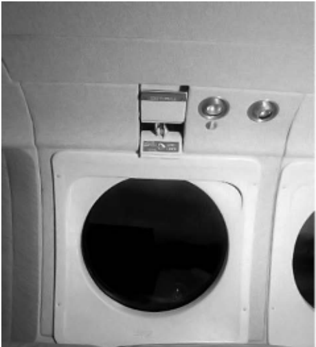

Figure 1-31. Emergency Exit Release Handles

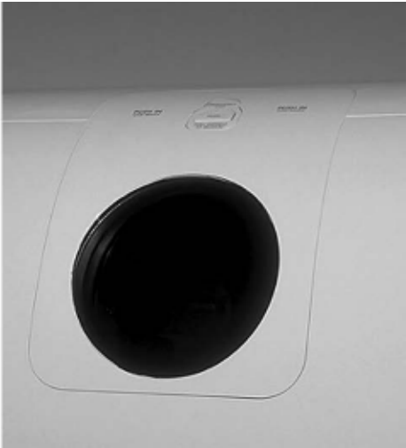

## CABIN WINDOWS

Each cabin windowpane is composed of a sheet of polyvinyl butyral between two transparent sheets of acrylic plastic. It is stressed to withstand the cabin pressure differential. There are two types of windowpanes available: polarized and shade type.

## Polarized Type

Two dust panes are inboard of the cabin window each composed of polarized film. The inboard pane may be rotated to permit light regulation.

## WARNING

Do not look directly at the sun, even through polarized windows, because eye damage could result.

## CAUTION

When the airplane is to be parked in areas exposed to intensive sunlight, the polarized windows should be rotated to the clear position to prevent deterioration of the polarized material. Sufficient ultraviolet protection is provided to prevent fading of the upholstery.

## Shade Type

A single sheet of tinted acrylic plastic serves as a dust pane. The shade is mounted in the window frame, inboard of the cabin window dust pane. It can be moved along detents in a track.

internationa

## CONTROL LOCKS

The flight and engine controls are mechanically locked by a U-shaped clamp and two pins within the cockpit, as seen in Figure 1-32. The pins lock the primary flight controls and the Ushaped clamp fits around the engine control levers. A pin is inserted through the control column to lock the ailerons and elevator. A second pin is inserted through a hole in the floor, which locks the rudder bellcrank. All locks must be installed and removed together to preclude taxiing or flying with the engine control levers released but the flight controls locked.

## SUPER KING AIR 200/B200 PILOT TRAINING MANUAL

## WARNING

Before starting engines, remove the locks.

## CAUTION

Remove the control locks before towing the airplane. If towed with a tug while the rudder lock is installed, serious damage to the steering linkage can result.

Figure 1-32. Control Locks

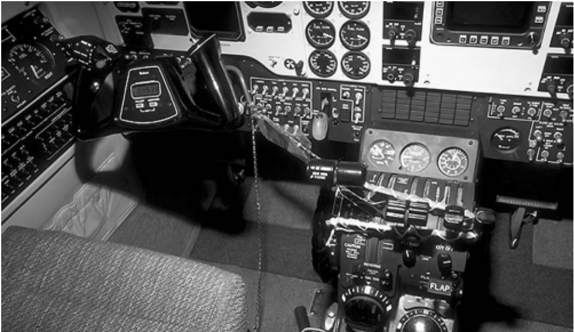

FlightSafety

## CHAPTER 2 ELECTRICAL POWER SYSTEMS

## CONTENTS

| INTRODUCTION................................................................................................................... 2-1 Page   |
|--------------------------------------------------------------------------------------------------------------------------------------------|
| GENERAL............................................................................................................................... 2-1 |
| DC POWER............................................................................................................................. 2-2  |
| Battery.............................................................................................................................. 2-2  |
| Generators........................................................................................................................ 2-4     |
| Ground Power................................................................................................................... 2-5        |
| Distribution...................................................................................................................... 2-8     |
| Operation........................................................................................................................ 2-10     |
| Avionics Master Switch..................................................................................................2-12               |
| AC Power Inverters........................................................................................................2-12             |
| Controls and Indications................................................................................................2-12               |
| Distribution.................................................................................................................... 2-15      |
| Operation........................................................................................................................ 2-15     |
| LIMITATIONS...................................................................................................................... 2-22     |
| Generator Limits (250 Amperes)...................................................................................2-22                      |
| Starters........................................................................................................................... 2-22   |
| Inverters.......................................................................................................................... 2-22   |
| Circuit Breakers.............................................................................................................2-22          |
| QUESTIONS......................................................................................................................... 2-28    |

internationa internationa

## SUPER KING AIR 200/B200 PILOT TRAINING MANUAL

## ILLUSTRATIONS

| Figure   | Title                                                                                                                                                                                   | Page   |
|----------|-----------------------------------------------------------------------------------------------------------------------------------------------------------------------------------------|--------|
| 2-1      | Electrical Component Location...................................................................................                                                                        | 2-2    |
| 2-2      | Battery Cooling (Nickel Cadium)...............................................................................                                                                          | 2-3    |
| 2-3      | Battery Control Circuit................................................................................................                                                                 | 2-3    |
| 2-4      | Volt-Loadmeters-Battery Ammeter.............................................................................                                                                            | 2-3    |
| 2-5      | BATTERY CHG Annunciator.....................................................................................                                                                            | 2-4    |
| 2-6      | Generator.....................................................................................................................                                                          | 2-4    |
| 2-7      | Generator Switches.....................................................................................................                                                                 | 2-5    |
| 2-8      | Generator Control Circuit............................................................................................                                                                   | 2-6    |
| 2-9      | Ground Power Connector............................................................................................                                                                      | 2-7    |
| 2-10     | External Power Circuit................................................................................................                                                                  | 2-7    |
| 2-11     | MASTER SWITCHES................................................................................................                                                                         | 2-8    |
| 2-12     | Lights and Meters........................................................................................................                                                               | 2-8    |
| 2-13     | Electrical Distribution.................................................................................................                                                                | 2-9    |
| 2-14     | Circuit-Breaker Panels-Pilot's.................................................................................                                                                         | 2-10   |
| 2-15     | Circuit-Breaker Panels-Copilot's............................................................................                                                                            | 2-11   |
| 2-16     | Avionic Power Distribution.......................................................................................                                                                       | 2-13   |
| 2-17     | Typical Avionics Bus Distribution (EFIS Equipped Aircraft)...................................                                                                                           | 2-14   |
| 2-18     | Inverters.....................................................................................................................                                                          | 2-15   |
| 2-19     | Volt-Frequency Meter................................................................................................                                                                    | 2-15   |
| 2-20     | Inverters Control Circuit............................................................................................                                                                   | 2-16   |
| 2-21     | Electrical System-Super King Air B200 (BB-1484, 1486 and Subsequent; BW-1 and Subsequent).............................................................................................. | 2-17   |
| 2-22     | Electrical System-Super King Air B200 (BB-1449, 1458-1462, 1464-1485, Except 1484; BL-139, 140).......................................................................................  | 2-18   |

|        |                                                                                                                                                                          | SUPER KING AIR 200/B200                                                                                                                                                  | PILOT TRAINING MANUAL                                                                                                                                                    |        |
|--------|--------------------------------------------------------------------------------------------------------------------------------------------------------------------------|--------------------------------------------------------------------------------------------------------------------------------------------------------------------------|--------------------------------------------------------------------------------------------------------------------------------------------------------------------------|--------|
| 2-23   | Electrical System-Super King Air B200 (BB-1439, 1444-1448, 1450-1457)........                                                                                            | Electrical System-Super King Air B200 (BB-1439, 1444-1448, 1450-1457)........                                                                                            | Electrical System-Super King Air B200 (BB-1439, 1444-1448, 1450-1457)........                                                                                            | 2-19   |
| 2-24   | Electrical System-Super King Air B200 (BB-734, 793, 829, 854-870, 874-891, 894, 896-911, 913-1438, 1440-1443, BL 37-138).....................................            | Electrical System-Super King Air B200 (BB-734, 793, 829, 854-870, 874-891, 894, 896-911, 913-1438, 1440-1443, BL 37-138).....................................            | Electrical System-Super King Air B200 (BB-734, 793, 829, 854-870, 874-891, 894, 896-911, 913-1438, 1440-1443, BL 37-138).....................................            | 2-20   |
| 2-25   | Electrical System-Super King Air 200 (BB-2, 6-733, 735-792, 794-828, 830-853, 871-873, 892, 893, 895, 912, BL-1-36)..................................................... | Electrical System-Super King Air 200 (BB-2, 6-733, 735-792, 794-828, 830-853, 871-873, 892, 893, 895, 912, BL-1-36)..................................................... | Electrical System-Super King Air 200 (BB-2, 6-733, 735-792, 794-828, 830-853, 871-873, 892, 893, 895, 912, BL-1-36)..................................................... | 2-21   |
| TABLES | TABLES                                                                                                                                                                   | TABLES                                                                                                                                                                   | TABLES                                                                                                                                                                   | TABLES |
| Table  | Table                                                                                                                                                                    | Title                                                                                                                                                                    |                                                                                                                                                                          | Page   |
| 2-1    | Limitations-Ground Operations................................................................................2-22                                                        | Limitations-Ground Operations................................................................................2-22                                                        | Limitations-Ground Operations................................................................................2-22                                                        |        |
| 2-2    | Fuel Control Circuit-Breaker Panel............................................................................2-23                                                       | Fuel Control Circuit-Breaker Panel............................................................................2-23                                                       | Fuel Control Circuit-Breaker Panel............................................................................2-23                                                       |        |
| 2-3    | Right Side Circuit-Breaker Panel................................................................................2-24                                                     | Right Side Circuit-Breaker Panel................................................................................2-24                                                     | Right Side Circuit-Breaker Panel................................................................................2-24                                                     |        |
| 2-4    | Pilot's Right Subpanel Circuit-Breaker Switches........................................................2-27                                                              | Pilot's Right Subpanel Circuit-Breaker Switches........................................................2-27                                                              | Pilot's Right Subpanel Circuit-Breaker Switches........................................................2-27                                                              |        |

## CHAPTER 2 ELECTRICAL POWER SYSTEMES

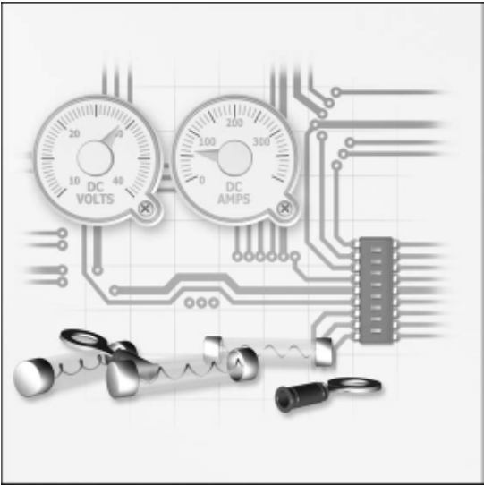

## INTRODUCTION

The primary electrical system on the airplane is a 28-VDC generator system. It is used for inverter input and, through the distribution system, for powering the electronic equipment and landing gear. The DC system consists of generation, distribution, storage, control, and monitoring of DC power. The AC system consists of the inverters, power distribution, control, and monitoring of AC power.

A section on specific limitations, a circuit-breaker table, and a series of questions conclude this chapter.

## GENERAL

The DC power is supplied by a 24-volt battery and by two 30-volt, regulated to 28.25 ± .25 volts, 250-ampere starter-generators. Either one of two inverters supplies AC power for engine instruments and for avionics (Figure 2-1). Each component of the electrical power system is capable of supplying power to all systems that are necessary for normal operation of the airplane; however, the battery, if it is the only source of power, does have a limited life.

FlightSafety

## SUPER KING AIR 200/B200 PILOT TRAINING MANUAL

Figure 2-1. Electrical Component Location

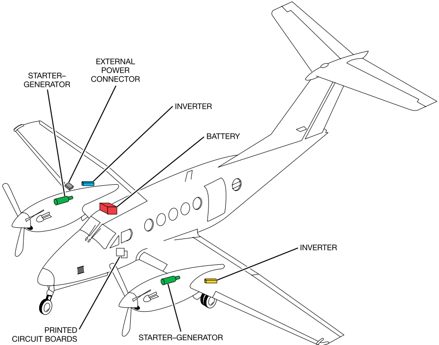

the battery is routed via the battery relay, which is controlled by the BAT ON-OFF switch on the pilot's left subpanel.

For aircraft BB-1632 and subsequent, the battery ammeter (Figure 2-4) provides a direct reading of the charge or discharge rate of the battery (-60 amps to +60 amps). The charge rate should be 0 to +10 amperes for take-off.

On aircraft prior to BB-1632 with a NiCad battery, a battery charge current detector is installed. This senses an increase in normal current flow and causes an amber BATTERY CHG caution

## DC POWER

## BATTERY

For BB-1632 and subsequent, a single, 24-volt, 42 ampere-hour sealed lead acid gel cell battery is located in the right wing center section forward of the main spar. Prior to BB-1632, a single 24-volt, 34/36 ampere-hour nickel-cadmium (NiCad) battery is installed. This NiCad battery requires air cooling through a thermostatically controlled valve installed in the ram air tube adjacent to the battery drain (Figure 2-2).

A hot battery bus (Figure 2-3) is provided for operation of essential equipment and the cabin threshold light circuit when the battery and generators are not on. Power to the main bus from internationa

Figure 2-4. Volt-Loadmeters-Battery Ammeter

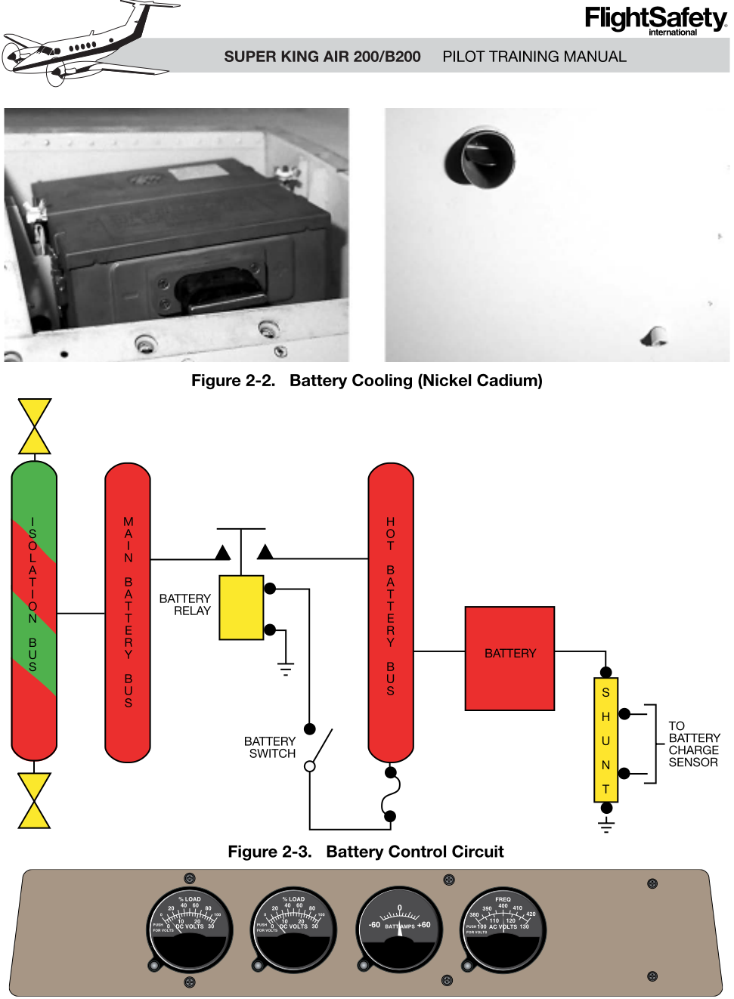

## SUPER KING AIR 200/B200 PILOT TRAINING MANUAL

annunciator to illuminate (Figure 2-5), alerting the flight crew that the battery charge current is above normal. Following a battery-powered engine start, the battery recharge current is very high and causes illumination of the BATTERY CHG annunciator, thus providing an automatic self test of the detector and the battery. As the battery approaches a full charge and the charge current decreases to a satisfactory level, the annunciator will extinguish. This will normally occur within a few minutes after an engine start, but it may require a longer time if the battery has a low state of charge initially before engine start, or if it is exposed to low or high temperatures. In flight this alerts the pilot that conditions may exist that could eventually damage the battery. If the BATTERY CHG annunciator illuminates, the pilot should turn the battery switch to OFF. If the annunciator remains on after the BAT switch is moved to the OFF position during the check, a malfunction is indicated in either the battery system or charge current detector, in which case the airplane should be landed as soon as practicable. This system is designed for continuous monitoring of the battery condition.

Figure 2-5. BATTERY CHG Annunciator

## GENERATORS

Two 30-volt, regulated to 28.25 ± .25 volts, 250-ampere starter-generators connected in parallel provide normal DC power (Figure 2-6). Either one of the generators can supply the entire electrical load.

## NOTE

Optional 300-ampere starter-generators are available and installed on some airplanes.

Figure 2-6. Generator

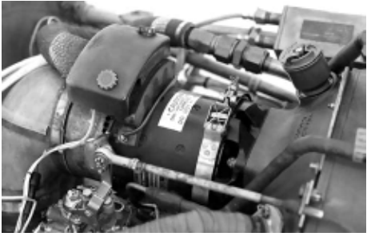

Starter power to each starter-generator is provided from the main battery bus through a starter relay. The start cycle is controlled by a three-position switch for each engine labeled IGNITION AND ENGINE START. When placed to the ON (up) position, the switch becomes mechanically locked and must be pulled out to reposition. When held to the down position, labeled STARTER ONLY, the associated engine will motor, but ignition will not occur. When released, the spring-loaded switch will move to the center position, which is labeled OFF.

During an engine start, the starter-generator, drives the compressor section of the engine through the accessory gearing. The starter- generator, in the start mode, could initially draw approximately 1,100 amperes, and then drop rapidly to about 300 amperes as the engine reaches 20% N1. When the engine reaches approximately 35%, it drives the starter. After the condition lever is set to high idle (approximately 70%), the generator can be turned on.

The generator operation is controlled by individual generator switches located on the pilot's left subpanel under the MASTER SWITCH gang bar with the BAT switch. As shown in Figure 2-7, the switches are labeled GEN 1 and GEN 2. In order to turn the generator on, the control switch must be held upward in the GEN RESET position (Figure 2-7) for a minimum of one second, then released to the ON position. (Prior to BB-88, the generator switches do not have the reset position.)

FlightSafety

## SUPER KING AIR 200/B200 PILOT TRAINING MANUAL

Figure 2-7. Generator Switches

Figure 2-8 shows that power to the bus system from the generators is protected by Generator Control Units (GCU). For BB-88 and after, the GCU operates a line contactor relay to protect the generator. Prior to BB-88, reverse-current protection is provided by a unit in line with the generator output.

The generators are controlled by individual generator control units, which maintain a constant voltage during variations in engine speed and electrical load requirements. The voltage regulating circuit will automatically connect or disconnect a generator's output to the bus. The load on each generator is indicated by the respective left and right volt-loadmeter (Figure 2-8) on the overhead panel which reads in percent of the generator's maximum continuous capacity. Normally, this value is 250 amps; therefore, a loadmeter reading of .5, or 50%, is equal to 125 amps of generator output.

## NOTE

The generators will drop off the line if underexcitation, overexcitation, overvoltage, or undervoltage conditions exist.

## GROUND POWER

For ground operation, a ground power receptacle, located under the right wing outboard of the nacelle, is provided for connecting a ground power unit (Figure 2-9). A relay in the external power circuit will close only if:

1. The ground power source polarity is correct.
2. The BAT SWITCH is on.
3. The GPU voltage is not greater than 32 volts (BB-364 and subsequent).

## NOTE

Prior to BB-364, the battery switch does not have to be on to apply ground power (Figure 2-10).

For starting, an external power source capable of supplying up to 1,000 amperes (300 amperes maximum continuous) should be used. A caution light on the caution advisory annunciator panel labeled EXT PWR is provided to alert the operator when a ground power plug is connected to the airplane. Some earlier airplanes used a switch to sense power plug connection, and later airplanes incorporated an electronic circuit utilizing the small pin of the plug (Figure 2-10).

internationa FlightSafety

## SUPER KING AIR 200/B200 PILOT TRAINING MANUAL

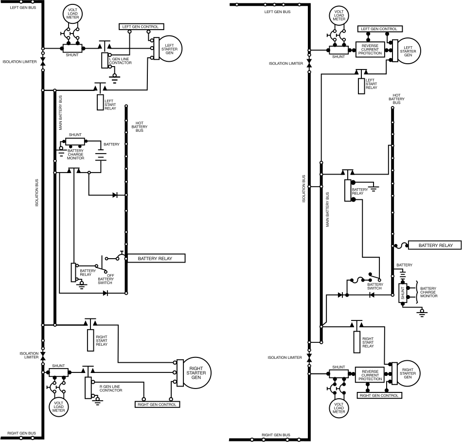

BB-88 AND AFTER

PRIOR TO BB-88

Figure 2-8. Generator Control Circuit

internationa FlightSafety

## SUPER KING AIR 200/B200 PILOT TRAINING MANUAL

Figure 2-9. Ground Power Connector

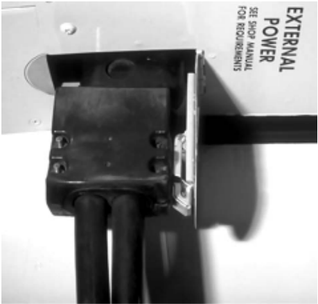

## CAUTION

Never connect an external power source to the airplane unless a battery indicating a charge of at least 20 volts is in the airplane. If the battery voltage is less than 20 volts, the battery must be recharged, or replaced with a battery indicating at least 20 volts, before connecting ground power.

Observe the following precautions when using a ground power source:

1. Use only a ground power source that is negatively grounded. If polarity of the power source is unknown, determine the polarity with a voltmeter before connecting the unit to the airplane.
2. Before connecting a ground power unit, turn off the avionics master power switch and the generator switches, and turn the battery switch on.

Figure 2-10. External Power Circuit

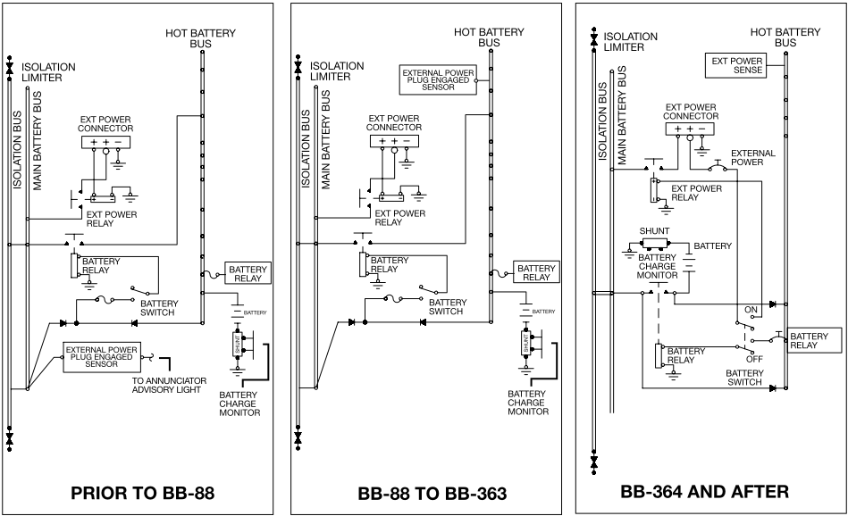

internationa FlightSafety

## SUPER KING AIR 200/B200 PILOT TRAINING MANUAL

## CAUTION

Voltage is required to energize the avionics master power relays to remove the power from the avionics equipment. Therefore, never apply ground power to the airplane without first applying battery voltage. If the battery is removed from the airplane or if the battery switch is to be placed in the OFF position, turn each individual radio and other avionics equipment off.

3. After the external power plug is connected and power is applied, leave the battery on during the entire ground power operation to protect transistorized equipment against transient voltage spikes.

## CAUTION

The battery may be damaged if exposed to voltages higher than 30 volts for more than two minutes.

Only use a ground power source fitted with an AN2552-type plug. If uncertain of the polarity, check it with a voltmeter to ensure that it is a negative-ground plug. Connect the positive lead to the larger center post of the receptacle, and connect the negative-ground lead to the remaining large post. The small post is the polarizing pin; it must have a positive voltage applied to it in order for the external power relay to close.

## Controls and Indicators

Electrical control switches are conveniently located on the pilot's left subpanel (Figure 2-11). The battery switch and the two generator switches are positioned under a hinged flap labeled MASTER SWITCH, commonly referred to as the gang bar. When this flap is depressed, the battery and both generators are switched off.

Electrical component indication is through lights on the annunciator panel or meters on the overhead panel (Figure 2-12).

Figure 2-11. MASTER SWITCHES

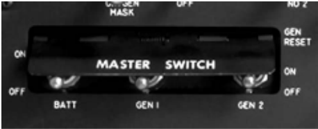

Figure 2-12. Lights and Meters

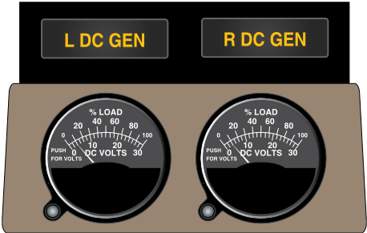

When a generator is off the line, the respective amber L or R DC GEN caution annunciator illuminates. There are also optional red GEN OVHT warning lights to warn of a generator overheat condition on B200 airplanes.

For NiCad batteries, in the event of an excessive battery charge rate, the amber BATTERY CHG light comes on.

The generator loadmeters indicate generator amperage in percent of 250 amps per generator and the associated meter button must be pressed to indicate bus voltage.

## DISTRIBUTION

The battery is connected to a hot battery bus (Figure 2-13) which powers threshold lights, the fire extinguishing system, firewall shutoff valves, the battery relay, ground communications, auxiliary DC bus (if installed), external power light (BB-88 and after), RNAV memory, stereo, and prior to BB-1098 (excluding BB-1096), standby boost pumps. With the battery switch on, power is fed to the main battery bus, which is connected through the start relays to both

internationa FlightSafety

## SUPER KING AIR 200/B200 PILOT TRAINING MANUAL

starter-generators. The main battery bus feeds the isolation bus and, through two 325-ampere isolation limiters (current limiters), connects the left and right generator buses together.

When the battery, generators, or GPU are providing power, the isolation bus, L generator bus, and R generator bus function as one unit, as long as both current limiters are not open. There are four subbuses fed by both the left and right generator buses. They are labeled No. 1 through No. 4 DUAL FED BUS. Each subbus is fed from either side through a 60-ampere current limiter, a 70-ampere reverse current diode, and a 50-ampere circuit breaker which is accessible to the crew. There are eight of these 50-amp feeder breakers. Four are located on the copilot's side panel for the No. 1 and No. 2 subbuses, and on the fuel panel circuit breaker bus for the No. 3 and No. 4 subbuses. Of those items with paired circuits such as the left and right landing lights, the distribution will be such that the left circuit is on the No. 1 or No. 3 dual fed bus and the right is on the No. 2 or No. 4.

Generally, dual fed bus No. 1 and No. 2 run in alternating rows on the copilot's circuit breaker panel (excluding the avionics section). Dual fed bus No. 3 and No. 4 are on the pilot's circuitbreaker panel.

Figure 2-13. Electrical Distribution

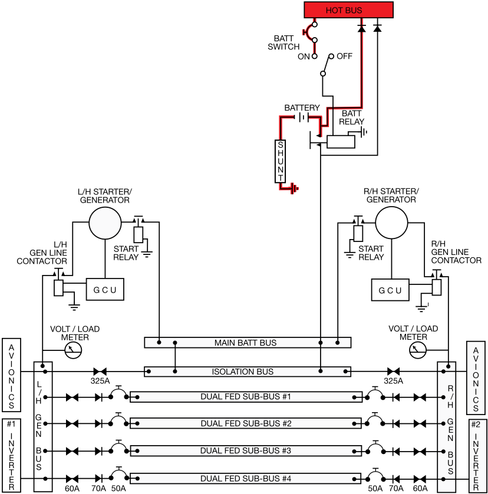

internationa

## SUPER KING AIR 200/B200 PILOT TRAINING MANUAL

With BB-1484, 1486 and subsequent, dualpowered engine instruments are also on the pilot's circuit breaker panel and they are powered by No. 1 dual fed bus (left engine instruments), No. 2 dual fed bus (right engine instruments), or by the isolation bus (should either of the subbuses fail).

See Figure 2-14 for the pilot's circuit-breaker panel distribution. See Figure 2-15 for the copilot's circuit-breaker panel distribution.

## OPERATION

The DC electrical system is activated by turning the battery switch on, then after the engines are stabilized, turning the generators on. Monitor the generator loadmeters and all electrical indicating lights throughout the flight.

If the pilot suspects a NiCad battery malfunction, he should refer to the Battery Condition Check procedures, in the Normal Procedures section of the Aircraft Flight Manual.

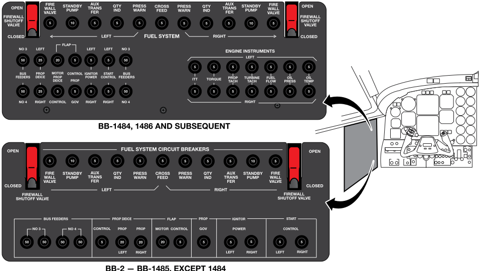

BB-2 - BB-1485, EXCEPT 1484

Figure 2-14. Circuit-Breaker Panels-Pilot's

internationa

## SUPER KING AIR 200/B200 PILOT TRAINING MANUAL

BB-1484, 1486 AND SUBSEQUENT

BB-1439, 1444-1485, EXCEPT 1463 AND 1484.

Figure 2-15. Circuit-Breaker Panels-Copilot's (1 of 2)

## SUPER KING AIR 200/B200 PILOT TRAINING MANUAL

B-2 THROUGH BB-1443, EXCEPT 1439

Figure 2-15. Circuit-Breaker Panels-Copilot's (2 of 2)

## AVIONICS MASTER SWITCH

The avionics power relays are normally closed and supply power to the buses. Note that the relays require DC power to open and disconnect the avionics buses (Figure 2-16).

Typical avionics bus distribution for an EFIS equipped aircraft is shown in Figure 2-17.

## AC POWER INVERTERS

Either one of two inverters (Figure 2-18) provides the AC power. The inverters are installed in the wing center section outboard of each nacelle. Each inverter provides both 115-volt and 26-volt, 400-Hertz power to be used for avionics equipment and engine instruments.

## CONTROLS AND INDICATIONS

If the airplane has an AC VOLT-FREQ meter, inverter output can be monitored. The meter normally reads frequency (Figure 2-19) but will display volts when the button is depressed.

Figure 2-16. Avionic Power Distribution

FlightSafety

## SUPER KING AIR 200/B200 PILOT TRAINING MANUAL

Figure 2-17. Typical Avionics Bus Distribution (EFIS Equipped Aircraft)

internationa FlightSafety

## SUPER KING AIR 200/B200 PILOT TRAINING MANUAL

Figure 2-18. Inverters

Figure 2-19. Volt-Frequency Meter

Inverter operation is controlled by an INVERTER select switch (Figure 2-20) on the pilot's left subpanel. Selection of either inverter activates the inverter power relay and supplies inverter input power. Only one inverter operates at a time.

In the event the inverter fails, a red INVERTER (INST INV on 200 models) light on the warning annunciator panel will illuminate.

## DISTRIBUTION

The inverter system described here is the standard installation. The circuit diagram in ATA chapter format 24-20 of the Wiring Diagram Manual provides a circuit routing of the DC and AC power for the standard airplane instrumentation. Due to the wide variety of customer-requested avionics options installed in the airplane, the avionics diagrams are supplied with each airplane to provide the avionics portion of the AC power system. These wiring diagrams will show any modifications, which have been made to the standard installation (Figure 2-21 through Figure 2-25).

## OPERATION

Turn the INVERTER select switch to either inverter position, note that the INVERTER (INST INV on 200 models) warning light extinguishes, and then monitor the VOLT-FREQ meter.

internationa

## 2 ELECTRICAL POWER SYSTEMS

FlightSafety

## SUPER KING AIR 200/B200 PILOT TRAINING MANUAL

internationa

## Figure 2-20. Inverters Control Circuit

FlightSafety

## SUPER KING AIR 200/B200 PILOT TRAINING MANUAL

internationa FlightSafety FlightSafety

Figure 2-21. Electrical System-Super King Air B200 (BB-1484, 1486 and Subsequent; BW-1 and Subsequent)

## SUPER KING AIR 200/B200 PILOT TRAINING MANUAL

Figure 2-22. Electrical System-Super King Air B200 (BB-1449, 1458-1462, 1464-1485, Except 1484; BL-139, 140)

internationa FlightSafety

## SUPER KING AIR 200/B200 PILOT TRAINING MANUAL

Figure 2-23. Electrical System-Super King Air B200 (BB-1439, 1444-1448, 1450-1457)

internationa FlightSafety

## SUPER KING AIR 200/B200 PILOT TRAINING MANUAL

Figure 2-24. Electrical System-Super King Air B200 (BB-734, 793, 829, 854-870, 874-891, 894, 896-911, 913-1438, 1440-1443, BL 37-138)

internationa FlightSafety

## SUPER KING AIR 200/B200 PILOT TRAINING MANUAL

Figure 2-25. Electrical System-Super King Air 200 (BB-2, 6-733, 735-792, 794-828, 830-853, 871-873, 892, 893, 895, 912, BL-1-36)

internationa

## LIMITATIONS

## GENERATOR LIMITS (250 AMPERES)

Maximum sustained generator load (Table 2-1) is limited as follows:

## In Flight:

| Sea Level to 31,000 feet altitude........................   |   1.00 | (100%)   |
|-------------------------------------------------------------|--------|----------|
| Above 31,000 feet altitude ...............                  |   0.88 | (88%)    |
| Ground Operation ............................               |   0.85 | (85%)    |

During ground operation, also observe the limitations in Table 2-1.

Table 2-1. LIMITATIONS-GROUND OPERATIONS

| GENERATOR LOAD                 | MINIMUM GAS GENERATOR RPM-N1 - WITHOUT AIR CONDITIONING   | MINIMUM GAS GENERATOR RPM-N1 - WITH AIR CONDITIONING   |
|--------------------------------|-----------------------------------------------------------|--------------------------------------------------------|
| 0 to 70%                       | 52%                                                       | 60%                                                    |
| 70 to 75%                      | 55%                                                       | 60%                                                    |
| 75 to 80%                      | 60%                                                       | 60%                                                    |
| 80 to 85%                      | 65%                                                       | 65%                                                    |
| BB - 1439, 1444 AND SUBSEQUENT | BB - 1439, 1444 AND SUBSEQUENT                            | BB - 1439, 1444 AND SUBSEQUENT                         |
| 0 to 70%                       | 61%                                                       | 62%                                                    |
| 75 to 80%                      | 61%                                                       | 62%                                                    |
| 80 to 85%                      | 65%                                                       | 62%                                                    |

## STARTERS

Use of the starter is limited to 40 seconds ON, 60 seconds OFF, 40 seconds ON, 60 seconds OFF, 40 seconds ON, then 30 minutes OFF.

## INVERTERS

Due to avionics equipment requirements, the 115-volt inverter output must be 105-120 VAC, 380-420 Hz.

## CIRCUIT BREAKERS

Table 2-2 to Table 2-4 give circuit breaker titles, values, and the circuits that they control. They are grouped by panel location.

FlightSafety

## SUPER KING AIR 200/B200 PILOT TRAINING MANUAL

Table 2-2. FUEL CONTROL CIRCUIT-BREAKER PANEL

| CIRCUIT BREAKER NAME                                 | CAPACITY            | PROVIDES POWER TO                                                                             |
|------------------------------------------------------|---------------------|-----------------------------------------------------------------------------------------------|
| 1. FUEL SYSTEM                                       |                     |                                                                                               |
| A. AUX TRANSFER (L & R)                              | 5 AMP               | TRANSFER SELECT SWITCH NO TRANSFER LIGHT AUX TANK FLOAT SWITCH MOTIVE FLOW VALVE              |
| B. CROSSFEED                                         | 5 AMP               | CROSSFEED SWITCH CROSSFEED VALVE AUX FUEL TRANSFER MODULE                                     |
| C. FIREWALL VALVE (L & R)                            | 5 AMP               | FIREWALL VALVE SWITCH FIREWALL VALVE                                                          |
| D. FUEL PRESSURE WARNING (L & R)                     | 5 AMP               | FUEL PRESS SWITCH FUEL PRESS WARNING LIGHT AUX FUEL TRANSFER MODULE                           |
| E. FUEL QUANTITY INDICATOR (L & R)                   | 5 AMP               | INDICATOR POWER                                                                               |
| F. STANDBY PUMP (L & R)                              | 10 AMP              | STANDBY PUMP SWITCH AUX TRANSFER PCB                                                          |
| G. BUS FEEDERS NO. 3 (L & R) NO. 4 (L & R)           | 50 AMP 50 AMP       | NO. 3 DUAL-FED BUS NO. 4 DUAL-FED BUS                                                         |
| 2. FLAP                                              |                     |                                                                                               |
| A. MOTOR                                             | 20 AMP              | MOTOR RELAY AND MOTOR POWER                                                                   |
| B. CONTROL                                           | 5 AMP               | FLAP POTENTIOMETER (POSITION XMTR) SPLIT FLAP HOBBS METER FLAP POSITION INDICATOR             |
| 3. PROP                                              |                     |                                                                                               |
| A. GOVERNOR                                          | 5 AMP               | OVERSPEED GOVERNOR TEST SWITCH                                                                |
| B. PROP DEICE (1) CONTROL (2) PROP (L & R)           | 5 AMP 20 AMP 25 AMP | SPLIT FLAP DEICE POWER DEICE POWER (BB-1439, 1444 AND SUBSEQUENT)                             |
| 4. START CONTROL                                     |                     |                                                                                               |
| A. CONTROL (L & R)                                   | 5 AMP               | ENGINE START SWITCH STARTER RELAY IGNITER AND PURGE VALVE CONTROL AUTOIGNITION CONTROL SWITCH |
| B. CONTROL (L & R)                                   | 5 AMP               | IGNITER POWER IGNITER PURGE VALVE HOBBS METER FLAP POSITION INDICATOR                         |
| 5. ENGINE INSTRUMENTS (BB-1484, 1486 AND SUBSEQUENT) |                     |                                                                                               |
| A. ITT (L & R)                                       | 5 AMP               | GAGE POWER                                                                                    |
| B. TORQUE (L & R)                                    | 5 AMP               | GAGE POWER                                                                                    |
| C. PROP TACH (L & R)                                 | 5 AMP               | GAGE POWER                                                                                    |
| D. TURBINE TACH (L & R)                              | 5 AMP               | GAGE POWER                                                                                    |
| E. FUEL FLOW (L & R)                                 | 5 AMP               | GAGE POWER                                                                                    |
| F. OIL PRESS (L & R)                                 | 5 AMP               | GAGE POWER                                                                                    |
| G. OIL TEMP (L & R)                                  | 5 AMP               | GAGE POWER                                                                                    |

internationa

## SUPER KING AIR 200/B200 PILOT TRAINING MANUAL

Table 2-3. RIGHT SIDE CIRCUIT-BREAKER PANEL

| CIRCUIT                    | BREAKER NAME                                             | CAPACITY    | PROVIDES POWER TO                                                                                                         |
|----------------------------|----------------------------------------------------------|-------------|---------------------------------------------------------------------------------------------------------------------------|
| 1. ELECTRICAL DISTRIBUTION |                                                          |             |                                                                                                                           |
| A.                         | NO. 1 BUS FEEDERS (L & R)                                | 50 AMP      | NO. 1 DUAL FED BUS                                                                                                        |
| B.                         | NO. 2 BUS FEEDERS (L & R)                                | 50 AMP      | NO. 2 DUAL FED BUS                                                                                                        |
| C.                         | GEN CONTROL (L & R)                                      | 10 AMP      | GENERATOR CONTROL SWITCH GENERATOR CONTROL PANEL                                                                          |
| 2.                         | INVERTER CONTROL (BB-1439, 1444-1448,                    | 1450-1457   | AND PRIOR)                                                                                                                |
| A.                         | NO. 1                                                    | 5 AMP       | NO. 1 INVERTER CONTROL SWITCH AND CONTROL RELAY                                                                           |
| B.                         | NO. 2                                                    | 5 AMP       | NO. 2 INVERTER CONTROL SWITCH AND CONTROL RELAY                                                                           |
| 3.                         | ENGINE                                                   |             |                                                                                                                           |
| A.                         | AUTOFEATHER                                              | 5 AMP       | POWER LEVER ARM SWITCHES AUTOFEATHER ARM SWITCHES (400 & 200 FT-LB)                                                       |
| B.                         | CHIP DETECTOR                                            | 5 AMP       | BB 1-162, CHIP DETECTOR AND LIGHT                                                                                         |
| C.                         | CHIP DETECTOR (L & R)                                    | 5 AMP       | BB 163 AND SUBSEQUENT L & R CHIP DETECTOR AND L & R CHIP DETECTOR LIGHTS                                                  |
| D.                         | FIRE DETECT                                              | 5 AMP       | TERMINAL BOARD AMPLIFIER (PRIOR TO BB-1444, EXCEPT 1439) DETECTOR AND TEST SWITCH                                         |
| E.                         | FUEL CONTROL HEAT                                        | 7.5 AMP     | L & R FUEL CONTROL HEAT SWITCH (THROTTLE QUADRANT) L & R FUEL CONTROL PNEUMATIC LINE HEAT (PRIOR TO BB-1444, EXCEPT 1439) |
| F.                         | FUEL DRAIN COLLECTOR PUMP                                | 5 AMP       | L & R COLLECTOR FLOAT SWITCH AND COLLECTOR PUMP (BB 2-665)                                                                |
| G.                         | FUEL FLOW (L & R)                                        | 2 AMP 5 AMP | BB 2-224 FUEL FLOW INDICATOR AND TRANSMITTER (AC) BB 225-1483, 1485 FUEL FLOW INDICATOR AND TRANSMITTER (DC)              |
| H.                         | ENGINE INSTRUMENT POWER                                  | 7.5 AMP     | BB-1484, 1486 AND SUBSEQUENT                                                                                              |
| I.                         | ICE VANE CONTROL (L & R) (PRIOR TO BB-1444, EXCEPT 1439) | 5 AMP       | L & R ICE VANE CONTROL SWITCH ICE VANE SENSE MODULE ICE VANE ACTUATOR                                                     |
| J.                         | MN ENG ANTI-ICE (L & R) (BB-1439, 1444 AND SUBSEQUENT)   | 5 AMP       | L & R MN ENG ANTI-ICE CONTROL SWITCH MN ENG ANTI-ICE SENSE MODULE MN ENG ANTI-ICE ACTUATOR                                |
| K.                         | STBY ENG ANTI-ICE (L & R) (BB-1439, 1444 AND SUBSEQUENT) | 5 AMP       | L & R STBY ENG ANTI-ICE CONTROL SWITCH STBY ENG ANTI-ICE SENSE MODULE STBY ENG ANTI-ICE ACTUATOR                          |
| L.                         | OIL PRESS (L & R) (PRIOR TO BB-1486, EXCEPT 1484)        | 5 AMP       | OIL PRESSURE INDICATOR AND TRANSMITTER                                                                                    |
| M.                         | OIL TEMP (L & R) (PRIOR TO BB-1486, EXCEPT 1484)         | 5 AMP       | OIL TEMP INDICATOR AND TRANSMITTER                                                                                        |
| N.                         | TORQUEMETER (L & R) (PRIOR TO BB-1486, EXCEPT 1484)      | 2 AMP       | TORQUE INDICATOR AND TRANSMITTER AC                                                                                       |
| O.                         | PROP SYNC                                                | 5 AMP       | PROP SYNCHROPHASER CONTROL BOX SYNCH CONTROL SWITCH                                                                       |

FlightSafety

## SUPER KING AIR 200/B200 PILOT TRAINING MANUAL

Table 2-3. RIGHT SIDE CIRCUIT-BREAKER PANEL (Cont)

| CIRCUIT BREAKER NAME      | CAPACITY   | PROVIDES POWER TO                                                                                                                                                                                     |
|---------------------------|------------|-------------------------------------------------------------------------------------------------------------------------------------------------------------------------------------------------------|
| 4. ENVIRONMENTAL          |            |                                                                                                                                                                                                       |
| A. BLEED-AIR CONT (L & R) | 5 AMP      | BLEED AIR CONTROL SWITCH ANNUN BLEED AIR OFF LIGHT FLOW CONTROL PACKAGE PNEUMATIC SHUTOFF VALVE RUDDER BOOST                                                                                          |
| B. OXYGEN                 | 5 AMP      | BB 54 AND SUBSEQUENT - PASSENGER O2 MASKS 12,500 FT PRESSURE SWITCH                                                                                                                                   |
| C. PRESS CONT             | 5 AMP      | LEFT SQUAT SWITCH PEDESTAL PRESS CONTROL SWITCH SAFETY VALVE DUMP SOLENOID EVAPORATOR DOOR SOLENOID CABIN DOOR SOLENOID                                                                               |
| D. TEMP CONTROL           | 5 AMP      | VENT BLOWER CONTROL SWITCH LEFT SQUAT SWITCH AMBIENT AIR VALVES AND PCB BB 1-450 RADIANT HEAT CONTROL SWITCH BB 450 AND SUBSEQUENT RADIANT HEAT POWER CIRCUIT BREAKER CABIN TEMP MODE SELECTOR SWITCH |
| 5. FLIGHT                 |            |                                                                                                                                                                                                       |
| A. PITCH TRIM             | 5 AMP      | PEDESTAL ELECTRIC ELEVATOR TRIM SWITCH TRIM MOTOR                                                                                                                                                     |
| B. RUDDER BOOST           | 5 AMP      | PEDESTAL ON/OFF SWITCH DIFFERENTIAL PRESSURE SWITCH RUDDER BOOST SOLENOIDS                                                                                                                            |
| C. TURN AND SLIP          | 5 AMP      | TURN AND SLIP INDICATOR                                                                                                                                                                               |
| D. ENCODING ALTIMETER     | 1 AMP      | ALTIMETER (ENCODING)                                                                                                                                                                                  |
| 6. LIGHTS                 |            |                                                                                                                                                                                                       |
| A. AVIONICS AND ENG INST  | 5 AMP      | RADIO AND ENGINE INSTRUMENT LIGHTS PILOT AND COPILOT CLOCK AND MAP LIGHTS                                                                                                                             |
| B. FLIGHT INST            | 7.5 AMP    | OVERHEAD PANEL AND TERMINAL BOARD PILOT & COPILOT FLIGHT INST LIGHTS                                                                                                                                  |
| C. FSB & NO SMOKE CABIN   | 5 AMP      | FASTEN SEAT BELT/CABIN NO SMOKING LIGHTS CABIN FLUORESCENT LIGHTS CABIN WARNING CHIME                                                                                                                 |
| D. INST INDIRECT          | 5 AMP      | GLARESHIELD LIGHTS OVERHEAD PANEL APPROACH PLATE LIGHTS                                                                                                                                               |
| E. SIDE PANEL             | 5 AMP      | RIGHT SIDE CIRCUIT BREAKER PANEL LIGHTS FUEL PANEL LIGHTS AVIONICS PANEL LIGHTS OVERHEAD PANEL OR PILOT'S RIGHT SUBPANEL                                                                              |

internationa

## SUPER KING AIR 200/B200 PILOT TRAINING MANUAL

Table 2-3. RIGHT SIDE CIRCUIT-BREAKER PANEL (Cont)

| CIRCUIT BREAKER NAME         | CAPACITY   | PROVIDES POWER TO                                                                                                                                                               |
|------------------------------|------------|---------------------------------------------------------------------------------------------------------------------------------------------------------------------------------|
| 7. WARNING                   |            |                                                                                                                                                                                 |
| A. ANNUN INDICATOR           | 5 AMP      | ANNUN N1 LOW LIGHT ANNUN INVERTER OUT LIGHT ICE VANE PCB O2 PRESS SWITCH CABIN ALT WARN PRESS SWITCH (12,500) BATTERY CHARGE MODULE DUCT OVERTEMP SWITCH ALTITUDE WARNING LIGHT |
| B. ANNUN POWER               | 5 AMP      | 28V ANNUNCIATOR CONTROL CARD MASTER WARNING LIGHTS MASTER CAUTION LIGHTS CAUTION LEGEND SWITCH                                                                                  |
| C. BLEED AIR WARNING (L & R) | 5 AMP      | BLEED AIR WARN LIGHTS BLEED AIR WARN PRESS SWITCH                                                                                                                               |
| D. LANDING GEAR INDICATOR    | 5 AMP      | GREEN GEAR DN LIGHTS RED GEAR HANDLE LIGHTS                                                                                                                                     |
| E. LANDING GEAR WARNING      | 5 AMP      | GEAR WARNING HORN & FLASHER GEAR WARNING HORN SILENCE BUTTON & RELAY                                                                                                            |
| F. STALL WARNING             | 5 AMP      | POWER TO STALL WARNING LIFT COMPUTER                                                                                                                                            |
| 8. WEATHER                   |            |                                                                                                                                                                                 |
| A. BRAKE DEICE               | 5 AMP      | LEFT UPLOCK SWITCH BATTERY CHARGE/ DEICE MODULE BRAKE DEICE SWITCH DEICE BLEED AIR VALVES                                                                                       |
| B. FUEL VENT HEATERS (L & R) | 5 AMP      | HEATER SWITCH HEATER ELEMENTS                                                                                                                                                   |
| C. SURFACE DEICE             | 5 AMP      | SURFACE DEICE SWITCH DEICE DISTRIBUTOR VALVE TIME DELAY PCB                                                                                                                     |
| D. WINDSHIELD WIPERS         | 10 AMP     | OVERHEAD PANEL SWITCH WIPER MOTOR POWER                                                                                                                                         |
| 9. AVIONICS                  |            |                                                                                                                                                                                 |
| A. AVIONICS MASTER           | 5 AMP      | AVIONICS MASTER SWITCH TO KEEP AVIONICS OFF                                                                                                                                     |
| B. AVIONICS NO. 1            | 30 AMP     | AVIONICS BUS NO. 1 FEEDER                                                                                                                                                       |
| C. AVIONICS NO. 2            | 30 AMP     | AVIONICS BUS NO. 2 FEEDER                                                                                                                                                       |

FlightSafety

## SUPER KING AIR 200/B200 PILOT TRAINING MANUAL

Table 2-4. PILOT'S RIGHT SUBPANEL CIRCUIT-BREAKER SWITCHES

| CIRCUIT BREAKER NAME   | CIRCUIT BREAKER NAME                   | CAPACITY          | PROVIDES POWER TO                                                                          |
|------------------------|----------------------------------------|-------------------|--------------------------------------------------------------------------------------------|
| 1.                     | ICE PANEL                              |                   |                                                                                            |
|                        | A. PITOT (L & R)                       | 7.5 AMP           | POWER TO PITOT ELEMENTS                                                                    |
|                        | B. PROP (AUTO/OFF)                     | 20 AMP 25 AMP     | POWER TO PROP DEICE AMMETER AND DEICE TIMER BB-1439, 1444 AND SUBSEQUENT                   |
|                        | C. STALL WARN                          | 5 AMP             | FIREWALL VALVE SWITCH                                                                      |
| 2.                     | LANDING GEAR                           |                   |                                                                                            |
|                        | A. LANDING GEAR RELAY                  | 5 AMP             | LANDING GEAR CONTROL SWITCH RVS NOT READY ANNUNCIATOR POWER                                |
|                        | B. LANDING GEAR RELAY (HYDRAULIC GEAR) | 2 AMP             | LANDING GEAR CONTROL SWITCH HYD FLUID LOW LIGHT RVS NOT READY ANNUNCIATOR POWER            |
| 3.                     | LIGHTS                                 |                   |                                                                                            |
|                        | A. ICE                                 | 5 AMP             | ICE LIGHTS                                                                                 |
|                        | B. LANDING LIGHTS (L & R)              | 10 AMP            | LANDING LIGHTS                                                                             |
|                        | C. NAV LIGHT                           | 5 AMP             | NAV LIGHTS                                                                                 |
|                        | D. TAIL FLOODLIGHT                     | 15 AMP            | TAIL FLOODLIGHTS OVERHEAD PANEL LIGHTS                                                     |
|                        | E. RECOG LIGHTS                        | 15 AMP OR 7.5 AMP | BB 50-177 RECOG LIGHT RELAY AND LIGHTS (2 BULB) BB 178 AND SUBSEQUENT RECOG LIGHT (1 BULB) |
| F.                     | TAXI LIGHT                             | 15 AMP            | TAXI LIGHT                                                                                 |
| G.                     | BEACON                                 | 10 AMP            | BEACONS                                                                                    |
|                        | H. STROBE                              | 5 AMP             | STROBE POWER SUPPLY & STROBE TUBE                                                          |

internationa

1. What is the rating for the battery?
- A. 28-volt, 24 ampere-hour
- B. 24-volt, 34/36 ampere-hour
- C. 28-volt, 34/36 ampere-hour
- D. 24-volt, 42 ampere-hour
2. Where is the battery located?
- A. In the left wing center section
- B. In the aft compartment
- C. In the right wing center section
- D. In the nose compartment
3. If the amber BATTERY CHG annunciator illuminates in flight, what initial action does the checklist say to do?
- A. Turn the battery switch OFF
- B. Reduce the electrical load
- C. Isolate the battery bus
- D. Reset the annunciator
4. What is the individual generator rating?
- A. 30-volt, 200-ampere
- B. 24-volt, 300-ampere
- C. 28-volt, 250-ampere
- D. 32-volt, 250-ampere
5. Where are the generator switches located?
- A. Under a gang bar on the overhead panel
- B. On the center instrument panel
- C. Under a gang bar on the pilot's left subpanel
- D. On the copilot's subpanel

## SUPER KING AIR 200/B200 PILOT TRAINING MANUAL

## QUESTIONS

6. On airplanes with Serial Nos. BB-88 and subsequent, how is a generator turned on?
- A. Move the switch to OFF, then to ON
- B. Hold the switch to RESET for one second and release to ON
- C. Move the switch to ON
- D. Hold the switch to ON for one second
7. When an engine is being started, in what position should its GEN switch be?
- A. RESET
- B. ON
- C. OFF
8. When a generator is off line, what indication is present?
- A. An amber DC GEN light is on
- B. No indications are present
- C. A green DC GEN light is on
- D. A red DC GEN light is on
9. Where is the external power connector located?
- A. Under the left wing
- B. On the left aft fuselage
- C. Under the right wing, outboard of the engine nacelle
- D. On the right forward fuselage
10. How much continuous current should the external power unit be capable of supplying?
- A. 100 amperes
- B. 300 amperes
- C. 800 amperes
- D. 1,000 amperes

FlightSafety

## SUPER KING AIR 200/B200 PILOT TRAINING MANUAL

11. What indication is provided to alert the operator that an external power plug is connected to the airplane?
- A. An audible tone
- B. An EXT PWR light
- C. A master warning light
- D. Fluctuating generator meters
12. What is the minimum required battery voltage before using an external power unit?
- A. 28 volts
- B. 24 volts
- C. 22 volts
- D. 20 volts
13. Why should the BATtery switch be left on during use of external power?
- A. To charge the battery
- B. To energize the generator control units (GCU)
- C. To power the volt-loadmeters
- D. To protect against voltage spikes
14. To protect the battery from damage, the external power voltage must not go over what value for more than two minutes?
- A. 35 volts
- B. 30 volts
- C. 25 volts
- D. 24 volts
15. Prior to BB-1632, if the BATTERY CHG light does not extinguish in flight when the battery control switch is placed to OFF, what action should be taken?
- A. Pull the battery circuit breaker
- B. Reset the BATtery switch
- C. Turn one generator off
- D. Land at nearest suitable airport
16. How many inverters are there?
- A. 1
- B. 2
- C. 3
- D. 4
17. What is the rating of each inverter?
- A. 28-volt and 26-volt, 400 Hz
- B. 24-volt and 130-volt, 60 Hz
- C. 115-volt and 26-volt, 400 Hz
- D. 30-volt and 115-volt, 120 Hz
18. Where is the INVERTER switch located?
- A. On the copilot's right subpanel
- B. On the overhead panel
- C. On the copilot's right sidepanel
- D. On the pilot's left subpanel
19. After starting the right engine and turning the right generator on, what should the loadmeter reading decrease to before starting the left engine?
- A. 25% (.25 )
- B. 50% (.50 )
- C. 75% (.75 )
- D. 100% (1.00)
20. What are the starter limits?
- A. 40 seconds ON, 60 seconds OFF,
48. 40 seconds ON, 60 seconds OFF, 40 seconds ON, 30 minutes OFF
- B. 10 seconds ON, 30 seconds OFF,
50. 40 seconds ON, 60 seconds OFF, 60 seconds ON, 90 seconds OFF
- C. 20 seconds ON, 60 seconds OFF,
52. 20 seconds ON, 60 seconds OFF, 20 seconds ON, 90 minutes OFF
- D. 15 seconds ON, 50 seconds OFF,
54. 15 seconds ON, 60 seconds OFF, 10 seconds ON, 5 minutes OFF

internationa

## CHAPTER 3 LIGHTING

## CONTENTS

|                                                                                                                                                                                                                                                                   | Page    |
|-------------------------------------------------------------------------------------------------------------------------------------------------------------------------------------------------------------------------------------------------------------------|---------|
| INTRODUCTION...................................................................................................................                                                                                                                                   | 3-1     |
| GENERAL...............................................................................................................................                                                                                                                            | 3-1     |
| INTERIOR LIGHTING...........................................................................................................                                                                                                                                      | 3-3     |
| Cockpit.............................................................................................................................                                                                                                                              | 3-3     |
| Cabin ...............................................................................................................................                                                                                                                             | 3-5     |
| EXTERIOR LIGHTS..............................................................................................................                                                                                                                                     | 3-7     |
| Landing Lights.................................................................................................................                                                                                                                                   | 3-7     |
| Taxi Light.........................................................................................................................                                                                                                                               | 3-7     |
| Wing Ice Lights................................................................................................................                                                                                                                                   | 3-7     |
| Navigation Lights.............................................................................................................                                                                                                                                    | 3-7     |
| Recognition Lights...........................................................................................................                                                                                                                                     | 3-7     |
| Beacon Lights...................................................................................................................                                                                                                                                  | 3-7     |
| Strobe Lights....................................................................................................................                                                                                                                                 | 3-7     |
| Tail Floodlights................................................................................................................                                                                                                                                  | 3-7     |
| Airstair Floodlight............................................................................................................                                                                                                                                   | 3-8     |
| Under Step Lighting......................................................................................................... QUESTIONS........................................................................................................................... | 3-8 3-9 |

FlightSafety FlightSafety

## SUPER KING AIR 200/B200 PILOT TRAINING MANUAL

## ILLUSTRATIONS

| Figure   | Title                                                                                                                        | Page   |
|----------|------------------------------------------------------------------------------------------------------------------------------|--------|
| 3-1      | Overhead Lighting Controls........................................................................................           | 3-2    |
| 3-2      | Copilot's Left Subpanel...............................................................................................       | 3-2    |
| 3-3      | Pilot's Right Subpanel.................................................................................................      | 3-3    |
| 3-4      | Instrument and Panel Lights........................................................................................          | 3-3    |
| 3-5      | Console Lights.............................................................................................................  | 3-4    |
| 3-6      | Overhead Subpanel Lights..........................................................................................           | 3-4    |
| 3-7      | Copilot's Instrument Lights.........................................................................................         | 3-4    |
| 3-8      | OAT Gage.................................................................................................................... | 3-5    |
| 3-9      | Free Air Temperature Switch.......................................................................................           | 3-5    |
| 3-10     | Fluorescent Light Switch............................................................................................         | 3-5    |
| 3-11     | Passenger Warning Sign..............................................................................................         | 3-5    |
| 3-12     | Reading Lights............................................................................................................   | 3-6    |
| 3-13     | Threshold, Aisle, and Baggage Lights.........................................................................               | 3-6    |
| 3-14     | Landing and Taxi Lights..............................................................................................        | 3-7    |
| 3-15     | Exterior Lights............................................................................................................. | 3-8    |
| 3-16     | Airstair Floodlight.......................................................................................................   | 3-8    |
| 3-17     | Under Step Lighting....................................................................................................      | 3-8    |

internationa

## INTRODUCTION

The instruments are illuminated either internally or with post-type lights. General cabin lighting consists of overhead fluorescent lights and individual passenger reading lights. A passenger Fasten Seat Belt-No Smoking sign is provided. Both the airstair and baggage area are illuminated. Exterior lights consist of landing, taxi, ice inspection, navigation, recognition, beacon, strobe, and lights for the area around the airstair door. Optional lighting is available to illuminate the vertical tail fin.

## GENERAL

An overhead light control panel in the cockpit contains controls for instrument panel and cockpit lighting (Figure 3-1). Each light group has an individual rheostat switch labeled BRT-OFF. The MASTER PANEL LIGHTS switch controls power to the overhead light control panel lights, fuel control panel lights, engine instrument lights, radio panel lights, both subpanels and the console lights, pilot and copilot instrument lights, and gyro instrument lights. Separate rheostat switches individually control the instrument indirect lighting and the overhead floodlights.

## SUPER KING AIR 200/B200 PILOT TRAINING MANUAL

## CHAPTER 3 LIGHTING

## SUPER KING AIR 200/B200 PILOT TRAINING MANUAL

Figure 3-1. Overhead Lighting Controls

A Free-Air-Temperature gage is located on the left sidewall aft of the fuel panel. For BB-1439, 1444 and subsequent, a digital display indicates the free air temperature in Celsius. Prior to BB-1444, excluding 1439, an analog temperature display also indicates the temperature in Celsius.

A switch on the copilot's left subpanel labeled BRIGHT-DIM-OFF (prior to BB-1444, excluding 1439, it is labeled START/BRIGHTDIM-OFF) (Figure 3-2) controls the fluorescent overhead cabin lights. To the right of the interior light switch is a switch labeled NO SMOKE &amp; FSB-FSB-OFF. It controls the NO SMOKINGFASTEN SEAT BELT sign and the accompanying chimes.

Figure 3-2. Copilot's Left Subpanel

A pushbutton switch next to each light controls the individual passenger reading lights along the top of the cabin.

A switch just inside the airstair door aft of the doorframe controls a baggage-area light.

FlightSafety

## SUPER KING AIR 200/B200 PILOT TRAINING MANUAL

A threshold light located forward of the airstair door at floor level, and an aisle light located at floor level aft of the spar cover, are controlled by a switch next to the threshold light. When the airstair is open, these lights come on; when it is closed and locked, they automatically extinguish. A flush-mounted floodlight forward of the flaps in the bottom of the left wing and under the stair lights are also controlled by the threshold light switch. They illuminate the area around the airstair when it is open and the switch is turned on.

Switches for the landing lights, taxi light, ice lights, navigation lights, recognition lights, beacons, and strobe lights are located on the pilot's right subpanel (Figure 3-3). They are appropriately labeled as to the specific function.

Tail floodlights, if installed, are controlled by a switch located either on the overhead panel or the pilot's right subpanel.

Figure 3-3. Pilot's Right Subpanel

## INTERIOR LIGHTING

## COCKPIT

## Overhead Floodlights

These lights are designed to give general illumination for the cockpit area and are controlled by a rheostat on the overhead panel labeled OVERHEAD FLOODLIGHTS.

## Instrument Indirect Lights

These lights are located under the glareshield and illuminate the instrument panel.

## Pilot Flight Lights

The PILOT FLIGHT LIGHTS rheostat for the pilot's flight instrument area controls the internal or eyebrow post lights. The flight lights are shown in Figure 3-4.

Figure 3-4. Instrument and Panel Lights

## Pilot Gyro Instrument Lights

For EFIS equipped aircraft, the EADI and EHSI intensity are controlled by the EFIS dimming rheostats.

For non-EFIS equipped aircraft, the PILOT GYRO INSTRUMENT LIGHTS rheostat controls the pilot's gyro horizon and horizontal situation indicator on the pilot's flight panel.

## Avionics Panel Lights

The AVIONICS PANEL LIGHTS rheostat controls the illumination of the internal avionics panel lights.

## Overhead Subpanel and Console Lights

The rheostat labeled OVERHEAD SUBPANEL &amp; CONSOLE LIGHTS controls the lighting for the overhead subpanel and the throttle console (Figure 3-5 and Figure 3-6).

## Side Panel Lights

A rheostat labeled SIDE PANEL LIGHTS controls the lights on the left and right side panels.

internationa

## SUPER KING AIR 200/B200 PILOT TRAINING MANUAL

Figure 3-5. Console Lights

## Copilot's Gyro Instrument Lights

The COPILOT GYRO INSTRUMENT LIGHTS rheostat controls any gyro instruments on the copilot's flight panel.

## Copilot's Flight Lights

The COPILOT FLIGHT LIGHTS rheostat for the copilot's flight instrument area controls the external eyebrow or post lights (Figure 3-7).

Figure 3-7. Copilot's Instrument Lights

## Master Panel Lights Switch

The switch labeled MASTER PANEL LIGHTS controls power to the overhead light control panel, fuel control panel, engine instruments, radio panel, both subpanels, the console, and the pilot's and copilot's instrument lights. These lights can be adjusted individually with the individual rheostats, but are conveniently shut off or turned on with this MASTER PANEL light switch (Figure 3-1).

## Free Air Temperature Switch

On BB-1439, 1444 and subsequent aircraft, a seven segment digital display, located on the sidewall, indicates the free air temperature in Celsius. When the adjacent button is depressed, Fahrenheit is displayed (Figure 3-8).

Figure 3-6. Overhead Subpanel Lights

FlightSafety

## SUPER KING AIR 200/B200 PILOT TRAINING MANUAL

Figure 3-8. OAT Gage

Prior to BB-1444, excluding 1439, the switch labeled FREE AIR TEMP controls the post lights in the immediate area of the outside air temperature gage. The switch is located either next to the gage on the sidewall panel or on the overhead lighting control panel (Figure 3-9).

Figure 3-9. Free Air Temperature Switch

## CABIN

## Fluorescent Lights

The fluorescent cabin lights are controlled by a switch (Figure 3-10) on the copilot's subpanel. The switch positions are BRIGHT- DIM-OFF. (Prior to BB-1444, except 1439, this switch is labeled START/BRIGHT- DIM-OFF. The switch must be positioned to START/BRIGHT until the lights illuminate before being moved to DIM.)

Figure 3-10. Fluorescent Light Switch

## Passenger Warning Sign

A sign to warn passengers not to smoke and/or to fasten their seat belts (Figure 3-11) is controlled by a switch on the copilot's subpanel. The switch has three positions which are NO SMOKE &amp; FSB-FSB-OFF. In FSB, the FASTEN SEAT BELT portion of the sign illuminates. The NO SMOKING and FASTEN SEAT BELT positions are illuminated in the NO SMOKE &amp; FSB position, with accompanying chimes.

Figure 3-11. Passenger Warning Sign

## Reading Lights

Switches next to each light control individual overhead reading lights (Figure 3-12). These lights are powered from the No. 2 dual-fed bus.

internationa

## SUPER KING AIR 200/B200 PILOT TRAINING MANUAL

Figure 3-12. Reading Lights

## Threshold and Aisle Lights

A light at floor level, forward of the airstair door (Figure 3-13) is designed to illuminate the threshold. Another light, located at floor level aft of the spar cover, illuminates the aisle. Both lights are automatically turned on by a switch when the door is opened and turned off when the door is closed and locked if the adjacent rocker switch is placed to the ON position.

## Baggage Area Light

A switch just inside and aft of the airstair doorframe controls a baggage area light. This switch is wired to the hot battery bus and does not automatically shut off when the airstair is closed.

Figure 3-13. Threshold, Aisle, and Baggage Lights

## Passenger Oxygen Switch

When oxygen flows into the passenger oxygen system supply line, a pressure-sensitive switch in the line closes a circuit to illuminate the green PASS OXYGEN ON annunciator on the cautionadvisory annunciator panel. On series beginning with 1979 models, this switch will also cause the cabin lights, the vestibule light, and the baggage compartment light to illuminate in the full-bright mode, regardless of the position of the cabin lights switch.

## EXTERIOR LIGHTS

## LANDING LIGHTS

Two sealed-beam landing lights are mounted on the nose gear (Figure 3-14). An individual circuit-breaker switch in the lighting group on the pilot's right subpanel controls each light. The switches are labeled LANDING and either LEFT or RIGHT.

Figure 3-14. Landing and Taxi Lights

## TAXI LIGHT

The single, sealed-beam taxi light is mounted on the nose gear just below the landing lights. The control circuit-breaker switch is on the pilot's right subpanel and is labeled TAXI.

The following described lights are shown in Figure 3-15.

## WING ICE LIGHTS

The ice inspection lights are mounted on the outside of each nacelle and illuminate the wing leading edge. A control circuit-breaker switch labeled ICE is located on the pilot's right subpanel.

## NAVIGATION LIGHTS

Navigation lights are located on each wingtip and in the horizontal stabilizer tail cone. Control is accomplished with a circuit-breaker switch on the pilot's right subpanel labeled NAV.

## RECOGNITION LIGHTS

Lights to be used for recognition purposes are installed in each wingtip. These lights are controlled with the RECOG switch on the pilot's right subpanel.

## BEACON LIGHTS

A beacon is installed on the top of the vertical stabilizer and another on the bottom of the fuselage just forward of the main gear doors. Control for these lights is incorporated into a circuit-breaker switch labeled BEACON on the right of the pilot's right subpanel.

## STROBE LIGHTS

A strobe light is installed in each wingtip and also in the tip of the tail cone. Control for these lights is incorporated into a switch on the right of the pilot's right subpanel and is labeled STROBE.

## TAIL FLOODLIGHTS

Floodlights, which may be installed on the underside of the horizontal stabilizer, light the identification on the vertical stabilizer. Control is with a switch labeled TAIL FLOODLIGHT located on the overhead panel, or on the pilot's right subpanel.

internationa

FlightSafety

Figure 3-15. Exterior Lights

## AIRSTAIR FLOODLIGHT

A flush-mounted floodlight (Figure 3-16) is installed forward of the flaps in the bottom of the left wing to provide illumination of the area around the bottom of the airstair door. It is connected to the hot battery bus and is controlled by the threshold light switch and will extinguish automatically whenever the cabin door is closed.

Figure 3-16. Airstair Floodlight

## UNDER STEP LIGHTING

Under each step there is a light to illuminate the airstair door (Figure 3-17). These lights are also controlled by the threshold light switch and will extinguish automatically whenever the airstair door is closed.

Figure 3-17. Under Step Lighting

## SUPER KING AIR 200/B200 PILOT TRAINING MANUAL

## QUESTIONS

1. Where are the majority of cockpit lighting controls?
- A. Pilot's right subpanel
- B. Overhead panel
- C. Copilot's left subpanel
- D. Pilot's side panel
2. Where is the baggage-area light switch located?
- A. Just inside and aft of the airstair doorframe
- B. Within the baggage compartment
- C. On the overhead panel
- D. On the pilot's left subpanel
3. How are the threshold and aisle lights turned on?
- A. With a switch just aft of the doorframe
- B. Automatically, when the battery switch is turned off
- C. With a switch on the pilot's right subpanel
- D. Automatically, when the airstair door is opened and the threshold switch turned on
4. Where is the switch for the strobe lights located?
- A. On the overhead panel
- B. On the copilot's side panel
- C. On the pilot's right subpanel
- D. On the pilot's side panel
5. Where are the recognition lights mounted?
- A. In each wingtip
- B. In the nose fuselage area
- C. In each wingroot
- D. On the vertical stabilizer
6. What bus powers the airstair floodlight?
- A. No. 1 dual-fed bus
- B. Hot battery bus
- C. No. 2 dual-fed bus
- D. Isolation bus
7. After takeoff how are the landing lights extinguished?
- A. Automatically as the gear doors close
- B. Automatically as the airplane lifts off
- C. By turning off the LANDING light switches
- D. By turning off the TAXI light switch
8. Where are the ice lights mounted?
- A. On the outside of the engine nacelles
- B. On the wingroot
- C. On the nose
- D. On either side of the fuselage
9. What is the switch labeled MASTER PANEL LIGHTS used for?
- A. To control power for all cockpit panel lights
- B. To shut off all cockpit lights
- C. To intensify all cockpit panel lights
- D. To shut off all lights

## CHAPTER 4 MASTER WARNING SYSTEMS

## CONTENTS

|                                                                                                                                        | Page   |
|----------------------------------------------------------------------------------------------------------------------------------------|--------|
| INTRODUCTION...................................................................................................................        | 4-1    |
| GENERAL............................................................................................................................... | 4-1    |
| DIM..................................................................................................................................  | 4-3    |
| TEST................................................................................................................................   | 4-3    |
| GLARESHIELD FLASHERS.................................................................................................                  | 4-3    |
| MASTER WARNING Flashers.......................................................................................                         | 4-3    |
| MASTER CAUTION Flashers........................................................................................                        | 4-3    |
| WARNING ANNUNCIATOR PANEL (RED)........................................................................                                | 4-4    |
| General.............................................................................................................................   | 4-4    |
| Illumination Causes-200................................................................................................                | 4-5    |
| Illumination Causes-B200.............................................................................................                  | 4-6    |
| CAUTION-ADVISORY ANNUNCIATOR PANEL (AMBER/GREEN)...............................                                                        | 4-7    |
| General.............................................................................................................................   | 4-7    |
| CAUTION Switch (200 models only).............................................................................                          | 4-7    |
| Illumination Causes-200 ...............................................................................................                | 4-9    |
| Illumination Causes-B200...........................................................................................4-10                |        |
| QUESTIONS.........................................................................................................................     | 4-12   |

## SUPER KING AIR 200/B200 PILOT TRAINING MANUAL

## ILLUSTRATIONS

| Figure   | Title                                                                                                                                                            | Page   |
|----------|------------------------------------------------------------------------------------------------------------------------------------------------------------------|--------|
| 4-1      | Component Locations.................................................................................................                                             | 4-2    |
| 4-2      | MASTER WARNING Flasher and MASTER CAUTION Flasher.............................                                                                                   | 4-3    |
| 4-3      | Warning Annunciator Panel-200 Aircraft.................................................................                                                          | 4-4    |
| 4-4      | Warning Annunciator Panel-B200 Aircraft (Prior to BB-1444, Except BB-1439)..                                                                                    | 4-4    |
| 4-5      | Warning Annunciator Panel-B200 Aircraft (BB-1439, 1444 and Subsequent)........                                                                                   | 4-5    |
| 4-6      | Caution-Advisory Annunciator Panel-200 Aircraft (Prior to BB-453)....................                                                                            | 4-7    |
| 4-7      | Caution-Advisory Annunciator Panel-200 Aircraft (BB-453 and After)..................                                                                             | 4-8    |
| 4-9      | Caution-Advisory Annunciator Panel-B200 (BB-1439, 1444 and Subsequent)......                                                                                     | 4-8    |
| 4-8      | Caution-Advisory Annunciator Panel-B200 Aircraft (Prior to BB-1444, Except 1439)................................................................................ | 4-8    |
| Table    | TABLES Title                                                                                                                                                     | Page   |
| 4-1      | Warning Annunciator-200 Aircraft.............................................................................4-5                                                 |        |
| 4-2      | Illumination Causes-B200 Aircraft (Prior to BB-1444, Except 1439).......................4-6                                                                      |        |
| 4-3      | Illumination Causes-B200 Aircraft (BB-1439, 1444 and Subsequent)......................4-6                                                                        |        |
| 4-4      | Caution Advisory Annunciator-200 Aircraft..............................................................4-9                                                       |        |
| 4-5      | Caution Advisory Annunciator-B200 Aircraft (Prior to BB-1444, Except 1439)................................................................................4-10   |        |
| 4-6      | Caution Advisory Annunciator-B200 Aircraft (BB-1439, 1444 and Subsequent)...............................................................................4-11     |        |

## CHAPTER 4 MASTER WARNING SYSTEMS

## INTRODUCTION

The master warning system consists of a warning annunciator panel with red readouts centrally located in the glareshield, a caution-advisory annunciator panel with amber and green readouts located on the center subpanel, and two flasher lights in front of each pilot on the glareshield (one labeled MASTER WARNING (red) and the other MASTER CAUTION (amber). Adjacent to the warning annunciator panel on the glareshield is a PRESS TO TEST switch, which is used to illuminate the annunciator lights and flashers (Figure 4-1).

## GENERAL

The annunciators are word-readout types. When a fault condition covered by the annunciator system occurs, a signal is generated and the appropriate annunciator is illuminated. This action, in turn, illuminates either the WARNING or CAUTION flasher. Super King Air 200 airplanes built before 1979 have 12 legends on the warning panel and

30 legends on the caution-advisory panel. Super King Air 200 models built in 1979 and after have 16 warning legends and 36 caution-advisory legends. The B200 airplanes have 20 legends on the warning panel and 36 legends on the cautionadvisory panel.

FlightSafety

## SUPER KING AIR 200/B200 PILOT TRAINING MANUAL

Figure 4-1. Component Locations

internationa

## DIM

The warning annunciators (red), caution annunciators (amber), advisory annunciators (green), amber MASTER CAUTION flashers and red MASTER WARNING flashers feature both a bright and a dim mode of illumination intensity. (Prior to BB-1444, except 1439, the MASTER WARNING flasher does not have a dim mode.) The dim mode will be selected automatically when all the following conditions are met: a generator is on the line; the MASTER PANEL switch is on; the OVERHEAD FLOODLIGHTS are off; the PILOT FLIGHT LIGHTS are on; and the ambient light level in the cockpit (as sensed by a photoelectric cell located in the overhead light control panel) is below a preset value. Unless all these conditions are met, the bright mode will be selected automatically.

## TEST

The lamps in the annunciator system should be tested before every flight, and at any other time the integrity of a lamp is in question. Depressing the PRESS TO TEST button, located to the right of the warning annunciator panel in the glareshield, illuminates the annunciator lights, both MASTER WARNING flashers, and both MASTER CAUTION flashers. (The yellow NO TRANSFER lights on the fuel panel are not included in this test, since they do not affect flashers when a NO TRANSFER condition exists.) Any lamp that fails to illuminate when tested should be replaced.

## GLARESHIELD FLASHERS

## MASTER WARNING FLASHERS

If a fault requires the immediate attention and reaction of the pilot, the appropriate red warning annunciator in the warning annunciator panel illuminates and both MASTER WARNING flashers begin flashing (Figure 4-2). Illuminated lenses in the warning annunciator panel will remain on until the fault is corrected. However, the MASTER WARNING flashers FlightSafety

## SUPER KING AIR 200/B200 PILOT TRAINING MANUAL

Figure 4-2. MASTER WARNING Flasher and MASTER CAUTION Flasher

can be extinguished by depressing the face of either MASTER WARNING flasher, even if the fault is not corrected. In such a case, the MASTER WARNING flashers will again be activated if an additional warning annunciator illuminates. When a warning fault is corrected, the affected warning annunciator will extinguish, but the MASTER WARNING flashers will continue flashing until one of the flashers is depressed to reset the circuit.

## MASTER CAUTION FLASHERS

When an annunciator-covered fault occurs that requires the pilot's attention, the appropriate amber caution annunciator in the caution-advisory panel illuminates, and both MASTER CAUTION flashers begin flashing (Figure 4-2). The flashing MASTER CAUTION lights can be extinguished by pressing the face of either of the flashing lights to reset the circuit. Subsequently, when any other caution annunciator illuminates, the MASTER CAUTION flashers will be activated again. Most illuminated caution annunciators on the caution-advisory annunciator panel will remain on until the fault condition is corrected, at which time they will extinguish. The MASTER CAUTION flashers will continue flashing until one of the flashers is depressed.

internationa

## SUPER KING AIR 200/B200 PILOT TRAINING MANUAL

## WARNING ANNUNCIATOR PANEL (RED)

## GENERAL

If a fault indicated by an illuminated warning annunciator is cleared, the annunciator will automatically extinguish. Figure 4-3 shows typical 200 airplane warning panels, and Figure

4-4 shows a typical B200 airplane warning panel. Figure 4-5 shows a typical B200, BB-1439, 1444 and subsequent warning panel.

BB-453 AND AFTER * OPTIONAL EQUIPMENT

Figure 4-3. Warning Annunciator Panel-200 Aircraft

* OPTIONAL EQUIPMENT

Figure 4-4. Warning Annunciator Panel-B200 Aircraft (Prior to BB-1444, Except BB-1439)

FlightSafety

## SUPER KING AIR 200/B200 PILOT TRAINING MANUAL

* OPTIONAL EQUIPMENT

Figure 4-5. Warning Annunciator Panel-B200 Aircraft (BB-1439, 1444 and Subsequent)

## ILLUMINATION CAUSES-200

Table 4-1 lists annunciators and causes for illumination in 200 aircraft.

Table 4-1. WARNING ANNUNCIATOR-200 AIRCRAFT

| Annunciator | Cause for illumination |
|---|---|
| (ícone sem legenda) | Fire in left engine compartment |
| (ícone sem legenda) | Cabin altitude exceeds 12,500 feet |
| (ícone sem legenda) | Fire in right engine compartment |
| (ícone sem legenda) | Fuel pressure failure on left side |
| (ícone sem legenda) | The inverter selected is inoperative |
| (ícone sem legenda) | Fuel pressure failure on right side |

| Annunciator | Cause for illumination |
|---|---|
| (ícone sem legenda) | Melted or failed plastic left bleed air failure warning line |
| (ícone sem legenda) | Improper trim or no trim from autopilot trim command \* |
| (ícone sem legenda) | Melted or failed plastic right bleed air failure warning line |
| (ícone sem legenda) | Contamination is detected in left engine oil |
| (ícone sem legenda) | Autopilot is disconnected \* |
| (ícone sem legenda) | Contamination is detected in right engine oil |

\* Optional equipment

internationa

## SUPER KING AIR 200/B200 PILOT TRAINING MANUAL

## ILLUMINATION CAUSES-B200

Table 4-2 and Table 4-3 list annunciators and causes for illumination in B200 aircraft.

Table 4-2. ILLUMINATION CAUSES-B200 AIRCRAFT (PRIOR TO BB-1444, EXCEPT 1439)

| Annunciator | Cause for illumination |
|---|---|
| (ícone sem legenda) | Fire in left engine compartment |
| (ícone sem legenda) | The inverter selected is inoperative |
| (ícone sem legenda) | Cabin/cargo door open or not secure |
| (ícone sem legenda) | Cabin altitude exceeds 12,500 feet |
| (ícone sem legenda) | Fire in right engine compartment |
| (ícone sem legenda) | Fuel pressure failure on left side |
| (ícone sem legenda) | Fuel pressure failure on right side |
| (ícone sem legenda) | Low oil pressure left engine \* |
| (ícone sem legenda) | Left generator temperature too high \* |

| Annunciator | Cause for illumination |
|---|---|
| (ícone sem legenda) | Improper trim or no trim from autopilot trim command \* |
| (ícone sem legenda) | Right generator temperature too high \* |
| (ícone sem legenda) | Low oil pressure right engine \* |
| (ícone sem legenda) | Contamination is detected in left engine oil |
| (ícone sem legenda) | Melted or failed plastic left bleed air failure warning line |
| (ícone sem legenda) | Autopilot is disconnected \* |
| (ícone sem legenda) | Melted or failed plastic right bleed air failure warning line |
| (ícone sem legenda) | Contamination is detected in right engine oil |

\* Optional equipment

Table 4-3. ILLUMINATION CAUSES-B200 AIRCRAFT (BB-1439, 1444 AND SUBSEQUENT)

| Annunciator | Cause for illumination |
|---|---|
| (ícone sem legenda) | Fire in left engine compartment |
| (ícone sem legenda) | The inverter selected is inoperative |
| (ícone sem legenda) | Cabin altitude exceeds 12,500 feet |
| (ícone sem legenda) | Fire in right engine compartment |
| (ícone sem legenda) | Fire in right engine compartment |
| (ícone sem legenda) | Fuel pressure failure on left side |
| (ícone sem legenda) | Fuel pressure failure on right side |
| (ícone sem legenda) | Low oil pressure left engine \* |

| Annunciator | Cause for illumination |
|---|---|
| (ícone sem legenda) | Left generator temperature too high \* |
| (ícone sem legenda) | Improper trim or no trim from autopilot trim command \* |
| (ícone sem legenda) | Right generator temperature too high \* |
| (ícone sem legenda) | Low oil pressure right engine \* |
| (ícone sem legenda) | Melted or failed plastic left bleed air failure warning line |
| (ícone sem legenda) | Autopilot is disconnected \* |
| (ícone sem legenda) | Melted or failed plastic right bleed air failure warning line |

\* Optional equipment

FlightSafety

## SUPER KING AIR 200/B200 PILOT TRAINING MANUAL

## CAUTION-ADVISORY ANNUNCIATOR PANEL (AMBER/GREEN)

## GENERAL

If a cautionary fault exists, the appropriate amber light will illuminate. If the fault indicated by an illuminated caution annunciator is cleared, the annunciator will automatically extinguish.

The caution-advisory annunciator panel also contains green advisory annunciators. There are no master flashers associated with these annunciators since they are only advisory in nature, indicating functional situations which do not demand the immediate attention or reaction of the pilot. An advisory annunciator can be extinguished only by correcting the condition indicated on the illuminated lens.

## CAUTION SWITCH (200 MODELS ONLY)

If the fault indicated by an illuminated caution annunciator is not corrected, and provided the MASTER CAUTION flasher is not flashing, the pilot can still extinguish the annunciator by momentarily moving the spring-loaded CAUTION toggle switch (if installed) down to the OFF position, then releasing it to the center position. This action will extinguish all illuminated caution annunciators, and will illuminate the green CAUT LGND OFF advisory annunciator in the caution advisory panel; this reminds the pilot that an uncorrected fault condition exists, but that the caution legends have all been extinguished. The annunciator(s) previously extinguished with the CAUTION switch can again be illuminated anytime by momentarily moving the switch up to the ON position. This action will also extinguish the green CAUT LGND OFF annunciator. If an additional fault covered by the caution annunciators occurs after the caution legends have been extinguished with the CAUTION switch, the appropriate caution annunciator for the new fault will illuminate, and all previously extinguished annunciators will again illuminate. This switch is not installed in B200 airplanes.

Figure 4-6, Figure 4-7, Figure 4-8 and Figure 4-9 show typical caution advisory annunciator panels in 200/B200 aircraft.

Figure 4-6. Caution-Advisory Annunciator Panel-200 Aircraft (Prior to BB-453)

internationa FlightSafety FlightSafety

## SUPER KING AIR 200/B200 PILOT TRAINING MANUAL

Figure 4-7. Caution-Advisory Annunciator Panel-200 Aircraft (BB-453 and After)

Figure 4-8. Caution-Advisory Annunciator Panel-B200 Aircraft (Prior to BB-1444, Except 1439)

* OPTIONAL EQUIPMENT

Figure 4-9. Caution-Advisory Annunciator Panel-B200 (BB-1439, 1444 and Subsequent)

internationa

internationa FlightSafety

## SUPER KING AIR 200/B200 PILOT TRAINING MANUAL

## ILLUMINATION CAUSES-200

Table 4-4 is a listing of the warning annunciators and causes for illumination (starting on the top left and moving to the right) for the 200 aircraft.

Table 4-4. CAUTION ADVISORY ANNUNCIATOR-200 AIRCRAFT

| Annunciator | Cause for illumination |
|---|---|
| (ícone sem legenda) | Left generator off line |
| (ícone sem legenda) | Left ice vane malfunction. Ice vane has not attained proper position |
| (ícone sem legenda) | Propeller levers are not in the high-rpm, low-pitch position with landing gear extended |
| (ícone sem legenda) | Right ice vane malfunction. Ice vane has not attained proper position |
| (ícone sem legenda) | Right generator off line |
| (ícone sem legenda) | Cabin door open or not secure |
| (ícone sem legenda) | Synchrophaser is turned on with the landing gear extended |
| (ícone sem legenda) | External power connector is plugged in |
| (ícone sem legenda) | Excessive charge rate on the battery |
| (ícone sem legenda) | Duct air too hot |
| (ícone sem legenda) | Autofeather armed with power levers advanced above approximately 90% N1 power lever position \* |
| (ícone sem legenda) | Electric trim deengergized by a trim disconnect switch on the control wheel with the system power switch on the pedestal turned on \* |
| (ícone sem legenda) | Crossfeed has been selected |

| Annunciator | Cause for illumination |
|---|---|
| (ícone sem legenda) | Right engine rpm is too low for air-conditioning load |
| (ícone sem legenda) | Autofeather armed with power levers advanced above approximately 90% N1 power lever position \* |
| (ícone sem legenda) | Ice vane extended |
| (ícone sem legenda) | Brake deice has been selected \* |
| (ícone sem legenda) | Landing lights on with landing gear up |
| (ícone sem legenda) | Oxygen is available to the passengers |
| (ícone sem legenda) | Ice vane extended |
| (ícone sem legenda) | Left starter/ignition switch is in the engine/ignition mode or left autoignition system is armed and left engine torque is below 400 ft-lbs |
| (ícone sem legenda) | Left environmental bleed-air valve is closed |
| (ícone sem legenda) | Caution annunciator is turned off |
| (ícone sem legenda) | Right environmental bleed-air valve is closed |
| (ícone sem legenda) | Right starter/ignition switch is in the engine/ignition mode or right autoignition system is armed and right engine torque is below 400 ft-lbs |

\* Optional equipment

internationa SYSTEMS

4 MASTER WARNING

## SUPER KING AIR 200/B200 PILOT TRAINING MANUAL

## ILLUMINATION CAUSES-B200

Table 4-5 and Table 4-6 list the warning annunciators and causes for illumination (starting on the top left and moving to the right) for the B-200 aircraft.

Table 4-5. CAUTION ADVISORY ANNUNCIATOR-B200 AIRCRAFT (PRIOR TO BB-1444, EXCEPT 1439)

| Annunciator | Cause for illumination |
|---|---|
| (ícone sem legenda) | Left generator off line |
| (ícone sem legenda) | Hydraulic fluid in the landing gear system is low |
| (ícone sem legenda) | Synchrophaser is turned on with the landing gear extended \* † |
| (ícone sem legenda) | Propeller levers are not in the high-rpm, low-pitch position with landing gear extended |
| (ícone sem legenda) | Right generator off line |
| (ícone sem legenda) | Duct air too hot |
| (ícone sem legenda) | Left ice vane malfunction. Ice vane has not attained proper position |
| (ícone sem legenda) | Excessive charge rate on the battery |
| (ícone sem legenda) | External power connector is plugged in |
| (ícone sem legenda) | Right ice vane malfunction. Ice vane has not attained proper position |
| (ícone sem legenda) | Autofeather armed with power levers advanced above approximately 90% N1 power lever position \* |
| (ícone sem legenda) | Electric trim deengergized by a trim disconnect switch on the control wheel with the system power switch on the pedestal turned on \* |
| (ícone sem legenda) | Right engine rpm is too low for air-conditioning load |

| Annunciator | Cause for illumination |
|---|---|
| (ícone sem legenda) | Autofeather armed with power levers advanced above approximately 90% N1 power lever position \* |
| (ícone sem legenda) | Ice vane extended |
| (ícone sem legenda) | Brake deice has been selected |
| (ícone sem legenda) | Landing lights on with landing gear up |
| (ícone sem legenda) | Oxygen is available to the passengers |
| (ícone sem legenda) | Ice vane extended |
| (ícone sem legenda) | Left starter/ignition switch is in the engine/ignition mode or left autoignition system is armed and left engine torque is below 400 ft-lbs |
| (ícone sem legenda) | Left environmental bleed-air valve is closed |
| (ícone sem legenda) | Crossfeed has been selected |
| (ícone sem legenda) | Right environmental bleed-air valve is closed |
| (ícone sem legenda) | Right starter/ignition switch is in the engine/ignition mode or right autoignition system is armed and right engine torque is below 400 ft-lbs |

\* Optional equipment

† Not required when Type II synchrophaser is used

† Not required when Type II synchrophaser is used FlightSafety

## SUPER KING AIR 200/B200 PILOT TRAINING MANUAL

Table 4-6. CAUTION ADVISORY ANNUNCIATOR-B200 AIRCRAFT (BB-1439, 1444 AND SUBSEQUENT)

| Annunciator | Cause for illumination |
|---|---|
| (ícone sem legenda) | Left generator off line |
| (ícone sem legenda) | Hydraulic fluid in the landing gear system is low |
| (ícone sem legenda) | Propeller levers are not in the high-rpm, low-pitch position with landing gear extended |
| (ícone sem legenda) | Right generator off line |
| (ícone sem legenda) | Metal contamination in the left engine oil is detected |
| (ícone sem legenda) | Duct air too hot |
| (ícone sem legenda) | Metal contamination in the right engine oil is detected |
| (ícone sem legenda) | Left engine anti-ice malfunction. Ice vane has not attained proper position |
| (ícone sem legenda) | Excessive charge rate on the battery |
| (ícone sem legenda) | External power connector is plugged in |
| (ícone sem legenda) | Right engine anti-ice malfunction. Ice vane has not attained proper position |
| (ícone sem legenda) | Autofeather armed with power levers advanced above approximately 90% N1 power lever position \* |
| (ícone sem legenda) | Electric trim deengergized by a trim disconnect switch on the control wheel with the system power switch on the pedestal turned on \* |

| Annunciator | Cause for illumination |
|---|---|
| (ícone sem legenda) | Right engine rpm is too low for air-conditioning load |
| (ícone sem legenda) | Autofeather armed with power levers advanced above approximately 90% N1 power lever position |
| (ícone sem legenda) | Left engine anti-ice vane extended |
| (ícone sem legenda) | Brake deice has been selected \* |
| (ícone sem legenda) | Landing lights on with landing gear up |
| (ícone sem legenda) | Oxygen is available to the passengers |
| (ícone sem legenda) | Cabin electric heat is on |
| (ícone sem legenda) | Right engine anti-ice vane extended |
| (ícone sem legenda) | Left starter/ignition switch is in the engine/ignition mode or left autoignition system is armed and left engine torque is below 400 ft-lbs |
| (ícone sem legenda) | Left environmental bleed-air valve is closed |
| (ícone sem legenda) | Crossfeed has been selected |
| (ícone sem legenda) | Right environmental bleed-air valve is closed |
| (ícone sem legenda) | Right starter/ignition switch is in the engine/ignition mode or right autoignition system is armed and right engine torque is below 400 ft-lbs |

\* Optional equipment

internationa

## SUPER KING AIR 200/B200 PILOT TRAINING MANUAL

## QUESTIONS

1. How are the MASTER CAUTION flashers dimmed?
- A. By using the BRT DIM switch
- B. With the overhead control rheostats
- C. Automatically relative to cockpit light intensity
- D. With the CAUTION switch on the copilot's subpanel
2. How can the annunciator lights be tested?
- A. By depressing each light legend
- B. By moving the CAUTION switch to ON
- C. With the APPROACH PLATE rheostat
- D. With the PRESS TO TEST switch
3. To extinguish a MASTER WARNING flasher, what action must be taken?
- A. Move the CAUTION switch to OFF
- B. Depress either MASTER WARNING flasher
- C. Depress the PRESS TO TEST button
- D. Clear the illuminating fault
4. When will a red annunciator light extinguish?
- A. When the indicated fault is cleared
- B. When the MASTER WARNING flasher is pressed
- C. When the RESET button is depressed
- D. When the TEST button is depressed
5. To illuminate the CAUT LGND OFF light on 200 models, what action must be taken?
- A. Move the CAUTION switch to ON
- B. Depress the PRESS TO TEST button
- C. Move the CAUTION switch to OFF
- D. Depress a MASTER CAUTION flasher

internationa

## SUPER KING AIR 200/B200 PILOT TRAINING MANUAL

## CHAPTER 5 FUEL SYSTEM

## CONTENTS

|                                                                                                                                        | Page   |
|----------------------------------------------------------------------------------------------------------------------------------------|--------|
| INTRODUCTION...................................................................................................................        | 5-1    |
| GENERAL............................................................................................................................... | 5-1    |
| Fuel Routing Into the Engine...........................................................................................                | 5-2    |
| MAJOR COMPONENT LOCATIONS AND FUNCTIONS..................................................                                              | 5-2    |
| Main and Auxiliary Fuel Systems....................................................................................                    | 5-2    |
| Auxiliary Fuel Transfer System.......................................................................................                  | 5-5    |
| Firewall Shutoff Valve......................................................................................................           | 5-6    |
| Engine-Driven Boost Pump.............................................................................................                  | 5-8    |
| Standby Boost Pump........................................................................................................             | 5-8    |
| Firewall Fuel Filter...........................................................................................................        | 5-9    |
| Low Fuel Pressure Switch................................................................................................               | 5-9    |
| Fuel Flow Transmitter and Gages....................................................................................                    | 5-9    |
| Fuel Heater.......................................................................................................................     | 5-9    |
| High-Pressure Engine Fuel Pump..................................................................................5-10                   |        |
| FUEL MANIFOLD CLEARING..........................................................................................5-10                   |        |
| Fuel Purge System (BB-666 and Subsequent)...............................................................5-10                           |        |
| Fuel Drain Collector System (BB-2 through BB-665)..................................................5-11                                |        |
| Fuel Crossfeed System...................................................................................................5-11           |        |
| Fuel Gaging System.......................................................................................................5-12          |        |
| Fueling............................................................................................................................    | 5-13   |
| Antisiphon Valve............................................................................................................5-13       |        |

internationa

## SUPER KING AIR 200/B200 PILOT TRAINING MANUAL

| Vent System....................................................................................................................5-13   |      |
|---------------------------------------------------------------------------------------------------------------------------------------|------|
| Fuel Drains.....................................................................................................................5-13  |      |
| LIMITATIONS......................................................................................................................     | 5-13 |
| Approved Fuel Grades and Operating Limitations........................................................5-13                            |      |
| Approved Fuel Additive.................................................................................................5-14           |      |
| Fueling Considerations...................................................................................................5-15         |      |
| Zero-Fuel Weight...........................................................................................................5-15       |      |
| QUESTIONS.........................................................................................................................    | 5-16 |

internationa

## SUPER KING AIR 200/B200 PILOT TRAINING MANUAL

## ILLUSTRATIONS

| Figure   | Title                                                                                                                                                               | Page   |
|----------|---------------------------------------------------------------------------------------------------------------------------------------------------------------------|--------|
| 5-1      | Fuel System Schematic for the Super King Air 200 and B200 (BB-666 and Subsequent).................................................................................. | 5-3    |
| 5-2      | Fuel System Schematic for the Super King Air 200 (Prior to BB-666)......................                                                                            | 5-4    |
| 5-3      | Fuel Tank/Cell Capacities (Super King Air 200 and B200)........................................                                                                     | 5-5    |
| 5-4      | Fuel Pressure Warning Lights.....................................................................................                                                   | 5-6    |
| 5-5      | Fuel Control Panel.......................................................................................................                                           | 5-7    |
| 5-6      | Auxiliary Fuel Transfer System..................................................................................                                                    | 5-8    |
| 5-7      | Fuel Flow Gages..........................................................................................................                                           | 5-9    |
| 5-8      | Fuel Purge System.....................................................................................................                                              | 5-10   |
| 5-9      | Fuel Crossfeed System..............................................................................................                                                 | 5-11   |
| 5-10     | Fuel Crossfeed Advisory Light.................................................................................                                                      | 5-12   |
| 5-11     | Fuel Temperature (OAT) Versus Minimum Oil Temperature Graph.........................                                                                                | 5-14   |
| TABLES   | TABLES                                                                                                                                                              | TABLES |
| Table    | Title                                                                                                                                                               | Page   |
| 5-1      | Drain Locations...........................................................................................................5-13                                      |        |

## INTRODUCTION

The airplane fuel system consists of two separate wing fuel systems connected with a common crossfeed line and solenoid-operated crossfeed valve. Each wing system is further divided into a main and an auxiliary system. The main system employs a total of 386 gallons of usable fuel; the auxiliary system, 158 gallons. At 6.7 pounds per gallon, these totals convert to 2,586 pounds in the main system and 1,058 pounds in the auxiliary system. Total usable fuel is 544 gallons, or 3,644 pounds.

## GENERAL

Each main fuel system is fueled through a filler opening on top of each wing at the outer wingtip. Fuel flows by gravity to the nacelle tank. Each auxiliary fuel system is fueled through its own filler port. An antisiphon valve at each filler point prevents fuel loss should the filler cap be improperly secured or lost in flight. The auxiliary fuel system in each wing consists of a rubber bladder-type tank mounted in each wing center section from which auxiliary fuel is transferred by a jet pump to the nacelle tank in the main fuel system. Although the main fuel system is fueled first, the fuel in the auxiliary tank is normally exhausted before the fuel in the main fuel system is automatically selected.

## SUPER KING AIR 200/B200 PILOT TRAINING MANUAL

## CHAPTER 5 FUEL SYSTEM

Additionally, the fuel system incorporates a fully automatic vent system; a capacitance fuel gaging system on each side which provides separate quantity readings for each main and auxiliary fuel system; and a fuel filter system incorporating a filter bypass to enable fuel feed to the engine in the event of filter icing or clogging.

A high-pressure fuel pump and a low-pressure boost pump are engine-driven through the accessory drive section. The high-pressure fuel pump delivers fuel to the engine. The enginedriven boost pump delivers low-pressure fuel to the high-pressure fuel pump to prevent cavitation and ensure continuous flow of fuel. In the event that the engine-driven boost pump fails, the electric standby boost pump should be actuated. The low-pressure standby boost pump is electrically powered and is submerged in the bottom of the nacelle tank.

On SN BB-666 and subsequent, a pneumatic pressure fuel purge system delivers fuel remaining in the engine fuel nozzle manifolds at engine shutdown to the combustion chamber for burning. On airplanes prior to BB-666, excess fuel remaining in the engine fuel nozzle manifolds at engine shutdown is returned to the gravity-feed line from the fuel drain collector system.

A fuel crossfeed system is available for (and limited to) single-engine operation to crossfeed from the main fuel system. However, if needed, all published usable fuel in either wing system is available for crossfeed to either engine.

Approved fuel grades, operating limitations and fueling considerations are covered in the LIMITATIONS section of this chapter.

The fuel system is covered in this chapter up to the high-pressure, engine-driven fuel pump, at which point fuel system operation becomes a function of the engine. Refer to Chapter 7, POWERPLANT, for additional information.

internationa

FlightSafety

## FUEL ROUTING INTO THE ENGINE

After exiting the main fuel system, fuel passes through the normally open firewall shutoff valve. Just downstream of this valve is the low-pressure, engine-driven boost pump. From this pump, fuel is subsequently routed to the firewall fuel filter and pressure switch, through a fuel heater which utilizes heat from engine oil, to the engine fuel pump, on to the fuel control unit (FCU), and then through the fuel flow transmitter (prior to BB-1401, the fuel flow transmitter is upstream of the fuel heater). Fuel is then directed through the dual fuel manifold to the fuel sprayer nozzles and into the annular combustion chamber. Fuel is also taken from just downstream of the firewall fuel filter to supply the auxiliary tank transfer system with motive fuel flow.

## MAJOR COMPONENT LOCATIONS AND FUNCTIONS

## MAIN AND AUXILIARY FUEL SYSTEMS

Each fuel system is divided into a main and an auxiliary fuel system, with a total usable fuel capacity of 544 gallons. See Figure 5-1 for Models 200 and B200, SN BB-666 and subsequent. See Figure 5-2 for Model 200 prior to SN BB-666.

The total usable fuel capacity of the main fuel system is 386 gallons (Figure 5-3).

The filler cap for the main fuel system is located on top of the leading edge of the wing, near the tip; the cap has an antisiphon valve.

The auxiliary fuel system consists of a fuel tank located in each wing center section, with a total usable capacity of 79 gallons per side.

FlightSafety

## 5 FUEL SYSTEM

FlightSafety

SUPER KING AIR 200/B200 PILOT TRAINING MANUAL

internationa

internationa FlightSafety

Figure 5-2. Fuel System Schematic for the Super King Air 200 (Prior to BB-666)

## SUPER KING AIR 200/B200 PILOT TRAINING MANUAL

Figure 5-3. Fuel Tank/Cell Capacities (Super King Air 200 and B200)

Each auxiliary fuel system is equipped with its own filler port and antisiphon valve.

While the auxiliary fuel system is being used, fuel is transferred from the auxiliary tank to the nacelle tank by a jet transfer pump, which is mounted adjacent to the outlet strainer and drain in the auxiliary fuel cell.

A swing check valve in the gravity feed line prevents reverse flow into the outboard tanks when the auxiliary transfer system is in use. When auxiliary fuel is exhausted, normal gravity flow from the outboard tanks to the nacelle tanks begins.

## AUXILIARY FUEL TRANSFER SYSTEM

When auxiliary fuel is available, this system automatically transfers fuel from the auxiliary tank to the nacelle tank. No pilot action is involved. The jet transfer pump in the auxiliary tank operates on the venturi principle using the fuel and boost pump for motive flow. The enginedriven or electric low-pressure boost pump routes fuel through the normally-closed motive flow valve, the jet pump, and into the nacelle tank. Fuel moving through the jet pump venturi creates suction in the jet pump which draws fuel from the auxiliary tank.

During engine start, a 30- to 50-second time delay is built into the automatic transfer system to allow all the fuel pressure to be used for engine starting.

At the end of this time, the motive flow valve opens automatically and fuel transfer begins. The pilot should monitor the NO TRANSFER lights on the fuel panel to ensure that they are extinguished 30 to 50 seconds after engine start. The pilot should also monitor the auxiliary fuel level during the beginning of the flight to ensure that the transfer of fuel is taking place.

Fuel pressure supplied by either the enginedriven boost pump or the electric standby boost pump (normally 25 to 30 psi) will open a fuel pressure-sensing switch and extinguish the red FUEL PRESS warning light (Figure 5-4). A minimum pressure of 10 ± 1 psi is required to extinguish the light. This same FUEL PRESS switch will also send a signal to the auxiliary fuel transfer printed circuit board indicating that motive flow is available for fuel transfer. If there is fuel in the auxiliary tank, this circuit board will open the motive flow valve within 30 to 50 seconds. With the motive flow valve now open, fuel is permitted to flow through the auxiliary transfer line. If the fuel pressure in this auxiliary transfer line is at least 4 to 6 psi, a normallyclosed pressure switch will open and extinguish the amber NO TRANSFER light on the fuel panel. When the auxiliary tank empties, a float switch in the auxiliary tank transmits a signal to close the motive flow valve. This normally occurs after a 30- to 60-second time delay, to prevent cycling of the motive flow valve due to sloshing fuel. This will not illuminate the NO TRANSFER light because there is no more fuel left to transfer.

internationa

internationa

## SUPER KING AIR 200/B200 PILOT TRAINING MANUAL

Figure 5-4. Fuel Pressure Warning Lights

If the motive flow valve or its associated circuitry should fail, it will go to the normally-closed position. Loss of motive flow pressure with fuel remaining in the auxiliary tank will illuminate the amber NO TRANSFER light on the applicable side of the fuel control panel. The motive flow valve may be manually energized to the open position by placing the AUXILIARY TRANSFER switch, normally in the AUTO position, to the OVERRIDE position (Figure 5-5). This procedure will bypass the automatic feature in the auxiliary transfer system and send DC power directly to the motive flow valve.

On BB-32 and subsequent airplanes and on earlier models complying with Service Bulletin 0703-286, power bypasses the AUXILIARY TRANSFER switch and the amber NO TRANSFER light will not extinguish unless the motive flow valve has opened (Figure 5-6).

On SN BB-2 through BB-31, selecting the OVERRIDE position of the switch takes power from the NO TRANSFER light, causing it to extinguish. Even though the light is extinguished, the valve may or may not open. The auxiliary fuel level must be monitored to ensure that it is decreasing.

The amber NO TRANSFER lights installed on airplanes prior to SN BB-516 illuminate and stay bright. On SN BB-516 and subsequent, they are dimmed through the airplane's automatic dimming system.

## FIREWALL SHUTOFF VALVE

The fuel system incorporates two in-line motordriven firewall shutoff valves, one on each side. Each is controlled by a corresponding (guarded) switch near the circuit breakers on the fuel control panel (Figure 5-5). The switches are placarded LEFT and RIGHT FIREWALL SHUTOFF VALVE, OPEN, and CLOSED. A red guard (guarded open) over each switch prevents inadvertent activation to the closed position.

The firewall shutoff valves, like the standby boost pumps, are powered by the No. 3 (left) and No. 4 (right) dual-fed buses. The firewall shutoff valves are also powered from the hot battery bus. Therefore, they can be operated regardless of battery-switch position. When these valves are closed, fuel is cut off from the engine.

FlightSafety

## SUPER KING AIR 200/B200 PILOT TRAINING MANUAL

PRIOR TO BB-1486, EXCEPT BB-1484

BB-1484, BB-1486 AND AFTER

Figure 5-5. Fuel Control Panel

internationa FlightSafety

## SUPER KING AIR 200/B200 PILOT TRAINING MANUAL

Figure 5-6. Auxiliary Fuel Transfer System

## ENGINE-DRIVEN BOOST PUMP

The low-pressure, engine-driven boost pump is mounted on a drive pad on the aft accessory section of the engine. The boost pump delivers low-pressure fuel to the engine high-pressure fuel pump, thus preventing cavitation. The boost pump is protected against contamination by a strainer, and has an operating capacity of 1,250 pph at a pressure of 25 to 30 psi. Since it is engine driven, the pump operates any time the gas generator (N1) is turning and provides sufficient fuel to the high-pressure pump for all flight conditions. An exception exists with aviation gasoline where flight above 20,000 feet altitude requires both standby boost pumps to be operational and crossfeed to be operational.

In case of a low-pressure engine-driven boost pump failure, the L or R red FUEL PRESS light illuminates on the warning annunciator panel (Figure 5-4). The light illuminates when pressure decreases below 10 ± 1 psi. Activation of the standby boost pump on the side of the failure will increase the pressure and extinguish the light.

## CAUTION

Engine operation with the fuel pressure light on is limited to 10 hours before overhaul or replacement of the highpressure main engine fuel pump.

When using aviation gas in climbs above 20,000 feet, the first indication of insufficient fuel pressure will be an intermittent flicker of the red FUEL PRESS lights. Fuel flow and torque may also indicate wide fluctuation. These conditions may be eliminated by activation of the standby pumps.

## STANDBY BOOST PUMP

An electrically-driven, low-pressure standby boost pump located in the bottom of each nacelle tank performs three functions:

1. It is a backup pump for use in the event of an engine-driven fuel boost pump failure.
2. It is used with aviation gas above 20,000 feet.
3. It is used during crossfeed operation.

If a standby pump becomes inoperative, crossfeed can be accomplished only from the side of the operative standby pump.

Electrical power for standby pump operation is controlled by lever-lock switches on the fuel control panel (Figure 5-5) and DC power is supplied from the dual fed buses (prior to BB-1098, except 1096 the standby boost pumps are also powered by the hot battery bus). The switches are labeled STANDBY PUMP ONOFF. With the master switch on, power is supplied from the No. 3 (left) or No. 4 (right) bus feeders through the STANDBY PUMP circuit breakers on the fuel control panel to the pumps.

Prior to BB-1098, except 1096, battery power from the hot battery bus is also available for standby boost pump operation. Fuses located in the right wing center section adjacent to the battery box protect this circuit. These circuits use diodes to prevent failure of one circuit from disabling the other circuit. During shutdown, both STANDBY PUMP switches and the CROSSFEED FLOW switch must be positioned to OFF to prevent battery discharge.

## FIREWALL FUEL FILTER

Fuel is filtered through a firewall-mounted 20-micron filter, which incorporates an internal bypass. The bypass opens to permit uninterrupted fuel supply to the engine in case of filter icing or blockage. In addition, a screen strainer is located at each tank outlet before fuel reaches the fuel boost and auxiliary transfer pumps.

## LOW FUEL PRESSURE SWITCH

Mounted on top of the firewall fuel filter is a fuel pressure-sensing switch. In the event of an engine-driven boost pump failure or any other failure resulting in low pressure in the fuel line, the respective fuel pressure switch will close, causing the red FUEL PRESS light on the warning annunciator panel to illuminate (Figure 5-4). This light illuminates any time pressure decreases below 10 ± 1 psi. The light will normally be extinguished by switching on the standby boost pump on that side.

internationa

FlightSafety

This switch also sends a signal to the auxiliary fuel transfer printed circuit board advising the system if fuel pressure is or is not available for auxiliary tank transfer.

## FUEL FLOW TRANSMITTER AND GAGES

The fuel flow gages on the instrument panel indicate fuel flow in pounds per hour (Figure 5-7). The following list indicates how these gages are powered:

- Prior to BB-225 by 26-volt AC power
- BB-225 through 1483, including 1485, by DC power from the No. 1 and No. 2 dualfed buses.
- BB-1484, 1486 and subsequent by DC power from the No. 1 and No. 2 dual-fed buses or from the isolation bus.

Figure 5-7. Fuel Flow Gages

With BB-1401 and subsequent, the transmitters were moved downstream of the fuel control unit to only indicate fuel used for combustion. Prior to BB-1401, the fuel flow transmitters were installed in the fuel line upstream of the fuel heater and were affected by FCU fuel purge flow.

## FUEL HEATER

Fuel is heated prior to entering the fuel control unit by an oil-to-fuel heat exchanger. An engine oil line is in proximity with the fuel line and, through conduction, a heat transfer occurs. The purpose of heating the fuel is to remove any ice formation which may have occurred or preclude any ice from forming, and which may result in fuel blockage at the fuel control unit (see LIMITATIONS at the end of this chapter). The fuel heater is thermostatically controlled to maintain a fuel temperature of 70° to 90°F under normal conditions. If the fuel temperature rises above 90°, the fuel will automatically bypass the fuel heater. If the fuel is extremely cold, and the oil temperature is too low, the unit may not be capable of preventing icing in the FCU. The oil vs. fuel temperature graph in the LIMITATIONS section will specify under what conditions icing may occur. The fuel heater is automatic and requires no pilot action.

## HIGH-PRESSURE ENGINE FUEL PUMP

The high-pressure engine fuel pump is engine driven and is mounted on the accessory drive in conjunction with the fuel control unit. This geartype pump supplies the fuel pressure needed for a proper spray pattern in the combustion chamber. Failure of this pump results in an immediate flameout.

## FUEL MANIFOLD CLEARING

## FUEL PURGE SYSTEM (BB-666 and Subsequent)

The fuel purge system (Figure 5-8) uses P3 bleed air to purge the fuel manifolds of fuel when the condition lever is placed in the fuel cutoff position and the fuel pressure in the fuel manifold decreases.

Fuel enters the fuel manifolds in the normal manner via the flow divider. Incorporated in the flow divider is the dump valve which functions to prevent fuel from the fuel control from entering the purge line while the engine is in operation. P3 air is extracted from the engine compressor and sent to the airframe services (pressurization/ pneumatics) just aft of the fireseal. At the point where the airframe services distribution is separated, a small line is tapped off and P3 air is sent via a filter and check valve to the purge tank. The output end of the purge tank also has FlightSafety

Figure 5-8. Fuel Purge System

## SUPER KING AIR 200/B200 PILOT TRAINING MANUAL

a check valve, working in conjunction with the dump valve, which prevents the return of fuel or air from the fuel manifolds to the purge tank.

In normal operation, the P3 air generated by the engine is held within the purge tank by the input check valve and fuel pressure which holds the dump valve shuttle closed. When the engine is shut down, fuel pressure on the dump valve shuttle decreases. The shuttle valve opens when P3 pressure is greater than fuel manifold pressure. This allows P3 air to enter the fuel manifolds, forcing the remaining fuel in the manifolds into the burner can. Since combustion has not ceased, this small amount of fuel from the manifolds is now burned, which may result in a small rise in ITT and N1. Refer to Chapter 7, POWERPLANT, for additional information on the purge system.

## FUEL DRAIN COLLECTOR SYSTEM (BB-2 through BB-665)

Fuel from the engine flow divider drains into a collector tank mounted below the aft engine accessory section. An internal float switch actuates an electric pump, which delivers the fuel to the fuel purge line just aft of the fuel purge shutoff valve. A check valve in the line prevents the backflow of fuel during engine purging. A vent line plumbed from the top of the collector tank is routed through an in-line flame arrester and downward to a drain manifold on the underside of the nacelle (Figure 5-2). The system receives power from the No. 1 dual-fed bus. This fuel delivery is completely automatic.

Figure 5-9. Fuel Crossfeed System

## FUEL CROSSFEED SYSTEM

Crossfeeding is conducted only during singleengine operation, when it may be necessary to supply fuel to the operative engine from the fuel system on the opposite side (Figure 5-9). The simplified crossfeed control positions are labeled CROSSFEED FLOW and OFF (Figure 5-5). The STANDBY PUMP switches must be positioned to OFF for crossfeeding.

internationa FlightSafety

## SUPER KING AIR 200/B200 PILOT TRAINING MANUAL

## CAUTION

The auxiliary transfer switch must be positioned to the AUTO position on the side being crossfed. If auxiliary fuel supply is required from the inoperative engine side, the firewall valve must be opened provided engine shutdown was not due to a fuel leak or fire.

Movement of the CROSSFEED switch LEFT or RIGHT, will directly affect four circuits and may indirectly cause a fifth indication:

1. The green FUEL CROSSFEED annunciator will illuminate (Figure 5-10).
2. The CROSSFEED valve will open.
3. The standby boost pump on the delivery side will be turned on.
4. The motive flow valve on the receiving side will close, stopping auxiliary tank fuel transfer.

If there is fuel in the receiving side's auxiliary tank when crossfeed is selected:

5. The NO TRANSFER light on the receiving side will illuminate. (Note that this will not occur if there is no auxiliary fuel available.)

Illumination of the green FUEL CROSSFEED light on the caution/advisory panel indicates crossfeed has been selected, not that the crossfeed valve has moved. The Before Engine Starting checklist contains a crossfeed test to ensure operation of this valve. During this test, the pilot should ensure that both red FUEL PRESSure lights extinguish once the CROSSFEED switch is moved LEFT or RIGHT, indicating the valve has opened.

## FUEL GAGING SYSTEM

A capacitance-type fuel gaging system monitors fuel quantity in either the main or auxiliary fuel system for each side. Two fuel gages, one for each wing fuel system, are on the fuel control panel (Figure 5-5).

Quantity is read directly in pounds. An error of 3% maximum may be encountered in the system. The readings are compensated for density changes caused by temperature variations.

A FUEL QUANTITY selector switch on the fuel control panel placarded MAIN and AUXILIARY allows monitoring of the main or auxiliary system fuel quantity. This switch is spring loaded to the main system and must be held in the auxiliary position for reading.

Figure 5-10. Fuel Crossfeed Advisory Light

internationa The fully-independent indicating system on each side of the airplane incorporates eight probes: one in the inboard box fuel cell, one in the nacelle fuel cell, two in the integral wet-wing cell, two in the inboard leading edge cell, and two in the auxiliary tank.

Power is supplied through the capacitance probes to the quantity indicator.

## FUELING

Fuels and fueling considerations are covered in LIMITATIONS.

The procedure for blending anti-icing additive with fuel is accomplished during fueling, and is covered in the NORMAL PROCEDURES section of the Flight Manual.

## ANTISIPHON VALVE

An antisiphon valve installed at each filler port prevents loss of fuel in the event of improper securing or loss of the filler cap in flight.

## VENT SYSTEM

The two wing fuel systems are vented through recessed ram vents coupled to protruding heated ram vents on the underside of the wing adjacent to the nacelle. One vent on each side is recessed and aerodynamically prevents ice from forming. The other vent is protruding and is heated to prevent icing. Refer to Chapter 10, ICE AND RAIN PROTECTION, for additional information.

An air inlet at the wingtip vents the integral (wet cell) tank, the auxiliary tank and for BB-479 and subsequent, the nacelle tank. Prior to BB-479 a dedicated nacelle air inlet was located at the trailing edge of the wing behind the nacelle.

## FUEL DRAINS

There are five sump drains and a firewall filter drain in each wing. Drain locations are shown in Table 5-1.

Table 5-1. DRAIN LOCATIONS

| DRAINS               | LOCATION                                                      |
|----------------------|---------------------------------------------------------------|
| LEADING EDGE TANK    | Outboard of nacelle underside of wing                         |
| INTEGRAL TANK        | Underside of wing forward of aileron                          |
| FIREWALL FUEL FILTER | Underside of cowling forward of firewall                      |
| SUMP STRAINER        | Bottom center of nacelle forward of the wheel well            |
| GRAVITY FEED LINE    | Outboard side of nacelle Aft of wheel well (Prior to BB-1193) |
| AUXILIARY TANK       | At wingroot just forward of the flap                          |

## LIMITATIONS

## APPROVED FUEL GRADES AND OPERATING LIMITATIONS

Commercial Grades Jet A, Jet A-1, and Jet B, and Military Grades JP-4 and JP-5 are recommended fuels for use in the Super King Air 200 and B200. They may be mixed in any ratio.

Aviation gasoline Grades 80 Red (formerly 80/87), 91/98, 100LL Blue (same as 100L Green in some countries), 100 Green (formerly 100/130), and 115/145 Purple are emergency fuels. Emergency fuels may be mixed with recommended fuels in any ratio. However, when aviation gasoline is used, operation is limited to 150 hours between engine overhauls. The number of gallons taken aboard for each engine divided by the engine fuel consumption rate equals the number of hours to be charged against time between overhauls (TBO).

The pilot must be familiar with the consumption rate of his airplane and record the number of gallons taken aboard for each engine.

It is recommended that the pilot refer also to the Limitations chart in the POH concerning standby boost pumps and crossfeed operations when aviation gasoline is used.

internationa

FlightSafety

## SUPER KING AIR 200/B200 PILOT TRAINING MANUAL

Takeoff is prohibited if either fuel quantity gage indicates less than 265 pounds of fuel or is in the yellow arc.

Crossfeed is utilized for single-engine operation only.

Operation of either engine with its corresponding fuel pressure warning annunciator (L FUEL PRESS or R FUEL PRESS) illuminated is limited to 10 hours between overhaul or replacement of the high-pressure main engine fuel pump.

## NOTE

Windmilling time need not be charged against this time limit.

The maximum allowable fuel imbalance is 1,000 pounds. Check the Aircraft Flight Manual Supplements for maximum imbalance during autopilot operation.

## APPROVED FUEL ADDITIVE

Anti-icing additive conforming to Specification MIL-I-27686 or MIL-I-85470 are the only approved fuel additives.

Figure 5-11. Fuel Temperature (OAT) Versus Minimum Oil Temperature Graph

Engine oil is used to heat the fuel on entering the fuel control. Since no temperature measurement is available for the fuel at this point, it must be assumed to be the same as the OAT. Figure 5-11 is supplied for use as a guide in preflight planning, based on known or forecast operating conditions, to allow the operator to become aware of operating temperatures at which icing of the fuel control could occur. If oil temperature versus OAT indicates that ice formation could occur during takeoff or in flight, anti-icing additive per MIL-I-27686 or MIL-I-85470 must be mixed with the fuel at refueling to ensure safe operation.

## CAUTION

Anti-icing additive must be properly blended with the fuel to avoid deterioration of the fuel cells. The additive concentration by volume shall be a minimum of 0.10% and a maximum of 0.15 %.

FlightSafety

## SUPER KING AIR 200/B200 PILOT TRAINING MANUAL

## CAUTION

Anti-icing additive per MIL-I-27686 is blended in JP-4 fuel per MEL-T-5624 at the refinery, and no further treatment is necessary. Some fuel suppliers blend anti-icing additive in their storage tanks. Prior to refueling, check with the fuel supplier to determine whether or not the fuel has been blended. To assure proper concentration by volume of fuel on board, only enough additive for the unblended fuel should be added.

## FUELING CONSIDERATIONS

Do not put any fuel into the auxiliary tanks unless the main tanks are full.

The airplane must be statically grounded to the servicing unit, and the servicing unit must also be grounded.

The fuel filler nozzle must not be allowed to rest in the tank filler neck as the filler neck might be damaged.

It is recommended that a period of three hours be allowed to elapse after refueling so that water and other fuel contaminants have time to settle. A small amount of fuel should then be drained from each drain point and checked for contamination. In addition, fuel filters must be cleaned whenever fuel is suspected of being contaminated.

## ZERO-FUEL WEIGHT

The maximum zero-fuel weight of the Super King Air 200 is 10,400 pounds. The maximum zero-fuel weight of the B200 is 11,000 pounds.

internationa

## SUPER KING AIR 200/B200 PILOT TRAINING MANUAL

## QUESTIONS

1. Fuel is heated prior to entering the fuel control unit by:
- A. Bleed air from the engine's compressor
- B. Engine oil, through an oil-to-fuel heat exchanger
- C. The friction heating caused by the boost pump
- D. An air-to-fuel heat exchanger prior to the fuel control unit
2. Which of the following is not affected when the crossfeed switch is moved to the right or left?
- A. The override function for auxiliary fuel transfer
- B. The crossfeed valve
- C. The standby pump on the side supplying the fuel
- D. The motive flow valve on the side being fed
3. Which of the following is electrically powered?
- A. Engine-driven boost pump
- B. Standby boost pump
- C. Engine fuel pump
- D. Fuel manifold pump
4. Which of the following is a function of the electric standby boost pump?
- A. It functions as a backup pump for use in the event of primary boost pump failure
- B. It is used with aviation gas in climbs above 20,000 feet
- C. It is used in crossfeed operation
- D. All of the above
5. The fuel panel check tests electrical continuity to which items?
- A. Firewall valves only
- B. Firewall valves, standby boost pumps, and crossfeed valve
- C. Standby boost pumps only
- D. Firewall valves and standby boost pumps prior to BB-1096
6. When is crossfeed use authorized?
- A. For single-engine operation
- B. For climbs above 20,000 feet when aviation gas is used
- C. When one standby pump is inoperative
- D. When fuel pressure decreases below 10 ± 1psi
7. Which of the following limitations applies to operation with aviation gas?
- A. A maximum altitude of 20,000 feet with both standby boost pumps operative and 150 hours between overhauls
- B. A maximum altitude of 31,000 feet with standby boost pump inoperative and 150 hours between overhauls
- C. A maximum altitude of 20,000 feet with one standby pump inoperative and 150 hours between overhauls
- D. A maximum of 150 hours between overhauls only
8. Operation of the engine with the FUEL PRESS light illuminated is limited to which of the following?
- A. Ten hours of engine operation between main engine fuel pump overhauls or before replacement.
- B. Ten hours of operation above 20,000 feet.
- C. Unlimited operation below 20,000 feet.
- D. Respective engine shutdown.

## CHAPTER 6 AUXILIARY POWER SYSTEMS

The information normally contained in this chapter is not applicable to this particular aircraft.

FlightSafety

## CHAPTER 7 POWERPLANT

## CONTENTS

|                                                                                                                                          | Page   |
|------------------------------------------------------------------------------------------------------------------------------------------|--------|
| INTRODUCTION...................................................................................................................          | 7-1    |
| OVERVIEW.............................................................................................................................    | 7-1    |
| ENGINE.................................................................................................................................. | 7-2    |
| General.............................................................................................................................     | 7-2    |
| Major Sections.................................................................................................................          | 7-2    |
| Operating Principles.........................................................................................................            | 7-6    |
| ENGINE LUBRICATION SYSTEM......................................................................................                          | 7-8    |
| General.............................................................................................................................     | 7-8    |
| Oil Tank............................................................................................................................     | 7-8    |
| Pumps...............................................................................................................................     | 7-8    |
| Oil Cooler.........................................................................................................................      | 7-8    |
| Indication..........................................................................................................................     | 7-8    |
| Fuel Heater.......................................................................................................................       | 7-9    |
| Operation..........................................................................................................................      | 7-9    |
| ENGINE FUEL SYSTEM.......................................................................................................                | 7-9    |
| General.............................................................................................................................     | 7-9    |
| Indication..........................................................................................................................     | 7-9    |
| Fuel System Operation...................................................................................................7-11             |        |
| Fuel Control Unit (FCU)................................................................................................7-13              |        |

internationa

FlightSafety internationa

## SUPER KING AIR 200/B200 PILOT TRAINING MANUAL

| ENGINE IGNITION SYSTEM.............................................................................................7-15                                                                                                                                             |
|---------------------------------------------------------------------------------------------------------------------------------------------------------------------------------------------------------------------------------------------------------------------|
| General........................................................................................................................... 7-15                                                                                                                             |
| Starting Ignition.............................................................................................................7-15                                                                                                                                  |
| Autoignition................................................................................................................... 7-15                                                                                                                                |
| Indication........................................................................................................................ 7-16                                                                                                                             |
| Operation........................................................................................................................ 7-16                                                                                                                              |
| PROPELLER......................................................................................................................... 7-16                                                                                                                             |
| General........................................................................................................................... 7-16                                                                                                                             |
| Feathering....................................................................................................................... 7-18                                                                                                                              |
| Unfeathering and Reversing...........................................................................................7-18                                                                                                                                           |
| Basic Principles..............................................................................................................7-18                                                                                                                                  |
| Control............................................................................................................................ 7-18                                                                                                                            |
| Overspeed Control.........................................................................................................7-19                                                                                                                                      |
| Fuel Topping (Power Turbine) Governor........................................................................7-19                                                                                                                                                   |
| Reverse Operation..........................................................................................................7-20                                                                                                                                     |
| Beta Mode Control.........................................................................................................7-21                                                                                                                                      |
| Propeller Operating Principles.......................................................................................7-21                                                                                                                                           |
| Powerplant Power Control..............................................................................................7-23                                                                                                                                          |
| Engine Instrumentation..................................................................................................7-26                                                                                                                                        |
| Synchroscope................................................................................................................. 7-28                                                                                                                                  |
| Synchrophasing.............................................................................................................. 7-29                                                                                                                                   |
| PROPELLER FEATHERING...............................................................................................7-31                                                                                                                                             |
| Autofeathering................................................................................................................ 7-31                                                                                                                                 |
| Operating Principles.......................................................................................................7-32 7-33                                                                                                                                |
| Autofeathering................................................................................................................ Unfeathering................................................................................................................... 7-34 |

international

## SUPER KING AIR 200/B200 PILOT TRAINING MANUAL

| LIMITATIONS (POWERPLANT)........................................................................................7-35                    |
|-----------------------------------------------------------------------------------------------------------------------------------------|
| General........................................................................................................................... 7-35 |
| Powerplant...................................................................................................................... 7-35   |
| Engine Operating Limits................................................................................................7-35             |
| Approved Fuels..............................................................................................................7-37        |
| Propeller......................................................................................................................... 7-37 |
| Powerplant Instrument Markings...................................................................................7-37                   |
| Starter Limits..................................................................................................................7-37    |
| QUESTIONS......................................................................................................................... 7-39 |

internationa

## SUPER KING AIR 200/B200 PILOT TRAINING MANUAL

## ILLUSTRATIONS

| Figure   | Title                                                                                                                         | Page   |
|----------|-------------------------------------------------------------------------------------------------------------------------------|--------|
| 7-1      | Super King Air 200.....................................................................................................       | 7-2    |
| 7-2      | PT6A Engine...............................................................................................................    | 7-3    |
| 7-3      | Engine Cutaway...........................................................................................................     | 7-4    |
| 7-4      | Compressor Bleed Valves............................................................................................           | 7-5    |
| 7-5      | Engine Gas Flow and Stations.....................................................................................             | 7-7    |
| 7-6      | Oil Pressure/Temperature Gages.................................................................................               | 7-8    |
| 7-7      | Chip Detection Lights.................................................................................................        | 7-9    |
| 7-8      | Oil System Schematic...............................................................................................           | 7-10   |
| 7-9      | Fuel Low-Pressure Lights..........................................................................................            | 7-11   |
| 7-10     | Fuel Flow Gages........................................................................................................       | 7-11   |
| 7-11     | Fuel Schematic..........................................................................................................      | 7-12   |
| 7-12     | Simplified Fuel Control Schematic...........................................................................                  | 7-14   |
| 7-14     | Engine Autoignition Switches...................................................................................               | 7-15   |
| 7-13     | Engine Start and Ignition Switches...........................................................................                 | 7-15   |
| 7-15     | Ignition System Schematic........................................................................................             | 7-16   |
| 7-16     | Propellers................................................................................................................... | 7-17   |
| 7-17     | PROP GOV TEST Switch.........................................................................................                 | 7-19   |
| 7-18     | Propeller Governor Test Schematic...........................................................................                  | 7-20   |
| 7-19     | Propeller Onspeed Schematic....................................................................................               | 7-22   |
| 7-20     | Propeller Overspeed Schematic.................................................................................                | 7-22   |
| 7-21     | Propeller Underspeed Schematic..............................................................................                  | 7-23   |
| 7-22     | Powerplant Control Levers........................................................................................             | 7-24   |
| 7-23     | Beta and Reverse Control..........................................................................................            | 7-25   |
| 7-24     | Propeller Control Lever.............................................................................................          | 7-26   |

FlightSafety

## SUPER KING AIR 200/B200 PILOT TRAINING MANUAL

|        |                                                                                                                                                                                             |        |
|--------|---------------------------------------------------------------------------------------------------------------------------------------------------------------------------------------------|--------|
| 7-25   | Friction Control Knobs..............................................................................................                                                                        | 7-26   |
| 7-26   | ITT Gages..................................................................................................................                                                                 | 7-27   |
| 7-27   | Torque Gages.............................................................................................................                                                                   | 7-27   |
| 7-28   | Propeller RPM Gages................................................................................................                                                                         | 7-28   |
| 7-29   | Engine RPM Gages...................................................................................................                                                                         | 7-28   |
| 7-30   | Propeller Synchroscope and Switches (Type II)........................................................                                                                                      | 7-28   |
| 7-31   | Type II System Schematic.........................................................................................                                                                           | 7-29   |
| 7-32   | Type I System Schematic..........................................................................................                                                                           | 7-30   |
| 7-34   | Sync Light.................................................................................................................                                                                 | 7-31   |
| 7-33   | Propeller Synchroscope and Switch (Type I)............................................................                                                                                      | 7-31   |
| 7-35   | AUTOFEATHER Switch...........................................................................................                                                                               | 7-32   |
| 7-36   | Autofeather Lights.....................................................................................................                                                                     | 7-32   |
| 7-37   | Autofeather System Schematic (Both Power Levers at Approximately 90% N1; Right Engine Has Failed).......................................................................................... | 7-33   |
| 7-38   | Autofeather Test Schematic (Left Power Lever Below 200 ft-lb; Right Power Lever Above 400 ft-lb)..........................................................................                  | 7-34   |
| TABLES | TABLES                                                                                                                                                                                      | TABLES |
| Table  | Title                                                                                                                                                                                       | Page   |
| 7-2    | Engine Operating Limits (PT6A-42 Engine Prior to BB-1439, 1444 and Subsequent)......................................7-35                                                                    |        |
| 7-1    | Engine Operating Limits (PT6A-42 Engine BB-1439, 1444 and Subsequent)...................................................7-35                                                                |        |
| 7-3    | Engine Operating Limits (PT6A-41 Engine)..............................................................7-36                                                                                  |        |
| 7-4    | Powerplant Instrument Markings................................................................................7-38                                                                          |        |

internationa

## INTRODUCTION

This chapter deals with the powerplant of the Super King Air 200. All values, such as for pressures, temperatures, rpm, and power are used for illustrative meanings only. Actual values must be determined from the appropriate sections of the approved flight manual.

Information in this chapter must not be construed as being equal to or superseding any information issued by or on behalf of the various manufacturers or the Federal Aviation Administration.

## OVERVIEW

The Super King Air 200 (Figure 7-1) is powered by two wing-mounted, turboprop engines, manufactured by Pratt and Whitney Aircraft of Canada Limited, a Division of United Technologies. The engines drive three- or four-blade, constant-speed propellers which incorporate full feathering and full reversing capabilities in addition to ground fine/Beta mode control for ground operation. On the ground, the propeller is feathered when the engine is shut down and unfeathered when the engine is restarted.

## CHAPTER 7 POWERPLANT

## SUPER KING AIR 200/B200 PILOT TRAINING MANUAL

Figure 7-1. Super King Air 200

## MAJOR SECTIONS

For the purpose of this chapter, the engine (Figure 7-3) is divided into seven major sections.

1. Air Intake Section
2. Compressor Section
3. Combustion Section
4. Turbine Section
5. Exhaust Section
6. Reduction Gear Section
7. Accessory Drive Section

## ENGINE

## GENERAL

The engines used on the Super King Air 200 are designated PT6A-41, while the B200 uses PT6A-42.

The PT6A (Figure 7-2) is a free-turbine, reverseflow, lightweight turboprop engine, capable of developing 850-shaft horsepower (903 equivalent shaft horsepower [ESHP]).

PT6 engine development began about 1960. The first certificated engine, the PT6A-6, entered service in 1962, rated at 450-shaft horsepower. Since then, the output of the PT6A has almost tripled (with no apparent outward changes), to 1,300-shaft horsepower on the PT6A-68A.

FlightSafety

## SUPER KING AIR 200/B200 PILOT TRAINING MANUAL

Figure 7-2. PT6A Engine

internationa FlightSafety

## SUPER KING AIR 200/B200 PILOT TRAINING MANUAL

internationa

Figure 7-3. Engine Cutaway

## Air Intake Section

The compressor air intake consists of a circular screen-covered, aluminum casting. Air is directed to the air intake by the nacelle air scoop on the lower side of the nacelle. The function of the air intake section is to direct airflow to the gas generator compressor.

## Compressor Section

This section consists of a four-stage compressor assembly, made up of three axial stages and one centrifugal stage. The function of the compressor is to compress and supply air for combustion, combustion cooling, pressurization and pneumatic services, compressor bleed valve operation, and bearing sealing and cooling.

## Compressor Bleed Valves

At low N1 rpm, the compressor axial stages produce more compressed air than the centrifugal stage can use. Compressor bleed valves compensate for this excess airflow at low rpm internationa FlightSafety by overboarding, or bleeding axial stage air to reduce backpressure on the centrifugal stage (Figure 7-4). This pressure relief helps prevent compressor stall of the centrifugal stage.

The compressor bleed valves, one on each side of the compressor, are pneumatic pistons, which reference the pressure differential between the axial and centrifugal stages. Looking forward, the low-pressure valve is located at the 9 o'clock position and the high pressure at 3 o'clock. The function of these valves is to prevent compressor stalls and surges in the low N1 rpm range.

At low N1 rpm, both valves are in the open position. At takeoff and cruise N1 rpm, above approximately 90%, both bleed valves will be closed. If both compressor bleed valves were to stick closed below approximately 90% N1, a compressor stall would result.

If one or both valves were to stick open, the ITT would increase and torque decrease while N1 rpm remained constant.

Figure 7-4. Compressor Bleed Valves

internationa

FlightSafety

## SUPER KING AIR 200/B200 PILOT TRAINING MANUAL

## Combustion Section

The PT6 engine utilizes an annular combustion chamber. Two, high-energy igniter plugs are installed in the combustion chamber, as well as 14 equally-spaced simplex fuel nozzles.

## Turbine Section

The PT6A uses three reaction turbines: a free, two-stage axial propeller (power) turbine and a single-stage compressor turbine. The twostage power turbine extracts energy from the combustion gases to drive the propeller and its accessories through the planetary reduction gears. This combination is defined as NP. The singlestage compressor turbine extracts energy from the combustion gases to drive the gas generator compressor and the accessory gear section. This combination is defined as N1.

## Exhaust Section

This section is located immediately aft of the reduction gear section and it consists of an annular exit plenum, a heat-resistant cone, and two exhaust outlets at the 9 o'clock and 3 o'clock positions.

## Reduction Gear Section

The reduction gear section at the front of the engine is a two-stage, planetary type. The primary function of the reduction gear section is to reduce the high rpm of the free turbine to the value required for propeller operation.

The reduction gear section is also used for torquemeter operation and includes drive sections for the propeller governor (with fuel topping governor sensing), the propeller overspeed governor, and a propeller tachgenerator (Figure 7-2).

## Accessory Section

The accessory drive section forms the aft portion of the engine. The accessory section is driven by the compressor turbine through a shaft that extends aft through the oil tank to the accessory gearbox.

The function of the accessory section is to drive the engine and airplane accessories, which include:

- Fuel control unit (FCU) and high-pressure fuel pump
- Lubricating pump/scavenge pumps
- N1 tachgenerator
- DC starter-generator
- Refrigerant compressor (right engine only)
- Low-pressure fuel boost pump

Other drive pads are provided for optional operator equipment (Figure 7-2).

## OPERATING PRINCIPLES

When the engine is rotating (Figure 7-5), air is inducted through the nacelle air scoop to the engine air intake. Airflow is turned 180° in a forward direction and is then progressively increased in pressure by a three-stage axial-flow and single-stage centrifugal-flow compressor. It is then directed forward through diffuser ducts towards the forward side of the combustion chamber. The airflow is again turned 180° and enters the combustion chamber, where metered fuel is added to the air by 14 fuel spray nozzles. Two high-energy igniter plugs ignite the gas mixture. The expanding gases move rearward through the combustion chamber and turn 180° forward to enter the turbine section. The compressor turbine extracts sufficient energy from the expanding gases to drive the four-stage compressor and the accessory gear section. The remaining two stages of the free power turbine extract the maximum amount of the remaining energy from the combustion gases to drive the propeller and the propeller accessories through the reduction gearbox. The two-stage power turbine is a free turbine and is only aerodynamically (not mechanically) connected to the gas generator. The gases from the turbine continue forward into an exhaust plenum where they are directed to the atmosphere by exhaust nozzles at the 9 o'clock and 3 o'clock positions on the exhaust section of the engine.

internationa

## SUPER KING AIR 200/B200 PILOT TRAINING MANUAL

Figure 7-5. Engine Gas Flow and Stations

## ENGINE LUBRICATION SYSTEM

## GENERAL

The engine lubrication system is a completely selfcontained and fully automatic system. It provides for cooling and lubrication of the engine bearings and the reduction and accessory drive gears, and for operation of the propeller control system, the torquemeter system, the torque limiter, and the fuel heater system.

The engine oil system is a dry-sump system consisting of pressure, scavenge, and centrifugal air breather systems.

## OIL TANK

The oil tank forms an integral part of the engine, located between the aft end of the compressor air inlet and the forward end of the accessory gearbox.

A filler and dipstick are located at the 11 o'clock position on the accessory case. The oil tank is vented to a centrifugal breather to provide for airoil separation.

## PUMPS

The oil pumps consist of one pressure element and four scavenge elements. The pressure pump supplies lubrication pressure to the bearings and the accessory system drive gears. In addition, the pressure pump supplies oil to the propeller control system, the torquemeter system, reduction gears and the torque limiter.

## OIL COOLER

An oil radiator is located inside the lower nacelle for oil cooling. The oil cooling system is fully automatic and uses a thermal sensor to control the position of a door that regulates the flow of air through the oil cooler.

internationa

FlightSafety

## INDICATION

## Engine Oil Pressure

Engine oil pressure is sensed by a transmitter in the pressure pump outlet line and supplied to a combination, pressure-temperature gage (Figure 7-6) on the engine instrument panel. The oil pressure system requires DC power.

Figure 7-6. Oil Pressure/ Temperature Gages

## Engine Oil Temperature

Oil temperature is sensed by a resistance bulb and transmitted to the same combination pressure/temperature gage (Figure 7-6) on the engine instrument panel. The power supply for the gage is from the DC power system.

## Chip Detection

For BB-1439, 1444 and subsequent, the caution annunciator panel contains two amber lights marked L CHIP DETECT and R CHIP DETECT (Figure 7-7). Prior to BB-1444, except 1439, these are red lights on the warning annunciator panel. They are operated by a magnetic chip detector located at the bottom of each reduction gearbox.

When either light illuminates, it indicates that ferrous metal particles in the oil have been attracted to the chip detector magnets.

BB-1439, 1444 AND AFTER

PRIOR TO BB-1444, EXCEPT 1439

Figure 7-7. Chip Detection Lights

## ENGINE FUEL SYSTEM

## GENERAL

The engine fuel system consists of an oil-tofuel heater, an engine-driven, high-pressure fuel pump, an engine-driven, low-pressure

boost pump, a fuel control unit (FCU), a flow divider, and two fuel manifolds each with seven simplex fuel nozzles.

## INDICATION

## Fuel Pressure

The warning annunciator panel red lights marked L FUEL PRESS and R FUEL PRESS (Figure 7-9) are operated by pressure switches that sense outlet pressure at the engine-driven boost (LP) pump. The lights will come on to indicate abnormally low (10 ± 1 psi) fuel pressure to the (HP) engine pump.

## Fuel Flow

Fuel flow information is sensed by a transmitter in the engine fuel supply line and supplied to the fuel flow gages (Figure 7-10) on the center instrument panel. For BB-225 airplanes and subsequent, they are DC powered. Prior to BB-225, these fuel flow gages are AC powered.

## FUEL HEATER

Oil scavenged from the accessory gearcase is directed through an oil-to-fuel heater prior to its return to the oil tank.

## OPERATION

When the engine is running, the oil pressure pump (Figure 7-8) draws oil from the tank, develops a higher pressure with the oil, and directs pressure oil through various filters to the engine bearings, the accessory and reduction drive gears, the propeller governor, and the engine torquemeter system. Oil pressure is regulated and limited by a relief valve. Oil pressure and temperature are sensed and transmitted to the cockpit gages. All oil is scavenged to the accessory gearcase except the reduction gearcase oil, which goes directly to the oil cooler. A screened scavenge pump returns the gearcase oil to the tank through the oil-fuel heater; another scavenge pump scavenges oil from the reduction gearcase and returns this oil to the tank through the oil cooler.

7 POWERPLANT

FlightSafety

## SUPER KING AIR 200/B200 PILOT TRAINING MANUAL

internationa FlightSafety

Figure 7-8. Oil System Schematic

Figure 7-9. Fuel Low-Pressure Lights

Figure 7-10. Fuel Flow Gages

## FUEL SYSTEM OPERATION

The fuel control system for PT6A engines is essentially a fuel governor that increases or decreases fuel flow to the engine to maintain selected engine operating speeds. At first glance, the system may appear quite complicated. The engine fuel control system consists of the main components shown in Figure 7-11. They are the primary low-pressure boost pump, oil-to-fuel heat exchanger, high-pressure fuel pump, fuel control unit, fuel cutoff valve, fuel flow transmitter, flow divider, and dual fuel manifold with 14 simplex nozzles.

The low-pressure boost pump is engine-driven and operates when the gas generator shaft (N1) is turning, to provide sufficient fuel head pressure to the high-pressure pump to maintain proper cooling and lubrication. The oil-to-fuel heat exchanger uses warm engine oil to maintain a desired fuel temperature at the fuel pump inlet to prevent icing at the pump filter. This is done with automatic temperature sensors and requires no action by the pilot.

Fuel enters the engine fuel system through the oil-to-fuel heat exchanger, and then flows into the high-pressure engine-driven fuel pump, and on into the fuel control unit (FCU).

The high-pressure fuel pump is an engine-driven gear-type pump with an inlet and outlet filter. Flow rates and pressures will vary with gas generator (N1) rpm. Its primary purpose is to provide sufficient pressure at the fuel nozzles for a good spray pattern at all modes of engine operation. The high-pressure pump supplies fuel at approximately 800 psi to the fuel side of the FCU.

Two valves included in the FCU ensure consistent and cool engine starts. When the ignition or start system is energized, the purge valve is electrically opened to clear the FCU of vapors and bubbles. The excess fuel flows back to the nacelle fuel tank. The spill valve, referenced to atmospheric pressure, adjusts the fuel flow for cooler highaltitude starts.

Between the FCU fuel valve and the engine combustion chamber, and part of the FCU, a minimum pressurizing valve cuts off fuel flow during starts until fuel pressure builds sufficiently to maintain a proper spray pattern in the combustion chamber. About 70 psi is required to open the minimum-pressurizing valve. The engine-driven high-pressure fuel pump maintains this required pressure. If the pump should fail, the valve would close and the engine would flame out.

7 POWERPLANT

FlightSafety

## SUPER KING AIR 200/B200 PILOT TRAINING MANUAL

internationa

## Figure 7-11. Fuel Schematic

FlightSafety

## SUPER KING AIR 200/B200 PILOT TRAINING MANUAL

aDownstream from the minimum pressurizing valve in the FCU is the fuel cutoff valve. The condition lever controls this valve, either open or closed. There is no intermediate position of this valve. For starting, fuel flows initially through the flow divider valve to the primary fuel spray nozzles in the combustion chamber. As the engine accelerates through approximately 40% N1, fuel pressure is sufficient to open the transfer valve to the secondary fuel nozzles. At this time all 14 nozzles are delivering atomized fuel to the combustion chamber. This progressive sequence of primary and secondary fuel nozzle operation provides cooler starts. On engine startups, there is a definite surge in N1 speed when the secondary fuel nozzles cut in.

In order to improve cold weather starting, SB-3214 changed seven primary and seven secondary nozzles to 10 primary and four secondary. At a later date, SB-3250 changed the nozzles back to seven and seven, but with a different arrangement and an improved burner can.

During engine shutdown on BB-666 and subsequent, any fuel left in the manifold is forced out through the nozzles and into the combustion chamber by purge tank pressure. As the fuel is burned, a momentary surge in N1 rpm should be observed. The entire operation is automatic and requires no input from the crew. On BB-2 through BB-665, an EPA collector tank is used instead of the purge tank system.

## FUEL CONTROL UNIT (FCU)

## General

The fuel control unit (Figure 7-12), which is normally referred to as the FCU, has multiple functions, but its main purpose is to meter the proper fuel amount to the nozzles in all modes of engine operation. It is calibrated for starting flow rates, acceleration, and maximum power. The FCU compares gas generator speed (N1) with the power lever setting and regulates fuel to the engine fuel nozzles. The FCU also senses compressor section discharge pressure, compares it to rpm, and establishes acceleration and deceleration fuel flow limits.

Fuel flow to the engine is dependent on the position of the fuel cutoff valve, which is manually operated by the condition lever in the cockpit. In addition, the minimum pressurizing valve prevents fuel flow to the engine until the fuel pressure has increased enough to ensure proper atomization of the fuel at the nozzles. Once the minimum pressure valve has opened, fuel will flow to the flow divider and the fuel nozzles.

Aside from opening and closing the fuel cutoff valve, the condition lever adjusts N1 speed from LOW IDLE to HIGH IDLE. The power lever, by adjusting the governor position in the FCU, adjusts the fuel-metering valve to allow more or less fuel to the spray nozzles. In summary, the power lever controls fuel to the engine by adjusting the governor position, which in turn repositions the fuel-metering valve in the FCU.

## FCU Operation

The pneumatic section of the FCU determines the flow rate of fuel to the engine for all operations. The power levers control engine power from idle through takeoff power by operation of the gas generator (N1) governor in the FCU. Increasing N1 rpm results in increased engine power.

For explanation purposes, consider the N1 governor bellows as a diaphragm. P3 air is introduced into the bellows in a manner that sets up a differential pressure on each side of the diaphragm. Therefore, any change in P3 pressure will move the diaphragm. When pressure is increased, the fuel-metering valve attached to the bellows will move in an opening direction to increase fuel flow and increase N1 rpm.

As P3 pressure decreases, fuel flow also decreases which reduces the N1 rpm. The N1 governor increases or decreases P3 pressure in the bellows by varying the opening of relief orifices in the bellows.

The FCU controls engine power by maintaining the requested N1 rpm through the N1 governor. If actual N1 rpm is lower than the desired setting, the N1 governor closes the P3 orifice, allowing pressure to increase. As the pressure increases,

internationa

FlightSafety

## SUPER KING AIR 200/B200 PILOT TRAINING MANUAL

the diaphragm moves to open the metering valve, increasing fuel flow, which in turn increases N1 rpm to the speed requested by the governor. When N1 rpm reaches the desired speed, the governor adjusts the P3 orifice to reduce pneumatic pressure to match the fuel pressure required to maintain the desired N1 rpm.

The fuel topping (power turbine) governor protects against power turbine overspeed. If an overspeed occurs, and the propeller goes beyond 106% of the requested propeller rpm, the fuel topping governor vents air to reduce fuel flow. Reducing fuel flow decreases N1 speed and accordingly power turbine speed. With propellers in reverse, the fuel-topping governor restricts fuel flow to approximately 95% of the requested propeller rpm.

## ENGINE IGNITION SYSTEM

## GENERAL

The engine ignition system is a high-energy, capacitance type consisting of a dual-circuit igniter box and two igniter plugs in the combustion chamber. The ignition system is divided into starting ignition and autoignition.

## STARTING IGNITION

A three-position lever lock switch for each engine (Figure 7-13) controls this system. The switch is located on the left switch panel. It has three marked positions: ON-OFF-STARTER ONLY. The ON position (UP) is lever locked and it provides for engine cranking and ignition operation. The STARTER ONLY position is a momentary (spring­ loaded to center hold down) position and it only provides for engine motoring. In this position, the igniters do not function.

Figure 7-13. Engine Start and Ignition Switches

## AUTOIGNITION

The autoignition system is controlled by a twoposition switch for each engine marked ARM and OFF (Figure 7-14). Turning on an AUTO IGNITION switch arms the igniter circuit to an engine torque switch that is normally open when the engine is developing more than 400 foot-pounds of torque. The system must be armed prior to takeoff and for all phases of flight, and it should be turned off only after landing. If engine torque drops to 400 foot-pounds or less when the autoignition is armed, the ignition system will energize to prevent engine flameout if the loss of power was caused by a momentary fuel or air interruption.

Figure 7-14. Engine Autoignition Switches

internationa

## INDICATION

Green annunciator lights marked L and R IGNITION ON tells the pilot that the igniters are receiving power.

## OPERATION

## Starting Ignition

When DC power is available, turning on the ignition and engine start switch (Figure 7-15) will apply DC power to the ignition ON light, FCU purge valve, and to the ignition exciter. The exciter, which operates at three cycles per second, will apply high-energy power to the igniter plugs in the combustion chamber.

## Autoignition

When the AUTO IGNITION switch (Figure 7-14) is at the ARM position, the ignition system is inactive as long as engine torque is above 400 foot-pounds. If torque decreases to 400 footpounds, the torque switch will close and apply DC power to the ignition ON light, the FCU purge valve, and to the ignition exciter. Ignition will be continuous until power increases above 400 foot-pounds.

## PROPELLER

## GENERAL

The PT6A engine drives a three- or four-blade, oil-operated propeller (Figure 7-16). A three

Figure 7-15. Ignition System Schematic

FlightSafety FlightSafety

## SUPER KING AIR 200/B200 PILOT TRAINING MANUAL

3-BLADE PROPELLER

4-BLADE PROPELLER

Figure 7-16. Propellers

internationa blade Hartzell propeller is used on BB-2 through B-1192 and has a blade angle range of +90° to -9°. A three blade McCauley propeller is used on BB-1193 through 1438, and 1440 through 1443, and has a blade angle range of +86.8° to -10°. Airplanes BB-1439, 1444 through 1508 have a four-bladed McCauley propeller with a blade angle range of +87.5° to -10°. Airplanes BB-1509 and subsequent have a four-bladed Hartzell propeller with a blade angle range of +87.9° to -11°. The propeller control system provides for constant-speed operation, full feathering, reversing, and Beta mode control. Feathering is induced by counterweights and springs.

If an engine flames out in flight or if the pilot selects the condition lever to CUTOFF, the propeller will not feather because of the windmilling effect and governor action. Feathering in flight should be manually selected by using the propeller control lever.

A conventional oil-operated propeller governor achieves normal propeller operation in the constant speed range. A preset oil-operated overspeed governor is provided in case of failure of the normal propeller governor. In addition to the normal and overspeed propeller governors, a fuel topping function, integral with the primary governor, provides protection against propeller overspeed, as well as limiting rpm in the reverse ranges.

## FEATHERING

Feathering is a function of counterweights attached to each blade root and spring forces in the propeller cylinder.

## UNFEATHERING AND REVERSING

Unfeathering and reversing functions are done by hydraulic (engine oil) pressure developed by a high-pressure oil pump, which is an integral part of the propeller primary governor.

The Hartzell or McCauley propeller installed in the Super King Air operates in two modes: the propeller-governing constant-speed mode, and the ground fine/Beta-reverse propeller blade angle control mode.

internationa

FlightSafety

## BASIC PRINCIPLES

Constant-speed propellers operated in three conditions under the control of a propeller governor. These conditions are:

- Onspeed
- Overspeed
- Underspeed

## Onspeed

Onspeed is defined as the condition of operation in which the selected rpm and actual rpm are the same.

## Overspeed

Overspeed is the condition of operation in which the actual rpm is greater than the selected rpm.

## Underspeed

Underspeed is the condition of operation in which the actual rpm is less than the selected rpm.

## CONTROL

Speed (rpm) control is a function of the propeller governor. This unit is engine-driven and operates on the principle of balancing two opposing forces, both of which are variables. These forces are speeder spring force and flyweight force.

## Speeder Spring Force

Speeder spring force is a function of, and varied by, the position of the propeller control lever.

## Flyweight Force

Flyweight force is a function of, and varied by, propeller rpm through a reduction gear section.

If the speeder spring force is greater than flyweight force, the propeller would be operating in an underspeed condition.

If the flyweight force is greater than speeder spring force, the propeller would be operating in an overspeed condition.

FlightSafety

## SUPER KING AIR 200/B200 PILOT TRAINING MANUAL

When the speeder spring and flyweight forces are equal, the propeller is onspeed.

Unbalance of speeder spring and flyweight forces is used to position a pilot valve to accomplish the following:

- Direct governor boosted high oil pressure to the propeller servo piston to reduce the blade angle.
- Shut off governor-boosted high oil pressure to the propeller servo piston and connect the piston chamber to the oil sump, allowing the counterweights and propeller spring force to increase the blade angle, to include feather if desired. When the speeder spring and flyweight forces are equal, the pilot valve is positioned appropriately to maintain a constant blade angle.

## OVERSPEED CONTROL

The normal rpm control range of the primary governor is from 1,600 rpm to 2,000 rpm; the latter is 100% rpm.

If the primary governor fails to limit rpm to 2,000, a second (overspeed) governor, driven by the reduction gearbox, operates in parallel with the primary governor. This is called the overspeed governor. The overspeed governor has a preset speeder spring tension which limits propeller rpm to the preset limit of 2,120 rpm (prior to BB-1444, except 1439; 2,080 rpm), which is 106% (prior to BB-1444, except 1439; 104%) of the primary governor maximum setting. If the propeller blades stick or move too slowly failing to limit rpm, a fuel topping section of the primary governor will limit rpm to 106% of the propeller rpm selected by the propeller control lever (2,120 being the highest setting, propeller levers full forward).

## Test System

The overspeed governor incorporates a test system controlled by a two-position switch (Figure 7-17) for both propellers. The switch is marked PROP GOV TEST. The switch is located on the pilot's left subpanel (BB-2 through 162 had two switches).

Figure 7-17. PROP GOV TEST Switch

A solenoid valve is associated with each overspeed governor. The valve is energized when the PROP GOV TEST switch is moved to the TEST position. When energized, the valve applies governor pump pressure to change the fixed value of the overspeed governor as listed above, to a range of from 1,830-1,910 rpm.

## Operating Principles

With the engine running and the propeller control lever full forward, moving the governor test switch to TEST will open a solenoid valve and admit primary governor pump pressure to a hydraulic reset valve on the overspeed governor. Movement of the reset valve will raise the pilot valve, simulating an overspeed, and allow governor pump pressure to drain to the reduction gearcase through the pilot valve of the overspeed governor. If the power lever is advanced, the rpm should stabilize at the TEST reset value of the overspeed governor, which is between 1,830 and 1,910 rpm (Figure 7-18).

## FUEL TOPPING (POWER TURBINE) GOVERNOR

If a mechanical failure causes the propeller to lock or stick, it will not respond to oil pressure changes. The primary and overspeed governors, although still operating normally, will be unable to control propeller rpm with oil pressure. The fuel topping governor (FTG), an integral part of the primary governor, acts to reduce fuel flow,

internationa FlightSaf FlightSafety

## SUPER KING AIR 200/B200 PILOT TRAINING MANUAL

Figure 7-18. Propeller Governor Test Schematic

which in turn reduces propeller rpm. With a locked propeller (fixed pitch propeller), a power reduction will control rpm as long as airspeed is not increased excessively.

The fuel-topping governor is designed to vent air pressure from the FCU, which results in a fuel flow reduction. The propeller rpm at which the FTG activates is determined by propeller control lever position. With the propeller locked, the FTG will reduce fuel flow when the overspeed reaches approximately 106% of the selected propeller rpm.

The FTG utilizes the same flyweights and pilot valve mechanism of the primary governor. If the primary governor fails, the fuel-topping governor will not be operational. The resultant overspeed will, however, be controlled by the backup overspeed governor.

## REVERSE OPERATION

When full reverse is selected, the power levers send three commands:

1. Spool the compressor to 83% ± 5% N1 with a fuel flow increase.
2. Decrease the propeller blade angle to -9° or -10°.
3. Reset the FTG to 95% of the rpm selected by the propeller lever.

The maximum allowable propeller speed in reverse is 1,900 rpm; however, this is not an overspeed limitation for the propeller or power turbine. The 1,900-rpm limit, which is controlled by the FTG, assures that the propeller does not attain 2,000 rpm, which brings the propeller on speed and begins to interfere with the reverse operation.

internationa

internationa

## BETA MODE CONTROL

Beta control defines a range of operation in which the pilot can reduce the residual idle thrust of the propeller by reducing blade angle. This reduction in blade angle and, therefore, propeller thrust, is accomplished by lifting the power levers aft into the ground fine range on BB-1439, 1444 and subsequent. For prior aircraft this is accomplished by lifting the power levers aft to a position just above the red and white lines (reverse range) on the throttle quadrant.

The propeller used in the King Air Series includes a Beta valve, which forms an integral part of the propeller governor. The pilot can mechanically position this valve, within a limited (ground) range, described above, to effect propeller blade angle changes. Propeller servo piston movement is fed back to the valve by a mechanical followup system to null the Beta valve when the blades reach the desired angle, and blade angle will remain constant until the pilot selects another angle.

## PROPELLER OPERATING PRINCIPLES

## Onspeed

When the upward force of the governor flyweights (Figure 7-19) is equal to the downward force of the speeder spring, the governor pilot valve is positioned to shut off the governor pump pressure from the propeller piston and isolate the propeller cylinder from the gearcase drain. This, in effect, hydraulically locks the blades at a specific angle. This condition does not prevail for very long as changes in altitude, temperature, airspeed, and inherent leakage at the prop transfer sleeve require blade angle changes. In effect, in any constant-speed condition, the governor is hunting through a very narrow range to maintain the selected rpm.

## Overspeed

When an overspeed occurs, the governor flyweight force (Figure 7-20) exceeds the speeder spring force. This occurs when the propeller has accelerated above the selected rpm. The increased flyweight force will raise the governor pilot valve and reduce oil pressure at the propeller piston, allowing the counterweights and spring to increase blade angle and decelerate the propeller until an onspeed condition occurs.

## Underspeed

When an underspeed condition occurs, the propeller decelerates below the selected rpm and the speeder spring force overcomes the force of the flyweights (Figure 7-21). As a result, the pilot valve moves down and allows the governor pump to apply oil pressure to the propeller servo piston, resulting in a decrease in blade angle. This allows the propeller to accelerate until the flyweight force equals the speeder spring force and pressure is again restricted from the propeller servo piston.

FlightSafety PROP

LEVER

PRIMARY PROP GOVERNOR

1,600 - 2,000 RPM

PILOT

VALVE

GOVERNOR

PUMP

TO

CASE

FlightSafety

internationa

SUPER KING AIR 200/B200 PILOT TRAINING MANUAL

OIL

REVERSE

LEVER

BETA

VALVE

TRANSFER

GLAND

HYDRAULIC

OVERSPEED

GOVERNOR

TO

CASE

AUTOFEATHER SOLENOID (NC)

LOW PITCH

(HIGH OIL PRESSURE)

Figure 7-19. Propeller Onspeed Schematic

Figure 7-20. Propeller Overspeed Schematic

2,120 RPM

NORMAL

(2,080 PRIOR

TO BB-1444,

EXCEPT 1439)

Figure 7-21. Propeller Underspeed Schematic

## POWERPLANT POWER CONTROL

The powerplant (engine-propeller combination) is controlled by the interaction of three levers (Figure 7-22): a condition lever, a power lever, and a propeller control lever.

## Condition Lever

The condition lever (Figure 7-22) is mechanically connected to the FCU to operate a fuel cutoff valve that shuts off metered fuel to the fuel manifold.

The condition levers located on the power lever quadrant (last two levers on the right side) are in the center pedestal and have three designated positions: FUEL CUTOFF, LOW IDLE, and HIGH IDLE. The FUEL CUTOFF position will shut off fuel to the engine, and the LOW IDLE position will establish a fuel flow that will sustain 61% (56% in B200s prior to BB-1444, except 1439; or 52% in the PT6A-41) gas generator, or N1 rpm. HIGH IDLE will establish a fuel flow that will sustain 70% N1 rpm. There is a progressive increase in fuel flow as the condition lever is moved from LOW IDLE to HIGH IDLE, and any rpm may be selected between LOW IDLE and HIGH IDLE.

## Power Levers

Power levers (Figure 7-22) are located on the power lever quadrant (first two levers on the left side) on the center pedestal and they are mechanically interconnected through a cam box to the FCU, the Beta valve and follow-up mechanism, and the fuel topping (NP) governor. The power lever quadrant permits movement of the power lever in the forward thrust (Alpha) range from idle to maximum thrust and in the ground fine (Beta prior to BB-1444, except 1439) or reverse range from idle to maximum reverse. A detent in the power lever quadrant at the IDLE position prevents inadvertent movement of the lever into the ground fine (Beta prior to BB-1444, except 1439) or reverse range. The pilot must lift the power levers up and over this detent to select ground fine/Beta or reverse.

internationa

## SUPER KING AIR 200/B200 PILOT TRAINING MANUAL

BB-1439, 1444 AND AFTER

PRIOR TO BB-1444, EXCEPT 1439

Figure 7-22. Powerplant Control Levers

The function of the power levers in the forward thrust (Alpha) range is to establish a gas generator rpm through the gas generator governor (N1) and a fuel flow that will produce and maintain the selected N1 rpm. In the ground fine (Beta) range, the power levers are used to reduce the propeller blade angle, thus reducing residual prop thrust. In the reverse range, the power lever functions to:

1. Select a blade angle proportionate to the aft travel of the lever.
2. Select a fuel flow that will sustain the selected reverse power.
3. Reset the fuel topping governor (NP) from its normal 106% to a range of approximately 95%.

## Ground Fine (Beta) and Reverse Control

The geometry of the power lever linkage (Figure 7-23) through the cam box is such that power lever increments from idle to full forward thrust have no effect on the position of the Beta valve. When the power lever is moved from idle into the reverse range, which requires the power levers to be lifted over a second gate in BB-1439, 1444 and subsequent, it positions the Beta valve to direct governor pressure to the propeller piston, decreasing blade angle through zero into a negative range (Figure 7-23). The travel of the propeller servo piston is fed back to the Beta valve to null its position and, in effect, provide many negative blade angles all the way to full reverse. The opposite will occur when the power lever is moved from full reverse to any forward position up to idle, therefore providing the pilot with manual blade angle control for ground handling.

Figure 7-23. Beta and Reverse Control

## Propeller Control Lever

The propeller control lever (Figure 7-24) operates in the throttle quadrant (the two center levers) on the center pedestal and it is mechanically connected to the primary propeller governor. In the forward thrust, or constant-speed range, the propeller control lever selects rpm from low rpm to high rpm (1,600 to 2,000 rpm) by changing the setting of the primary propeller governor. The propeller control lever is also used to feather the propeller by moving the lever aft into the feather detent position. This action positions the primary propeller governor's pilot valve to dump oil from the propeller servo piston chamber and allows the propeller counterweights and springs to move the propeller blades to the full feather position. A detent (requiring more force to overcome) at the low rpm position, prevents inadvertent movement of the propeller lever into the feather range.

Figure 7-24. Propeller Control Lever

## Friction Control

Four friction locks (Figure 7-25) are located on the center pedestal. Turning the knobs counterclockwise will reduce friction on the powerplant control levers. Clockwise rotation will increase friction or lock the levers in any desired position.

internationa

FlightSafety

Figure 7-25. Friction Control Knobs

## ENGINE INSTRUMENTATION

## Engine Temperature (ITT) Gages

Engine operating temperature at station T5 is sensed by eight thermocouple probes located between the gas generator turbine and the first stage power turbine. The probes are connected in parallel to provide the best average reading.

Interstage turbine temperature (ITT) measurement is calibrated to provide a very accurate reading. This is done by a temperature trimmer located on top of the engine. This temperature trimmer is connected in parallel with the ITT harness, and it is factory preset.

The temperature sensed by the thermocouples is sent to gages (Figure 7-27) on the center instrument panel calibrated in degrees Celsius and designated ITT. On BB-1484, 1486 and subsequent, the gages use DC power. Prior to BB-1486, excluding BB-1484, the gages are self-energizing and do not require DC power.

## Engine Power (Torque)

Engine power is a measurement of that portion of the power developed by the engine that is transmitted to the propeller. This power is measured in foot-pounds and is designated as engine TORQUE.

200

Figure 7-26. ITT Gages

The ring gear of the first-stage planetary reduction gearbox is fixed in rotary direction, but it can move a limited amount in axial direction because of helical splines. Therefore, the first-stage ring gear is a reaction member that reacts to an increase or decrease of applied torque by moving aft as engine torque is increased and moving forward as engine torque is decreased. This axial motion of the ring gear is balanced by oil pressure in a metered chamber called a torquemeter chamber.

The pressure in the torquemeter chamber is sensed by a transmitter and sent to a gage (Figure 7-27) on the engine instrument panel that is calibrated in foot-pounds of torque times 100. The torquemeter Engine torque is automatically limited to a preset value by a torque limiter that is supplied with a torque pressure signal from the torquemeter.

At a predetermined torque pressure of 2,368 to 2,447 foot-pounds, the torque limiter will bleed off and change the pneumatic servo pressures in the fuel control unit. This action reduces metered fuel flow and, consequently, gas generator power to the preset limit of the torque limiter. The system is designed only to protect the nose gearbox and reduction gearing from excessive torque. It will not prevent a pilot from exceeding the certified maximum torque of 2,230 foot-pounds.

## Propeller RPM

Propeller rpm output is sent to a gage (Figure 7-28) on the engine instrument panel calibrated directly in propeller revolutions per minute. On BB-1484, 1486 and subsequent, DC power is required. Prior to BB-1486, except BB-1484, these gages do not require aircraft DC electrical power, as they are operated by tachgenerators.

BB-1484, 1486 AND AFTER

PRIOR TO BB-1486, EXCEPT 1484

Figure 7-28. Propeller RPM Gages

## Engine RPM (N1)

Engine or gas generator (N1) rpm is also sent to a gage (Figure 7-29) on the engine instrument panel. The gage is calibrated in percentage of design 100% rpm. On BB-1484, 1486 and subsequent, DC power is required. It does not require aircraft electrical power prior to BB-1484 including BB-1485 as they are powered by tachgenerators.

Figure 7-29. Engine RPM Gages

## SYNCHROSCOPE

A synchroscope (Figure 7-30) with black and white cross patterns is located on the lower right corner of the pilot's instrument panel to aid in manual propeller synchronization. The disc will rotate in the direction of the higher rpm engine. The disc will stop rotating when the engines are synchronized. Input signals to the synchroscope are from the propeller tachgenerators.

Figure 7-30. Propeller Synchroscope and Switches (Type II)

## SYNCHROPHASING

## General

Two synchrophasing systems are available. They are identified as Type I and Type II systems.

## Type II System (BB-935 and Subsequent)

The Type II synchrophaser system is an electronic system, certified for takeoff and landing (Figure 7-31). It functions to match the rpm of both propellers and establish a blade phase relationship between the right and left propellers to reduce cabin noise to a minimum.

The system can not reduce rpm of either propeller below the datum selected by the propeller control lever. Therefore, there is no indicating light associated with the Type II system.

## Control

The system is controlled by a two-position switch (Figure 7-30) located on the lower right side of the pilot's instrument panel.

## Operation Type II System

Turning the control switch on will supply DC power to the electronic control box. Input signals representing propeller rpm are received from magnetic pickups on each propeller. The computed input signals are corrected to a command signal and sent to an rpm trimming coil located on the propeller governor of the slow engine and its (propeller) rpm is adjusted to that of the other propeller.

## NOTE

If the synchrophaser is on and fails to synchronize the propellers, turn it off, then manually synchronize the propellers and turn it back on.

Figure 7-31. Type II System Schematic

FlightSafety

## Type I System BB-2 through BB-934

The Type I system uses the master-slave concept (Figure 7-32). The left propeller is the master propeller and the right propeller is the slave. The system functions to adjust the rpm of the right propeller to that of the left, within a limited rpm range and at the same time it provides a specific blade phase relationship between the left and right propellers. The overall effect of the synchrophaser system is to reduce noise level in the cabin to a low value.

## Control

System control is achieved by a two-position switch (Figure 7-33) on the lower right side of the pilot's instrument panel. Being a master slave system, it should be off during ground operation, takeoff, and landing, because if the master engine fails, the rpm of the slave engine will decrease a limited amount. The propellers should be manually synchronized before turning the system on.

Figure 7-32. Type I System Schematic

internationa

FlightSafety FlightSafety

## SUPER KING AIR 200/B200 PILOT TRAINING MANUAL

Figure 7-33. Propeller Synchroscope and Switch (Type I)

An amber light (Figure 7-34) on the caution/ advisory panel will come on if the synchronizer system is on and the landing gear is selected down.

Figure 7-34. Sync Light

## Operation Type I System

When the synchrophaser switch is on (Figure 7-33), DC power is available to the control box. Input signals are received by the control box from monopoles on each propeller overspeed governor. These signals represent propeller rpm. The pulse rate difference of the signals is corrected to a command signal, which is transmitted to an actuator on the right engine primary governor housing. The actuator, in turn, trims the right propeller governor to match its rpm to the left (master) propeller. This adjustment does not affect the position of the propeller control lever. When turned off, the stepping motor or actuator will run to a neutral position.

## PROPELLER FEATHERING

The Hartzell and McCauley propeller installations on the King Air are full-feathering propellers.

The propeller servo piston is spring-loaded to FEATHER. The counterweights attached to each blade near the root are supplemented by feathering springs. The centrifugal forces exerted by the counterweights and spring forces tend to induce high blade angles or toward feather.

Feathering is normally accomplished with the propeller control lever (Figure 7-22). Moving this lever aft to the FEATHER position will mechanically raise the governor pilot valve and dump oil from the propeller cylinder. The counterweights and springs will then rapidly feather the propeller.

Also, if the engine is shut down on the ground using the condition lever, the oil pressure decreases and the centrifugal force of the counterweights plus the springs will eventually feather the propeller. However, this is not a recommended procedure. The prop should be feathered with the prop control lever.

## AUTOFEATHERING

An autofeather system is available in the event of engine failure. This system will rapidly feather the affected propeller by opening a solenoid valve on the overspeed governor and will dump propeller control oil. The counterweights and springs will rapidly feather the propeller.

## Control

Autofeather is controlled by a single switch (Figure 7-35) for both propellers. The switch is marked ARM, OFF, and TEST.

internationa FlightSafety

## SUPER KING AIR 200/B200 PILOT TRAINING MANUAL

Figure 7-35. AUTOFEATHER Switch

## Arming

Turning the switch to the ARM position applies power to a microswitch in each power lever quadrant. The switches will close when the power levers are advanced to a position that should produce approximately 90% N1 rpm. When this occurs, electrical power is finally transmitted to torque switches.

Once engine torque is over 400 foot-pounds, the opposite engine's autofeather annunciator will illuminate.

## Indication

Two green lights (Figure 7-35) on the caution/ advisory panel marked L and R AUTO FEATHER will illuminate if the autofeather system is armed, the power levers are advanced to approximately 90% N1 rpm or greater, and the engines are developing power in excess of 400 foot-pounds of torque.

## Testing

The TEST position of the autofeather system is used to bypass the power lever microswitches and induce arming at a much lower power setting to test the integrity of the torque switches, the arming relays, the dump solenoid valve, and the arming lights without high power settings. The autofeather system is designed for use only during critical power periods such as takeoff, approach, and landing, and it should be turned off under all other operating conditions.

## OPERATING PRINCIPLES

Assume that the autofeather system is armed for takeoff. As the power levers are advanced, the microswitches will close at a position in the quadrant representing 90% N1 rpm. Electrical power will now be applied to engine torquesensitive switches (two for each engine). One switch on each engine is set to open at approximately 200 foot-pounds of torque and the second switch on each engine opens at 400 foot-pounds of torque. When passing through 90% N1, a green autofeather light for each engine should be on, indicating a fully armed condition for both engines.

Figure 7-36. Autofeather Lights

internationa

## AUTOFEATHERING

If an engine fails (Figure 7-37) (for example, during takeoff), a torque switch will close when torque decays to 400 foot-pounds and the autofeather light of the operating engine will extinguish, indicating that its autofeather circuit is disarmed. Then as torque on the failing engine decays to 200 foot-pounds, a second torque switch closes. The arming relay will be energized, and the dump valve located on the overspeed governor will open to dump propeller servo oil and produce rapid feathering. In addition, the autofeather light for the failed engine will extinguish.

## Autofeather Test

The TEST position (Figure 7-38) of the AUTOFEATHER switch bypasses the power lever 90% N1 switches. With both engines set to approximately 500 foot-pounds of torque, moving the switch to the TEST position and reducing power slowly on one engine, the opposite engine's autofeather light should extinguish at approximately 400 foot-pounds of torque. Continued power reduction should cause the other autofeather light to extinguish at 200 foot-pounds, then begin flashing as the feather/unfeather cycle begins. The propeller will not completely feather during the testing procedure, since the engine is still producing torque.

Figure 7-37. Autofeather System Schematic (Both Power Levers at Approximately 90% N1; Right Engine Has Failed)

internationa

FlightSafety FlightSafet;

FlightSafety

## SUPER KING AIR 200/B200 PILOT TRAINING MANUAL

Figure 7-38. Autofeather Test Schematic (Left Power Lever Below 200 ft-lb; Right Power Lever Above 400 ft-lb)

## NOTE

If the condition levers are not set at LOW IDLE, it may not be possible to reduce torque below 200 foot-pounds, which would result in the propeller not cycling during test.

When the autofeather system is activated, a dump valve on the overspeed governor is energized open, connecting the propeller servo piston chamber directly to the drain line, dumping propeller oil into the reduction gearcase. The counterweights and springs will move the blades to the full-feathered position.

## UNFEATHERING

With the prop levers set full forward, propeller unfeathering occurs automatically with oil pressure as the engine is started and the blade angle will decrease to the datum set by the Beta/reverse mechanism (approximately 18°). As there are no unfeathering pumps installed in the King Air 200, the engine must be operating to unfeather the propeller.

internationa

internationa

## LIMITATIONS (POWERPLANT)

## GENERAL

The limitations contained in Section II of the Pilot's Operating Handbook and FAA-approved Flight Manual must be observed in the operation of the Super King Air.

## POWERPLANT

Manufacturer: Pratt &amp; Whitney Aircraft of Canada LTD, Engine Model No. PT6A-41/42.

## ENGINE OPERATING LIMITS

The following limitations in Table 7-1, Table 7-2 and Table 7-3 shall be observed. Each column presents limitations. The limits presented do not necessarily occur simultaneously. Refer to Pratt &amp; Whitney Maintenance Manual for specific actions required if limits are exceeded.

Table 7-1. ENGINE OPERATING LIMITS (PT6A-42 ENGINE BB-1439, 1444 AND SUBSEQUENT)

| OPERATING CONDITION                  | SHP   | TORQUE FT-LB (1)   | MAXIMUM OBSERVED ITT °C   | GAS GENERATOR RPM N1 - RPM   | GAS GENERATOR RPM N1 - %   | PROP RPM NP   | OIL PRESS. PSI (2)   | OIL TEMP °C (3) (4)   |
|--------------------------------------|-------|--------------------|---------------------------|------------------------------|----------------------------|---------------|----------------------|-----------------------|
| STARTING                             | ---   | ---                | 1,000 (5)                 | ---                          | ---                        | ---           | ---                  | -40 (min)             |
| LOW IDLE                             | ---   | ---                | 750 (6)                   | 22,875                       | 61 (min)                   | (13)          | 60 (min)             | -40 to 99             |
| HIGH IDLE                            | ---   | ---                | ---                       | ---                          | (7)                        | ---           | ---                  | -40 to 99             |
| TAKEOFF AND MAX CONT                 | 850   | 2,230              | 800                       | 38,100                       | 101.5                      | 2,000         | 100 to 135           | 0 to 99               |
| MAX CRUISE                           | 850   | 2,230 (8)          | 800                       | 38,100                       | 101.5                      | 2,000         | 100 to 135           | 0 to 99               |
| CRUISE CLIMB AND REC (NORMAL) CRUISE | 850   | 2,230 (8)          | 770                       | 38,100                       | 101.5                      | 2,000         | 100 to 135           | 0 to 99               |
| MAX REVERSE (9)                      | 850   | ---                | 750                       | ---                          | 88                         | 1,900         | 100 to 135           | 0 to 99               |
| TRANSIENT                            | ---   | 2,750 (5)          | 850                       | 38,500 (10)                  | 102.6 (10)                 | 2,200 (5)     | ---                  | 0 to 104 (11)         |

Table 7-2. ENGINE OPERATING LIMITS (PT6A-42 ENGINE PRIOR TO BB-1439, 1444 AND SUBSEQUENT)

| OPERATING CONDITION                  | SHP   | TORQUE FT-LB (1)   | MAXIMUM OBSERVED ITT °C   | GAS GENERATOR RPM N1 - RPM   | GAS GENERATOR RPM N1 - %   | PROP RPM NP   | OIL PRESS. PSI (2)   | OIL TEMP °C (3) (4)   |
|--------------------------------------|-------|--------------------|---------------------------|------------------------------|----------------------------|---------------|----------------------|-----------------------|
| STARTING                             | ---   | ---                | 1,000 (5)                 | ---                          | ---                        | ---           | ---                  | -40 (min)             |
| LOW IDLE                             | ---   | ---                | 750 (6)                   | 21,000                       | 56 (min)                   | (13)          | 60 (min)             | -40 to 99             |
| HIGH IDLE                            | ---   | ---                | ---                       | ---                          | (7)                        | ---           | ---                  | -40 to 99             |
| TAKEOFF AND MAX CONT                 | 850   | 2,230              | 800                       | 38,100                       | 101.5                      | 2,000         | 100 to 135           | 0 to 99               |
| MAX CRUISE                           | 850   | 2,230 (8)          | 800                       | 38,100                       | 101.5                      | 2,000         | 100 to 135           | 0 to 99               |
| CRUISE CLIMB AND REC (NORMAL) CRUISE | 850   | 2,230 (8)          | 770                       | 38,100                       | 101.5                      | 2,000         | 100 to 135           | 0 to 99               |
| MAX REVERSE (9)                      | 850   | ---                | 750                       | ---                          | 88                         | 1,900         | 100 to 135           | 0 to 99               |
| TRANSIENT                            | ---   | 2,750 (5)          | 850                       | 38,500 (10)                  | 102.6 (10)                 | 2,200 (5)     | ---                  | 0 to 104 (11)         |

## SUPER KING AIR 200/B200 PILOT TRAINING MANUAL

Table 7-3. ENGINE OPERATING LIMITS (PT6A-41 ENGINE)

| OPERATING CONDITION                  | SHP   | TORQUE FT-LB (1)   | MAXIMUM OBSERVED ITT °C   | GAS GENERATOR RPM N1 - RPM   | GAS GENERATOR RPM N1 - %   | PROP RPM NP   | OIL PRESS. PSI (2)   | OIL TEMP °C (3) (4)   |
|--------------------------------------|-------|--------------------|---------------------------|------------------------------|----------------------------|---------------|----------------------|-----------------------|
| STARTING                             | ---   | ---                | 1,000 (5)                 | ---                          | ---                        | ---           | ---                  | -40 (min)             |
| LOW IDLE                             | ---   | ---                | 660 (6)                   | 19,500                       | 52 (min)                   | ---           | 60 (min)             | -40 to 99             |
| HIGH IDLE                            | ---   | ---                | ---                       | ---                          | (7)                        | ---           | ---                  | -40 to 99             |
| TAKEOFF AND MAX CONT                 | 850   | 2,230              | 750                       | 38,100                       | 101.5                      | 2,000         | 105 to 135           | 10 to 99              |
| MAX CRUISE                           | 850   | 2,230 (8)          | 750                       | 38,100                       | 101.5                      | 2,000         | 105 to 135           | 10 to 99              |
| CRUISE CLIMB AND REC (NORMAL) CRUISE | 850   | 2,230 (8)          | 725                       | 38,100                       | 101.5                      | 2,000         | 105 to 135           | 0 to 99               |
| MAX REVERSE (9)                      | 850   | ---                | 750                       | ---                          | 88                         | 1,900         | 105 to 135           | 0 to 99               |
| TRANSIENT                            | ---   | 2,750 (5)          | 850                       | 38,500 (10)                  | 102.6 (10)                 | 2,200 (5)     | ---                  | 0 to 104 (11)         |

## FOOTNOTES:

1. Torque limit applies within range of 1,600-2,000 propeller rpm (N2). Below 1,600 propeller rpm torque is limited to 1,100 ft-lbs.
2. When gas generator speeds are above 27,000 rpm (72% N1) and oil temperatures are between 60°C and 71°C, normal oil pressures are: 105 to 135 psi below 21,000 feet; 85 to 135 psi at 21,000 feet and above.

During extremely cold starts, oil pressure may reach 200 psi. Oil pressure between 60 and 85 psi is undesirable; it should be tolerated only for the completion of the flight, and then only at a reduced power setting not exceeding 1,100 ft-lbs torque. Oil pressure below 60 psi is unsafe; it requires that either the engine be shut down, or that a landing be made at the nearest suitable airport, using the minimum power required to sustain flight. Fluctuations of ± 10 psi are acceptable.

3. A minimum oil temperature of 55°C is recommended for fuel heater operation at takeoff power.
4. Oil temperature limits are -40°C and 99°C. However, temperatures of up to 104°C are permitted for a maximum time of 10 minutes.
5. These values are time limited to five seconds.
6. High ITT at ground idle may be corrected by reducing accessory load or increasing N1 rpm.
7. At approximately 70% N1.
8. Cruise torque values vary with altitude and temperature.
9. This operation is time limited to one minute.
10. These values are time limited to 10 seconds.
11. Values above 99°C are time limited to 10 minutes.
12. These values are time limited to five minutes.
13. 1,100 rpm for McCauley Propeller, 1,180 rpm for Hartzell Propeller.

## APPROVED FUELS

See Chapter 5, Fuel System.

## PROPELLER

## Manufacturer:

- Prior to BB-1193 and BL-37 Hartzell Propeller, Inc. Diameter 98.5 inches
- BB-1193 through 1438, BB-1440 through 1443, BL-37 through 138 McCauley Propeller Diameter 98.0 inches
- BB-1439, 1444 through 1508, McCauley Propeller Diameter 94.0 inches
- BB-1509 and subsequent Hartzell Propeller Diameter 93.0 inches Rotational Speed Limits

## Rotational Speed Limits:

- 2,200 rpm (Transient)-Not exceeding
- five seconds 1,900 rpm-Reverse 2,000 rpm-All other conditions

## Propeller Rotational Overspeed Limits

The maximum propeller overspeed limit is 2,200 rpm and is time-limited to five seconds. Sustained propeller overspeeds faster than 2,000 rpm indicate failure of the primary governor. Flight may be continued at propeller overspeeds up to 2,120 rpm (2,080 rpm prior to BB-1444, except 1439) provided torque is limited to 1,800 foot-pounds. Sustained propeller overspeeds faster than 2,120 rpm (or 2,080 as indicated above) indicate failure of both the primary governor and the secondary governor, and such overspeeds are unapproved.

## SUPER KING AIR 200/B200 PILOT TRAINING MANUAL

## POWERPLANT INSTRUMENT MARKINGS

The powerplant instrument markings are given in Table 7-4.

## STARTER LIMITS

| Use of the starter is limited to:                                                                                      | ON   |
|------------------------------------------------------------------------------------------------------------------------|------|
| 40 seconds ................................................ 60 seconds ............................................... | OFF  |
| Then, if necessary:                                                                                                    |      |
| 40 seconds ................................................                                                            | ON   |
| 60 seconds ...............................................                                                             | OFF  |
| Then, if necessary:                                                                                                    |      |
| 40 seconds ................................................                                                            | ON   |
| 30 minutes ...............................................                                                             | OFF  |

## SUPER KING AIR 200/B200 PILOT TRAINING MANUAL

## Table 7-4. POWERPLANT INSTRUMENT MARKINGS

## BB-1484, 1486 AND SUBSEQUENT

| INSTRUMENT                             | RED LINE MINIMUM LIMIT   | YELLOW ARC CAUTION RANGE   | GREEN ARC NORMAL OPERATING   | RED LINE MAXIMUM LIMIT   |
|----------------------------------------|--------------------------|----------------------------|------------------------------|--------------------------|
| INTERSTAGE TURBINE TEMPERATURE (ITT) * | ---                      | ---                        | 400°C to 800°C               | 800°C                    |
| TORQUEMETER                            | ---                      | ---                        | 0 to 2,230 ft-lb             | 2,230 ft-lb              |
| PROPELLER TACHOMETER (N2)              | ---                      | ---                        | ***                          | 2,000 rpm                |
| GAS GENERATOR TACHOMETER (N1)          | ---                      | ---                        | 61 to 101.5%                 | 101.5%                   |
| OIL TEMPERATURE                        | ---                      | ---                        | 0°C to 99°C                  | 99°C                     |
| OIL PRESSURE **                        | 60 psi                   | 60 to 100 psi              | 85 psi to 135 psi            | 135 psi                  |

## BB-2 THROUGH 1485, EXCEPT 1484

| INSTRUMENT                             | RED LINE MINIMUM LIMIT   | YELLOW ARC CAUTION RANGE   | GREEN ARC NORMAL OPERATING   | RED LINE MAXIMUM LIMIT   |
|----------------------------------------|--------------------------|----------------------------|------------------------------|--------------------------|
| INTERSTAGE TURBINE TEMPERATURE (ITT) * | ---                      | ---                        | 400°C to 800°C               | 800°C                    |
| TORQUEMETER                            | ---                      | ---                        | 400 ft-lb to 2,230 ft-lb     | 2,230 ft-lb              |
| PROPELLER TACHOMETER (N2)              | ---                      | ---                        | 1,600 rpm to 2,000 rpm       | 2,000 rpm                |
| GAS GENERATOR TACHOMETER (N1)          | ---                      | ---                        | ---                          | 101.5%                   |
| OIL TEMPERATURE                        | ---                      | ---                        | 10°C to 99°C                 | 99°C                     |
| OIL PRESSURE **                        | 60 psi                   | ---                        | 100 psi to 135 psi           | 200 psi                  |

## PT6A-41 ENGINE

| INSTRUMENT                             | RED LINE MINIMUM LIMIT   | YELLOW ARC CAUTION RANGE   | GREEN ARC NORMAL OPERATING   | RED LINE MAXIMUM LIMIT   |
|----------------------------------------|--------------------------|----------------------------|------------------------------|--------------------------|
| INTERSTAGE TURBINE TEMPERATURE (ITT) * | ---                      | ---                        | 400°C to 750°C               | 750°C                    |
| TORQUEMETER                            | ---                      | ---                        | 400 to 2,230 ft-lb           | 2,230 ft-lb              |

\* Starting Limit (Dashed Red Line) 1,000°C

\*\* A dual band, yellow-green arc extends form 85 to 100 psi, indicating the extended range of normal oil pressures for operation at 21,000 feet or above

\*\*\* 1,180 to 2,000 rpm (Hartzell Propeller), 1,100 to 2,000 rpm (McCauley Propeller)

## SUPER KING AIR 200/B200 PILOT TRAINING MANUAL

## QUESTIONS

1. The PT6A engine power section consists of:
- A. One compression stage and four turbine stages.
- B. A two-stage reaction turbine.
- C. A two-stage turbine and a centrifugal compressor.
- D. Twin-spool, two-stage turbines.
2. The function of the reduction gear system is to provide gear reduction:
- A. For the propeller
- B. Between the compressor and the power turbine
- C. For the airplane's accessory drive section
- D. Between the compressor and the compressor turbine
3. If a chip detector light illuminates, you must do one of the following:
- A. Continue normal flight operations and have the filter checked after landing.
- B. Reduce torque to 500 foot-pounds for the remainder of the flight.
- C. Check engine instruments and, if normal, no action is required.
- D. Shut the engine down and land as soon as practical.
4. During ground operation at LO IDLE, you note that ITT is exceeding 750°C. Which of the following actions would you consider best to reduce ITT?
- A. Move the propeller control lever to the low rpm position
- B. Reduce accessory load or increase N1 rpm
- C. Move the power lever into the ground fine (Beta)/reverse range
- D. Shut down and have the propeller LO IDLE stops checked
5. When using maximum reverse power at HI IDLE and full increase rpm, you would expect a maximum propeller rpm of:
- A. 1,900
- B. 2,200
- C. 1,830
- D. 2,000
6. During a ground start of the right engine, the IGNITION ON light should illuminate:
- A. At 10% N1 rpm.
- B. When the condition lever is moved to LO IDLE.
- C. At a stabilized 12% N1.
- D. When the start switch is moved to the IGNITION and ENGINE START position.
7. When the AUTO-IGNITION switch is in the ARM position, ignition is:
- A. Continuous.
- B. Inactive but armed if torque is greater than 400 foot-pounds.
- C. Controlled by the stall warning system.
- D. Continuous when torque is greater than 400 foot-pounds.
8. After lift-off, if an autofeather is initiated, the immediate requirement is to:
- A. Continue to fly the airplane and allow the propeller to feather and stop.
- B. Move the power lever to idle.
- C. Move the condition lever to cutoff.
- D. Reduce electrical loads.

FlightSafety

## SUPER KING AIR 200/B200 PILOT TRAINING MANUAL

9. As you start taxiing, the OAT is +38°C. You notice that the right engine N1 rpm is decreasing and ITT is rising rather fast. Which of the following is the best action to take?
- A. Turn off the refrigerant compressor and adjust the condition lever to a higher N1
- B. Move the condition lever to LO IDLE
- C. Advance the power lever to increase N1 rpm
- D. Move the propeller lever to FULL DECREASE RPM
10. Which of the following is the most accurate definition of Engine Torque Readout?
- A. Power developed by the gas generator
- B. Thrust supplied by the propeller
- C. Ratio of compressor inlet to exhaust outlet
- D. Power delivered to the propeller

internationa

## CHAPTER 8 FIRE PROTECTION

## CONTENTS

| Page                                                                                                                                     |
|------------------------------------------------------------------------------------------------------------------------------------------|
| INTRODUCTION................................................................................................................... 8-1      |
| FIRE DETECTION................................................................................................................. 8-1      |
| General............................................................................................................................. 8-1 |
| Indicators.......................................................................................................................... 8-4 |
| FIRE EXTINGUISHING........................................................................................................ 8-4           |
| General............................................................................................................................. 8-4 |
| Controls, Indicators, and Operation................................................................................. 8-4                 |
| Limitations....................................................................................................................... 8-4   |
| TESTING OF THE SYSTEMS............................................................................................... 8-6                |
| PORTABLE FIRE EXTINGUISHERS................................................................................... 8-7                       |
| QUESTIONS........................................................................................................................... 8-8 |

FlightSafety FlightSafety

## SUPER KING AIR 200/B200 PILOT TRAINING MANUAL

## ILLUSTRATIONS

| Figure      | Title                                                                                                                      | Page   |
|-------------|----------------------------------------------------------------------------------------------------------------------------|--------|
| 8-1         | Fire Detection System-BB-1439, 1444 and After.....................................................                         | 8-2    |
| 8-2         | Fire Detection System-BB-2 through 1443, Except 1439........................................                               | 8-3    |
| 8-3         | Fire-Extinguishing System..........................................................................................        | 8-5    |
| 8-4         | Gage Location............................................................................................................. | 8-6    |
| 8-5         | Portable Fire Extinguisher...........................................................................................      | 8-7    |
| TABLES      | TABLES                                                                                                                     | TABLES |
| Table Title | Table Title                                                                                                                | Page   |
| 8-1         | Temperature Vs. Pressure Data......................................................................................8-6     |        |

## INTRODUCTION

The two engines each have independently operating fire-detection systems. A temperaturesensing cable or three flame detectors per engine (operating through an amplifier) turn on the appropriate warning light. Separate fire-extinguishing systems are available as an option. Crew activation is required to release the extinguishing chemical agent into the nacelle with the fire.

## FIRE DETECTION

## GENERAL

On BB-1439, BB-1444 and after, the system consists of a temperature-sensing cable for each engine; two red warning annunciators, L ENG FIRE and R ENG FIRE; a test switch on

## SUPER KING AIR 200/B200 PILOT TRAINING MANUAL

## CHAPTER 8 FIRE PROTECTION

the copilot's left subpanel and a circuit breaker labeled FIRE DET on the right side panel (No. 1 dual fed bus) (Figure 8-1).

Figure 8-1. Fire Detection System-BB-1439, 1444 and After

Figure 8-2. Fire Detection System-BB-2 through 1443, Except 1439

8 FIRE PROTECTION

Prior to BB-1444 except BB-1439, three photoconductive detectors per engine each feed one control amplifier to activate the appropriate annunciator. The left amplifier controls a red warning light labeled FIRE L ENG; the right amplifier controls a red warning light labeled FIRE R ENG (Figure 8-2). The detector system operates at a high preset threshold level, but occasionally the system may be set off by sunlight if it enters nacelle openings at the appropriate angle to reach the detectors. Power is supplied from the No. 1 dual-fed bus through a circuit breaker on the right side panel.

## INDICATORS

When the temperature-sensing cable is activated or the light threshold is reached (prior to BB-1444, except 1439) indicating a possible fire, the appropriate light on the warning annunciator panel comes on. Assuming the integrity of the wiring or sensor cable has not been compromised and the fire goes out, the light will extinguish. Both systems can again detect the outbreak of fire.

With the fire-extinguishing system installed, fire warning is indicated by the L or R ENG FIRE PUSH TO EXT switchlights located on the glareshield at each end of the warning annunciator. Fire warning is also simultaneously indicated by the red warning annunciators.

## FIRE EXTINGUISHING

## GENERAL

Fire in either engine compartment is smothered by engulfing the nacelle compartment with bromotrifluoromethane (CBrF3) pressurized with dry nitrogen. There are three spray bars per engine compartment (Figure 8-3), each one supplied by one common fire extinguisher supply cylinder per engine. One squib per bottle incorporates a pyrotechnic cartridge which releases the entire contents. The squib is fired by depressing the switchlight on the glareshield. Each engine has its own independent system, but both circuit breakers (fuses prior to 1098, except 1096) are fed from the hot battery bus.

## CONTROLS, INDICATORS, AND OPERATION

A three-lens control indicator is located on the glareshield when the optional extinguisher system is incorporated (Figure 8-3). The three lenses are:

- Red-L (or R) ENG FIRE PUSH TO EXT
- Amber-D
- Green-OK

The red L (or R) ENG FIRE PUSH TO EXT lens indicates a detected fire. The three-lens control indicator is pushed to activate the appropriate extinguisher.

The amber D lens indicates that the extinguisher has been discharged, and the supply cylinder is empty.

The green OK lens confirms circuit continuity during the test function.

When a red warning light indicates a fire and it is confirmed by the pilot, the appropriate (L or R) engine should be shut down and the fireextinguishing switchlight depressed. This fires the appropriate squib, releasing the contents through the tubing. When the bottle is discharged, the amber D light illuminates.

The pressure gages, one located on each fireextinguishing supply cylinder, reflect the contents of the bottle. They can be read only while on the ground because they are located in the wheel wells. See Figure 8-4 and Table 8-1 for temperatures vs. pressure data and for the gage location.

## LIMITATIONS

The detection system is operable when electrical power is applied to the aircraft. But the extinguishing system can be discharged at any time since it is operated from the hot battery bus. Therefore, even though the airplane may be parked with the engines off, the fire-extinguishing system may be discharged.

Each engine has its own self-contained extinguishing system, which can be used only once between recharging. This system cannot be used to extinguish a fire in the opposite engine.

Figure 8-3. Fire-Extinguishing System

## SUPER KING AIR 200/B200 PILOT TRAINING MANUAL

Figure 8-4. Gage Location

## Table 8-1. TEMPERATURE VS. PRESSURE DATA

| TEMPERATURES °C/°F   | -40°/-40°   | -29°/-20°   | -18°/0°   | -6°/20°   | 4°/40°   | 16°/60°   | 27°/80°   | 38°/100°   | 48°/120°   |
|----------------------|-------------|-------------|-----------|-----------|----------|-----------|-----------|------------|------------|
| PSI MINIMUM          | 190         | 220         | 250       | 290       | 340      | 390       | 455       | 525        | 605        |
|                      | to          | to          | to        | to        | to       | to        | to        | to         | to         |
| PSI MAXIMUM          | 240         | 275         | 315       | 365       | 420      | 480       | 550       | 635        | 730        |

NOTE: PRESSURES ARE EXTRACTED FROM THE BEST AVAILABLE INFORMATION AND SHOULD ONLY BE USED AS A GUIDE.

## TESTING OF THE SYSTEMS

The rotary test switch allows ground or inflight testing of the detection system (Figure 8-1 and Figure 8-2).

For BB-1439, 1444 and subsequent, when the switch is placed in the DET L or DET R position, the illumination of the corresponding ENG FIRE light assures the integrity of the cable and continuity of the electrical wiring.

Prior to BB-1444, except 1439, the four-position rotary test switch allows each of the detection sections to be individually tested. For testing the detection systems, an output voltage is supplied to the control amplifier, simulating a signal from the detectors. Each of the three detector circuits is tested individually, causing the appropriate panel lights to illuminate.

During testing, the pilot's and copilot's red MASTER WARNING light flashes, and, if the optional extinguisher system is installed, the red lenses placarded L ENG FIRE-PUSH TO EXT and R ENGINE FIRE-PUSH TO EXT illuminate. Failure of the fire detection annunciators in any of the test positions indicates a malfunction in that system. When the light fails to come on during testing, a no-go situation exists. Should there be no response in any position, check the circuit breaker.

For testing the extinguishing systems, the circuitry of the squibs is checked for continuity by rotating the TEST SWITCH FIRE DET and FIRE EXT through the two (LEFT and RIGHT) EXT positions (Figure 8-3). The amber D light and the green OK light should illuminate, indicating that the bottle charge detector circuitry and squib-firing circuitry are operational and that the squib is in place (Figure 8-3).

FlightSafety

## SUPER KING AIR 200/B200 PILOT TRAINING MANUAL

## PORTABLE FIRE EXTINGUISHERS

There are two portable fire extinguishers inside the airplane. One is in the cabin, the other is in the cockpit. One is normally installed on the floor on the left side of the airplane forward of the airstair entrance door, just aft of the rearmost seat; the other is underneath the copilot's seat (Figure 8-5).

Figure 8-5. Portable Fire Extinguisher

internationa

## SUPER KING AIR 200/B200 PILOT TRAINING MANUAL

## QUESTIONS

1. How many times can the fire-extinguishing system be fired between supply cylinder recharges, per engine?
- A. One
- B. Two
- C. Three
- D. Four
2. The amber D light, when illuminated (other than for test purposes), indicates:
- A. The supply cylinder is full.
- B. The supply cylinder is empty.
- C. The supply cylinder is being discharged.
- D. The supply cylinder is available for discharge.
3. The fire detection system is tested by the flight crew using the TEST SWITCH. The switch:
- A. Supplies an electrical signal similar to the one that the detectors send to the warning annunciating system.
- B. Heats up an infrared source by each detector.
- C. Merely checks the annunciator system operation.
- D. Directs a small amount of bleed air to heat the detectors.
4. In the testing mode, if the TEST SWITCH is in either LEFT or RIGHT EXT position, the green OK light fails to illuminate, but the amber D does illuminate, what does this mean?
- A. The bottles are empty.
- B. The lights are definitely burned out.
- C. The generators are not powering the supply bus.
- D. The squib-firing circuitry may not work.

## CHAPTER 9 PNEUMATICS

## CONTENTS

| Page                                                                                                                                       |
|--------------------------------------------------------------------------------------------------------------------------------------------|
| INTRODUCTION................................................................................................................... 9-1        |
| GENERAL............................................................................................................................... 9-1 |
| System Description and Location.................................................................................... 9-1                    |
| Bleed-Air Warning System.............................................................................................. 9-3                 |
| Bleed-Air Control............................................................................................................. 9-5         |
| Door Seal System............................................................................................................. 9-7          |
| Flight Hourmeter.............................................................................................................. 9-7         |
| LIMITATIONS........................................................................................................................ 9-7    |
| QUESTIONS........................................................................................................................... 9-8   |

FlightSafety FlightSafety

## SUPER KING AIR 200/B200 PILOT TRAINING MANUAL

## ILLUSTRATIONS

| Figure   | Title                                                                                                                         | Page   |
|----------|-------------------------------------------------------------------------------------------------------------------------------|--------|
| 9-1      | Pneumatic and Vacuum Systems Diagram..................................................................                        | 9-2    |
| 9-2      | Bleed-Air Ejector........................................................................................................     | 9-3    |
| 9-3      | Suction Gage and Pressure Gage................................................................................                | 9-3    |
| 9-4      | Bleed-Air Warning System Diagram..........................................................................                    | 9-4    |
| 9-6      | BLEED AIR VALVE Switches....................................................................................                  | 9-5    |
| 9-5      | L and R BL AIR FAIL Warning Lights.......................................................................                    | 9-5    |
| 9-7      | Pneumatic Plastic Tubing............................................................................................          | 9-5    |
| 9-8      | Bleed-Air Control Diagram.........................................................................................            | 9-6    |
| 9-9      | Cabin Door Air Seal....................................................................................................       | 9-7    |
| 9-10     | Hourmeter.................................................................................................................... | 9-7    |

internationa

## INTRODUCTION

The Super King Air utilizes an engine bleed-air pneumatic system to provide bleed air for the door system (door seal line), the ice protection systems (surface deice), the bleed-air warning system, the rudder boost, the hourmeter, and the brake deice system. Also, pneumatic air that is exhausted overboard via a venturi creates a negative pressure that is used by the vacuum system.

## GENERAL

## SYSTEM DESCRIPTION AND LOCATION

## Pneumatic and Vacuum Systems

High-pressure bleed air regulated to 18 psi, supplies pressure for the surface deice system and the vacuum source (Figure 9-1). Vacuum for the flight instruments, pressurization controller, and surface deice originates through a venturi (bleed air ejector) which is exhausted overboard (Figure 9-2). One engine can supply sufficient bleed air for all associated systems. In addition, the brake

## SUPER KING AIR 200/B200 PILOT TRAINING MANUAL

## CHAPTER 9 PNEUMATICS

FlightSafety

FlightSafety

## SUPER KING AIR 200/B200 PILOT TRAINING MANUAL

Figure 9-1. Pneumatic and Vacuum Systems Diagram

internationa

internationa FlightSafety

## SUPER KING AIR 200/B200 PILOT TRAINING MANUAL

Figure 9-2. Bleed-Air Ejector

deice system receives bleed air that is tapped off downstream of each instrument air valve (Figure 9-1). Refer to Chapter 10, ICE AND RAIN PROTECTION, for more information on the brake deice system. Refer to Chapter 15, FLIGHT CONTROLS, for information on the rudder boost system.

Engine bleed air is ducted from each engine to its respective L or R flow control unit mounted on the firewall. A pressure supply line tees off the engine bleed-air line forward of the firewall and flow control unit. This supply line contains pneumatic pressure to operate the surface deicer, rudder boost, door seal, brake deice (hot brakes) system hydraulic reservoir (BB-1193 and after, including BB-1158 and 1167), and the flight hourmeter. An ejector changes pressure to a vacuum to operate gyro instruments, pressurization controller, and outflow and safety valves. The flow control unit regulates the mixture of engine bleed air for pressurization with ambient air. Pressurization air is routed through the wings and, finally, into the cabin where it is used for heating, cooling, and pressurization.

A suction gage (Figure 9-3), which is calibrated in inches of mercury and is located on the copilot's right subpanel, indicates gyro suction. To the right of the suction gage is a pneumatic pressure gage (Figure 9-3) which indicates air pressure available to the deice distributor valve, vacuum system, bleed air warning, rudder boost, hourmeter, and door seal. The pneumatic pressure gage is calibrated in pounds per square inch (psi).

## BLEED-AIR WARNING SYSTEM

The bleed-air warning system is installed to alert the pilot when a pressurization line or pneumatic line ruptures, exhausting hot engine bleed air into the airframe.

Whenever the temperature from this rupture reaches approximately 204°F (Figure 9-4), the plastic tubing melts, which results in the illumination of either the L BL AIR FAIL or the R BL AIR FAIL warning lights (Figure 9-5). A severe bleed-air leak could result in a decrease in engine torque and an increase in ITT. Therefore, whenever the applicable BLEED AIR VALVE switch (Figure 9-6) is placed into INST and ENVIR OFF position, the pilot should monitor the engine instruments for an increase in torque and a decrease in ITT. This indicates that the leak has been isolated, if it was a severe leak.

Figure 9-3. Suction Gage and Pressure Gage

internationa FlightSafety

## SUPER KING AIR 200/B200 PILOT TRAINING MANUAL

Figure 9-4. Bleed-Air Warning System Diagram

internationa FlightSafety

## SUPER KING AIR 200/B200 PILOT TRAINING MANUAL

Figure 9-5. L and R BL AIR FAIL Warning Lights

However, regardless of engine instruments, any time the bleed-air warning light illuminates, the respective bleed-air valve must be positioned in the INSTrument and ENVIRonmental OFF position.

Figure 9-6. BLEED AIR VALVE Switches

The plastic tubing (Figure 9-7) lies alongside the insulated pressurization air lines and the uninsulated pneumatic lines. Excessive heat from a ruptured bleed-air line causes the plastic tubing to fail and could damage surrounding systems, or weaken the structure. The pressure released in the plastic tubing closes a pressure switch located underneath the floor below the copilot's feet. When this switch (one of two switches) closes, the applicable BL AIR FAIL light illuminates.

Figure 9-7. Pneumatic Plastic Tubing

## NOTE

The bleed-air warning annunciator will not extinguish after closing the bleed-air valves. When the bleed-air control switch is in the OPEN position, it requires DC power to open the flow control unit shutoff valve. When the switch is in the INST &amp; ENVIR OFF position, it requires DC power to close the pneumatic instrument air valve. Both positions receive their power from the bleed-air control CB.

## BLEED-AIR CONTROL

Bleed air entering the cabin, used for pressurization and environmental functions, is controlled by the two BLEED AIR VALVES switches which are marked OPEN, ENVIR OFF, and INST &amp; ENVIR OFF. When the switch is in the OPEN position, both the environmental flow control unit and the pneumatic instrument air valve open. When the switch is in the ENVIR OFF position, the environmental flow control unit closes and the pneumatic instrument air valve remains open. In the INST &amp; ENVIR OFF position, both the environmental and pneumatic flow valves are closed (Figure 9-8).

9 PNEUMATICS

## SUPER KING AIR 200/B200 PILOT TRAINING MANUAL

## DOOR SEAL SYSTEM

The entrance door to the cabin utilizes air from the pneumatic system to inflate the door seal (Figure 9-9) after the airplane lifts off. Bleed air is tapped off the manifold downstream of the 18-psi pressure regulator. After the tap, the regulated air passes through a 4-psi regulator and to the normally-open valve that is controlled by the left landing gear safety switch.

Figure 9-9. Cabin Door Air Seal

## FLIGHT HOURMETER

The FLIGHT hourmeter (Figure 9-10) provides a readout of the airplane's flight time. The meter is located on the copilot's right subpanel. In order for it to operate, pneumatic bleed air must be supplied, and DC power must be available through the flap control circuit breaker. In addition, weight must be removed from the right landing gear strut to affect the squat switch.

Figure 9-10. Hourmeter

## LIMITATIONS

The pneumatic system limitations are as follows:

- Pneumatic gage indicates, within a green arc, the normal operating range of 12 to 20 psi, and the maximum operating limit (red line) of 20 psi.
- Vacuum (suction) gage indicates, within a narrow green arc, the normal suction from 15,000 to 30,000 feet MSL of 3.0 to 4.3 in. Hg, or from 15,000 to 35,000 feet MSL of 2.8 to 4.3 in. Hg. A wide green arc indicates the normal vacuum range from sea level to 15,000 feet MSL of 4.3 to 5.9 in. Hg.

## QUESTIONS

1. To what systems does the pneumatic system supply bleed air?
- A. Electrical and hydraulics
- B. Air data computer
- C. Vacuum, hourmeter, hot brakes, door seal, surface deice, rudder boost, and hydraulic reservoir (if installed)
- D. Windshield, radiant heat, flight controls
2. Where does the negative pressure for the vacuum system originate?
- A. 18 psi regulator
- B. Pneumatic bleed-air venturi
- C. Refrigerant compressor
- D. Safety/dump valve
3. Approximately what temperature will cause the plastic pneumatic tubing of the bleed-air warning system to fail?
- A. 306°F
- B. 406°F
- C. 260°F
- D. 204°F
4. A bleed-air leak could result in a decrease in "\_\_\_\_\_\_\_\_\_\_" and an increase in "\_\_\_\_\_\_\_\_\_\_"
- A. Engine torque, N1
- B. Engine rpm, ITT
- C. Engine temperature, N1
- D. Engine torque, ITT
5. What are the engine instruments monitored for after a bleed-air warning light has illuminated when a BLEED AIR VALVE switch is placed in INST &amp; ENVIR OFF?
- A. Increase in torque, decrease in ITT
- B. Increase in ITT, decrease in torque
- C. Steady N1 rpm, decrease in ITT
- D. Increase in N1 rpm, decrease in ITT
6. What lights illuminate when there is a failure in the pneumatic system?
- A. Either L BL AIR FAIL or R BL AIR FAIL only
- B. Either L BL AIR FAIL or R BL AIR FAIL or both
- C. BLEED AIR FAIL
- D. R FAIL or L FAIL
7. What is the maximum operating pressure limit of the pneumatic system?
- A. 12-20 psi
- B. 18 psi
- C. 6 psi
- D. 20 psi
8. From sea level to 15,000 feet MSL, what is the normal vacuum range of the vacuum system?
- A. 3.0-4.3 in. Hg
- B. 3.0-4.3 psi
- C. 4.3-5.9 in. Hg
- D. 4.3-5.9 psi

internationa

FlightSafety

## CHAPTER 10 ICE AND RAIN PROTECTION

## CONTENTS

|                                                                                                                                          | Page                                                                                                                      |
|------------------------------------------------------------------------------------------------------------------------------------------|---------------------------------------------------------------------------------------------------------------------------|
| INTRODUCTION.................................................................................................................            | 10-1                                                                                                                      |
| GENERAL ............................................................................................................................10-1 |                                                                                                                           |
| ICE PROTECTION-PNEUMATIC SOURCE....................................................................10-2                                  |                                                                                                                           |
| Wing and Horizontal Stabilizer Deice                                                                                                     | System...............................................................10-2                                                 |
| Controls, Indicators and Operation................................................................................10-5                   |                                                                                                                           |
| Brake Deice System.......................................................................................................10-6            |                                                                                                                           |
| Control and                                                                                                                              | Indicator.....................................................................................................10-6        |
| Operation........................................................................................................................        | 10-6                                                                                                                      |
| ICE PROTECTION-ELECTRICAL SOURCE..................................................................10-7                                   |                                                                                                                           |
| Windshield Heat.............................................................................................................10-7         |                                                                                                                           |
| Controls..........................................................................................................................       | 10-9                                                                                                                      |
| Operation........................................................................................................................        | 10-9                                                                                                                      |
| Propeller                                                                                                                                | Heat.................................................................................................................10-9 |
| Controls, Indicators and Operation................................................................................10-9                   |                                                                                                                           |
| Pitot Heat......................................................................................................................10-11    |                                                                                                                           |
| Controls and Operation................................................................................................10-11              |                                                                                                                           |
| Stall Warning Vane                                                                                                                       | Heat..............................................................................................10-11                   |
| Fuel Vent                                                                                                                                | Heat..............................................................................................................10-12   |
| MISCELLANEOUS SYSTEMS POWERPLANT.............................................................10-12                                       |                                                                                                                           |
| Controls, Indicators and Operation..............................................................................10-13                    |                                                                                                                           |

FlightSafety

## SUPER KING AIR 200/B200 PILOT TRAINING MANUAL

| WINDSHIELD WIPERS.....................................................................................................10-17           |
|---------------------------------------------------------------------------------------------------------------------------------------|
| Controls and Operation................................................................................................10-17           |
| WING ICE LIGHTS............................................................................................................10-17      |
| Location and Control....................................................................................................10-17         |
| Limitations...................................................................................................................10-17   |
| QUESTIONS.......................................................................................................................10-21 |

internationa

## SUPER KING AIR 200/B200 PILOT TRAINING MANUAL

## ILLUSTRATIONS

| Figure                                                                                                               | Title                                                                                                                                                        | Page   |
|----------------------------------------------------------------------------------------------------------------------|--------------------------------------------------------------------------------------------------------------------------------------------------------------|--------|
| 10-1                                                                                                                 | Weather-Protected Airplane Surfaces........................................................................                                                  | 10-2   |
| 10-2                                                                                                                 | Ice and Rain Protection Controls and Indicators (BB-1439, 1444 and Subsequent)............................................................................. | 10-3   |
| 10-3                                                                                                                 | Ice and Rain Protection Controls and Indicators (Prior to BB-1444, Except BB-1439)........................................................................  | 10-4   |
| 10-4                                                                                                                 | Wing and Horizontal Stabilizer Deice Boots System Control..................................                                                                  | 10-5   |
| 10-5                                                                                                                 | Brake Deice System..................................................................................................                                         | 10-7   |
| 10-6                                                                                                                 | Windshield Anti-Ice System......................................................................................                                             | 10-8   |
| 10-7                                                                                                                 | Propeller Boots Heat-Control and Indicator...........................................................                                                        | 10-10  |
| 10-8                                                                                                                 | Pitot Probes and Heat Controls..............................................................................                                                | 10-11  |
| 10-9                                                                                                                 | Stall Warning Vane and Heat Controls...................................................................                                                     | 10-12  |
| 10-10 Heated Fuel Vent and Control................................................................................  | 10-10 Heated Fuel Vent and Control................................................................................                                          | 10-12  |
| 10-11 Powerplant Intake Ice Protection (BB-1439, 1444 and Subsequent).....................                           | 10-11 Powerplant Intake Ice Protection (BB-1439, 1444 and Subsequent).....................                                                                   | 10-14  |
| 10-12 Powerplant Intake Ice Protection (Prior to BB-1444, Except BB-1439)................                            | 10-12 Powerplant Intake Ice Protection (Prior to BB-1444, Except BB-1439)................                                                                    | 10-15  |
| 10-13 Engine Intake Inertial Vane Positions and Bypass Door........................................                  | 10-13 Engine Intake Inertial Vane Positions and Bypass Door........................................                                                          | 10-16  |
| 10-14 Windshield Wiper Control...................................................................................... | 10-14 Windshield Wiper Control......................................................................................                                         | 10-17  |
| 10-15 Wing Ice Inspection Light and Control..................................................................       | 10-15 Wing Ice Inspection Light and Control..................................................................                                               | 10-17  |

## CHAPTER 10 ICE AND RAIN PROTECTION

## INTRODUCTION

Ice, rain, and fogging can adversely affect a flight. Several systems have been included on the Super King Air to protect those surfaces susceptible to the effects of weather.

Three sources of energy are used to prevent or to break up ice formations on the airplane's surfaces: engine bleed-air (pneumatics), electrical power, and engine exhaust.

## GENERAL

Surfaces kept ice-free by engine bleed-air (pneumatics) are:

- Wing and horizontal stabilizer leading edge surfaces (inflatable boots)
- Brakes

Surfaces kept ice- and/or water-free by electrical energy are:

- Propellers
- Both pitot tubes
- The stall warning vane
- Both windshield panes
- Fuel vents

## SUPER KING AIR 200/B200 PILOT TRAINING MANUAL

Surfaces kept ice-free by engine exhaust gases are:

- The air inlets for both engines

Figure 10-1 illustrates the location of the surfaces so protected.

Heated pitot tubes, stall warning vane, windshield panes, fuel vents, and the engine inlet lips prevent ice from forming and are components of the antiice systems.

The inflatable boots on the wings and horizontal stabilizer and the electrically-heated propeller deicers remove accumulated ice and are considered to be the deice system.

Also, to prevent ice from accumulating on the engine compressor intake screen, an inertial vane separating system is installed.

The ice and rain controls and indicators are located on the main instrument panel (Figure 10-2 and Figure 10-3).

## ICE PROTECTIONPNEUMATIC SOURCE

## WING AND HORIZONTAL STABILIZER DEICE SYSTEM

The leading edges of the wings and horizontal stabilizer are protected against an accumulation of ice buildup. Inflatable boots attached to these surfaces are inflated when necessary by pneumatic pressure to break away the ice accumulation and are deflated by pneumatic-derived vacuum. The vacuum is always supplied while the boots are not in use and are held tightly against the skin.

## CAUTION

Never take off or land with the boots inflated. Do not operate deice boots when OAT is below -40°C (-40°F).

Each wing has an inboard and an outboard boot. The horizontal section of the tail has only one boot from the left and right segments of the horizontal stabilizer. The vertical stabilizer is not, nor does it have to be, deiced (Figure 10-1).

Figure 10-1. Weather-Protected Airplane Surfaces

FlightSafety

FlightSafety

## SUPER KING AIR 200/B200 PILOT TRAINING MANUAL

Figure 10-2. Ice and Rain Protection Controls and Indicators (BB-1439, 1444 and Subsequent)

internationa

internationa FlightSafety

## SUPER KING AIR 200/B200 PILOT TRAINING MANUAL

Figure 10-3. Ice and Rain Protection Controls and Indicators (Prior to BB-1444, Except BB-1439)

internationa

internationa

## CONTROLS, INDICATORS AND OPERATION

The three-position switch in the ice protection group labeled DEICE CYCLE SINGLE-OFFMANUAL controls the operation of the boots.

This switch is spring-loaded to the center OFF position. When approximately one-half to one inch of ice has accumulated, the switch should be selected to the SINGLE cycle (up) position and released (Figure 10-4). Pressure-regulated bleed air from the engines' compressors supply air through a distributor valve to inflate the wing boots. After an inflation period of six seconds, an internationa FlightSafety electronic timer switches the distributor to deflate the wing boots with vacuum, and a four-second inflation begins in the horizontal stabilizer boots. After these boots have been inflated and deflated, the cycle is complete, and all boots are again held down tightly against the wings and horizontal stabilizer by vacuum. The spring-loaded switch must be selected up again for another cycle to occur.

Each engine supplies a common bleed-air manifold. To ensure the operation of the system if one engine is inoperative, a check valve is incorporated in the bleed-air line from each engine to prevent the loss of pressure through the compressor of the inoperative engine.

Figure 10-4. Wing and Horizontal Stabilizer Deice Boots System Control

If the boots fail to function sequentially, they may be operated manually by selecting the down position of the same DEICE CYCLE switch. Depressing and holding it in the MANUAL (down) position inflates all the boots simultaneously. When the switch is released, it returns to the (spring-loaded) OFF position, and each boot is deflated and held by vacuum.

A single circuit breaker located on the copilot's side panel, receiving power from the No. 1 dualfed bus, supplies the electrical operation of both boot systems.

The boots operate most effectively when approximately one-half to one inch of ice has formed. Very thin ice will crack and could cling to the boots and/or move aft into unprotected areas.

When operated manually, the boots should not be left inflated longer than necessary to eliminate the ice, as a new layer of ice may begin to form on the expanded boots and become unremovable.

If one engine is inoperative, the loss of its pneumatic pressure does not affect boot operation.

Refer to LIMITATIONS in this chapter for additional information.

Electrical power to the boot system is required to inflate the boots in either single-cycle or manual operation, but with a loss of this power, the vacuum will hold them tightly against the leading edge.

## BRAKE DEICE SYSTEM

The disc brakes may freeze when they are exposed to water and snow because the carrier lining and the disc are always in contact.

An optional brake deice system provides engine P3 bleed air directed onto the brake assemblies by a distributor manifold on each main landing gear. If installed, this high-pressure and hightemperature air is routed through a solenoid control valve in each main wheel well, through a flexible hose on the main gear strut, and to the distribution manifold around the brake assembly (Figure 10-5).

internationa

FlightSafety

The brake deice system can be used on the ground or in flight to prevent or melt away any ice accumulation.

## CONTROL AND INDICATOR

The BRAKE DEICE switch in the anti-ice group on the pilot's right subpanel (Figure 10-2 and Figure 10-3) activates the valves, allowing the pneumatic air to enter the brake manifolds. When this switch is activated, both solenoid valves are opened, and the green BRAKE DEICE ON light on the caution advisory annunciator panel illuminates to advise that both solenoids are being activated to the open position (Figure 10-5). The light does not, however, ensure that the valves have actually opened. Conversely, if the BRAKE DEICE switch is turned off, the light should extinguish. However, it is possible that the valves are stuck in the open position. Confirmation that the valves are opening and closing can be made by observing a slight increase or decrease in ITT when BRAKE DEICE is cycled. The circuit breaker for the brake deice system is located on the copilot's side panel in the weather group labeled BRAKE DEICE.

## OPERATION

With the landing gear extended, the brake deice system may be operated on a continuous basis, provided that the limitations listed in that section are observed.

During ground operation, the simultaneous use of the hot brake system and the wing deice boots system may cause the red BLEED AIR FAIL lights on the warning annunciator panel to flash momentarily because of the substantial drop in pneumatic pressure. This is normal, and the light should not remain on.

A minimum of 85% power on each engine is necessary to maintain proper boot inflation if the hot brake system is on.

A 10-minute timer is activated when the gear is retracted, which allows sufficient time for the brakes to dry.

FlightSafety

FlightSafety

## SUPER KING AIR 200/B200 PILOT TRAINING MANUAL

Figure 10-5. Brake Deice System

Do not leave brake deice on longer than required to check function of annunciators at ambient temperatures above 15°C. Brake deice control valves may become inoperative if valves are not cycled periodically. One cycle of the valves is required daily regardless of the weather conditions.

The brake deice system is the single biggest user of engine bleed air. During an engine failure, the rudder boost system may be inoperative when the brake deice system is in use because there isn't enough differential pressure to activate the system.

## ICE PROTECTIONELECTRICAL SOURCE

## WINDSHIELD HEAT

Both windshields are heated by resistance wire embedded in the glass. A thermal sensor within the lamination monitors the glass temperature and feeds a control signal into a controller unit. The controller regulates the current flow to the embedded wire. Normally, a constant temperature of +95°F to +105°F is maintained (Figure 10-6). However, at cold temperatures and high airspeeds, the system may not be able to maintain an ice-free windshield.

internationa

internationa FlightSafety FlightSafety

Figure 10-6. Windshield Anti-Ice System

## SUPER KING AIR 200/B200 PILOT TRAINING MANUAL

The windshields can be operated at two heat levels. Normal heating supplies heat to the broadest area. High heating supplies a higher intensity of heat to a smaller but more essential viewing area.

## CONTROLS

Each windshield heat system is separately controlled by a toggle switch labeled WSHLD ANTI-ICE on the pilot's right subpanel. Each switch has three positions: OFF (center position), NORMAL (upper position), and HI (down position). Each switch must be lifted over a detent before it can be moved to the HI (down) position, preventing inadvertent selection of the HI position when moving the switch from NORMAL to OFF.

The two control units receive power through two 5-amp control circuit breakers located on a panel on the forward pressure bulkhead, not accessible by the crew in flight. The window heaters are each supplied by 50-amp circuit breakers located in the power distribution panel under the floor forward of the main spar.

## OPERATION

Either or both windshields may be heated at any time, as overheating is prevented by thermal sensors. Each window is fed from the left or right generator bus through a circuit breaker located in the power distribution panel under the floor forward of the main spar. The panel switch closes a relay, which supplies current to the windshields, subject to the control of the temperature controller and thermal sensors.

Windshield heat may be used at any time, but it causes erratic operation of the magnetic compass, and could result in distorted visual cues.

## PROPELLER HEAT

An electrically-heated boot on each blade, deices the propellers (BB-2 through 815, 817-824, 991; BL 1-29, these boots were divided into an inner and outer segment). The boot, firmly cemented in place, receives current from a slip ring and brush assembly on the propeller shaft. The slip ring transmits current to the deice boot. The centrifugal force of the spinning propeller and airblast breaks the ice particles loose from the heated blades.

CAUTION

Propeller deice must not be operated when the propellers are static.

The boots are heated in a preset sequence, which is an automatic function controlled by a timer.

On models BB-816, 825-990, 992 and subsequent; BL 30 and subsequent, the following sequence is followed:

- For 90 seconds-entire right propeller
- For 90 seconds-entire left propeller

On models prior to BB-2 through 815, 817-824, 991; BL 1-29, the most common timer is used and this sequence is followed:

- For 30 seconds-right outer elements
- For 30 seconds-right inner elements
- For 30 seconds-left outer elements
- For 30 seconds-left inner elements

Once the system is turned on for automatic operation, it cycles continuously.

For both versions, manual bypass of the timer is possible. Refer to LIMITATIONS in this chapter for additional information on propeller deicing.

Figure 10-7 shows the control and circuit breakers for the two configurations.

## CONTROLS, INDICATORS AND OPERATION

The propeller deice boots are controlled by a circuit-breaker type switch and a two-position PROP toggle switch. When the possibility of ice buildup exists, the PROP AUTO switch labeled AUTO-OFF should be set to the AUTO position, initiating the timer sequencing of the boots. An ammeter labeled PROP AMPS on the copilot's left subpanel indicates the current flow to the propeller elements (Figure 10-7).

Normal current flow within the green arc is 18 to 24 amperes for all 4-bladed airplane versions (14 to 18 for 3-bladed versions). The ammeter

internationa

## SUPER KING AIR 200/B200 PILOT TRAINING MANUAL

may flicker as the timer sequences to the next combination of boots, but this flicker is very difficult to see.

The ammeter should be monitored to make certain that current flow is approximately the same for all timer positions. Variations could indicate that uneven heating is occurring, resulting in possible propeller vibrations. However, loss of one heating element (when the prop ammeter indicates a less than green arc value) does not mean that the entire system must be turned off. (Refer to the appropriate section of the Flight Manual.)

A manual backup of the automatic sequencing is installed in case the timer fails to operate properly. The PROP MANUAL-OFF switch (or on earlier aircraft as listed above, the PROP INNER-OUTER switch), provides current to the boots (Figure 10-7). On airplanes with a single boot element per propeller, with the PROP AUTO switch in the OFF position, holding the PROP MANUAL switch in the MANUAL position for approximately 90 seconds deices both props at the same time, applying heat to all the boots. On airplanes with a two-segment boot per propeller, the spring-loaded switch must be held to the OUTER position until the ice has been dislodged from both propellers' outer boots. Then it must be held to the INNER position to deice both propellers' inner boots.

The PROP AMPS ammeter does not register current flow in the MANUAL mode of operation. The increased load, however, can be observed on the airplane loadmeters.

Figure 10-7. Propeller Boots Heat-Control and Indicator

FlightSafety

## SUPER KING AIR 200/B200 PILOT TRAINING MANUAL

The automatic and manual deice circuits have separate circuit breakers. A single circuit-breaker switch is utilized for the automatic mode and is located on the pilot's right subpanel in the ice group. The manual system's circuit breakers are located on the fuel control circuit-breaker panel, located on the pilot's left side panel in the PROP DEICE group. The control circuit breaker is for the INNER/ OUTER switch, depending on the model. The PROP LEFT and PROP RIGHT circuit breakers control power to the prop elements in the manual mode.

## CAUTION

Although this system is called a prop deice system, pilot management of the system should be as an anti-ice system.

## PITOT HEAT

A heating element in each pitot probe prevents ice and moisture buildup. There is no thermal protection for the heating system except its own circuit-breaker switch.

## CONTROLS AND OPERATION

Each pitot heater has its own circuit-breaker switch that can be left in the ON position during flight (Figure 10-8).

The two circuit-breaker switches are fed off separate dual-fed buses. The left is on the No. 1 and the right is on the No. 2 dual-fed bus.

It is recommended that the pitot heat not be operated on the ground except for testing or for short intervals to remove ice or snow from the mast. However, it should be turned on for takeoff when icing conditions are suspected.

## CAUTION

Prolonged use of pitot and stall warning heat on the ground will damage the heating elements.

PITOT PROBES

HEAT CONTROLS

Figure 10-8. Pitot Probes and Heat Controls

## STALL WARNING VANE HEAT

Heat is applied to both the mounting plate and the vane. There is no thermal protection of the heating element except its own control circuit-breaker switch.

## Control and Operation

A circuit-breaker switch labeled STALL WARN in the ICE group controls the heating function. Due to the left landing gear squat switch, the current flow to the heater is minimal while the airplane is on the ground. In flight, full current is supplied (Figure 10-9).

## CAUTION

The heating elements protect the left transducer vane and faceplate from ice. However, a buildup of ice on the wing may change or disrupt the airflow

internationa

## SUPER KING AIR 200/B200 PILOT TRAINING MANUAL

STALL WARNING VANE

HEAT CONTROLS

Figure 10-9. Stall Warning Vane and Heat Controls

and prevent the system from accurately indicating an imminent stall.

## FUEL VENT HEAT

## Controls and Operation

Electric heaters prevent ice formation in the fuel vent system. Each wing fuel system has its own anti-ice system, operated by the two switches in the ICE group labeled FUEL VENT (Figure 10-10). They should be used whenever icing conditions are anticipated or encountered.

A fuel heater prevents ice formation in the fuel control unit. An engine oil line within the fuel HEAT CONTROLS

HEATED FUEL VENT

Figure 10-10. Heated Fuel Vent and Control

heater is in proximity to the fuel lines and, through conduction, a heat transfer occurs, melting any ice particles which may have formed in the fuel.

On earlier models prior to 1979, each P3 pneumatic fuel control line is protected against ice by an electrically-heated jacket which receives electric current if the engine condition levers are moved out of fuel cutoff range. On later models and all B200 airplanes, a heated jacket and a filter is installed for this purpose.

## MISCELLANEOUS SYSTEMS POWERPLANT

The engine air inlet lips are heated by engine exhaust gases to prevent the formation of ice (Figure 10-11 and Figure 10-12). On airplanes BB-1266, BL-129 and subsequent, hot engine FlightSafety

## SUPER KING AIR 200/B200 PILOT TRAINING MANUAL

exhaust flows from the left stack, through the lip, and exits out the right stack. Prior to BB-1266, hot engine exhaust is routed downward and into each end of the inlet lip and eventually ducted out through the bottom of the lip.

The system is automatic and does not require pilot action.

To prevent the engine compressor inlet screen from accumulating ice, an inertial vane separating system is installed. When the ice vanes are lowered, they deflect the airstream slightly downward, creating a venturi effect. At the same time, an inertial vane bypass door under the cowling is also opened, allowing an exit.

As the ice particles or water droplets enter the engine inlet, the airstream with these particles is accelerated because of the venturi effect. These frozen moisture particles, due to the greater mass and, therefore, greater momentum, accelerate past the screen area and vent overboard through the bypass door. However, the airstream makes the sudden turn easier because the air is free of the ice particles which are being deflected rearward and overboard.

The inertial vane and the inertial vane bypass door are closed for normal flying conditions, thus directing the air into the powerplant intake and oil cooler.

## CONTROLS, INDICATORS AND OPERATION

To extend or retract the ice vanes, the ENG ANTI-ICE toggle switches (prior to BB-1444, except 1439, ICE VANE toggle switches) are moved to the appropriate position. They are located on the pilot's left subpanel (Figure 10-11 and Figure 10-12).

In the ice-protection mode, the extended position of the vane and the bypass door is indicated by the green annunciator lights, L ENG ANTI-ICE and R ENG ANTI-ICE (prior to BB-1444, 1439; L ICE VANE EXT and R ICE VANE EXT) on the caution-advisory panel. When retracted, the lights extinguish.

In addition, two amber lights labeled L and R ENG ANTI-ICE (prior to BB-1444, except 1439 L ICE VANE and R ICE VANE) are provided on the caution-advisory panel. If either engine's inertial vane and inertial vane bypass door have not attained the selected position (either open or closed) within 15 seconds, the appropriate light illuminates.

For BB-1439, 1444 and subsequent a backup system consists of dual actuators and controls. Illumination of the L and R ENG ANTI-ICE (amber) annunciators indicates that the system did not operate to the desired position. Immediate illumination of the L or R ENG ANTI-ICE (yellow) annunciator indicates loss of electrical power, whereas delayed illumination indicates an inoperative actuator. In either event, the STANDBY actuator should be selected.

Prior to BB-1444, except 1439, a mechanical backup system is provided for manually lowering or raising the vanes. It is actuated by pulling the T-handles just below the pilot's subpanel. Airspeed should be decreased to 160 knots or less to reduce the forces opposing manual operation. Normal airspeed may be resumed after the ice vanes have been positioned. During manual system use, the electric switch position should match the manual handle position for correct annunciator indication provided the appropriate circuit breaker has already been pulled via the checklist. When the vane is successfully positioned with the manual system, the amber annunciator light(s) will extinguish.

## CAUTION

## Prior to BB-1444, except 1439

Once the manual override system has been engaged (i.e., any time the manual ice vane T-handle has been pulled out), do not attempt to retract or extend the ice vanes electrically, even if the T-handle has been pushed back in, until the override linkage in the engine compartment has been properly reset on the ground. However, the pilot can

internationa FlightSafety

## SUPER KING AIR 200/B200 PILOT TRAINING MANUAL

Figure 10-11. Powerplant Intake Ice Protection (BB-1439, 1444 and Subsequent)

internationa

internationa

FlightSafety

internationa FlightSafety

Figure 10-12. Powerplant Intake Ice Protection (Prior to BB-1444, Except BB-1439)

## SUPER KING AIR 200/B200 PILOT TRAINING MANUAL

raise or lower the vanes repeatedly, any time, with the manual system engaged. (See the manufacturer's Maintenance Manual for resetting procedure.)

## NOTE

Lowering the ice vanes will result in a slight ITT rise and a significant loss of torque at normal cruise power settings.

The circuit breakers for the ice vanes are located on the copilot's right side panel in the engine group and are labeled MAIN ENG ANTI-ICE and STBY ENG ANTI-ICE (prior to BB-1444, except 1439 only one circuit breaker exists labeled ICE VANE CONTROL).

The movable vane and the bypass door must be lowered into the airstream when operating in visible moisture at +5°C or colder. Retraction should be accomplished at +15°C and above to ensure adequate engine oil cooling.

The vanes must be either retracted or extended. There are no intermediate positions (Figure 10-13).

INERTIAL VANE RETRACTED

INERTIAL VANE BYPASS DOOR EXTENDED

INERTIAL VANE BYPASS DOOR EXTENDED

Figure 10-13. Engine Intake Inertial Vane Positions and Bypass Door

internationa

## WINDSHIELD WIPERS

## CONTROLS AND OPERATION

The dual wipers are driven by a mechanism operated by a single electric motor, all located forward of the instrument panel.

The windshield wiper switch is located on the overhead light control panel (Figure 10-14). It provides the wiper mechanism with two speeds and a park position. The wipers may be used either on the ground or in flight, as required. The wipers must not be operated on a dry windshield.

## CAUTION

Windshield wipers may be damaged if used on a cracked outer panel.

The circuit breaker is on the copilot's right CB panel in the WEATHER group.

Figure 10-14. Windshield Wiper Control

## WING ICE LIGHTS

## LOCATION AND CONTROL

The wing lights are located on the outboard side of each nacelle. The circuit-breaker switch is located on the pilot's right subpanel in the LIGHTS group above the ICE group (Figure 10-15).

WING ICE INSPECTION LIGHT

Figure 10-15. Wing Ice Inspection Light and Control

## LIMITATIONS

Safe operation in icing conditions is dependent upon pilot knowledge regarding atmospheric conditions conducive to ice formation, familiarity with the operation and limitations of the installed equipment, and the exercise of good judgment when planning a flight into areas where possible icing conditions might exist.

When icing conditions are encountered, the performance characteristics of the airplane will deteriorate.

Increased aerodynamic drag increases fuel consumption, thereby reducing the airplane's range and making it more difficult to maintain speed.

FlightSafety

## SUPER KING AIR 200/B200 PILOT TRAINING MANUAL

Decreased rate of climb must be anticipated, not only because of the decrease in wing and empennage efficiency, but also because of the possible reduced efficiency of the propellers and increase in gross weight. Also, the use of the inertial ice vanes may result in lost performance.

Abrupt maneuvering and steep turns at low speeds must be avoided because the airplane will stall at higher than published speeds with ice accumulation. On final approach for landing, increased airspeed must be maintained to compensate for this increased stall speed. After touchdown with heavy ice accumulation, landing distances may be as much as twice the normal distance due to the increased landing speed.

During descent, a minimum of 85% power on each engine is necessary to maintain proper boot inflation if the airplane is equipped with and using the hot brake system.

Use of the brake deice system in flight will result in an ITT rise of approximately 20°C. ITT limitations must be observed when setting climb and cruise power.

The brake deice system should not be operated continuously above +15°C OAT.

If the landing gear is retracted, the system may not be operated longer than 10 minutes, which is one timer cycle. The annunciator light should be monitored. If it does not automatically go out after approximately 10 minutes following gear retraction, the system should be manually turned off.

Both engine bleed-air sources must be in operation to use the brake deice system on both sides.

A minimum speed of 140 KIAS is necessary to prevent ice formation on the underside of the wing, which cannot be adequately deiced.

Windshield heat may be used at any time, but it causes erratic operation of the magnetic compass, and could result in distorted visual cues.

## CAUTION

Windshield wipers may be damaged if used on a cracked outer panel. Heating elements may be inoperative in area of crack.

During sustained icing conditions, 226 KIAS is the maximum effective airspeed due to the limitations of the windshield heating system.

In flight, the boots should be cycled once every time the ice accumulation is approximately onehalf to one inch thick.

Should either engine fail in flight, there is sufficient air for the entire deice operation (except for the hot brake operation). Should the automatic cycling of the boots fail, the MANUAL position should be used for inflation.

While in flight, the engine ice vanes must be extended and the appropriate annunciator lights monitored:

- Before visible moisture is encountered at OAT +5°C and below.
- At night when freedom from visible moisture is not assured and the OAT is +5°C or below.

If the amber ENG ANTI-ICE (prior to BB-1444, except 1439, ICE VANE) annunciators illuminate upon extension (Figure 10-11 and Figure 10-12), the ice vanes may not have positioned properly.

The STBY actuators (or prior to BB-1444, except 1439, manual control) should be used to retract or to extend them. A reliable backup check on the position is to closely monitor engine torque. Normal torque may be regained with the power levers, observing the ITT limits.

internationa FlightSafety

## SUPER KING AIR 200/B200 PILOT TRAINING MANUAL

## CAUTION

If in doubt, extend the vanes. Engine icing can occur even though no surface icing is present. If freedom from visible moisture cannot be assured, engine ice protection should be activated. Visible moisture is moisture in any form: clouds, ice crystals, snow, rain, sleet, hail, or any combination of these. Ice vanes should be retracted at +15°C and above to assure adequate engine oil cooling. Operation of strobe lights will sometimes show ice crystals not normally visible.

Prior to BB-1444, except 1439, once the ice vanes have been actuated manually, do not attempt to retract or extend them electrically until they have been reset, as this may cause damage to the system.

During flight in icing conditions, fuel vent heat, pitot heat, prop deice, windshield heat, and stall warning heat should all be on.

The wing ice lights should be used as required in night flight to check for wing ice accumulation.

## CAUTION

Due to distortion of the wing airfoil, stalling airspeeds should be expected to increase as ice accumulates on the airplane. For the same reason, stall warning devices are not accurate and should not be relied upon. Maintain a comfortable margin of airspeed above the normal stall airspeed when ice is on the airplane. In order to prevent ice accumulation on unprotected surfaces of the wing, maintain a minimum of 140 knots during operations in sustained icing conditions. In the event of windshield icing, reduce airspeed to 226 KIAS or below to ensure maximum windshield heat effectiveness.

## NOTE

The wing ice lights operate at a high temperature and therefore should not be used for prolonged periods while the airplane is on the ground.

If either BLEED AIR FAIL light illuminates in flight, the bleed-air switch on the affected engine must be closed to the INST &amp; ENVIR OFF position. This will isolate the brake deice system on that side. Therefore, the brake deice system must be selected to OFF. BLEED AIR FAIL lights may momentarily illuminate during simultaneous wing boot and brake deice operation at low N1 speeds. If lights immediately extinguish, they may be disregarded.

The wipers must not be operated on a dry windshield.

## CAUTION

Windshield wipers may be damaged if used on a cracked outer panel.

While in flight, the propeller deice system may be operated continuously in automatic mode without overheating.

## CAUTION

Propeller deice must not be operated when the propellers are static.

The PROP AMPS should read 18 to 24 amperes for 4-bladed models and 14 to 18 amperes for 3-bladed models. Procedures differ for various abnormal readings on the PROP AMPS ammeter.

For a reading of zero amperes, the PROP AUTO switch should be checked to ensure that it is on. If it is off, it should be repositioned to ON after 30 seconds have elapsed. If turned on with no current flow, the PROP AUTO switch must be turned OFF and the manual backup system used to supply current to the propellers.

internationa FlightSafety

## SUPER KING AIR 200/B200 PILOT TRAINING MANUAL

For a reading below the green arc, use of the PROP AUTO switch may be continued even though one or more boots is probably not heating. If propeller imbalance occurs, rpm must be increased briefly to aid in ice removal.

For a reading higher than the green arc, normal automatic operation may be continued unless the circuit-breaker switch trips. If the automatic circuit breaker does not trip, automatic deicing may be continued. If propeller imbalance occurs, rpm must be increased briefly to aid in ice removal. If the circuit breaker switch trips, the manual backup system must be used and the loadmeter monitored for excessive current flow. If the manual circuit breaker(s) trip, icing conditions should be avoided as soon as possible.

## NOTES

For manual backup on airplanes BB-816, 825-990, 992 and subsequent; BL-30 and subsequent, the switch is held to the ON position for approximately 90 seconds. This backup system may be repeated as required and the loadmeter should be monitored for a deflection of approximately 5%.

For manual backup on airplanes prior to BB-2 through 815, 817-824, 991; BL-1 through 29, the PROP INNER/OUTER switch is positioned first to the OUTER, then to the INNER position for 30 seconds in each position and the loadmeter monitored for a deflection of approximately 5%.

internationa

## SUPER KING AIR 200/B200 PILOT TRAINING MANUAL

## QUESTIONS

1. The wing and horizontal stabilizer leading edges are deiced by:
- A. Pneumatically-inflated boots.
- B. Pneumatically-heated boots.
- C. Pneumatically-inflated and heated boots.
- D. Pneumatically-inflated/electricallyheated boots.
2. If wing and horizontal stabilizer boots were inflated with only a thin coating of ice on them:
- A. The system would work most efficiently.
- B. The ice would only crack and may not break loose.
- C. The ice would only begin to melt and then refreeze.
- D. The cracking ice might rupture the boot.
3. When the deice boots are automatically cycled, the timer sequence is as follows:
- A. Wings and horizontal stabilizer simultaneously, 10 seconds.
- B. Inboard boots on wings, six seconds outboard and horizontal stabilizer, four seconds.
- C. Wings and tail, six seconds expanded, four seconds contracted.
- D. Wing, six seconds; horizontal stabilizers, four seconds.
4. If the boots are held inflated too long they:
- A. May form the foundation for a new unremovable layer of ice.
- B. May overheat and deform.
- C. May develop a puncture.
- D. Add dangerous drag.
5. If the airplane is flying through icing conditions, what is the minimum speed necessary to keep the bottom of the wings' leading edges ice-free?
- A. 100 knots
- B. 120 knots
- C. 140 knots
- D. 160 knots
6. If there is a loss of electrical power to the timer of wing and horizontal stabilizer boots while they are inflated:
- A. The boots will neither inflate nor deflate.
- B. The boots will stay inflated.
- C. The boots will collapse under vacuum.
- D. The boots deflate very slowly.
7. If the BRAKE DEICE switch in the anti-ice group is selected to the ON position, and the lower annunciator panel light BRAKE DEICE ON is illuminated, the:
- A. Brake manifolds are most likely receiving hot bleed air.
- B. Brake manifolds are definitely receiving hot bleed air.
- C. Brake manifolds are at operating temperature.
- D. Brake manifolds are receiving an adequate supply of bleed air.
8. After the wheels have retracted into the wheel wells:
- A. Brake deice cannot be running at all.
- B. Brake deice cannot run more than 10 minutes without extending gear again.
- C. Brake deice cannot run unless it was first turned on prior to retraction.
- D. Brake deice heat is inoperable because it may eventually cause a fire.

FlightSafety

## SUPER KING AIR 200/B200 PILOT TRAINING MANUAL

9. Brake deicing is the largest single load on the bleed-air system. If the brake deicing is used with other pneumatic systems, such as boot inflation, at what level must the engine N1 be maintained?
- A. 85%
- B. 75%
- C. 65%
- D. 55%
10. The windshield temperature is regulated and affected by:
- A. Cockpit ambient temperature.
- B. Outside ambient temperature.
- C. Heat sensors which sense glass temperature.
- D. An accumulation of ice and snow.
11. The current requirements of the propeller boots must be monitored because:
- A. A heavy current flow in one boot may or may not be sufficient to trip the breaker.
- B. Overheating propellers can seriously weaken the structural integrity.
- C. Defective boots can cause uneven deicing and serious vibration.
- D. Heavy current flow may burn up the brushes and slip rings.
12. During icing conditions in flight, the stall warning:
- A. Is reliable as long as the stall warning vane heat is on.
- B. Is unreliable unless the wing boots and warning vane heat boots are both on.
- C. Is unreliable.
- D. Indication speeds

internationa

## CHAPTER 11 AIR-CONDITIONING SYSTEM

## CONTENTS

| Page                                                                                                                                      |
|-------------------------------------------------------------------------------------------------------------------------------------------|
| INTRODUCTION................................................................................................................. 11-1        |
| GENERAL............................................................................................................................. 11-4 |
| System Description and Location..................................................................................11-4                     |
| Limitations...................................................................................................................11-11       |
| QUESTIONS.......................................................................................................................11-12     |

internationa

## SUPER KING AIR 200/B200 PILOT TRAINING MANUAL

## ILLUSTRATIONS

| Figure                                                                                                                     | Title                                                                                                                                                                         | Page   |
|----------------------------------------------------------------------------------------------------------------------------|-------------------------------------------------------------------------------------------------------------------------------------------------------------------------------|--------|
| 11-1                                                                                                                       | Super King Air Air-Conditioning System, BB-1180 and After (With Aft Evaporator)................................................................                              | 11-2   |
| 11-2                                                                                                                       | Super King Air Air-Conditioning System Prior to BB-1180 (With Aft Evaporator)................................................................................................ | 11-3   |
| 11-4                                                                                                                       | Floor and Ceiling Outlets..........................................................................................                                                           | 11-4   |
| 11-3                                                                                                                       | AIR CND N1 LOW Advisory Light..........................................................................                                                                      | 11-4   |
| 11-5                                                                                                                       | Cockpit "Eyeball" Outlets.........................................................................................                                                            | 11-5   |
| 11-6                                                                                                                       | Receiver-Dryer Sight Gage.......................................................................................                                                              | 11-5   |
| 11-7                                                                                                                       | Air Control Knobs.....................................................................................................                                                        | 11-6   |
| 11-8                                                                                                                       | DUCT OVERTEMP Caution Light...........................................................................                                                                       | 11-6   |
| 11-9                                                                                                                       | ELECTRIC HEAT Switch........................................................................................                                                                  | 11-7   |
| 11-10 RADIANT HEAT Switch and Panel.........................................................................               | 11-10 RADIANT HEAT Switch and Panel.........................................................................                                                                  | 11-7   |
| 11-11 ENVIRONMENTAL Group Switches and Knobs....................................................                           | 11-11 ENVIRONMENTAL Group Switches and Knobs....................................................                                                                              | 11-8   |
| 11-12 CABIN TEMP MODE Selector Switch....................................................................                 | 11-12 CABIN TEMP MODE Selector Switch....................................................................                                                                    | 11-8   |
| 11-13 Air-Conditioning System Control Diagram..............................................................                | 11-13 Air-Conditioning System Control Diagram..............................................................                                                                   | 11-9   |
| 11-14 Ram-Air Scoop....................................................................................................... | 11-14 Ram-Air Scoop.......................................................................................................                                                    | 11-11  |

## CHAPTER 11 AIR-CONDITIONING SYSTEM

## INTRODUCTION

The Super King Air's air-conditioning system (Figure 11-1 and Figure 11-2) provides the crew and passengers with cooling, heating and unpressurized ventilation. In addition to the heating afforded by the air-conditioning system, electric heat (radiant heat prior to BB-1444, except 1439) is available as an option. The air-conditioning system may be operated in the heating mode and the cooling mode either under automatic mode control or manual mode control.

FlightSafety

## SUPER KING AIR 200/B200 PILOT TRAINING MANUAL

NORMAL OUTFLOW VALVE

Figure 11-1. Super King Air Air-Conditioning System, BB-1180 and After (With Aft Evaporator)

internationa FlightSafety

## SUPER KING AIR 200/B200 PILOT TRAINING MANUAL

Figure 11-2. Super King Air Air-Conditioning System Prior to BB-1180 (With Aft Evaporator)

internationa

## SUPER KING AIR 200/B200 PILOT TRAINING MANUAL

## GENERAL

## SYSTEM DESCRIPTION AND LOCATION

## Cooling

Cabin cooling is provided by a refrigerant gas, vapor-cycle refrigeration system. This system consists of the following components:

- A belt-driven, engine-mounted compressor (right engine)
- Refrigerant plumbing
- N1 speed switch
- High- and low-pressure protection switches
- A condenser coil
- A condenser blower
- An evaporator with an optional aft evaporator.
- A receiver-dryer.
- An expansion valve or two expansion valves if aft evaporation is installed.
- A bypass valve.

The plumbing from the compressor, which is mounted on the right engine, is routed through the right wing and then forward to the condenser coil, receiver-dryer, expansion valve, bypass

CEILING OUTLETS

valve, and evaporator-all of which are located in the nose of the airplane.

The high- and low-pressure limit switches and the N1 speed switch (engine speed) prevent compressor operation outside of established limitation parameters. The N1 speed switch disengages the compressor clutch when the engine speed is below 62% N1 and air conditioning is requested. When the N1 speed switch opens, and if air conditioning is being requested, the green AIR CND N1 LOW advisory annunciator (Figure 11-3) will illuminate.

Figure 11-3. AIR CND N1 LOW Advisory Light

The forward vent blower moves recirculated cabin air through the forward evaporator, into the mixing plenum, into the floor-outlet ducts, and ceiling eyeball outlets. Approximately 75% of the recirculated air passes through the floor outlets while approximately 25% of the air is routed through the ceiling outlets, bypassing the mixing plenum (Figure 11-4).

FLOOR OUTLETS

Figure 11-4. Floor and Ceiling Outlets

FlightSafety

## SUPER KING AIR 200/B200 PILOT TRAINING MANUAL

The forward vent blower, with the system in AUTOmatic normally runs at low speed.

If the cooling mode is operating, refrigerant circulates through the forward evaporator, cooling the output air. All the air entering the ceiling-outlet duct is cooler than the air entering through the floor outlets if either BLEED AIR VALVE switch is in the OPEN position. This air discharges through "eyeball" outlet nozzles (Figure 11-5) in the cockpit and cabin. Each nozzle is movable so the airstream may be directed as desired. Also, the volume of air can be adjusted from full open to closed by twisting the nozzle. As the nozzle is twisted, a damper opens or closes to regulate airflow.

Figure 11-5. Cockpit "Eyeball" Outlets

Cool air also enters the floor-outlet duct, but in order to provide cabin pressurization, warm bleed air also enters this duct any time either BLEED AIR VALVE switch is in the OPEN position. Therefore, pressurized air discharged from the floor outlets is always warmer than the air discharged from the ceiling outlets, no matter what temperature mode is used.

## NOTE

On the Super King Air 200, prior to BB 310 and all cargo door airplanes, a lever on each floor outlet register (except the forward facing register in the baggage compartment) can be moved vertically to regulate the airflow. On BB 310, 343 and all subsequent passenger door models, this feature has been deleted. A vane-axial blower in the nose section draws ambient air through the condenser to cool the refrigerant gas when the cooling mode is operating. On Serial Nos. BB-345 and subsequent and BL-1 and subsequent (and any earlier serials that have complied with Beechcraft Service Instructions No. 0968 by the installation of Kit Number 101-5035-1 S or 101-5035-3 S), this blower shuts off when the gear is retracted.

The receiver-dryer and sight gage (glass) are located high in the condenser compartment.

The crew can view these components by removing the upper-compartment access panel, located on top of the nose section left of centerline. This, however, is not a normal preflight action. If there are bubbles seen through the sight glass (Figure 11-6), the refrigerant system is low on the refrigerant gas being used. If, after adding more refrigerant gas, bubbles are still appearing, then the system needs to be evacuated and recharged.

Figure 11-6. Receiver-Dryer Sight Gage

internationa

## SUPER KING AIR 200/B200 PILOT TRAINING MANUAL

An optional aft evaporator and blower is available for additional cooling. It is located below the center aisle cabin floor behind the rear spar. The additional unit increases the airplane's cooling capacity from 18,000 BTU (with the forward evaporator only) to 32,000 BTU. Refrigerant flows through the aft evaporator any time it flows through the forward evaporator; however, the additional cooling is provided only when the aft blower is operating, recirculating cabin air through the aft evaporator, and routing it to the aft floor and ceiling outlets.

## Heating

Bleed air from the compressor of each engine is delivered into the cabin for heating, as well as pressurization. When the left landing gear safety switch is in the ground position, the ambient air valve in each flow control unit is closed; therefore, only bleed air is delivered. When airborne, bleed air is mixed with outside ambient air from the ambient air valve in each flow control unit until a cold air temperature closes off the ambient flow. Then only bleed air is delivered.

In the cockpit, additional air can be provided by adjusting either the pilot's damper, which is controlled by the PILOT AIR knob (Figure 11-7), or the copilot's damper, which is controlled by the COPILOT AIR knob. Movement of these knobs affects cockpit temperature by adjusting the air volume (Figure 11-7). The CABIN/COCKPIT AIR knob (simply CABIN AIR prior to BB-1444, except 1439) controls air volume to the cabin

(Figure 11-7) and is located on the copilot's left subpanel below and inboard of the control column. This knob controls the cabin air control valve. When this knob is pulled out of its stop, a minimum amount of air passes through the valve to the cabin, thus increasing the volume of air available to the pilot and copilot outlets and the defroster. When the knob is pushed all the way in, the valve opens, allowing the air in the duct to be directed into the cabin floor outlets.

The DEFROST AIR knob (Figure 11-7) controls a valve on the pilot/copilot heat duct which admits air to two ducts that deliver the warm air to the defroster, located below the windshields and at the top of the glareshield.

The rest of the air in the bleed-air duct mixes with recirculated cabin air and is routed aft through the floor-outlet duct, which handles 75% of the total airflow. If the airflow becomes too low in the ducting, the amber DUCT OVERTEMP caution light (Figure 11-8) illuminates, indicating that the duct temperature has reached approximately 300°F.

Figure 11-8. DUCT OVERTEMP Caution Light

Figure 11-7. Air Control Knobs

FlightSafety

## SUPER KING AIR 200/B200 PILOT TRAINING MANUAL

## Electric Heat (BB-1439, 1444 and Subsequent)

A supplemental electric heating system is available for cabin comfort. It is operated by a solenoid-held switch on the copilot's left subpanel placarded ELEC HEAT-OFF (Figure 11-9). This system can be used in conjunction with an external power unit for warming the cabin prior to starting the engines, and is used in the manual heat or automatic temp control mode only.

Figure 11-9. ELECTRIC HEAT Switch

This system uses one forward heating element located in a forward duct and one aft heating element located in the aft evaporator plenum. Both the forward and the aft blower must be operating during electric heat operation. An ELEC HEAT ON advisory annunciator is provided to indicate that the power relays are in the closed position to apply electrical power to the heating elements. When the electric heat system is selected to OFF, the ELEC HEAT ON

RADIANT HEAT SWITCH

annunciator must be extinguished to indicate power is removed from the heating elements before the blowers are switched to OFF.

## NOTE

The electric heat system will draw approximately 300 amps.

The system is available for ground operation only. If the aircraft takes off with the electric heat ON, the squat switch will remove electric power via the solenoid-operated electric heat switch and the switch goes to the OFF position.

## Radiant Heating (Prior to BB-1444 except BB-1439)

An optional electric radiant heating system is available for the Super King Air. This system is turned on or off by the RADIANT HEAT switch (Figure 11-10) located in the ENVIRONMENTAL group on the copilot's left subpanel. This system uses overhead heating panels to warm the cabin prior to engine start, as well as to provide supplemental heat in flight (Figure 11-10). During ground operations when using radiant heat, the use of an auxiliary power unit is highly encouraged.

## NOTE

The radiant heating system should be used with the manual temperature control mode only.

RADIANT HEAT PANELS

Figure 11-10. RADIANT HEAT Switch and Panel

internationa

## SUPER KING AIR 200/B200 PILOT TRAINING MANUAL

## AIR-CONDITIONING SYSTEM CONTROLS

The ENVIRONMENTAL control section (Figure 11-11) on the copilot's left subpanel provides automatic or manual control of the airconditioning system. This section contains all the major controls of the environmental function, which are:

- BLEED AIR VALVE switches.
- Forward VENT BLOWER control switch.
- AFT (evaporator) BLOWER ON/OFF switch (if installed).
- ELECTRIC HEAT switch (if installed, BB-1439, 1444 and subsequent).
- RADIANT HEAT switch (if installed, prior to BB-1444, except 1439).
- MANUAL TEMPerature switch.
- CABIN TEMPerature level control switch.
- CABIN TEMP MODE selector switch.

## Automatic Mode Control

When the CABIN TEMP MODE selector switch (Figure 11-12) is in the AUTO position, the air delivery system (Figure 11-13) operates automatically to establish the temperature requested by the pilot. To reach the desired temperature setting, the automatic temperature control modulates the bypass valves and air conditioning compressor. For greater heating, bleed air is allowed to bypass the air-to-air heat

PRIOR TO BB-1444, EXCEPT 1439

exchangers in the wing center sections. For greater cooling, the bleed air is allowed to pass through the air-to-air heat exchangers to reduce its temperature. In either case, the resultant bleed air is mixed with recirculated cabin air (which can be additionally cooled if the air conditioning compressor is activated in the cooling mode) in the forward mixing plenum.

Figure 11-12. CABIN TEMP MODE Selector Switch

The CABIN TEMP level control (Figure 11-11) provides regulation of the temperature level in the AUTO mode. The pilot can adjust the temperature in the aircraft by turning the CABIN TEMP level control as required. A temperature-sensing unit behind the first set of passenger oxygen masks (or BB-54 through BB-310, in the cockpit ceiling; and prior to BB-54, in the lower left side cabin

AFTER BB-1439, 1444 AND SUBSEQUENT

Figure 11-11. ENVIRONMENTAL Group Switches and Knobs

FlightSafety

## SUPER KING AIR 200/B200 PILOT TRAINING MANUAL

Figure 11-13. Air-Conditioning System Control Diagram

wall), in conjunction with the temperature level setting, initiates a heat or cool command to the temperature controller.

## Manual Mode Control

When the CABIN TEMP MODE selector switch is in the MAN COOL or MAN HEAT position, regulation of the cabin temperature is accomplished manually by momentarily holding the MANUAL TEMP switch (Figure 11-11) to either INCRease or DECRease position as desired.

When released, this switch returns to the center (OFF) position. When held in either position, it results in modulation of the bypass valves in the bleed-air lines. The pilot should allow one minute (30 seconds per valve) for both valves to move fully open or fully closed. Only one valve moves at a time to vary the amount of bleed air routed through the air-to-air heat exchanger, thus causing a variance in bleed-air temperature. This bleed air mixes with recirculated cabin air in the mixing plenum and is then routed to the floor registers. Therefore, the cabin temperature varies according to the position of the cabin-heat control valves whether or not the refrigerant system is working.

## NOTE

The air-conditioner compressor does not operate unless the bypass valves are closed. To ensure that the valves are closed, select MAN COOL then hold the MANUAL TEMP switch in the DECR position for one minute.

## Airflow Control

Four additional manual controls on the subpanels may be used to partially regulate cockpit comfort when the cockpit partition door is closed and the cabin comfort level is satisfactory (Figure 11-7). These controls are:

1. PILOT AIR control knob
2. DEFROST AIR control knob
3. CABIN AIR control knob
4. COPILOT AIR control knob

When these control knobs are fully pulled out, they provide maximum airflow to the cockpit; when fully pushed in, they provide minimum airflow. During flights in warm air, such as short, low-altitude flights in the summer, all the cabin ceiling outlets should be fully open for maximum cooling. During high-altitude flights, cool-night flights, and flights in cold weather, the ceiling outlets should be closed for maximum cabin heating.

## Bleed-Air Control

The BLEED AIR VALVE switches control the bleed air entering the cabin (Figure 11-11). For maximum cooling on the ground, place the switches in the ENVIR OFF position.

## Vent Blower Control

The VENT BLOWER switch located in the ENVIRONMENTAL group, controls the forward vent blower (Figure 11-11). This switch has three positions, HI-LO-AUTO. When it is in the AUTO position, the blower operates at a low speed if the CABIN TEMP MODE selector switch is in any position other than OFF. When the VENT BLOWER switch is in AUTO and the mode selector is in the OFF position, the blower ceases to operate. Any time the blower switch is in the LO position, the blower operates at low speed, even if the mode selector is in the OFF position. Likewise, if the blower switch is in the HI position, the blower operates at high speed even if the mode selector is in the OFF position.

FlightSafety

## SUPER KING AIR 200/B200 PILOT TRAINING MANUAL

If the optional aft evaporator unit is installed in the airplane, an aft blower is also installed under the floor next to the evaporator in the rear of the cabin. The aft blower, which draws in cabin air, blows it across the evaporator and to the aft floor and ceiling outlets; it operates at high speed only. The AFT BLOWER switch (Figure 11-11), located in the ENVIRONMENTAL group, controls the blower, which is independent of any other control.

## NOTE

If the aft blower is turned on during the heating mode of operation, the door between the aft-blower duct and the warm air (floor-outlet) duct opens. This stops the flow of bleed air to the aft floor registers and delivers recirculated cabin air (which comes from under the floor and will be cooler than cabin air) to the aft floor registers and ceiling outlets (DETAIL A, Figure 11-1 and Figure 11-2). For BB-1439, 1444 and subsequent, both the vent blower and aft blower must be operating if electric heat is on.

On Super King Air 200 airplanes, serials prior to BB-39, some airplanes were delivered with a twospeed aft blower which did not have a separate AFT BLOWER switch, but was controlled by the forward VENT BLOWER switch and a temperature sensor. In this installation, aft blower operation is entirely automatic and cannot be controlled by the pilot (Figure 11-11).

## Unpressurized Ventilation

Fresh air is available during unpressurized flight with the CABIN PRESS switch in the DUMP position. This ambient (ram) air is obtained via the fresh air door and the ram-air scoop in the airplane nose section (Figure 11-14). This door is open only during unpressurized flight when the switch is in the DUMP position and there is 0 psid. This allows the forward blower to draw ram air into the cabin. This air is mixed with recirculated cabin air in the plenum chamber and then directed to both the floor registers and ceiling outlets.

FlightSafety

## SUPER KING AIR 200/B200 PILOT TRAINING MANUAL

Figure 11-14. Ram-Air Scoop

On early Super King Air 200 models, the volume of air from the registers is regulated by moving a sliding handle (lever) at the side of each inboardfacing register. On BB 310, 345 and after on the Super King Air B200 the air volume is regulated by the CABIN AIR control knob (Figure 11-7).

## NOTE

A flight conducted with the bleed-air switches placed in any position other than OPEN will also result in unpressurized flight, but the fresh air door will not be open.

## LIMITATIONS

The following limits are imposed upon the airconditioning system:

Underpressure limit-2.5 psi (which disengages the air-conditioning clutch).

Overpressure limit, forward evaporator-290 psi (which disengages the compressor clutch).

Overpressure limit with aft evaporator -340 psi (which disengages the compressor clutch).

## NOTE

Prior to Serial No. 345, a 50°F OAT switch is located on top of the condenser for auto only:

OAT above 50°F, condenser motor runs.

OAT below 50°F, condenser motor stops.

After Serial No. 345, the nose gear limit switch stops the condenser motor when the gear is up.

Air-conditioning system rated at 18,000 BTU with forward blower only.

Air-conditioning system rated at 32,000 BTU with aft blower and forward blower operating.

AIR CND N1 LOW illuminates if right engine is below 62% N1 speed and system is requesting air conditioning.

Air-conditioning system current draw is 80 amps.

internationa

## QUESTIONS

1. When the engine speed falls below 62% N1 the compressor clutch disengages and the green advisory annunciator illuminates.
- A. AIR CND N1 LOW
- B. DUCT OVERTEMP
- C. AIR CND LOW
- D. ENG SPD N1 LOW
2. How much of the recirculated air passes through the ceiling outlet ducts?
- A. 75%
- B. 50%
- C. 25%
- D. 60%
3. How is the airstream adjusted on the "eyeball" outlets?
- A. By twisting the nozzle
- B. By pushing in the nozzle
- C. By moving a sliding lever
- D. By positioning VENT BLOWER switch to LO
4. What is the airplane's cooling capacity with the aft evaporator, without the aft evaporator?
- A. 1,800 BTU, 18,000 BTU
- B. 3,200 BTU, 32,000 BTU
- C. 1,800 BTU, 9,000 BTU
- D. 32,000 BTU, 18,000 BTU
5. What control is adjusted if the bleed-air mixture is too warm for the crew?
- A. CREW AIR knob
- B. CABIN AIR knob
- C. VENT BLOWER switch
- D. PILOT AIR or COPILOT AIR knob
6. On the Super King Air B200, the air volume passing through the floor registers is controlled by:
- A. Sliding handle
- B. CABIN AIR knob
- C. Adjusting the engine N1 speed
- D. Radiant heat switch
7. What is the source of fresh air during unpressurized flight with the PRESS switch in the DUMP position?
- A. Ram air
- B. Ram air, bleed-air heating system
- C. Refrigerant air, ram air
- D. Refrigerant air, bleed-air heating system
8. Prior to BB-1444, except 1439 when should the radiant heating system be used?
- A. With the manual temperature control mode
- B. When the automatic temperature control mode is used
- C. Only when airborne
- D. Whenever the aft blower is off
9. What adjustment is made if the cockpit temperature is too hot when the plane is being heated?
- A. PILOT AIR, COPILOT AIR, DEFROST AIR, and CABIN AIR knobs fully pushed in or as required
- B. PILOT AIR, COPILOT AIR, and DEFROST AIR knobs fully pulled out
- C. Cockpit overhead "eyeball" outlets closed
- D. CABIN AIR knob pushed in at small increments

internationa

FlightSafety FlightSafety

## SUPER KING AIR 200/B200 PILOT TRAINING MANUAL

10. When the CABIN TEMP MODE selector switch is in the MAN COOL position, how is the cabin temperature lowered?
- A. Momentarily depressing the MANUAL TEMP switch to INCR
- B. Momentarily depressing the MANUAL TEMP to DECR
- C. Momentarily holding the CABIN TEMP level control to DECR
- D. Momentarily holding the CABIN TEMP level control to INCR
11. How does the pilot ensure that the air-to-air heat exchanger valves are closed?
- A. Turn the CABIN TEMP selector all the way clockwise
- B. Momentarily place the CABIN TEMP MODE switch to MAN COOL
- C. Select MAN COOL, then hold the MANUAL TEMP switch in the DECR position for one minute
- D. Hold the MANUAL TEMP switch in the INCR position for one minute
12. When does the door between the aftblower duct and the warm duct open, thus stopping the flow of heated air to the aft floor registers?
- A. When the aft blower is turned on
- B. If the aft blower is turned off during the heating mode of operation
- C. When in manual temperature control mode
- D. During unpressurized flight

internationa

## CHAPTER 12 PRESSURIZATION

## CONTENTS

|                                                                                                                                       | Page   |
|---------------------------------------------------------------------------------------------------------------------------------------|--------|
| INTRODUCTION.................................................................................................................         | 12-1   |
| GENERAL.............................................................................................................................  | 12-1   |
| System Description and Location..................................................................................12-2                 |        |
| Operation........................................................................................................................     | 12-5   |
| Preflight Operation.........................................................................................................12-7      |        |
| In-Flight Operation.........................................................................................................12-8      |        |
| Descent And Landing Operation....................................................................................12-8                 |        |
| QUESTIONS.......................................................................................................................12-10 |        |

FlightSafety FlightSafety

## SUPER KING AIR 200/B200 PILOT TRAINING MANUAL

## ILLUSTRATIONS

| Figure                                                                                                               | Title                                                                                                                                                                    | Page   |
|----------------------------------------------------------------------------------------------------------------------|--------------------------------------------------------------------------------------------------------------------------------------------------------------------------|--------|
| 12-1                                                                                                                 | Pressurization Controls.............................................................................................                                                     | 12-2   |
| 12-2                                                                                                                 | Electronic Flow Control Unit (BB-1180 and Subsequent, BL-71 and Subsequent)............................................................................................. | 12-3   |
| 12-3                                                                                                                 | Pneumatic Flow Control Unit (Prior to BB-1180, Prior to BL-71)...........................                                                                                | 12-4   |
| 12-4                                                                                                                 | Outflow Valve............................................................................................................                                                | 12-5   |
| 12-5                                                                                                                 | Safety Valve...............................................................................................................                                              | 12-6   |
| 12-6                                                                                                                 | Pressurization Controller...........................................................................................                                                     | 12-6   |
| 12-7                                                                                                                 | Cabin Altimeter.........................................................................................................                                                 | 12-7   |
| 12-8                                                                                                                 | CABIN CLIMB Indicator.........................................................................................                                                           | 12-7   |
| 12-9                                                                                                                 | CABIN PRESSURE Switch......................................................................................                                                              | 12-7   |
| 12-10 ALT WARN Annunciator.......................................................................................... | 12-10 ALT WARN Annunciator..........................................................................................                                                     | 12-8   |
| TABLES                                                                                                               | TABLES                                                                                                                                                                   | TABLES |
| Table                                                                                                                | Title                                                                                                                                                                    | Page   |
| 12-1                                                                                                                 | Pressurization Controller Setting for Landing...........................................................12-8                                                            |        |

internationa

## INTRODUCTION

On Super King Air 200s, BB-2 through BB-194, the pressurization system is designed to provide a normal working pressure differential of 6.0 ± 0.1 psi, which provides cabin pressure altitudes of approximately 3,900 feet at an altitude of 20,000 feet, 9,900 feet at 31,000 feet, and 11,700 feet at 35,000 feet. The normal working pressure differential for Super King Air 200s, Serial Nos. BB-195 up to the B200, is 6.1 psi.

On Super King Air B200 airplanes, the pressurization system is designed to provide a normal working pressure differential of 6.5 ± 0.1 psi, which provides cabin pressure altitudes of approximately 2,800 feet at 20,000 feet, 8,600 feet at 31,000 feet, and 10,400 feet at 35,000 feet.

## GENERAL

Pressurization is regulated through a pressurization controller, monitored by a cabin altimeter/psid indicator, and a rate-of-climb indicator. Pressurization can be dumped by a CABIN PRESSure switch. These components are

## SUPER KING AIR 200/B200 PILOT TRAINING MANUAL

## CHAPTER 12 PRESSURIZATION

mounted near the throttle quadrant. Additional components are a vacuum line drain and the outflow and safety valves (Figure 12-1).

Figure 12-1. Pressurization Controls

## SYSTEM DESCRIPTION AND LOCATION

Bleed air from each engine is used to pressurize the pressure vessel (cabin and cockpit areas). A flow control unit in each of the engine nacelles controls the volume of the bleed air and combines ambient air with it to provide a suitable air density for pressurization. The BLEED AIR VALVE switch in the ENVIRONMENTAL group on the copilot's left subpanel controls the flow control unit (Figure 12-2). When this switch is either in the ENVIR OFF or the INSTR &amp; ENVIR OFF position, the flow control unit is closed. These switch positions will also illuminate the green L or R BL AIR OFF advisory annunciator light. When it is in the OPEN position, the mixture of engine bleed air and ambient air flows through the flow control unit and through or around the air-toair heat exchangers.

FlightSafety

FlightSafety

## SUPER KING AIR 200/B200 PILOT TRAINING MANUAL

Figure 12-2. Electronic Flow Control Unit (BB-1180 and Subsequent, BL-71 and Subsequent)

## Electronic Flow Control Unit (BB-1180 and Subsequent,BL-71 and Subsequent)

Electronic flow control units control the mass flow of both ambient and bleed air into the cabin (Figure 12-3). Each unit consists of an ambient temperature sensor, an electronic controller, and an environmental air control valve assembly, interconnected by a wire harness.

The control valve assembly consists of:

- Mass flow transducer
- Ambient flow motor and modulating valve
- Check valve that prevents the bleed air from escaping through ambient air intake
- Bleed air flow transducer
- Bleed air flow motor and modulating valve (including bypass line)
- Air ejector
- Flow control solenoid valve
- Environmental shutoff valve

After engine start up when the flow control unit is energized, the bleed air modulating valve closes. When it is fully closed, it actuates the bleed-air shaft switch, signaling the electronic controller to open the solenoid valve. This enables P3 bleed air to pressurize the environmental shutoff valve, causing it to open.

The bleed-air shaft continues to open until the desired bleed-air flow rate to the cabin is reached. (The flow rate is sensed by the bleed-air flow transducer and controlled by the electronic controller per the input of the ambient temperature sensor.)

As the airplane enters a cooler environment, ambient airflow is gradually reduced and bleedair flow gradually increased to maintain a constant inflow and to provide sufficient heat for the cabin. At approximately 0°C ambient temperature, ambient airflow is completely closed off and the bleed-air valve bypass section is opened, as necessary, to allow more bleed air flow past the fixed flow passage of the air ejector.

internationa

internationa

## SUPER KING AIR 200/B200 PILOT TRAINING MANUAL

## Flow Control Unit (Prior to BB1180, Prior to BL-71)

Each flow control unit (Figure 12-3) consists of an ejector and an integral bleed-air modulating valve, firewall shutoff valve, ambient air modulating valve, and a check valve that prevents the bleed air from escaping through the ambient air intake. The flow of bleed air through the flow control unit is controlled as a function of atmospheric pressure and temperature. Ambient airflow is controlled as a function of temperature only. When the bleed-air valve switches on the copilot's left subpanel are in the open position, a bleed-air shutoff electric solenoid valve on each flow control unit opens to allow the bleed air into the unit. As the bleed air enters the flow control unit, it passes through a filter before going to the reference pressure regulator. The regulator will reduce the pressure to a constant value (18 to 20 psi). This reference pressure is then directed to the various components within the flow control unit that regulate the output to the cabin.

One reference pressure line is routed to the firewall shutoff valve located downstream of the ejector. A restrictor is placed in the line immediately before the shutoff valve to provide a controlled opening rate. At the same time, the reference pressure is directed to the ambient air modulating valve, located upstream of the ejector, and to the ejector flow control actuator.

A pneumatic thermostat with a variable orifice is connected to the modulating valve. The pneumatic thermostat (pneumostat) is located on the lower aft side of the fireseal forward of the firewall. The bi-metallic sensing discs of the thermostat are inserted into the cowling intake. These discs sense ambient temperature and regulate the size of the thermostat orifices. Warm air will open the orifice and cold air will restrict it until, at minus 30°F, the orifice will completely close. When the variable orifice is closed, the pressure buildup will cause the modulating valve to close off the ambient air source. An ambient air shutoff valve, located in the line to the pneumatic

Figure 12-3. Pneumatic Flow Control Unit (Prior to BB-1180, Prior to BL-71)

## SUPER KING AIR 200/B200 PILOT TRAINING MANUAL

thermostat is wired to the left landing gear safety switch. When the airplane is on the ground, this solenoid valve is closed, thereby directing the pressure to the modulating valve, causing it to shut off the ambient air source. The exclusion of ambient air allows faster cabin warm-up during cold weather operation. An electric circuit containing a time delay relay is wired to the above mentioned solenoid valves to allow the left valve to operate several seconds before the right valve. This precludes the simultaneous opening of the modulating valves and a sudden pressure surge into the cabin. A check valve, located downstream from the modulation valve, prevents the loss of bleed air through the ambient air intake. The ejector flow control actuator is connected to another variable orifice of the pneumatic thermostat and a variable orifice controlled by an isobaric aneroid. The pneumostat orifice is restricted by decreasing ambient temperature, and the isobaric aneroid orifice is restricted by decreasing ambient pressure. The restriction of either orifice will cause a pressure buildup on the ejector flow control actuator, permitting more bleed air to enter the ejector.

## OPERATION

The flow control units regulate the rate of airflow to the pressure vessel. The bleed air portion is variable from approximately 5 to 14 pounds per minute depending upon ambient temperature. On the ground, since ambient air is not available, cabin inflow is variable and limited by ambient temperature. Inflight, ambient air provides the balance of the constant airflow volume of 12 to 14 pounds per minute.

From here, the air, which is also being used for cooling and heating, flows into the pressure vessel, creating differential, and out through the outflow valve (Figure 12-4) located on the aft pressure bulkhead. To the left of the outflow valve (looking forward) is a safety valve (Figure 12-5) which provides pressure relief if the outflow valve fails, depressurizes the airplane whenever the CABIN PRESS switch is moved into the DUMP position, and keeps the airplane unpressurized while it is on the ground with the left landing-gear safety switch compressed. A negative-pressure relief function, which prevents outside atmospheric FlightSafety FlightSafety

Figure 12-4. Outflow Valve

## SUPER KING AIR 200/B200 PILOT TRAINING MANUAL

Figure 12-5. Safety Valve

pressure from exceeding cabin pressure by more than 0.1 psi during rapid descents with or without bleed air flow, is also incorporated into both valves.

When the BLEED AIR VALVE switches are in the OPEN position, the air mixture (bleed air and ambient air) from the flow control units enters the plane. When the plane is on the ground, only bleed air enters the cabin because the safety switch causes the flow control units to close a valve that allows ambient air to mix with the bleed air. At liftoff, the safety valve closes and, except for cold temperatures, ambient air begins to enter the flow control unit, then the pressure vessel. As the left flow control unit's ambient air valve opens, in approximately six to eight seconds, the right flow control unit's ambient air valve opens. By increasing the airflow volume gradually (left first, then right), excessive pressure bumps are avoided during takeoff.

An adjustable cabin pressurization controller (Figure 12-6) mounted in the pedestal, commands modulation of the outflow valve. A dual-scale indicator dial, mounted in the center of the controller, indicates the cabin pressure altitude on the outer scale (CABIN ALT) and the maximum airplane altitude on the inner scale (ACFT ALT), at which the airplane can fly without causing the cabin pressure to exceed maximum differential. Airplanes equipped with the PT6A-41 engines and maintaining a 6.0 ± 0.1 psi differential can provide a nominal cabin pressure altitude of 10,000 feet at an airplane altitude of 31,300 feet. Airplanes equipped with PT6A-42 engines and maintaining a 6.5 ± 0.1 psi differential can provide a nominal cabin pressure altitude of 10,400 feet at an aircraft altitude of 35,000 feet. The RATE

Figure 12-6. Pressurization Controller

internationa

internationa control knob controls the rate at which the cabin pressure altitude changes from the current value to the selected value. The selected rate of change may be from approximately 200 to 2,000 feet per minute (fpm).

The actual cabin pressure altitude (outer scale) and cabin differential (inner scale) is continuously monitored by the cabin altimeter (Figure 12-7), located on the right side of the panel above the throttle quadrant. To the left of the cabin altimeter is the CABIN CLIMB (cabin vertical speed) indicator (Figure 12-8), which continuously monitors, in feet per minute, the rate of cabin climb and descent.

Figure 12-7. Cabin Altimeter

The CABIN PRESSure switch (Figure 12-9), located to the left of the pressurization controller, in the DUMP (forward lever locked) position, opens the safety valve, allowing the cabin to depressurize and stay unpressurized until the switch is placed in the PRESS (center) position. In the PRESS position, the safety valve closes and the pressurization controller takes command of the outflow valve. In the TEST (aft, spring-loaded to the center) position, the safety valve is held closed, bypassing the landing gear safety switch to allow cabin pressurization tests on the ground.

Figure 12-8. CABIN CLIMB Indicator

Figure 12-9. CABIN PRESSURE Switch

## PREFLIGHT OPERATION

Prior to takeoff, the cabin altitude selector knob is adjusted until the ACFT ALT (inner) scale on the indicator dial reads an altitude approximately 500 feet or 1,000 feet above the planned cruise pressure altitude. The RATE control knob is adjusted as desired. When the index mark is set between the 9 o'clock and 12 o'clock positions, the most comfortable rate of climb is maintained. The CABIN PRESSure switch is placed in the PRESSure position.

FlightSafety

## SUPER KING AIR 200/B200 PILOT TRAINING MANUAL

## IN-FLIGHT OPERATION

As the airplane climbs, the cabin pressure altitude climbs at the selected rate of change until the cabin reaches the selected pressure altitude.

The system then maintains cabin pressure altitude at the selected value. If the airplane climbs to an altitude higher than the value indexed on the ACFT ALT scale on the pressure controller, the cabin-to-ambient pressure differential reaches the pressure relief setting of the outflow valve and the safety valve. Either or both valves then override the pressure controller in order to limit the cabin to ambient pressure differential to the normal working pressure differential previously stated. If the cabin pressure altitude should reach a value of 12,500 feet, a pressure-sensing switch on the forward pressure bulkhead closes, thus illuminating the red ALT WARN annunciator light, (Figure 12-10), warning the pilot of operation requiring oxygen use. If the auto deployment oxygen system is installed, a pressure-sensing switch in the cabin wall (copilot's side) forward of the emergency exit also closes, deploying the passenger oxygen masks to face level. During cruise operation, if the flight plan requires an altitude change of 1,000 feet or more, the CABIN ALT dial should be readjusted.

Figure 12-10. ALT WARN Annunciator

## DESCENT AND LANDING OPERATION

During descent and in preparation for landing, the cabin altitude selector is set to indicate a cabin altitude of approximately 500 feet above the landing field pressure altitude (Table 12-1). Also, the RATE control knob is adjusted as required to provide a comfortable cabin altitude rate of descent. The airplane rate of descent is controlled so the airplane altitude does not catch up with the cabin pressure altitude until the cabin pressure altitude reaches the selected value and stabilizes.

As the airplane descends to and reaches the cabin pressure altitude, the outflow valve remains open, keeping the vessel depressurized. As the airplane continues to descend below the preselected cabin pressure altitude, the cabin remains depressurized and follows the airplane rate of descent to touchdown.

Table 12-1. PRESSURIZATION CONTROLLER SETTING FOR LANDING

| CLOSEST ALTIMETER SETTING   | ADD TO AIRPORT ELEVATION   |
|-----------------------------|----------------------------|
| 28.00 ............+         | 2,400                      |
| 28.10 ............+         | 2,300                      |
| 28.20 ............+         | 2,200                      |
| 28.30 ............+         | 2,100                      |
| 28.40 ............+         | 2,000                      |
| 28.50 ............+         | 1,900                      |
| 28.60 ............+         | 1,800                      |
| 28.70 ............+         | 1,700                      |
| 28.80 ............+         | 1,600                      |
| 28.90 ............+         | 1,500                      |
| 29.00 ............+         | 1,400                      |
| 29.10 ............+         | 1,300                      |
| 29.20 ............+         | 1,200                      |
| 29.30 ............+         | 1,100                      |
| 29.40 ............+         | 1,000                      |
| 29.50 ............+         | 900                        |
| 29.60 ............+         | 800                        |
| 29.70 ............+         | 700                        |
| 29.80 ............+         | 600                        |
| 29.90 ............+         | 500                        |
| 30.00 ............+         | 400                        |
| 30.10 ............+         | 300                        |
| 30.20 ............+         | 200                        |
| 30.30 ............+         | 100                        |
| 30.40 ..............        | 0                          |
| 30.50 ............          | - 100                      |
| 30.60 ............          | - 200                      |
| 30.70 ............          | - 300                      |
| 30.80 ............          | - 400                      |
| 30.90.............          | - 500                      |

internationa

## LIMITATIONS

The following limitations have been imposed on the pressurization system:

- CABIN DIFFERENTIAL PRESSURE GAGE (B200)

Green Arc (Approved Operating Range) 0 to 6.6 psi

Red Arc (Unapproved Operating Range) 6.6 psi to end of scale

- CABIN DIFFERENTIAL PRESSURE GAGE (200; BB-195 and after)

Green Arc (Approved Operating Range) 0 to 6.1 psi

Red Arc (Unapproved Operating Range) 6.1 psi to end of scale

- CABIN DIFFERENTIAL PRESSURE GAGE (200; prior to BB-195)

Green Arc (Approved Operating Range) 0 to 6.0 psi

Red Arc (Unapproved Operating Range) 6.0 psi to end of scale

- MAXIMUM OPERATING PRESSUREALTITUDE LIMITS

Normal Operation

35,000 feet

- MAXIMUM OPERATING PRESSUREALTITUDE LIMITS (Prior to BB-54, except 38, 39, 42, and 44)

Normal Operation

31,000 feet

FlightSafety

## SUPER KING AIR 200/B200 PILOT TRAINING MANUAL

internationa

## SUPER KING AIR 200/B200 PILOT TRAINING MANUAL

## QUESTIONS

1. What is avoided by increasing the airflow volume gradually by opening the flow control units' ambient air valves one at a time?
- A. Excessive pressure bumps during takeoff
- B. Excessive pressure bumps during landing
- C. Excessive pressure bumps during flight
- D. Exceeding maximum cabin pressure differential
2. The rate of change selected on the RATE control knob may be from approximately:
- A. 100 to 1,000 fps.
- B. 200 to 2,000 fpm.
- C. 200 to 2,500 fps.
- D. 50 to 5,000 fpm.
3. What indicator reflects the rate of cabin pressure altitude change?
- A. RATE control knob
- B. CABIN CLIMB (cabin vertical speed) indicator
- C. Cabin altimeter
- D. Pressurization controller
4. Which position on the RATE control knob provides the most comfortable rate of climb?
- A. Index mark set at MEDIUM
- B. Index mark set between the 2 o'clock and 6 o'clock positions
- C. Index mark set between the 6 o'clock and 9 o'clock positions
- D. Index mark set between the 9 o'clock and 12 o'clock positions
5. The ALT WARN annunciator light illuminates when the cabin pressure altitude reaches:
- A. 12,500 feet.
- B. 14,000 feet.
- C. 10,000 feet.
- D. 35,000 feet.
6. What is the maximum cabin pressure differential for the Super King Air airplane?
- A. 6.1 psid
- B. 6.0 psid
- C. 6.5 psid
- D. 6.6 psid

FlightSafety

## CHAPTER 13 HYDRAULIC POWER SYSTEMS

See Chapter 14, "Landing Gear and Brakes," for information on the hydraulic power systems.

## CHAPTER 14 LANDING GEAR AND BRAKES

## CONTENTS

|                                                                                                                                       | Page                                                                                                                         |
|---------------------------------------------------------------------------------------------------------------------------------------|------------------------------------------------------------------------------------------------------------------------------|
| INTRODUCTION.................................................................................................................         | 14-1                                                                                                                         |
| LANDING GEAR (ELECTRIC)..........................................................................................14-2                 |                                                                                                                              |
| General...........................................................................................................................    | 14-2                                                                                                                         |
| Gear Assemblies                                                                                                                       | ............................................................................................................14-2             |
| Wheel Well Door Mechanisms.......................................................................................14-2                 |                                                                                                                              |
| Controls..........................................................................................................................    | 14-5                                                                                                                         |
| Indicators........................................................................................................................    | 14-5                                                                                                                         |
| Warning System.............................................................................................................14-6       |                                                                                                                              |
| Operation........................................................................................................................     | 14-7                                                                                                                         |
| LANDING GEAR (HYDRAULIC)......................................................................................14-9                    |                                                                                                                              |
| General...........................................................................................................................    | 14-9                                                                                                                         |
| Gear Assemblies                                                                                                                       | ..........................................................................................................14-10              |
| Wheel Well Door Mechanisms.....................................................................................14-13                  |                                                                                                                              |
| Controls                                                                                                                              | .......................................................................................................................14-14 |
| Indicators......................................................................................................................14-15 |                                                                                                                              |
| Operation......................................................................................................................14-16  |                                                                                                                              |
| NOSEWHEEL STEERING.................................................................................................14-20              |                                                                                                                              |
| General.........................................................................................................................14-20 |                                                                                                                              |
| Operation......................................................................................................................14-20  |                                                                                                                              |

FlightSafety

## SUPER KING AIR 200/B200 PILOT TRAINING MANUAL

| BRAKE SYSTEM...............................................................................................................14-22      |
|---------------------------------------------------------------------------------------------------------------------------------------|
| Operation......................................................................................................................14-22  |
| Care and Handling in Cold Weather.............................................................................14-24                   |
| Main Gear Safety Switches..........................................................................................14-24              |
| LIMITATIONS....................................................................................................................14-24  |
| Airspeed Limitations....................................................................................................14-24         |
| QUESTIONS.......................................................................................................................14-25 |

internationa

## SUPER KING AIR 200/B200 PILOT TRAINING MANUAL

## ILLUSTRATIONS

| Figure                                                                                                                    | Title                                                                                                                     | Page   |
|---------------------------------------------------------------------------------------------------------------------------|---------------------------------------------------------------------------------------------------------------------------|--------|
| 14-1                                                                                                                      | Nose Gear Assembly.................................................................................................       | 14-2   |
| 14-2                                                                                                                      | Main Gear Assembly.................................................................................................       | 14-3   |
| 14-3                                                                                                                      | Main Gear Door (Standard Gear)..............................................................................              | 14-4   |
| 14-4                                                                                                                      | Main Gear Door (High Flotation Gear).....................................................................                 | 14-4   |
| 14-5                                                                                                                      | Landing Gear Switch Handle and Indicator Lights...................................................                        | 14-5   |
| 14-6                                                                                                                      | Normal Indications Gear Down................................................................................              | 14-5   |
| 14-7                                                                                                                      | Nose Gear Not Fully Extended.................................................................................             | 14-5   |
| 14-8                                                                                                                      | Normal Indications, Gear Up....................................................................................           | 14-6   |
| 14-9                                                                                                                      | One or More Gear Not Fully Retracted.....................................................................                 | 14-6   |
| 14-10 Normal Landing Gear Operation...............................................................................        | 14-10 Normal Landing Gear Operation...............................................................................        | 14-8   |
| 14-11 Hydraulic Power Pack............................................................................................... | 14-11 Hydraulic Power Pack............................................................................................... | 14-9   |
| 14-12 Components Locations...........................................................................................     | 14-12 Components Locations...........................................................................................     | 14-10  |
| 14-13 Hydraulic Landing Gear System............................................................................           | 14-13 Hydraulic Landing Gear System............................................................................           | 14-11  |
| 14-14 Nose Gear Assembly..............................................................................................    | 14-14 Nose Gear Assembly..............................................................................................    | 14-11  |
| 14-15 Internal Nose Gear Lock........................................................................................     | 14-15 Internal Nose Gear Lock........................................................................................     | 14-12  |
| 14-16 Main Gear Assembly..............................................................................................    | 14-16 Main Gear Assembly..............................................................................................    | 14-13  |
| 14-17 Main Gear Door Mechanism (Standard Gear).......................................................                     | 14-17 Main Gear Door Mechanism (Standard Gear).......................................................                     | 14-14  |
| 14-18 Main Gear Door Mechanism (High-Flotation Gear)..............................................                        | 14-18 Main Gear Door Mechanism (High-Flotation Gear)..............................................                        | 14-14  |
| 14-19 Landing Gear Control Handle and Indicator Lights...............................................                     | 14-19 Landing Gear Control Handle and Indicator Lights...............................................                     | 14-15  |
| 14-20 Normal Indications Gear Down.............................................................................           | 14-20 Normal Indications Gear Down.............................................................................           | 14-15  |
| 14-21 Nose Gear Not Fully Extended..............................................................................          | 14-21 Nose Gear Not Fully Extended..............................................................................          | 14-15  |
| 14-22 Normal Indications, Gear Up.................................................................................        | 14-22 Normal Indications, Gear Up.................................................................................        | 14-16  |
| 14-23 One or More Gear Not Fully Retracted..................................................................              | 14-23 One or More Gear Not Fully Retracted..................................................................              | 14-16  |
| 14-24 Normal Retraction.................................................................................................. | 14-24 Normal Retraction.................................................................................................. | 14-17  |

FlightSafety

## SUPER KING AIR 200/B200 PILOT TRAINING MANUAL

| 14-25 Normal Extension...................................................................................................   | 14-19   |
|-----------------------------------------------------------------------------------------------------------------------------|---------|
| 14-26 Alternate Extension................................................................................................   | 14-21   |
| 14-27 Brake System Schematic (Serial Nos. BB-666 and Subsequent)...........................                                 | 14-22   |
| 14-28 Brake System Schematic (Serial Nos. BB-453 through BB-665)..........................                                  | 14-23   |
| 14-29 Brake System Schematic (Serial Nos. BB-2 through BB-452)..............................                                | 14-23   |

internationa

## CHAPTER 14 LANDING GEAR AND BRAKES

## INTRODUCTION

The tricycle landing gear on the Super King Air 200 is actuated either by an electric motor or an electrically-driven hydraulic pump. The gear is controlled with a landing gear control switch handle on the pilot's right subpanel. On the electrically-actuated gear, motor torque is mechanically transmitted for gear extension and retraction. On the hydraulic gear, three hydraulic actuators provide motive power for gear operation.

Individual gear position lights provide gear position indication and two red lights in the gear control handle. In addition, a warning horn sounds if all three gears are not down and locked when flap position and/or power lever settings are in the landing configuration.

The hydraulic wheel brake system is pressurized by master cylinders actuated by the pilot's or copilot's rudder pedals. Optional bleed-air deicing of the brakes is provided for cold weather operation.

Nosewheel steering is mechanical, actuated by the rudder pedals. Braking and differential thrust can be used to supplement steering.

## LANDING GEAR (ELECTRIC)

## GENERAL

The landing gear is actuated by a 28-VDC motor powered by the right generator bus. The motor operates torque tubes and a chain drive to transmit power to a mechanical actuator at each gear. A circuit breaker or current limiter and a spring-loaded friction clutch, prevents damage to the motor that may result from a mechanical malfunction.

## GEAR ASSEMBLIES

## Description

The landing gear assemblies (main and nose) consist of shock struts, torque knees (scissors), drag braces, actuators, wheels and tires, brake assemblies, and a shimmy damper. The shimmy damper is mounted on the nose gear assembly (Figure 14-1); brake assemblies are located on the main gear assemblies (Figure 14-2).

## Operation

The upper end of the drag braces and two points on the shock struts are attached to the airplane structure. When the gear is extended, the drag braces are rigid components of the gear assemblies.

Airplane weight is borne by the air charge in the shock struts. At touchdown, the lower portion of each strut is forced into the upper cylinder; this moves fluid through an orifice, further compressing the air charge and thus absorbing landing shock.

A torque knee connects the upper and lower portions of the shock struts. It allows strut compression and extension but resists rotational forces, thereby keeping the wheels aligned with the longitudinal axis of the airplane. On the nose gear assembly, the torque knee also transmits steering motion to the nosewheel, and nosewheel shimmy motion to the shimmy damper.

The shimmy damper, mounted on the right side of the nose gear strut, is a balanced hydraulic cylinder that bleeds fluid through an orifice to dampen nosewheel shimmy.

The jackscrew actuators retract and extend the gear and provide a gear uplock due to friction.

## WHEEL WELL DOOR MECHANISMS

Landing gear doors are mechanically actuated by gear movement during extension and retraction. On airplanes configured with the standard main gear, rollers on the shock strut contact cams in the wheel well during retraction (Figure 14-3).

Cam movement is transmitted through linkage to close the doors. During extension, roller action reverses cam movement to open the doors. When the rollers have left the cams, springs drive the linkage overcenter to hold the doors open.

Figure 14-1. Nose Gear Assembly

Figure 14-2. Main Gear Assembly

## SUPER KING AIR 200/B200 PILOT TRAINING MANUAL

CAM

SPRING

Figure 14-3. Main Gear Door (Standard Gear)

On airplanes configured with the high-flotation gear, the main gear wheels are larger and the shock strut shorter than on the standard gear. Since the wheels will not retract completely into the wheel well, a cutout in the doors allows part of the wheel to protrude into the airstream by approximately five inches. On airplanes so configured, the main gear doors are mechanically linked to the shock strut and are opened and closed as the gear extends or retracts (Figure 14-4).

Nose gear doors on airplanes with standard or high-flotation gear are mechanically actuated in the manner previously described for standard main gear doors.

DOOR ACTUATING LINK

Figure 14-4. Main Gear Door (High Flotation Gear)

## CONTROLS

The landing gear is controlled by the LDG GEAR CONT switch handle on the pilot's right subpanel. Gear position is indicated by three green gear position lights adjacent to the switch handle, and two red lights to illuminate the handle (Figure 14-5).

Figure 14-5. Landing Gear Switch Handle and Indicator Lights

The switch handle is detented in both the UP and DN positions. A solenoid-operated downlock latch (commonly referred to as the "J" hook) engages the handle when the airplane is on the ground, preventing inadvertent movement of the handle to the UP position. When airborne, the safety switch on the right main gear completes circuitry to disengage the handle latch, and the handle can be positioned to UP. A DN LOCK REL button to the left of the handle, when pressed, releases the downlock latch whether the airplane is on the ground or in flight (Figure 14-5).

## INDICATORS

When the gear down cycle begins, the red lights illuminate the switch handle. As each gear locks down, the corresponding green light comes on. When all three gear are down and locked, all three green lights are on and the handle illumination ceases (Figure 14-6).

Figure 14-6. Normal Indications Gear Down

If any gear does not lock down during extension, its corresponding green light will not be on and the red handle will remain illuminated (Figure 14-7).

Figure 14-7. Nose Gear Not Fully Extended

## SUPER KING AIR 200/B200 PILOT TRAINING MANUAL

When the gear up cycle begins, the handle will illuminate and the three green position lights go out. The handle remains illuminated until all gear are fully retracted, then goes out (Figure 14-8).

Figure 14-8. Normal Indications, Gear Up

If any gear fails to retract completely, the red lights in the handle remain on (Figure 14-9).

Figure 14-9. One or More Gear Not Fully Retracted

Pushing on the individual light or the light housing tests the green position indicator lights. Test the handle illumination lights by pressing the HDL LT TEST switch (Figure 14-9).

If the DN LOCK REL is overridden and the landing gear switch handle is placed in the UP position with the airplane on the ground, the handle will illuminate and the warning horn will sound, provided DC power is available to the airplane.

## WARNING SYSTEM

The landing gear warning system consists of the red lights that illuminate the LDG GEAR CONT switch handle, and a warning horn that sounds when the gear is not down and locked during certain flight regimes.

## Super King Air 200, BB-2 through BB-452

With the flaps in the UP position and either or both power levers retarded below a certain power level, the landing gear switch handle will illuminate. Also, the warning horn will sound intermittently (on Serial Nos. BB-324 through BB-452, but only if the airspeed is below 140 knots). The horn can be silenced by pressing the WARN HORN SILENCE button adjacent to the switch handle; the lights in the switch handle cannot be cancelled. The landing gear warning system will be rearmed if the power lever(s) are advanced sufficiently.

## Super King Air 200, BB-453 and Subsequent, and BL-1 and Subsequent

## Super King Air B200/B200C

With the flaps in the UP or APPROACH position and either or both power levers retarded below a certain power level, the warning horn will sound intermittently and the switch handle lights will illuminate. The horn can be silenced by pressing the WARN HORN SILENCE button; the lights in the switch handle cannot be cancelled. The warning system will be rearmed if the power lever(s) are advanced sufficiently.

FlightSafety

## SUPER KING AIR 200/B200 PILOT TRAINING MANUAL

## Super King Air 200, Prior to BB-324

With the flaps in the APPROACH position and either or both power levers retarded below a certain power level, the warning horn and switch handle lights will be activated and neither can be cancelled.

## Super King Air 200, BB-324 Through BB-452

With the flaps in the APPROACH position or beyond, the switch handle lights will illuminate and, if the airspeed is below 140 knots, the warning horn will sound intermittently. Neither the horn nor the lights can be cancelled.

## Super King Air 200, Prior to BB324, BB-453 and Subsequent, and BL-1 and Subsequent

## Super King Air B200/B200C

With the flaps beyond the APPROACH position, the warning horn and the switch handle lights will be activated regardless of the power settings, and neither can be cancelled.

## OPERATION

## Normal

Pull the LDG GEAR CONT switch handle out of detent and position it to UP or DN, as applicable. This applies DC power from the right generator bus to the applicable field winding of the landing gear motor (Figure 14-10).

As the motor operates, torque tubes and the duplex chain arrangement from the motor gearbox drive the main and nose gear actuators to extend or retract the gear. In addition, a 200-amp remote circuit breaker (Serial Nos. BB-2 through BB-185) or a 150-ampere current limiter (Serial Nos. BB-186 through BB-1192) protects the motor from overload.

When full extension or retraction has been achieved, a dynamic brake relay, controlled by up or down limit switches, simultaneously breaks the motor circuit and completes a circuit through the armature and the unused field winding to stop the motor.

Friction in the jackscrew assembly in each actuator holds the gear in the retracted position.

The nose gear is locked down by an overcenter condition of the drag brace. The main gears are locked down by a notched hook and plate attachment on the drag braces.

## Emergency

Reduce speed to 130 knots, place the LDG GEAR CONT switch handle to the DN position, and pull the LANDING GEAR RELAY circuit breaker (Figure 14-10).

Pull up on the emergency engage handle located on the floor aft or to the left of the pedestal, and turn it clockwise to the stop. This disconnects electrical power from the motor and engages the emergency drive system. Pump the extension handle until the three green gear position indicator lights come on. Additional pumping could bind the drive mechanism and prevent subsequent retraction; however, if the green indicator lights do not come on, continue pumping until a definite resistance is felt.

## WARNING

After an emergency landing gear extension has been made, do not stow the extension handle or move any landing gear controls or reset any switches or circuit breakers until the airplane is on jacks. These precautions are necessary because the failure may have been in the gear-up circuit, in which case, the gear might retract on the ground. The gear cannot be retracted manually.

If a practice emergency extension is made, the gear can be retracted electrically. Rotate the emergency engage handle counterclockwise and push it down. Stow the extension handle and reset the LANDING GEAR RELAY circuit breakers. Place the LDG GEAR CONT switch handle in the UP position to retract the gear.

Figure 14-10. Normal Landing Gear Operation

## LANDING GEAR (HYDRAULIC)

## GENERAL

On airplanes Serial Nos. BB-1193, BL-73, and subsequent, the landing gear is actuated by a hydraulic power pack (Figure 14-11). The pack consists mainly of a 28-VDC motor-driven hydraulic pump, a hydraulic reservoir pressurized by engine bleed air, filters, a solenoid-operated selector valve, and an uplock pressure switch. Adjacent to the pack is a service valve used for hand pump actuation of the gear during ground maintenance operations. Figure 14-12 shows the power pack and components locations.

FlightSafety

The power pack reservoir, serviced with MIL-H5606 hydraulic fluid, is divided into two sections. One section supplies the electrically- driven hydraulic pump, and the other section supplies the hand pump. A fill reservoir just inboard of the left nacelle and forward of the main spar (Figure 14-12) features a cap and dipstick assembly for maintaining system fluid level.

When reservoir fluid level is low, a sensor on the reservoir completes a circuit to illuminate an amber HYD FLUID LOW annunciator. Pressing the HYD FLUID SENSOR TEST button on the pilot's subpanel tests the annunciator.

Figure 14-11. Hydraulic Power Pack

## SUPER KING AIR 200/B200 PILOT TRAINING MANUAL

Figure 14-12. Components Locations

The landing gear is extended and retracted by the power pack in conjunction with three hydraulic actuators, one for each gear (Figure 14-13).

## GEAR ASSEMBLIES

## Description

The landing gear assemblies (main and nose) consist of shock struts, torque knee (scissors), drag braces, actuators, wheels and tires, brake assemblies, and a shimmy damper. Brake assemblies are located on the main gear assemblies; the shimmy damper is mounted on the nose gear assembly (Figure 14-14 and Figure 14-15).

## Operation

The upper end of the drag braces and two points on the shock struts are attached to the airplane structure. When the gear is extended, the drag braces are rigid components of the gear assemblies.

Airplane weight is borne by the air charge in the shock struts. At touchdown, the lower portion of each strut is forced into the upper cylinder; this moves fluid through an orifice, further compressing the air charge and thus absorbing landing shock. Orifice action also reduces bounce during landing.

FlightSafety

Figure 14-13. Hydraulic Landing Gear System

Figure 14-14. Nose Gear Assembly

At takeoff, the lower portion of the strut extends until an internal stop engages.

A torque knee connects the upper and lower portion of the shock struts. It allows strut compression and extension but resists rotational forces, thereby keeping the wheels aligned with the longitudinal axis of the airplane. On the nose gear assembly, the torque knee also transmits steering motion to the nosewheel, and nosewheel shimmy motion to the shimmy damper.

The shimmy damper, mounted on the right side of the nose gear strut, is a balanced hydraulic cylinder that bleeds fluid through an orifice to dampen nosewheel shimmy.

A hydraulic actuator attached to the folding drag brace of each gear assembly provides motive force for gear actuation. Nose gear downlocking is provided by an internal lock mechanism (Figure 14-15) in the hydraulic actuator and by the overcenter condition of the drag brace.

FlightSafety

## SUPER KING AIR 200/B200 PILOT TRAINING MANUAL

Figure 14-15. Internal Nose Gear Lock

FlightSafety

## SUPER KING AIR 200/B200 PILOT TRAINING MANUAL

The main gears are mechanically locked down by a notched hook and plate attachment on the main gear drag braces (Figure 14-16).

## WHEEL WELL DOOR MECHANISMS

Gear movement during extension and retraction mechanically actuates landing gear doors. On airplanes configured with the standard main gear, rollers on the shock strut contact cams in the wheel well during retraction (Figure 14-17).

Cam movement is transmitted through linkage to close the doors. During extension, roller action reverses cam movement to open the doors. When the rollers have left the cams, springs drive the linkage overcenter to hold the doors open.

On airplanes configured with the high-flotation gear, the main gear wheels are larger and the shock strut shorter than on the standard gear.Since the wheels will not retract completely into the wheel well, a cutout in the doors allows part of the wheel to protrude into the airstream by approximately five inches. On airplanes so configured, the main gear doors are mechanically linked to the shock strut and are opened and closed as the gear extends or retracts (Figure 14-18).

Nose gear doors on airplanes with standard or high-flotation gear are mechanically actuated in the manner previously described for standard main gear doors.

Figure 14-16. Main Gear Assembly

internationa

## SUPER KING AIR 200/B200 PILOT TRAINING MANUAL

CAM

SPRING

Figure 14-17. Main Gear Door Mechanism (Standard Gear)

DOOR ACTUATING LINK

Figure 14-18. Main Gear Door Mechanism (High-Flotation Gear)

## CONTROLS

The LDG GEAR CONT switch handle on the pilot's right subpanel controls the landing gear. Gear position is indicated by three green gear position lights adjacent to the switch handle, and two red lights to illuminate the handle (Figure 14-19).

The switch handle is detented in both the UP and DN positions. A solenoid-operated downlock latch (commonly referred to as the "J" hook) engages the handle when the airplane is on the ground, preventing inadvertent movement of the handle to the UP position. When airborne, the safety switch on the right main gear completes circuitry to disengage the handle latch, and the handle can be positioned to UP. A DN LOCK REL button to the left of the handle, when pressed releases the downlock latch whether the airplane is on the ground or in flight (Figure 14-19). As an additional safety factor, control circuitry to the landing gear selector valve is complete only when the main gear safety switches sense an airborne condition.

FlightSafety

SUPER KING AIR 200/B200 PILOT TRAINING MANUAL

Figure 14-19. Landing Gear Control Handle and Indicator Lights

## INDICATORS

Landing gear position is indicated by an assembly of three green lights in a single unit to the right of the LDG GEAR CONT switch handle. Two red parallel-wired lights in the handle illuminate to indicate that the gear is unlocked or in transit.

When the gear down cycle begins, the red lights illuminate the switch handle. As each gear locks down, the corresponding green light comes on. When all three gear are down and locked, all three green lights are on, and the handle illumination ceases (Figure 14-20).

If any gear does not lock down during extension, its corresponding green light will not be on, and the red handle lights will remain on (Figure 14-21).

Figure 14-20. Normal Indications Gear Down

Figure 14-21. Nose Gear Not Fully Extended

When the gear up cycle begins, the handle illuminates and the three green position lights go out. The handle remains illuminated until all gear are fully retracted, then goes out (Figure 14-22). If any gear fails to retract completely, the handle continues to be illuminated (Figure 14-23).

## SUPER KING AIR 200/B200 PILOT TRAINING MANUAL

Figure 14-22. Normal Indications, Gear Up

Pushing on the light capsule tests the green position indicator lights. Test the handle illumination by pressing the HDL LT TEST switch (Figure 14-23).

Figure 14-23. One or More Gear Not Fully Retracted

## Warning System

The landing gear warning system consists of the red lights that illuminate the LDG GEAR CONT switch handle and a warning horn that sounds when the gear is not down and locked during certain flight regimes.

With the flaps in the UP or APPROACH position and either or both power levers retarded below approximately 85% N1, the warning horn will sound intermittently and the switch handle lights will illuminate. The horn can be silenced by pressing the WARN HORN SILENCE button; the lights in the switch handle cannot be cancelled. The warning system will be rearmed if the power lever(s) are advanced sufficiently. With the flaps beyond the APPROACH position, the warning horn and the switch handle lights will be activated regardless of the power settings, and neither can be cancelled.

## OPERATION

## Normal Retraction

With the safety switches sensing an airborne condition, moving the LDG GEAR CONT switch handle UP completes circuits to the pump motor relay and the up solenoid of the gear selector valve (Figure 14-24).

Power to the pump motor relay pulls in 28 VDC to the hydraulic pump motor in the power pack. The gear selector valve is energized to the gear up position, directing fluid pressure to the retract side of all three gear actuators. When retraction is complete (approximately six seconds), the gear actuators bottom out, and pressure increases rapidly. At 2,775 psi, the uplock pressure switch opens, breaking the circuit to the pump motor relay, and the pump motor deenergizes.

Since there are no gear uplock mechanisms, pressure in the retract side holds the gear retracted. When system leakage drops the pressure to 2,475 psi, the uplock pressure switch closes to reestablish the power circuit to the pump. Automatic cycling of the pump maintains pressure to keep the gear up and locked.

FlightSafety

## SUPER KING AIR 200/B200 PILOT TRAINING MANUAL

28 VDC

internationa

Figure 14-24. Normal Retraction

## Normal Extension

Placing the LDG GEAR CONT switch handles in the DN position completes a circuit to the down solenoid of the gear selector valve and through any of three gear downlock switches to the pump motor relay (Figure 14-25). The energized relay pulls in 28 VDC for operation of the hydraulic pump motor in the power pack.

The gear selector valve is energized to the down position, routing pressure to the extend side of all three gear actuators. As each main gear is fully extended, mechanical downlock mechanisms in the drag braces lock the gear in the extended position. A mechanical lock within the nose gear actuator locks the nose gear down. As each gear locks down, its downlock switch is actuated. When the last gear locks down, the circuit to the pump motor relay is opened, stopping the pump. The pump motor does not cycle after gear extension.

The gear selector valve is spring-loaded to the down position for fail-safe operation in the event of electrical power loss.

FlightSafety

## SUPER KING AIR 200/B200 PILOT TRAINING MANUAL

internationa FlightSafety

## SUPER KING AIR 200/B200 PILOT TRAINING MANUAL

28 VDC

internationa FlightSafety

Figure 14-25. Normal Extension

## SUPER KING AIR 200/B200 PILOT TRAINING MANUAL

## Alternate Extension

In the event of electrical power loss or hydraulic power pack malfunction, a hydraulic hand pump is provided for an alternate gear extension (Figure 14-26). The hand pump, located on the floor between the pilot's right foot and the pedestal, is labeled LANDING GEAR EMERGENCY EXTENSION.

To use the alternate extension system, pull the LANDING GEAR RELAY circuit breaker on the gear control panel, and position the LDG GEAR CONT switch handle DN.

Remove the hand pump handle from the securing clip and actuate the hand pump until the three green gear position lights (NOSE-L-R) illuminate. Place the pump handle in the down position, and secure in the retaining clip.

## WARNING

If the green gear position lights do not illuminate, continue pumping until heavy resistance is felt to ensure the gear is down and locked. Then leave the handle at the top of the stroke.

## NOTE

The landing gear cannot be damaged by continued operation of the hand pump.

## WARNING

After an alternate gear extension has been made and the pump handle placed in the securing clip, do not move any other landing gear controls or reset any switches or circuit breakers until the airplane is on jacks and the cause of the malfunction has been determined and corrected.

The landing gear cannot be retracted with the alternate extension system.

After a practice alternate extension, the gear may be retracted hydraulically by resetting the LANDING GEAR RELAY circuit breaker and moving the LDG GEAR CONT switch handle to UP.

## NOSEWHEEL STEERING

## GENERAL

Direct linkage from the rudder pedals to an arm near the top of the shock strut mechanically actuates nosewheel steering. The steering angle is from 14° left of center to 12° right of center, but can be considerably increased when augmented by differential braking and/or differential thrust.

## OPERATION

Since motion of the rudder pedals is transmitted by cables and linkage to the rudder, deflection of the rudder occurs when force is applied to any of the pedals. With the nosewheel stationary on the ground or with the self-centering nose gear retracted, rudder pedal movement compresses a spring-loaded link in the system but it is not sufficient to steer the nosewheel. If the nosewheel is on the ground and rolling, less force is required for steering; therefore, pedal deflection results in steering the nosewheel.

FlightSafety

## SUPER KING AIR 200/B200 PILOT TRAINING MANUAL

internationa

Figure 14-26. Alternate Extension

## BRAKE SYSTEM

## OPERATION

Either the pilot or copilot can apply the brakes. Toe pressure applied to either set of rudder pedals actuates two master cylinders to generate braking pressure (Figure 14-27, Figure 14-28, and Figure 14-29).

Pressure from the master cylinders is applied to the brake assemblies. Each master cylinder supplies pressure to its set of brake assemblies; therefore, differential braking is available.

Prior to BB-666, the initial pressure from a set of pedals will position a shuttle valve in the braking system. Brake operation from the opposite side can then only be accomplished by moving the shuttle valve.

An optional brake deicing system using bleed air is provided for cold weather operation. This feature is covered in Chapter 10, Ice and Rain Protection.

The pilot can set the parking brakes by applying the brakes, then pulling out on the PARKING BRAKE handle on the pilot's left or right subpanel. The brakes can be released by applying toe pressure on the pedals, then pushing in the PARKING BRAKE handle. Prior to BB-453, only the pilot can set the parking brake (Figure 14-29).

On some airplanes the PARKING BRAKE handle is located on the pilot's right subpanel, below the LDG GEAR CONT switch handle. On these airplanes, either the pilot or the copilot can set the parking brakes.

Figure 14-27. Brake System Schematic (Serial Nos. BB-666 and Subsequent)

FlightSafet

FlightSafety

## SUPER KING AIR 200/B200 PILOT TRAINING MANUAL

Figure 14-28. Brake System Schematic (Serial Nos. BB-453 through BB-665)

Figure 14-29. Brake System Schematic (Serial Nos. BB-2 through BB-452)

internationa

internationa

## CARE AND HANDLING IN COLD WEATHER

## Preflight

Check the brakes and the tire-to-ground contact for freeze lockup. Anti-ice solutions may be used on the brakes and tires if freezeup occurs. No antiice solution, which contains a lubricant, such as oil, should be used on the brakes. It will decrease the effectiveness of the brake friction areas.

## Taxiing

When possible, taxiing in deep snow or slush should be avoided. Under these conditions the snow and slush can be forced into the brake assemblies. Keep flaps retracted during taxiing to avoid throwing snow and slush into the flap mechanism and to minimize damage to flap surfaces.

Do not taxi with a flat shock strut.

## MAIN GEAR SAFETY SWITCHES

The main gear safety switches control some landing gear functions in addition to functions in other systems, as follows.

## Left Gear Safety Switch

- Safety valve
- Preset solenoid
- Dump solenoid
- Door seal solenoid
- Ambient air modulating valves
- Lift computer (stall warning)
- Stall warning heat control
- Landing gear solenoid (hydraulic gear)

internationa

FlightSafety

## Right Gear Safety Switch

- Landing gear handle lock solenoid
- Landing gear motor
- Landing gear emergency control
- Flight hourmeter

## LIMITATIONS

## AIRSPEED LIMITATIONS

Maximum Landing Gear Operating Speed

VLO

- Do not extend landing gear above 182 KCAS/181 KIAS.
- Do not retract landing gear above 164 KCAS/163 KIAS.

Maximum Landing Gear Extended Speed

VLE

- Do not exceed 182 KCAS/181 KIAS with landing gear extended.

## SUPER KING AIR 200/B200 PILOT TRAINING MANUAL

## QUESTIONS

1. Electric gear-When full up or down position of the gear has been achieved, gear travel is limited by:
- A. Limit switches only
- B. Limit switches and the dynamic brake relay
- C. Physical stops in the drag brace
- D. A slip clutch in the motor gearbox
2. Electric gear-Electric motor torque is transmitted to the gear actuators:
- A. By a chain to all three gear actuators
- B. By torque tubes to-all three gear actuators
- C. By torque tubes to the nose gear actuator and by a chain to the main gear actuators
- D. By torque tubes to the main gear actuators and by a chain to the nose gear actuator
3. Electric gear-In the event of electrical failure, the landing gear is extended:
- A. By using the emergency engage handle and the extension handle, located on the floor aft or to the left of the pedestal
- B. By releasing the uplocks and allowing the gear to free-fall
- C. By applying battery power to the landing gear motor
- D. By pulling the emergency engage handle and allowing the gear to free-fall
4. If the wing flaps are beyond the 40% (APPROACH) position, the warning horn will sound if:
- A. Both power levers are retarded below a specified setting
- B. Either power lever is retarded below a specified setting
- C. Any one gear is not down and locked and power levers are below 80% N1 position.
- D. Any one gear is not down and locked, regardless of power lever setting
5. If the wing flaps are up or at 40% (APPROACH) position, the warning horn will sound if:
- A. Either or both power levers are retarded below a specified power setting
- B. Both power levers are retarded below a specified setting and any one gear is not down and locked
- C. Either or both power levers are retarded below a specified setting and any one gear is not down and locked
- D. There is no other requirement
6. If the rudder pedals are deflected with the airplane stationary:
- A. The nosewheel steers, the rudder does not move
- B. The spring-loaded link in the system compresses, the nosewheel does not steer
- C. The nosewheel does not steer and the rudder does not move
- D. The nosewheel steers and the rudder moves
7. When the PARKING BRAKE handle is pulled:
- A. Two master cylinders are mechanically actuated, applying the brakes
- B. Two master cylinders, already actuated, are mechanically held in that position
- C. The parking brake valve is actuated to trap pressure from that point to brake assemblies
- D. The parking brake valve is mechanically actuated to build pressure for brake application

FlightSafety

## SUPER KING AIR 200/B200 PILOT TRAINING MANUAL

8. Hydraulic gear-The landing gear is held retracted by:
- A. Mechanical uplock mechanisms
- B. Continuously applied hydraulic pressure
- C. Internal uplock mechanisms in all three gear actuators
- D. Spring tension
9. Hydraulic gear-The landing gear is locked down by:
- A. Continuously applied hydraulic pressure
- B. Internal downlock mechanisms in all three gear actuators
- C. An internal lock in the nose gear actuator and overcenter drag brace (nose gear) or by mechanical downlock mechanisms on the drag braces (main gear)
- D. Bungees
10. Hydraulic gear-With the airplane airborne, placing the LDG GEAR CONT switch handle UP:
- A. Completes a circuit to the UP solenoid of the gear selector valve
- B. Completes a circuit to the pump motor relay, pulling in 28 VDC to start the pump motor
- C. A and B
- D. None of the above
11. Hydraulic gear-When the landing gear is fully retracted, the electrically driven hydraulic pump:
- A. Stops, and does not start again
- B. Stops, but cycles as required
- C. Operates continuously
- D. Continues to operate for five minutes, then stops

internationa

## CHAPTER 15 FLIGHT CONTROLS

## CONTENTS

| INTRODUCTION................................................................................................................. 15-1 Page         |
|-------------------------------------------------------------------------------------------------------------------------------------------------|
| GENERAL............................................................................................................................. 15-1       |
| FLIGHT CONTROL LOCKS...............................................................................................15-2                         |
| ROLL..................................................................................................................................... 15-2  |
| Operation........................................................................................................................ 15-2          |
| PITCH.................................................................................................................................... 15-3  |
| Operation........................................................................................................................ 15-3          |
| YAW....................................................................................................................................... 15-3 |
| Operation........................................................................................................................ 15-3          |
| Rudder Boost..................................................................................................................15-3              |
| Yaw Damping.................................................................................................................15-5                |
| TRIM SYSTEMS..................................................................................................................15-5              |
| Operation........................................................................................................................ 15-5          |
| Elevator Electric Trim....................................................................................................15-5                  |
| FLAPS................................................................................................................................... 15-6   |
| Operation........................................................................................................................ 15-6          |
| Split Flap Protection.....................................................................................................15-10                 |
| STALL WARNING..............................................................................................................15-10                |
| Operation......................................................................................................................15-10            |

internationa

## SUPER KING AIR 200/B200 PILOT TRAINING MANUAL

| LIMITATIONS....................................................................................................................15-12   |
|----------------------------------------------------------------------------------------------------------------------------------------|
| Airspeed Limitations....................................................................................................15-12          |
| Maneuver Limits..........................................................................................................15-12         |
| Maximum Operating Pressure-Altitude Limits............................................................15-12                            |
| QUESTIONS.......................................................................................................................15-13  |

FlightSafety

## SUPER KING AIR 200/B200 PILOT TRAINING MANUAL

## ILLUSTRATIONS

| Figure   | Title                                                                                                                 | Page   |
|----------|-----------------------------------------------------------------------------------------------------------------------|--------|
| 15-1     | Flight Controls and Trim Tabs...................................................................................      | 15-2   |
| 15-2     | Flight Control Locks................................................................................................. | 15-3   |
| 15-3     | Rudder Boost and Yaw Damp Switches....................................................................                | 15-4   |
| 15-4     | Rudder Boost Diagram..............................................................................................    | 15-5   |
| 15-5     | Autopilot and Yaw Damp Switches...........................................................................           | 15-5   |
| 15-6     | Trim System Control.................................................................................................  | 15-6   |
| 15-7     | Elevator Electric Trim Controls.................................................................................      | 15-7   |
| 15-8     | Flap System Diagram................................................................................................   | 15-8   |
| 15-9     | Flap Control and Indication.......................................................................................    | 15-9   |
| 15-10    | Stall Warning System.............................................................................................     | 15-11  |

internationa

## INTRODUCTION

The Super King Air is equipped with manually-actuated primary flight controls, operated through cables, bellcranks, and pushrods. The ailerons and rudder are conventional; the horizontal stabilizer and elevators are mounted at the extreme top of the vertical stabilizer, conforming to the T-tail configuration. A pneumatic rudder boost system assists in directional control in the event of engine failure or a difference in engine bleed air pressure.

All surfaces are manually trimmed from the cockpit; however, optional elevator electric trim is available. Two trailing-edge flaps on each wing are actuated by an electric motor driving flexible drive shafts through a gearbox. A safety mechanism provides split flap protection. A stall warning system provides aural warning of an imminent stall.

## GENERAL

The flight controls consist of ailerons, elevators, rudder, and flaps. Excluding flaps and the right aileron, all surfaces incorporate trim tabs

## CHAPTER 15 FLIGHT CONTROLS

(the right aileron has a ground adjustable trim tab) (Figure 15-1).

FlightS

FlightSafety

## SUPER KING AIR 200/B200 PILOT TRAINING MANUAL

Figure 15-1. Flight Controls and Trim Tabs

## FLIGHT CONTROL LOCKS

The flight control locks consist of a chain, two pins, and a U-shaped clamp (Figure 15-2).

The pin in the control column prevents control wheel rotation and fore-and-aft movement of the control column, locking the ailerons and elevators. On BB-82 and subsequent, BL-1 and subsequent, and all B200 airplanes, the control column must be full forward and a control wheel rotated 15° left before the pin can be installed.

The L-shaped pin inserted through the hole in the floor aft of the pilot's rudder pedals locks the rudder. The pedals must be centered before this pin can be installed.

The U-shaped clamp around the power levers serves as a warning not to start engines with the control locks installed.

## NOTE

The rudder control lock must be removed prior to towing the airplane to prevent damage to the steering linkage.

External flight control surface locks are optional.

## ROLL

## OPERATION

Roll control around the longitudinal axis is maintained by conventional ailerons mounted on the trailing edge of each wing, outboard of the flaps. Rotation of either interconnected control wheel on the control column mechanically positions the ailerons. Aileron travel is approximately 25° up and 17° down, limited by adjustable stops.

intern

internationa

## SUPER KING AIR 200/B200 PILOT TRAINING MANUAL

Figure 15-2. Flight Control Locks

## PITCH

## OPERATION

Pitch control around the lateral axis is provided by elevators attached to the aft edge of the horizontal stabilizer. Since the control columns are linked together, fore-or-aft movement of either column transmits motion through cables, bellcranks, and pushrod linkage to move the elevators. Elevator travel is approximately 20° up and 14° down, and is limited by adjustable stops.

## YAW

## OPERATION

Yaw control around the vertical axis is maintained by the rudder, which extends along the entire aft edge of the vertical stabilizer. It is actuated, through cables and bellcranks, by either set of mechanically-connected rudder pedals. Rudder travel is approximately 15° either side of neutral, and is limited by adjustable stops. Yaw damping and rudder boost are also activated through the rudder.

## RUDDER BOOST

A rudder boost system is provided as an aid in maintaining directional control in the event of engine failure or a large variation of power between the engines. Two pneumatic boost servos are incorporated into the rudder cable system to provide force for rudder boosting, when required.

## Operation

The rudder boost system is armed by placing the RUDDER BOOST switch to the ON position, and both the left and right BLEED AIR VALVE switches in either the OPEN or ENVIR OFF positions (Figure 15-3).

A differential pressure switch in the system (commonly referred to as the Delta P switch) senses bleed-air pressure from each engine. If a substantial pressure differential exists (60 ± 5 psi), a circuit is completed to open a solenoid operated valve that directs regulated bleed-air pressure to the applicable rudder boost servo, boosting the rudder to compensate for asymmetrical thrust (Figure 15-4). Placing either of the BLEED AIR VALVE switches to the INSTR &amp; ENVIR OFF position will cause the system to disengage.

The system is tested during engine runup by retarding one engine to idle and advancing power on the other engine until the rudder pedal on the same side as the high rpm engine moves forward. Reverse the procedure to check the opposite side.

FlightSafety

## SUPER KING AIR 200/B200 PILOT TRAINING MANUAL

Figure 15-3. Rudder Boost and Yaw Damp Switches

internationa

## SUPER KING AIR 200/B200 PILOT TRAINING MANUAL

Figure 15-4. Rudder Boost Diagram

## ELEVATOR ELECTRIC TRIM

Most airplanes have an optional electric elevator trim system installed. An electric motor in the fuselage aft section actuates the elevator trim tabs through a system of cables.

Figure 15-5. Autopilot and Yaw Damp Switches

## YAW DAMPING

## Operation

On all airplanes, a yaw damping system is provided. It can be activated with a switch located on the pedestal or autopilot panel (Figure 15-3and Figure 15-5). On some installations it will automatically activate with autopilot engagement.

The system is required to be operational above 17,000 feet.

## TRIM SYSTEMS

## OPERATION

Trim in all three axes is maintained by trim tabs on the primary flight control surfaces. A tab is located on the trailing edge of the rudder, each elevator, and the left aileron. Moving trim wheels (Figure 15-6) mechanically transmits motion to screwjack actuators that position the tabs.

## Operation

The ELEV TRIM switch must be placed in the ON position to arm the system (Figure 15-7).

Electrical power to the system is routed through the PITCH TRIM circuit breaker. Dual PITCH TRIM thumb switches on the outboard side of either control wheel must be moved simultaneously to achieve pitch trim. Either switch alone will not actuate the trim motor. As an option in some airplanes, trim inputs by the pilot override those made by the copilot. The PITCH TRIM switches are spring loaded to the center (off) position when released. The manual elevator trim wheel can be used for trimming, even when the electrical trim system is switched on.

A bilevel, push-button, momentary-on trim disconnect switch on each control wheel can be used to disconnect the system. To initiate a trim disconnect, depress either of these switches to the second level. The green ELEC TRIM OFF light on the advisory panel comes on when disconnect is selected. To reset the system for subsequent

## SUPER KING AIR 200/B200 PILOT TRAINING MANUAL

operation, cycle the ELEV TAB CONTROL switch to OFF, then back to ON.

## FLAPS

Two flaps on each wing are driven by an electric motor through a gearbox and four flexible drive shafts connected to screwjacks at each flap. The motor incorporates a dynamic braking system through the use of two sets of field windings. Lowering the flaps results in nose pitch-up, lowered stall speed, and reduced airspeed. The flaps limit switches and flaps position transmitter are located under the right inboard flap.

## OPERATION

Flap movement is initiated by positioning the FLAP handle (Figure 15-8).

Placing the FLAP handle from the UP to the APPROACH (40%) position connects No. 3 dualfed bus power through the FLAP MOTOR circuit breaker to the flap motor (Figure 15-9). The

Figure 15-6. Trim System Control

Figure 15-7. Elevator Electric Trim Controls

15 FLIGHT CONTROLS

FlightSafety

## SUPER KING AIR 200/B200 PILOT TRAINING MANUAL

flaps are driven to the 40% (14° ± 1°) position, as indicated on the flap position indicator. For BB-1439, 1444 and subsequent, the flaps cannot be stopped at any intermediate point during this travel.

Placing the handle to the DOWN position and leaving it there results in full 100%, (35° +1°, -2°) flap extension. For BB-1439, 1444 and subsequent only the UP, APPROACH (or takeoff), and DN positions are selectable. However, they are follow-up flaps which allows the flaps to extend or retract to achieve the selected flap handle position. The flaps cannot be stopped in any intermediate position.

Prior to BB-1439, 1444 and subsequent, if any position between 40% and 100% is desired (for example, 60%), place the handle to DOWN until the desired position is attained, then return it to the APPROACH position. The flaps will stop at 60%. In like manner, the flaps may be raised to any position between DOWN and APPROACH by placing the handle in the UP position beyond the APPROACH detent until the desired position is reached, then returning it to the APPROACH detent. Moving the handle from DOWN to APPROACH will not retract the flaps. When the handle is moved from the APPROACH position to the UP position, the flaps retract completely and cannot be stopped in between the APPROACH and UP positions.

A safety mechanism is provided to disconnect power to the electric flap motor in the event of a malfunction, which would cause any flap to be 3° to 6° out of phase with the other flaps.

The flap-motor power circuit is protected by a 20-ampere flap-motor circuit breaker placarded FLAP MOTOR, located on the left circuit-breaker panel below the fuel control panel. A 5-ampere circuit breaker for the control circuit (placarded FLAP CONTROL) is also located on this panel.

Figure 15-8. Flap System Diagram

internationa

BB-1439, BB-1444 THROUGH BB-1485, EXCEPT BB-1463 AND BB-1484; BL-139 AND BL-140 Figure 15-9. Flap Control and Indication

## Super King Air 200, BB-453 and Subsequent, BL-1 and Subsequent and Super King Air B200/B200C

With the flaps in the UP or the APPROACH position and either or both power levers retarded below a certain power level, the warning horn will sound intermittently and the landing gear switch handle lights will illuminate. The horn can be silenced by pressing the WARN HORN SILENCE button; the lights in the switch handle cannot be cancelled. The landing gear warning system will be rearmed if the power lever(s) are advanced sufficiently.

## SPLIT FLAP PROTECTION

A split flap sensing system (Figure 15-8) provides protection in the event any flap panel is out of phase with the other panel. Airplane serials BB-425 and subsequent utilize a cam/switch arrangement. BB-2 through BB-424 are equipped with a fuse block protection system.

The fuse or switch is rigged in such a way that if either flap on that side splits 3° to 6° during travel up or down, the circuit is interrupted and the motor stops. Once the motor stops due to a split flap condition, the flaps cannot be moved until the failure is corrected.

Protection is provided between each pair of flaps on that side of the airplane. There is no split flap protection between the left pair of flaps from the right.

## STALL WARNING

## OPERATION

The stall warning system senses angle of attack through a lift transducer actuated by a vane mounted on the leading edge of the left wing (Figure 15-10.

Angle of attack from the lift transducer and flap position signals are processed by the lift computer to sound the stall warning horn mounted on the copilot's side of the cockpit. The horn sounds when the following conditions are present:

1. Airspeed is 5 to 13 knots above stall, flaps are fully retracted.
2. Airspeed is 5 to 12 knots above stall, flaps are in the APPROACH (40%) position.
3. Airspeed is 8 to 14 knots above stall, flaps are fully extended.

The system can be tested prior to flight by placing the STALL WARN TEST switch, located on the copilot's left subpanel, in the TEST position. This simulates a stall condition and sounds the warning horn.

## WARNING

The heating elements protect the lift transducer vane and faceplate from ice. However, a buildup of ice on the wing may change or disrupt the airflow and prevent the system from accurately indicating an imminent stall. Remember that the stall speed increases whenever ice accumulates on any airplane.

FlightSafety

## SUPER KING AIR 200/B200 PILOT TRAINING MANUAL

Figure 15-10. Stall Warning System

internationa

## LIMITATIONS

For complete limitations information, refer to the LIMITATIONS section of the Pilot's Operating Manual.

## AIRSPEED LIMITATIONS

Maneuvering Speed

V A (12,500 pounds)

- Do not make full or abrupt control movements above 182 KCAS/181 KIAS.

Maximum Flap Extension/Extended Speed

V FE

APPROACH Position-40%

- Do not extend flaps or operate with 40% flaps above 200 KCAS/KIAS.
- Full DOWN Position-100%
- Do not extend flaps or operate with 100% flaps above 144 KCAS/146 KIAS (King Air 200) or 155 KCAS/157 KIAS (King Air B200).

Maximum Landing Gear Operating Speed

V LO

- Do not extend landing gear above 182 KCAS/181 KIAS.
- Do not retract landing gear above 164 KCAS/163 KIAS.

Maximum Landing Gear Extended Speed

V LE

- Do not exceed 182 KCAS/181 KIAS with landing gear extended.

Air Minimum Control Speed

V MCA

- The lowest airspeed at which the airplane is directionally controllable when one engine suddenly becomes inoperative and the other engine is at takeoff power is 91 KCAS/86 KIAS.

## SUPER KING AIR 200/B200 PILOT TRAINING MANUAL

Maximum Operating Speed

V M0

M M0

- Do not exceed 260 KCAS/259 KIAS (.52 Mach) in any operation.
- NOTE
- Super King Air B200/B200C, Super King Air 200 Serial No. BB-199 and subsequent, BL-1 and subsequent, and any earlier airplanes modified by Beechcraft Kit Number 101-5033-1 in compliance with Beechcraft Service Instruction Number 0894.

Maximum Operating Speed

V M0

M M0

- Do not exceed 270 KCAS/269 KIAS (.48 Mach) in any operation.
- NOTE
- Super King Air 200 Serial No. BB-2 through BB-198, except airplanes modified by Beechcraft Kit Number 101-5033-1 in compliance with Beechcraft Service Instruction Number 0894.

## MANEUVER LIMITS

- The Super King Air 200 and B200 are Normal Category Aircraft. Acrobatic maneuvers, including spins, are prohibited.
- FLIGHT LOAD FACTOR LIMITS AT 12,500 POUNDS
- Flaps Up
- Do not exceed 3.17 positive Gs, or 1.27 negative Gs.
- Flaps Down
- Do not exceed 2.00 positive Gs, or 0 negative Gs (B200); (1.27 negative for 200).

## MAXIMUM OPERATING PRESSURE-ALTITUDE LIMITS

Do not exceed 17,000 feet with yaw damper inoperative.

## SUPER KING AIR 200/B200 PILOT TRAINING MANUAL

## QUESTIONS

1. What is the maximum allowable altitude with yaw damping inoperative?
- A. 10,000 feet
- B. 17,000 feet
- C. 20,000 feet
- D. 25,000 feet
2. What happens when the FLAP handle is moved from the DOWN to the APPROACH position?
- A. The flaps will bypass the APPROACH position and retract fully.
- B. The flaps will not retract.
- C. The flaps will retract to the APPROACH position.
- D. The flaps will retract completely, then return to the APPROACH position.
3. On airplanes with optional elevator electric trim, how is trim initiated?
- A. Either the pilot or the copilot moving either element of his PITCH TRIM switch.
- B. Both the pilot and the copilot moving both elements of their PITCH TRIM switches in the same direction simultaneously.
- C. Either the pilot or the copilot moves both elements of his PITCH TRIM switch simultaneously.
- D. Both the pilot and copilot moving either element of their PITCH

internationa

## SUPER KING AIR 200/B200 PILOT TRAINING MANUAL

## CHAPTER 16 AVIONICS

## CONTENTS

|                                                                                                                                       | Page   |
|---------------------------------------------------------------------------------------------------------------------------------------|--------|
| INTRODUCTION.................................................................................................................         | 16-1   |
| COLLINS PROLINE II.........................................................................................................16-1       |        |
| Audio System.................................................................................................................16-1     |        |
| Communication Radios..................................................................................................16-3            |        |
| ADF Equipment...........................................................................................................16-13         |        |
| Transponder Equipment...............................................................................................16-16             |        |
| FLIGHT INSTRUMENTS..................................................................................................16-21             |        |
| Pitot and Static System.................................................................................................16-21         |        |
| Outside Air                                                                                                                           |        |
| Temperature Gage................................................................................................................16-22 |        |
| AUTOFLIGHT SYSTEM....................................................................................................16-22            |        |
| Yaw Damper.................................................................................................................16-22      |        |
| STALL WARNING SYSTEM.............................................................................................16-23                |        |
| COMMUNICATION SYSTEM..........................................................................................16-24                   |        |
| Static Discharging Description....................................................................................16-24               |        |
| LIMITATIONS....................................................................................................................16-25  |        |
| Airspeed Indicator........................................................................................................16-25       |        |
| Outside Air Temperature Gage.....................................................................................16-25                |        |
| Autopilot......................................................................................................................16-25  |        |
| QUESTIONS.......................................................................................................................16-26 |        |

internationa

## SUPER KING AIR 200/B200 PILOT TRAINING MANUAL

## ILLUSTRATIONS

| Figure                                                                                                                         | Title                                                                                                                          | Page   |
|--------------------------------------------------------------------------------------------------------------------------------|--------------------------------------------------------------------------------------------------------------------------------|--------|
| 16-1                                                                                                                           | B200 Audio Panel Controls.......................................................................................               | 16-2   |
| 16-2                                                                                                                           | VHF-22 COMM Radio Controls/Displays................................................................                            | 16-5   |
| 16-3                                                                                                                           | VHF-22 COMM Radio Self Test Displays................................................................                           | 16-6   |
| 16-4                                                                                                                           | VIR-32 NAV Receiver Controls/Displays.................................................................                         | 16-8   |
| 16-5                                                                                                                           | DME-42 Systems IND-42 Displays..........................................................................                       | 16-9   |
| 16-6                                                                                                                           | Typical Pro Line II Dual DME Installation............................................................                          | 16-10  |
| 16-7                                                                                                                           | IND-42 Self Test Displays......................................................................................                | 16-12  |
| 16-8                                                                                                                           | VIR-32 NAV Receiver Self-Test Displays..............................................................                          | 16-12  |
| 16-9                                                                                                                           | ADF-60A ADF Receiver Controls/Displays..........................................................                               | 16-13  |
| 16-10                                                                                                                          | ADF-60A ADF Receiver Self-Test Displays..........................................................                             | 16-15  |
| 16-11 TDR-94 Transponder Controls/Displays................................................................                     | 16-11 TDR-94 Transponder Controls/Displays................................................................                     | 16-16  |
| 16-12 TDR-94 Transponder Controls/Displays................................................................                     | 16-12 TDR-94 Transponder Controls/Displays................................................................                     | 16-18  |
| 16-13 B200 Antenna Locations........................................................................................           | 16-13 B200 Antenna Locations........................................................................................           | 16-19  |
| 16-14 Pitot and Static System Diagram............................................................................              | 16-14 Pitot and Static System Diagram............................................................................              | 16-20  |
| 16-15 Pitot Mast Location................................................................................................      | 16-15 Pitot Mast Location................................................................................................      | 16-21  |
| 16-16 Static Ports Location..............................................................................................      | 16-16 Static Ports Location..............................................................................................      | 16-21  |
| 16-17 Pilot's Static Air Source Valve Switch....................................................................              | 16-17 Pilot's Static Air Source Valve Switch....................................................................              | 16-21  |
| 16-18 Typical OAT Gage and Probe.................................................................................              | 16-18 Typical OAT Gage and Probe.................................................................................              | 16-22  |
| 16-19 YAW Damp Switch................................................................................................          | 16-19 YAW Damp Switch................................................................................................          | 16-23  |
| 16-21 STALL WARN TEST Switch (Copilot's Left Subpanel).......................................                                 | 16-21 STALL WARN TEST Switch (Copilot's Left Subpanel).......................................                                 | 16-23  |
| 16-20 Stall Warning Transducer Vane..............................................................................             | 16-20 Stall Warning Transducer Vane..............................................................................             | 16-23  |
| 16-22 STALL WARN Heat Switch (Pilot's Right Subpanel)...........................................                              | 16-22 STALL WARN Heat Switch (Pilot's Right Subpanel)...........................................                              | 16-24  |
| 16-23 Static Wicks............................................................................................................ | 16-23 Static Wicks............................................................................................................ | 16-24  |

## INTRODUCTION

The Super King Air utilizes an avionics package which consists of, but is not limited to, the navigation system, the weather radar system, the autoflight system, the stall warning system, and the communication system.

## COLLINS PROLINE II

## AUDIO SYSTEM

## General

The audio system consists of an audio control panel, two flight compartment speakers with jacks for pilot and copilot headphones and microphones, dual audio amplifiers, a passenger speaker amplifier, and an aural warning tone generator.

The audio control panel provides control over both transmission and reception of all communication and navigation equipment installed in the airplane. ON-OFF switches, source selector switches and volume controls are provided for pilot and copilot control of each individual audio system (Figure 16-1).

## CHAPTER 16 AVIONICS

FlightSafety

## SUPER KING AIR 200/B200 PILOT TRAINING MANUAL

internationa

## Figure 16-1. B200 Audio Panel Controls

## Operation

The two audio control amplifiers operate independently for the pilot and copilot systems. If the pilot moves a source select switch up, the pilot's headset will receive audio from that source. If the "Audio Speaker" switch is selected up, then the audio will also be broadcast over the pilot's speaker. If this audio contains both a Morse code (Range) and a voice message, these can be listened to simultaneously or individually with the switch labeled Voice-Both-Range. All of the above selections are identical on the copilot's side.

A microphone selector switch allows transmission through either Communication Radio No. 1 (COMM 1), Radio No. 2 (COMM 2), or to the "Cabin" speakers. For the COMM 1 and Comm 2 selection an Auto Comm switch will automatically send the selected COMM radio's received audio to the headset (and speaker, if selected). This eliminates having to select the COMM radio on the source select panel unless audio from the opposite radio is desired (e.g., microphone selector switch on COMM 1 for enroute communication but ATIS on COMM 2).

Each COMM radio has an individual volume control knob. However, a knob is provided on each microphone selector switch for master volume control (this does not affect incoming warning tones).

A GND COMM PWR button is connected to the hot battery bus of the aircraft and allows activation of headsets, speakers and handheld microphones and COMM 1 prior to turning on the main aircraft battery switch. This allows frequencies such as clearance delivery and ATIS to be retrieved without excessive battery use. Once communication is complete, turn off the system by pushing the button again. (Although the ground communication power will disconnect when turning the battery switch on, normal procedure is to turn it off through the GND COMM PWR button.)

The passenger speaker amplifier provides chime tones in conjunction with the fasten-seatbelt and no smoking selection and paging audio through the use of the microphone selector switch mentioned above. A knob labeled PAGING allows volume control of cabin audio.

internationa

FlightSafety

## SUPER KING AIR 200/B200 PILOT TRAINING MANUAL

The aural warning tone generator generates aural warning tones to the cockpit headphones and speaker for stall warning, landing gear warning, autopilot disconnect warning, and altitude alert warning (other optional equipment may be included). The aural warning tone generator operates on command from fault detection equipment and does not have a volume control.

An AUDIO EMER switch is provided should there be a failure of both amplifier systems (Figure 16-1). When selected to EMER, the amplifier selector panel is no longer functional. COMM 1, COMM 2, Sidetone 1, Sidetone 2, and aural warning tones are all simultaneously output to the headsets only, without individual selection capability (Sidetone = transmitted audio sent to the headset to monitor quality of transmission). Therefore each radio volume control should be turned down to listen to the appropriate unit for that point in time. A Morse code identifier check will not be possible on the remaining NAV radios during the EMER mode.

## COMMUNICATION RADIOS

## General

Two communications transceivers (VHF-22A) are installed and are each controlled by a CTL-22 control. This control is shown in Figure 16-2 and detailed operation/description are shown in Table 16-1.

## Operation

When the COMM radio is first turned on, it sounds a brief tone while the microprocessor checks its own memory. If there is a memory defect, the tone is continuous to indicate that the transceiver can neither receive nor transmit. After the memory check, the display shows the same active and preset frequencies that were present when the equipment was last turned off.

Moving the mode switch (Figure 16-2) to SQ OFF and then adjusting the background noise level can help set the radio volume. After a comfortable level has been established, return the mode switch to ON to return the squelch back to normal.

## SUPER KING AIR 200/B200 PILOT TRAINING MANUAL

Table 16-1. CTL-22 COMM CONTROL, CONTROLS AND INDICATIONS

| CONTROL OR DISPLAY       | FUNCTION/DESCRIPTION                                                                                                                                                                                                                                                                                                                                                                                                                                                                                                                                                                                |
|--------------------------|-----------------------------------------------------------------------------------------------------------------------------------------------------------------------------------------------------------------------------------------------------------------------------------------------------------------------------------------------------------------------------------------------------------------------------------------------------------------------------------------------------------------------------------------------------------------------------------------------------|
| ACTIVE FREQUENCY DISPLAY | The active frequency (frequency to which the VHF-22A is tuned) and dashes (----) on dIAG during self test.                                                                                                                                                                                                                                                                                                                                                                                                                                                                                          |
| PRESET FREQUENCY DISPLAY | The preset (inactive) frequency and diagnostic messages are displayed in the lower window.                                                                                                                                                                                                                                                                                                                                                                                                                                                                                                          |
| COMPARE ANNUNCIATOR      | ACT momentarily illuminates when frequencies are being changed. If ACT continues to flash, the actual radio frequency is not identical to the frequency shown in the active window.                                                                                                                                                                                                                                                                                                                                                                                                                 |
| ANNUNCIATORS             | The COMM control contains MEM (memory), and TX (transmit) annunciators. The MEM annunciator illuminates whenever a frequency is displayed in the lower window. The TX annunciator illuminates whenever the VHF-22A is transmitting.                                                                                                                                                                                                                                                                                                                                                                 |
| POWER AND MODE SWITCH    | The OFF-ON positions switch system power to turn the system on or off. The SQ OFF position disables the receiver squelch circuits, so you should hear noise. Use this position to set the volume control or, if necessary, to try to receive a very weak signal which cannot break squelch.                                                                                                                                                                                                                                                                                                         |
| LIGHT SENSOR             | The built-in light sensor automatically controls the display brightness. The ANN PUSH BRT control knob/push button can be used to override the automatic dim controls and force the display to go to full bright.                                                                                                                                                                                                                                                                                                                                                                                   |
| XFR/MEM SWITCH           | This switch is a three-position, spring-loaded toggle switch. When moved to the XFR position, the preset frequency is transferred up to the active display and the VHF-22A retunes. The previously active frequency becomes the new preset frequency and is displayed in the lower window. When this switch is moved to the MEM position, one of the six stacked memory frequencies is loaded into the preset display. Successive pushes cycle the six memory frequencies through the display (...2, 3, 4, 5, 6, 1, 2, 3...).                                                                       |
| FREQUENCY SELECT KNOBS   | Two concentric knobs control the preset or active frequency display. The larger knob changes the three digits to the left of the decimal point in 1-MHz steps. The smaller knob changes the two digits to the right of the decimal point in 50-kHz steps (or in 25-kHz steps for the first two steps after the direction of rotation has been reversed). Numbers roll over at the upper and lower frequency limits.                                                                                                                                                                                 |
| ACT BUTTON               | Push the ACT button for approximately two seconds to enable the frequency select knobs to directly retune the VHF-22A. The bottom window will display dashes and the upper window will continue to display the active frequency. Push the ACT button a second time to return the control to the normal two-display tune/preset mode of operation. The active tuning feature is not affected by power removal. If active tuning is selected (one push of the ACT button) and power is removed from the control, active tuning will still be enabled the next time power is reapplied to the control. |
| STO BUTTON               | The STO button allows up to six preset frequencies to be selected and entered into the control's nonvolatile memory. To store a frequency, simply toggle the MEM switch until the upper window displays the desired channel number (CH 1 through CH 6), rotate the frequency select knobs until the lower window displays the frequency to be stored, and push the STO button twice within five seconds. After approximately five seconds, the control will return to the normal two-display tune/preset mode of operation.                                                                         |
| TEST                     | Push the TEST button to initiate the radio self-test diagnostic routine. The transceiver performs a complete self-test routine requiring about five seconds.                                                                                                                                                                                                                                                                                                                                                                                                                                        |

Whenever a new frequency is selected in the active window, an ACT annunciator (compare annunciator) illuminates to indicate the transceiver is changing frequencies and then extinguishes after the process is complete. If it continues to flash, then the selected frequency on the CTL-22 is not the frequency being used by the transceiver. A recycling of the frequency should be accomplished (verifying the ACT annunciator extinguishes) or the use of a different radio.

For frequency selection and storing refer to Table 16-1.

## Stuck MIC Protection

Each time the Push-to-Talk (PTT) button is pushed the microprocessor in the transceiver starts a two-minute timer. If the transmitter is still on at the end of two minutes the microprocessor turns it off. This protects the ATC channel from long-term interference. Transmission is indicated by a TX annunciator on the CTL-22 control and continuous illumination without pressing the PTT button would indicate this malfunction (Figure 16-2 and Table 16-1). This annunciator should extinguish at the two-minute time limit.

Figure 16-2. VHF-22 COMM Radio Controls/Displays

## Overtemperature Protection

The temperature of the transmitter is continuously monitored by a microprocessor. If the temperature exceeds +160°C (+320°F) the transmitter is shut down. This immediately eliminates sidetone. A release of the PTT will sound two beeps, and as long as the temperature remains above the limit, the transmitter will not operate. If you must transmit, you can override the protection by rapidly keying the PTT button twice and holding it on the second push.

## Self Test

An extensive self-test diagnostic routine can be initiated in the transceiver by pushing the TEST button on the radio. During the self test, the upper and lower displays modulate from minimum to maximum lighting intensity to indicate the self test is in progress. Several audio tones will be heard from the audio system during this test. At the completion of the self test the radio usually displays four dashes (- - - -) in the upper display and 00 in the lower display (Figure 16-3). If any out-of-limit conditions are found, the upper display will read dIAG and the lower display will contain a two-digit diagnostic code (Figure 16-3).

## Navigation/DME Equipment

Two navigation receivers (VIR-32) are installed and are each controlled by a CTL-32 control. This control is shown in Figure 16-4 and detailed function/descriptions are listed in Table 16-2.

TEST DISPLAY NO FAULT PRESENT

TEST DISPLAY FAILURE PRESENT

Figure 16-3. VHF-22 COMM Radio Self Test Displays

Two DME transceivers (DME-42) are also installed and they show information on the respective indicator (IND-42). These are shown in Figure 16-5 with a detailed function/description in Table 16-3.

## Operation

The navigation radios provide VOR, LOC, GS and marker beacon capabilities. On-side or cross-side course display information can then be selected on the pilot and copilot displays via push buttons or an EFIS system.

Selection of frequencies and storing are identical to that described in the communications section above.

The DME equipment will indicate the slantrange distance when the on-side navigation radio contains a DME associated frequency. The DME identifier is sent once every 30 seconds and when received, the indicator will show the DME identifier (2-, 3-, or 4-letter identifier). This information can be altered to show the ID, KT (velocity) and MIN (time-to/from station) through repeated pushes of the SEL button (Figure 16-5 and Table 16-3).

A HOLD function is provided on the NAV power and mode switch (Figure 16-4) and allows selection of a different NAV frequency without changing DME stations (e.g., flying with an ILS frequency tuned in the active selection but using the DME from a VOR). To operate in the HOLD mode, first select the desired DME station and then move the power and mode switch to HOLD. The frequency being held will appear in the preset window. The CTL-32 and DME indicator will now show HLD in the annunciator section as a reminder of the HOLD selection. (KT and MIN can be selected on the DME indicator during FlightSafety

## SUPER KING AIR 200/B200 PILOT TRAINING MANUAL

Table 16-2. CTL-32 NAV/DME CONTROL, CONTROLS AND INDICATIONS

| CONTROL OR DISPLAY       | FUNCTION/DESCRIPTION                                                                                                                                                                                                                                                                                                                                                                                                                                                                                                                                                                                                       |
|--------------------------|----------------------------------------------------------------------------------------------------------------------------------------------------------------------------------------------------------------------------------------------------------------------------------------------------------------------------------------------------------------------------------------------------------------------------------------------------------------------------------------------------------------------------------------------------------------------------------------------------------------------------|
| ACTIVE FREQUENCY DISPLAY | Active frequency is the frequency to which the DME-42 channel 1 is tuned. In DME or NAV self test, diagnostic messages are displayed in the upper window.                                                                                                                                                                                                                                                                                                                                                                                                                                                                  |
| PRESET FREQUENCY DISPLAY | The preset (inactive) frequency is the frequency to which the DME-42 channel 2 is tuned. In DME or NAV self test, diagnostic messages are displayed in the lower window.                                                                                                                                                                                                                                                                                                                                                                                                                                                   |
| COMPARE ANNUNCIATOR      | ACT momentarily illuminates when frequencies are being changed. If ACT continues to flash, the actual tuned frequency is not identical to the frequency shown in the active display.                                                                                                                                                                                                                                                                                                                                                                                                                                       |
| ANNUNCIATORS MEM HLD     | The NAV control contains MEM (memory) and HLD (hold) annunciators. The MEM annunciator illuminates when a frequency is displayed in the lower window. The HLD annunciator indicates the DME is in DME hold. In this mode it is normally tuned to the frequency displayed in the active window at the time of selection. After selecting hold, the upper window displays the NAV frequency and the lower window displays the DME hold frequency. Tuning of the active frequency can take place during this time. When completed, the unit will always revert back to display of the DME hold frequency in the lower window. |
| VOLUME CONTROL           | The volume control is concentric with the power and mode switch. It controls only the NAV receiver volume.                                                                                                                                                                                                                                                                                                                                                                                                                                                                                                                 |
| POWER AND MODE SWITCH    | The NAV control power and mode switch contains three detented positions. The positions are: OFF-ON-HLD. The OFF-ON positions switch system power. The HLD position allows the NAV frequency to be changed but holds the DME to the current active NAV frequency.                                                                                                                                                                                                                                                                                                                                                           |
| LIGHT SENSOR             | The built-in light sensor automatically controls the display brightness. The ANN PUSH BRT control knob/push button can be used to override the automatic dim controls and force the display to go to full bright.                                                                                                                                                                                                                                                                                                                                                                                                          |
| XFR/MEM SWITCH           | This switch is a three-position, spring-loaded toggle switch. When moved to the XFR position, the preset frequency is transferred up to the active display and the NAV/DME retunes. The previously active frequency becomes the new preset frequency and is displayed in the lower window. When this switch is moved to the MEM position, one of the four stacked memory frequencies is loaded into the preset display. Successive pushes cycle the four-memory frequencies through the display (...2, 3, 4, 1, 2, 3....).                                                                                                 |
| FREQUENCY SELECT KNOBS   | Two concentric knobs select the preset or active frequency displays. The larger knob changes the two digits to the left of the decimal point in 1-MHz steps. The smaller knob changes the two digits to the right of the decimal point in 0.05-MHz steps. Frequencies roll over at the upper and lower limits. The two frequency select knobs are independent of each other such that the upper and lower limit rollover of the 0.1-MHz digit will not cause the 1.0-MHz digit to change.                                                                                                                                  |
| ACT BUTTON               | Push the ACT button for approximately two seconds to enable the frequency select knobs to directly retune the VIR-32 and DME. The bottom window will display dashes and the upper window will continue to display the active frequency. Push the ACT button a second time to return the control to the normal two-display tune/preset mode of operation. The active tuning feature is not affected by power removal. If active tuning is selected (one push of the ACT button) and power is removed from the control, active tuning will still be enabled the next time power is reapplied to the control.                 |
| STO BUTTON               | The STO button allows up to four preset frequencies to be selected and entered into the control's nonvolatile memory. To store a frequency, simply toggle the MEM switch until the upper window displays the desired channel number (CH 1 through CH 4), rotate the frequency select knobs until the lower window displays the frequency to be stored, and push the STO button twice within five seconds. After approximately five seconds, the control will return to the normal two-display tune/ preset mode of operation.                                                                                              |
| TEST BUTTON              | Push the TEST button to initiate the radio self test diagnostic routine. (In the case of the VIR- 32 NAV receiver, self-test is active only while the TEST button is pushed or about 15 seconds maximum. In the case of the DME-442 transceiver, the self test routine requires about 10 seconds for completion.)                                                                                                                                                                                                                                                                                                          |

internationa HOLD operations; however, the indicator will default to ID after five seconds.) Although, the preset frequency is showing the "held" station, any previously selected frequency still remains in memory and a movement of the XFR/MEM switch to XFR will move that preset frequency to the active window. If frequency selection is done by a movement of the frequency select knobs, only the active window will change. To return to preset frequency selection the power and mode switch must be turned to ON. Frequencies can still be retrieved from the memory during HOLD operations as discussed in Table 16-2.

Figure 16-4. VIR-32 NAV Receiver Controls/Displays

In a dual DME installation the copilot's indicator will usually allow selection of different DME channels. By repeatedly pushing the CH button, these channels can be cycled. The current selected option will be indicated on the display as 1, 2, or 3 (Figure 16-5). A typical installation of channel usage is shown in Figure 16-6. If the pilot does not have channel selection then channel 1 is the default indication.

## Self Test

Like the communication radios, the nav radios provide the ability for an extensive self-test sequence. During the self test, the upper and lower displays modulate from minimum to maximum lighting intensity to indicate the self test is in progress. The DME will be placed in self test at the same time.

Figure 16-5. DME-42 Systems IND-42 Displays

## SUPER KING AIR 200/B200 PILOT TRAINING MANUAL

Table 16-3. IND-42A/C DME INDICATOR, CONTROLS AND INDICATIONS

| CONTROL OR DISPLAY                      | FUNCTION/DESCRIPTION                                                                                                                                                                                                                                                                                                                                                                                                                                                                                                                                        |
|-----------------------------------------|-------------------------------------------------------------------------------------------------------------------------------------------------------------------------------------------------------------------------------------------------------------------------------------------------------------------------------------------------------------------------------------------------------------------------------------------------------------------------------------------------------------------------------------------------------------|
| NUMERIC DISPLAY                         | The numeric display presents the NM (distance) and diagnostic code.                                                                                                                                                                                                                                                                                                                                                                                                                                                                                         |
| ALPHANUMERIC DISPLAY                    | The alphanumeric display presents the KT (velocity), MIN (time-to-station), ID (2-, 3-, or 4-letter station identifier), and diagnostic identifier.                                                                                                                                                                                                                                                                                                                                                                                                         |
| POWER (PWR) SWITCH                      | The latching push-on/push-off PWR switch controls the power applied to the IND-42.                                                                                                                                                                                                                                                                                                                                                                                                                                                                          |
| MODE SELECTOR (SEL) SWITCH ALPHANUMERIC | The non latching pushbutton SEL switch selects the information to be displayed in the display. (When power is initially applied, NM (distance) is shown in the numeric display and ID (DME station identifier) is shown in the alphanumeric display.) Pressing the SEL switch will sequentially select KT (velocity), MIN (time-to-station), and ID (2-, 3-, or 4-letter station identifier). KT, MIN, and ID are shown in the alphanumeric display and NM (distance) is continuously shown in the numeric display, provided the DME is locked on a signal. |
| CHANNEL (CH) SWITCH (IND-42A ONLY)      | The momentary pushbutton CH switch sequentially selects the information from the next DME channel and lights the appropriate channel annunciator 1, 2, or 3. The copilot's IND-42C will always power up on channel 2                                                                                                                                                                                                                                                                                                                                        |
| ANNUNCIATORS                            | The annunciators provide an indication of which DME channel is selected, system operational information, and units of measure. The following list describes the annunciators.                                                                                                                                                                                                                                                                                                                                                                               |
| ANNUNCIATOR DESCRIPTION                 | ANNUNCIATOR DESCRIPTION                                                                                                                                                                                                                                                                                                                                                                                                                                                                                                                                     |
| 1 2 3                                   | Sequentially controlled by the channel (CH) button to indicate which DME channel is providing the information being displayed in the numeric and alphanumeric displays.                                                                                                                                                                                                                                                                                                                                                                                     |
| NM                                      | Automatically illuminates after power on when valid DME data is available. Indicates that the numbers displayed in the numeric display are slant range DME distance in nautical miles.                                                                                                                                                                                                                                                                                                                                                                      |
| HLD                                     | Indicates that DME hold has been selected on the CTL-32 NAV Control. When in HLD, KTS and MIN will revert to ID after approximately 5 seconds.                                                                                                                                                                                                                                                                                                                                                                                                              |
| KT                                      | Indicates that the value displayed in the alphanumeric display is the computed rate of change of DME distance.                                                                                                                                                                                                                                                                                                                                                                                                                                              |
| MIN                                     | Indicates that the value displayed in the alphanumeric display is the computed time-to-station in minutes.                                                                                                                                                                                                                                                                                                                                                                                                                                                  |
| ID                                      | Automatically illuminates after power on. The DME ident is transmitted once every 30 seconds and it is possible that 2 minutes could elapse before the station ident is displayed in the alphanumeric display. The station identifier is usually 3 letters, but can be 2, 3, or 4 letters, depending on the type of facility being received.                                                                                                                                                                                                                |

Figure 16-6. Typical Pro Line II Dual DME Installation

## VOR Self Test

Select a VOR frequency on the CTL-32 NAV control. (108.20 MHz will do. A specific frequency is not required for test.) A signal on the frequency will not interfere with the self test.

- Select VOR-1 or -2 (as required) as the active course sensor on the EHSI.
- Rotate the Course Select knob to approximately 0°.
- Push and hold the TEST button on the CTL-32.
- The active course sensor VOR1 or 2 annunciator on the EHSI will turn red.
- After approximately two seconds, the VOR1 or 2 annunciator will turn green, the EHSI lateral deviation bar will approximately center, and a TO indication will appear. The RMI pointers connected to the VIR-32 will indicate approximately 0° magnetic bearing.
- Release the TEST button. (The VIR-32 will return to normal operation after approximately 15 seconds, even if the TEST button is held.)

## ILS (Localizer and Glideslope) Self-Test

Select a localizer frequency on the CTL-32 NAV control. (108.10 MHz will do. A specific frequency is not required for test.)

- Select LOC1 or 2 (as required) as the active course sensor on the EHSI.
- Push and hold the TEST button on the CTL-32.
- The active course sensor LOC1 or 2 annunciator on the EHSI will turn red and the red GS flag will come into view.
- After approximately three seconds, the LOC1 or 2 annunciator will turn green and the GS flag will go out of view, the EHSI lateral deviation bar will deflect right approximately two-thirds of full scale, and the glideslope pointer will deflect down approximately two-thirds of full scale.

internationa

FlightSafety

## SUPER KING AIR 200/B200 PILOT TRAINING MANUAL

- Release the TEST button. (The VIR-32 will return to normal operation after approximately 15 seconds, even if the TEST button is held.)

## Marker Beacon Self-Test

The marker beacon assembly is tested automatically when the TEST button on the CTL-32 is pushed and either a VOR or localizer frequency is selected. For No. 1 Nav receiver proper operation of the marker beacon assembly is indicated by all three-marker annunciators on the EADI cycling through in order. For No. 2 Nav receiver the indication will be the three marker annunciators flickering at 30Hz. In addition, a tone will also be present in the marker beacon audio output.

## DME Self Test

- Turn power on to the DME, NAV, and EFIS systems.
- Ensure that VOR or LOC is selected as the nav source on the HSI.
- On the CTL-32, select ON. Use the frequency select knobs and select the frequency for any DME or VORTAC station that is within range.
- Read the distance to the station on the IND-42A/C and the left side of the EHSI display. Verify the station ID next to the distance display.

## NOTE

The DME can require at least 30 seconds, and as much as two minutes, to properly decode the station ident.

- On the CTL-32, push TEST. On the IND42 the following happens:
- Initially the IND-42A/C display modulates in intensity between maximum and minimum brightness.
- LH display on IND-42A/C shows a test distance of 100.0(nm). After about 10 seconds, the RH display shows an AOK (Figure 16-7).

## SUPER KING AIR 200/B200 PILOT TRAINING MANUAL

- Listen to DME audio and note that audio is a Morse code A O K (· - - - - - · -).
- Push SEL to annunciate KT and read 100 (knots) in RH window.

## NOTE

If the 10-second self test expires before reaching this point, select TST again and continue with the test.

Figure 16-7. IND-42 Self Test Displays

If there are any detected faults in the system on the IND-42A/C a diagnostic code will appear in place of the AOK display (Figure 16-7). The EFIS display will only show dashes for a fault.

The diagnostic routines are intended as an extension of the self-test capability. The operator should first observe the deviation indicators and associated flags for the proper self-test responses. If an out-of-limit condition exists, then the problem may be verified in more detail by the diagnostics.

For the first two or three seconds immediately after the TEST button on the CTL-32 is pushed, a two-digit diagnostic code may be displayed in the lower window based on the conditions existing immediately before the TEST button was pushed. Four dashes will be displayed along with the code 00, indicating normal operation, no trouble found (Figure 16-8). If an out-of-limit condition is detected during self test, that two-digit code will also be displayed on the CTL-32 along with the word dIAG (diagnostic) or FLAG. FLAG will be displayed along with a two-digit code when something is abnormal but a failure has not occurred (i.e., low signal level, etc.) (Figure 16-8). dIAG is displayed along with a two-digit code to indicate a failure has been detected in the VIR-32 (Figure 16-8).

TEST DISPLAY NO FAULT PRESENT

## TEST DISPLAY ABNORMAL OPERATION PRESENT

TEST DISPLAY FAILURE PRESENT

Figure 16-8. VIR-32 NAV Receiver Self-Test Displays

FlightSafety

## SUPER KING AIR 200/B200 PILOT TRAINING MANUAL

Completion of self test is indicated when the NAV control displays either the normal active and preset frequencies in the upper and lower windows, respectively, or a two-digit code.

## ADF EQUIPMENT

## General

The B200 aircraft can have either single ADF receiver installed or dual ADFs. The ADF-60A is controlled through the CTL-62 control. This control is shown in Figure 16-9 and detailed function/descriptions are listed in Table 16-4.

The ADF receives transmissions from a selected ground station, indicates relative bearing to that station, and provides audio for determining station identification and listening to voice announcements.

Figure 16-9. ADF-60A ADF Receiver Controls/Displays

The ground station must be within the normal operating range of 190 to 1749.5kHz. There are three functional modes of operation. In ANT mode, the ADF receiver functions as an aural receiver, providing only an aural output of the received signal. In ADF mode, it functions as an automatic direction finder receiver in which bearing-to-the-station is presented on an associated bearing indicator and an aural output of the received signal is provided. A TONE mode provides a 1000-Hz aural output tone when a signal is being received to allow identification of keyed CW signals.

internationa FlightSafety

## SUPER KING AIR 200/B200 PILOT TRAINING MANUAL

Table 16-4. CTL-62 ADF CONTROL, CONTROLS AND INDICATIONS

| CONTROL OR DISPLAY                                  | FUNCTION/DESCRIPTION                                                                                                                                                                                                                                                                                                                                                                                                                                                                                                                                                                                                                                                                                                                                                                                                                   |
|-----------------------------------------------------|----------------------------------------------------------------------------------------------------------------------------------------------------------------------------------------------------------------------------------------------------------------------------------------------------------------------------------------------------------------------------------------------------------------------------------------------------------------------------------------------------------------------------------------------------------------------------------------------------------------------------------------------------------------------------------------------------------------------------------------------------------------------------------------------------------------------------------------|
| ACTIVE FREQUENCY DISPLAY                            | The active frequency; the frequency to which the ADF-60A is tuned. In self-test mode and if an out-of-tolerance condition is detected, the word "dIAG" is displayed in the upper window while the diagnostic code is displayed in the lower window.                                                                                                                                                                                                                                                                                                                                                                                                                                                                                                                                                                                    |
| PRESET FREQUENCY DISPLAY                            | The preset frequency is displayed in the lower window. In self-test mode and if an out-of- tolerance condition is detected, the diagnostic code is displayed in the lower window.                                                                                                                                                                                                                                                                                                                                                                                                                                                                                                                                                                                                                                                      |
| COMPARE ANNUNCIATOR                                 | ACT momentarily illuminates when frequencies are being changed. If the ACT annunciator continues flashing, the receiver is not tuned to the displayed active frequency.                                                                                                                                                                                                                                                                                                                                                                                                                                                                                                                                                                                                                                                                |
| ANNUNCIATORS                                        | The ADF control contains a MEM (memory) annunciator. The MEM annunciator illuminates whenever a frequency is displayed in the lower window                                                                                                                                                                                                                                                                                                                                                                                                                                                                                                                                                                                                                                                                                             |
| VOLUME CONTROL                                      | The volume control, is concentric with the power and mode switch and controls ADF audio volume.                                                                                                                                                                                                                                                                                                                                                                                                                                                                                                                                                                                                                                                                                                                                        |
| LIGHT SENSOR                                        | The built-in light sensor automatically controls the display brightness. The ann push brt control knob/push button can be used to override the automatic dim controls and force the display to go to full bright.                                                                                                                                                                                                                                                                                                                                                                                                                                                                                                                                                                                                                      |
| POWER AND MODE SWITCH                               | The power and mode switch contains four detented positions.                                                                                                                                                                                                                                                                                                                                                                                                                                                                                                                                                                                                                                                                                                                                                                            |
| OFF                                                 | The OFF position interrupts system power ( Turns the ADF off). Selecting ANT, ADF, or TONE applies power to the ADF system and establishes the system mode of operation.                                                                                                                                                                                                                                                                                                                                                                                                                                                                                                                                                                                                                                                               |
| ANT                                                 | In ANT mode, the ADF receiver functions as an aural receiver, providing only an aural output of the received signal                                                                                                                                                                                                                                                                                                                                                                                                                                                                                                                                                                                                                                                                                                                    |
| ADF                                                 | In ADF mode, it functions as an automatic direction finder receiver in which bearing-to-the-station is presented on an associated bearing indicator and an aural output of the received signal is provided.                                                                                                                                                                                                                                                                                                                                                                                                                                                                                                                                                                                                                            |
| TONE                                                | TONE mode provides a 1000-Hz aural output tone when a keyed CW signal is being received.                                                                                                                                                                                                                                                                                                                                                                                                                                                                                                                                                                                                                                                                                                                                               |
| XFR/MEM SWITCH                                      | This switch is a 3-position, spring-loaded toggle switch. When moved to the XFR position, the preset frequency is transferred up to the active display and the ADF-60 retunes. The previously active frequency becomes the new preset frequency and is displayed in the lower window. When this switch is moved to the MEM position, one of the four stacked memory frequencies is loaded into the preset display. Successive pushes to the MEM position cycles the four memory frequencies through the display (...2, 3, 4, 1, 2, 3....). The frequency that was in the preset window is: 1. Maintained in memory if it was originally assigned as a stored frequency, or                                                                                                                                                             |
| 1/2 SWITCH (DUAL ADF INSTALLATION WITH ONE CONTROL) | 2. Discarded if it was originally direct tuned either as a preset or active. The 1/2 switch connects the tuning knobs to either the upper window or lower window for tuning, 1 for upper and 2 for lower                                                                                                                                                                                                                                                                                                                                                                                                                                                                                                                                                                                                                               |
| TUNING                                              | Normally, tuning is accomplished by entering a frequency into the preset window and then either storing that frequency in memory (STO) or entering it into the active window (XFR) to tune the receiver. An alternate method is to press the ACT button for at least 2 seconds (this gives direct tuning access to the upper window) and insert the desired frequency directly into the active window.                                                                                                                                                                                                                                                                                                                                                                                                                                 |
| FREQUENCY SELECT KNOBS                              | Two concentric knobs control the preset or active frequency displays. The larger knob changes the 1000's and 100's kHz digits. The smaller knob changes the 10's, units, and tenths kHz digits. Each detent of the larger knob changes the frequency in 100-kHz steps. Each detent of the smaller knob changes the frequency in 1-kHz steps with the exception that the first two detent positions following a change in rotational direction will cause a 0.5-kHz change. Rapid rotation of the smaller knob will cause frequency changes greater than 1 kHz as a function of the rate of rotation. Frequencies roll over at the upper and lower limits. The two frequency select switches are independent of each other such that the upper and lower limit rollover of the 10-kHz digit will not cause the 100-kHz digit to change. |
| ACT BUTTON                                          | Push the ACT button for approximately 2 seconds to directly change the active display window with the frequency select knob. The bottom window will display dashes. Push the ACT button a second time for about 2 seconds to return the control to the normal 2-display tune/preset mode of operation. The active tuning feature is not affected by power removal. If active tuning is selected (one push of the ACT button) and power is removed from the control, active tuning will still be enabled the next time power is reapplied to the control.                                                                                                                                                                                                                                                                               |

internationa

## SUPER KING AIR 200/B200 PILOT TRAINING MANUAL

## Table 16-5. CTL-62 ADF CONTROL, CONTROLS AND INDICATIONS (Cont)

| CONTROL OR DISPLAY   | FUNCTION/DESCRIPTION                                                                                                                                                                                                                                                                                                                                                                                                                                                                                                   |
|----------------------|------------------------------------------------------------------------------------------------------------------------------------------------------------------------------------------------------------------------------------------------------------------------------------------------------------------------------------------------------------------------------------------------------------------------------------------------------------------------------------------------------------------------|
| STO BUTTON           | The STO button allows up to four preset frequencies to be selected and entered into the control's nonvolatile memory. To store a frequency, simply toggle the MEM switch until the upper window displays the desired channel number (CH 1 through CH 4), rotate the frequency select knobs until the lower window displays the frequency to be stored, and press the STO button twice within 5 seconds. After approximately 5 seconds, the control will return to the normal 2-display tune/ preset mode of operation. |
| TEST BUTTON          | Push the TEST button to initiate the radio self-test routine. Self-test is active only while the TEST button is pushed. The display modulate in intensity while the TEST button is pushed.                                                                                                                                                                                                                                                                                                                             |

## ADF Self Test

- Apply power to the ADF and RMI, and EFIS systems.
- Select appropriate bearing pointer on the RMI and EHSI for the ADF to be tested.
- Set the control mode to ADF. This applies power to the system.
- Tune the control to any frequency, preferably one that is known to give a good signal.
- Note that the RMI pointer should indicate the correct relative bearing to the station. Adjust the audio volume, as necessary, for a comfortable listening level.

## NOTE

If the RMI pointer remains parked, the system may not be receiving a reliable signal. In this case, try two or three other stations if possible.

- Push and hold the self-test switch. Note the RMI and EHSI bearing pointer rotates 90° counterclockwise. Release self-test switch.

## NOTE

If the signal is weak or of poor quality, the bearing pointer can rotate rather slowly. Degraded receiver sensitivity might give the same response.

- Tune to any CW station if one is available. Set the mode to TONE and listen to the audio for a 1000-Hz tone identifying the CW station.

When the CTL-62 is used with the CAD-62 to control the ADF-60A system, certain diagnostics codes can be displayed on the CTL-62 in the selftest mode. The diagnostic display appears when the self-test button is pressed as above for the ADF self test. If the diagnostics detect no faults, the CTL-62 displays four dashes (- - - -) and code 00 (Figure 16-10). If the diagnostics detect a fault dIAG will be displayed along the fault code on the CTL-62 display (Figure 16-10).

## TEST DISPLAY NO FAULT PRESENT

Figure 16-10. ADF-60A ADF Receiver Self-Test Displays TEST DISPLAY FAILURE PRESENT

## TRANSPONDER EQUIPMENT

## General

Two TDR-94 transponders are installed in the B200 aircraft with only one operating at any one time. The TDR-94 is a mode-A, mode-C and mode-S transponder and is an integral part of the Air Traffic Control Radar Beacon System. These transponders are controlled by a CTL-92 and is shown in Figure 16-11 with detailed function/ descriptions in Table 16-5.

## Operation

Both transponders provide identification (mode-A) of the aircraft on the ATC ground controller's plan position indicator. The TDR-94 transponder also provides aircraft pressure altitude to the ground controller's indicator (mode-C). The transponders are sent altitude data information from the pilot's altimeter or the copilot's altimeter (selection is via an encoding altimeter switch on the audio panel) (Figure 16-11). In normal mode-A or mode-C operation, the TDR94 is interrogated by radar pulses from a ground station and replies automatically with a series of pulses. The TDR94/94D can operate in mode-S and provide a unique aircraft identification code as well as airto-air and air-to-ground interrogation replies. The unit also has data link capability, which allows it to perform additional air traffic control and aircraft separation assurance functions. The TDR94 transponder can also transmit an ident pattern when requested to squawk ident by the ground controller. This can be done via the IDENT button on the transponder or with a push of the IDENT button on the back of each yoke.

For mode-S operation an air-ground signal from a strut switch is input to the transponder. This operates the "on ground" or "in air" state of the mode-S information.

Figure 16-11. TDR-94 Transponder Controls/Displays

internationa

## SUPER KING AIR 200/B200 PILOT TRAINING MANUAL

Table 16-5. CTL-32 NAV/DME CONTROL, CONTROLS AND INDICATIONS

| CONTROL OR DISPLAY              | FUNCTION/DESCRIPTION                                                                                                                                                                                                                                                                                                                                                                                                                                                                                                                                                                                                                                                                                                                                                                                                                                                                                                 |
|---------------------------------|----------------------------------------------------------------------------------------------------------------------------------------------------------------------------------------------------------------------------------------------------------------------------------------------------------------------------------------------------------------------------------------------------------------------------------------------------------------------------------------------------------------------------------------------------------------------------------------------------------------------------------------------------------------------------------------------------------------------------------------------------------------------------------------------------------------------------------------------------------------------------------------------------------------------|
| UPPER DISPLAY WINDOW            | The ATC code (code with which the active transponder replies) and diagnostic messages are displayed in the upper display window. During normal operation, the CTL-92 has only a single display (the transponder code) shown in the upper window.                                                                                                                                                                                                                                                                                                                                                                                                                                                                                                                                                                                                                                                                     |
| LOWER DISPLAY WINDOW            | The lower display window is normally blank. It is active only during self test. If a fail/warn condition is detected, dIAG will be displayed. Press the TEST button to view the diagnostic code.                                                                                                                                                                                                                                                                                                                                                                                                                                                                                                                                                                                                                                                                                                                     |
| COMPARE ANNUNCIATOR             | ACT momentarily illuminates when codes are being changed. If ACT flashes, the actual reply code is not identical to the code shown in the active code display.                                                                                                                                                                                                                                                                                                                                                                                                                                                                                                                                                                                                                                                                                                                                                       |
| ANNUNCIATOR                     | The ATC control annunciator contains a TX (transmit) annunciator. The TX annunciator illuminates when the transponder replies to an interrogation.                                                                                                                                                                                                                                                                                                                                                                                                                                                                                                                                                                                                                                                                                                                                                                   |
| POWER AND MODE SWITCH           | The ATC control power and mode switch contains four detented positions. Available positions are: OFF-STBY-ON-ALT. Power is removed in the OFF position and is applied when any of the other modes is selected. In the STBY mode, power is applied to the transponder but it is prevented from transmitting replies. STBY should be used only during taxi or when requested by ATC. The ALT position is the normal operating position and allows the transponder to reply to the interrogation pulses, as well as transmitting uncorrected barometric altitude when the transponder is interrogated in mode C.                                                                                                                                                                                                                                                                                                        |
| 1/2 SWITCH                      | The ON position deletes the altitude code and is normally used when requested by ATC. The 1/2 switch selects which of two transponders is active.                                                                                                                                                                                                                                                                                                                                                                                                                                                                                                                                                                                                                                                                                                                                                                    |
| LIGHT SENSOR                    | The built-in light sensor automatically controls the display brightness. The ANN PUSH BRT control knob/push button can be used to override the automatic dim controls and force the display to go to full bright.                                                                                                                                                                                                                                                                                                                                                                                                                                                                                                                                                                                                                                                                                                    |
| CODE SELECT KNOBS               | Two concentric knobs control the active code display. The larger knob changes the two more significant digits, and the smaller knob changes the two less significant digits. The less significant digit is incremented or decremented for each detent of the smaller knob if the knob is slowly turned. Rapid rotation of either knob will cause changes proportional to the rate of rotation. Rollover of the less significant digits will occur at 0 and 7, and will cause the more significant digits to be incremented or decremented. The left two digits and the right two digits are independent of each other. The various codes used for normal operation are listed in the Aeronautical Information Manual. Codes 7600 or 7700 are selected for in-flight emergency operation and will be annunciated by the codes flashing in the active code display for a couple of seconds before transmission begins. |
| PRE BUTTON                      | Push and hold the PRE button while turning the code select knobs to select a preset code for storage. The preset code will be stored in nonvolatile memory and can be recalled by momentarily pressing the PRE button again.                                                                                                                                                                                                                                                                                                                                                                                                                                                                                                                                                                                                                                                                                         |
| IDENT BUTTON                    | The IDENT button causes the transponder to transmit a special identification pattern that is displayed on the ground controller's radar scope. This button should be pushed only when you are requested to "squawk ident" by the ground controller.                                                                                                                                                                                                                                                                                                                                                                                                                                                                                                                                                                                                                                                                  |
| TEST BUTTON                     | Push theTEST button to initiate the radio self-test routine. In dual version units, the 1/2 switch determines which transponder responds to the test command.                                                                                                                                                                                                                                                                                                                                                                                                                                                                                                                                                                                                                                                                                                                                                        |
| ENCODING ALIMETER SELECT SWITCH | This switch selects which altimeter, the pilot's (ALTM1) or copilot's (ALTM2), will provide encoding altimeter information to the transponders.                                                                                                                                                                                                                                                                                                                                                                                                                                                                                                                                                                                                                                                                                                                                                                      |
| SELF-TEST DISPLAY               | SELF-TEST DISPLAY                                                                                                                                                                                                                                                                                                                                                                                                                                                                                                                                                                                                                                                                                                                                                                                                                                                                                                    |
| NO FAILURE                      | During self test, the active code display intensity will modulate from minimum to maximum. If the transponder is functioning properly and an altitude encoder is connected to the CTL-92 and operating, AL will be displayed in the upper window and the altitude in thousands of feet in100- foot increments will be displayed in the lower window.                                                                                                                                                                                                                                                                                                                                                                                                                                                                                                                                                                 |
| FAILURE                         | If an out-of-tolerance condition is detected, the upper window shows the word DIAG while the lower window shows a two-character diagnostic code.                                                                                                                                                                                                                                                                                                                                                                                                                                                                                                                                                                                                                                                                                                                                                                     |

## Self Test

To carry out the transponder self-test position the mode switch to ON and select the desired transponder to be tested. Set the desired code using the code select knobs. Push the TEST button on the CTL-92. During self test the CTL92 display flashes from minimum to maximum brightness. If there are no diagnostic conditions detected, uncorrected barometric altitude is displayed on the bottom display line in hundreds of feet and the annunciator AL on the top display line (Figure 16-12).

If no altitude data is present the display will show dashes (- - - -) without a diagnostic code (Figure 16-12).

## SUPER KING AIR 200/B200 PILOT TRAINING MANUAL

If a diagnostic condition is detected in the TDR-94/94D during self test, the upper window displays the word dIAG while the lower window displays a two-digit diagnostic code (Figure 16-12). To carry out self test on the opposite transponder use the select switch on CLT-92 to select that transponder.

If during normal operation a "fail/warn" condition is detected the CTL-92 will display the dIAG message in the lower window without having pressed the TEST button (Figure 16-12). When this occurs, press the TEST button to view the associated diagnostic code.

## Antennas

A typical installation of antennas is shown in Figure 16-13.

Figure 16-14. Pitot and Static System Diagram

FlightSafety

## SUPER KING AIR 200/B200 PILOT TRAINING MANUAL

## EFIS and other Avionics

For specific EFIS and avionics equipment not discussed here refer to the appropriate pilot guides, AFM supplements and other appropriate information.

## FLIGHT INSTRUMENTS

## PITOT AND STATIC SYSTEM

The pitot and static system (Figure 16-14) provides a source of impact air and static air for operation of the flight instruments. Two heated pitot masts (Figure 16-15) are located on each side of the lower portion of the nose. Tubing from the left pitot mast is connected to the pilot's airspeed indicator, and tubing from the right pitot mast is connected to the copilot's airspeed indicator.

Figure 16-15. Pitot Mast Location

The normal static system provides two separate sources of static air: one for the pilot's flight instruments and one for the copilot's flight instruments. Each of the two static air lines open to the atmosphere through two static ports (Figure 16-16) on each side of the aft fuselage.

An alternate static air line is also provided for the pilot's flight instruments. In the event of a failure of the pilot's normal static air source, which could be caused by ice accumulations obstructing the static ports (the static ports are not heated), the alternate static source may be selected by lifting the spring-clip retainer off the PILOT'S STATIC AIR SOURCE valve switch

Figure 16-16. Static Ports Location

(Figure 16-17), located under the copilot's right side circuit-breaker panel, and placing the switch in the ALTERNATE position. This connects the alternate line to the pilot's flight instruments only. It obtains static air aft of the rear pressure bulkhead from inside the unpressurized area of the fuselage.

Figure 16-17. Pilot's Static Air Source Valve Switch

## WARNING

The pilot's airspeed and altimeter normal indications are changed when the alternate static air source is in use. Refer to the Airspeed CalibrationAlternate System, and the Altimeter Correction Alternate System graphs in the Flight Manual (Performance Section) for operation when the alternate static air source is in use. (The vertical speed indicator is also affected, but no correction table is available.)

internationa

## SUPER KING AIR 200/B200 PILOT TRAINING MANUAL

When the alternate static air source is not required, the pilot should ensure the PILOT'S STATIC AIR SOURCE valve switch is held in the NORMAL (forward) position by the spring-clip retainer.

## OUTSIDE AIR TEMPERATURE GAGE

The outside air temperature (OAT) gage on very early models is located on the overhead panel adjacent to the oxygen controls. The probe and sunshield protrude through the skin at the top of the fuselage. A button located on the overhead panel must be depressed to illuminate a post light next to the gage for night flight.

On later models, the OAT gage (Figure 16-18) is located on the left sidewall panel below the pilot's left arm. The probe is mounted below the pilot's side window and directly opposite of the gage.

The ON-OFF button for the post lights is located next to the gage on the side panel.

On BB-1439, 1444 and subsequent, a digital display is located on the sidewall, and it indicates the free air temperature in Celsius. When the adjacent button is depressed, Fahrenheit is displayed. The probe is located on the lower fuselage under the pilot position (Figure 16-18).

## AUTOFLIGHT SYSTEM

## YAW DAMPER

A yaw damper function aids the pilot in maintaining directional control of the airplane. The function may be used at any altitude; however, it is required for flight above 17,000 feet. Yaw damping should be deactivated for takeoff and landing.

BB-1439, 1444 AND AFTER

Figure 16-18. Typical OAT Gage and Probe

FlightSafety

## SUPER KING AIR 200/B200 PILOT TRAINING MANUAL

If the airplane has an autopilot system, the operation of the yaw damper is covered in the applicable Flight Manual supplement (vendor's manual). If an autopilot system is not installed, yaw damping functions as an independent system. The components of this system consist of a yaw sensor, amplifier, and a control valve (Figure 16-19).

Figure 16-19. YAW Damp Switch

## STALL WARNING SYSTEM

## WARNING

The formation of ice at the transducer vane results in erroneous indications during flight.

The stall warning system consists of a transducer, a lift computer, a warning horn, and a test switch. Angle of attack is sensed by air pressure on the transducer vane (Figure 16-20) located on the left wing leading edge. When a stall is imminent, the transducer output is sent to a lift computer which activates a stall warning horn at approximately 5 to 13 knots above stall with flaps retracted, and at 5 to 12 knots above stall with flaps in the 40% position, and at 8 to 14 knots above stall with flaps fully extended.

The left main-gear squat switch disconnects the stall warning system when the aircraft is on the ground.

Figure 16-20. Stall Warning Transducer Vane

The system has preflight test capability through the use of the STALL WARN TEST switch (Figure 16-21) on the copilot's left subpanel. This switch, held in the TEST position, raises the transducer vane, which actuates the warning horn for preflight test purposes.

Figure 16-21. STALL WARN TEST Switch (Copilot's Left Subpanel)

In the ICE group located on the pilot's right subpanel, a STALL WARN switch (Figure 16-22) controls electrical heating of the transducer vane and mounting plate.

internationa

Figure 16-22. STALL WARN Heat Switch (Pilot's Right Subpanel)

## COMMUNICATION SYSTEM

## STATIC DISCHARGING DESCRIPTION

A static electrical charge, commonly referred to as "P" (precipitation static), builds up on the surface of an airplane while in flight and causes interference in radio and avionics equipment operation. The charge is also dangerous to persons disembarking after landing, as well as to persons performing maintenance on the airplane. Fifteen static wicks (Figure 16-23) are installed on the trailing edges of the flight surfaces and the wing tips. The wicks aid in the dissipation of the electrical charge. Nineteen are installed and only three may be broken or missing.

Figure 16-23. Static Wicks

## SUPER KING AIR 200/B200 PILOT TRAINING MANUAL

## LIMITATIONS

## AIRSPEED INDICATOR

Refer to Table 16-6 for airspeed indicator limitations.

## OUTSIDE AIR TEMPERATURE GAGE

Do not operate the airplane when the outside air temperature is beyond the following limits:

- Minimum limit at all altitudes is -53.9°C (-65.02°F) for Super King Air 200 and -60°C (-76°F) for Super King Air B200.
- Maximum limit as follows:
1. Sea level to 25,000 feet-ISA +37°C
2. Above 25,000 feet-ISA + 31°C

Table 16-6. AIRSPEED INDICATOR MARKINGS*

| MARKING                              | KCAS VALUE OR RANGE                                                                                                                       | KIAS VALUE OR RANGE                                                                                                                       | SIGNIFICANCE                                                                                                                                                                                  |
|--------------------------------------|-------------------------------------------------------------------------------------------------------------------------------------------|-------------------------------------------------------------------------------------------------------------------------------------------|-----------------------------------------------------------------------------------------------------------------------------------------------------------------------------------------------|
| RED LINE                             | 91                                                                                                                                        | 86                                                                                                                                        | Air Minimum Control Speed (VMCA)                                                                                                                                                              |
| WHITE ARC                            | 80 to 144 †80 to 155                                                                                                                      | 75 to 146 †75 to 157                                                                                                                      | Full-flap Operating Range                                                                                                                                                                     |
| WIDE WHITE ARC (VSO) (ALL AIRPLANES) | 80 to 102                                                                                                                                 | 75 to 99                                                                                                                                  | Lower limit is the stalling speed at maximum weight with full flaps (100%) and idle power.                                                                                                    |
| NARROW WHITE ARC                     | 102 to 144 †102 to 155                                                                                                                    | 99 to 146 †99 to 157                                                                                                                      | Lower limit is the stalling speed (VS) at maximum weight with Flaps Up (0%) and idle power. Upper limit is the maximum speed permissible with flaps extended beyond approach (more than 40%). |
| WHITE TRIANGLE (ALL AIRPLANES)       | 200                                                                                                                                       | 200                                                                                                                                       | Maximum flaps to/at approach (40%) speed.                                                                                                                                                     |
| BLUE LINE (ALL AIRPLANES)            | 122                                                                                                                                       | 121                                                                                                                                       | One engine-inoperative best rate of climb speed.                                                                                                                                              |
| RED & WHITE HASH-MARKED POINTER      | ‡270 KCAS (269 KIAS) or value equal to .48 Mach, whichever is lower. ¥260 KCAS (259 KIAS) or value equal to .48 Mach, whichever is lower. | ‡270 KCAS (269 KIAS) or value equal to .48 Mach, whichever is lower. ¥260 KCAS (259 KIAS) or value equal to .48 Mach, whichever is lower. | Maximum speed for any operation                                                                                                                                                               |

\* The airspeed indicator is marked in CAS values for 200 aircraft.

† Applicable to Super King Air B200.

‡ SN BB-2 through BB-198, except airplanes modified by Beechcraft Kit Number 101-5033-1 S in compliance with Beechcraft Service Instructions Number 0894.

¥ SN BB-199 and subsequent, BL-1 and subsequent, and any earlier airplanes modified by Beechcraft Kit Number 101-5033-1 S in compliance with Beechcraft Service Instructions Number 0894.

## AUTOPILOT

Refer to the applicable FAA-approved Flight Manual supplement for FAR Part 91 Operational Limitations for the autopilot. Except for minimum altitude, refer to the same supplement for limitations imposed by FAR Part 135, Operations, which establishes these two limitations as well:

1. Enroute-500 feet above terrain is minimum altitude.
2. Coupled Approach-Observe decision height (DH) or minimum descent altitude (MDA).

## QUESTIONS

1. What is the purpose of the static wicks?
- A. To dissipate static electricity
- B. To collect static electricity
- C. To function as an aerodynamic aid
- D. To dissipate lightning strikes
2. What is the minimum number of static wicks required for the Super King Air?
- A. 20
- B. 25
- C. 15
- D. 16
3. What instrument does the right pitot mast supply?
- A. Copilot's airspeed indicator
- B. Air data command display
- C. Pilot's airspeed indicator
- D. Air data computer
4. When is the yaw damper required?
- A. Above 20,000 feet
- B. 20,000 feet or above
- C. 17,000 feet or above
- D. Above 17,000 feet
5. Collins Proline II-The GND COMM PWR button is used to:
- A. Speak to line personnel while pushing/ towing the aircraft.
- B. Activate the radios while on the ground.
- C. Communicate through Comm 1 while the battery switch is off.
- D. Provide a backup should the main radio power fails.
6. Collins Proline II-The ACT annunciator on the Comm radios:
- A. Indicates a malfunction with the radios if it extinguishes.
- B. Illuminates only during the self test.
- C. Illuminates only when both radios are tuned to the same frequency.
- D. Indicates the transceiver is changing frequencies.
7. Collins Proline IIThe AUTO-COMM switch:
- A. Allows the nav radios to automatically identify the frequency when within range.
- B. Allows reception of currently selected comm radio without moving its select switch.
- C. Only operates during the AUDIO-EMERG mode.
- D. Should always be selected for proper comm radio operation.
8. Collins Proline II-To get proper bearing information from the ADF, the selector should be on:
- A. ADF or ANT
- B. ADF only
- C. ANT only
- D. None of the above
9. Collins Proline II-The two transponders:
- A. Get information from different encoding altimeters.
- B. Are both replying to ATC at all times.
- C. Operate independently and must be selected on the transponder control.
- D. Always get altimeter information from the pilot's side.

## 10. Collins Proline II-

The DME Hold function:

- A. Is indicated by the annunciator HLD on the Nav radio.
- B. Operates only on the pilot's side.
- C. Eliminates the use of any previously stored frequencies.
- D. Is not possible when an ILS frequency has been tuned in the active window.

The AUDIO EMERG-NORM switch

11. Collins Proline IIis used:
- A. When the GND COMM PWR switch is no longer functional.
- B. To bypass the amplifier on the pilot side only.
- C. To bypass the amplifier on the copilot side only.
- D. B and C

FlightSafety

## SUPER KING AIR 200/B200 PILOT TRAINING MANUAL

internationa

## CHAPTER 17 MISCELLANEOUS SYSTEMS

## CONTENTS

| Page                                                                                                                                          |
|-----------------------------------------------------------------------------------------------------------------------------------------------|
| INTRODUCTION................................................................................................................. 17-1            |
| OXYGEN SYSTEMS............................................................................................................17-1                |
| Manual Plug-In System..................................................................................................17-4                   |
| Autodeployment System................................................................................................17-4                     |
| TOILET.................................................................................................................................. 17-9 |
| RELIEF TUBES....................................................................................................................17-9          |
| QUESTIONS.......................................................................................................................17-10         |

## SUPER KING AIR 200/B200 PILOT TRAINING MANUAL

## ILLUSTRATIONS

| Figure       | Title                                                                                                                            | Page   |
|--------------|----------------------------------------------------------------------------------------------------------------------------------|--------|
| 17-1         | Oxygen System Diagram (BB-1439, 1444 and Subsequent)....................................                                         | 17-2   |
| 17-2         | Oxygen System Diagram (Prior to BB-1444, Except 1439).....................................                                       | 17-3   |
| 17-3         | Oxygen Mask Stowed................................................................................................               | 17-4   |
| 17-4         | O 2 Mask Selector (BB-1439, 1444 and After-Puritan Bennett)..............................                                       | 17-5   |
| 17-5         | O 2 Mask Selector (Prior to BB-1444, Except 1439).................................................                              | 17-5   |
| 17-6         | First Aid Mask Access Panel.....................................................................................                | 17-6   |
| 17-7         | Oxygen System Push-Pull Handles (BB-1439, 1444 and Subsequent)....................                                              | 17-6   |
| 17-8         | Oxygen System Push-Pull Handles (Prior to BB-1439)...........................................                                   | 17-6   |
| 17-9         | Oxygen Bottle and Shutoff Valve..............................................................................                   | 17-6   |
| 17-10        | Oxygen System Annunciators...................................................................................                   | 17-7   |
| 17-11        | Passenger Oxygen Mask Deployed...........................................................................                       | 17-7   |
| 17-12        | Oxygen Available with Partially Full Bottle..............................................................                       | 17-8   |
| 17-13        | Toilet.......................................................................................................................... | 17-9   |
| 17-14 Relief | Tube................................................................................................................             | 17-9   |
| TABLES       | TABLES                                                                                                                           | TABLES |
| Table        | Title                                                                                                                            | Page   |
| 17-1         | Average Time of Useful Consciousness......................................................................17-5                  |        |
| 17-2         | Oxygen Duration-200 and B200...............................................................................17-8                  |        |

## INTRODUCTION

The miscellaneous systems include the oxygen system, toilet, and the relief tubes.

## OXYGEN SYSTEMS

The Super King Air has two oxygen systems available:

- 1) A plug-in system for SNs BB-2 through BB-54, and
- 2) An automatic deployment system for SNs BB-55 and subsequent, including the B200 (Figures 17-1 and 17-2).

On the Super King Air 200, these systems are based on an adequate flow for an altitude of 31,000 feet. The Oxygen Duration Chart in the Flight Manual and the masks are based on

## SUPER KING AIR 200/B200 PILOT TRAINING MANUAL

## CHAPTER 17 MISCELLANEOUS SYSTEMS

- 3.7 SLPM (Standard Liters Per Minute). The diluter-demand crew mask is the only exception when used in the 100% mode. For computation purposes, each diluter-demand crew mask being used in the 100% mode counts as two masks at 3.7 SLPM.

On the Super King Air B200, the oxygen systems are based on an adequate flow for an altitude of 35,000 feet. The duration chart and masks are based on a flow rate of 3.9 LPM-NTPD (Liters per Minute-Normal Temperature Pressure Differential). The diluter demand crew masks are FlightSafety

## SUPER KING AIR 200/B200 PILOT TRAINING MANUAL

Figure 17-1. Oxygen System Diagram (BB-1439, 1444 and Subsequent)

internationa FlightSafety

## SUPER KING AIR 200/B200 PILOT TRAINING MANUAL

Figure 17-2. Oxygen System Diagram (Prior to BB-1444, Except 1439)

internationa

## SUPER KING AIR 200/B200 PILOT TRAINING MANUAL

an exception also, and computation is identical with that used on the Super King Air 200. At cabin altitudes above 20,000 feet, the 100% mode is required.

## MANUAL PLUG-IN SYSTEM

## (Super King Air 200)

The manual plug-in system (SNs BB-2 through BB-54) is the constant-flow type with each mask plug having its own regulating orifice. The crew oxygen masks are stowed under the pilot's and copilot's seats. Oxygen outlets are located on the forward cockpit sidewalls. The passenger masks are stowed in pockets behind the seat backs. However, with respect to the couch, the masks are stowed underneath. The cabin outlets, located on the cabin headliner at the top center at the forward and aft ends of the cabin, are protected by access doors when not in use. Pushing the plug in firmly and then turning clockwise one-quarter turn easily connects the masks. Reversing this procedure unplugs the mask.

## AUTODEPLOYMENT SYSTEM

The autodeployment system (Figure 17-1 and Figure 17-2) is available for all Super King Air airplanes after SN BB-54 and is factory installed on all Super King Air B200 airplanes.

The crew utilizes diluter-demand, quick-donning oxygen masks (Figure 17-3) which are held in the overhead panel. (Prior to BB-1444, except 1439, they hang on the aft cockpit partition behind and outboard of the crew seats.) Since these masks deliver oxygen only upon inhalation, there is no oxygen loss when the masks are plugged in and the PULL ON-SYS READY handle is pulled out. For BB-1439, 1444 and subsequent this is

PRIOR TO BB-1444, EXCEPT 1439

BB-1439, 1444 AND AFTER

BB-1439, 1444 AND AFTER-PURITAN BENNETT

Figure 17-3. Oxygen Mask Stowed

## SUPER KING AIR 200/B200 PILOT TRAINING MANUAL

located to the left of the power quadrant. For prior aircraft it is located aft of the overhead lighting control panel.

## WARNING

The PULL ON-SYS READY handle shall be pulled out to arm the oxygen system prior to flight. This is mandatory since the oxygen bottle cable or linkage may freeze. Should this cable or linkage freeze when the handle is in the OFF position (pushed in), the handle cannot be pulled out, and oxygen would not be available.

Table 17-1 sets forth the average time of useful consciousness (time from onset on hypoxia until loss of effective performance) at various altitudes.

On BB-1439, 1444 and subsequent, the crew mask has three modes of operation-normal, 100%, and emergency (Figure 17-4). The normal position mixes cockpit air with oxygen supplied through the mask. This mode reduces the rate of oxygen depletion. When 100% is selected, only oxygen directly from the oxygen bottle is breathed by the crewmember. The emergency position supplies a positive pressure to the face piece and should be used if smoke and/or fumes are present in the cabin.

## Table 17-1. AVERAGE TIME OF USEFUL CONSCIOUSNESS

| 35,000 feet..................................................... 1/2 to 1 minute   | 35,000 feet..................................................... 1/2 to 1 minute   | 35,000 feet..................................................... 1/2 to 1 minute   |
|------------------------------------------------------------------------------------|------------------------------------------------------------------------------------|------------------------------------------------------------------------------------|
| 30,000 feet                                                                        | ....................................................                               | 1 to 2 minutes                                                                     |
| 28,000 feet                                                                        | ..............................................                                     | 2 1/2 to 3 minutes                                                                 |
| 25,000 feet                                                                        | ....................................................                               | 3 to 5 minutes                                                                     |
| 22,000 feet                                                                        | ..................................................                                 | 5 to 10 minutes                                                                    |
| 12,000-18,000 feet ................................ 30                             | 12,000-18,000 feet ................................ 30                             | minutes or more                                                                    |

Figure 17-4. O 2 Mask Selector (BB1439, 1444 and AfterPuritan Bennett)

Prior to BB-1444 except BB-1439, a small lever (Figure 17-5) on each crew mask permits the selection of two operational modes-NORMAL and 100%. In the NORMAL position, cockpit air is mixed with the oxygen supplied through the mask. This mode reduces the oxygen depletion, plus it is more comfortable to use than 100% oxygen. However, when smoke or contaminated air is in the cockpit, 100% oxygen must be used. The selector levers must be kept in the 100% position when the masks are stowed so that no adjustment is necessary when the masks are donned.

Figure 17-5. O 2 Mask Selector (Prior to BB-1444, Except 1439)

## SUPER KING AIR 200/B200 PILOT TRAINING MANUAL

When the primary oxygen supply line is charged, oxygen can be obtained from the first aid oxygen mask located in the toilet area. The first aid mask is actuated by manually opening the overhead access panel (Figure 17-6) marked FIRST AID OXYGEN-PULL and opening the on-off valve inside the box. There is a placard which reads: NOTE: CREW SYS MUST BE ON to remind the user that the PULL ON-SYS READY handle in the cockpit must be armed before oxygen flows through the first aid mask.

Figure 17-6. First Aid Mask Access Panel

The PULL ON-SYS READY push-pull handle (Figure 17-7) is located to the left of the power quadrant (Prior to BB-1444, except 1439 it is aft of the overhead light control panel; Figure 17-8). The PASSENGER MANUAL O'RIDE (override) push-pull handle (Figure 17-7) is located on the right side of the power quadrant (prior to BB-1444, except 1439 it is next to the PULL ON-SYS READY handle in the overhead panel; Figure 17-8). Both are operated the same way. Pushing in the handle deactivates the selected function, while pulling out the handle actuates the desired function.

Figure 17-8. Oxygen System Push-Pull Handles (Prior to BB-1439)

The system ready handle operates a cable that opens and closes the shutoff valve on the oxygen bottle (Figure 17-9) in the aft fuselage, behind the aft pressure bulkhead. When the handle is pushed in, no oxygen supply is available anywhere in the airplane. It must be pulled out before engine starting to ensure oxygen is available any time it is needed. If the oxygen bottle is not empty when the handle is pulled out, the primary oxygen supply line charges with oxygen. This supply line, when charged, delivers oxygen to the two-crew oxygen outlets, to the first aid oxygen mask, and to the manual override shutoff valve. The crew can monitor the pressure in the oxygen bottle by reading the oxygen gage on the copilot's right subpanel. It should be noted the filler gage also reads bottle and system pressure.

The passenger oxygen system is the constant flow type. Any time the cabin-pressure altitude exceeds approximately 12,500 feet, a barometric pressure switch automatically energizes a solenoid causing passenger manual override shutoff valve to open.

Figure 17-7. Oxygen System PushPull Handles (BB-1439, 1444 and Subsequent)

Figure 17-9. Oxygen Bottle and Shutoff Valve

FlightSafety

## SUPER KING AIR 200/B200 PILOT TRAINING MANUAL

Also, the crew can manually open this valve any time by pulling out the PASSENGER MANUAL O'RIDE handle. Once the shutoff valve is opened, either automatically or manually, oxygen flows into the passenger oxygen supply line. When this happens, a pressure-sensitive switch in the supply line causes the PASS OXY ON advisory annunciator to illuminate (Figure 17-10). On SNs BB-310, -343, -383, -415, -416, -418, -448, -450 and subsequent (including the B200 airplanes), and with all serial numbers in the 1979 model year, this switch also causes the cabin lights (which includes all fluorescent lights, the vestibule light, and the center baggage compartment light) to illuminate in the full bright mode.

This occurs regardless of the position of the CABIN LIGHTS switch on the copilot's left subpanel.

Figure 17-10. Oxygen System Annunciators

Automatic deployment of the passenger constantflow oxygen masks is accomplished when the pressure of the oxygen in the supply line causes a plunger to extend against each of the mask dispenser doors, which forces the door open (Figure 17-11). When the doors open, the masks drop down approximately nine inches below the doors.

## NOTE

The lanyard valve pin at the top of the oxygen mask hose must be pulled out in order for oxygen to flow through the mask.

A lanyard valve pin is connected to the mask with a flexible cord. When the mask is pulled down for use, the cord pulls the pin out of the lanyard valve. When this occurs, oxygen will flow continuously from the mask until the passenger shutoff valve is closed. If the PASSENGER MANUAL O'RIDE

Figure 17-11. Passenger Oxygen Mask Deployed

handle is pushed in (and cabin altitude is below 12,500 feet), or the oxygen control circuit breaker in the environmental group is pulled (regardless of cabin altitude), this will isolate the remaining oxygen for the crew and first aid outlets. Refer to Table 17-2for the oxygen duration and see Figure 17-12 for oxygen bottle capacity.

## NOTE (200 AND B200)

For duration time with crew using diluter-demand, quick-donning oxygen masks with selector on 100%, increase computation of NUMBER OF PEOPLE USING by a factor of two (e.g., with four passengers, enter this table at eight).

internationa

## SUPER KING AIR 200/B200 PILOT TRAINING MANUAL

Figure 17-12. Oxygen Available with Partially Full Bottle

Table 17-2. OXYGEN DURATION-200 AND B200

**OXYGEN DURATION-200** — Number of people using / duration in minutes

| Cylinder volume (cu ft) | 1 | 2 | 3 | 4 | 5 | 6 | 7 | 8 | 9 | 10 | 11 | 12 | 13 | 14 | 15 |
|---|---|---|---|---|---|---|---|---|---|---|---|---|---|---|---|
| 22 | 150 | 72 | 48 | 36 | 30 | 24 | 21 | 18 | 16 | 15 | 13 | 12 | 11 | 10 | * |
| 49 | 336 | 168 | 108 | 84 | 66 | 54 | 48 | 42 | 37 | 33 | 30 | 27 | 25 | 24 | 22 |
| 64 | 438 | 216 | 144 | 108 | 84 | 72 | 60 | 54 | 48 | 43 | 39 | 36 | 33 | 31 | 28 |
| 76 | 552 | 261 | 173 | 130 | 104 | 87 | 74 | 66 | 57 | 52 | 47 | 43 | 40 | 37 | 34 |
| 115 | 792 | 396 | 264 | 198 | 158 | 132 | 113 | 99 | 88 | 79 | 72 | 66 | 60 | 56 | 52 |

**OXYGEN DURATION-B200** — Number of people using / duration in minutes

| Cylinder volume (cu ft) | 1 | 2 | 3 | 4 | 5 | 6 | 7 | 8 | 9 | 10 | 11 | 12 | 13 | 14 | 15 | \*\*16 | \*\*17 |
|---|---|---|---|---|---|---|---|---|---|---|---|---|---|---|---|---|---|
| 22 | 143 | 71 | 47 | 35 | 28 | 23 | 20 | 17 | 15 | 14 | 13 | 11 | 11 | 10 | * | * | * |
| 49 | 320 | 160 | 106 | 80 | 64 | 53 | 45 | 40 | 35 | 32 | 29 | 26 | 24 | 22 | 21 | 20 | 18 |
| 66 | 431 | 215 | 143 | 107 | 86 | 71 | 61 | 53 | 47 | 43 | 39 | 35 | 33 | 30 | 28 | 26 | 25 |
| 76 | 496 | 248 | 165 | 124 | 99 | 82 | 70 | 62 | 55 | 49 | 45 | 41 | 38 | 35 | 33 | 31 | 29 |
| 115 | 751 | 375 | 250 | 187 | 150 | 125 | 107 | 93 | 83 | 75 | 68 | 62 | 57 | 53 | 50 | 46 | 44 |

**OXYGEN DURATION-BB-1439, 1444 and Subsequent** — Number of people using / duration in minutes

| Cylinder volume (cu ft) | 1 | 2 | 3 | 4 | 5 | 6 | 7 | 8 | 9 | 10 | 11 | 12 | 13 | 14 | 15 | \*\*16 | \*\*17 |
|---|---|---|---|---|---|---|---|---|---|---|---|---|---|---|---|---|---|
| 22 | 144 | 72 | 48 | 36 | 28 | 24 | 20 | 18 | 16 | 14 | 13 | 12 | 11 | 10 | * | * | * |
| 50 | 317 | 158 | 105 | 79 | 63 | 52 | 45 | 39 | 35 | 31 | 28 | 26 | 24 | 22 | 21 | 19 | 18 |
| 77 | 488 | 244 | 162 | 122 | 97 | 81 | 69 | 61 | 54 | 48 | 44 | 40 | 37 | 34 | 32 | 30 | 28 |
| 115 | 732 | 366 | 244 | 183 | 146 | 122 | 104 | 91 | 81 | 73 | 66 | 61 | 56 | 52 | 48 | 45 | 43 |

\* Will not meet oxygen requirements.

\*\* For oxygen duration computations, count each diluter-demand crew mask in use as 2 (e.g. with 4 passengers and a crew of 2, enter the table at 8 people using).

## NOTE (200)

Oxygen duration is computed for a Puritan-Zep oxygen system that uses either the red, color-coded, plug-in-type or the autodeployed-type mask, both rated at 3.7 Standard Liters Per Minute (SLPM) flow. Both are approved for altitudes up to 31,000 feet.

## NOTE (B200)

Oxygen duration is computed for an autodeployed-type mask, 3.9 Liters Per Minute (LPM-NTPD), color-coded orange and white, and approved for altitudes up to 35,000 feet.

## TOILET

The side-facing toilet (Figure 17-13) is installed in the foyer and faces the airstair door. The foyer can be closed off from the cabin by sliding the two partition-type door panels to the center of the fuselage, where they are held closed by magnetic strips. The forward-facing toilet, when installed, is located in the aft cargo area and is enclosed by the cargo partition. The toilet may be either the chemical type or the electrically-flushing type. In either case, the two-hinged lid half-sections must be raised to gain access to the toilet. A toilet tissue dispenser is contained in a slide out compartment on the forward side of the toilet cabinet.

## CAUTION

If a Monogram electrically-flushing toilet is installed, the sliding knife valve should be open at all times, except when actually servicing the unit. The cabinet below the toilet must be opened in order to gain access to the knife valve actuator handle.

## SUPER KING AIR 200/B200 PILOT TRAINING MANUAL

## RELIEF TUBES

A relief tube (Figure 17-14) is contained in a special tilt-out compartment at the aft side of the toilet cabinet. A relief tube may also be installed in the cockpit and stowed under the pilot or copilot seat. The hose on the cockpit relief tube is of sufficient length to permit use by either pilot or copilot.

A valve lever is located on the side of the relief tube horn. This valve lever must be depressed at all times while the relief tube is in use. Each tube drains into the atmosphere through its own special drain port, which protrudes from the bottom of the fuselage. Each drain port atomizes the discharge to keep it away from the skin of the airplane.

## NOTE

The relief tubes are for use during flight only.

Figure 17-13. Toilet

Figure 17-14. Relief Tube

## SUPER KING AIR 200/B200 PILOT TRAINING MANUAL

## QUESTIONS

1. Where are the crew oxygen masks stowed in the autodeployment system (Serial Nos. BB-55 and subsequent and the B200)?
- A. In the side panels
- B. In the overhead
- C. Under the pilot and copilot seats
- D. On the aft partition, outboard and behind the crew seats
2. Where are the crew oxygen outlets located in the manual plug-in system (Serial Nos. BB-2 through BB-54)?
- A. On the forward cockpit sidewalls
- B. In the overhead
- C. Under the crew seats
- D. On the pedestal
3. When do the crew diluter-demand, quickdonning masks deliver oxygen?
- A. At all times
- B. Upon exhalation
- C. Upon inhalation
- D. When the hose is plugged-in
4. Why must the PULL ON-SYS READY handle be pulled out, prior to flight, arming the system?
- A. In case of oxygen bottle linkage freeze-up
- B. To prevent oxygen mask icing
- C. To prevent fill valve freeze-up
- D. To deenergize the barometric pressure switch
5. At what cabin-pressure altitude will the autodeployment system operate?
- A. 10,500 feet
- B. 12,500 feet
- C. 20,000 feet
- D. 31,000 feet
6. What opens the mask dispenser doors during automatic deployment of the passenger oxygen masks?
- A. Pneumatically-operated solenoid
- B. Electrically-operated solenoid
- C. Oxygen pressure in the supply line
- D. Release of mechanical locks by pulling the PASSENGER MANUAL O'RIDE handle
7. When selected to the 100% mode, the number of crew masks in use should be for computing oxygen duration.
- A. Counted once
- B. Tripled
- C. Halved
- D. Doubled
8. When should the sliding-knife valve on a Monogram toilet be open?
- A. At all times except when actually servicing the unit
- B. At all times including when servicing the unit
- C. Only when servicing the unit
- D. Only when in actual use

## CHAPTER 18 WEIGHT AND BALANCE

## CONTENTS

|                                                                                                                                       | Page   |
|---------------------------------------------------------------------------------------------------------------------------------------|--------|
| INTRODUCTION.................................................................................................................         | 18-1   |
| SYMBOLS, ABBREVIATIONS, AND TERMINOLOGY..................................................18-2                                         |        |
| General Airspeed Terminology.......................................................................................18-2               |        |
| Meteorological Terminology..........................................................................................18-3              |        |
| Power Terminology.........................................................................................................18-4        |        |
| Control and Instrument Terminology.............................................................................18-4                   |        |
| Graph and Tabular Terminology.....................................................................................18-5                |        |
| Weight and Balance Terminology..................................................................................18-6                  |        |
| WEIGHT AND BALANCE..................................................................................................18-7              |        |
| Weight and Balance Computation..................................................................................18-9                  |        |
| PERFORMANCE................................................................................................................18-18      |        |
| QUESTIONS.......................................................................................................................18-19 |        |

internationa

FlightSafety FlightSafety

## SUPER KING AIR 200/B200 PILOT TRAINING MANUAL

## ILLUSTRATIONS

| Figure   | Title                                                                                                                 | Page   |
|----------|-----------------------------------------------------------------------------------------------------------------------|--------|
| 18-1     | Basic Empty Weight and Balance Form....................................................................               | 18-8   |
| 18-2     | Weight and Balance Loading Form...........................................................................            | 18-9   |
| 18-3     | Loading Data (Passenger)......................................................................................        | 18-10  |
| 18-4     | Cabin Loading........................................................................................................ | 18-11  |
| 18-5     | Loading Data Cargo Configuration........................................................................              | 18-12  |
| 18-6     | Density Variation of Aviation Fuel.........................................................................           | 18-13  |
| 18-7     | Useful Load Weights and Moments Usable Fuel...................................................                        | 18-14  |
| 18-8     | Moment Limits vs.Weight......................................................................................         | 18-16  |
| 18-9     | Moment Limits vs.Weight with CG.......................................................................                | 18-17  |

internationa

## SUPER KING AIR 200/B200 PILOT TRAINING MANUAL

## CHAPTER 18 WEIGHT AND BALANCE

## INTRODUCTION

It is the responsibility of the airplane operator to ensure the airplane is properly loaded. At the time of delivery, the manufacturer provides the necessary weight and balance data to compute individual loading. All subsequent changes in airplane weight and balance are the responsibility of the airplane owner and/or operator. Weight and balance computation and considerations are covered in the first portions of this chapter.

Information in this chapter begins with a list of symbols, abbreviations, and terminology. The weight and balance covers loading a typical airplane and uses data to complete a typical computation. Additional information is provided in the Airplane Flight Manual.

## SUPER KING AIR 200/B200 PILOT TRAINING MANUAL

## SYMBOLS, ABBREVIATIONS, AND TERMINOLOGY

The following glossary is applicable within this manual.

## GENERAL AIRSPEED TERMINOLOGY

## CAS

Calibrated Airspeed is the indicated airspeed of an airplane corrected for position and instrument error. Calibrated airspeed is equal to true airspeed in standard atmosphere at sea level.

## GS

Ground Speed is the speed of an airplane relative to the ground.

## IAS

Indicated Airspeed is the speed of an airplane as shown on the airspeed indicator when corrected for instrument error. IAS values published in this handbook assume zero instrument error.

## KCAS

Calibrated Airspeed expressed in knots.

## KIAS

Indicated Airspeed expressed in knots.

## M

Mach Number is the ratio of true airspeed to the speed of sound.

## TAS

True Airspeed is the airspeed of an airplane relative to undisturbed air, which is the CAS corrected for altitude, temperature, and compressibility.

## V

Takeoff Decision Speed.

## V2

Takeoff Safety Speed.

## VA

Maneuvering Speed is the maximum speed at which application of full available aerodynamic control will not overstress the airplane.

## VF

Design Flap Speed is the highest speed permissible at which wing flaps may be actuated.

## VFE

Maximum Flap Extended Speed is the highest speed permissible with wing flaps in a prescribed extended position.

## VLE

Maximum Landing Gear Extended Speed is the maximum speed at which an airplane can be safely flown with the landing gear extended.

## VLO

Maximum Landing Gear Operating Speed is the maximum speed at which the landing gear can be safely extended or retracted.

## VLOF

Lift-off Speed.

## VMCA

Air Minimum Control Speed is the minimum flight speed at which the airplane is directionally controllable as determined in accordance with Federal Aviation Regulations. The airplane certification conditions include one engine becoming inoperative and windmilling (or inoperative with the autofeather system armed when Hartzell propellers are installed), a 5° bank towards the operative engine, takeoff power on operative engine, landing gear up, flaps in takeoff position, and most rearward CG. For some conditions of weight and altitude, stall can be encountered at speeds above VMCA as established by the certification procedure described above, in which event stall speed must be regarded as the limit of effective directional control.

## VMCG

Ground Minimum Control Speed.

## VM0/MM0

Maximum Operating Limit Speed is the speed limit that may not be deliberately exceeded in normal flight operations. V is expressed in knots and M in Mach Number.

## VR

Rotation Speed.

## VS

Stalling Speed or the minimum steady flight speed at which the airplane is controllable.

## VS0

Stalling Speed or the minimum steady flight speed at which the airplane is controllable in the landing configuration.

## VSSE

Intentional One-Engine-Inoperative Speed is speed above both VMCA and stall speed, selected to provide a margin of lateral and directional control when one engine is suddenly rendered inoperative. Intentional failing of one engine below this speed is not recommended.

## VX

Best Angle-of-Climb Speed is the airspeed which delivers the greatest gain of altitude in the shortest possible horizontal distance with gear and flaps up.

## VXSE

One-Engine-Inoperative Best Angle-of-Climb Speed is the airspeed, which delivers the greatest gain in altitude in the shortest possible horizontal distance with one engine inoperative.

## VY

Best Rate-of-Climb Speed is the airspeed which delivers the greatest gain in altitude in the shortest possible time with gear and flaps up.

## VYSE

One-Engine-Inoperative Best Rate-of-Climb Speed is the airspeed which delivers the greatest gain in altitude in the shortest possible time with one engine inoperative.

## SUPER KING AIR 200/B200 PILOT TRAINING MANUAL

## METEOROLOGICAL TERMINOLOGY

## Altimeter Setting

Barometric Pressure corrected to sea level.

## Indicated Pressure Altitude

The number actually read from an altimeter when the barometric subscale has been set to 29.92 inches of mercury (1013.2 millibars).

## IOAT

Indicated Outside Air Temperature is the temperature value read from an indicator.

## ISA

International Standard Atmosphere in which:

- (1) The air is a dry perfect gas.
- (2) The temperature at sea level is 15°C (59°F).
- (3) The pressure at sea level is 29.92 inches of mercury (1013.2 millibars).
- (4) The temperature gradient from sea level to the altitude at which the temperature is -56.5°C (-69.7°F) is -0.00198°C (-.003566°F) per foot and zero above that altitude.

## OAT

Outside Air Temperature is the free air static temperature obtained either from the temperature indicator (IOAT) adjusted for compressibility effects or from ground meteorological sources.

## Pressure Altitude

Altitude measured from standard sea-level pressure (29.92 in Hg) by a pressure (barometric) altimeter. It is the indicated pressure altitude corrected for position and instrument error. In this handbook, altimeter instrument errors are assumed to be zero. Position errors may be obtained from the Altimeter Correction graphs.

## Station Pressure

Actual atmospheric pressure at field elevation.

## Temperature Compressibility Effects

An error in the indication of temperature caused by airflow over the temperature probe. The error varies, depending on altitude and airspeed.

## Wind

The wind velocities recorded as variables on the charts of this handbook are to be understood as the headwind or tailwind components of the reported winds.

## POWER TERMINOLOGY

## Beta Range

The region of the Power Lever control which is aft of the Idle Stop and forward of reversing range where blade pitch angle can be changed without a change of gas generator rpm.

## Cruise Climb

Is the maximum power approved for normal climb. These powers are torque or temperature (ITT) limited.

## High Idle

Obtained by placing the Condition Lever in the High Idle position. This limits the power operation to a minimum of 70% of N1 rpm.

## Low Idle

Obtained by placing the Condition Lever in the Low Idle position. This limits the power operation to a minimum of 52% (200), 56% (3-blade B200), or 61% (4-blade B200) of N1 rpm.

## Maximum Continuous Power

Is the highest power rating not limited by time. Use of this rating is intended for emergency situations at the discretion of the pilot.

## Maximum Cruise Power

Is the highest power rating for cruise and is not time limited.

## Propeller Ground Fine

Propeller ground fine operation is used to provide deceleration on the ground during landing and accelerate-stop conditions by taking advantage of the maximum available propeller drag without creating negative thrust.

## Reverse

Reverse thrust is obtained by lifting the Power Levers and moving them aft of the Beta range.

## SHP

Shaft Horsepower.

## Takeoff Power

Is the maximum power rating and is limited to a maximum of five minutes operation. Use of this rating should be limited to normal takeoff operations and emergency situations.

## CONTROL AND INSTRUMENT TERMINOLOGY

## Condition Lever (Fuel Shutoff Lever)

The fuel shutoff lever actuates a valve in the fuel control unit, which controls the flow of fuel at the fuel control outlet and regulates the idle range from Low to High Idle.

## ITT (Interstage Turbine Temperature)

Eight probes wired in parallel indicate the temperature between the compressor and power turbines.

## N1 Tachometer (Gas Generator RPM)

The tachometer registers the rpm of the gas generator with 100% representing a gas generator speed of 37,500 rpm.

## Power Lever (Gas Generator N1 rpm)

This lever serves to modulate engine power from full reverse thrust to takeoff. The position for idle represents the lowest recommended level of power for flight operation.

## Propeller Control Lever (N2 rpm)

This lever requests the control to maintain rpm at a selected value and, in the maximum decrease rpm position, feathers the propeller.

internationa

FlightSafety

## Propeller Governor

This governor will maintain the selected speed requested by the propeller control lever, except on reverse selection where the power lever interconnection to the integral pneumatic area of the governor will select a lower speed. The pneumatic area during normal selection will act as an overspeed limiter.

## Torquemeter

The torquemeter system determines the shaft output torque. Torque values are obtained by tapping into two outlets on the reduction gear case and recording the differential pressure from the outlets. The relationship between torquemeter pressure and propeller shaft power is shown in the LIMITATIONS section. Instrument readout is in foot-pounds.

## GRAPH AND TABULAR TERMINOLOGY

## Accelerate-Go

The distance to accelerate to Takeoff Decision Speed (V1), experience an engine failure, continue accelerating to lift-off speed (VLOF) then climb and accelerate in order to achieve Takeoff Safety Speed (V2) at 35 feet above the runway.

## Accelerate-Stop

The distance to accelerate to Takeoff Decision Speed (V1) and stop, using brakes and propeller reversing on the operative engine. V1 speed is equal to the takeoff rotation speed (VR).

## AGL

Above Ground Level.

## Best Angle-of-Climb Speed

The best angle-of-climb speed is the airspeed which delivers the greatest gain of altitude in the shortest possible horizontal distance with gear and flaps up.

## Best Rate-of-Climb Speed

The best rate-of-climb speed is the airspeed which delivers the greatest gain of altitude in the shortest possible time with gear and flaps up.

FlightSafety

## SUPER KING AIR 200/B200 PILOT TRAINING MANUAL

## Clearway

A clearway is an area beyond the airport runway not less than 500 feet wide, centrally located about the extended centerline of the runway, and under the control of the airport authorities. The clearway is expressed in terms of a clear plane, extending from the end of the runway with an upward slope not exceeding 1.25%, above which no object nor any terrain protrudes. However, threshold lights may protrude above the plane if their height above the end of the runway is 26 inches or less and if they are located to each side of the runway.

## Climb Gradient

The ratio of the change in height during a portion of a climb, to the horizontal distance traversed in the same time interval.

## Demonstrated Crosswind

The maximum 90° crosswind component for which adequate control of the airplane during takeoff and landing was actually demonstrated during certification.

## MEA

Minimum Enroute Altitude.

## Net Gradient of Climb

The gradient of climb with the flaps in the takeoff position, and the landing gear retracted. Net indicates that the actual gradients of climb have been reduced by .8% to allow for turbulence and pilot technique. The Net Gradient of Climb graphs are constructed so the value(s) obtained using the airport pressure altitude and outside air temperature will be the average gradient from 35 feet above the runway up to 1,500 feet above the runway.

## Route Segment

A part of a route. Each end of that part is identified by either:

- (1) A geographic location, or
- (2) A point at which a definite radio fix can be established.

internationa

## Takeoff Flight Path

The minimum gradient of climb required to clear obstacles in excess of 35 feet, measured horizontally from reference zero and vertically at the altitude above the runway. Reference zero is the point where the airplane has reached 35 feet above the runway as determined from the Accelerate-Go graphs.

## WEIGHT AND BALANCE TERMINOLOGY

## Approved Loading Envelope

Those combinations of airplane weight and center of gravity which define the limits beyond which loading is not approved.

## Arm

The distance from the center of gravity of an object to a line about which moments are to be computed.

## Basic Empty Weight

The weight of an empty airplane including full engine oil and unusable fuel. This equals empty weight plus the weight of unusable fuel, and the weight of all the engine oil required to fill the lines and tanks. Basic empty weight is the basic configuration from which loading data is determined.

## Center of Gravity

A point at which the weight of an object may be considered concentrated for weight and balance purposes.

## CG limits

The extreme center of gravity locations within which the airplane must be operated at a given weight.

## Datum

A vertical plane perpendicular to the airplane longitudinal axis from which fore-and-aft (usually aft) measurements are made for weight and balance purposes.

FlightSafety

## SUPER KING AIR 200/B200 PILOT TRAINING MANUAL

## Empty Weight

The weight of an empty airplane before any oil or fuel has been added. This includes all permanently-installed equipment, fixed ballast, full hydraulic fluid, full chemical toilet fluid, and all other full operating fluids, except that the engines, tanks, and lines do not contain any engine oil or fuel.

## Engine Oil

That portion of the engine oil which can be drained from the engine.

## Jack Point

Points on the airplane identified by the manufacturer as suitable for supporting the airplane for weighing or other purposes.

## Landing Weight

The weight of the airplane at landing touchdown.

## Leveling Points

Those points which are used during the weighing process to level the airplane.

## Maximum Weight

The largest weight allowed by design, structural, performance, or other limitations.

## Moment

A measure of the rotational tendency of a weight, about a specified line, mathematically equal to the product of the weight and the arm.

## Payload

Weight of occupants, cargo and baggage.

## PPH

Pounds Per Hour.

## Ramp Weight

The airplane weight at engine start assuming all loading is completed.

## Standard Empty Weight

The basic empty weight of a standard airplane as specified by the manufacturer.

internationa

## Station

The longitudinal distance from some point to the zero datum or zero-fuselage station.

## Takeoff Weight

The weight of the airplane at lift off from the runway.

## Tare

The weight which may be indicated by scales before any load is applied.

## Unusable Fuel

The fuel remaining after consumption of usable fuel.

## Usable Fuel

That portion of the total fuel which is available for consumption as determined in accordance with applicable regulatory standards.

## Useful Load

The difference between airplane ramp weight and basic empty weight.

## Zero-Fuel Weight

The airplane ramp weight minus the weight of fuel on board.

## WEIGHT AND BALANCE

A current record of airplane basic weight and balance must be maintained at all times. This may require periodic weighing. The need for weighing is determined through maintenance procedures and practices.

A Basic Empty Weight and Balance form is provided by the airplane manufacturer to maintain the record in a current condition (Figure 18-1). A careful check should be made each time this form is used to ensure the information is current. A sample basic empty weight and moment of a typical airplane is used in this chapter.

FlightSafety

## SUPER KING AIR 200/B200 PILOT TRAINING MANUAL

internationa international SUPER KING AIR 200/B200 PILOT TRAINING MANUAL

## BASIC EMPTY WEIGHT AND BALANCE

Figure 18-1. Basic Empty Weight and Balance Form

FlightSafety

## SUPER KING AIR 200/B200 PILOT TRAINING MANUAL

## WEIGHT AND BALANCE COMPUTATION

Another form is provided by the airplane manufacturer to compute weight and balance (Figure 18-2). This computation should be completed before each flight to ensure proper airplane operation, both on the ground and in flight.

## WEIGHT AND BALANCE LOADING FORM

SERIAL NO:

REGISTRATION NO:

DATE:

Figure 18-2. Weight and Balance Loading Form

| PAYLOAD COMPUTATIONS     | PAYLOAD COMPUTATIONS   |    | ITEM                                                       |   WEIGHT |   MOM/1OO |
|--------------------------|------------------------|----|------------------------------------------------------------|----------|-----------|
| ITEM PASSENGERS OR CARGO | WEIGHT                 |    | BASIC EMPTY COND.                                          |    8,035 |  15,105.2 |
|                          | WEIGHT                 | 2  | PILOT                                                      |          |           |
|                          |                        | 3_ | PILOTS BAGGAGE                                             |          |           |
|                          |                        |    | EXTRA EQUIPMENT                                            |          |           |
|                          |                        | 5  | TOTAL PAYLOAD                                              |          |           |
|                          |                        |    | SUBTOTAL ZERO FUEL COND. DO NOT EXCEED 10,400 OR 11,000 LB |          |           |
|                          |                        |    | FUEL LOADING                                               |          |           |
|                          |                        |    | SUBTOTAL RAMP CONDITION                                    |          |           |
|                          |                        |    | "LESS FUEL FOR START, TAXI; AND TAKEOFF                    |          |           |
|                          |                        | 10 | SUBTOTAL TAKEOFF CONDITION                                 |          |           |
| BAGGAGE                  |                        |    | LESS FUEL TO                                               |          |           |
| CABINET CONTENTS         |                        |    | DESTINATION                                                |          |           |
| TOTAL PAYLOAD            |                        | 12 | LANDING CONDITION                                          |          |           |

internationa FlightSafety

## SUPER KING AIR 200/B200 PILOT TRAINING MANUAL

One or two pilots' weights and moments/100 are recorded on REF line 2. The moment/100 is the product of pilot weight times the Centroid Fuselage Station (F.S.) of the crew (Figure 18-3). This same method is used to compute the moment/100 of Pilot's Baggage and Extra Equipment. The F.S. used will depend on where the items are actually placed in the airplane and can be computed from the airplane loading data.

Payload computations are made in the left column. Both passenger and cargo can be added in this column. The F.S. components for passengers are provided on the Cabin Arrangement Diagram of Figure 18-4, and those for cargo are shown on the Loading Data Cargo Configuration (Figure 18-5). F.S. components are also provided for baggage and cabinet contents. The Total Payload weight and moment/100 are then recorded in REF line 5.

The Zero-Fuel Condition is the total of weights and moments/100 in REF lines 1 through 5. This weight must not exceed 10,400 pounds in the 200, and must not exceed 11,000 pounds in the B200.

Figure 18-3. Loading Data (Passenger)

internationa

## SUPER KING AIR 200/B200 PILOT TRAINING MANUAL

|   USE COLUMNS - MARKED X - WEIGHT |   CREW - ES 129 - MOMENT/1OO |   CHAIR POSITIONS - RS: 171 - MOMENT/1OO |   CHAIR POSITIONS - ES:176 - MOMENT/1OO |   CHAIR POSITIONS - ES206 - MOMENT/1OO |   CHAIR POSITIONS - RS 222 - MOMENT/1OO |   CHAIR POSITIONS - MOMENT/1OO |   CHAIR POSITIONS - ES258 - MOMENT/1OO |   LAVATORY - ES:335 - MOMENT/1OO |
|-----------------------------------|------------------------------|------------------------------------------|-----------------------------------------|----------------------------------------|-----------------------------------------|--------------------------------|----------------------------------------|----------------------------------|
|                                80 |                          103 |                                      137 |                                     141 |                                    165 |                                     178 |                            201 |                                    206 |                              268 |
|                                90 |                          116 |                                      154 |                                     158 |                                    185 |                                     200 |                            226 |                                    232 |                              302 |
|                               100 |                          129 |                                      171 |                                     176 |                                    206 |                                     222 |                            251 |                                    258 |                              335 |
|                               110 |                          142 |                                      188 |                                     194 |                                    227 |                                     244 |                            276 |                                    284 |                              369 |
|                               120 |                          155 |                                      205 |                                     211 |                                    247 |                                     266 |                            301 |                                    310 |                              402 |
|                               130 |                          168 |                                      222 |                                     229 |                                    268 |                                     289 |                            326 |                                    335 |                              436 |
|                               140 |                          181 |                                      239 |                                     246 |                                    288 |                                     311 |                            351 |                                    361 |                              469 |
|                               150 |                          194 |                                      257 |                                     264 |                                    309 |                                     333 |                                |                                    387 |                              503 |
|                               160 |                          206 |                                      274 |                                     282 |                                    330 |                                     355 |                            402 |                                    413 |                              536 |
|                               170 |                          219 |                                      291 |                                     299 |                                    350 |                                     377 |                            427 |                                    439 |                              570 |
|                               180 |                          232 |                                      308 |                                     317 |                                    371 |                                     400 |                            452 |                                    464 |                              603 |
|                               190 |                          245 |                                      325 |                                     334 |                                    391 |                                     422 |                            477 |                                    490 |                              637 |
|                               200 |                          258 |                                      342 |                                     352 |                                    412 |                                     444 |                            502 |                                    516 |                              670 |
|                               210 |                          271 |                                      359 |                                     370 |                                    433 |                                     466 |                            527 |                                    542 |                              704 |
|                               220 |                          284 |                                      376 |                                     387 |                                    453 |                                     488 |                            552 |                                    568 |                              737 |
|                               230 |                          297 |                                      393 |                                     405 |                                    474 |                                     511 |                            577 |                                    593 |                              771 |
|                               240 |                          310 |                                      410 |                                     422 |                                    494 |                                     533 |                            602 |                                    619 |                              804 |

## BAGGAGE

## CABINET CONTENTS

| WEIGHT     | AFT CABIN F.S: 325   |
|------------|----------------------|
| MOMENT/1OO | MOMENT/1OO           |
| 10         | 33                   |
| 20         | 65                   |
| 30         | 98                   |
| 40         | 130                  |
| 50         |                      |
| 60         | 195                  |
| 70         | 228                  |
| 80         | 260                  |
| 90         | 293                  |
| 100        | 325                  |
| 200        | 650                  |
| 300        | 975                  |
| 400        | 1300                 |
| 500        | 1625                 |
| 550        | 1788                 |

| USE COLUMNS MARKED X - WEIGHT   | CHART CASES - MOMENT/1OO   | FORWARD CABINET ES158 - MOMENT/1OO   | MIDDLE CABINET ES196 - MOMENT/1OO   | AFT CABINET ES272 - MOMENT/1OO   | COUCH DRAWERS - MOMENT/1OO   |
|---------------------------------|----------------------------|--------------------------------------|-------------------------------------|----------------------------------|------------------------------|
| 10 20 30 40 50 60 70 80 90 100  | 15 30 44 59 74             | 16 32 47 63 79 95 111 126 142 158    | 20 39 59 78                         | 27 54 82 109                     | 17 35 52                     |

Weight and Moment/1OO of Cabinet Contents must be included in all loading computations:

Figure 18-4. Cabin Loading

FlightSafety

## SUPER KING AIR 200/B200 PILOT TRAINING MANUAL

Figure 18-5. Loading Data Cargo Configuration

internationa FlightSafety

## SUPER KING AIR 200/B200 PILOT TRAINING MANUAL

Fuel is added by first referring to the Density Variation of Aviation Fuel chart (Figure 18-6) to determine the fuel density (Note: For aircraft flight manual purposes 1kg/L = 8.345 lb/gal). Then the weight and moment of the fuel loaded is determined from the Useful Load Weights and Moments Useful Fuel chart (Figure 18-7).

## BASED ON AVERAGE SPECIFIC GRAVITY

| FUEL                               |   AVERAGE SPECIFIC |
|------------------------------------|--------------------|
| AVIATION KEROSENE JET A AND JET A1 |                    |
| JET B (JP-4)                       |                785 |
| AV GAS GRADE 100/130               |                703 |

NOTE:

THE FUEL QUANTITY INDICATOR IS CALIBRATED FOR CORRECT INDICATION WHEN USING AVIATION KEROSENE JET A AND JET Ai. WHEN USING OTHER FUELS, MULTIPLY THE INDICATED FUEL QUANTITY IN POUNDS BY .99 FOR JET B (JP-4) OR BY .98 FOR AVIATION GASOLINE (100/130) TO OBTAIN ACTUAL FUEL QUANTITY IN POUNDS:

Figure 18-6. Density Variation of Aviation Fuel

internationa

## SUPER KING AIR 200/B200 PILOT TRAINING MANUAL

## USEFUL LOAD WEIGHTS AND MOMENTS USABLE FUEL

Figure 18-7. Useful Load Weights and Moments Usable Fuel

| GALLONSI   | 6.4 LBIGAL - WEIGHT   | 6.4 LBIGAL - MOMENT 100   | 6 5 LBIGAL - WEIGHT   | 6 5 LBIGAL - MOMENT 100   | 6.6 LBIGAL - WEIGHT   | 6.6 LBIGAL - MOMENT 100   | 6.7 LBIGAL - WEIGHT   | 6.7 LBIGAL - MOMENT 100   |
|------------|-----------------------|---------------------------|-----------------------|---------------------------|-----------------------|---------------------------|-----------------------|---------------------------|
| 10         | 64                    | 99                        | 65                    | 100                       | 66                    | 102                       | 67                    | 103                       |
| 20         | 128                   | 197                       | 130                   | 200                       | 132                   | 203                       | 134                   | 206                       |
| 30         | 192                   | 305                       | 195                   | 310                       | 198                   | 314                       | 201                   | 319                       |
| 40         | 256                   | 423                       | 260                   | 430                       | 264                   | 436                       | 268                   | 443                       |
| 50         | 320                   | 542                       | 325                   | 550                       | 330                   | 559                       | 335                   | 567                       |
| 60         | 384                   | 662                       | 390                   | 672                       | 396                   | 683                       | 402                   | 693                       |
| 70         | 448                   | 782                       | 455                   | 794                       |                       | 807                       | 469                   | 819                       |
| 80         | 512                   | 904                       | 520                   | 918                       | 528                   | 932                       | 536                   | 946                       |
| 90         | 576                   | 1023                      | 585                   | 1039                      | 594                   | 1055                      | 603                   | 1071                      |
| 100        | 640                   | 1142                      | 650'                  | 1160                      | 660                   | 1178                      | 670                   | 1196                      |
| 110        | 704                   | 1260                      | 715                   | 1280                      | 726                   | 1300                      | 737                   | 1319                      |
| 120        | 768                   | 1379                      | 780                   | 1400                      | 792                   | 1422                      | 804                   | 1443                      |
| 130        | 832                   | 1496                      | 845                   | 1519                      | 858                   | 1543                      | 871                   | 1566                      |
| 140        | 896                   | 1615                      | 910                   | 1640                      | 924                   | 1665                      | 938                   | 1690                      |
| 150        | 960                   | 1734                      | 975                   | 1761                      | 990                   | 1788                      | 1005                  | 1815                      |
| 160        | 1024                  | 1852                      | 1040                  | 1881                      | 1056                  | 1910                      | 1072                  | 1939                      |
| 170        | 1088                  | 1971                      | 1105                  | 2002                      | 1122                  | 2033                      | 1139                  | 2064                      |
| 180        | 1152                  | 2090                      | 1170                  | 2122                      | 1188                  | 2155                      | 1206                  | 2188                      |
| 190        | 1216                  | 2209                      | 1235                  | 2244                      |                       | 2279                      | 1273                  | 2313                      |
| 200        | 1280                  | 2328                      | 1300                  | 2365                      | 1320                  | 2401                      | 1340                  | 2437                      |
| 210        | 1344                  | 2447                      | 1365                  | 2486                      | 1386                  | 2524                      | 1407                  | 2562                      |
| 220        | 1408                  | 2567                      | 1430                  | 2607                      | 1452                  | 2647                      | 1474                  | 2687                      |
| 230        | 1472                  | 2686                      | 1495                  | 2728                      | 1518                  | 2770                      | 1541                  | 2812                      |
| 240        | 1536                  | 2806                      | 1560                  | 2850                      | 1584                  | 2894                      | 1608                  | 2938                      |
| 250        | 1600                  | 2926                      | 1625                  | 2971                      | 1650                  | 3017                      | 1675                  | 3063                      |
| 260        | 1664                  | 3045                      | 1690                  | 3093                      | 1716                  | 3140                      | 1742                  | 3188                      |
| 270        | 1728                  | 3164                      | 1755                  | 3213                      | 1782                  | 3263                      | 1809                  | 3312                      |
| 280        | 1792                  | 3283                      | 1820                  | 3334                      | 1848                  | 3386                      | 1876                  | 3437                      |
| 290        | 1856                  | 3402                      | 1885                  |                           | 1914                  | 3508                      | 1843                  | 3562                      |
| 300        | 1920                  | 3521                      | 1950                  | 3576                      | 1980                  | 3631                      | 2010                  | 3686                      |
| 310        | 1984                  | 3641                      | 2015                  | 3698                      | 2046                  |                           | 2077                  | 3811                      |
| 320        | 2048                  | 3760                      | 2080                  | 3819                      | 2112                  | 3878                      | 2144                  | 3936                      |
| 330        | 2112                  | 3880                      | 2145                  | 3940                      | 2178                  | 4001                      | 221-                  | 4062                      |
| 340        | 2176                  | 3999                      | 2210                  | 4062                      | 2244                  | 4124                      | 2278                  | 4187                      |
| 350        | 2240                  | 4119                      | 2275                  | 4184                      | 2310                  | 4248                      | 2345                  | 4312                      |
| 360        | 2304                  | 4244                      | 2340                  | 4310                      | 2376                  | 4377                      | 2412                  |                           |
| 370        | 2368                  | 4365                      | 2405                  | 4434                      | 2442                  | 4502                      | 2479                  | 4570                      |
| 380        |                       | 4489                      | 2470                  | 4560                      | 2508                  | 4630                      | 2546                  | 4700                      |
| 386        | 2470                  | 4562                      | 2509                  | 4634                      | 2548                  | 4706                      | 2586                  | 4776                      |
| 400        | 2560                  | 4741                      | 2600                  | 4815                      | 2640                  | 4889                      | 2680                  | 4963                      |
| 410        | 2624                  | 4869                      | 2665                  | 4945                      | 2706                  | 5021                      | 2747                  | 5097                      |
| 420        | 2688                  | 4997                      | 2730                  | 5075                      | 2772                  | 5153                      | 2814                  | 5231                      |
| 430        | 2752                  | 5126                      | 2795                  | 5206                      | 2838                  | 5286                      | 2881                  | 5366                      |
| 440        | 2816                  | 5255                      | 2860                  | 5337                      | 2904                  | 5419                      | 2948 3015             | 5501                      |
| 450        | 2880 2944             | 5386                      | 2925                  | 5470 5600                 | 2970 3036             | 5554 5686                 | 3082                  | 5638                      |
| 460        |                       | 5514                      | 2990                  |                           |                       |                           | 3149                  | 5773                      |
| 470        | 3008                  | 5645                      | 3055                  | 5733                      | 3102                  | 5821                      |                       | 5909                      |
| 480        | 3072                  | 5775                      | 3120                  | 5866                      | 3168                  | 5956                      | 3216                  | 6046                      |
| 490        | 3136                  | 5907                      | 3185                  | 5999                      | 3234                  | 6091                      | 3283                  | 6184                      |
| 500        | 3200                  |                           | 3250                  | 6134                      | 3300                  |                           | 3350                  | 6323                      |
| 510        | 3264                  | 6040 6172                 | 3315                  | 6269                      | 3366                  | 6229 6365                 | 3417                  | 6462                      |
| 520 530    | 3328 3392             | 6307 6441                 | 3380 3445             | 6405                      | 3432                  | 6504                      | 3551                  | 6602 6743                 |
|            |                       |                           |                       | 6542                      | 3498                  | 6643 6779                 | 3618                  | 6881                      |
| 540        | 3456                  | 6573                      |                       | 6676                      | 3564                  | 6832                      |                       | 6936                      |
| 544        | 3482                  | 6626                      | 3536                  | 6729                      | 3590                  |                           | 3645                  |                           |

FlightSafety

## SUPER KING AIR 200/B200 PILOT TRAINING MANUAL

The total weight and moment/100 for Ramp Condition is the sum of Zero-Fuel condition plus the Fuel Loading. The fuel weight and moment/100 for start, taxi, and takeoff is listed at the bottom of the form. The total weight for Takeoff Condition must not exceed 12,500 pounds. The computed Takeoff Condition moment/100 should be checked to be within limits. (Figure 18-8 and Figure 18-9.) When using the Moment Limits vs. Weight Graph, move horizontally with the weight of the airplane to the point where it meets the airplane's moment/100 which is presented diagonally. The point where the two meet shows the center of gravity in inches aft of the datum.

Fuel to destination is computed during the performance functions of flight planning. This fuel figure is used in REF line 11 to compute the Landing Condition. The moment/100 for fuel to destination is computed by subtracting the moment/100 for the fuel remaining (at landing) from the fuel moment/100 used for fuel loading. Use Figure 18-7 for this computation.

Landing Condition is computed by subtracting the fuel to be used from Takeoff Condition. The moment/100 for Landing Condition should be checked using Figure 18-8 to verify that it is within limits.

## PERFORMANCE

The material for performance computation training for the Super King Air begins on the following page.

The material in the Performance section of this manual is not copyrighted by FlightSafety International, Inc. Because of the critical nature of this data, the material has been reproduced directly from the manufacturer's publication.

internationa FlightSafety

## SUPER KING AIR 200/B200 PILOT TRAINING MANUAL

## CENTER OF GRAVITY LIMITS (LANDING GEAR DOWN)

Figure 18-8. Moment Limits vs.Weight

| WEIGHT CONDITION                                     |             | AFT CG LIMIT   |
|------------------------------------------------------|-------------|----------------|
| 12,500 LB (MAX TAKEOFF OR LANDING) 11,279 LB OR LESS | 185.0 181.0 | 196.4 196.4    |

internatio

internationa FlightSafety

## SUPER KING AIR 200/B200 PILOT TRAINING MANUAL

## CENTER OF GRAVITY\_INCHES AFT OF DATUM

Figure 18-9. Moment Limits vs.Weight with CG

internationa

## SUPER KING AIR 200/B200 PILOT TRAINING MANUAL

## QUESTIONS

1. What is the maximum takeoff weight of the Super King Air?
- A. 12,590 pounds
- B. 12,500 pounds
- C. 12,350 pounds
- D. 12,200 pounds
2. What is the maximum zero-fuel weight for the Super King Air 200?
- A. 10,100 pounds
- B. 10,200 pounds
- C. 10,300 pounds
- D. 10,400 pounds
3. What is the maximum zero-fuel weight for the Super King Air B200?
- A. 10,800 pounds
- B. 10,960 pounds
- C. 11,100 pounds
- D. 11,000 pounds
4. What moment/100 figure should be checked within limits on each flight?
- A. Takeoff, zero fuel
- B. Takeoff, ramp
- C. Takeoff, landing
- D. Takeoff, in flight

## GIVEN:

An airplane with basic weight of 8,087 pounds and moment/100 of 15,041. The airplane is loaded with two 170-pound pilots, four 170-pound passengers (two in seats at F.S. 212 and two in seats at F.S. 259), 160 pounds of baggage, and 40 pounds of refreshment in the forward cabinet.

5. What is the zero-fuel weight and moment/100 of the given airplane?
6. If the fuel gages read a total of 603 pounds after the previous flight, how much fuel can be added for flight in gallons?
7. Will the takeoff weight and moment/100 be within limits with the fuel loading in Question 6?

FlightSafety

## GENERAL PILOT INFORMATION

## CONTENTS

|                                                                                                                                      | Page                                                                               |
|--------------------------------------------------------------------------------------------------------------------------------------|------------------------------------------------------------------------------------|
| FLIGHT MANEUVERS AND PROFILES.......................................................................GEN-1                            |                                                                                    |
| Takeoff........................................................................................................................GEN-1 |                                                                                    |
| FLIGHT PROFILES..........................................................................................................GEN-1       |                                                                                    |
| LANDING.......................................................................................................................GEN-20 |                                                                                    |
| Flaps-Up Approach and Landing                                                                                                        | ............................................................................GEN-20 |
| Single-Engine Approach and Landing.....................................................................GEN-20                        |                                                                                    |
| Crosswind Approach and Landing...........................................................................GEN-20                      |                                                                                    |
| WINDSHEAR.................................................................................................................GEN-20     |                                                                                    |
| General.....................................................................................................................GEN-20   |                                                                                    |
| Acceptable Performance Guidelines........................................................................GEN-21                      |                                                                                    |

## SUPER KING AIR 200/B200 PILOT TRAINING MANUAL

## ILLUSTRATIONS

| Figure   | Title                                                                                                                  | Page   |
|----------|------------------------------------------------------------------------------------------------------------------------|--------|
| GEN-1    | Takeoff-Normal............................................................................................             | GEN-2  |
| GEN-2    | Takeoff-Power Failure at or Above V1.................................................................................. | GEN-3  |
| GEN-3    | Takeoff-Rejected..........................................................................................             | GEN-4  |
| GEN-4    | Steep Turns.....................................................................................................       | GEN-5  |
| GEN-5    | Approach to Stall-Takeoff Configuration.....................................................                           | GEN-6  |
| GEN-6    | Approach to Stall-Enroute Configuration....................................................                            | GEN-7  |
| GEN-7    | Approach to Stall-Approach Configuration.................................................                              | GEN-8  |
| GEN-8    | Approach to Stall-Landing Configuration...................................................                             | GEN-9  |
| GEN-9    | Emergency Descent......................................................................................                | GEN-10 |
| GEN-10   | Standard Holding Pattern-Direct Entry......................................................                            | GEN-11 |
| GEN-11   | Standard Holding Pattern-Teardrop Entry.................................................                               | GEN-12 |
| GEN-12   | Standard Holding Pattern-Parallel Entry...................................................                             | GEN-13 |
| GEN-13   | Visual Approach-Normal...........................................................................                      | GEN-14 |
| GEN-14   | Visual Approach-One Engine Inoperative.................................................                                | GEN-15 |
| GEN-15   | Visual Approach-Flap Malfunction...........................................................                            | GEN-16 |
| GEN-16   | Precision Approach and Missed Approach-Normal...................................                                       | GEN-17 |
| GEN-17   | Non-Precision and Missed Approach-Normal...........................................                                    | GEN-18 |
| GEN-18   | Circling Approach.........................................................................................             | GEN-19 |
| GEN-19   | Situational Awareness in the Cockpit...........................................................                        | GEN-22 |
| GEN-20   | Command and Leadership............................................................................                     | GEN-22 |
| GEN-21   | Communication Process...............................................................................                   | GEN-23 |
| GEN-22   | Decision-Making Process.............................................................................                   | GEN-23 |

## GENERAL PILOT INFORMATION

## Obstacle Clearance Takeoff

Follow procedures for normal takeoff except:

- Maintain V2 until clear of obstacle.

## FLIGHT PROFILES

Specific flight profiles are graphically depicted on the following pages.

## TAKEOFF FLIGHT MANEUVERS AND PROFILES

## Crosswind Takeoff

Follow procedures for normal takeoff except:

- Hold aileron into wind.
- Maintain runway heading with rudder until rotation then crab to hold center line.

## Instrument Takeoff

- Follow procedures for normal takeoff except:
- Transition to flight instruments at or before 100 feet AGL.

GENERAL PILOT INFORMATION

FlightSafety

## SUPER KING AIR 200/B200 PILOT TRAINING MANUAL

FlightSafety

## SUPER KING AIR 200/B200 PILOT TRAINING MANUAL

Figure GEN-2. Takeoff-Power Failure at or Above V1

FlightSafety

## SUPER KING AIR 200/B200 PILOT TRAINING MANUAL

## EMERGENCY OR MALFUNCTION AT OR/ BELOW V1

1. RECOGNIZE REASON FOR REJECTING TAKEOFF
2. POWER LEVERS-IDLE/GROUND FINE
3. BRAKING-AS REQUIRED TO ACHIEVE STOPPING DISTANCE
4. OPERATIVE ENGINE-MAXIMUM REVERSE 5. MAINTAIN RUNWAY HEADING

## BEFORE TAKEOFF

1. FOLLOW NORMAL TAKEOFF PROCEDURES UNTIL INITIATING ABORT AT OR BELOW V1

## WARNING

EXTREME CARE MUST BE EXERCISED WHEN USING SINGLE-ENGINE REVERSING ON SURFACES WITH REDUCED TRACTION.

## NOTE:

IF REJECTED TAKEOFF IS DUE TO REASONS OTHER THAN ONE ENGINE POWER LOSS, REVERSE IS MOST EFFECTIVE AT HIGH SPEEDS; BRAKING IS MOST EFFECTIVE AT LOW SPEEDS.

Figure GEN-3. Takeoff-Rejected

CLEAR OF RUNWAY

1. COMPLETE AFTER

LANDING CHECKLIST

Figure GEN-4. Steep Turns

FlightSafety

## SUPER KING AIR 200/B200 PILOT TRAINING MANUAL

## EXECUTION:

1. THE INSTRUCTOR SETS UP THE STALL SCENARIO
2. THE ENTRY ALTITUDE SHOULD BE CONSISTENT WITH THE EXPECTED OPERATIONAL ENVIRONMENT FOR THE STALL CONFIGURATION
3. FOR TRAINING AND EVALUATION, THE MANEUVERS MAY BE ACCOMPLISHED WITH THE AUTOPILOT ON OR OFF AS DIRECTED BY THE INSTRUCTOR
4. THE STANDARD IS BASED ON THE DEMONSTRATION OF SMOOTH, POSITIVE CONTROL DURING ENTRY, APPROACH TO STALL, AND RECOVERY

THE AIM OF THESE STALL PROFILES IS TO FAMILIARIZE THE PILOT WITH THE STALL CHARACTERISTICS AND TO TRAIN RECOGNITION AND RECOVERY PROCEDURES IN ACCORDANCE WITH THE ATP PRACTICAL TEST STANDARDS IN FLIGHT SIMULATOR TRAINING ONLY.

Figure GEN-5. Approach to Stall-Takeoff Configuration

FlightSafety

## SUPER KING AIR 200/B200 PILOT TRAINING MANUAL

## EXECUTION:

1. THE INSTRUCTOR SETS UP THE STALL SCENARIO
2. THE ENTRY ALTITUDE SHOULD BE CONSISTENT WITH THE EXPECTED OPERATIONAL ENVIRONMENT FOR THE STALL CONFIGURATION
3. FOR TRAINING AND EVALUATION, THE MANEUVERS MAY BE ACCOMPLISHED WITH THE AUTOPILOT ON OR OFF AS DIRECTED BY THE INSTRUCTOR
4. THE STANDARD IS BASED ON THE DEMONSTRATION OF SMOOTH, POSITIVE CONTROL DURING ENTRY, APPROACH TO STALL, AND RECOVERY

THE AIM OF THESE STALL PROFILES IS TO FAMILIARIZE THE PILOT WITH THE STALL CHARACTERISTICS AND TO TRAIN RECOGNITION AND RECOVERY PROCEDURES IN ACCORDANCE WITH THE ATP PRACTICAL TEST STANDARDS IN FLIGHT SIMULATOR TRAINING ONLY.

Figure GEN-6. Approach to Stall-Enroute Configuration

FlightSafety

## SUPER KING AIR 200/B200 PILOT TRAINING MANUAL

## EXECUTION:

1. THE INSTRUCTOR SETS UP THE STALL SCENARIO
2. THE ENTRY ALTITUDE SHOULD BE CONSISTENT WITH THE EXPECTED OPERATIONAL ENVIRONMENT FOR THE STALL CONFIGURATION
3. FOR TRAINING AND EVALUATION, THE MANEUVERS MAY BE ACCOMPLISHED WITH THE AUTOPILOT ON OR OFF AS DIRECTED BY THE INSTRUCTOR
4. THE STANDARD IS BASED ON THE DEMONSTRATION OF SMOOTH, POSITIVE CONTROL DURING ENTRY, APPROACH TO STALL, AND RECOVERY

THE AIM OF THESE STALL PROFILES IS TO FAMILIARIZE THE PILOT WITH THE STALL CHARACTERISTICS AND TO TRAIN RECOGNITION AND RECOVERY PROCEDURES IN ACCORDANCE WITH THE ATP PRACTICAL TEST STANDARDS IN FLIGHT SIMULATOR TRAINING ONLY.

Figure GEN-7. Approach to Stall-Approach Configuration

FlightSafety

## SUPER KING AIR 200/B200 PILOT TRAINING MANUAL

## EXECUTION:

1. THE INSTRUCTOR SETS UP THE STALL SCENARIO
2. THE ENTRY ALTITUDE SHOULD BE CONSISTENT WITH THE EXPECTED OPERATIONAL ENVIRONMENT FOR THE STALL CONFIGURATION
3. FOR TRAINING AND EVALUATION, THE MANEUVERS MAY BE ACCOMPLISHED WITH THE

AUTOPILOT ON OR OFF AS DIRECTED BY THE INSTRUCTOR

4. THE STANDARD IS BASED ON THE DEMONSTRATION OF SMOOTH, POSITIVE CONTROL DURING ENTRY, APPROACH TO STALL, AND RECOVERY

THE AIM OF THESE STALL PROFILES IS TO FAMILIARIZE THE PILOT WITH THE STALL CHARACTERISTICS AND TO TRAIN RECOGNITION AND RECOVERY PROCEDURES IN ACCORDANCE WITH THE ATP PRACTICAL TEST STANDARDS IN FLIGHT SIMULATOR TRAINING ONLY.

Figure GEN-8. Approach to Stall-Landing Configuration

INITIAL

1. OXYGEN SYSTEM - VERIFY ARMED
2. CREW MASK - ON
3. MIC SWITCH - OXYGEN MASK POSITION
4. SPEAKER (AS REQUIRED)
5. PASSENGER OXYGEN (AS REQUIRED)
6. POWER LEVERS - IDLE
7. PROP LEVERS - SMOOTHLY FULL FORWARD
8. FLAPS - APPROACH (BELOW TRIANGLE)
9. GEAR - DOWN (BELOW VLE)

NOTE: IF INITIAL INDICATED AIRSPEED IS ABOVE VLE, MAINTAIN THE INITIAL ALTITUDE UNTIL THE IAS IS AT OR BELOW VLE.

1.

DESCENT

20° NOSEDOWN

VLE - APPROXIMATELY

14° NOSEDOWN

INITIAL PITCH ATTITUDE - 20°

NOSEDOWN

2. PRIOR TO VLE, REDUCE PITCH

ATTITUDE TO APPROXIMATELY 14°

NOSEDOWN

3. MAXIMUM IAS SHOULD BE VLE

4. ADVISE ATC

5. RESET ALTIMETER AND ALTITUDE

ALERTER TO LEVEL-OFF ALTITUDE

NOTE: DESCENT FROM 35,000 TO 12,500 FEET REQUIRES APPROXIMATELY SIX MINUTES

Figure GEN-9. Emergency Descent LEVEL-OFF

REDUCE RATE OF DESCENT APPROXIMATELY 500 FEET ABOVE LEVEL-OFF ALTITUDE

LEVEL OFF

1. APPROXIMATELY 500 FEET

BEFORE LEVEL-OFF ALTITUDE,

SMOOTHLY REDUCE RATE OF

DESCENT

2. FLAPS - UP

3. GEAR - UP (BELOW VLO

RETRACTION)

4. ADD POWER AS REQUIRED

5. MIC SWITCH - NORMAL POSITION

6. REMOVE MASK

7. SET PROP RPM

8. COMPLETE DESCENT

FlightSafety

## SUPER KING AIR 200/B200 PILOT TRAINING MANUAL

Figure GEN-10. Standard Holding Pattern-Direct Entry

internationa FlightSafety

## SUPER KING AIR 200/B200 PILOT TRAINING MANUAL

Figure GEN-11. Standard Holding Pattern-Teardrop Entry

internationa FlightSafety

## SUPER KING AIR 200/B200 PILOT TRAINING MANUAL

Figure GEN-12. Standard Holding Pattern-Parallel Entry

internationa GENERAL PILOT INFORMATION

FlightSafety

## SUPER KING AIR 200/B200 PILOT TRAINING MANUAL

Figure GEN-13. Visual Approach-Normal

internationa FlightSafety

## SUPER KING AIR 200/B200 PILOT TRAINING MANUAL

Figure GEN-14. Visual Approach-One Engine Inoperative

internationa

FlightSafety

## SUPER KING AIR 200/B200 PILOT TRAINING MANUAL

Figure GEN-15. Visual Approach-Flap Malfunction

internationa

## CAUTION

TO ENSURE CONSTANT REVERSING CHARACTERISTICS, THE PROPELLER CONTROL MUST BE IN FULL INCREASE RPM POSITION.

## NOTE:

REVERSE IS MOST EFFECTIVE AT HIGHER SPEEDS; BRAKING IS MOST EFFECTIVE AT LOWER SPEEDS.

FlightSafety

## CAUTION

IF POSSIBLE, PROPELLERS SHOULD BE MOVED OUT OF REVERSE AT APPROXIMATELY 40 KNOTS TO MINIMIZE BLADE EROSION. CARE MUST BE EXERCISED WHEN REVERSING ON RUNWAYS WITH LOOSE SAND, DUST, OR SNOW ON THE SURFACE. FLYING GRAVEL WILL DAMAGE PROPELLER BLADES, AND DUST OR SNOW MAY IMPAIR THE PILOT'S VISIBILITY.

Figure GEN-16. Precision Approach and Missed Approach-Normal FlightSafety

## SUPER KING AIR 200/B200 PILOT TRAINING MANUAL

Figure GEN-17. Non-Precision and Missed Approach-Normal

internationa FlightSafety

## SUPER KING AIR 200/B200 PILOT TRAINING MANUAL

## CAUTION

TO ENSURE CONSTANT REVERSING CHARACTERISTICS, THE PROPELLER LEVERS MUST BE IN THE HIGH RPM (FULL FORWARD) POSITION.

## NOTE:

REVERSE IS MOST EFFECTIVE AT HIGHER SPEEDS; BRAKING IS MOST EFFECTIVE AT LOWER SPEEDS.

## CAUTION

IF POSSIBLE, PROPELLERS SHOULD BE MOVED OUT OF REVERSE AT APPROXIMATELY 40 KNOTS TO MINIMIZE BLADE EROSION. CARE MUST BE EXERCISED WHEN REVERSING ON RUNWAYS WITH LOOSE SAND, DUST, OR SNOW ON THE SURFACE. FLYING GRAVEL WILL DAMAGE PROPELLER BLADES, AND DUST OR SNOW MAY IMPAIR THE PILOT'S VISIBILITY.

Figure GEN-18. Circling Approach internationa

## LANDING

## FLAPS-UP APPROACH AND LANDING

Follow normal approach and landing procedures except:

- Complete the flaps up landing checklist.
- Refer to the flaps up VREF.
- Airspeed 140 knots until established on final.
- When landing assured-reduce the airspeed to the flaps up VREF.

## SINGLE-ENGINE APPROACH AND LANDING

Follow normal approach and landing procedures except:

- Complete the one-engine-inoperative approach and landing checklist.
- The target torque settings are approximately doubled.
- Smoothly push the propeller lever full forward (2,000 rpm) prior to the IAF or downwind.
- Maintain the airspeed at least 10 knots above VREF until landing assured.
- Cautiously use reverse, if necessary.
- If performance is limited when accomplishing a circling approach, circle with the flaps positioned for approach and the gear up until it is certain the field can be reached with the gear down.

internationa

FlightSafety

## CROSSWIND APPROACH AND LANDING

Follow normal approach and landing procedures except:

- Crab into the wind to maintain the desired track across the ground.
- Immediately prior to touchdown, lower the upwind wing by use of the aileron and align the fuselage with the runway by use of the rudder. During the rollout, hold the aileron control into the wind and maintain directional control with the rudder and brakes.

## WINDSHEAR

## GENERAL

The best windshear procedure is avoidance. Recognize the indications of potential windshear and then:

AVOID

## AVOID

AVOID

The key to recovery from windshear is to fly the aircraft so it is capable of a climb gradient greater than the windshear-induced loss of performance. Normally, the standard wind/gust correction factor 1/2 gust will provide a sufficient margin of climb performance. If a shear is encountered that jeopardizes safety, initiate a rejected landing procedure. If the sink rate is arrested, continue with the procedure for microbursts.

## MICROBURSTS

If a microburst is encountered, the first indication will be a rapid increase in the rate of descent accompanied by a rapid drop below glide path (visual or electronic).

1. Initiate normal rejected landing procedures (10° pitch).
2. Do not change the aircraft configuration until a climb is established.
3. If the aircraft is not climbing, smoothly increase pitch until a climb is established or stall warning is encountered. If stall warning is encountered, decrease pitch sufficiently to depart the stall warning regime.
4. When positively climbing at a safe altitude, complete the rejected landing maneuver.

## NOTE

The positive rate of climb should be verified on at least two (2) instruments. Leave the gear down until you have this climb indication, as it will absorb some energy on impact should the microburst exceed your capability to climb.

## WARNING

If a decision is made to rotate to the stall warning, extreme care should be exercised so as not to over rotate beyond that point as the aircraft is only a small percentage above the stall when the aural warning activates.

international

FlightSafety

## ACCEPTABLE PERFORMANCE GUIDELINES

- Understand that avoidance is primary.
- Ability to recognize potential windshear situations.
- Ability to fly the aircraft to obtain optimum performance.

FlightSafety

## SUPER KING AIR 200/B200 PILOT TRAINING MANUAL

Figure GEN-19. Situational Awareness in the Cockpit

Figure GEN-20. Command and Leadership

internationa FlightSafety

## SUPER KING AIR 200/B200 PILOT TRAINING MANUAL

Figure GEN-21. Communication Process

Figure GEN-22. Decision-Making Process

internationa SUPER KING AIR 200/B200 PILOT TRAINING MANUAL

## WALKAROUND

The following section is a pictorial walkaround. It shows each item called out in the exterior power-off preflight inspection. The foldout pages at the beginning and the end of the walkaround section should be unfolded before starting to read.

The general location photographs do not specify every checklist item. However, each item is portrayed on the large-scale photographs that follow.

## SUPER KING AIR 200/B200 PILOT TRAINING MANUAL

## WALKAROUND INSPECTION

1. CABIN DOOR SEAL-CHECK
4. LEFT MAIN GEAR, STRUT, TIRES, BRAKES-CHECK
5. CHOCK-REMOVE
6. BRAKE DEICE LINE (IF INSTALLED)-CHECK
2. FLAPS-CHECK
3. OIL BREATHER VENT-CHECK
7. FIRE EXTINGUISHER PRESSURE (IF INSTALLED)- CHECK
8. INVERTER COOLING LOUVERS-CHECK

FlightSafety

## SUPER KING AIR 200/B200 PILOT TRAINING MANUAL

9. AILERON, AILERON TAB, STATIC WICKS (4)- CHECKED

10. FLUSH OUTBOARD DRAIN-DRAIN

12. MAIN FUEL TANK CAP-SECURE

13. STALL WARNING VANE-CHECK

11. NAVIGATION, RECOGNITION, STROBE LIGHTCHECKED

14. TIEDOWN-REMOVED

internationa FlightSafety

## SUPER KING AIR 200/B200 PILOT TRAINING MANUAL

15. OUTBOARD DEICE BOOTS-CHECKED

16. STALL STRIP-CHECK

18. RAM SCOOP FUEL VENT AND HEATED FUEL VENTCLEAR

17. ICE LIGHT-CHECK

19. WING LEADING EDGE TANK SUMP-DRAIN

20. GRAVITY LINE DRAIN-DRAIN

internationa FlightSafety

## SUPER KING AIR 200/B200 PILOT TRAINING MANUAL

21. FUEL FILTER STRAINER DRAIN AND STANDBY PUMP DRAIN-DRAIN

24. ENGINE OIL-CHECK

22. LANDING GEAR DOORS-CHECK

23. WHEEL WELL-CHECK

25. ENGINE OIL CAP-SECURE

26. ENGINE COMPARTMENT DOOR (OUTBOARD)- SECURE, BLEED VALVE EXHAUST CLEAR

internationa FlightSafety

## SUPER KING AIR 200/B200 PILOT TRAINING MANUAL

27. EXHAUST STACK (OUTBOARD)- CHECK FOR CRACKS
28. TOP COWLING LOCKS (OUTBOARD)-SECURE
32. ENGINE COMPARTMENT DOOR (INBOARD)- SECURE, BLEED VALVE EXHAUST CLEAR
33. TOP COWLING LOCKS (INBOARD)-SECURE
34. EXHAUST STACK (INBOARD)-CHECK FOR CRACKS

29. NACELLE COOLING RAM AIR INLETS-CLEAR

30. PROPELLER-CHECK FOR NICKS, DEICE BOOT SECURE

31. ENGINE AIR INTAKE-CLEAR

35. GENERATOR COOLING INLET-CLEAR

internationa FlightSafety

## SUPER KING AIR 200/B200 PILOT TRAINING MANUAL

36. AUXILIARY FUEL TANK CAP-SECURE

39. INBOARD DEICE BOOTS-CHECKED

37. HYDRAULIC GEAR SERVICE DOOR-SECURE

40. HYDRAULIC LANDING GEAR VENT LINES-CLEAR

38. HEAT EXCHANGER (INLET &amp; OUTLET)-CLEAR

41. AUXILIARY FUEL TANK SUMP-DRAIN

internationa WALKAROUND

internationa

FlightSafety

42. LOWER ANTENNAS AND BEACON-CHECKED

48. NOSE GEAR STEERING STOP BLOCK-CHECK

43. OAT PROBE-CHECK
44. AVIONICS PANEL-SECURE
45. CONDENSER BLOWER OUTLET-CLEAR
46. NOSE GEAR, DOORS, STRUT, TIRE-CHECKED
47. CHOCK-REMOVED

49. NOSE GEAR WHEEL WELL-CHECK

50. LANDING AND TAXI LIGHTS-CHECK

FlightSafety

## SUPER KING AIR 200/B200 PILOT TRAINING MANUAL

51. PITOT MASTS-COVER REMOVED, CLEAR

## For Right Wing, A Close Up Is Given For Those Components Different Than Left Wing (See Foldout Page For Specific Locations)

52. WINDSHIELD, WINDSHIELD WIPERS-CHECK
53. RAM AIR INLET-CLEAR
54. RADOME-CHECK
55. AVIONICS PANEL-SECURE
56. AUXILIARY FUEL TANK CAP-SECURE
57. INBOARD DEICE BOOTS-CHECKED
58. HEAT EXCHANGER (INLET &amp; OUTLET)-CLEAR
59. AUXILIARY FUEL TANK SUMP-DRAIN
60. ENGINE OIL-CHECK
61. ENGINE OIL CAP-SECURE
62. ENGINE COMPARTMENT DOOR (INBOARD)-SECURE, BLEED VALVE EXHAUST CLEAR
63. TOP COWLING LOCKS (INBOARD)-SECURE
64. EXHAUST STACK (INBOARD)-CHECK FOR CRACKS
65. NACELLE COOLING RAM AIR INLETS-CLEAR
66. PROPELLER-CHECK FOR NICKS, DEICE BOOT SECURE
67. ENGINE AIR INTAKE-CLEAR

internationa FlightSafety

## SUPER KING AIR 200/B200 PILOT TRAINING MANUAL

68. BATTERY AIR EXHAUST (NICKEL-CADMIUM)- CLEAR

69. BATTERY BOX DRAIN-CLEAR

70. BATTERY AIR INLET (NICKEL-CADMIUM)-CLEAR, VALVE FREE

## See Foldout Page For Specific Locations

71. ENGINE COMPARTMENT DOOR (OUTBOARD)- SECURE
72. EXHAUST STACK (OUTBOARD)-CHECK FOR CRACKS
73. TOP COWLING LOCKS (OUTBOARD)-SECURE
74. GENERATOR COOLING INLET-CLEAR
75. FUEL FILTER STRAINER DRAIN AND STANDBY PUMP DRAIN-DRAIN
76. LANDING GEAR, DOORS, STRUT, TIRES, BRAKESCHECKED
77. CHOCK-REMOVE
78. FIRE EXTINGUISHER PRESSURE (IF INSTALLED)- CHECK

79. EXTERNAL POWER DOOR-SECURE

internationa FlightSafety

## SUPER KING AIR 200/B200 PILOT TRAINING MANUAL

## See Foldout Page For Specific Locations

80. RAM SCOOP FUEL VENT AND HEATED FUEL VENTCLEAR
81. GRAVITY LINE DRAIN-DRAIN
82. INVERTER COOLING LOUVERS-CLEAR
83. WING LEADING EDGE TANK SUMP-DRAIN
84. ICE LIGHT-CHECK
85. OUTBOARD DEICE BOOTS-CHECKED
86. TIEDOWN-REMOVE
87. FLUSH OUTBOARD DRAIN-DRAIN
88. MAIN FUEL TANK CAP-SECURE
89. NAVIGATION, RECOGNITION, STROBE LIGHTCHECKED
91. AILERON, FLAPS-CHECKED
92. BRAKES-CHECK
93. BRAKE DEICE (IF INSTALLED)-CHECK
94. OIL BREATHER VENT-CLEAR

90. STALL STRIP-CHECK

95. BENDABLE TAB (RIGHT AILERON ONLY)

internationa FlightSafety

## SUPER KING AIR 200/B200 PILOT TRAINING MANUAL

96. LOWER ANTENNAS-CHECKED

97. VENTRAL FIN DRAIN HOLES-CLEAR 98. TIEDOWN-REMOVE

100. CABIN AIR EXHAUST-CLEAR

99. LOWER AFT CABIN ACCESS DOOR-SECURE

101. OXYGEN SERVICE ACCESS DOOR-SECURE 102. RIGHT STATIC PORTS-CLEAR

103. ELT AFT ARMING SWITCH (PRIOR TO BB-1510)- ARMED

internationa FlightSafety

## SUPER KING AIR 200/B200 PILOT TRAINING MANUAL

104. ACCESS PANEL-SECURE

107. RUDDER TAB-CHECK

105. VENTRAL FIN, STATIC WICK (1)-CHECKED

108. ELEVATOR, ELEVATOR TAB, STATIC WICKS (3 EACH SIDE)-CHECKED

109. POSITION LIGHT-CHECK
110. TAIL FLOODLIGHTS (LEFT AND RIGHT IF INSTALLED)-CHECKED

106. RUDDER, STATIC WICKS (4)-CHECKED

111. HORIZONTAL STABILIZER, DEICE BOOTS (TAIL)- CHECKED

internationa FlightSafety

## SUPER KING AIR 200/B200 PILOT TRAINING MANUAL

112. ACCESS PANEL-SECURE

116. LEFT STATIC PORTS-CLEAR

113. RELIEF TUBE DRAIN-CLEAR

114. AFT COMPARTMENT DRAIN TUBE-CLEAR 115. OXYGEN OVERPRESSURE DRAIN TUBE-CLEAR

internationa

## SUPER KING AIR 200/B200 PILOT TRAINING MANUAL

## ANSWERS TO QUESTIONS

## Chapter 2 Chapter 5 Chapter 10 Chapter 12 Chapter 17

1. B or D
2. C
3. A
4. C
5. C
6. B
7. C
8. A
9. C
10. B

11. B

12. D
13. D

14. B

15. D

16. B
17. C
18. D
19. B
20. A

## Chapter 3

1. B
2. A
3. D
4. C
5. A
6. B
7. C
8. A
9. A

## Chapter 4

1. C
2. D
3. B
4. A
5. C

1. B

2. A
3. B
4. D
5. B
6. A
7. C
8. A

## Chapter 7

1. B

2. A

3. C or D
4. B
5. A
6. D
7. B
8. A
9. A
10. D

## Chapter 8

1. A
2. C
3. A
4. D

## Chapter 9

1. C
2. B
3. D
4. D
5. A
6. B
7. D
8. C

1. A

2. B
3. D
4. A
5. C
6. C
7. A
8. B
9. A

10. C

11. C

12. C

13. B
14. C
15. A
16. D
17. B
18. D
19. A
20. B
21. C
22. B
23. B
24. C
25. C

## Chapter 11

1. A
2. C
3. A
4. D
5. D
6. B
7. A
8. A
9. A
10. B
11. C
12. A

1. A

2. B
3. B
4. D
5. A
6. A, B or D

## Chapter 14

1. B

2. D
3. A
4. D
5. C
6. B
7. C
8. B
9. C

10. C

11. B

## Chapter 15

1. B
2. B or C
3. C
4. C
5. A
6. D

Chapter 16

1. A
2. D
3. A
4. D
5. C
6. A
7. B
8. B
9. C
10. A

11. D

1. B or D
2. C
3. C
4. A
5. B
6. C
7. D
8. A

## Chapter 18

1. B 2. D 3. D 4. C 5. 9307/17664 6. 453 7. No (12861/ 23396

APPENDIX

## ANNUNCIATOR PANELS

The Annunciator section presents a color representation of all the annunciator lights in the plane.

internationa

## SUPER KING AIR 200/B200 PILOT TRAINING MANUAL

PRIOR TO BB-453

## WARNING ANNUNCIATOR PANEL-200 AIRCRAFT

FlightSafety

## SUPER KING AIR 200/B200 PILOT TRAINING MANUAL

internationa FlightSafety

## SUPER KING AIR 200/B200 PILOT TRAINING MANUAL

internationa FlightSafety

## SUPER KING AIR 200/B200 PILOT TRAINING MANUAL

(BB-453 AND AFTER)

